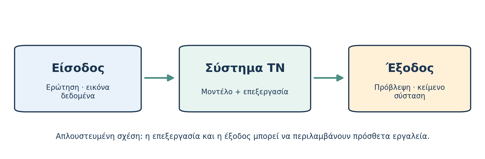

# AL00.1 — Τι είναι η Τεχνητή Νοημοσύνη;

*Μέρος Α — Κατανοώ την τεχνολογία*

*Εκτιμώμενος χρόνος: 12 λεπτά.*

**Πριν διαβάσεις — Πρόβλεψη.** Μια αριθμομηχανή εκτελεί πράξεις, μια εφαρμογή αναγνωρίζει πρόσωπα σε φωτογραφίες και μια τρίτη προτείνει βίντεο. Χρησιμοποιούν και οι τρεις απαραίτητα Τεχνητή Νοημοσύνη; Γράψε δύο προτάσεις για το τι πιστεύεις ότι ξεχωρίζει την ΤΝ από το απλό λογισμικό.

## Μια τεχνολογία που συναντάμε ήδη

Η καθημερινότητά μας περιλαμβάνει πολλές εφαρμογές που επεξεργάζονται πληροφορίες. Το κινητό μας αναγνωρίζει ομιλία, ένα ψηφιακό σύστημα μπορεί να προτείνει μια διαδρομή και μια εφαρμογή μπορεί να εντοπίζει αντικείμενα σε μια φωτογραφία. Αυτές οι λειτουργίες δεν στηρίζονται απαραίτητα στην ίδια μέθοδο. Κάποιες περιλαμβάνουν μοντέλα που εκπαιδεύονται από δεδομένα, άλλες συνδυάζουν κανόνες, μηχανές αναζήτησης ή μαθηματικές μεθόδους.

Ο όρος **Τεχνητή Νοημοσύνη (Artificial Intelligence, AI)** περιγράφει ένα ευρύ επιστημονικό και τεχνολογικό πεδίο. Με βάση τον επικαιροποιημένο ορισμό του OECD, ένα **σύστημα ΤΝ** είναι ένα υπολογιστικό σύστημα που, για ρητούς ή έμμεσους στόχους, συμπεραίνει από τις εισόδους του πώς να παράγει εξόδους όπως προβλέψεις, περιεχόμενο, συστάσεις ή αποφάσεις. Τα συστήματα διαφέρουν ως προς τον βαθμό αυτονομίας και τη δυνατότητα προσαρμογής τους μετά την ανάπτυξη [1].

Η διατύπωση αυτή περιγράφει **συστήματα**, όχι κάποιο υποχρεωτικό ισοδύναμο της ανθρώπινης σκέψης. Η ικανότητα ενός προγράμματος να παράγει μια πειστική εξήγηση δεν αποδεικνύει από μόνη της ότι έχει ανθρώπινες εμπειρίες, επίγνωση ή ότι όλα όσα αναφέρει είναι σωστά. Ταυτόχρονα δεν πρέπει να υποτιμούμε την πρακτική αξία των σύγχρονων συστημάτων: σε αρκετές εργασίες μπορούν να αναγνωρίζουν πολύπλοκα πρότυπα, να υποστηρίζουν αποφάσεις και να βοηθούν στη σύνθεση πληροφοριών.

*Σχήμα 1. Απλοποιημένη απεικόνιση εισόδου, υπολογιστικής επεξεργασίας και εξόδου. Ένα πραγματικό σύστημα μπορεί να συνδυάζει πολλά μοντέλα και εργαλεία.*

## Ένα παράδειγμα σχετικό με τις σπουδές

Φαντάσου ένα σύστημα που δέχεται φωτογραφία φύλλου και εκτιμά σε ποιο είδος φυτού ανήκει. Η **είσοδος** είναι η εικόνα, το σύστημα αξιοποιεί τα διαθέσιμα χαρακτηριστικά της και η **έξοδος** είναι μια εκτίμηση ταξινόμησης. Ένα άλλο σύστημα δέχεται μια γραπτή ερώτηση για τη φωτοσύνθεση και παράγει εξήγηση. Παρότι οι είσοδοι και οι έξοδοι διαφέρουν, και στις δύο περιπτώσεις πρέπει να ρωτάμε: από πού προκύπτει το αποτέλεσμα και πόσο αξιόπιστο είναι;

Μια αριθμομηχανή που εκτελεί τη σταθερή διαδικασία πολλαπλασιασμού δεν χαρακτηρίζεται αυτομάτως ΤΝ. Η υπολογιστική πολυπλοκότητα δεν αποτελεί επαρκές κριτήριο. Ούτε όμως είναι ορθό να ορίσουμε την ΤΝ αποκλειστικά ως προγράμματα που μαθαίνουν από δεδομένα: υπάρχουν και συμβολικές ή βασισμένες σε κανόνες προσεγγίσεις ΤΝ.

## Τι σημαίνει για τη μάθησή μας;

Η ΤΝ μπορεί να εξηγήσει μια έννοια, να προτείνει παράδειγμα ή να διατυπώσει μια ερώτηση. Δεν μπορεί όμως να πιστοποιήσει από μόνη της ότι **εσύ** απέκτησες τη δεξιότητα. Η κατανόηση φαίνεται όταν διατυπώνεις προσωπική εξήγηση, ελέγχεις πληροφορίες και αντιμετωπίζεις νέα προβλήματα. Αυτόν τον διαχωρισμό θα συναντούμε σε ολόκληρο το μάθημα.

**Μικρή δραστηριότητα.** Κατάγραψε δύο εφαρμογές που χρησιμοποιείς καθημερινά. Για καθεμία γράψε τι δέχεται ως είσοδο, τι επιστρέφει ως έξοδο και γιατί πιστεύεις ότι εμπλέκεται —ή όχι— ΤΝ. Δεν αρκεί να γράψεις «είναι έξυπνο».

**Έλεγχος κατανόησης.** (1) Ποια τέσσερα είδη εξόδων αναφέρει ο ορισμός του OECD; (2) Γιατί η αριθμομηχανή δεν είναι αυτομάτως σύστημα ΤΝ; (3) Ποια είναι η διαφορά ανάμεσα στο να λάβεις μια εξήγηση και στο να έχεις μάθει κάτι;

**Κράτησε:** Η ΤΝ είναι ευρύ πεδίο. Κάθε εφαρμογή πρέπει να αξιολογείται ως προς την πραγματική λειτουργία, την καταλληλότητα και τους περιορισμούς της.
