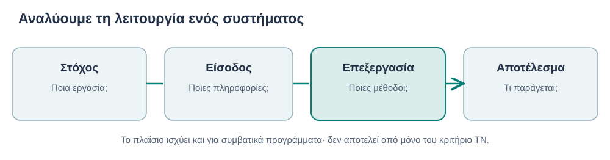
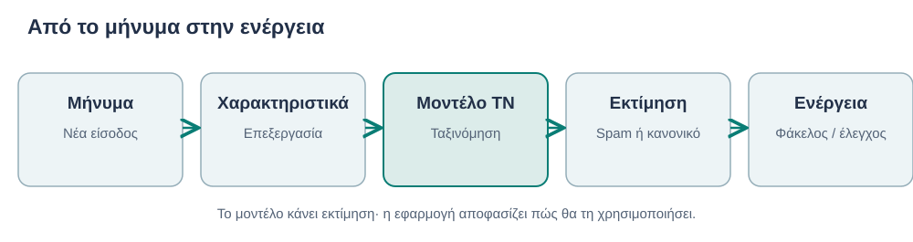
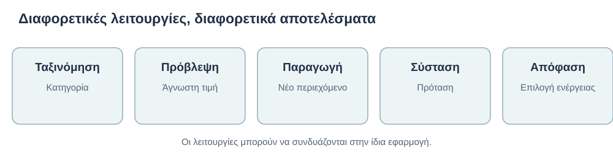
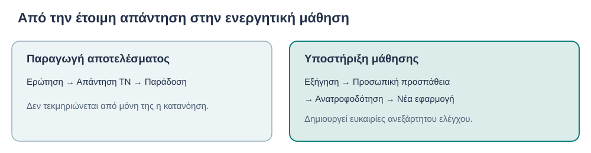

# AL00.1 — Τι είναι πραγματικά η Τεχνητή Νοημοσύνη;

> **Έκδοση:** v2.1 — αποκατάσταση αναλυτικής ανάπτυξης προς εκπαιδευτική αξιολόγηση\
> **Μέρος:** Α — Κατανοώ την τεχνολογία\
> **Κοινό:** Πρωτοετείς φοιτητές, χωρίς προαπαιτούμενες τεχνικές γνώσεις\
> **Κατάσταση:** Προεπισκόπηση περιεχομένου· όχι εγκεκριμένο προς δημοσίευση

> **Εκτιμώμενος χρόνος:** 55–70 λεπτά. Πρόκειται για προσωρινή σχεδιαστική εκτίμηση και όχι για εμπειρικά επιβεβαιωμένο χρόνο.

## Πριν ξεκινήσεις

Η Τεχνητή Νοημοσύνη (ΤΝ) εμφανίζεται σε εφαρμογές που χρησιμοποιούμε για επικοινωνία, μελέτη, αναζήτηση πληροφοριών και εργασία. Ωστόσο, δεν είναι κάθε αυτοματοποιημένο πρόγραμμα εφαρμογή ΤΝ, ούτε κάθε αποτέλεσμα ενός συστήματος ΤΝ είναι αυτομάτως σωστό.

Στο κεφάλαιο θα γνωρίσεις τις βασικές έννοιες μέσα από παραδείγματα και θα εξασκηθείς στην αξιολόγηση νέων εφαρμογών. Δεν χρειάζεται να γνωρίζεις προγραμματισμό ή προχωρημένα μαθηματικά.

### Μαθησιακοί στόχοι

Με την ολοκλήρωση του κεφαλαίου θα μπορείς:

1. Να εξηγείς με δικά σου λόγια τι είναι η ΤΝ και τι χαρακτηρίζει ένα σύστημα ΤΝ.
2. Να περιγράφεις στόχο, είσοδο, επεξεργασία και αποτέλεσμα μιας εφαρμογής.
3. Να αναγνωρίζεις ταξινόμηση, πρόβλεψη, παραγωγή περιεχομένου και συστάσεις.
4. Να διακρίνεις την ΤΝ από έναν απλό αυτοματισμό, χωρίς να ταυτίζεις την ΤΝ αποκλειστικά με τη Μηχανική Μάθηση.
5. Να εξηγείς γιατί τα αποτελέσματα της ΤΝ μπορεί να είναι ανακριβή ή ακατάλληλα.
6. Να προτείνεις τρόπους αξιοποίησης της ΤΝ για μάθηση που διατηρούν την προσωπική προσπάθεια.
7. Να αξιολογείς τεκμηριωμένα μια νέα εφαρμογή ως προς τη χρησιμότητα και τους περιορισμούς της.

---

## 1.1 Η Τεχνητή Νοημοσύνη στην καθημερινή και επιστημονική ζωή

### Τι κάνει μια εφαρμογή «έξυπνη»;

Συχνά αναγνωρίζουμε μια τεχνολογία ως «έξυπνη» από το αποτέλεσμά της: μια εφαρμογή καταλαβαίνει τι υπαγορεύουμε, μια πλατφόρμα προτείνει υλικό σχετικό με τα ενδιαφέροντά μας ή ένα chatbot συνθέτει μια απάντηση σε ελεύθερα διατυπωμένο ερώτημα. Αυτές οι δυνατότητες δημιουργούν την εντύπωση ότι ο υπολογιστής κάνει κάτι παρόμοιο με την ανθρώπινη σκέψη. Η εντύπωση, όμως, δεν είναι επιστημονικό κριτήριο.

Για να αξιολογήσουμε ένα σύστημα δεν αρκεί να εξετάσουμε την οθόνη του. Χρειάζεται να διακρίνουμε την *εργασία* που εκτελεί από τον *μηχανισμό* που χρησιμοποιεί. Δύο εφαρμογές μπορεί να εμφανίζουν παρόμοιο αποτέλεσμα, ενώ στο εσωτερικό τους αξιοποιούν πολύ διαφορετικές προσεγγίσεις. Αντίστροφα, η ίδια οικογένεια μοντέλων μπορεί να χρησιμοποιείται σε διαφορετικά προβλήματα.

Σκέψου ένα πανεπιστήμιο που οργανώνει τις ανακοινώσεις του. Μια εφαρμογή αποστέλλει αυτομάτως μια ειδοποίηση σε όσους δήλωσαν συγκεκριμένο μάθημα. Μια άλλη εξετάζει το ελεύθερο κείμενο ερωτήσεων φοιτητών και προτείνει την κατάλληλη υπηρεσία στην οποία θα απευθυνθούν. Η πρώτη εργασία μπορεί να βασίζεται σε προκαθορισμένη αντιστοίχιση εγγραφών. Η δεύτερη μπορεί να απαιτεί επεξεργασία διαφορετικών διατυπώσεων και εκτίμηση του θέματος μιας ερώτησης. Η δεύτερη *μπορεί* να αξιοποιεί ΤΝ, αλλά για να το επιβεβαιώσουμε χρειάζεται να γνωρίζουμε πώς έχει υλοποιηθεί.

Αυτό είναι το κεντρικό ερώτημα του πρώτου κεφαλαίου: **τι ακριβώς μας επιτρέπει να χαρακτηρίζουμε και να αξιολογούμε ένα σύστημα ως εφαρμογή Τεχνητής Νοημοσύνης;**

Η Τεχνητή Νοημοσύνη δεν αφορά μόνο ερευνητικά εργαστήρια. Συστήματα που χρησιμοποιούν μεθόδους ΤΝ μπορούν να αναγνωρίζουν ανεπιθύμητα μηνύματα, να μετατρέπουν ομιλία σε κείμενο, να προτείνουν περιεχόμενο και να παράγουν απαντήσεις σε ερωτήσεις φυσικής γλώσσας. Στον επαγγελματικό χώρο αξιοποιούνται επίσης στην επεξεργασία εικόνων, στην πρόβλεψη της ζήτησης, στην ανάλυση μεγάλων συνόλων δεδομένων και στην υποστήριξη αποφάσεων.

Οι εργασίες αυτές δεν είναι ίδιες. Μερικές προϋποθέτουν αναγνώριση προτύπων, άλλες εκτίμηση άγνωστων τιμών και άλλες παραγωγή περιεχομένου. Το κοινό τους χαρακτηριστικό δεν είναι ότι εκτελούνται γρήγορα ή αυτοματοποιημένα. Είναι ότι βασίζονται σε κατάλληλες υπολογιστικές προσεγγίσεις για τις συγκεκριμένες εργασίες.

Σκέψου τρεις εφαρμογές:

- **Υπολογιστικό φύλλο:** αθροίζει τις δαπάνες ενός έργου με καθορισμένους μαθηματικούς τύπους. Η λειτουργία δεν απαιτεί από μόνη της ΤΝ.
- **Φίλτρο ηλεκτρονικού ταχυδρομείου:** μπορεί να χρησιμοποιεί εκπαιδευμένο μοντέλο για να εκτιμά αν ένα νέο μήνυμα είναι ανεπιθύμητο. Πρόκειται για χαρακτηριστική εφαρμογή Μηχανικής Μάθησης.
- **Chatbot:** επεξεργάζεται ερώτηση φυσικής γλώσσας και παράγει σχετικό κείμενο. Πρόκειται για χαρακτηριστική χρήση σύγχρονης Παραγωγικής ΤΝ.

Στις τρεις περιπτώσεις χρησιμοποιούμε λογισμικό. Ωστόσο, η περιγραφή «ένα πρόγραμμα κάνει κάτι αυτόματα» δεν εξηγεί επαρκώς τι συμβαίνει στο εσωτερικό του.

**Στάση κατανόησης.** Ένα πανεπιστήμιο χρησιμοποιεί πρόγραμμα που δημιουργεί το ωρολόγιο πρόγραμμα μαθημάτων, λαμβάνοντας υπόψη αίθουσες και διαθεσιμότητες. Μπορούμε μόνο από αυτή την πληροφορία να συμπεράνουμε ότι χρησιμοποιείται ΤΝ;

:::{dropdown} Ενδεικτική απάντηση — διάβασε αφού προσπαθήσεις
Όχι με βεβαιότητα. Το πρόβλημα μπορεί να αντιμετωπίζεται με διάφορες τεχνικές, όπως αλγορίθμους βελτιστοποίησης, ικανοποίηση περιορισμών ή μεθόδους που εντάσσονται σε προσεγγίσεις ΤΝ. Η αυτόματη παραγωγή προγράμματος δεν αποτελεί από μόνη της απόδειξη χρήσης ΤΝ. Για να απαντήσουμε χρειάζεται να γνωρίζουμε τις μεθόδους του συστήματος.
:::

Αυτή η διάκριση μάς οδηγεί στον επιστημονικό ορισμό.

## 1.2 Τι ονομάζουμε Τεχνητή Νοημοσύνη;

### Από την καθημερινή περιγραφή στον επιστημονικό ορισμό

Μια επιστημονική έννοια πρέπει να μας επιτρέπει να περιγράφουμε με συνέπεια διαφορετικές περιπτώσεις. Αν ορίσουμε την ΤΝ ως «ό,τι κάνει ο υπολογιστής και φαίνεται εντυπωσιακό», ο ορισμός αλλάζει κάθε φορά που εξοικειωνόμαστε με μια καινούρια τεχνολογία. Αν την περιορίσουμε στα chatbots, αγνοούμε δεκαετίες έρευνας σε αναγνώριση, συλλογισμό και σχεδιασμό ενεργειών. Αν την ταυτίσουμε με κάθε αυτοματισμό, τότε ακόμη και ένας απλός χρονοδιακόπτης θα θεωρείται ΤΝ.

Χρειαζόμαστε επομένως έναν ορισμό αρκετά ευρύ ώστε να καλύπτει τις διαφορετικές προσεγγίσεις, αλλά και αρκετά συγκεκριμένο ώστε να στηρίζει τη συζήτησή μας. Χρειάζεται επίσης να διακρίνουμε δύο διαφορετικά πράγματα: την **Τεχνητή Νοημοσύνη ως επιστημονικό πεδίο** και ένα **σύστημα ΤΝ ως συγκεκριμένη τεχνολογική εφαρμογή**. Το πεδίο περιλαμβάνει θεωρίες και μεθόδους· το σύστημα είναι μια υλοποίηση με ορισμένους στόχους και λειτουργίες.

Η **Τεχνητή Νοημοσύνη (Artificial Intelligence — AI)** είναι ένα ευρύ επιστημονικό και τεχνολογικό πεδίο που ασχολείται με την ανάπτυξη υπολογιστικών συστημάτων για εργασίες όπως η αναγνώριση προτύπων, ο συλλογισμός, η πρόβλεψη και η παραγωγή περιεχομένου.

Δεν αποτελεί έναν μόνο αλγόριθμο. Περιλαμβάνει προσεγγίσεις που αξιοποιούν δεδομένα για την ανάπτυξη μοντέλων και άλλες που χρησιμοποιούν οργανωμένη γνώση και μηχανισμούς συλλογισμού.

Ο επικαιροποιημένος ορισμός του **OECD** περιγράφει ένα *σύστημα ΤΝ* ως υπολογιστικό σύστημα που, για ρητούς ή έμμεσους στόχους, συμπεραίνει από τις εισόδους που λαμβάνει πώς να παράγει αποτελέσματα — όπως προβλέψεις, περιεχόμενο, συστάσεις ή αποφάσεις — τα οποία μπορούν να επηρεάσουν φυσικά ή εικονικά περιβάλλοντα. Τα συστήματα διαφέρουν ως προς την αυτονομία και τη δυνατότητα προσαρμογής τους μετά την ανάπτυξη [1].

Για να μελετήσουμε μια συγκεκριμένη εφαρμογή, είναι χρήσιμο να απαντούμε σε τέσσερα ερωτήματα:

| Στοιχείο | Ερώτημα |
|---|---|
| **Στόχος** | Ποιο συγκεκριμένο πρόβλημα αντιμετωπίζει; |
| **Είσοδος** | Ποιες πληροφορίες χρησιμοποιεί; |
| **Επεξεργασία** | Ποιες υπολογιστικές μεθόδους αξιοποιεί; |
| **Αποτέλεσμα** | Τι παράγει και πώς χρησιμοποιείται; |

Το σχήμα αυτό είναι αναλυτικό εργαλείο, όχι αποκλειστικό γνώρισμα της ΤΝ: είσοδο, επεξεργασία και αποτέλεσμα διαθέτει και μια αριθμομηχανή.

**Μια σημαντική διευκρίνιση:** Το ότι ένα σύστημα ταξινομεί εικόνες ή παράγει γλωσσικά συνεκτικό κείμενο δεν αποδεικνύει ότι αντιλαμβάνεται τον κόσμο με ανθρώπινο τρόπο. Εξετάζουμε τις παρατηρήσιμες δυνατότητές του και τις συνθήκες στις οποίες λειτουργεί, χωρίς να του αποδίδουμε αυτομάτως ανθρώπινες ιδιότητες.

*Σχήμα 1. Το σχήμα μάς βοηθά να αναλύουμε τη λειτουργία μιας εφαρμογής. Δεν αποτελεί μόνο του κριτήριο για το αν υπάρχει ΤΝ.*

Στη συνέχεια θα εφαρμόσουμε το πλαίσιο σε ένα συγκεκριμένο και οικείο πρόβλημα.

## 1.3 Πώς λειτουργεί ένα σύστημα ΤΝ στην πράξη;

### Η διαφορά ανάμεσα στο να γνωρίζουμε το αποτέλεσμα και στο να κατανοούμε τη διαδικασία

Όταν ένα μήνυμα εμφανίζεται αυτόματα στον φάκελο ανεπιθύμητων, συνήθως δεν μας ενδιαφέρει τι συνέβη στα ενδιάμεσα βήματα. Από την πλευρά του χρήστη, η υπηρεσία απλώς «ξεχώρισε» το μήνυμα. Αν όμως θέλουμε να καταλάβουμε την ΤΝ, πρέπει να ανοίξουμε αυτό το αδιαφανές βήμα σε μικρότερα, κατανοητά στάδια.

Θα εξετάσουμε έναν συγκεκριμένο τύπο εφαρμογής: ένα φίλτρο που χρησιμοποιεί μοντέλο Μηχανικής Μάθησης. Δεν υποθέτουμε ότι *όλες* οι υπηρεσίες ηλεκτρονικού ταχυδρομείου λειτουργούν με ακριβώς τον ίδιο τρόπο. Στις πραγματικές υποδομές μπορεί να υπάρχουν πολλαπλά μοντέλα, κανόνες ασφαλείας και έλεγχοι αποστολέων. Το παράδειγμα είναι χρήσιμο επειδή μας επιτρέπει να ξεχωρίσουμε καθαρά το **νέο δεδομένο**, το **μοντέλο**, την **εκτίμηση** και την **τελική ενέργεια**.

### Το παράδειγμα των ανεπιθύμητων μηνυμάτων

Οι υπηρεσίες ηλεκτρονικού ταχυδρομείου προσπαθούν να διακρίνουν τα κανονικά μηνύματα από τα ανεπιθύμητα (*spam*). Μπορούν να χρησιμοποιούν λίστες αποστολέων, προκαθορισμένους κανόνες και μοντέλα Μηχανικής Μάθησης.

Έστω δύο υποθετικά μηνύματα:

> **Μήνυμα Α — Ενημέρωση εξεταστικής:** «Το αναθεωρημένο πρόγραμμα εξετάσεων έχει αναρτηθεί στην ιστοσελίδα του Τμήματος.»
>
> **Μήνυμα Β — Χρηματικό έπαθλο:** «Συγχαρητήρια! Κερδίσατε μεγάλο χρηματικό έπαθλο. Ακολουθήστε τον σύνδεσμο για να το παραλάβετε.»

Το πρώτο μοιάζει με κανονική ενημέρωση και το δεύτερο με ανεπιθύμητο ή παραπλανητικό μήνυμα. Όμως η αξιολόγηση δεν πρέπει να βασίζεται σε μία λέξη. Νόμιμα μηνύματα μπορεί να περιέχουν προσφορές, ενώ παραπλανητικά μηνύματα μπορεί να έχουν προσεγμένη επαγγελματική διατύπωση.

### Ο ρόλος του μοντέλου

Ας ξεχωρίσουμε πρώτα δύο χρονικές στιγμές. **Πριν από τη χρήση**, κατά την ανάπτυξη, επιλέγεται ο τρόπος με τον οποίο ένα μοντέλο θα επεξεργάζεται μηνύματα και αξιοποιούνται κατάλληλα δεδομένα για την προσαρμογή των παραμέτρων του. **Κατά τη χρήση**, ένα νέο μήνυμα περνά από το ήδη προετοιμασμένο μοντέλο και παράγεται μια εκτίμηση. Η ταξινόμηση ενός νέου μηνύματος δεν σημαίνει ότι το μοντέλο επανεκπαιδεύεται κάθε φορά.

Η διάκριση αυτή μάς προφυλάσσει από μια συνηθισμένη παρανόηση: όταν λέμε ότι ένα σύστημα «μαθαίνει από παραδείγματα», δεν εννοούμε ότι αποθηκεύει όλες τις προηγούμενες περιπτώσεις και αναζητά απλώς ένα πανομοιότυπο μήνυμα. Το ζητούμενο είναι να αναγνωρίζει χρήσιμα μοτίβα που μπορούν να εφαρμοστούν και σε μηνύματα που δεν είχαν παρουσιαστεί αυτούσια κατά την ανάπτυξή του. Στην AL00.3 θα εξετάσουμε πώς ελέγχουμε αν αυτή η γενίκευση επιτυγχάνεται στην πράξη.

Ας υποθέσουμε ότι χρησιμοποιείται ένα **εκπαιδευμένο μοντέλο**. Κατά την ανάπτυξή του, έχουν χρησιμοποιηθεί κατάλληλα παραδείγματα ώστε να προσαρμοστούν οι παράμετροί του και να αναγνωρίζει σχέσεις χρήσιμες για την ταξινόμηση μηνυμάτων.

Όταν λαμβάνει ένα νέο μήνυμα, το μοντέλο εξετάζει διαθέσιμα χαρακτηριστικά και παράγει εκτίμηση της κατηγορίας του. Δεν χρειάζεται να έχει συναντήσει αυτούσιο το συγκεκριμένο μήνυμα κατά την εκπαίδευση. Η ικανότητα εφαρμογής σε νέα δεδομένα ονομάζεται **γενίκευση**. Η γενίκευση, ωστόσο, έχει όρια και εξαρτάται από τις συνθήκες χρήσης και τα δεδομένα.

### Από το μήνυμα στην ενέργεια

*Σχήμα 2. Το μοντέλο παράγει εκτίμηση, ενώ η εφαρμογή καθορίζει την ενέργεια. Απλοποιημένη απεικόνιση για εκπαιδευτικούς σκοπούς.*

Η διάκριση ανάμεσα στο **μοντέλο** και στην **εφαρμογή** είναι ουσιαστική. Το μοντέλο παράγει εκτίμηση. Η ευρύτερη εφαρμογή αποφασίζει πώς θα χρησιμοποιήσει αυτή την εκτίμηση, ενδεχομένως μαζί με άλλους κανόνες και ελέγχους.

Ένα μοντέλο μπορεί να επιστρέφει βαθμολογία, π.χ. `0,92` για την κατηγορία «spam». Η τιμή δεν ισοδυναμεί αυτομάτως με επιβεβαιωμένη πιθανότητα 92%· η ερμηνεία εξαρτάται από τον σχεδιασμό και τη βαθμονόμηση του μοντέλου.

### Τι συμβαίνει όταν το σύστημα κάνει λάθος;

Αν ένα σημαντικό μήνυμα της Γραμματείας σταλεί στα ανεπιθύμητα, ο φοιτητής ενδέχεται να χάσει μια κρίσιμη ενημέρωση. Αν αντίθετα ένα ανεπιθύμητο μήνυμα εμφανιστεί στα εισερχόμενα, μπορεί να προκαλέσει απλή ενόχληση ή, εφόσον είναι κακόβουλο, σοβαρό κίνδυνο.

Και οι δύο περιπτώσεις είναι σφάλματα. Δεν έχουν όμως απαραίτητα το ίδιο κόστος. Γι' αυτό δεν αρκεί να αξιολογούμε ένα μοντέλο μόνο με το συνολικό ποσοστό σωστών ταξινομήσεων.

**Καθοδηγούμενη δραστηριότητα.** Από 100 μηνύματα τα 80 είναι κανονικά και τα 20 ανεπιθύμητα. Το σύστημα χαρακτηρίζει λανθασμένα 5 κανονικά ως ανεπιθύμητα και αφήνει 3 ανεπιθύμητα στα εισερχόμενα. Πόσα ταξινομεί σωστά; Αρκεί αυτός ο αριθμός για την πλήρη αξιολόγηση;

:::{dropdown} Ενδεικτική λύση
Τα λάθη είναι `5 + 3 = 8`, άρα οι σωστές ταξινομήσεις είναι `100 − 8 = 92`. Η συνολική επίδοση στο συγκεκριμένο παράδειγμα είναι 92%. Δεν αρκεί όμως ο αριθμός: πρέπει να εξετάσουμε χωριστά τα είδη των σφαλμάτων και τις συνέπειές τους. Δεν μπορούμε επίσης να γενικεύσουμε αυτόματα την επίδοση σε άλλα σύνολα μηνυμάτων.
:::

Η συστηματική εκπαίδευση και αξιολόγηση μοντέλων θα αναπτυχθεί στην AL00.3. Εδώ μας ενδιαφέρει η σχέση ανάμεσα στο πρόβλημα, στο μοντέλο, στην εφαρμογή και στις πραγματικές συνέπειες.

## 1.4 Ποιες εργασίες μπορεί να υποστηρίξει η ΤΝ;

### Ίδιος τεχνολογικός όρος, διαφορετικός μαθησιακός στόχος

Η λέξη «ΤΝ» δεν αποκαλύπτει από μόνη της τι ζητούμε από ένα σύστημα. Άλλοτε ενδιαφερόμαστε να αναγνωριστεί μια κατηγορία, άλλοτε να εκτιμηθεί μια ποσότητα και άλλοτε να παραχθεί νέο περιεχόμενο. Το να τα ξεχωρίζουμε είναι σημαντικό, επειδή αλλάζει τόσο η μορφή του αποτελέσματος όσο και ο τρόπος με τον οποίο θα κρίνουμε αν το σύστημα ήταν χρήσιμο.

Για παράδειγμα, σε μια πανεπιστημιακή βιβλιοθήκη υπάρχουν τουλάχιστον τρεις διαφορετικές πιθανές εργασίες. Το σύστημα μπορεί να **ταξινομεί** νέα άρθρα σε θεματικές κατηγορίες, να **προτείνει** σχετικούς τίτλους στον χρήστη ή να **παράγει** μια σύντομη περιγραφή του περιεχομένου. Πρόκειται για διαφορετικές λειτουργίες, ακόμη κι αν παρέχονται όλες μέσα από την ίδια ιστοσελίδα. Δεν είναι σωστό να τις αντιμετωπίζουμε ως συνώνυμες, ούτε να θεωρούμε ότι υλοποιούνται υποχρεωτικά με το ίδιο μοντέλο.

Το φίλτρο spam αποτελεί παράδειγμα **ταξινόμησης**. Άλλες εφαρμογές επιδιώκουν διαφορετικά αποτελέσματα.

### Αναγνώριση και ταξινόμηση

Μια ψηφιακή βιβλιοθήκη μπορεί να χρησιμοποιεί μοντέλο για να κατατάσσει επιστημονικά άρθρα ανά θεματική περιοχή. Ένα άρθρο μπορεί να σχετίζεται ταυτόχρονα με την Ιατρική και την Πληροφορική. Η ταξινόμηση εξαρτάται από το πώς έχουν οριστεί οι κατηγορίες και από τη λειτουργία του συστήματος.

### Πρόβλεψη

Έχει σημασία να καταλάβουμε τι ακριβώς σημαίνει «προβλέπω». Στην καθημερινή γλώσσα το ρήμα συνδέεται κυρίως με το μέλλον. Στις υπολογιστικές εφαρμογές μπορεί επίσης να αναφέρεται στην εκτίμηση μιας άγνωστης τιμής στο παρόν. Για παράδειγμα, ένα μοντέλο μπορεί να εκτιμά την εμπορική αξία ενός ακινήτου βάσει χαρακτηριστικών του ή τη ζήτηση ηλεκτρικής ενέργειας της επόμενης ημέρας. Στην πρώτη περίπτωση εκτιμούμε μια άγνωστη ποσότητα, στη δεύτερη μια μελλοντική ποσότητα.

Και στις δύο περιπτώσεις πρέπει να διακρίνουμε την εκτίμηση από την παρατήρηση. Μια πρόβλεψη μπορεί να αποκλίνει από την τιμή που θα διαπιστωθεί αργότερα. Η διαφορά δεν αρκεί από μόνη της για να κρίνουμε ολόκληρο το σύστημα, αλλά αποτελεί πληροφορία για την αξιολόγησή του.

Μια εταιρεία ενέργειας μπορεί να αξιοποιεί ιστορικά δεδομένα για να εκτιμά την αυριανή ζήτηση ηλεκτρικής ενέργειας. Η πρόβλεψη είναι εκτίμηση, όχι εγγύηση. Δεν αφορά πάντοτε το μέλλον: ένα μοντέλο μπορεί να εκτιμά και μια άγνωστη τιμή στο παρόν, όπως την αξία ενός ακινήτου.

### Παραγωγή περιεχομένου

Η παραγωγή κειμένου δεν είναι το ίδιο με την αναζήτηση ενός αποθηκευμένου κειμένου. Αν μια εφαρμογή επιστρέψει την επίσημη ανακοίνωση ενός μαθήματος, ανακτά υπάρχουσα πληροφορία. Αν συνθέσει μια νέα εξήγηση για το περιεχόμενο της ανακοίνωσης, πραγματοποιεί και μια εργασία παραγωγής κειμένου. Σε πραγματικά προϊόντα οι δύο δυνατότητες μπορεί να συνδυάζονται: πρώτα γίνεται αναζήτηση σε έγγραφα και μετά παράγεται απάντηση.

Αυτός ο συνδυασμός είναι χρήσιμος, αλλά δημιουργεί και μια υποχρέωση: η παραγόμενη εξήγηση πρέπει να αποδίδει πιστά τις πληροφορίες των εγγράφων. Δεν αρκεί η απάντηση να είναι εύληπτη ή καλογραμμένη. Η διάκριση αυτή θα μας απασχολήσει ιδιαίτερα όταν μελετήσουμε τα γλωσσικά μοντέλα και τον έλεγχο πηγών.

Ένα σύστημα Παραγωγικής ΤΝ μπορεί να δημιουργεί κείμενο, εικόνα, ήχο ή κώδικα. Ένα chatbot, για παράδειγμα, συνθέτει μια εξήγηση ανάλογα με το αίτημα του χρήστη. Αυτό δεν είναι το ίδιο με την απλή εμφάνιση μιας ήδη αποθηκευμένης απάντησης, παρότι πραγματικές εφαρμογές μπορούν να συνδυάζουν αναζήτηση και παραγωγή. Η ποιότητα της διατύπωσης δεν εγγυάται την ακρίβεια.

### Συστάσεις

Μια πανεπιστημιακή βιβλιοθήκη μπορεί να προτείνει δημοσιεύσεις συναφείς με μια αναζήτηση. Η σύσταση είναι πρόταση προς αξιολόγηση και όχι απαραίτητα η μοναδική ή η καλύτερη επιλογή.

### Υποστήριξη αποφάσεων

Ένας οργανισμός μπορεί να προβλέπει αυξημένη ζήτηση εξυπηρέτησης και να χρησιμοποιεί την εκτίμηση για να οργανώσει το προσωπικό του. Η πρόβλεψη μπορεί να τροφοδοτεί σύσταση, ενώ η τελική ενέργεια μπορεί να λαμβάνεται από άνθρωπο ή από κατάλληλα σχεδιασμένο αυτοματοποιημένο μηχανισμό.

| Δυνατότητα | Βασικό ερώτημα | Παράδειγμα |
|---|---|---|
| Ταξινόμηση | Σε ποια κατηγορία ανήκει; | Κατηγοριοποίηση άρθρων |
| Πρόβλεψη | Ποια τιμή ή κατάσταση εκτιμούμε; | Ζήτηση ηλεκτρικής ενέργειας |
| Παραγωγή | Τι νέο περιεχόμενο δημιουργείται; | Εξήγηση επιστημονικής έννοιας |
| Σύσταση | Ποια επιλογή μπορεί να είναι χρήσιμη; | Πρόταση δημοσιεύσεων |
| Υποστήριξη απόφασης | Πώς αξιοποιείται το αποτέλεσμα; | Κατανομή προσωπικού |

Οι δυνατότητες αυτές **δεν αποτελούν αυστηρά αμοιβαία αποκλειόμενες κατηγορίες συστημάτων**. Μια εφαρμογή μπορεί να ταξινομεί ένα αίτημα, να προτείνει ενέργεια και να δημιουργεί απαντητικό κείμενο.

*Σχήμα 3. Μία εφαρμογή μπορεί να συνδυάζει περισσότερες από μία λειτουργίες.*

**Στάση κατανόησης.** Σύστημα πανεπιστημιακής υποστήριξης αναλύει ελεύθερα διατυπωμένα αιτήματα και τα προωθεί στην αρμόδια υπηρεσία. Ποιες επιμέρους λειτουργίες αναγνωρίζεις;

:::{dropdown} Ενδεικτική απάντηση
Μπορεί να χρησιμοποιεί **ταξινόμηση** για να εκτιμήσει την κατηγορία του αιτήματος. Η προώθηση μπορεί να γίνεται με προκαθορισμένο κανόνα. Η ενιαία εφαρμογή επομένως μπορεί να συνδυάζει λειτουργία ΤΝ και απλό αυτοματισμό.
:::

## 1.5 ΤΝ, αλγόριθμοι και αυτοματισμοί

### Γιατί οι όροι συγχέονται εύκολα;

Ο όρος «αυτοματισμός» περιγράφει ότι μια εργασία εκτελείται χωρίς συνεχή ανθρώπινη παρέμβαση. Ο «αλγόριθμος» περιγράφει μια οργανωμένη υπολογιστική διαδικασία. Η «ΤΝ» αναφέρεται σε ένα ευρύτερο ερευνητικό και τεχνολογικό πεδίο, στο οποίο περιλαμβάνονται διαφορετικές μέθοδοι. Οι τρεις έννοιες, επομένως, δεν βρίσκονται στο ίδιο επίπεδο περιγραφής.

Αυτό εξηγεί γιατί ένα σύστημα μπορεί να είναι ταυτόχρονα αυτοματοποιημένο και βασισμένο σε ΤΝ, χωρίς κάθε αυτοματοποιημένο σύστημα να χρησιμοποιεί ΤΝ. Εξηγεί επίσης γιατί η παρουσία αλγορίθμου δεν αρκεί για να αποφασίσουμε: όλοι οι υπολογιστικοί μηχανισμοί υλοποιούνται μέσα από διαδικασίες, αλλά δεν υπηρετούν όλοι τις ίδιες λειτουργίες ή μεθόδους.

Ένας **αλγόριθμος** είναι σαφώς περιγραμμένη διαδικασία βημάτων για την εκτέλεση μιας εργασίας ή την επίλυση προβλήματος. Χρησιμοποιούνται αλγόριθμοι τόσο σε συμβατικά προγράμματα όσο και σε συστήματα ΤΝ. Δεν ισχύει ότι τα πρώτα «έχουν αλγορίθμους» ενώ η δεύτερη «σκέφτεται χωρίς αλγορίθμους».

Ο **αυτοματισμός** περιγράφει την εκτέλεση μιας διαδικασίας χωρίς συνεχή ανθρώπινη παρέμβαση. Ένας θερμοστάτης που ενεργοποιεί τη θέρμανση όταν η θερμοκρασία πέσει κάτω από καθορισμένο όριο είναι απλός αυτοματισμός. Η λειτουργία αυτή δεν απαιτεί ΤΝ.

### Κανόνες και εκπαιδευμένα μοντέλα

Στο πρόβλημα spam μπορούμε να χρησιμοποιήσουμε έναν σαφή κανόνα:

> «Αν ο αποστολέας βρίσκεται στη λίστα αποκλεισμού, μετακίνησε το μήνυμα στα ανεπιθύμητα».

Μπορούμε όμως να χρησιμοποιήσουμε και εκπαιδευμένο μοντέλο, που αξιοποιεί πρότυπα σε πολλά χαρακτηριστικά ενός μηνύματος. Και οι δύο προσεγγίσεις έχουν πλεονεκτήματα και περιορισμούς. Σε περιορισμένο και καλά ορισμένο πρόβλημα οι απλοί κανόνες μπορεί να είναι επαρκείς. Σε συνθετότερες περιπτώσεις ένα μοντέλο μπορεί να προσφέρει δυνατότητες που είναι δύσκολο να περιγραφούν με μικρό αριθμό χειροκίνητων κανόνων.

### Γιατί η ΤΝ δεν ισούται με τη Μηχανική Μάθηση

Θα ήταν ανακριβές να θεωρήσουμε ότι κάθε σύστημα με κανόνες βρίσκεται εκτός ΤΝ. Υπάρχουν **συμβολικές προσεγγίσεις**, στις οποίες οργανώνεται γνώση και χρησιμοποιούνται μηχανισμοί λογικού συμπερασμού. Τα παραδοσιακά **έμπειρα συστήματα** αποτελούν σχετικό παράδειγμα.

Η χρήση κανόνων λοιπόν δεν αποκλείει από μόνη της την ΤΝ. Ταυτόχρονα, ένα πρόγραμμα με πολλούς κανόνες δεν χαρακτηρίζεται αυτομάτως ΤΝ. Πρέπει να εξετάζουμε τη λειτουργία και την υπολογιστική προσέγγιση του συγκεκριμένου συστήματος.

### Επιλέγουμε τεχνολογία με βάση το πρόβλημα

Μια επιχείρηση θέλει να αποστέλλει υπενθύμιση δύο ημέρες πριν από ένα ραντεβού. Ένας απλός μηχανισμός ημερομηνιών μπορεί να επαρκεί. Δεν υπάρχει προφανής λόγος να χρησιμοποιηθεί εκπαιδευμένο μοντέλο μόνο για αυτή την ενέργεια.

Αν όμως η επιχείρηση θέλει να προβλέπει πιθανές ακυρώσεις και να οργανώνει διαφορετικά τις διαθέσιμες ώρες, μπορεί να εξετάσει πρόσθετες αναλυτικές τεχνικές — μεταξύ αυτών και Μηχανική Μάθηση — εφόσον το όφελος δικαιολογεί το κόστος και την πολυπλοκότητα.

**Εφαρμογή.** Πανεπιστήμιο θέλει (Α) υπενθυμίσεις προθεσμιών, (Β) ταξινόμηση ελεύθερων ερωτήσεων προς Γραμματεία, (Γ) συστάσεις εκπαιδευτικού υλικού. Πού αρκεί απλός αυτοματισμός και πού θα μπορούσε να είναι χρήσιμη η ΤΝ;

:::{dropdown} Ενδεικτική ανάλυση
**Α:** Μπορεί να πραγματοποιηθεί με απλό αυτοματισμό βάσει ημερομηνίας. **Β:** Η ταξινόμηση φυσικής γλώσσας μπορεί να αξιοποιεί ΤΝ, αν και ένα περιορισμένο πρόβλημα ίσως καλύπτεται με απλούστερο τρόπο. **Γ:** Τα συστήματα συστάσεων μπορούν να αξιοποιούν ΤΝ, αλλά η επιλογή της λύσης πρέπει να λαμβάνει υπόψη τις ανάγκες και τα διαθέσιμα δεδομένα. Η σωστή απάντηση αιτιολογεί την καταλληλότητα· δεν επιβάλλει ΤΝ σε κάθε λειτουργία.
:::

---

## 1.6 Αξιοπιστία και περιορισμοί της ΤΝ

### Αξιόπιστο για ποια εργασία και σε ποιες συνθήκες;

Ένα σύστημα δεν μπορεί να χαρακτηριστεί γενικά «αξιόπιστο» χωρίς να γνωρίζουμε το πρόβλημα για το οποίο σχεδιάστηκε και τις συνθήκες στις οποίες ελέγχθηκε. Για παράδειγμα, ένα μοντέλο αναγνώρισης ομιλίας μπορεί να αποδίδει ικανοποιητικά σε καθαρές ηχογραφήσεις και να παρουσιάζει προβλήματα σε αίθουσα με έντονο θόρυβο. Η επιτυχία στο πρώτο περιβάλλον δεν αποτελεί αυτόματα τεκμήριο επιτυχίας στο δεύτερο.

Εξίσου σημαντική είναι η συνέπεια των λαθών. Ένα σφάλμα σε μια σύσταση μουσικής μπορεί απλώς να μην ικανοποιεί τον χρήστη. Ένα λάθος στην προτεραιοποίηση επείγοντος αιτήματος μπορεί να επηρεάσει ουσιαστικά την εξυπηρέτηση ενός πολίτη. Γι' αυτό η αξιολόγηση δεν αφορά μόνο μια συνολική αριθμητική επίδοση: περιλαμβάνει και το ερώτημα αν η συγκεκριμένη επίδοση είναι επαρκής για τον σκοπό χρήσης.

Η υψηλή επίδοση ενός συστήματος δεν σημαίνει απουσία σφαλμάτων. Αν ένα μοντέλο ταξινομεί σωστά το 95% των αιτημάτων μιας δημόσιας υπηρεσίας, χρειάζεται ακόμη να γνωρίζουμε ποια αιτήματα ταξινομούνται λανθασμένα. Εάν τα λάθη αφορούν δυσανάλογα επείγουσες περιπτώσεις, οι συνέπειες μπορεί να είναι σοβαρές.

### Τρεις πηγές προβλημάτων

Οι αιτίες μπορεί να βρίσκονται στα δεδομένα, στη μεταβολή του περιβάλλοντος ή ακόμη και στο ίδιο το ερώτημα που επιχειρούμε να απαντήσουμε.

**Ακατάλληλη αντιπροσώπευση.** Ένα σύστημα μπορεί να λειτουργεί καλά με έναν τύπο εισόδων και λιγότερο καλά με άλλον. Αν το περιβάλλον χρήσης περιλαμβάνει συνθήκες που δεν εκπροσωπούνται επαρκώς στα δεδομένα ανάπτυξης και ελέγχου, χρειάζεται πρόσθετη αξιολόγηση.

**Μεταβολή συνθηκών.** Οι πρακτικές αποστολής ανεπιθύμητων μηνυμάτων αλλάζουν συνεχώς. Δεν είναι ορθό να θεωρούμε ότι ένα σύστημα θα διατηρεί επ' αόριστον την ίδια επίδοση χωρίς παρακολούθηση.

**Ακατάλληλο υποκατάστατο μέτρησης.** Η συχνότητα σύνδεσης ενός φοιτητή στην ηλεκτρονική πλατφόρμα δεν μετρά άμεσα τη μαθησιακή κατανόηση. Αν τη χρησιμοποιήσουμε ως μοναδικό στοιχείο για σημαντικές εκπαιδευτικές αποφάσεις, ενδέχεται να συγχέουμε μια εύκολα καταγράψιμη συμπεριφορά με μια πολύπλοκη ανθρώπινη ικανότητα.

1. **Περιορισμοί δεδομένων.** Ένα μοντέλο αναγνώρισης ομιλίας μπορεί να λειτουργεί καλά με καθαρή ηχογράφηση και να δυσκολεύεται σε έντονο θόρυβο ή σε υποεκπροσωπούμενους τρόπους ομιλίας.
2. **Αλλαγή συνθηκών.** Νέες μορφές spam μπορεί να διαφέρουν από τα παραδείγματα στα οποία είχε βασιστεί ένα φίλτρο.
3. **Ακατάλληλος ορισμός προβλήματος.** Η συχνότητα σύνδεσης ενός φοιτητή στην ψηφιακή πλατφόρμα δεν αποτυπώνει υποχρεωτικά τη συνολική προσπάθεια ή την κατανόησή του. Ένα μοντέλο μπορεί να επεξεργάζεται σωστά αυτά τα δεδομένα αλλά να μην δικαιολογεί το συμπέρασμα που κάποιος θέλει να εξαγάγει.

### Πειστικό κείμενο και πραγματολογική ακρίβεια

Τα συστήματα Παραγωγικής ΤΝ μπορούν να συνθέτουν συνεκτικά κείμενα που περιλαμβάνουν ανακρίβειες. Ένα chatbot μπορεί να δημιουργήσει ανύπαρκτη βιβλιογραφική αναφορά με αληθοφανή τίτλο, συγγραφείς και έτος. Ο όρος *hallucination* («παραίσθηση») χρησιμοποιείται μεταφορικά για τέτοιες περιπτώσεις επινοημένου ή αβάσιμου περιεχομένου· δεν σημαίνει ανθρώπινη ψυχολογική εμπειρία.

Υπάρχουν δύο διαφορετικοί έλεγχοι: **υπάρχει πράγματι η πηγή;** και **υποστηρίζει πράγματι αυτό που της αποδίδεται;** Μια αληθινή δημοσίευση μπορεί να παρουσιάζεται με υπερβολικό ή εσφαλμένο συμπέρασμα.

Η απαιτούμενη ένταση ελέγχου εξαρτάται από τη χρήση. Μια δημιουργική ιδέα τίτλου μπορεί να κριθεί σχετικά εύκολα· ένας ισχυρισμός που θα επηρεάσει επιστημονική, διοικητική ή υγειονομική απόφαση απαιτεί ισχυρότερη τεκμηρίωση. Η συστηματική επαλήθευση θα αναπτυχθεί στις AL00.6–AL00.7.

**Στάση κατανόησης.** Ένα chatbot ισχυρίζεται ότι τρεις μελέτες «αποδεικνύουν πως η ΤΝ βελτιώνει πάντοτε την επίδοση όλων των φοιτητών». Τι θα έλεγες;

:::{dropdown} Ενδεικτική απάντηση
Πρώτα πρέπει να εξακριβώσουμε ότι οι μελέτες υπάρχουν και ότι τα βιβλιογραφικά τους στοιχεία είναι σωστά. Έπειτα πρέπει να ελέγξουμε τι πραγματικά εξέτασαν, με ποιον πληθυσμό και υπό ποιες συνθήκες. Η διατύπωση «πάντοτε» και «όλων» είναι πολύ ισχυρή και δεν τεκμηριώνεται μόνο με την αναφορά μεμονωμένων μελετών.
:::

## 1.7 Η ΤΝ στην πανεπιστημιακή μάθηση

### Η ολοκλήρωση της εργασίας δεν είναι ίδια με την ανάπτυξη ικανότητας

Στο πανεπιστήμιο μια άσκηση δεν σχεδιάζεται πάντα μόνο για να παραδοθεί ένα σωστό αποτέλεσμα. Μπορεί να αποσκοπεί στο να μάθει ο φοιτητής να συγκρίνει επιχειρήματα, να ελέγχει δεδομένα, να κατασκευάζει συλλογισμό ή να εξηγεί με σαφήνεια μια έννοια. Αν ένα εργαλείο αναλάβει εξ ολοκλήρου αυτές τις δραστηριότητες, ενδέχεται να ολοκληρωθεί το παραδοτέο χωρίς να έχουμε επαρκείς ενδείξεις ότι αναπτύχθηκε η επιδιωκόμενη ικανότητα.

Ας πάρουμε μια εργασία Στατιστικής για τη διαφορά συσχέτισης και αιτιότητας. Ο φοιτητής μπορεί να παραδώσει ένα κείμενο που δημιουργήθηκε από chatbot, χωρίς να είναι σαφές αν μπορεί να εξηγήσει τη διαφορά σε νέο παράδειγμα. Μπορεί όμως και να ζητήσει καθοδήγηση, να επιχειρήσει δική του λύση και να ζητήσει επισημάνσεις πάνω στη συλλογιστική του. Η δεύτερη πορεία προσφέρει περισσότερες ευκαιρίες ενεργητικής εξάσκησης. Δεν αποδεικνύει αυτομάτως μάθηση· αυτή χρειάζεται να διαπιστωθεί με κατάλληλη ανεξάρτητη εφαρμογή.

Για τον φοιτητή η ΤΝ δεν είναι μόνο αντικείμενο μελέτης. Μπορεί να χρησιμοποιείται για εξηγήσεις, εξάσκηση, ανατροφοδότηση και οργάνωση της μελέτης. Όμως **η παραγωγή ενός καλού παραδοτέου δεν αποδεικνύει από μόνη της την κατανόηση του ανθρώπου που το παρέδωσε**.

Ας υποθέσουμε ότι δύο φοιτητές καλούνται να εξηγήσουν τη διαφορά συσχέτισης και αιτιότητας. Ο πρώτος ζητά πλήρη έτοιμη απάντηση και την παραδίδει. Ο δεύτερος ζητά μια αρχική εξήγηση, δημιουργεί δικό του παράδειγμα και ζητά να εντοπιστούν αδυναμίες στη συλλογιστική του.

Οι δύο τρόποι χρήσης δεν μας επιτρέπουν να γνωρίζουμε αυτομάτως τι έμαθε ο καθένας. Ο δεύτερος όμως δημιουργεί περισσότερες ευκαιρίες προσωπικής εφαρμογής και ελέγχου της κατανόησης.

### Ένα παράδειγμα καθοδηγούμενης μάθησης

Η ΤΝ μπορεί να χρησιμοποιηθεί για **εναλλακτικές εξηγήσεις**, όταν ένα σημείο του βιβλίου παραμένει δυσνόητο· για **σταδιακή εξάσκηση**, όπου η λύση αποκαλύπτεται αφού δοκιμάσουμε μόνοι μας· για **ανατροφοδότηση**, όπου ζητούμε εντοπισμό αδύναμων σημείων σε δική μας απάντηση· και για **οργάνωση μελέτης**, όπου προγραμματίζουμε μικρές ενότητες και επανέλεγχο.

Κανένας από αυτούς τους τρόπους δεν είναι από μόνος του εγγύηση καλής μάθησης. Το εργαλείο μπορεί να δώσει και λανθασμένη εξήγηση ή ανατροφοδότηση. Παραμένει σημαντικό να επιστρέφουμε στις κατάλληλες πηγές, να κρίνουμε τις προτάσεις του και να δοκιμάζουμε αν μπορούμε να αντιμετωπίσουμε διαφορετικό πρόβλημα χωρίς βοήθεια.

> **Φοιτητής:** «Δεν καταλαβαίνω γιατί ένα μεγάλο δείγμα μπορεί να μην είναι αντιπροσωπευτικό».\
> **Ενδεικτική απάντηση ΤΝ:** «Αν θέλεις να μελετήσεις πώς μετακινούνται όλοι οι φοιτητές αλλά ρωτήσεις 1.000 άτομα μόνο στον χώρο στάθμευσης αυτοκινήτων, ποιο πρόβλημα μπορεί να εμφανιστεί;»\
> **Φοιτητής:** «Ίσως να συμμετέχουν κυρίως όσοι μετακινούνται με αυτοκίνητο».\
> **Ενδεικτική απάντηση ΤΝ:** «Σωστά. Τώρα βρες μια άλλη περίπτωση όπου ο τρόπος επιλογής συμμετεχόντων θα μπορούσε να επηρεάσει το αποτέλεσμα».

*Σχήμα 4. Οι δύο χρήσεις μπορεί να παράγουν παρόμοιο τελικό κείμενο, αλλά προσφέρουν διαφορετικές ευκαιρίες εξάσκησης.*

Η αλληλεπίδραση δεν περιορίζεται στην εμφάνιση της λύσης. Απαιτεί από τον φοιτητή να σκεφτεί και να εφαρμόσει την ιδέα σε νέο πρόβλημα.

Δεν είναι κάθε ανάθεση εργασίας σε εργαλείο αρνητική. Αν η ΤΝ διευκολύνει μια δευτερεύουσα διαδικασία, ίσως επιτρέπει να δοθεί περισσότερη προσοχή στον βασικό μαθησιακό στόχο. Αν όμως αναλαμβάνει ακριβώς τη δεξιότητα που πρέπει να εξασκήσουμε, μπορεί να περιορίζει την ευκαιρία ανάπτυξής της.

Η χρήση πρέπει επιπλέον να συμμορφώνεται με τις οδηγίες του διδάσκοντα και την ακαδημαϊκή δεοντολογία. Οι συγκεκριμένες στρατηγικές μαθησιακής χρήσης θα εξεταστούν εκτενώς στην AL00.8.

**Ερώτηση αναστοχασμού.** Πώς θα χρησιμοποιούσες chatbot για μια δύσκολη έννοια, ώστε να διαπιστώσεις ότι μπορείς να την εφαρμόσεις χωρίς βοήθεια;

:::{dropdown} Ενδεικτική προσέγγιση
Ζητώ αρχική εξήγηση και ένα λυμένο παράδειγμα. Στη συνέχεια λύνω μόνος μου νέα άσκηση, λαμβάνω ανατροφοδότηση και διορθώνω τη συλλογιστική μου. Αργότερα δοκιμάζω ακόμη μία διαφορετική περίπτωση χωρίς το εργαλείο και συγκρίνω την απάντησή μου με το διδακτικό υλικό.
:::

---

### Έλεγχος ανεξάρτητης κατανόησης

Διάβασε ένα παράδειγμα που εξηγήθηκε με βοήθεια και στη συνέχεια προσπάθησε να αντιμετωπίσεις ένα *διαφορετικό* πρόβλημα χωρίς να συμβουλευτείς την προηγούμενη λύση. Αν δεν μπορείς, αυτό δεν ακυρώνει τη μελέτη σου· σου δείχνει συγκεκριμένα ποια βήματα χρειάζονται επανάληψη. Είναι χρησιμότερο να εντοπίσεις έγκαιρα μια παρανόηση παρά να συνεχίσεις έχοντας μόνο την αίσθηση ότι «το κατάλαβες όσο το διάβαζες».

:::{dropdown} Παράδειγμα αυτοελέγχου — άνοιξε μετά την προσπάθεια
Αν μελέτησες την έννοια της αντιπροσωπευτικής δειγματοληψίας με παράδειγμα από χώρους στάθμευσης, δοκίμασε νέο ερώτημα: ένα πανεπιστήμιο συλλέγει απαντήσεις μόνο από φοιτητές που παρακολουθούν πρωινά εργαστήρια. Ποια συμπεράσματα δεν μπορεί να γενικεύσει με ασφάλεια σε όλους τους φοιτητές; Η ουσία είναι να αναγνωρίσεις ποιοι μπορεί να απουσιάζουν συστηματικά από το δείγμα, όχι να επαναλάβεις αυτούσιο τον προηγούμενο ορισμό.
:::

## 1.8 Εφαρμόζω όσα έμαθα

Οι ακόλουθες δραστηριότητες ελέγχουν τη δυνατότητα μεταφοράς της γνώσης σε νέες περιπτώσεις. Η πρώτη είναι καθοδηγούμενη και η δεύτερη περισσότερο ανεξάρτητη. Η επιτυχία δεν εξαρτάται από τη χρήση συγκεκριμένων λέξεων αλλά από την αιτιολόγηση.

### Δραστηριότητα Α — Ψηφιακή βιβλιοθήκη

Μια πανεπιστημιακή βιβλιοθήκη διαθέτει σύστημα αναζήτησης με τίτλους, συγγραφείς και λέξεις-κλειδιά. Εξετάζει νέα εφαρμογή που συνδυάζει αναζήτηση στον κατάλογο και γλωσσικό μοντέλο για να απαντά σε ερωτήσεις όπως: «Προτείνε τρία εισαγωγικά βιβλία για την ηθική της ΤΝ».

Η διοίκηση δηλώνει ότι η νέα εφαρμογή είναι οπωσδήποτε καλύτερη επειδή χρησιμοποιεί ΤΝ.

**Ερωτήματα:** Πώς διαφέρουν οι δύο λειτουργίες; Τι όφελος μπορεί να υπάρχει; Τι είδους λάθη μπορεί να εμφανιστούν; Πώς θα αξιολογούσαμε αντικειμενικά τη νέα υπηρεσία;

:::{dropdown} Ενδεικτική ανάλυση — μετά την προσωπική προσπάθεια
Το πρώτο σύστημα αναζητά εγγραφές μέσω πεδίων και όρων. Το δεύτερο προσθέτει επεξεργασία φυσικής γλώσσας και σύνθεση απάντησης. Μπορεί να διευκολύνει πιο σύνθετα ερωτήματα, αλλά ενδέχεται να παρερμηνεύσει το αίτημα ή να προτείνει ακατάλληλους ή ανύπαρκτους τίτλους. Η σύγκριση πρέπει να στηριχτεί σε αντιπροσωπευτικά ερωτήματα φοιτητών, συνάφεια και ορθότητα των αποτελεσμάτων, χρηστικότητα, κόστος και δυνατότητες επαλήθευσης. Η παρουσία ΤΝ δεν αρκεί για να τεκμηριώσει ανωτερότητα.
:::

### Δραστηριότητα Β — Πρόταση εξατομικευμένης μάθησης

Ένα πανεπιστήμιο εξετάζει πλατφόρμα που καταγράφει δραστηριότητες φοιτητών, προβλέπει δυσκολίες και προτείνει εξατομικευμένο εκπαιδευτικό υλικό. Η εταιρεία υποστηρίζει ότι βελτιώνει σημαντικά τη μάθηση και μπορεί να λειτουργεί χωρίς ανθρώπινη παρέμβαση.

**Αποστολή:** Ως μέλος της επιτροπής αξιολόγησης, γράψε σύντομη εισήγηση. Ποιες πληροφορίες θα ζητούσες; Ποια κριτήρια θα χρησιμοποιούσες; Θα ενέκρινες την εφαρμογή χωρίς πιλοτικό έλεγχο;

:::{dropdown} Κριτήρια αυτοελέγχου
Μια ισχυρή απάντηση εξετάζει: σαφή εκπαιδευτικό στόχο, δεδομένα και προστασία τους, τεκμηριωμένη επίδοση προβλέψεων, πραγματική μαθησιακή αποτελεσματικότητα, πιθανές μεροληψίες και συνέπειες λανθασμένων εκτιμήσεων, ανθρώπινη εποπτεία, κόστος και συνθήκες λειτουργίας. Διαχωρίζει τους διαφημιστικούς ισχυρισμούς από τα ανεξάρτητα αποδεικτικά στοιχεία.
:::

:::{dropdown} Ενδεικτική σύντομη εισήγηση
«Η προτεινόμενη πλατφόρμα ενδέχεται να βοηθήσει στον εντοπισμό φοιτητών που χρειάζονται υποστήριξη και στην παροχή σχετικού υλικού. Δεν θεωρώ όμως επαρκή τον γενικό ισχυρισμό ότι βελτιώνει τη μάθηση. Πριν από οποιαδήποτε απόφαση απαιτείται σαφής περιγραφή των δεδομένων που συλλέγει, του σκοπού της επεξεργασίας και της προστασίας προσωπικών πληροφοριών. Θα ζητούσα ανεξάρτητα στοιχεία για την ακρίβεια των εκτιμήσεων, τις πιθανές διαφορές απόδοσης μεταξύ ομάδων και τις συνέπειες λανθασμένων προβλέψεων. Εξίσου σημαντικό είναι να αποδειχθεί ότι η χρήση της οδηγεί σε μετρήσιμα εκπαιδευτικά οφέλη και δεν περιορίζεται στην παραγωγή περισσότερων ψηφιακών δραστηριοτήτων. Η ανθρώπινη εποπτεία, η δυνατότητα επανεξέτασης και ένας περιορισμένος πιλοτικός έλεγχος αποτελούν προϋποθέσεις για σοβαρή αξιολόγηση. Συνεπώς, θα πρότεινα διερεύνηση και πιλοτική δοκιμή με προκαθορισμένα κριτήρια, όχι άμεση καθολική εφαρμογή».
:::

## 1.9 Έλεγχος κατανόησης και αυτοαξιολόγηση

Απάντησε χωρίς να συμβουλευτείς αρχικά το κείμενο. Άνοιξε τις εξηγήσεις μόνο αφού ολοκληρώσεις την προσπάθειά σου.

**1. Γιατί δεν είναι κάθε αυτοματισμός εφαρμογή ΤΝ;**

:::{dropdown} Ενδεικτική απάντηση
Επειδή ο αυτοματισμός δηλώνει ότι μια διαδικασία εκτελείται χωρίς συνεχή ανθρώπινη παρέμβαση. Δεν προσδιορίζει τη μέθοδο. Μια υπενθύμιση ημερομηνίας μπορεί να υλοποιείται με απλό κανόνα και να μη χρειάζεται ΤΝ.
:::

**2. Πώς συνδέονται το μοντέλο ταξινόμησης spam και η εφαρμογή ηλεκτρονικού ταχυδρομείου;**

:::{dropdown} Ενδεικτική απάντηση
Το μοντέλο εκτιμά αν το νέο μήνυμα είναι ανεπιθύμητο. Η εφαρμογή αξιοποιεί την εκτίμηση για ενέργειες, όπως μεταφορά φακέλου ή αίτημα ελέγχου, πιθανώς σε συνδυασμό με πρόσθετους κανόνες.
:::

**3. Ποια διαφορά υπάρχει ανάμεσα στην πρόβλεψη και στη σύσταση;**

:::{dropdown} Ενδεικτική απάντηση
Η πρόβλεψη εκτιμά μια άγνωστη τιμή ή κατάσταση. Η σύσταση προτείνει μια επιλογή ή ενέργεια. Μια σύσταση μπορεί να στηρίζεται σε πρόβλεψη, αλλά οι δύο έννοιες δεν ταυτίζονται.
:::

**4. Γιατί μια συνολική επίδοση 95% δεν επαρκεί πάντα για την αξιολόγηση ενός συστήματος;**

:::{dropdown} Ενδεικτική απάντηση
Επειδή δεν δείχνει το είδος των σφαλμάτων, τις πιθανές συνέπειές τους ή το αν το σύστημα αποδίδει κατάλληλα στο πραγματικό περιβάλλον χρήσης.
:::

**5. Γιατί δεν αρκεί να ελέγξουμε μόνο ότι μια βιβλιογραφική αναφορά υπάρχει;**

:::{dropdown} Ενδεικτική απάντηση
Επειδή ακόμη και πραγματική πηγή μπορεί να μην υποστηρίζει τον ισχυρισμό που της αποδίδεται. Χρειάζεται έλεγχος του σχετικού περιεχομένου και των ορίων των συμπερασμάτων.
:::

**6. Πώς μπορεί η ΤΝ να υποστηρίζει τη μάθηση χωρίς να υποκαθιστά την προσωπική προσπάθεια;**

:::{dropdown} Ενδεικτική απάντηση
Μπορεί να δίνει εξηγήσεις, παραδείγματα και ανατροφοδότηση, ενώ ο φοιτητής επιχειρεί ανεξάρτητα να επιλύσει νέα προβλήματα, ελέγχει τις πηγές και αξιολογεί την κατανόησή του χωρίς συνεχή βοήθεια.
:::

### Μπορώ να συνεχίσω όταν…

- [ ] Μπορώ να εξηγήσω τι είναι η ΤΝ με δικά μου λόγια.
- [ ] Μπορώ να περιγράψω στόχο, είσοδο, επεξεργασία και αποτέλεσμα μιας εφαρμογής.
- [ ] Μπορώ να αναγνωρίσω βασικές δυνατότητες της ΤΝ.
- [ ] Μπορώ να διακρίνω την ΤΝ από απλό αυτοματισμό.
- [ ] Μπορώ να αναγνωρίσω περιορισμούς και να προτείνω κατάλληλο έλεγχο.
- [ ] Μπορώ να σχεδιάσω χρήση ΤΝ που υποστηρίζει την προσωπική μου μάθηση.

Αν κάποιο σημείο παραμένει ασαφές, επέστρεψε στην αντίστοιχη ενότητα και δοκίμασε νέο παράδειγμα. Η αυτοαξιολόγηση είναι εργαλείο ανατροφοδότησης, όχι πιστοποιημένη μέτρηση επίδοσης.

## 1.10 Σύνοψη και συνέχεια

Η Τεχνητή Νοημοσύνη είναι ένα ευρύ πεδίο με διαφορετικές υπολογιστικές προσεγγίσεις. Δεν ταυτίζεται με κάθε αλγόριθμο ή αυτοματισμό, ούτε περιορίζεται στα γλωσσικά μοντέλα.

Μια εφαρμογή ΤΝ μπορεί να ταξινομεί δεδομένα, να πραγματοποιεί προβλέψεις, να παράγει περιεχόμενο ή να υποστηρίζει συστάσεις και αποφάσεις. Η αξιοπιστία της εξαρτάται από τον στόχο, τα δεδομένα, τη μέθοδο, τις συνθήκες χρήσης και τις συνέπειες των πιθανών σφαλμάτων.

Για να αξιολογείς μια νέα εφαρμογή, κράτησε πέντε ερωτήματα:

1. Ποιο πρόβλημα προσπαθεί να λύσει;
2. Ποιες πληροφορίες και μεθόδους χρησιμοποιεί;
3. Τι αποτέλεσμα παράγει;
4. Ποιους περιορισμούς ή σφάλματα παρουσιάζει;
5. Είναι κατάλληλη για τον συγκεκριμένο σκοπό;

Στην **AL00.2 — Τεχνητή Νοημοσύνη, Μηχανική Μάθηση, Βαθιά Μάθηση και Παραγωγική ΤΝ** θα εξετάσουμε πώς σχετίζονται αυτές οι περιοχές, γιατί δεν είναι συνώνυμες και πώς μπορούν να συνδυάζονται μέσα σε πραγματικές εφαρμογές.

---

## Γλωσσάριο

| Όρος | Σύντομη εξήγηση |
|---|---|
| **Τεχνητή Νοημοσύνη (AI)** | Ευρύ επιστημονικό και τεχνολογικό πεδίο υπολογιστικών προσεγγίσεων για εργασίες όπως αναγνώριση, συλλογισμός και παραγωγή αποτελεσμάτων. |
| **Σύστημα ΤΝ** | Υπολογιστικό σύστημα που συνάγει από εισόδους πώς να παράγει αποτελέσματα για συγκεκριμένους στόχους, σύμφωνα με τον ορισμό του OECD. |
| **Αλγόριθμος** | Σαφώς περιγραμμένη διαδικασία βημάτων για εργασία ή πρόβλημα. |
| **Αυτοματισμός** | Εκτέλεση διαδικασίας χωρίς συνεχή ανθρώπινη παρέμβαση. |
| **Μοντέλο** | Υπολογιστική αναπαράσταση ή μηχανισμός που χρησιμοποιείται για την παραγωγή εκτιμήσεων ή άλλων αποτελεσμάτων. |
| **Μηχανική Μάθηση (ML)** | Περιοχή της ΤΝ στην οποία υπολογιστικά μοντέλα αναπτύσσονται και προσαρμόζονται αξιοποιώντας δεδομένα. |
| **Γενίκευση** | Δυνατότητα ενός εκπαιδευμένου μοντέλου να λειτουργεί και σε κατάλληλα νέα παραδείγματα. |
| **Ταξινόμηση** | Εκτίμηση κατηγορίας ή κατηγοριών μιας εισόδου. |
| **Παραγωγική ΤΝ** | Προσεγγίσεις και συστήματα που παράγουν περιεχόμενο, όπως κείμενο, εικόνες, ήχο ή κώδικα. |
| **Συμβολική ΤΝ** | Προσεγγίσεις που αξιοποιούν αναπαράσταση γνώσης και διαδικασίες συλλογισμού, συχνά με σύμβολα και λογικούς κανόνες. |
| **Ανατροφοδότηση** | Πληροφορία για την ποιότητα μιας προσπάθειας και για το πώς μπορεί να βελτιωθεί. |

## Βιβλιογραφία και περαιτέρω ανάγνωση

1. **OECD (2024).** *Explanatory memorandum on the updated OECD definition of an AI system*. OECD Artificial Intelligence Papers. https://doi.org/10.1787/623da898-en — Βασική πηγή του ορισμού στην §1.2.
2. **OECD.** *Recommendation of the Council on Artificial Intelligence* (OECD/LEGAL/0449, amended 2024). https://legalinstruments.oecd.org/en/instruments/OECD-LEGAL-0449 — Θεσμικό πλαίσιο για την ΤΝ και την υπεύθυνη χρήση της.
3. **NIST (2023).** *Artificial Intelligence Risk Management Framework (AI RMF 1.0)*. https://www.nist.gov/itl/ai-risk-management-framework — Προαιρετική ανάγνωση για την αξιοπιστία και τη διαχείριση κινδύνων.
4. **UNESCO (2024).** *AI competency framework for students*. https://www.unesco.org/en/articles/ai-competency-framework-students — Προαιρετικό εκπαιδευτικό πλαίσιο για κατανόηση, κριτική χρήση και ανθρώπινο προσανατολισμό της ΤΝ. Αφορά κυρίως σχολικά προγράμματα και παρατίθεται ως ευρύτερη εκπαιδευτική αναφορά, όχι ως πανεπιστημιακό πρότυπο.

---

*Τέλος του ενοποιημένου φοιτητικού προσχεδίου. Εκκρεμούν έλεγχος MyST, επιμέλεια οπτικού διαγράμματος και πιλοτική δοκιμή. Δεν αποτελεί τεκμήριο ότι η έκδοση έχει δημοσιευτεί.*
