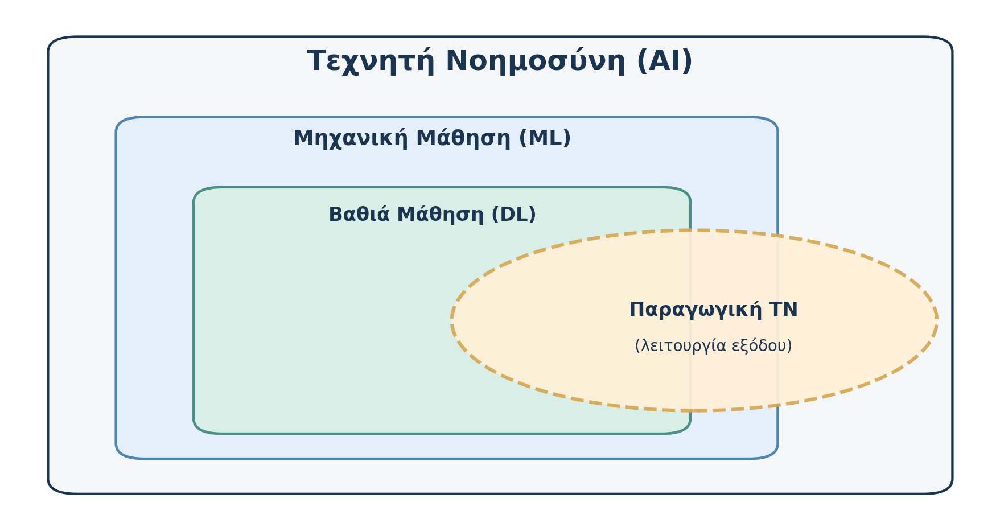

# AL00.2 — AI, ML, DL και Παραγωγική ΤΝ: πώς συνδέονται;

*Μέρος Α — Κατανοώ την τεχνολογία*

*Εκτιμώμενος χρόνος: 17 λεπτά.*

**Πριν διαβάσεις — Πρόβλεψη.** Ένα σύστημα αναγνωρίζει ποδήλατα σε φωτογραφίες και ένα άλλο δημιουργεί εικόνες ποδηλάτων από περιγραφές. Είναι και τα δύο Παραγωγική ΤΝ επειδή χειρίζονται εικόνες; Σημείωσε ποια διαφορά θα περίμενες στη λειτουργία τους.

## Το ευρύτερο πεδίο και οι επιμέρους μέθοδοι

Η **Τεχνητή Νοημοσύνη** περιλαμβάνει πολλές μεθόδους. Μία ιδιαίτερα σημαντική οικογένεια είναι η **Μηχανική Μάθηση (Machine Learning, ML)**: αντί να ορίζουμε χειροκίνητα κάθε λεπτομέρεια της συμπεριφοράς, χρησιμοποιούμε δεδομένα και διαδικασίες εκπαίδευσης ώστε ένα μοντέλο να προσαρμόσει τις παραμέτρους του.

Σκέψου τον εντοπισμό ανεπιθύμητων μηνυμάτων. Μια απλή προσέγγιση θα όριζε συγκεκριμένους κανόνες για ορισμένες λέξεις. Μια προσέγγιση ML μπορεί να μάθει από πολλά μηνύματα τα οποία έχουν ήδη χαρακτηριστεί ως επιθυμητά ή ανεπιθύμητα. Αργότερα προσπαθεί να ταξινομήσει καινούρια μηνύματα. Η αξιοπιστία της εξαρτάται από τα δεδομένα, τη μέθοδο και την αξιολόγηση.

Η **Βαθιά Μάθηση (Deep Learning, DL)** αποτελεί υποπεριοχή της Μηχανικής Μάθησης και αξιοποιεί τεχνητά νευρωνικά δίκτυα με πολλαπλά επίπεδα υπολογισμών. Σε μια εφαρμογή εικόνων, τέτοια δίκτυα μπορούν να μάθουν χρήσιμες αναπαραστάσεις από χρώματα, υφές και πιο σύνθετες σχέσεις. Δεν λειτουργούν ως βιολογικοί εγκέφαλοι και οι εσωτερικές αναπαραστάσεις τους δεν είναι πάντοτε εύκολο να ερμηνευθούν.

Η **Παραγωγική ΤΝ (Generative AI)** περιγράφει συστήματα που δημιουργούν περιεχόμενο: κείμενο, εικόνες, κώδικα, ήχο ή βίντεο. Η έννοια αυτή περιγράφει κυρίως το **είδος της λειτουργίας ή της εξόδου**, όχι μια αποκλειστική μέθοδο εκπαίδευσης. Οι κυρίαρχες σύγχρονες εφαρμογές χρησιμοποιούν Βαθιά Μάθηση, αλλά το «Generative AI» δεν πρέπει να σχεδιάζεται ως υποχρεωτικό τέταρτο ομόκεντρο επίπεδο μέσα στο DL.

{width=100%}

*Σχήμα 2. Η ML εντάσσεται στην AI και η DL στην ML. Η παραγωγική λειτουργία παρουσιάζεται ως εννοιολογική επικάλυψη· οι επιφάνειες δεν αντιστοιχούν σε ποσοστά.*

## Πώς σχετίζεται ένα μεγάλο γλωσσικό μοντέλο;

Ένα **μεγάλο γλωσσικό μοντέλο (Large Language Model, LLM)** είναι εκπαιδευμένο να επεξεργάζεται και να παράγει γλωσσικές ακολουθίες. Τα σύγχρονα LLMs συνήθως βασίζονται σε Βαθιά Μάθηση και μπορούν να χρησιμοποιηθούν σε εφαρμογές Παραγωγικής ΤΝ. Προσοχή: το ίδιο το μοντέλο δεν ταυτίζεται πάντα με την εφαρμογή που βλέπει ο χρήστης. Μια εφαρμογή μπορεί να συνδυάζει μοντέλο, αναζήτηση, αρχεία και ειδικά εργαλεία.

Ένα χρήσιμο παράδειγμα από τη Γεωπληροφορική: ένα μοντέλο ταξινόμησης αναγνωρίζει χρήσεις γης σε δορυφορικές εικόνες· ένα παραγωγικό μοντέλο δημιουργεί περιγραφή μιας χαρτογραφικής διαδικασίας· μια εφαρμογή ΤΝ μπορεί να συνδυάζει και τις δύο δυνατότητες. Δεν έχουν ίδιο στόχο ούτε κατ' ανάγκη ίδια αξιοπιστία.

**Μικρή δραστηριότητα.** Κατάταξε νοητικά τις εφαρμογές: (α) πρόβλεψη αξίας ακινήτου από χαρακτηριστικά, (β) αναγνώριση οχημάτων με βαθύ νευρωνικό δίκτυο, (γ) δημιουργία κειμένου περίληψης, (δ) σύστημα συμβολικών κανόνων για επίλυση λογικού προβλήματος. Μπορεί η ίδια εφαρμογή να εντάσσεται σε περισσότερες από μία κατηγορίες; Αιτιολόγησε.

**Έλεγχος κατανόησης.** (1) Γιατί η ML δεν ταυτίζεται με όλη την AI; (2) Τι χαρακτηρίζει τη DL; (3) Μπορεί ένα σύστημα να είναι ταυτόχρονα DL και Παραγωγική ΤΝ; (4) Γιατί μια εφαρμογή chatbot δεν ταυτίζεται πλήρως με το υποκείμενο LLM;

**Κράτησε:** Οι έννοιες περιγράφουν διαφορετικές σχέσεις: επιστημονικό πεδίο, μεθοδολογίες και είδη εφαρμογών.
