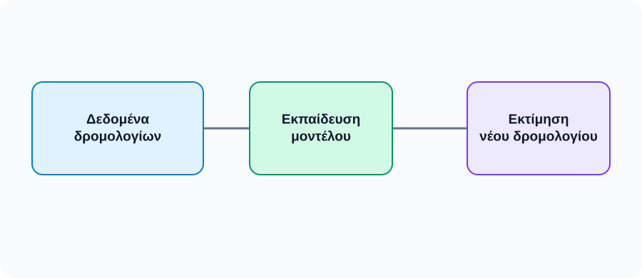
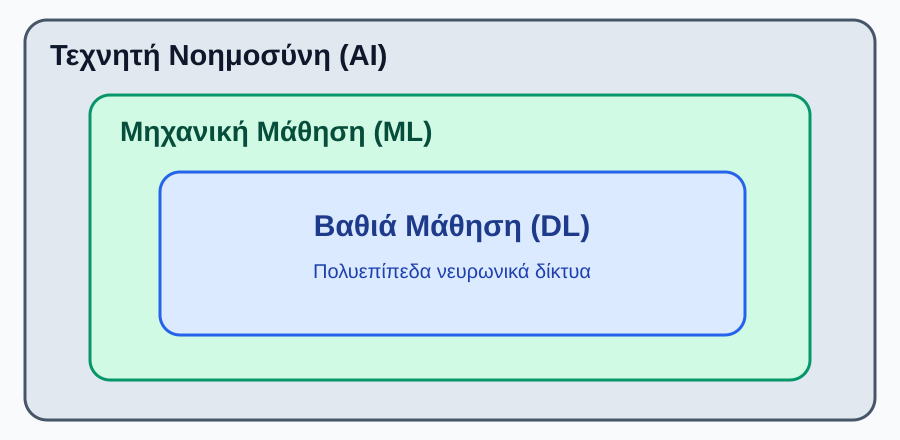
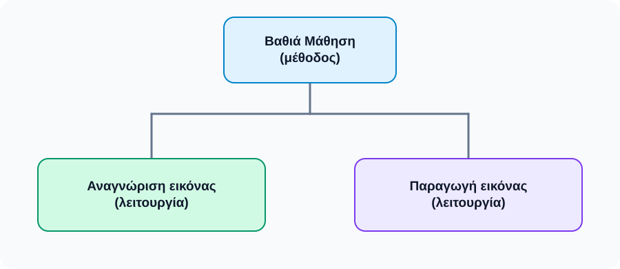
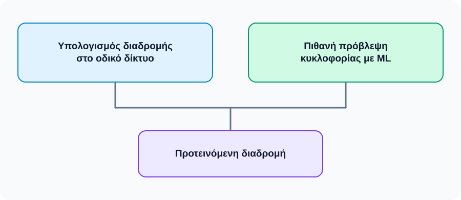
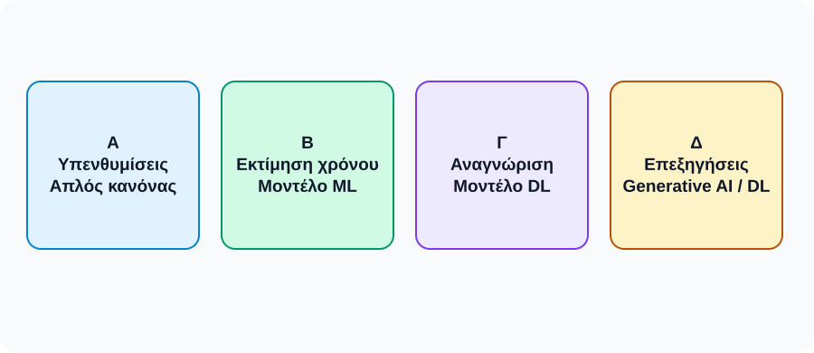

# AL00.2 — Τεχνητή Νοημοσύνη, Μηχανική Μάθηση, Βαθιά Μάθηση και Παραγωγική ΤΝ

**AI Learning Core · Μέρος Α — Κατανοώ την τεχνολογία**
**Κατάσταση:** Εικονογραφημένο προσχέδιο v1.2 — προς έγκριση, όχι δημοσιευμένο
**Αναγνωστικό κοινό:** Φοιτητές χωρίς τεχνικά προαπαιτούμενα

> **Μαθησιακός σκοπός.** Να διακρίνεις τις βασικές περιοχές της ΤΝ, να εξηγείς πώς συνδέονται, να αναλύεις τις λειτουργίες μιας εφαρμογής και να ξεχωρίζεις τις τεκμηριωμένες πληροφορίες από τις τεχνολογικές υποθέσεις.

## 2.1 Γιατί χρησιμοποιούμε διαφορετικούς όρους;

Η Τεχνητή Νοημοσύνη εμφανίζεται συχνά στις ειδήσεις, στα ψηφιακά εργαλεία που χρησιμοποιούμε και στις συζητήσεις για τις αλλαγές στην εκπαίδευση και στην εργασία. Άλλοτε διαβάζουμε ότι μια υπηρεσία «χρησιμοποιεί ΤΝ». Άλλοτε ακούμε για Μηχανική Μάθηση, Βαθιά Μάθηση ή Παραγωγική ΤΝ. Είναι εύκολο να πιστέψουμε ότι οι όροι αυτοί είναι απλώς διαφορετικά ονόματα του ίδιου πράγματος.

Ας συγκρίνουμε τρεις γνώριμες εργασίες. Μια εφαρμογή εκτιμά πότε θα φτάσει ένα λεωφορείο. Μια δεύτερη αναγνωρίζει αντικείμενα σε φωτογραφίες. Μια τρίτη δημιουργεί μια νέα εξήγηση όταν ο φοιτητής ζητά βοήθεια για μια δυσνόητη έννοια. Η πρώτη παράγει μια εκτίμηση, η δεύτερη αναγνωρίζει περιεχόμενο, η τρίτη δημιουργεί περιεχόμενο. Μπορεί να σχετίζονται όλες με την ΤΝ, αλλά δεν περιγράφονται με τον ίδιο τρόπο.


*Εικόνα 2.1α. Πραγματικός ηλεκτρονικός πίνακας στάσης λεωφορείου· η εικόνα δείχνει το είδος της πληροφορίας, όχι τον αλγόριθμο που χρησιμοποιεί η υπηρεσία. Πηγή και άδεια: `PHOTO_SOURCES.md`.*

*Εικόνα 2.1α. Εκτίμηση χρόνου άφιξης: η λειτουργία είναι η πρόβλεψη· η ακριβής μέθοδος εξαρτάται από την υλοποίηση.*

**[Θέση οπτικού υλικού σε εκκρεμότητα — PHOTO_02_image_recognition; βλέπε `PHOTO_SOURCES.md`]**
*Περιγραφή/alt: Αναγνώριση αντικειμένων σε φωτογραφία — ενδεικτική εικόνα προς αδειοδοτημένη επιλογή.*

*Εικόνα 2.1β. Αναγνώριση εικόνας: στόχος είναι η εκτίμηση του περιεχομένου μιας υπάρχουσας φωτογραφίας.*

**[Θέση οπτικού υλικού σε εκκρεμότητα — PHOTO_03_student_chat; βλέπε `PHOTO_SOURCES.md`]**
*Περιγραφή/alt: Φοιτητής που χρησιμοποιεί ψηφιακό βοηθό για μελέτη — ενδεικτική εικόνα προς αδειοδοτημένη επιλογή.*

*Εικόνα 2.1γ. Παραγωγή εκπαιδευτικού κειμένου: ο βοηθός συνθέτει απάντηση με βάση το αίτημα του φοιτητή.*

Εδώ βρίσκεται η βασική ιδέα του κεφαλαίου: **πρέπει να ξεχωρίζουμε το ευρύτερο επιστημονικό πεδίο, την υπολογιστική μέθοδο και τη λειτουργία που προσφέρει μια εφαρμογή**. Αν γνωρίζουμε μόνο τη λειτουργία, δεν γνωρίζουμε απαραίτητα και τον τρόπο υλοποίησης. Αυτή τη διάκριση θα χρησιμοποιήσουμε σε ολόκληρη την AL00.2.

### Μικρή στάση σκέψης

Ένα λογισμικό στέλνει αυτόματα υπενθύμιση δύο ημέρες πριν από κάθε καταχωρισμένο ραντεβού. Μπορούμε μόνο από αυτή τη λειτουργία να συμπεράνουμε ότι χρησιμοποιεί ΤΝ;

```{dropdown} Ενδεικτική απάντηση — Χρειάζεται ΤΝ για την υπενθύμιση;
:open: false
Όχι. Ένας συνηθισμένος μηχανισμός αυτοματισμού μπορεί να υπολογίσει την ημερομηνία και να στείλει την ειδοποίηση. Η αυτοματοποίηση μιας εργασίας δεν συνεπάγεται από μόνη της χρήση ΤΝ.
```

## 2.2 Τέσσερις έννοιες που πρέπει να ξεχωρίζουμε

### 2.2.1 Τεχνητή Νοημοσύνη: το ευρύτερο πεδίο

Η **Τεχνητή Νοημοσύνη (Artificial Intelligence — AI)** είναι το ευρύτερο επιστημονικό και τεχνολογικό πεδίο. Περιλαμβάνει προσεγγίσεις για την ανάπτυξη υπολογιστικών συστημάτων που εκτελούν εργασίες όπως η αναγνώριση προτύπων, η εξαγωγή συμπερασμάτων, η πρόβλεψη, ο σχεδιασμός ενεργειών και η παραγωγή περιεχομένου.

Δεν υπάρχει ένας μοναδικός αλγόριθμος που να αποτελεί «την ΤΝ». Μια εφαρμογή μπορεί να βασίζεται σε οργανωμένη γνώση και συλλογισμό, μια άλλη σε δεδομένα και εκπαιδευμένα μοντέλα, ενώ μια τρίτη μπορεί να συνδυάζει διαφορετικούς μηχανισμούς. Για παράδειγμα, ένα σύστημα υποστήριξης πανεπιστημιακών υπηρεσιών μπορεί να χρησιμοποιεί μοντέλο για να αναγνωρίζει το θέμα μιας ερώτησης και κατόπιν κανόνες για να την προωθεί στην αρμόδια υπηρεσία.

Η αναφορά σε κανόνες δεν σημαίνει, βέβαια, ότι κάθε απλό πρόγραμμα με συνθήκες είναι ΤΝ. Το παράδειγμα δείχνει ότι η οργανωμένη γνώση και ο συλλογισμός έχουν θέση στο ευρύτερο πεδίο της ΤΝ, δίπλα στις μαθησιακές μεθόδους. Για τον σκοπό αυτού του μαθήματος δεν χρειάζεται να μελετήσουμε τις τεχνικές κατασκευής τέτοιων συστημάτων.


**Γιατί έχει σημασία η διάκριση;** Αν ένας οργανισμός αγοράσει ένα λογισμικό με τον γενικό χαρακτηρισμό «τεχνητή νοημοσύνη», ο χαρακτηρισμός δεν του λέει ακόμη ποια δεδομένα θα χρειαστεί, πώς θα τεκμηριώνει τα αποτελέσματα ή τι είδους σφάλματα ενδέχεται να εμφανιστούν. Για έναν σαφή διάλογο με τον κατασκευαστή, χρειάζεται να ξεκινήσει από την εργασία: ταξινόμηση, πρόβλεψη, αναζήτηση, σύνθεση περιεχομένου ή συνδυασμός τους. Στη συνέχεια μπορεί να ρωτήσει για την υλοποίηση και την αξιολόγηση.

Σκέψου, για παράδειγμα, ένα πανεπιστημιακό γραφείο που δέχεται αιτήματα. Αν οι κατηγορίες και οι κανόνες δρομολόγησης είναι σαφείς, ένα οργανωμένο σύστημα κανόνων μπορεί να καλύψει μεγάλο μέρος της εργασίας. Αν όμως τα αιτήματα διατυπώνονται ελεύθερα και χρειάζεται αναγνώριση του θέματος μέσα σε μεγάλο αριθμό παραδειγμάτων, ένα μοντέλο ML μπορεί να βοηθήσει. Μια πλήρης εφαρμογή μπορεί να συνδυάζει και τις δύο προσεγγίσεις. Δεν ανακηρύσσουμε εκ των προτέρων «νικητή» μεταξύ κανόνων και μάθησης: προσδιορίζουμε τι πρέπει να επιτυγχάνει το σύστημα.

### 2.2.2 Μηχανική Μάθηση: σχέσεις που αναπτύσσονται από δεδομένα

Η **Μηχανική Μάθηση (Machine Learning — ML)** αποτελεί σημαντική περιοχή της ΤΝ. Περιλαμβάνει μεθόδους με τις οποίες αναπτύσσονται μοντέλα που αξιοποιούν σχέσεις και πρότυπα από δεδομένα ή εμπειρία.

Ας σκεφτούμε την εκτίμηση χρόνου άφιξης λεωφορείου. Μια υπηρεσία μπορεί να διαθέτει πληροφορίες από πολλά προηγούμενα δρομολόγια: χρόνο μετακίνησης, ώρα, απόσταση και κυκλοφοριακές συνθήκες. Ένα κατάλληλο μοντέλο μπορεί να αξιοποιήσει τέτοια δεδομένα για να εκτιμήσει τη διάρκεια νέων δρομολογίων. Δεν είναι απαραίτητο να έχει συναντήσει προηγουμένως μια απολύτως ίδια περίπτωση.

Αυτό που ενδιαφέρει είναι αν η μάθηση από προηγούμενα παραδείγματα βοηθά σε νέες περιπτώσεις. Η δυνατότητα αυτή ονομάζεται **γενίκευση**. Δεν πρέπει όμως να θεωρούμε κάθε εκτίμηση σωστή: ο χρόνος άφιξης εξακολουθεί να επηρεάζεται από συνθήκες που ενδέχεται να αλλάξουν. Επίσης, μια εφαρμογή που προβλέπει άφιξη δεν χρησιμοποιεί υποχρεωτικά ML· η συγκεκριμένη μέθοδος πρέπει να τεκμηριώνεται.



*Σχήμα 2.1. Η βασική ιδέα της ML σε ένα υποθετικό παράδειγμα. Η εκπαίδευση και η χρήση του εκπαιδευμένου μοντέλου είναι διακριτές διαδικασίες.*

Η Μηχανική Μάθηση μπορεί επίσης να αξιοποιείται σε ταξινόμηση μηνυμάτων, συστάσεις και αναγνώριση προτύπων. Τον τρόπο εκπαίδευσης, τα δεδομένα ελέγχου και την αξιολόγηση μοντέλων θα τα εξετάσουμε στην AL00.3.

### 2.2.3 Βαθιά Μάθηση: μια περιοχή της Μηχανικής Μάθησης

Η **Βαθιά Μάθηση (Deep Learning — DL)** είναι περιοχή της Μηχανικής Μάθησης. Βασίζεται σε τεχνητά νευρωνικά δίκτυα με πολλαπλά επίπεδα υπολογιστικής επεξεργασίας. Η λέξη «βαθιά» αναφέρεται στην αρχιτεκτονική αυτών των μοντέλων, όχι σε ανθρώπινη ή ανώτερη κατανόηση.

Ας υποθέσουμε ότι μια εφαρμογή αναγνωρίζει ποδήλατα σε φωτογραφίες. Τα ποδήλατα εμφανίζονται σε διαφορετικά χρώματα, από διαφορετικές οπτικές γωνίες και κάτω από διαφορετικές συνθήκες φωτισμού. Η αναγνώρισή τους απαιτεί αξιοποίηση σύνθετων οπτικών πληροφοριών. Μοντέλα Βαθιάς Μάθησης μπορούν να αναπτύσσουν χρήσιμες αναπαραστάσεις χαρακτηριστικών κατά την εκπαίδευσή τους.

Δεν χρειάζεται εδώ να μάθουμε τους κόμβους, τα βάρη ή τις μαθηματικές λειτουργίες ενός νευρωνικού δικτύου. Αρκεί να κατανοήσουμε ότι η DL είναι μια σημαντική οικογένεια μεθόδων για απαιτητικές εργασίες επεξεργασίας εικόνας, ήχου, γλώσσας και άλλων δεδομένων. Δεν είναι ωστόσο η καλύτερη λύση σε κάθε πρόβλημα: απλούστερες μέθοδοι μπορεί να επαρκούν ή να είναι καταλληλότερες.

### 2.2.4 Παραγωγική ΤΝ: δημιουργία περιεχομένου

Η **Παραγωγική Τεχνητή Νοημοσύνη (Generative AI)** περιγράφει συστήματα με δυνατότητα παραγωγής περιεχομένου, όπως κειμένου, εικόνων, ήχου και κώδικα.

Σκέψου δύο λειτουργίες. Στην πρώτη, ένα σύστημα δέχεται μια φωτογραφία και επιχειρεί να αναγνωρίσει αν εμφανίζεται σκύλος. Στη δεύτερη, ο χρήστης γράφει «δημιούργησε μια εικόνα σκύλου σε φανταστικό σεληνιακό τοπίο» και το σύστημα παράγει μια νέα εικόνα. Στην πρώτη περίπτωση η κύρια λειτουργία είναι η αναγνώριση υπάρχοντος περιεχομένου. Στη δεύτερη είναι η παραγωγή.


*Εικόνα 2.2α. Πραγματική φωτογραφία σκύλου, που χρησιμοποιείται ως είσοδος για να συζητήσουμε την αναγνώριση εικόνας. Πηγή και άδεια: `PHOTO_SOURCES.md`.*

*Εικόνα 2.2α. Αναγνώριση: «Τι απεικονίζεται στη φωτογραφία;»*


*Εικόνα 2.2β. Παραγωγή: «Δημιούργησε μια νέα εικόνα σκύλου σε φανταστικό σεληνιακό τοπίο». Εικόνα που δημιουργήθηκε με παραγωγική ΤΝ ειδικά για το παρόν εκπαιδευτικό παράδειγμα· δεν αποτελεί πραγματική φωτογραφία ή επιστημονική απεικόνιση της Σελήνης.*

Πολλά σύγχρονα παραγωγικά συστήματα βασίζονται στη Βαθιά Μάθηση. Αυτό δεν σημαίνει ότι κάθε μοντέλο DL δημιουργεί περιεχόμενο ούτε ότι η παραγωγή ως υπολογιστική δυνατότητα περιορίζεται αποκλειστικά στη DL.

Επίσης, η ικανότητα παραγωγής πειστικού κειμένου δεν εξασφαλίζει ότι οι πληροφορίες του είναι αληθείς ή επαρκώς τεκμηριωμένες. Η Παραγωγική ΤΝ μπορεί να είναι χρήσιμη για εναλλακτικές εξηγήσεις, ιδέες και πρόχειρα κείμενα, αλλά οι σημαντικοί ισχυρισμοί χρειάζονται έλεγχο.

### 2.2.5 Οι τέσσερις έννοιες στον ίδιο πίνακα

| Έννοια | Τι περιγράφει κυρίως | Χαρακτηριστικό παράδειγμα |
|---|---|---|
| AI — Τεχνητή Νοημοσύνη | Το ευρύτερο πεδίο | Σύστημα συλλογισμού ή πρόβλεψης |
| ML — Μηχανική Μάθηση | Μεθόδους ανάπτυξης μοντέλων από δεδομένα ή εμπειρία | Πρόβλεψη χρόνου άφιξης με μοντέλο ML |
| DL — Βαθιά Μάθηση | Περιοχή ML με πολυεπίπεδα νευρωνικά δίκτυα | Αναγνώριση εικόνων με βαθύ μοντέλο |
| Generative AI — Παραγωγική ΤΝ | Δυνατότητα παραγωγής περιεχομένου | Παραγωγή εξήγησης ή εικόνας |

Ο πίνακας δεν περιγράφει τέσσερα ανεξάρτητα «συρτάρια». Ένα σημερινό chatbot που βασίζεται σε παραγωγικό γλωσσικό μοντέλο DL μπορεί να ανήκει ταυτόχρονα και στις τέσσερις κατηγορίες.

## 2.3 Πώς συνδέονται μεταξύ τους;

### 2.3.1 Η σχέση ένταξης AI–ML–DL

Η σχέση των τριών πρώτων όρων είναι απλή: **DL μέσα στη ML, και ML μέσα στην AI**. Αυτό παρουσιάζει το επόμενο διάγραμμα.



*Σχήμα 2.2. Σχέση ένταξης επιστημονικών περιοχών· όχι κατάταξη ποιότητας ή καταλληλότητας.*

Κάθε μοντέλο DL ανήκει στη ML, αλλά δεν χρησιμοποιεί κάθε μοντέλο ML βαθύ νευρωνικό δίκτυο. Αντίστοιχα, η AI περιλαμβάνει περισσότερες προσεγγίσεις από τη ML. Ο σκοπός του διαγράμματος είναι η σωστή ορολογία, όχι να μας υποδείξει ποια λύση είναι «ανώτερη».

### 2.3.2 Άλλο η μέθοδος, άλλο η λειτουργία

Για να τοποθετήσουμε σωστά την Παραγωγική ΤΝ, πρέπει να κάνουμε δύο ερωτήσεις: **Με ποια μέθοδο λειτουργεί το σύστημα;** και **Τι κάνει το σύστημα;**

Η πρώτη ερώτηση μπορεί να απαντηθεί με όρους όπως ML ή DL. Η δεύτερη με όρους όπως αναγνώριση, πρόβλεψη ή παραγωγή περιεχομένου. Ένα μοντέλο DL μπορεί να χρησιμοποιείται για ταξινόμηση εικόνων· ένα άλλο για παραγωγή εικόνων. Γι' αυτό δεν παριστάνουμε όλη την Παραγωγική ΤΝ ως υποχρεωτικά μικρότερο κύκλο μέσα στη DL.



*Σχήμα 2.3. Μία οικογένεια μεθόδων μπορεί να εξυπηρετεί διαφορετικές λειτουργίες. Το σχήμα απεικονίζει παραδείγματα, όχι πλήρη ταξινόμηση όλων των παραγωγικών τεχνικών.*

### 2.3.3 Οι πολλαπλοί χαρακτηρισμοί δεν είναι αντίφαση

Αν ένα chatbot βασίζεται σε παραγωγικό γλωσσικό μοντέλο DL, είναι σωστό να το περιγράψουμε ως εφαρμογή AI, ML, DL και Generative AI. Η πρώτη ονομασία αναφέρει το πεδίο, η δεύτερη και η τρίτη την οικογένεια μεθόδων, και η τέταρτη μια κύρια λειτουργία.

Ένα **μεγάλο γλωσσικό μοντέλο (Large Language Model, LLM)** είναι ένα μοντέλο που έχει εκπαιδευτεί να επεξεργάζεται και να παράγει γλωσσικές ακολουθίες. Τα σύγχρονα LLM συνήθως βασίζονται στη Βαθιά Μάθηση και μπορούν να χρησιμοποιηθούν σε εφαρμογές Παραγωγικής ΤΝ. Το μοντέλο, όμως, δεν ταυτίζεται πάντοτε με ολόκληρη την εφαρμογή: ένα chatbot μπορεί να συνδυάζει το LLM με αναζήτηση, αρχεία, κανόνες πρόσβασης και άλλα εργαλεία.

Αντίθετα, μια εφαρμογή αναγνώρισης ποδηλάτων με μοντέλο DL ανήκει στην AI, τη ML και τη DL, αλλά η συγκεκριμένη λειτουργία ταξινόμησης δεν αποτελεί παραγωγή νέας εικόνας.

Ένα επιπλέον σημείο έχει σημασία: μια πλήρης εφαρμογή μπορεί να περιλαμβάνει και συμβατικά συστατικά, όπως αναζήτηση σε βάση δεδομένων, φίλτρα πρόσβασης ή μηχανισμούς εμφάνισης αποτελεσμάτων. Το ότι χρησιμοποιεί μοντέλο ΤΝ σε ένα στάδιο δεν συνεπάγεται ότι κάθε λειτουργία της υλοποιείται με ΤΝ.

```{dropdown} Στάση κατανόησης — Μπορεί ένα chatbot να ανήκει και στις τέσσερις κατηγορίες;
:open: false
Ναι, όταν η συγκεκριμένη υλοποίηση χρησιμοποιεί παραγωγικό μοντέλο Βαθιάς Μάθησης. Οι τέσσερις χαρακτηρισμοί περιγράφουν διαφορετικές διαστάσεις. Δεν σημαίνει όμως ότι κάθε υποσύστημα του προϊόντος χρησιμοποιεί DL.
```

## 2.4 Αναγνωρίζω την τεχνολογία πίσω από πραγματικές εφαρμογές

Όταν χρησιμοποιούμε ένα προϊόν, βλέπουμε τι κάνει, όχι κατ' ανάγκη πώς έχει κατασκευαστεί. Αυτό σημαίνει ότι πρέπει να μάθουμε να διατυπώνουμε συμπεράσματα με ακρίβεια.

### 2.4.1 Διαδρομές σε ψηφιακό χάρτη

Μια εφαρμογή χαρτών υπολογίζει διαδρομή από το σπίτι στο πανεπιστήμιο. Ο υπολογισμός μπορεί να πραγματοποιείται με συμβατικό αλγόριθμο αναζήτησης σε οδικό δίκτυο. Αν παράλληλα εκτιμά μελλοντική συμφόρηση με εκπαιδευμένο μοντέλο, μπορεί να χρησιμοποιεί και ML. Η ίδια υπηρεσία συνδυάζει διαφορετικές λειτουργίες. Δεν μπορούμε να συναγάγουμε από την εμφάνιση της διαδρομής ότι εφαρμόστηκε συγκεκριμένη μέθοδος ΤΝ.



*Σχήμα 2.4. Η αναζήτηση διαδρομής και η πρόβλεψη κυκλοφορίας είναι διακριτές εργασίες που ενδέχεται να χρησιμοποιούν διαφορετικές μεθόδους.*


**Ας το εξετάσουμε από την οπτική του χρήστη.** Ο φοιτητής πληκτρολογεί αφετηρία και προορισμό. Βλέπει μια μπλε γραμμή στον χάρτη και έναν εκτιμώμενο χρόνο. Η γραμμή είναι κάτι που μπορεί να παρατηρήσει· ο χρόνος είναι αποτέλεσμα υπολογισμού· η ύπαρξη συγκεκριμένου εκπαιδευμένου μοντέλου είναι υπόθεση μέχρι να τεκμηριωθεί.

Ας φανταστούμε ότι ο χάρτης προτείνει την ίδια διαδρομή στις 08:00 και στις 22:00, αλλά εμφανίζει διαφορετικούς χρόνους. Η διαφορά υποδηλώνει ότι ο χρόνος εξαρτάται από πρόσθετες πληροφορίες ή παραδοχές. Δεν αποδεικνύει ότι η εφαρμογή χρησιμοποιεί DL. Θα αναζητούσαμε την τεχνική περιγραφή της υπηρεσίας και τον τρόπο με τον οποίο υπολογίζονται ή προβλέπονται οι χρόνοι.

```{dropdown} Στάση κατανόησης — Η εκτίμηση χρόνου είναι απόδειξη Μηχανικής Μάθησης;
:open: false
Όχι. Μια εκτίμηση χρόνου μπορεί να προκύπτει από ιστορικούς μέσους χρόνους, απλούς κανόνες, ζωντανά δεδομένα ή εκπαιδευμένο μοντέλο. Η ύπαρξη πρόβλεψης μας δείχνει τι παράγεται, όχι υποχρεωτικά πώς παράγεται. Πιο προσεκτική διατύπωση είναι: «Η υπηρεσία εκτιμά χρόνο άφιξης· ενδέχεται να αξιοποιεί ML, αλλά χρειάζεται τεχνική τεκμηρίωση για επιβεβαίωση».
```

### 2.4.2 Μετατροπή ομιλίας σε κείμενο

Ο φοιτητής υπαγορεύει μια πρόταση στο κινητό του και η εφαρμογή την εμφανίζει ως γραπτό κείμενο. Η λειτουργία αυτή είναι η **αναγνώριση ομιλίας**. Πολλά σύγχρονα συστήματα χρησιμοποιούν DL, επειδή πρέπει να επεξεργάζονται μεταβολές σε προφορά, ρυθμό και θόρυβο.

Η μεταγραφή όμως δεν είναι αυτομάτως ίδια εργασία με τη σύνθεση ενός νέου άρθρου. Στην πρώτη περίπτωση ο στόχος είναι η αναγνώριση προϋπάρχοντος προφορικού περιεχομένου· στη δεύτερη η παραγωγή κειμένου. Αν δεν διαθέτουμε τεχνική τεκμηρίωση, δεν γνωρίζουμε το συγκεκριμένο μοντέλο μεταγραφής.


*Εικόνα 2.4α. Φωτογραφία πρωτοτύπου κινητού με αναγνώριση ομιλίας· η μετατροπή ομιλίας σε κείμενο είναι λειτουργία αναγνώρισης, όχι κατ’ ανάγκη παραγωγή νέου κειμένου. Πηγή και άδεια: `PHOTO_SOURCES.md`.*

*Εικόνα 2.3. Η μεταγραφή ομιλίας εμφανίζεται στον χρήστη ως γραπτό κείμενο· αυτό δεν αρκεί για να χαρακτηρίσουμε την εφαρμογή παραγωγική.*


**Δοκίμασε να αναλύσεις ένα σφάλμα.** Ο φοιτητής λέει «η πρόταση είναι απλή» και βλέπει στην οθόνη μια διαφορετική λέξη. Η εφαρμογή συνέχισε να εκτελεί αναγνώριση ομιλίας, αλλά το αποτέλεσμα περιείχε σφάλμα. Το ότι χρησιμοποιείται μια σύγχρονη μέθοδος δεν εγγυάται αλάνθαστη μεταγραφή. Η ποιότητα του μικροφώνου, ο θόρυβος και οι ιδιαιτερότητες της ομιλίας μπορεί να επηρεάζουν την εργασία.

```{dropdown} Στάση κατανόησης — Γιατί η μεταγραφή δεν σημαίνει απαραίτητα παραγωγικό σύστημα;
:open: false
Ο βασικός στόχος της μεταγραφής είναι να αποδώσει σε γραπτή μορφή τον προϋπάρχοντα προφορικό λόγο. Το αποτέλεσμα είναι πράγματι κείμενο, όμως η διάκριση αφορά τη λειτουργία του συστήματος, όχι το αν η έξοδος αποτελείται από γράμματα. Αν η ίδια εφαρμογή συντάξει στη συνέχεια νέα περίληψη της ομιλίας, αυτή η επιπλέον λειτουργία μπορεί να είναι παραγωγική.
```

### 2.4.3 Προτάσεις περιεχομένου

Μια πλατφόρμα προτείνει υπάρχοντα άρθρα ή βίντεο. Θα μπορούσε να χρησιμοποιεί προκαθορισμένους θεματικούς κανόνες ή μοντέλο ML που αξιοποιεί σχέσεις ανάμεσα σε περιεχόμενο και προηγούμενες επιλογές. Η σύσταση υπάρχοντος περιεχομένου δεν συνεπάγεται ότι το σύστημα παράγει το ίδιο αυτό περιεχόμενο.

Αν η υπηρεσία δημιουργεί επιπλέον μια νέα περίληψη των προτεινόμενων άρθρων με παραγωγικό μοντέλο, τότε αυτή η πρόσθετη λειτουργία αποτελεί χρήση Παραγωγικής ΤΝ. Η διάκριση χρειάζεται να γίνεται ανά λειτουργία.


**Μια χρήσιμη αντιπαραβολή.** Αν μια πλατφόρμα εμφανίζει «Διάβασε επίσης το άρθρο Χ», ο χρήστης παραπέμπεται σε ήδη υπάρχον υλικό. Αν εμφανίζει «Δημιούργησα για σένα μια καινούρια σύνοψη των πέντε άρθρων», τότε η δεύτερη λειτουργία μπορεί να βασίζεται σε παραγωγικό μοντέλο. Για να κρίνουμε την ποιότητα της σύνοψης χρειάζεται να τη συγκρίνουμε με τα άρθρα, όχι να αρκεστούμε στη φυσικότητα του λόγου.

```{dropdown} Στάση κατανόησης — Μπορεί ένα προϊόν να συνδυάζει σύσταση και παραγωγή;
:open: false
Ναι. Ένα υποσύστημα μπορεί να εντοπίζει σχετικά υπάρχοντα άρθρα και ένα άλλο να συνθέτει καινούρια σύντομη περιγραφή τους. Η πρώτη λειτουργία δεν καθίσταται αυτομάτως παραγωγική επειδή η δεύτερη είναι παραγωγική. Αναλύουμε τις εργασίες ξεχωριστά.
```

### 2.4.4 Chatbot για πανεπιστημιακή μελέτη

Ένας φοιτητής ζητά από ένα chatbot: «Εξήγησέ μου τη διαφορά συσχέτισης και αιτιότητας με καθημερινό παράδειγμα». Αν η υπηρεσία χρησιμοποιεί παραγωγικό γλωσσικό μοντέλο DL, μπορεί να περιγραφεί με όλους τους όρους AI, ML, DL και Generative AI. Η τεχνολογική αυτή περιγραφή δεν αρκεί για να αποδείξει ότι η εξήγηση είναι σωστή ή ότι ο φοιτητής τη γνώρισε ουσιαστικά.


*Εικόνα 2.4β. Πραγματική φωτογραφία φοιτητικής μελέτης· χρησιμοποιείται ως πλαίσιο για να συζητήσουμε πότε ένα ψηφιακό εργαλείο υποστηρίζει και πότε υποκαθιστά την ενεργητική μάθηση. Πηγή και άδεια: `PHOTO_SOURCES.md`.*

*Εικόνα 2.4. Η παραγωγή εξήγησης μπορεί να υποστηρίζει τη μάθηση, αλλά η κατανόηση και η αξιολόγηση παραμένουν ανθρώπινες δραστηριότητες.*


Ας δούμε τι θα έκανε ένας προσεκτικός φοιτητής μετά την απάντηση. Θα αναγνώριζε πρώτα αν το παράδειγμα του chatbot δείχνει πράγματι ότι δύο μεγέθη μπορεί να μεταβάλλονται μαζί χωρίς το ένα να προκαλεί το άλλο. Στη συνέχεια θα συνέκρινε τον ορισμό με το εκπαιδευτικό υλικό του μαθήματος και θα προσπαθούσε να σκεφτεί δικό του αντιπαράδειγμα. Έτσι η παραγωγική εξήγηση γίνεται αφετηρία ενεργητικής μάθησης και όχι υποκατάστατο της κατανόησης.

```{dropdown} Στάση κατανόησης — Αρκεί η σωστή απάντηση του chatbot για να αποδειχθεί μάθηση;
:open: false
Όχι. Το chatbot μπορεί να προσφέρει μια χρήσιμη διατύπωση, αλλά η μάθηση αφορά όσα μπορεί να εξηγήσει, να εφαρμόσει και να ελέγξει ο ίδιος ο φοιτητής. Μια ουσιαστική δοκιμή είναι να διατυπώσει την έννοια χωρίς να αντιγράψει το παραγόμενο κείμενο και να εφαρμόσει τη διάκριση σε νέο παράδειγμα.
```

### 2.4.5 Τρία επίπεδα τεκμηριωμένης ανάλυσης

Όταν περιγράφουμε μια εφαρμογή, διακρίνουμε:

1. **Τι παρατηρούμε:** μεταγραφή, σύσταση, πρόβλεψη, παραγωγή.
2. **Τι θεωρούμε πιθανό:** κατάλληλη τεχνολογική μέθοδος, χωρίς αυθαίρετη βεβαιότητα.
3. **Τι επιβεβαιώνουμε:** πραγματική υλοποίηση μέσω αξιόπιστης τεχνικής τεκμηρίωσης.

Για παράδειγμα, είναι τεκμηριωμένο να πούμε ότι «η εφαρμογή αναγνωρίζει ομιλία και πολλά σύγχρονα συστήματα αυτής της κατηγορίας χρησιμοποιούν DL». Δεν είναι τεκμηριωμένο να ισχυριστούμε, μόνο από τη λειτουργία της, ότι χρησιμοποιεί μια συγκεκριμένη αρχιτεκτονική.

### Δραστηριότητα — Τι γνωρίζω και τι υποθέτω;

Επίλεξε μια εφαρμογή που χρησιμοποιείς. Σε 80–120 λέξεις εξήγησε τι παρατηρείς, ποια προσέγγιση φαίνεται πιθανή, τι δεν γνωρίζεις και ποια τεκμηρίωση θα χρειαζόσουν. Προτίμησε να διατυπώσεις τις υποθέσεις σου με ακρίβεια αντί να χρησιμοποιήσεις πολλούς τεχνικούς όρους.

```{dropdown} Ενδεικτική ανάλυση — Εφαρμογή αναγνώρισης ομιλίας
:open: false
Παρατηρώ ότι η εφαρμογή μετατρέπει τον προφορικό λόγο σε γραπτό κείμενο. Πολλά σύγχρονα συστήματα αυτής της κατηγορίας χρησιμοποιούν DL, αλλά δεν μπορώ να γνωρίζω το συγκεκριμένο μοντέλο μόνο από την οθόνη. Θα αναζητούσα τεχνική τεκμηρίωση του κατασκευαστή. Η λειτουργία της μεταγραφής δεν αποδεικνύει από μόνη της ότι η εφαρμογή παράγει πρωτότυπο κείμενο.
```


### Μια μικρή άσκηση αντιστοίχισης

Η φράση «η εφαρμογή αναγνωρίζει εικόνες» περιγράφει πρωτίστως τη **λειτουργία**. Η φράση «η εφαρμογή χρησιμοποιεί ένα βαθύ νευρωνικό δίκτυο» περιγράφει **μέθοδο υλοποίησης**. Η φράση «η εφαρμογή δημιουργεί νέες εικόνες» περιγράφει **παραγωγική λειτουργία**. Οι τρεις πληροφορίες δεν αλληλοαναιρούνται, αλλά δεν μπορούμε να συναγάγουμε τη μία μόνο από την άλλη.

```{dropdown} Ενδεικτική απάντηση — Τι γνωρίζουμε όταν μια εφαρμογή αναγνωρίζει φωτογραφίες;
:open: false
Γνωρίζουμε την εξωτερική εργασία: αναγνώριση ή ταξινόμηση περιεχομένου. Δεν γνωρίζουμε ακόμη αν χρησιμοποιεί DL, κλασικό ML ή κάποια άλλη υλοποίηση. Για να το υποστηρίξουμε χρειαζόμαστε τεκμηρίωση. Η αναγνώριση δεν ισοδυναμεί αυτομάτως με παραγωγή νέας εικόνας.
```

## 2.5 Συνήθεις παρανοήσεις και τι πραγματικά ισχύει

Οι τεχνολογικοί ισχυρισμοί συχνά ξεκινούν από κάτι σωστό και οδηγούν σε μια γενίκευση. Στόχος της ενότητας δεν είναι να επαναλάβουμε τους ορισμούς αλλά να εξασκηθούμε στον εντοπισμό του μη τεκμηριωμένου άλματος.

### 2.5.1 «Κάθε έξυπνο πρόγραμμα χρησιμοποιεί ΤΝ»

Ένα πρόγραμμα που υπολογίζει το συνολικό ποσό τιμολογίου, ταξινομεί ονόματα ή ενεργοποιεί υπενθυμίσεις μπορεί να είναι γρήγορο και ιδιαίτερα χρήσιμο χωρίς να χρησιμοποιεί ΤΝ. Ο όρος «έξυπνο» σε ένα εμπορικό κείμενο δεν αποτελεί επαρκή τεχνική τεκμηρίωση. Χρειάζεται να εξετάσουμε τι πραγματοποιεί η εφαρμογή και με ποιον τρόπο.


### 2.5.2 «Η Τεχνητή Νοημοσύνη είναι απλώς ένα άλλο όνομα της Μηχανικής Μάθησης»

Το ότι πολλά σύγχρονα προϊόντα ΤΝ χρησιμοποιούν μοντέλα ML δεν εξαλείφει τις υπόλοιπες προσεγγίσεις. Ένα σύστημα οργανωμένης γνώσης και συλλογισμού μπορεί να ανήκει στην ευρύτερη ΤΝ χωρίς να εκπαιδεύεται σε παραδείγματα. Από την άλλη, η ύπαρξη ενός απλού κανόνα σε λογισμικό δεν αρκεί για να το ονομάσουμε ΤΝ. Η ορθή περιγραφή προϋποθέτει να γνωρίζουμε ποια εργασία επιτελεί το σύστημα και ποια μέθοδο χρησιμοποιεί.

```{dropdown} Ενδεικτική απάντηση — Πώς διορθώνουμε τον ισχυρισμό «AI = ML»;
:open: false
Η ML είναι σημαντική περιοχή της AI, όχι ολόκληρο το πεδίο. Η AI περιλαμβάνει και άλλες προσεγγίσεις, όπως την αναπαράσταση γνώσης και τον συλλογισμό. Ο όρος AI μόνος του δεν αποκαλύπτει αν ένα προϊόν χρησιμοποιεί μαθησιακό μοντέλο.
```

### 2.5.3 «Αφού χρησιμοποιεί Βαθιά Μάθηση, είναι σίγουρα Παραγωγική ΤΝ»

Ένα μοντέλο DL μπορεί να εκτιμά αν μια φωτογραφία απεικονίζει ποδήλατο. Αυτή η λειτουργία ταξινομεί υπάρχον περιεχόμενο και δεν δημιουργεί νέα φωτογραφία. Ένα διαφορετικό μοντέλο DL μπορεί να συνθέτει εικόνα από περιγραφή. Η σύγχυση προκύπτει όταν χρησιμοποιούμε τον όρο της υπολογιστικής μεθόδου ως συνώνυμο της λειτουργίας.

```{dropdown} Ενδεικτική απάντηση — Τι ρωτάμε πριν χαρακτηρίσουμε μια λειτουργία παραγωγική;
:open: false
Ρωτάμε τι ακριβώς κάνει το σύστημα: αναγνωρίζει, προβλέπει, επιλέγει προϋπάρχον υλικό ή δημιουργεί περιεχόμενο; Η χρήση DL δεν αρκεί για την ταξινόμηση ως Generative AI. Εξετάζουμε τη συγκεκριμένη λειτουργία και όχι μόνο τον τίτλο της τεχνολογίας.
```

### 2.5.4 «Το μεγαλύτερο μοντέλο είναι πάντοτε καλύτερο»

Ένα μεγάλο μοντέλο μπορεί να είναι κατάλληλο για ορισμένες απαιτητικές εργασίες, αλλά η επιλογή μεθόδου εξαρτάται από τον σκοπό, τα δεδομένα, τους υπολογιστικούς πόρους και την αξιολόγηση. Για μια περιορισμένη εργασία πρόβλεψης, ένα απλούστερο μοντέλο μπορεί να είναι επαρκές ή προτιμότερο. Το μέγεθος είναι χαρακτηριστικό, όχι αυτόματη απόδειξη ποιότητας.

### 2.5.5 «Αν η απάντηση ακούγεται επιστημονική, είναι αληθής»

Ένα παραγωγικό γλωσσικό μοντέλο μπορεί να συνθέσει κείμενο με προσεγμένη ορολογία και πειστική δομή, αλλά να περιλαμβάνει σφάλματα ή ανύπαρκτες βιβλιογραφικές αναφορές. Για παράδειγμα, αν ζητήσουμε τρεις επιστημονικές πηγές, οφείλουμε να ελέγξουμε αν οι συγκεκριμένες πηγές υπάρχουν και αν υποστηρίζουν πραγματικά τον ισχυρισμό. Η καλή διατύπωση δεν υποκαθιστά τον έλεγχο.

### 2.5.6 «Αφού ένα προϊόν έχει ΤΝ, όλα τα μέρη του είναι ΤΝ»

Μια πανεπιστημιακή εφαρμογή μπορεί να χρησιμοποιεί μοντέλο παραγωγής για την τελική διατύπωση της απάντησης, αλλά συμβατική βάση δεδομένων για τις εγγραφές και καθορισμένους κανόνες για τα δικαιώματα πρόσβασης. Πρέπει επομένως να αναλύουμε τις επιμέρους λειτουργίες, όχι να αποδίδουμε στο σύνολο του προϊόντος μια ενιαία εσωτερική μέθοδο.

### 2.5.7 Από την εντύπωση στην τεκμηρίωση

Συνάντησες μια είδηση με τίτλο: «Νέο σύστημα ΤΝ κατανοεί τέλεια τα εκπαιδευτικά κείμενα». Τι θα χρειαζόσουν για να αξιολογήσεις τον ισχυρισμό; Θα έπρεπε πρώτα να προσδιορίσεις τι σημαίνει στην πράξη «κατανοεί», με ποια εργασία εξετάστηκε, σε ποια δεδομένα, με ποια αποτελέσματα και ποιους περιορισμούς. Δεν αρκεί το εντυπωσιακό επίθετο.

```{dropdown} Ενδεικτική απάντηση — Πώς αξιολογούμε έναν ισχυρισμό «τέλειας κατανόησης»;
:open: false
Ζητώ σαφή περιγραφή της εργασίας, ανεξάρτητη αξιολόγηση και παραδείγματα επιτυχίας και αποτυχίας. Αν δεν γνωρίζω αυτά τα στοιχεία, δεν δικαιολογείται να αποδεχθώ ότι ένα σύστημα «κατανοεί τέλεια». Η προσεκτική διατύπωση δεν μειώνει τις δυνατότητές του· μας βοηθά να τις αξιολογούμε σωστά.
```

## 2.6 Καθοδηγούμενη εφαρμογή και αυτοαξιολόγηση

### 2.6.1 Το σενάριο — StudyAssist

Ένα πανεπιστήμιο εξετάζει την ανάπτυξη του **StudyAssist**, μιας υποθετικής εφαρμογής υποστήριξης μελέτης. Η ομάδα σχεδιασμού περιγράφει τέσσερις λειτουργίες:

- **Α — Υπενθυμίσεις εργασιών:** ο φοιτητής καταχωρίζει προθεσμίες και λαμβάνει ειδοποίηση δύο ημέρες νωρίτερα.
- **Β — Εκτίμηση χρόνου μελέτης:** εκπαιδευμένο μοντέλο ML χρησιμοποιεί κατάλληλα δεδομένα προηγούμενων δραστηριοτήτων για να εκτιμήσει τη διάρκεια νέας δραστηριότητας.
- **Γ — Ψηφιοποίηση φωτογραφημένης σελίδας:** μοντέλο DL αναγνωρίζει το κείμενο της φωτογραφίας και το αποδίδει ψηφιακά.
- **Δ — Επεξήγηση εννοιών:** παραγωγικό γλωσσικό μοντέλο DL συνθέτει εξηγήσεις και παραδείγματα ως απάντηση στα ερωτήματα του φοιτητή.



*Σχήμα 2.5. Η ίδια εκπαιδευτική εφαρμογή συνδυάζει απλό αυτοματισμό, ML, DL και παραγωγική λειτουργία.*

### 2.6.2 Ανάλυση βήμα προς βήμα

**Βήμα 1 — Υπενθύμιση.** Αν η προθεσμία είναι 20 Νοεμβρίου, η υπενθύμιση στις 18 Νοεμβρίου προκύπτει από απλό κανόνα. Δεν χρειάζεται μοντέλο ΤΝ.

**Βήμα 2 — Εκτίμηση.** Το σενάριο δηλώνει ότι χρησιμοποιείται εκπαιδευμένο μοντέλο ML. Γνωρίζουμε λοιπόν την οικογένεια προσέγγισης, όχι όμως αν η υλοποίηση είναι DL. Το αποτέλεσμα είναι εκτίμηση, όχι εγγυημένος χρόνος μελέτης. Η χρήση μαθησιακών δεδομένων χρειάζεται υπεύθυνη διαχείριση.

**Βήμα 3 — Αναγνώριση κειμένου.** Η περιγραφή δηλώνει ρητά μοντέλο DL. Επομένως η λειτουργία ανήκει στις AI, ML και DL. Ο στόχος της είναι η μεταγραφή υπάρχοντος κειμένου, με πιθανότητα σφαλμάτων αναγνώρισης· δεν αποτελεί αυτομάτως δημιουργία νέου κειμένου.

**Βήμα 4 — Παραγωγή επεξήγησης.** Το παραγωγικό μοντέλο DL συνθέτει νέο κείμενο. Η συγκεκριμένη υλοποίηση ανήκει στις τέσσερις έννοιες. Η εκπαιδευτική αξία, όμως, εξαρτάται και από την ορθότητα της εξήγησης και από το αν ο φοιτητής τη μελετά κριτικά.

| Λειτουργία | Τεκμηριωμένος χαρακτηρισμός | Τι δεν δικαιολογείται να συμπεράνουμε |
|---|---|---|
| Α — Υπενθυμίσεις | Απλός αυτοματισμός επαρκεί | Ότι απαιτεί ΤΝ |
| Β — Εκτίμηση χρόνου | ML, όπως δηλώνει το σενάριο | Ότι είναι υποχρεωτικά DL |
| Γ — Ψηφιοποίηση | DL και συνεπώς ML/AI | Ότι η μεταγραφή είναι αυτομάτως Generative AI |
| Δ — Εξηγήσεις | Παραγωγική ΤΝ βασισμένη σε DL | Ότι οι απαντήσεις είναι πάντοτε σωστές |


### 2.6.3 Τέσσερις σταθμοί ελέγχου του StudyAssist

Οι επόμενες ερωτήσεις δεν ζητούν να αποστηθίσεις τέσσερις ετικέτες. Ζητούν να αναγνωρίσεις **γιατί** ένας χαρακτηρισμός τεκμηριώνεται και ποια πληροφορία εξακολουθεί να λείπει.

**Σταθμός Α — Η ημερομηνία δεν είναι μοντέλο.** Μια εργασία λήγει στις 20 Νοεμβρίου. Το StudyAssist ειδοποιεί στις 18 Νοεμβρίου. Αν η ομάδα ανάπτυξης διαφημίζει «βαθιά νευρωνική νοημοσύνη για τον υπολογισμό υπενθυμίσεων», τι θα τη ρωτούσες;

```{dropdown} Ενδεικτική ανάλυση — Σταθμός Α
:open: false
Θα ζητούσα να εξηγήσει ποιο πρόβλημα δεν μπορεί να επιλύσει ένας συμβατικός προγραμματισμένος κανόνας. Η αφαίρεση δύο ημερών από μια προθεσμία και η αποστολή ειδοποίησης δεν απαιτούν εκπαίδευση μοντέλου. Μπορεί να υπάρχουν άλλες «έξυπνες» λειτουργίες, όμως δεν προκύπτουν από την περιγραφή αυτής της υπενθύμισης.
```

**Σταθμός Β — Εκτίμηση δεν σημαίνει βεβαιότητα.** Για μία δραστηριότητα το μοντέλο προβλέπει 45 λεπτά. Ένας φοιτητής τελικά χρειάζεται 80 λεπτά. Αυτό αποδεικνύει ότι «η ML δεν λειτουργεί»;

```{dropdown} Ενδεικτική ανάλυση — Σταθμός Β
:open: false
Όχι. Η εκτίμηση μπορεί να αποκλίνει από τον πραγματικό χρόνο, επειδή οι μαθησιακές ανάγκες και συνθήκες διαφέρουν. Ένα μεμονωμένο παράδειγμα δεν αρκεί ούτε για να αποδείξει αποτυχία ούτε για να τεκμηριώσει γενική αξιοπιστία. Θα χρειάζονταν σαφείς στόχοι αξιολόγησης και αντιπροσωπευτικά δεδομένα. Η χρήση προσωπικών μαθησιακών δεδομένων χρειάζεται επίσης διαφάνεια και προστασία.
```

**Σταθμός Γ — Η ψηφιοποίηση χρειάζεται έλεγχο.** Σε μια φωτογραφημένη σελίδα το σύστημα αναγνώρισε λανθασμένα έναν αριθμό. Μήπως η λειτουργία είναι παραγωγική επειδή «έβγαλε κείμενο»;

```{dropdown} Ενδεικτική ανάλυση — Σταθμός Γ
:open: false
Όχι. Ο πρωταρχικός στόχος είναι η μεταγραφή του υπάρχοντος κειμένου, όχι η δημιουργία νέου. Η ύπαρξη λάθους σημαίνει ότι χρειάζεται έλεγχος της αναγνώρισης, ιδιαίτερα για αριθμούς, τύπους ή βιβλιογραφικές αναφορές. Το σενάριο αναφέρει ρητά DL, συνεπώς γνωρίζουμε την οικογένεια μεθόδων αλλά όχι την ακριβή αρχιτεκτονική.
```

**Σταθμός Δ — Το κείμενο δεν είναι απόδειξη μάθησης.** Ο φοιτητής λαμβάνει μια καλοδιατυπωμένη εξήγηση και την αντιγράφει στην εργασία. Ποιο είναι το κρίσιμο ερώτημα;

```{dropdown} Ενδεικτική ανάλυση — Σταθμός Δ
:open: false
Πρέπει να εξετάσουμε αν η εξήγηση είναι ορθή, αν ταιριάζει στο υλικό του μαθήματος και κυρίως αν ο φοιτητής μπορεί να εξηγήσει την έννοια με δικά του λόγια ή να την εφαρμόσει σε νέο παράδειγμα. Η παραγωγή κειμένου είναι δυνατότητα της εφαρμογής· η ανθρώπινη μάθηση αποτελεί ξεχωριστό αποτέλεσμα που δεν τεκμηριώνεται από την απλή ύπαρξη της απάντησης.
```

**Σύνθεση.** Για την Α γνωρίζουμε ότι ένας απλός αυτοματισμός επαρκεί. Για τη Β η εκφώνηση αναφέρει ML, αλλά όχι DL. Για τη Γ αναφέρει DL, το οποίο ανήκει και στη ML και στην AI. Για τη Δ αναφέρει παραγωγικό μοντέλο DL, άρα συντρέχουν και οι τέσσερις χαρακτηρισμοί. Η ίδια εφαρμογή περιέχει ετερογενείς τεχνολογίες και πρέπει να αξιολογείται λειτουργία προς λειτουργία.


### 2.6.4 Αυτοαξιολόγηση

**Ερώτηση 1.** Μπορεί μια εφαρμογή υπενθυμίσεων να υλοποιηθεί χωρίς ΤΝ;

```{dropdown} Ενδεικτική απάντηση 1
:open: false
Ναι. Προκαθορισμένες ημερομηνίες και απλοί κανόνες επαρκούν για τη βασική λειτουργία. Αν η ειδοποίηση αποστέλλεται δύο ημέρες πριν από την προθεσμία, η ημερομηνία προκύπτει απευθείας από υπολογισμό. Δεν υπάρχει ανάγκη εκπαίδευσης μοντέλου μόνο για αυτό το βήμα.
```

**Ερώτηση 2.** Το ότι ένα μοντέλο είναι ML σημαίνει ότι είναι και DL;

```{dropdown} Ενδεικτική απάντηση 2
:open: false
Όχι. Η DL αποτελεί υποπεριοχή της ML, όχι συνώνυμό της. Για παράδειγμα, μια πρόβλεψη μπορεί να υλοποιείται με κατάλληλο κλασικό μοντέλο ML. Αν δεν γνωρίζουμε τον τύπο του μοντέλου, δεν δικαιολογείται να το χαρακτηρίσουμε DL.
```

**Ερώτηση 3.** Ένα μοντέλο DL ταξινομεί φωτογραφίες. Είναι υποχρεωτικά παραγωγικό;

```{dropdown} Ενδεικτική απάντηση 3
:open: false
Όχι. Η ταξινόμηση υπάρχουσας εικόνας είναι διαφορετική εργασία από την παραγωγή νέας εικόνας. Και οι δύο μπορούν να χρησιμοποιούν DL, όμως η οικογένεια μεθόδων δεν αποκαλύπτει μόνη της τη λειτουργία. Χρειάζεται να δούμε τι ζητά ο χρήστης και ποια έξοδο παράγει το σύστημα.
```

**Ερώτηση 4.** Ένα chatbot με παραγωγικό μοντέλο DL μπορεί να περιγραφεί ταυτόχρονα ως AI, ML, DL και Generative AI;

```{dropdown} Ενδεικτική απάντηση 4
:open: false
Ναι. Η AI είναι το ευρύτερο πεδίο, η ML και η DL χαρακτηρίζουν την οικογένεια μεθόδων και η Generative AI την παραγωγή περιεχομένου. Η ταυτόχρονη εφαρμογή των χαρακτηρισμών δεν είναι αντίφαση. Δεν σημαίνει, όμως, ότι όλα τα βοηθητικά τμήματα της υπηρεσίας υλοποιούνται με DL.
```

**Ερώτηση 5.** Η φράση «το προϊόν είναι έξυπνο» αρκεί για να γνωρίζουμε ποια τεχνολογία χρησιμοποιεί;

```{dropdown} Ενδεικτική απάντηση 5
:open: false
Όχι. Το «έξυπνο» μπορεί να αποτελεί εμπορικό χαρακτηρισμό. Ξεκινάμε από αυτό που παρατηρούμε, διατυπώνουμε μόνο εύλογες υποθέσεις και ζητούμε τεχνική τεκμηρίωση πριν αποδώσουμε συγκεκριμένες μεθόδους. Η εξωτερική εμφάνιση δεν αποδεικνύει αρχιτεκτονική.
```

**Ερώτηση 6.** Ένα κείμενο που παρήγαγε ΤΝ ακούγεται πειστικό. Αρκεί αυτό για ακαδημαϊκή χρήση;

```{dropdown} Ενδεικτική απάντηση 6
:open: false
Όχι. Ένα κείμενο μπορεί να είναι ευανάγνωστο και συγχρόνως να περιέχει λάθη ή ανύπαρκτες πηγές. Για ακαδημαϊκή χρήση ελέγχουμε κρίσιμα γεγονότα και παραπομπές σε πρωτογενείς ή αξιόπιστες πηγές, συγκρίνουμε με το υλικό του μαθήματος και αναδιατυπώνουμε με δική μας κατανόηση.
```

### 2.6.5 Τελική δραστηριότητα — Εξήγησε το σε συμφοιτητή

Ένας συμφοιτητής λέει: «Νόμιζα ότι η ΤΝ, η ML, η DL και το ChatGPT είναι το ίδιο». Σύνταξε μια εξήγηση **100–150 λέξεων**. Περιέγραψε τη σχέση AI–ML–DL, εξήγησε τι χαρακτηρίζει την Παραγωγική ΤΝ και χρησιμοποίησε ένα απλό παράδειγμα.

```{dropdown} Ενδεικτική απάντηση — Εξήγηση σε συμφοιτητή
:open: false
Η Τεχνητή Νοημοσύνη είναι το ευρύτερο πεδίο. Μέσα σε αυτό βρίσκεται η Μηχανική Μάθηση, που περιλαμβάνει μεθόδους ανάπτυξης μοντέλων από δεδομένα ή εμπειρία. Η Βαθιά Μάθηση είναι περιοχή της Μηχανικής Μάθησης και χρησιμοποιεί πολυεπίπεδα νευρωνικά δίκτυα. Η Παραγωγική ΤΝ αφορά συστήματα που δημιουργούν περιεχόμενο, όπως κείμενο και εικόνες. Πολλά σύγχρονα παραγωγικά μοντέλα βασίζονται στη Βαθιά Μάθηση. Έτσι, ένα βαθύ μοντέλο μπορεί να αναγνωρίζει αντικείμενα σε μια φωτογραφία, ενώ ένα άλλο να δημιουργεί μια νέα εικόνα. Ένα chatbot με παραγωγικό γλωσσικό μοντέλο DL μπορεί να ανήκει και στις τέσσερις κατηγορίες. Οι όροι επομένως συνδέονται, αλλά δεν είναι συνώνυμοι.
```

**Πώς θα αξιολογηθεί η απάντηση:** Μια επαρκής εξήγηση (α) δείχνει σωστά την ένταξη AI–ML–DL, (β) περιγράφει τη Generative AI ως παραγωγή περιεχομένου, (γ) αξιοποιεί ακριβές καθημερινό παράδειγμα, (δ) δεν αποδίδει ατεκμηρίωτα DL σε κάθε εφαρμογή, και (ε) χρησιμοποιεί φυσικό, κατανοητό λόγο. Η απλή παράθεση τεσσάρων ορισμών χωρίς σύνδεση και παράδειγμα δεν αρκεί.

**Αυτοέλεγχος πριν ολοκληρώσεις:** Εξήγησα την ένταξη AI–ML–DL; ξεχώρισα τη λειτουργία παραγωγής; έδωσα κατανοητό παράδειγμα; απέφυγα ατεκμηρίωτες γενικεύσεις;

## 2.7 Σύνοψη και μετάβαση στην AL00.3

Στην AL00.2 εξετάσαμε γιατί οι όροι AI, ML, DL και Generative AI δεν είναι συνώνυμοι. Η **ΤΝ** είναι το ευρύτερο πεδίο, η **ML** αποτελεί περιοχή της και η **DL** αποτελεί περιοχή της ML. Η **Παραγωγική ΤΝ** αναφέρεται πρωτίστως στη δυνατότητα δημιουργίας περιεχομένου· πολλά σημερινά παραγωγικά συστήματα βασίζονται σε DL.

Η διάκριση μάς βοηθά να ερμηνεύουμε σωστά πραγματικές εφαρμογές. Ένα εργαλείο μπορεί να αναγνωρίζει, να προβλέπει, να προτείνει ή να παράγει. Η λειτουργία που παρατηρούμε δεν αποκαλύπτει πάντοτε την ακριβή υπολογιστική υλοποίηση, ενώ μια σύνθετη εφαρμογή μπορεί να συνδυάζει πολλαπλές τεχνολογίες.

**Τρεις ερωτήσεις για κάθε νέα εφαρμογή:** Τι κάνει πραγματικά; τι γνωρίζω για τον τρόπο λειτουργίας της; ποια στοιχεία υποστηρίζουν τους ισχυρισμούς μου;

Στην επόμενη ενότητα, **AL00.3 — Πώς μαθαίνει και πώς αξιολογείται ένα μοντέλο ΤΝ**, θα προχωρήσουμε από το «τι είναι» στο «πώς ελέγχουμε αν λειτουργεί αξιόπιστα»: δεδομένα εκπαίδευσης και αξιολόγησης, απόδοση σε νέες περιπτώσεις, περιορισμοί και σφάλματα. Δεν χρειάζεται προγραμματισμός για να κατανοήσουμε τις βασικές αρχές.

---

## Επιλεγμένες πηγές για περαιτέρω μελέτη

- Russell, S., & Norvig, P. (2021). *Artificial Intelligence: A Modern Approach* (4th ed.). Pearson. Γενική εισαγωγή στο πεδίο της ΤΝ και στις διαφορετικές προσεγγίσεις του.
- Mitchell, T. M. (1997). *Machine Learning*. McGraw-Hill. Θεμελιώδης αναφορά για τη Μηχανική Μάθηση.
- Goodfellow, I., Bengio, Y., & Courville, A. (2016). *Deep Learning*. MIT Press. https://www.deeplearningbook.org/ Εισαγωγή στη Βαθιά Μάθηση· περισσότερο τεχνικό ανάγνωσμα, προαιρετικό για το παρόν κεφάλαιο.
- UNESCO (2023). *Guidance for generative AI in education and research*. https://unesdoc.unesco.org/ark:/48223/pf0000386693 Πλαίσιο για τη χρήση παραγωγικής ΤΝ στην εκπαίδευση.

*Οι πηγές παρατίθενται για προαιρετική εμβάθυνση. Δεν απαιτείται μελέτη των τεχνικών κεφαλαίων για την ολοκλήρωση της AL00.2.*
