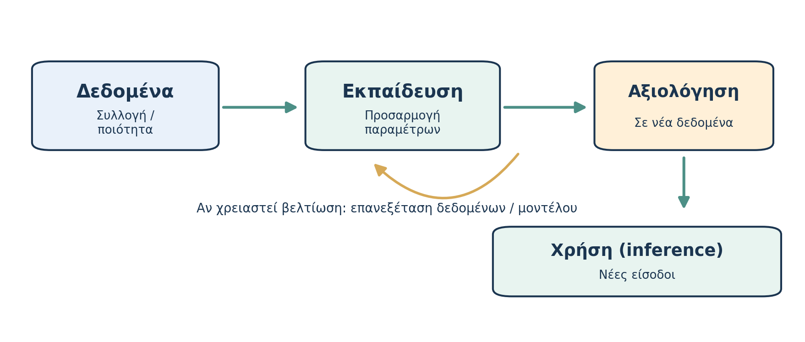

# AL00.3 — Πώς εκπαιδεύεται και αξιολογείται ένα μοντέλο;

*Μέρος Α — Κατανοώ την τεχνολογία*

*Εκτιμώμενος χρόνος: 19 λεπτά.*

**Πριν διαβάσεις — Πρόβλεψη.** Ένα μοντέλο ταξινομεί σωστά το 99% των μηνυμάτων που χρησιμοποίησε για εκπαίδευση. Σημαίνει ότι θα ταξινομεί σωστά και το 99% των νέων μηνυμάτων; Τι πληροφορία λείπει;

## Από τα δεδομένα σε ένα μοντέλο

Ας αναπτύξουμε το παράδειγμα των ανεπιθύμητων μηνυμάτων. Διαθέτουμε πολλά ηλεκτρονικά μηνύματα, ορισμένα χαρακτηρισμένα ως «κανονικά» και άλλα ως «ανεπιθύμητα». Δεν αρκεί να απομνημονεύσει το πρόγραμμα τα συγκεκριμένα μηνύματα. Θέλουμε να αποκτήσει τη δυνατότητα να αντιμετωπίζει **νέα** μηνύματα. Για τον σκοπό αυτό δημιουργούμε ένα σύνολο δεδομένων, ελέγχουμε την ποιότητά του και εκπαιδεύουμε έναν υπολογιστικό μηχανισμό που προσαρμόζει αριθμητικές παραμέτρους.

Κατά την εκπαίδευση το μοντέλο παράγει αποτελέσματα, συγκρίνει με κάποιον εκπαιδευτικό στόχο και προσαρμόζεται μέσω διαδικασιών βελτιστοποίησης. Η συγκεκριμένη μέθοδος εξαρτάται από το πρόβλημα. Τα δεδομένα δεν πρέπει να θεωρούνται αυτονόητα σωστά ή αντιπροσωπευτικά: μπορεί να περιλαμβάνουν λάθη, ελλείψεις ή ανισορροπίες που επηρεάζουν την επίδοση [3].

*Σχήμα 3. Ενδεικτικός κύκλος. Η αξιολόγηση μπορεί να οδηγήσει σε αναθεώρηση δεδομένων και μοντέλου.*

## Τι σημαίνει ότι «έμαθε»;

Στη **Μηχανική Μάθηση** η εκμάθηση συνήθως σημαίνει αλλαγή αριθμητικών παραμέτρων ώστε ένα μοντέλο να εκτελεί καλύτερα μια ορισμένη υπολογιστική εργασία. Δεν είναι ταυτόσημη με την ανθρώπινη κατανόηση. Στην **επιβλεπόμενη μάθηση** τα παραδείγματα συνοδεύονται από γνωστές επιθυμητές εξόδους, όπως η κατηγορία ενός μηνύματος. Σε **μη επιβλεπόμενη μάθηση** ένα μοντέλο μπορεί να αναζητά ομάδες ή δομές χωρίς τέτοιες ετικέτες.

**Προαιρετική εμβάθυνση — Αυτοεπιβλεπόμενη μάθηση.** Σε πολλές σύγχρονες μορφές γλωσσικής εκπαίδευσης, το εκπαιδευτικό σήμα δημιουργείται από το ίδιο το κείμενο, για παράδειγμα με πρόβλεψη επόμενων tokens. Δεν χρειάζεται χειροκίνητη ετικέτα για κάθε πρόταση. Δεν απαιτείται να θυμάσαι την τεχνική διαδικασία, μόνο ότι τα δεδομένα μπορούν να παρέχουν το ίδιο το σήμα εκπαίδευσης.

## Γιατί χρειάζονται διαφορετικά σύνολα δεδομένων;

Αν ένας φοιτητής απομνημονεύσει τις λύσεις δέκα συγκεκριμένων ασκήσεων, μπορεί να επιτύχει άριστα όταν οι ίδιες ασκήσεις εμφανιστούν ξανά. Αυτό δεν αποδεικνύει ότι μπορεί να λύσει μια ενδέκατη, διαφορετική άσκηση. Το αντίστοιχο πρόβλημα στα μοντέλα ονομάζεται **υπερπροσαρμογή (overfitting)**: πολύ καλή προσαρμογή στα δεδομένα εκπαίδευσης αλλά χαμηλότερη επίδοση σε νέα δεδομένα.

Γι' αυτό, σε πολλές εφαρμογές χρησιμοποιούνται **δεδομένα εκπαίδευσης**, **δεδομένα επικύρωσης** και **ανεξάρτητα δεδομένα ελέγχου**. Το σύνολο ελέγχου αξιολογεί την επίδοση σε παραδείγματα που δεν πρέπει να έχουν χρησιμοποιηθεί για την προσαρμογή ή την επιλογή του μοντέλου [3]. Η επιτυχία σε μία δοκιμή δεν εγγυάται ότι το μοντέλο θα λειτουργεί εξίσου καλά σε όλες τις πραγματικές συνθήκες.

Η δυνατότητα αξιοποίησης όσων έμαθε ένα μοντέλο σε νέα κατάλληλα παραδείγματα ονομάζεται **γενίκευση (generalization)**. Το όριο της γενίκευσης είναι ιδιαίτερα σημαντικό όταν τα νέα δεδομένα διαφέρουν από τα δεδομένα εκπαίδευσης.

## Εκπαίδευση και καθημερινή χρήση

Κατά την **εκπαίδευση** προσαρμόζονται παράμετροι. Κατά την **παραγωγή μιας απάντησης (inference)** εφαρμόζεται το εκπαιδευμένο μοντέλο στο νέο αίτημα. Το να χρησιμοποιεί ένα chatbot προηγούμενα μηνύματα της συνομιλίας δεν σημαίνει αυτομάτως ότι το βασικό μοντέλο εκπαιδεύεται εκ νέου. Η προσωρινή αξιοποίηση συμφραζομένων, η αποθηκευμένη μνήμη μιας εφαρμογής και η ενημέρωση παραμέτρων αποτελούν διακριτές λειτουργίες.

**Μικρή δραστηριότητα.** Ένας φοιτητής παίρνει 10/10 σε ερωτήσεις που έχει ήδη διαβάσει μαζί με τις λύσεις τους, αλλά 4/10 σε νέες ερωτήσεις. Ποιο πρόβλημα σου θυμίζει αυτό; Τι διαφορετικό θα ήθελες να ελέγξεις προτού ισχυριστείς ότι «έμαθε»;

**Έλεγχος κατανόησης.** (1) Ποια είναι η διαφορά εκπαίδευσης και inference; (2) Ποιος είναι ο σκοπός του ανεξάρτητου συνόλου ελέγχου; (3) Τι σημαίνει υπερπροσαρμογή; (4) Γιατί έχει σημασία η ποιότητα και αντιπροσωπευτικότητα των δεδομένων;

**Κράτησε:** Εκπαίδευση δεν σημαίνει απομνημόνευση όλων των απαντήσεων. Χρειαζόμαστε αξιολόγηση σε νέα δεδομένα και επίγνωση των περιορισμών γενίκευσης.
