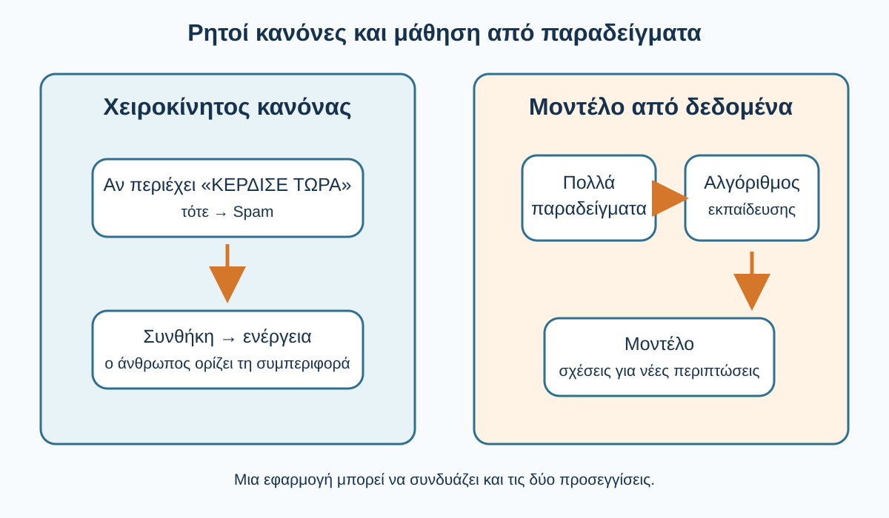
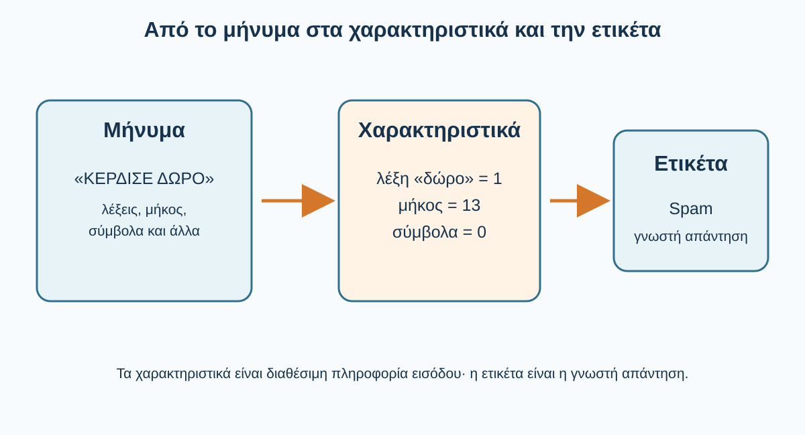
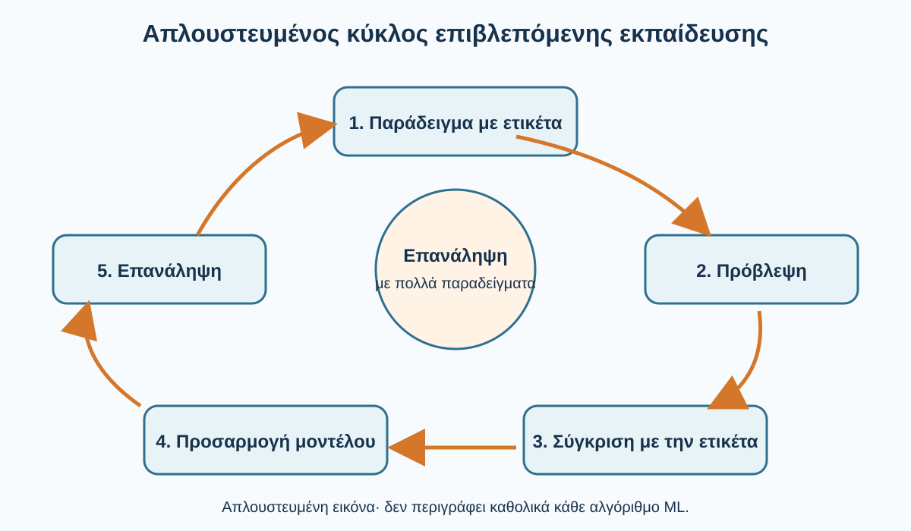
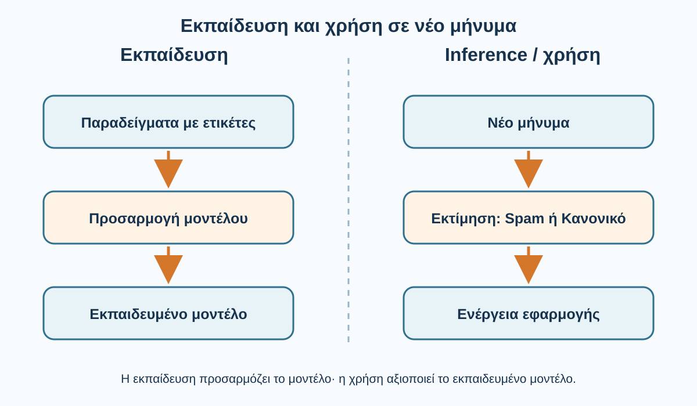
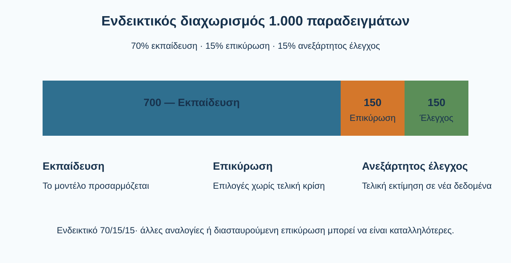
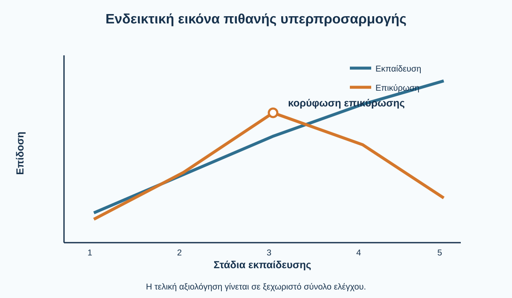
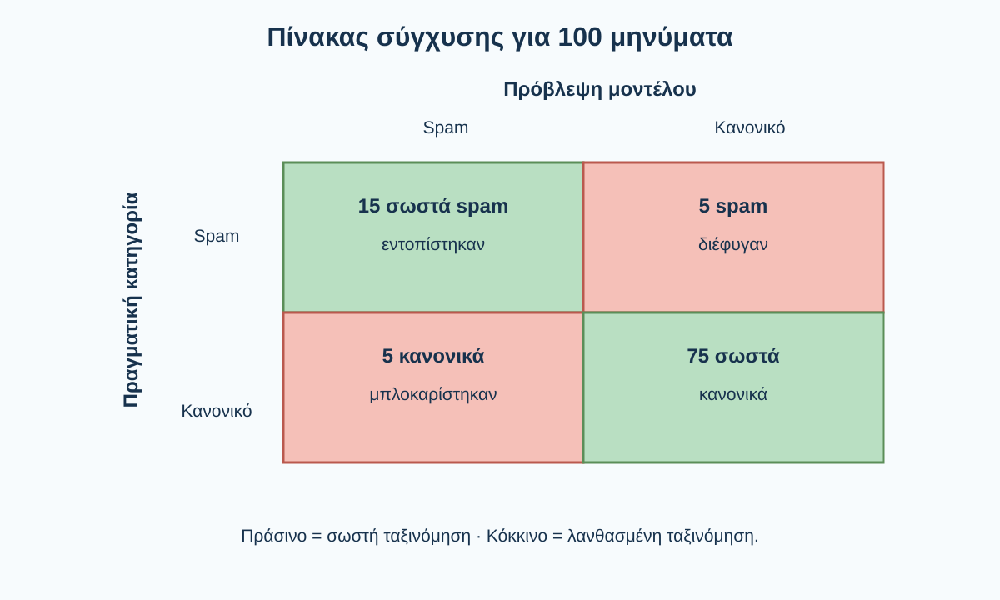
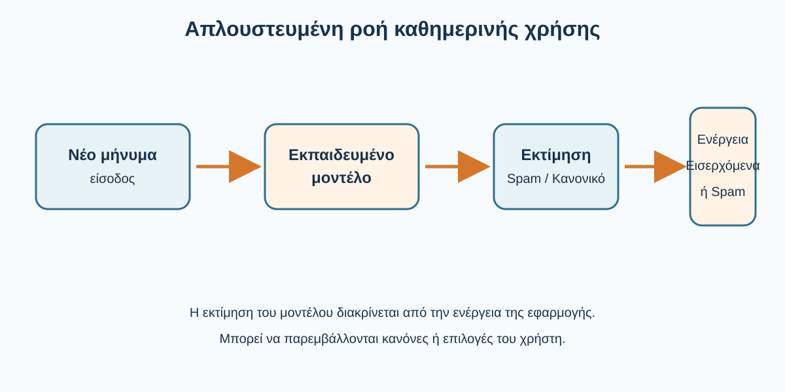
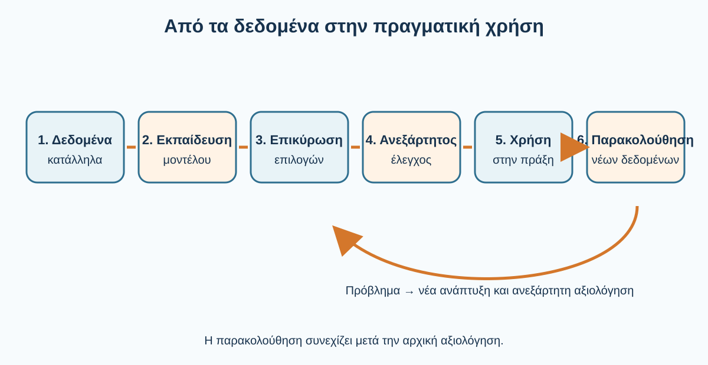

# AL00.3 — Πώς εκπαιδεύεται και πώς αξιολογείται ένα μοντέλο Τεχνητής Νοημοσύνης

**AI Learning Core · Μέρος Α — Κατανοώ την τεχνολογία**
**Ενιαίο εκπαιδευτικό κείμενο v2.1-RC — τελική συνεχής συγγραφική επιμέλεια, όχι δημοσιευμένο**
**Κοινό:** φοιτητές κάθε γνωστικού αντικειμένου, χωρίς προαπαιτούμενο προγραμματισμό

> **Μαθησιακός σκοπός.** Να κατανοήσεις με ποιον τρόπο τα δεδομένα χρησιμοποιούνται για την εκπαίδευση μοντέλων, γιατί η επιτυχία στα γνωστά παραδείγματα δεν αρκεί, πώς ερμηνεύονται οι αξιολογήσεις και πώς οι γνώσεις αυτές σε βοηθούν να χρησιμοποιείς κριτικά και υπεύθυνα τις εφαρμογές ΤΝ.

Στην AL00.2 ξεχωρίσαμε την Τεχνητή Νοημοσύνη (AI), τη Μηχανική Μάθηση (ML), τη Βαθιά Μάθηση (DL) και την Παραγωγική ΤΝ. Τώρα θα μετακινηθούμε από το **«τι είναι»** στο **«πώς αποκτούμε και αξιολογούμε μια χρήσιμη δυνατότητα»**. Δεν θα μάθουμε να προγραμματίζουμε ένα μοντέλο ούτε θα εξετάσουμε πολύπλοκους αλγορίθμους. Θα ακολουθήσουμε ένα σταθερό παράδειγμα: ένα σύστημα αναγνώρισης ανεπιθύμητων μηνυμάτων (*spam*). Στο τέλος, θα μπορέσεις να κρίνεις αν ένα αντίστοιχο σύστημα είναι κατάλληλο για ένα πανεπιστήμιο.

## 3.1 Τι σημαίνει ότι ένα μοντέλο «μαθαίνει»;

### 3.1.1 Πριν διαβάσεις — μια πρόβλεψη

Δύο φοιτητές προετοιμάζονται για εξέταση. Ο πρώτος απομνημονεύει τις λύσεις εκατό συγκεκριμένων ασκήσεων. Ο δεύτερος μελετά λιγότερες, προσπαθώντας να καταλάβει τις αρχές που χρησιμοποιούνται στις λύσεις. Στην εξέταση εμφανίζονται νέες ασκήσεις. Ποιος έχει καλύτερες προϋποθέσεις να ανταποκριθεί;

```{dropdown} Σκέψου πριν αποκαλύψεις — Ενδεικτική απάντηση
:open: false
Ο δεύτερος έχει συχνά καλύτερες προϋποθέσεις να εφαρμόσει όσα κατάλαβε σε νέες ασκήσεις. Δεν μπορούμε να προβλέψουμε με βεβαιότητα την επίδοση των δύο φοιτητών μόνο από αυτή τη σύντομη περιγραφή. Η αξία της αναλογίας βρίσκεται στη διάκριση ανάμεσα στην απομνημόνευση συγκεκριμένων λύσεων και στην αντιμετώπιση άγνωστων περιπτώσεων. Η ανθρώπινη μάθηση, πάντως, δεν ταυτίζεται με τη μηχανική.
```

### 3.1.2 Προκαθορισμένοι κανόνες ή μάθηση από παραδείγματα;

Φαντάσου ένα πρόγραμμα που χαρακτηρίζει ως ανεπιθύμητο κάθε μήνυμα που περιέχει τη φράση «ΚΕΡΔΙΣΕ ΤΩΡΑ». Ο κανόνας είναι σαφής: αν εντοπιστεί η φράση, το μήνυμα πηγαίνει στον φάκελο spam. Ένας προγραμματιστής έγραψε ρητά τι πρέπει να συμβαίνει. Το πρόγραμμα δεν χρειάζεται να έχει εκπαιδευτεί με προηγούμενα μηνύματα.

Τι θα συμβεί όμως με τη φράση «Συγχαρητήρια, κέρδισες ένα δώρο»; Ή με ένα κανονικό μήνυμα που αναλύει μια διαφημιστική καμπάνια και περιέχει αυτούσια τη φράση «ΚΕΡΔΙΣΕ ΤΩΡΑ»; Ένας μόνο κανόνας δεν αρκεί. Θα μπορούσαμε να προσθέσουμε περισσότερους, αλλά όσο αυξάνεται η ποικιλία των μηνυμάτων τόσο δυσκολότερο γίνεται να προβλέψουμε όλες τις περιπτώσεις εκ των προτέρων.

Στη Μηχανική Μάθηση ακολουθούμε μια διαφορετική προσέγγιση. Δίνουμε σε έναν κατάλληλο αλγόριθμο πολλά παραδείγματα μηνυμάτων και, στην απλή περίπτωση που εξετάζουμε, γνωρίζουμε ήδη αν κάθε μήνυμα είναι κανονικό ή ανεπιθύμητο. Η διαδικασία εκπαίδευσης διαμορφώνει ένα μοντέλο που μπορεί να αξιοποιεί σχέσεις ανάμεσα στις πληροφορίες του μηνύματος και στην κατηγορία του. Το ζητούμενο δεν είναι να θυμάται όλες τις γραμμές μιας λίστας αλλά να μπορεί να αξιοποιεί όσα αναπτύχθηκαν κατά την εκπαίδευση και σε νέες περιπτώσεις.



*Σχήμα 3.1. Στον προγραμματισμό με ρητούς κανόνες ο άνθρωπος ορίζει τη συνθήκη και την ενέργεια. Στη Μηχανική Μάθηση ο αλγόριθμος αξιοποιεί δεδομένα για να διαμορφώσει ένα μοντέλο. Στην πράξη, μια εφαρμογή μπορεί να συνδυάζει και τις δύο προσεγγίσεις.*

Η διαφορά δεν είναι ότι το πρώτο σύστημα είναι «ανόητο» και το δεύτερο «έξυπνο». Η διαφορά αφορά τον τρόπο με τον οποίο προσδιορίζεται η συμπεριφορά τους. Ακόμη και στην ML, οι άνθρωποι επιλέγουν το πρόβλημα, τη μέθοδο, τα δεδομένα, τον στόχο εκπαίδευσης και τον τρόπο αξιολόγησης.

### 3.1.3 Τι σημαίνει τεχνικά «έμαθε»;

Στη Μηχανική Μάθηση ο όρος *μάθηση* περιγράφει μια υπολογιστική διαδικασία: ένα μοντέλο αναπτύσσεται ή προσαρμόζεται, ώστε να εκτελεί καλύτερα μια συγκεκριμένη εργασία σύμφωνα με κάποιο κριτήριο. Σε πολλές μεθόδους αυτή η διαδικασία περιλαμβάνει την αλλαγή αριθμητικών παραμέτρων. Σε άλλες, η μαθημένη δομή μπορεί να έχει διαφορετική μορφή.

Δεν σημαίνει ότι το μοντέλο καταλαβαίνει ένα μήνυμα όπως ο άνθρωπος που το λαμβάνει. Ένα σύστημα μπορεί να διαχωρίζει αποτελεσματικά κανονικά και ανεπιθύμητα μηνύματα χωρίς να έχει ανθρώπινες εμπειρίες ή προθέσεις. Η ίδια προσοχή χρειάζεται όταν περιγράφουμε ένα chatbot: το γεγονός ότι παράγει εύστοχη εξήγηση δεν αποδεικνύει από μόνο του ανθρώπινο τρόπο κατανόησης.

Για να κρίνουμε αν η εκπαίδευση ήταν χρήσιμη, θα πρέπει τελικά να εξετάσουμε την επίδοση του μοντέλου σε νέα δεδομένα. Αυτή η δυνατότητα λέγεται **γενίκευση**. Θα τη μελετήσουμε ειδικότερα στην 3.5· εδώ αρκεί να συγκρατήσουμε το ερώτημα: *μπορεί το μοντέλο να αντιμετωπίσει και παραδείγματα που δεν έχει ήδη χρησιμοποιήσει;*

**Ένα πρώτο παράδειγμα γενίκευσης.** Ας συγκρίνουμε δύο υποθετικά μοντέλα που εκπαιδεύτηκαν με τα ίδια 100 μηνύματα και δοκιμάστηκαν στα ίδια 20 νέα μηνύματα:

| Αποτέλεσμα | Μοντέλο Α | Μοντέλο Β |
|---|---:|---:|
| Σωστές ταξινομήσεις στα 100 γνωστά μηνύματα | 100 | 92 |
| Σωστές ταξινομήσεις στα 20 νέα μηνύματα | 11 | 18 |

Το Μοντέλο Α πέτυχε το απόλυτο στα γνωστά μηνύματα, αλλά μόνο 11 σωστές απαντήσεις στα 20 νέα. Το Β δεν ήταν τέλειο στην εκπαίδευση, όμως πέτυχε 18 σωστές απαντήσεις στα νέα μηνύματα. **Ποιο θα προτιμούσες να εξετάσεις περαιτέρω για πραγματική χρήση και γιατί;** Η επίδοση του Β είναι πιο ενθαρρυντική ως πρώτη ένδειξη γενίκευσης. Ωστόσο, είκοσι νέα μηνύματα είναι λίγα για οριστική απόφαση: χρειαζόμαστε περισσότερα αντιπροσωπευτικά παραδείγματα, ανάλυση του είδους των λαθών και ανεξάρτητο έλεγχο. Στην 3.5 θα επιστρέψουμε σε τέτοιες διαφορές για να κατανοήσουμε την υπερπροσαρμογή.

### 3.1.4 Ένα χρήσιμο σημείο προσοχής: τι δεν ξέρουμε από τη λειτουργία

Αν δούμε στην οθόνη ότι μια εφαρμογή ξεχωρίζει κανονικά από ανεπιθύμητα μηνύματα, δεν γνωρίζουμε αυτόματα τον ακριβή τρόπο με τον οποίο το κάνει. Μπορεί να χρησιμοποιεί αποκλειστικά κανόνες, κάποιο εκπαιδευμένο μοντέλο ή συνδυασμό των δύο. Η ίδια προσεκτική στάση που αναπτύξαμε στην AL00.2 ισχύει και εδώ: **πρώτα περιγράφουμε τι κάνει το σύστημα και έπειτα, εφόσον έχουμε τεκμηρίωση, πώς το υλοποιεί**.

Σε μια πραγματική εφαρμογή μπορεί, για παράδειγμα, ένας κανόνας να εμποδίζει μηνύματα από διευθύνσεις που έχουν ήδη επιβεβαιωθεί ως κακόβουλες, ενώ ένα εκπαιδευμένο μοντέλο να εξετάζει άλλα μηνύματα με πιο αβέβαια χαρακτηριστικά. Η ύπαρξη του μοντέλου δεν καταργεί αυτομάτως τους κανόνες, ούτε η ύπαρξη κανόνων σημαίνει ότι δεν χρησιμοποιείται Μηχανική Μάθηση. Αυτό που έχει σημασία για τον χρήστη είναι να κατανοεί τι μπορεί να κάνει η εφαρμογή και πώς ελέγχονται οι αποφάσεις της.

### 3.1.5 Μια πρώτη μικρή δοκιμή

Ένα πανεπιστημιακό σύστημα ταξινομεί αιτήματα φοιτητών ως «Γραμματεία», «Βιβλιοθήκη» ή «Τεχνική Υποστήριξη». Πετυχαίνει 98 σωστές ταξινομήσεις στα 100 αιτήματα εκπαίδευσης, αλλά μόνο 18 στις 30 νέες αιτήσεις.

**Ερώτηση Α.** Αρκεί η επίδοση 98/100 για να ανακοινώσουμε ότι το σύστημα είναι αξιόπιστο; **Ερώτηση Β.** Τι πρόσθετο έλεγχο θα ζητούσες;

```{dropdown} Ενδεικτική λύση — Το μοντέλο έμαθε;
:open: false
Όχι. Το 98/100 δείχνει υψηλή επίδοση στα συγκεκριμένα γνωστά παραδείγματα, όχι αξιόπιστη συμπεριφορά σε νέες συνθήκες. Η επίδοση 18/30 είναι σημαντικά χαμηλότερη και απαιτεί διερεύνηση. Θα ζητούσαμε περισσότερα κατάλληλα νέα αιτήματα, ανάλυση των σφαλμάτων και έλεγχο κατά πόσο τα παραδείγματα εκπαίδευσης αντιπροσωπεύουν τα πραγματικά αιτήματα. Δεν γνωρίζουμε ακόμη αν η διαφορά οφείλεται σε υπερπροσαρμογή, σε πιο δύσκολα νέα αιτήματα ή σε πρόβλημα των δεδομένων.
```

**Μικρός αυτοέλεγχος — επίλεξε και αιτιολόγησε.** Για το σύστημα των 100 γνωστών και 30 νέων αιτημάτων:

1. Η επίδοση 98/100 αποδεικνύει αξιοπιστία; **Α:** Ναι, επειδή πλησιάζει το 100%. **Β:** Όχι, επειδή πρέπει να εξετάσουμε και νέα δεδομένα.
2. Ποιο στοιχείο μάς προβληματίζει περισσότερο; **Α:** Οι 18 σωστές ταξινομήσεις στα 30 νέα αιτήματα. **Β:** Το ότι υπάρχουν τρεις κατηγορίες.
3. Ποια είναι η καταλληλότερη επόμενη ενέργεια; **Α:** Αξιολόγηση περισσότερων αντιπροσωπευτικών αιτημάτων και ανάλυση λαθών. **Β:** Ανακοίνωση μόνο της επίδοσης εκπαίδευσης.

```{dropdown} Ενδεικτικές επιλογές και αιτιολόγηση — Μικρός αυτοέλεγχος
:open: false
1: **Β**. Η επίδοση στα γνωστά δεδομένα δεν αποδεικνύει την επίδοση σε νέες περιπτώσεις. 2: **Α**. Η χαμηλότερη επίδοση στα νέα αιτήματα απαιτεί διερεύνηση· το πλήθος κατηγοριών δεν αποτελεί από μόνο του σφάλμα. 3: **Α**. Εξετάζουμε αντιπροσωπευτικά νέα αιτήματα και τα είδη σφαλμάτων πριν αποφασίσουμε. Η διαφορά επίδοσης είναι ένδειξη προς διερεύνηση, όχι βέβαιη διάγνωση υπερπροσαρμογής.
```

**Τρεις ιδέες για να θυμάσαι:** Η εκπαίδευση δεν ταυτίζεται με την καταγραφή όλων των κανόνων. Η υψηλή επίδοση στα γνωστά παραδείγματα δεν εγγυάται την επίδοση στα νέα. Η αξιολόγηση απαιτεί κατάλληλα δεδομένα και προσεκτική ερμηνεία.

## 3.2 Από πού προέρχονται τα δεδομένα και γιατί έχει σημασία η ποιότητά τους;

Στην 3.1 είδαμε ότι η επιτυχία στα γνωστά παραδείγματα δεν εγγυάται καλή επίδοση σε νέες περιπτώσεις. Τι συμβαίνει όμως όταν τα ίδια τα παραδείγματα δεν είναι κατάλληλα;

Η εκπαίδευση αρχίζει πριν από την εκτέλεση οποιουδήποτε αλγορίθμου: πρέπει να έχουμε κατάλληλα δεδομένα. Ακόμη και μια εξελιγμένη μέθοδος μπορεί να αποδώσει φτωχά αν τα παραδείγματα είναι ελλιπή, παρωχημένα, λανθασμένα ή άσχετα με τη μελλοντική χρήση.

**Μετά τη μελέτη της ενότητας** θα μπορείς να διακρίνεις παραδείγματα, χαρακτηριστικά και ετικέτες, να αναγνωρίζεις προβλήματα ποιότητας και να αιτιολογείς την επιλογή δεδομένων για συγκεκριμένη χρήση.

### 3.2.1 Παραδείγματα και ετικέτες

Στο υποθετικό σύστημα spam συγκεντρώνουμε ηλεκτρονικά μηνύματα. Για το καθένα γνωρίζουμε, μετά από κατάλληλο έλεγχο, αν ανήκει στην κατηγορία «Κανονικό» ή «Spam». Κάθε μήνυμα είναι ένα **παράδειγμα** και η γνωστή επιθυμητή απάντηση είναι η **ετικέτα (label)**. Η προσέγγιση αυτή είναι μία μορφή **επιβλεπόμενης μάθησης**.

| Ενδεικτικό μήνυμα | Ετικέτα |
|---|---|
| «Η συνάντησή μας θα γίνει αύριο στις 10:00» | Κανονικό |
| «Κέρδισες δωρεάν δώρο! Πάτησε εδώ» | Spam |
| «Σου επισυνάπτω τις σημειώσεις της διάλεξης» | Κανονικό |
| «ΕΠΕΙΓΟΝ! Επιβεβαίωσε τον λογαριασμό σου» | Spam |
| «Η παραγγελία σου αποστάλθηκε» | Κανονικό |

*Πίνακας 3.1. Κατασκευασμένα παραδείγματα αποκλειστικά για την εξήγηση. Δεν αποτελούν πραγματική συλλογή μηνυμάτων ούτε επαρκές σύνολο εκπαίδευσης.*

Οι ετικέτες μπορεί να προκύπτουν από ανθρώπινη επισήμανση ή άλλες τεκμηριωμένες διαδικασίες· η ορθότητά τους χρειάζεται έλεγχο. Ένα νόμιμο μήνυμα μπορεί να χαρακτηριστεί λανθασμένα ως ανεπιθύμητο· ένα παραπλανητικό μήνυμα μπορεί να χαρακτηριστεί κανονικό. Εφόσον τα λάθη επαναλαμβάνονται στα δεδομένα, είναι πιθανό να επηρεάσουν το μοντέλο. Η καταχώριση μιας ετικέτας σε μια στήλη δεν την κάνει αυτομάτως αληθινή.

### 3.2.2 Τι είναι τα χαρακτηριστικά;

Για να διαχωρίσουμε δύο κατηγορίες, μπορεί να αξιοποιήσουμε πληροφορίες όπως λέξεις, εκφράσεις, παρουσία συνδέσμων ή τη δομή ενός μηνύματος. Οι πληροφορίες που χρησιμοποιεί ένα μοντέλο για την εργασία του λέγονται **χαρακτηριστικά (features)**. Σε ορισμένες μεθόδους τα χαρακτηριστικά επιλέγονται ρητά· σε άλλες, το μοντέλο μαθαίνει χρήσιμες αναπαραστάσεις των δεδομένων κατά την εκπαίδευσή του.

Στο μήνυμα «Κέρδισες δώρο! Πάτησε εδώ», μια απλουστευμένη αναπαράσταση θα μπορούσε να σημειώνει «περιέχει τη λέξη δώρο» και «περιέχει προτροπή για ενέργεια». Δεν θα δηλώναμε ότι περιέχει πραγματικό σύνδεσμο, αν τέτοιος σύνδεσμος δεν εμφανίζεται. Η ετικέτα «Spam» είναι η γνωστή απάντηση που χρησιμοποιείται στην εκπαίδευση· **δεν πρέπει να παρέχεται ως χαρακτηριστικό εισόδου** όταν το μοντέλο καλείται να αποφασίσει για άγνωστο μήνυμα.



*Σχήμα 3.2. Τα χαρακτηριστικά περιγράφουν διαθέσιμη πληροφορία εισόδου· η ετικέτα είναι η γνωστή απάντηση για το παράδειγμα εκπαίδευσης. Η πραγματική αναπαράσταση μπορεί να είναι πολύ πιο σύνθετη.*

### 3.2.3 Ποιος αποφασίζει ποια ετικέτα είναι σωστή;

Η λέξη «γνωστή» στην έκφραση «γνωστή ετικέτα» χρειάζεται προσοχή. Σημαίνει ότι διαθέτουμε μια απάντηση την οποία χρησιμοποιούμε ως σημείο αναφοράς, όχι ότι αυτή είναι αναγκαστικά αλάνθαστη. Σε ένα πραγματικό έργο μπορεί περισσότερα άτομα να εξετάζουν δύσκολες περιπτώσεις και να διαφωνούν. Ένα διαφημιστικό μήνυμα, για παράδειγμα, μπορεί να έχει αποσταλεί ύστερα από νόμιμη συγκατάθεση, παρότι κάποιος χρήστης το θεωρεί ενοχλητικό. Η ομάδα ανάπτυξης πρέπει πρώτα να ορίσει με σαφήνεια τις κατηγορίες και να τεκμηριώσει τον τρόπο επισήμανσης.

Όταν η αξιολόγηση δείξει ότι το μοντέλο «έκανε λάθος», χρειάζεται να είμαστε βέβαιοι ότι το πρόβλημα δεν βρίσκεται στην ίδια την ετικέτα του παραδείγματος. Αλλιώς μπορεί να επιχειρούμε να διορθώσουμε ένα μοντέλο που έδωσε εύλογη εκτίμηση σε αμφίσημη περίπτωση. Για τον φοιτητή που χρησιμοποιεί εφαρμογές ΤΝ, το αντίστοιχο μάθημα είναι ότι ακόμη και οι αριθμοί αξιολόγησης βασίζονται σε ανθρώπινες αποφάσεις για το τι μετρά ως σωστό.

### 3.2.4 Πολλά δεδομένα ή κατάλληλα δεδομένα;

Ας συγκρίνουμε δύο ομάδες. Η πρώτη διαθέτει 10.000 παλαιότερα μηνύματα, κυρίως του ίδιου τύπου. Η δεύτερη διαθέτει 3.000 πρόσφατα μηνύματα με μεγαλύτερη ποικιλία από εκείνα που αναμένεται να εμφανίζονται στην εφαρμογή. Δεν μπορούμε να αποφασίσουμε ποια συλλογή είναι καλύτερη μόνο από το πλήθος. Οι 10.000 εγγραφές μπορεί να είναι επαναλαμβανόμενες ή παρωχημένες. Οι 3.000 μπορεί να είναι καταλληλότερες για τη συγκεκριμένη χρήση, αλλά ενδέχεται να μην επαρκούν ή να έχουν άλλες ελλείψεις.

Η **ποιότητα** των δεδομένων έχει πολλές διαστάσεις:

- **Πληρότητα:** υπάρχουν οι πληροφορίες που απαιτεί η εργασία;
- **Ορθότητα:** είναι σωστά καταχωρισμένα τα παραδείγματα και οι ετικέτες;
- **Ποικιλία και αντιπροσωπευτικότητα:** καλύπτονται οι πραγματικές περιπτώσεις χρήσης;
- **Επικαιρότητα:** αντανακλούν τα δεδομένα τις συνθήκες στις οποίες θα λειτουργήσει η εφαρμογή;
- **Καταλληλότητα για τον σκοπό:** εξυπηρετούν πράγματι την εργασία για την οποία θα εκπαιδευτεί το μοντέλο; Για παράδειγμα, μια συλλογή αποκλειστικά αγγλικών email δεν αρκεί από μόνη της για να τεκμηριώσει την επίδοση ενός συστήματος που πρόκειται να λειτουργεί κυρίως σε ελληνόγλωσση αλληλογραφία.

Ας προσθέσουμε και ένα παράδειγμα διαφορετικής ποιότητας. Μια συλλογή μπορεί να έχει πάρα πολλά μηνύματα που διαφέρουν ελάχιστα μεταξύ τους: δεκάδες χιλιάδες σχεδόν πανομοιότυπες διαφημίσεις από τον ίδιο αποστολέα. Αυτό δημιουργεί την εντύπωση ότι διαθέτουμε μεγάλη ποικιλία, ενώ στην πράξη το μοντέλο συναντά επανειλημμένα σχεδόν το ίδιο περιεχόμενο. Αντίθετα, μια μικρότερη αλλά καλά επιλεγμένη συλλογή μπορεί να περιλαμβάνει διαφορετικές γλώσσες, μορφές και τύπους απάτης που έχουν πραγματική σημασία. Δεν σημαίνει ότι το μικρότερο σύνολο είναι πάντα ανώτερο· σημαίνει ότι **χρειάζεται να μετράμε την καταλληλότητα, όχι μόνο τις εγγραφές**.

### 3.2.5 Όταν οι κατηγορίες δεν είναι ισόρροπες

Ας υποθέσουμε ότι από 100 μηνύματα τα 95 είναι κανονικά και μόνο τα 5 είναι spam. Ένα πρόχειρο σύστημα που χαρακτηρίζει **όλα** τα μηνύματα «Κανονικά» θα έχει 95 σωστές αποφάσεις, δηλαδή 95% συνολική ακρίβεια. Όμως δεν θα εντοπίσει **κανένα** από τα πέντε πραγματικά spam.

| Πραγματική κατηγορία | Πλήθος | Πρόβλεψη «Όλα κανονικά» | Σωστά |
|---|---:|---|---:|
| Κανονικά | 95 | Κανονικό | 95 |
| Spam | 5 | Κανονικό | 0 |
| **Σύνολο** | **100** | | **95** |

*Πίνακας 3.2. Υποθετικό παράδειγμα ανισορροπίας κατηγοριών. Υψηλό συνολικό ποσοστό δεν σημαίνει ότι η εφαρμογή επιτυγχάνει τον σκοπό της.*

**Δοκίμασε δύο απλές στρατηγικές.** Αν χαρακτηρίσουμε όλα τα 100 μηνύματα «Κανονικά», έχουμε 95 σωστά και 0 εντοπισμένα spam. Αν τα χαρακτηρίσουμε όλα «Spam», έχουμε μόνο 5 σωστά και μπλοκάρουμε λανθασμένα 95 κανονικά. Και οι δύο στρατηγικές αγνοούν το περιεχόμενο των μηνυμάτων. Πριν δεις την επεξήγηση, πρόβλεψε ποια θα δώσει μεγαλύτερο συνολικό ποσοστό επιτυχίας.

```{dropdown} Ενδεικτική λύση — Δύο στρατηγικές χωρίς πραγματική αναγνώριση
:open: false
Η στρατηγική «Όλα κανονικά» επιτυγχάνει 95/100 = 95%, ενώ η «Όλα spam» επιτυγχάνει 5/100 = 5%. Το 95% φαίνεται καλό μόνο επειδή κυριαρχούν τα κανονικά μηνύματα. Η πρώτη στρατηγική δεν αναγνωρίζει ούτε ένα πραγματικό spam· η δεύτερη μπλοκάρει σχεδόν όλη την κανονική αλληλογραφία.
```

Η ανισορροπία κατηγοριών δεν είναι πάντα λάθος των δεδομένων· μπορεί να αντανακλά την πραγματική συχνότητα των περιπτώσεων. Σημαίνει, όμως, ότι πρέπει να εξετάζουμε προσεκτικά την επίδοση ανά κατηγορία. Στην 3.6 θα δούμε πώς διαβάζουμε τέτοια αποτελέσματα.

### 3.2.6 Στρεβλώσεις, προέλευση και υπεύθυνη χρήση

Τα δεδομένα μπορεί να μην εκπροσωπούν επαρκώς όλες τις συνθήκες χρήσης. Ένα σύστημα εκπαιδευμένο κυρίως σε αγγλόγλωσσα email μπορεί να αποδίδει χειρότερα όταν χρησιμοποιείται σε ελληνόγλωσσα. Σε εφαρμογές που επηρεάζουν ανθρώπους, ιστορικές στρεβλώσεις των δεδομένων μπορεί ακόμη να συντηρούν ή να ενισχύουν άδικες πρακτικές. Για παράδειγμα, ένα σύστημα αξιολόγησης αιτήσεων που βασίζεται σε παλαιότερες άδικες αποφάσεις μπορεί να αναπαράγει τις ίδιες ανισότητες. Η αξιολόγηση πρέπει επομένως να εξετάζει όχι μόνο το συνολικό αποτέλεσμα, αλλά και τις περιπτώσεις όπου εμφανίζονται προβλήματα.

Τα δεδομένα μπορεί να προέρχονται από δημόσια σύνολα, κατάλληλες ερευνητικές συλλογές, αισθητήρες, ερωτηματολόγια ή καταγραφές υπηρεσιών. Ωστόσο, η διαθεσιμότητα δεν ισοδυναμεί με άδεια ανεξέλεγκτης χρήσης. Ιδιαίτερα για την ηλεκτρονική αλληλογραφία, πρέπει να εξετάζουμε τη νόμιμη βάση επεξεργασίας, την προστασία προσωπικών δεδομένων, την αναγκαιότητα και τους όρους χρήσης. Δεν συγκεντρώνουμε αυθαίρετα ιδιωτική αλληλογραφία φοιτητών ή εργαζομένων μόνο και μόνο επειδή θα ήταν χρήσιμη για εκπαίδευση. Στο παρόν μάθημα όλα τα μηνύματα είναι **κατασκευασμένα εκπαιδευτικά παραδείγματα**.

### 3.2.7 Καθοδηγούμενη δραστηριότητα — Επιλογή δεδομένων

Ένα ελληνικό πανεπιστήμιο εξετάζει τρεις συλλογές: **Α:** 20.000 κυρίως παλαιότερα αγγλόγλωσσα μηνύματα· **Β:** 4.000 πρόσφατα ελληνόγλωσσα μηνύματα με ελεγμένες ετικέτες· **Γ:** 15.000 πρόσφατα πολύγλωσσα μηνύματα με αρκετές ανεξέλεγκτες ετικέτες και ανεπαρκώς τεκμηριωμένη προέλευση.

**Ερώτηση 1.** Ποια συλλογή φαίνεται καταλληλότερη ως αρχική υποψήφια; **Ερώτηση 2.** Αν η Β περιλαμβάνει 3.900 κανονικά και 100 spam, τι πρέπει να προσέξουμε; **Ερώτηση 3.** Θα ήταν σωστό να ενώσουμε αυτομάτως τις τρεις συλλογές;

```{dropdown} Ενδεικτική λύση — Επιλογή και έλεγχος συλλογής
:open: false
Η Β φαίνεται πιο συναφής ως αφετηρία, επειδή περιέχει πρόσφατα ελληνόγλωσσα μηνύματα με ελεγμένες ετικέτες. Δεν ξέρουμε ακόμη αν είναι επαρκής: χρειάζονται έλεγχοι ποικιλίας, αντιπροσωπευτικότητας και νόμιμης προέλευσης. Τα 3.900 κανονικά έναντι 100 spam δηλώνουν σημαντική ανισορροπία, άρα η συνολική ακρίβεια μπορεί να αποκρύπτει χαμηλή επίδοση στην αναγνώριση spam. Ο αυτόματος συνδυασμός Α, Β και Γ δεν εγγυάται βελτίωση· πρώτα εξετάζουμε ποιότητα, ετικέτες, επαναλήψεις, καταλληλότητα και δικαιώματα χρήσης.
```

**Εφαρμογή.** Γράψε εισήγηση 100–150 λέξεων: ποια συλλογή θα χρησιμοποιούσες αρχικά, ποιους ελέγχους θα απαιτούσες και γιατί;

```{dropdown} Ενδεικτική εισήγηση — Τι θα έγραφα στην ομάδα ανάπτυξης;
:open: false
Θα πρότεινα τη συλλογή Β ως υποψήφια αφετηρία, επειδή είναι πιο κοντά στη γλώσσα και στις συνθήκες του πανεπιστημίου και διαθέτει ελεγμένες ετικέτες. Δεν θα ξεκινούσα αμέσως εκπαίδευση. Θα επιβεβαίωνα τη νόμιμη προέλευση και τους όρους χρήσης, θα αναζητούσα λανθασμένες ή διπλές εγγραφές και θα εξέταζα αν εκπροσωπούνται οι διαφορετικοί τύποι μηνυμάτων που δέχονται οι χρήστες. Θα έδινα ιδιαίτερη προσοχή στην ανισορροπία ανάμεσα σε κανονικά και ανεπιθύμητα μηνύματα, γιατί ένα υψηλό συνολικό ποσοστό σωστών αποφάσεων μπορεί να κρύβει αποτυχία στον εντοπισμό spam. Θα εξέταζα το ενδεχόμενο κατάλληλης ενίσχυσης της συλλογής μόνο με ποιοτικά και επιτρεπτά δεδομένα και θα όριζα έλεγχο σε ανεξάρτητα, αντιπροσωπευτικά μηνύματα.
```

### 3.2.8 Τι κρατάμε από την ενότητα

Η υπεύθυνη ανάπτυξη μοντέλων ξεκινά ήδη από τη συλλογή και τον έλεγχο των δεδομένων, πριν από την εκπαίδευση. Τα περισσότερα παραδείγματα δεν είναι πάντοτε καλύτερα· οι αξιόπιστες ετικέτες, η αντιπροσωπευτικότητα και η τεκμηριωμένη προέλευση έχουν σημασία. Ακόμη και μια εντυπωσιακή συνολική επίδοση μπορεί να κρύβει αποτυχία στη λιγότερο συχνή αλλά σημαντική κατηγορία.

**Κράτησε:** Πλήθος, ποιότητα, αντιπροσωπευτικότητα, ετικέτες και νόμιμη προέλευση πρέπει να εξετάζονται μαζί.

**Μετάβαση στην 3.3.** Έχουμε καταλάβει ποια παραδείγματα και πληροφορίες είναι κατάλληλα. Στη συνέχεια θα εξετάσουμε πώς η διαδικασία εκπαίδευσης τα αξιοποιεί για να διαμορφώσει ένα μοντέλο, χωρίς μαθηματικούς τύπους ή προγραμματισμό.

## 3.3 Πώς πραγματοποιείται η εκπαίδευση ενός μοντέλου;

Στις προηγούμενες ενότητες είδαμε πώς ένα μοντέλο αξιοποιεί παραδείγματα και γιατί η ποιότητα των δεδομένων έχει σημασία. Τώρα θα εξετάσουμε πώς τα παραδείγματα αυτά χρησιμοποιούνται για να διαμορφωθεί ένα εκπαιδευμένο μοντέλο. Δεν χρειάζονται μαθηματικοί τύποι ή προγραμματισμός: θα ακολουθήσουμε βήμα προς βήμα το γνώριμο σύστημα αναγνώρισης spam.

**Τι θα μάθεις.** Μετά τη μελέτη θα μπορείς να περιγράφεις τα βασικά στάδια της εκπαίδευσης, να εξηγείς τον ρόλο των αρχικών λανθασμένων προβλέψεων και της ανατροφοδότησης, και να διακρίνεις την εκπαίδευση από τη χρήση του μοντέλου.

### 3.3.1 Η αρχική πρόβλεψη μπορεί να είναι λάθος

Αρχικά επιλέγουμε κατάλληλη μέθοδο και δημιουργούμε το μοντέλο. Ανάλογα με τη μέθοδο μπορεί να ξεκινά με αριθμητικές παραμέτρους ή άλλη δομή που δεν έχει ακόμη προσαρμοστεί στα συγκεκριμένα δεδομένα. Δεν υπάρχει λόγος να θεωρούμε τις αρχικές εκτιμήσεις αξιόπιστες. Όταν εξετάζει το μήνυμα «Κέρδισες δωρεάν δώρο! Πάτησε εδώ», μπορεί αρχικά να το χαρακτηρίσει ως «Κανονικό», παρότι η γνωστή ετικέτα είναι «Spam». Η διαφορά ανάμεσα στην εκτίμηση και στη γνωστή απάντηση δίνει χρήσιμη πληροφορία στη διαδικασία εκπαίδευσης. Δεν χρειάζεται κάθε λάθος να οδηγεί σε έναν καινούριο χειροκίνητο κανόνα.

### 3.3.2 Πρόβλεψη, σύγκριση, προσαρμογή

Μια συνηθισμένη διαδικασία επιβλεπόμενης μάθησης μπορεί να παρουσιαστεί σε τέσσερα βήματα:

1. **Παράδειγμα:** παρουσιάζουμε μήνυμα με γνωστή κατηγορία.
2. **Πρόβλεψη:** το μοντέλο εκτιμά «Κανονικό» ή «Spam».
3. **Σύγκριση:** η εκτίμηση αντιπαραβάλλεται με τη γνωστή απάντηση. Η μέτρηση της απόκλισης μπορεί να αξιοποιεί περισσότερες πληροφορίες από το απλό «σωστό» ή «λάθος».
4. **Προσαρμογή:** η διαδικασία εκπαίδευσης τροποποιεί τις παραμέτρους ή τη μαθημένη δομή, ανάλογα με τη μέθοδο, ώστε να υπηρετεί καλύτερα τον καθορισμένο στόχο.

Τα βήματα μπορεί να επαναλαμβάνονται με διαφορετικά παραδείγματα. **Δεν χρησιμοποιούν όλοι οι αλγόριθμοι τον ίδιο επαναληπτικό μηχανισμό**· το σχήμα που ακολουθεί είναι εκπαιδευτική απλούστευση και όχι καθολική συνταγή. Η εκπαίδευση είναι οργανωμένη υπολογιστική διαδικασία, όχι αυθαίρετη δοκιμή απαντήσεων.



*Σχήμα 3.3. Απλουστευμένος κύκλος επιβλεπόμενης εκπαίδευσης, όχι καθολική περιγραφή κάθε αλγορίθμου ML.*

Ας μετρήσουμε πόσα από **τα ίδια 100 παραδείγματα εκπαίδευσης** ταξινομεί σωστά ένα υποθετικό μοντέλο σε τρία στάδια:

| Στάδιο | Σωστές ταξινομήσεις στα 100 γνωστά μηνύματα |
|---|---:|
| Αρχή | 54 |
| Μέση | 76 |
| Τέλος | 94 |

Οι αριθμοί είναι κατασκευασμένοι. Δείχνουν ότι η συμπεριφορά του μοντέλου μπορεί να βελτιώνεται στα γνωστά δεδομένα. **Δεν δείχνουν** ακόμη πόσο καλά θα ταξινομεί νέα μηνύματα ούτε ότι η πρόσθετη εκπαίδευση είναι πάντα ωφέλιμη.

### 3.3.3 Πώς πρέπει να ερμηνεύουμε τη σταδιακή βελτίωση;

Οι 54, 76 και 94 σωστές ταξινομήσεις είναι τρεις ενδεικτικές στιγμές, όχι εγγύηση ότι κάθε βήμα εκπαίδευσης βελτιώνει την επίδοση. Στην πράξη μπορεί να υπάρχουν διακυμάνσεις και διαφορετικοί ρυθμοί προσαρμογής. Το σημαντικό εδώ είναι να ξεχωρίσουμε **τη διαδικασία που αλλάζει το μοντέλο** από **τον έλεγχο του αποτελέσματος**. Στην 3.5 θα εξετάσουμε συγκεκριμένα πότε η επιπλέον εκπαίδευση συνδέεται με χειρότερη επίδοση σε νέα δεδομένα.

Επίσης, η σωστή κατηγορία που εμφανίζεται τελικά στην οθόνη δεν μας λέει όσα ξέρει η ομάδα ανάπτυξης για την εσωτερική εκτίμηση. Δύο μοντέλα μπορεί να δίνουν και τα δύο «Spam», αλλά το ένα να έχει πολύ μεγαλύτερη βεβαιότητα σύμφωνα με τη δική του βαθμολογία. Αυτές οι βαθμολογίες δεν αποτελούν αυτόματα αξιόπιστες πιθανότητες. Εδώ αρκεί να καταλάβουμε ότι η αξιολόγηση μπορεί να εξετάζει περισσότερα στοιχεία από την τελική ετικέτα.

### 3.3.4 Η επιλογή του στόχου είναι ανθρώπινη ευθύνη

Το μοντέλο δεν ορίζει μόνο του τι πρέπει να πετύχει: άνθρωποι επιλέγουν την εργασία, τις κατηγορίες, τα δεδομένα, τη μέθοδο και τα κριτήρια αξιολόγησης. Κάποιος αποφασίζει τι θεωρείται επιτυχημένη λειτουργία. Στο σύστημα spam, ένα λάθος μπορεί να αφήσει ανεπιθύμητο μήνυμα στα εισερχόμενα· ένα άλλο μπορεί να κρύψει σημαντικό μήνυμα της Γραμματείας. Οι δύο συνέπειες δεν είναι απαραίτητα ισοδύναμες. Η ομάδα ανάπτυξης πρέπει να επιλέξει κατάλληλα δεδομένα, μέθοδο, κριτήρια και διαδικασία αξιολόγησης — όχι απλώς να επιδιώξει έναν εντυπωσιακό αριθμό.

### 3.3.5 Εκπαίδευση και χρήση δεν είναι το ίδιο

Κατά την **εκπαίδευση** διαμορφώνεται ή ενημερώνεται το μοντέλο. Κατά τη **χρήση (inference)** εφαρμόζεται το ήδη εκπαιδευμένο μοντέλο σε ένα νέο μήνυμα και προκύπτει εκτίμηση. Χιλιάδες νέες ταξινομήσεις μπορούν να πραγματοποιηθούν χωρίς το βασικό μοντέλο να εκπαιδεύεται ξανά κάθε φορά. Το ίδιο ισχύει συνήθως όταν ένα chatbot συνθέτει απάντηση: η χρήση ιστορικού συνομιλίας, πρόσθετων εγγράφων ή αποθηκευμένης πληροφορίας δεν αποδεικνύει ενημέρωση των παραμέτρων του. Τυχόν μεταγενέστερη εκπαίδευση είναι χωριστή διαδικασία, ανάλογα με την υπηρεσία και τις ρυθμίσεις της.



*Σχήμα 3.4. Η εκπαίδευση προσαρμόζει το μοντέλο· το inference χρησιμοποιεί το εκπαιδευμένο μοντέλο. Ορισμένες υπηρεσίες προσθέτουν ξεχωριστούς μηχανισμούς ενημέρωσης, που δεν απεικονίζονται εδώ.*

**Ερώτηση.** Ένα chatbot παράγει εξήγηση ως απάντηση σε φοιτητή. Αυτό αποδεικνύει ότι εκείνη τη στιγμή ενημερώνονται οι παράμετροι του βασικού μοντέλου;

```{dropdown} Ενδεικτική λύση — Εκπαίδευση ή inference;
:open: false
Όχι. Η συνήθης παραγωγή απάντησης από ήδη εκπαιδευμένο γλωσσικό μοντέλο είναι inference. Η αξιοποίηση προηγούμενων μηνυμάτων ως συμφραζόμενα ή η ανάκτηση αποθηκευμένης πληροφορίας δεν ταυτίζονται με ενημέρωση των παραμέτρων του βασικού μοντέλου. Μια υπηρεσία μπορεί να διαθέτει διαφορετικές, μεταγενέστερες διαδικασίες βελτίωσης, αλλά αυτές δεν αποδεικνύονται από μια απλή συνομιλία.
```

### 3.3.6 Μικρή δραστηριότητα — Εκπαίδευση ή χρήση;

Για κάθε περίπτωση σημείωσε **Εκπαίδευση** ή **Χρήση (inference)** προτού ανοίξεις τις απαντήσεις.

1. Ένα μοντέλο επεξεργάζεται χιλιάδες παραδείγματα με γνωστές ετικέτες και προσαρμόζονται οι παράμετροί του.
2. Μια εφαρμογή εξετάζει νέο email και το χαρακτηρίζει ανεπιθύμητο, χωρίς ενημέρωση του μοντέλου.
3. Ένας φοιτητής υποβάλλει ερώτηση σε chatbot και λαμβάνει παραγόμενη εξήγηση, χωρίς ενημέρωση των παραμέτρων του.
4. Η ομάδα ανάπτυξης χρησιμοποιεί νέα δεδομένα για να ενημερώσει τις παραμέτρους του μοντέλου.

```{dropdown} Ενδεικτικές λύσεις — Εκπαίδευση ή χρήση;
:open: false
**1. Εκπαίδευση:** αλλάζουν οι παράμετροι μέσα από παραδείγματα. **2. Χρήση:** εφαρμόζεται ήδη εκπαιδευμένο μοντέλο σε νέο μήνυμα. **3. Χρήση:** η παραγωγή απάντησης δεν αποδεικνύει νέα εκπαίδευση. **4. Εκπαίδευση:** η ενημέρωση των παραμέτρων είναι νέα διαδικασία εκπαίδευσης ή επανεκπαίδευσης.
```

### 3.3.7 Τι κρατάμε από την ενότητα

Η επιβλεπόμενη εκπαίδευση μπορεί να κατανοηθεί μέσα από τα παραδείγματα, τις προβλέψεις, τη σύγκριση με τις γνωστές απαντήσεις και την προσαρμογή του μοντέλου. Οι άνθρωποι καθορίζουν τον σκοπό και τα κριτήρια επιτυχίας. Η βελτίωση στην εκπαίδευση δεν αποδεικνύει από μόνη της αξιοπιστία σε νέα δεδομένα. Τέλος, **η εκπαίδευση και η χρήση είναι διακριτές διαδικασίες**.

**Μετάβαση στην 3.4.** Πώς θα ξέρουμε ότι η εκπαίδευση ολοκληρώθηκε ικανοποιητικά και πώς θα αποφύγουμε την αξιολόγηση μόνο στα ίδια γνωστά παραδείγματα; Θα εξετάσουμε γιατί χρειάζονται δεδομένα εκπαίδευσης, επικύρωσης και ανεξάρτητου ελέγχου.

## 3.4 Εκπαίδευση, επικύρωση και ανεξάρτητος έλεγχος

Στην προηγούμενη ενότητα είδαμε πώς το μοντέλο αξιοποιεί παραδείγματα, παράγει προβλέψεις και προσαρμόζεται. Τώρα χρειάζεται να εξετάσουμε πώς αξιολογούμε την επίδοσή του χωρίς να συγχέουμε τα γνωστά παραδείγματα με νέες περιπτώσεις.

Ένα μοντέλο που ταξινομεί σωστά 98 από τα 100 μηνύματα εκπαίδευσης φαίνεται επιτυχημένο. Όμως αν τα ίδια μηνύματα χρησιμοποιήθηκαν για να διαμορφωθεί η συμπεριφορά του, δεν έχουμε ακόμη ανεξάρτητη εικόνα της επίδοσης σε νέες περιπτώσεις.

**Τι θα μάθεις:** Μετά τη μελέτη της ενότητας θα μπορείς να διακρίνεις την εκπαίδευση, την επικύρωση και τον ανεξάρτητο έλεγχο, να αιτιολογείς γιατί δεν χρησιμοποιούμε τα ίδια παραδείγματα για όλους τους σκοπούς και να αναγνωρίζεις πότε μια αξιολόγηση είναι παραπλανητική.

### 3.4.1 Τρεις διαφορετικοί ρόλοι των δεδομένων

Ας φανταστούμε 1.000 κατάλληλα ελεγμένα μηνύματα. Ένας **ενδεικτικός**, όχι υποχρεωτικός, διαχωρισμός είναι: 700 για εκπαίδευση, 150 για επικύρωση και 150 για τελικό έλεγχο. Θα μπορούσαμε επίσης να χρησιμοποιήσουμε αναλογίες 60/20/20 ή 80/10/10, εφόσον είναι κατάλληλες για το συγκεκριμένο πρόβλημα. Δεν υπάρχει ένας σωστός διαχωρισμός για όλες τις εφαρμογές.



*Σχήμα 3.5. Ένας ενδεικτικός διαχωρισμός 70/15/15. Άλλες αναλογίες ή μέθοδοι, όπως η διασταυρούμενη επικύρωση, μπορεί να είναι καταλληλότερες ανάλογα με το πρόβλημα.*

Τα **δεδομένα εκπαίδευσης (training set)** χρησιμοποιούνται για να διαμορφωθεί το μοντέλο. Τα **δεδομένα επικύρωσης (validation set)** επιτρέπουν τη σύγκριση εκδοχών και ρυθμίσεων. Τα **δεδομένα ελέγχου (test set)** προορίζονται για την τελική ανεξάρτητη εκτίμηση της επίδοσης της προσέγγισης που επιλέξαμε.

Στο βασικό αυτό σχήμα, δεν χρησιμοποιούμε τα παραδείγματα επικύρωσης ως συνήθη παραδείγματα προσαρμογής παραμέτρων. Παρότι δεν εκπαιδεύουμε άμεσα το μοντέλο πάνω τους, οι αποφάσεις επιλογής επηρεάζονται από τα αποτελέσματά τους. Γι' αυτό χρειάζεται χωριστό σύνολο τελικού ελέγχου.

### 3.4.2 Γιατί δεν αρκεί η επίδοση στην εκπαίδευση;

Σκέψου έναν φοιτητή που έχει απομνημονεύσει τις λύσεις συγκεκριμένων ασκήσεων. Αν εξεταστεί αποκλειστικά σε αυτές, μπορεί να επιτύχει άριστα, χωρίς να γνωρίζουμε πώς θα αντιμετωπίσει άγνωστες ασκήσεις. Αντίστοιχα, ένα μοντέλο μπορεί να αποδίδει εξαιρετικά στα δεδομένα που ήδη χρησιμοποίησε, χωρίς αυτό να αποδεικνύει καλή γενίκευση.

Ας συγκρίνουμε δύο υποψήφια μοντέλα.

Ας εφαρμόσουμε τις έννοιες σε συγκεκριμένα αποτελέσματα. Δύο υποθετικά μοντέλα έχουν εκπαιδευτεί στα ίδια 700 μηνύματα και συγκρίνονται στα ίδια 150 μηνύματα επικύρωσης. Το Α ταξινομεί σωστά 693 γνωστά μηνύματα αλλά μόνο 108 από τα 150 επικύρωσης. Το Β ταξινομεί σωστά 651 από τα 700 γνωστά, αλλά 135 από τα 150 επικύρωσης.

| Αποτέλεσμα | Μοντέλο Α | Μοντέλο Β |
|---|---:|---:|
| Σωστά στα 700 μηνύματα εκπαίδευσης | 693 | 651 |
| Σωστά στα 150 μηνύματα επικύρωσης | 108 | 135 |

*Πίνακας 3.3. Κατασκευασμένα εκπαιδευτικά δεδομένα. Τα δύο μοντέλα συγκρίνονται πάνω στα ίδια σύνολα.*

Το Α μοιάζει εξαιρετικό όταν κοιτάμε μόνο την εκπαίδευση. Το Β όμως έχει πολύ καλύτερη επίδοση στην επικύρωση. Αν έπρεπε να εξετάσουμε ποια εκδοχή θα προχωρήσει, θα είχαμε βάσιμο λόγο να προτιμήσουμε το Β για περαιτέρω έλεγχο. Δεν θα ισχυριζόμασταν ακόμη ότι είναι πάντα καλύτερο. Θα εξετάζαμε τα λάθη, τις ανάγκες χρήσης και το τελικό ανεξάρτητο αποτέλεσμα. Ο πίνακας δείχνει τον παιδαγωγικό ρόλο της επικύρωσης: **μας εμποδίζει να εντυπωσιαζόμαστε μόνο από την επίδοση στα γνωστά παραδείγματα**.

### 3.4.3 Γιατί η επικύρωση δεν αντικαθιστά τον τελικό έλεγχο

Φαντάσου ότι δοκιμάζουμε πέντε μοντέλα, συγκρίνουμε την επίδοσή τους στο ίδιο σύνολο επικύρωσης και επιλέγουμε το καλύτερο. Αλλάζουμε μερικές ρυθμίσεις και συγκρίνουμε πάλι. Έτσι, οι επιλογές μας προσαρμόζονται στα συγκεκριμένα παραδείγματα επικύρωσης. Το σύνολο αυτό παραμένει χρήσιμο για επιλογή, αλλά δεν είναι πλέον ανεξάρτητο από τη διαδικασία επιλογής.

**Οι τρεις ρόλοι με μία ματιά:** Με την εκπαίδευση προσαρμόζουμε το μοντέλο· με την επικύρωση συγκρίνουμε και επιλέγουμε· με τον τελικό έλεγχο εκτιμούμε ανεξάρτητα την επίδοση της επιλεγμένης προσέγγισης.

Το τελικό σύνολο ελέγχου πρέπει να μην έχει επηρεάσει τις αποφάσεις εκπαίδευσης ή επιλογής. Αν το χρησιμοποιούμε επανειλημμένα για να διαλέγουμε εκδοχές, χάνεται σταδιακά η ανεξαρτησία του. Ούτε ένα καλό αποτέλεσμα τελικού ελέγχου εγγυάται ότι το μοντέλο θα λειτουργεί εξίσου καλά σε κάθε μελλοντική συνθήκη.

### 3.4.4 Όταν τα δεδομένα «διαρρέουν»

Για παράδειγμα, το μήνυμα «Κέρδισες δωρεάν εισιτήρια! Επίλεξε εδώ» εμφανίζεται στην εκπαίδευση και, από λάθος, ένα πανομοιότυπο αντίγραφό του περιλαμβάνεται και στον τελικό έλεγχο. Αν ένα μήνυμα βρίσκεται στην εκπαίδευση και ένα πανομοιότυπο αντίγραφό του βρίσκεται στον τελικό έλεγχο, το δεύτερο δεν αποτελεί πραγματικά άγνωστη περίπτωση. Η αξιολόγηση μπορεί να εμφανιστεί πιο αισιόδοξη από ό,τι δικαιολογείται. Πρόκειται για παράδειγμα **διαρροής δεδομένων (data leakage)**.

Ανάλογο πρόβλημα υπάρχει αν ένα χαρακτηριστικό εισόδου περιέχει πληροφορία που θα γινόταν διαθέσιμη μόνο *μετά* το γεγονός που θέλουμε να προβλέψουμε. Δεν αρκεί να μοιράσουμε μηχανικά τις γραμμές σε τρία αρχεία: πρέπει ο διαχωρισμός να ανταποκρίνεται στις πραγματικές συνθήκες χρήσης.

### 3.4.5 Στάση κατανόησης — Ποιο αποτέλεσμα εμπιστεύεσαι?

Μια ομάδα παρουσιάζει: **Α:** 99% στα δεδομένα εκπαίδευσης· **Β:** 92% στα δεδομένα επικύρωσης που χρησιμοποιήθηκαν πολλές φορές για επιλογές· **Γ:** 89% σε αντιπροσωπευτικό ανεξάρτητο σύνολο ελέγχου που έμεινε εκτός της διαδικασίας επιλογής.

**Ποιο αποτέλεσμα είναι η καταλληλότερη τελική ανεξάρτητη εκτίμηση της επίδοσης;**

- Περίπτωση Α — 99%
- Περίπτωση Β — 92%
- Περίπτωση Γ — 89%

```{dropdown} Ενδεικτική λύση — Αξιόπιστη εκτίμηση
:open: false
Η περίπτωση Γ. Το 89% προέρχεται από ανεξάρτητο έλεγχο και αποτελεί καταλληλότερη βάση τελικής εκτίμησης από τα άλλα δύο ποσοστά. Αυτό δεν σημαίνει ότι το 89% είναι οπωσδήποτε ικανοποιητικό. Πρέπει να γνωρίζουμε το πλήθος, την αντιπροσωπευτικότητα και τα είδη των λαθών. Το 99% της εκπαίδευσης περιγράφει επίδοση σε γνωστά παραδείγματα, ενώ το 92% της επικύρωσης έχει επηρεάσει επιλογές.
```

### 3.4.6 Τι κρατάμε από την ενότητα

Η εκπαίδευση, η επικύρωση και ο ανεξάρτητος έλεγχος εξυπηρετούν διαφορετικούς σκοπούς. Η δημιουργία τριών ξεχωριστών συνόλων δεν αρκεί, αν ο διαχωρισμός είναι προβληματικός ή αν πληροφορίες διαρρέουν μεταξύ τους. Για να εμπιστευτούμε έναν αριθμό επίδοσης, πρέπει να γνωρίζουμε **πώς** προέκυψε και ποιον ρόλο είχαν τα δεδομένα.

**Μετάβαση στην 3.5.** Γιατί ένα μοντέλο που αναγνωρίζει σχεδόν τέλεια τα μηνύματα εκπαίδευσης μπορεί να αποτυγχάνει σε νέα; Στη συνέχεια θα μελετήσουμε τη γενίκευση και την υπερπροσαρμογή.

## 3.5 Γενίκευση και υπερπροσαρμογή

Στην προηγούμενη ενότητα είδαμε γιατί διαχωρίζουμε τα δεδομένα εκπαίδευσης, επικύρωσης και ελέγχου. Τώρα θα εξετάσουμε τι μπορεί να αποκαλύψει αυτή η αξιολόγηση: γιατί ένα μοντέλο που αποδίδει εξαιρετικά στα γνωστά μηνύματα ενδέχεται να δυσκολεύεται σε καινούρια;

### Τι θα μάθεις

Μετά τη μελέτη της ενότητας θα μπορείς να εξηγείς τη γενίκευση, να αναγνωρίζεις ενδείξεις υπερπροσαρμογής και υποπροσαρμογής, να ερμηνεύεις τη διαφορά ανάμεσα στην επίδοση εκπαίδευσης και επικύρωσης και να κατανοείς γιατί οι πραγματικές συνθήκες χρήσης επηρεάζουν την αξιοπιστία.

### 3.5.1 Από την απομνημόνευση στη γενίκευση

Στην 3.1 γνωρίσαμε τον φοιτητή που απομνημόνευσε λύσεις ασκήσεων. Αν στην εξέταση εμφανίζονταν ακριβώς οι ίδιες ασκήσεις, θα μπορούσε να τα πάει πολύ καλά. Σε διαφορετικές ασκήσεις όμως θα χρειαζόταν να αξιοποιήσει όσα μελέτησε σε νέες περιπτώσεις. Η αναλογία αυτή έχει όρια — η ανθρώπινη μάθηση δεν ταυτίζεται με τη μηχανική — αλλά φωτίζει το ζητούμενο.

Δεν θέλουμε ένα μοντέλο μόνο να ταξινομεί σωστά τα μηνύματα στα οποία εκπαιδεύτηκε. Θέλουμε να είναι χρήσιμο και σε νέα, κατάλληλα μηνύματα. Αυτή η ικανότητα λέγεται **γενίκευση (generalization)**. Δεν σημαίνει αλάνθαστες προβλέψεις ούτε εγγύηση επιτυχίας σε κάθε πιθανή συνθήκη.

### 3.5.2 Πότε υποψιαζόμαστε υπερπροσαρμογή;

Ας εξετάσουμε δύο υποθετικά μοντέλα που δοκιμάστηκαν στα ίδια 100 νέα μηνύματα:

| Αποτέλεσμα | Μοντέλο Α | Μοντέλο Β |
|---|---:|---:|
| Σωστά στα 100 γνωστά μηνύματα εκπαίδευσης | 99 | 91 |
| Σωστά στα 100 νέα μηνύματα | 64 | 87 |

Το Α έχει σχεδόν τέλεια επίδοση στην εκπαίδευση, αλλά πολύ χαμηλότερη στα νέα μηνύματα. Το Β δεν είναι εξίσου αποτελεσματικό στα γνωστά δεδομένα, όμως ανταποκρίνεται καλύτερα στα νέα.

Η συμπεριφορά του Α αποτελεί **ένδειξη υπερπροσαρμογής (overfitting)**: ενδέχεται να έχει προσαρμοστεί υπερβολικά σε ιδιαιτερότητες των γνωστών δεδομένων. Για παράδειγμα, μπορεί να βασίζεται υπερβολικά σε συγκεκριμένες διατυπώσεις spam, οι οποίες δεν εμφανίζονται με τον ίδιο τρόπο στα νέα μηνύματα.

Δεν πρόκειται, πάντως, για βέβαιη διάγνωση. Η διαφορά μπορεί να σχετίζεται και με δυσκολότερα νέα παραδείγματα, διαφορετική γλώσσα, προβληματικές ετικέτες ή αλλαγές στις συνθήκες συλλογής. Γι' αυτό εξετάζουμε *πότε, πώς και γιατί* εμφανίζονται τα λάθη, αντί να αποδίδουμε αυτομάτως κάθε χαμηλή επίδοση στην υπερπροσαρμογή.

### 3.5.3 Πώς φαίνεται όταν συνεχίζεται η εκπαίδευση;

Στο ακόλουθο **κατασκευασμένο** παράδειγμα παρακολουθούμε το ίδιο μοντέλο σε πέντε διαδοχικά στάδια. Καταγράφουμε ξεχωριστά την επίδοση στα δεδομένα εκπαίδευσης και στα δεδομένα επικύρωσης:

| Στάδιο εκπαίδευσης | 1 | 2 | 3 | 4 | 5 |
|---|---:|---:|---:|---:|---:|
| Επίδοση εκπαίδευσης | 60% | 76% | 88% | 95% | 99% |
| Επίδοση επικύρωσης | 58% | 73% | 84% | 81% | 75% |



*Σχήμα 3.6. Ενδεικτική εικόνα πιθανής υπερπροσαρμογής. Το τρίτο στάδιο έχει την καλύτερη επίδοση επικύρωσης στο συγκεκριμένο παράδειγμα· η τελική αξιολόγηση γίνεται σε ξεχωριστό σύνολο ελέγχου.*

Στην αρχή βελτιώνονται και οι δύο επιδόσεις. Μετά το τρίτο στάδιο, όμως, η επίδοση επικύρωσης μειώνεται, παρότι η επίδοση εκπαίδευσης συνεχίζει να αυξάνεται. Επομένως, **περισσότερη εκπαίδευση δεν σημαίνει πάντοτε καλύτερη γενίκευση**.

Το τρίτο στάδιο θα μπορούσε να επιλεγεί με βάση την επικύρωση. Δεν χρησιμοποιούμε το τελικό σύνολο ελέγχου για να διαλέξουμε το καλύτερο στάδιο: το κρατάμε για την ανεξάρτητη εκτίμηση της επιλεγμένης προσέγγισης, όπως εξηγήσαμε στην 3.4.

### 3.5.4 Και αν το μοντέλο είναι υπερβολικά απλό;

Η υπερπροσαρμογή δεν είναι η μοναδική ανεπιθύμητη συμπεριφορά. Ας υποθέσουμε ότι προσπαθούμε να αναγνωρίσουμε spam εξετάζοντας μόνο αν εμφανίζεται η λέξη «δώρο». Ένα τέτοιο υπερβολικά περιορισμένο σύστημα μπορεί να μπλοκάρει κανονικά μηνύματα που αναφέρουν δώρα και να αφήνει ανεπιθύμητα μηνύματα που χρησιμοποιούν άλλες διατυπώσεις.

Όταν μια μαθησιακή μέθοδος δεν μπορεί να αποτυπώσει αρκετά από τις χρήσιμες σχέσεις των δεδομένων, ενδέχεται να αποδίδει χαμηλά τόσο στα γνωστά όσο και στα νέα παραδείγματα. Αυτή η κατάσταση ονομάζεται **υποπροσαρμογή (underfitting)**.

| Συμπεριφορά | Τι μπορεί να παρατηρήσουμε |
|---|---|
| Υποπροσαρμογή | Σχετικά χαμηλή επίδοση ακόμη και στην εκπαίδευση |
| Ικανοποιητική γενίκευση | Καλή επίδοση στην εκπαίδευση και σε κατάλληλα νέα δεδομένα |
| Υπερπροσαρμογή | Πολύ υψηλή επίδοση στην εκπαίδευση, αισθητά χαμηλότερη στα νέα δεδομένα |

Οι περιγραφές είναι ενδεικτικές και δεν αποτελούν αυτόματη διάγνωση. Χρειάζεται να εξετάσουμε την εργασία, τα δεδομένα και τα είδη των λαθών. Στόχος μας δεν είναι ούτε ένα μοντέλο που αδυνατεί να αναπτύξει χρήσιμες σχέσεις ούτε ένα μοντέλο που προσαρμόζεται υπερβολικά στις ιδιαιτερότητες των γνωστών παραδειγμάτων.

### 3.5.5 Όταν αλλάζει ο πραγματικός κόσμος

Ακόμη και ένα μοντέλο που αξιολογήθηκε σωστά μπορεί να αντιμετωπίσει δυσκολίες αργότερα. Οι αποστολείς spam μπορεί να αλλάξουν διατυπώσεις και πρακτικές. Τα νέα μηνύματα μπορεί πλέον να διαφέρουν από όσα συνάντησε το μοντέλο κατά την εκπαίδευσή του. Αυτή η μεταβολή ονομάζεται συχνά **αλλαγή κατανομής δεδομένων (distribution shift)**.

Δεν σημαίνει ότι το μοντέλο «ξέχασε» όσα είχε μάθει. Μπορεί να έχουν αλλάξει οι συνθήκες στις οποίες εφαρμόζεται. Γι' αυτό χρειάζεται παρακολούθηση, επαναξιολόγηση και, όταν τεκμηριώνεται η ανάγκη, βελτίωση ή επανεκπαίδευση.

Ένα διαφορετικό παράδειγμα αφορά τα γλωσσικά μοντέλα: αν τα δεδομένα εκπαίδευσης δεν περιλαμβάνουν πρόσφατες εξελίξεις και δεν υπάρχει πρόσβαση σε ενημερωμένες πηγές, η απάντηση μπορεί να είναι παρωχημένη. Αυτό δεν πρέπει να ονομάζεται αυτόματα υπερπροσαρμογή· είναι διαφορετικός περιορισμός.

### 3.5.6 Καθοδηγούμενη δραστηριότητα — Ποιο μοντέλο θα εμπιστευόσουν;

Τρία υποθετικά μοντέλα αξιολογούνται σε συγκρίσιμα σύνολα εκπαίδευσης και επικύρωσης:

| Μοντέλο | Εκπαίδευση | Επικύρωση |
|---|---:|---:|
| Α | 68% | 65% |
| Β | 91% | 88% |
| Γ | 99% | 70% |

**Ερώτηση 1.** Ποιο μοντέλο παρουσιάζει την πιο ενθαρρυντική εικόνα; (Α / Β / Γ)

**Ερώτηση 2.** Ποιο παρουσιάζει την ισχυρότερη ένδειξη υπερπροσαρμογής; (Α / Β / Γ)

**Ερώτηση 3.** Ποιο φαίνεται πιθανότερο να υποπροσαρμόζεται; (Α / Β / Γ)

```{dropdown} Ενδεικτικές λύσεις — Σύγκριση τριών μοντέλων
:open: false
1. **Β:** Έχει καλή επίδοση και στα δύο σύνολα και την καλύτερη επίδοση επικύρωσης.
2. **Γ:** Η μεγάλη διαφορά 99%–70% αποτελεί ισχυρή ένδειξη πιθανής υπερπροσαρμογής.
3. **Α:** Η σχετικά χαμηλή επίδοση και στα δύο σύνολα είναι συμβατή με υποπροσαρμογή, αλλά απαιτούνται περισσότερα στοιχεία για βέβαιο συμπέρασμα.
```

**Τι θα έκανες στη συνέχεια;** Ας υποθέσουμε ότι προτιμάς το Β. Μπορείς να δηλώσεις ήδη ότι είναι έτοιμο για πραγματική χρήση; Εξήγησε τι θα έλεγες στην ομάδα ανάπτυξης.

```{dropdown} Ενδεικτική απάντηση — Μετά την επιλογή
:open: false
Όχι ακόμη. Η επιλογή με βάση την επικύρωση δεν αντικαθιστά τον ανεξάρτητο τελικό έλεγχο. Θα εξετάζαμε την επίδοση σε κατάλληλο σύνολο ελέγχου, τα διαφορετικά είδη λαθών και το αν τα παραδείγματα αντιπροσωπεύουν τη μελλοντική χρήση. Μετά την εγκατάσταση θα απαιτούνταν κατάλληλη παρακολούθηση.
```

### 3.5.7 Τι κρατάμε από την ενότητα

Η καλή επίδοση στα δεδομένα εκπαίδευσης δεν αρκεί για να χαρακτηρίσουμε ένα μοντέλο αξιόπιστο. **Γενίκευση** σημαίνει χρήσιμη συμπεριφορά σε νέα, κατάλληλα παραδείγματα. Η **υπερπροσαρμογή** και η **υποπροσαρμογή** είναι δύο διαφορετικά προβλήματα που μπορούν να επηρεάσουν αυτή τη συμπεριφορά. Ακόμη και μια σωστά αξιολογημένη εφαρμογή μπορεί να χρειάζεται επαναξιολόγηση όταν μεταβάλλονται οι πραγματικές συνθήκες.

**Κράτησε:** Δεν αξιολογούμε ένα μοντέλο μόνο από το πόσο καλά εκπαιδεύτηκε, αλλά από το πώς αποδίδει σε περιπτώσεις που έχουν πραγματική σημασία για τη χρήση του.

**Μετάβαση στην 3.6.** Ως τώρα μιλούσαμε συχνά για ποσοστά σωστών ταξινομήσεων. Είναι όμως εξίσου σοβαρό να περάσει ένα spam στα εισερχόμενα και να μπλοκαριστεί ένα σημαντικό μήνυμα της Γραμματείας; Στην 3.6 θα μάθουμε να διαβάζουμε έναν πίνακα σωστών και λανθασμένων προβλέψεων, ώστε να κατανοούμε τι κρύβεται πίσω από ένα μόνο ποσοστό επιτυχίας.


## 3.6 Πώς αξιολογούμε ένα μοντέλο; Γιατί το 95% δεν λέει πάντα όλη την αλήθεια

Στις προηγούμενες ενότητες είδαμε γιατί ένα μοντέλο πρέπει να αξιολογείται σε νέα δεδομένα και γιατί η υψηλή επίδοση στα γνωστά παραδείγματα δεν αποτελεί εγγύηση για την πραγματική χρήση.

Ας υποθέσουμε ότι μια εταιρεία διαφημίζει σύστημα που «ταξινομεί σωστά το 95% των μηνυμάτων». Ακούγεται εντυπωσιακό. Αλλά εντοπίζει πράγματι τα spam ή μήπως τα περισσότερα μηνύματα είναι απλώς κανονικά; Για να καταλάβουμε τι σημαίνει ένα ποσοστό, χρειάζεται να εξετάζουμε τις σωστές αποφάσεις **και τα διαφορετικά λάθη**.

**Τι θα μάθεις.** Μετά τη μελέτη αυτής της ενότητας θα μπορείς να διαβάζεις έναν απλό πίνακα αποτελεσμάτων ταξινόμησης, να διακρίνεις τα διαφορετικά είδη λαθών και να εξηγείς γιατί η συνολική ακρίβεια δεν αρκεί πάντοτε για την αξιολόγηση ενός συστήματος ΤΝ.

### 3.6.1 Δύο είδη λαθών

Ένα κανονικό μήνυμα μπορεί να καταλήξει λανθασμένα στον φάκελο spam. Ή ένα πραγματικά ανεπιθύμητο μήνυμα μπορεί να φτάσει στα εισερχόμενα. Και τα δύο είναι σφάλματα, αλλά οι συνέπειές τους δεν είναι ίδιες. Αν χαθεί μια σημαντική ειδοποίηση της Γραμματείας, ο φοιτητής μπορεί να χάσει προθεσμία. Το τι μετρά ως αποδεκτός κίνδυνος συνδέεται επομένως με τον σκοπό της εφαρμογής.

### 3.6.2 Διαβάζοντας έναν πίνακα πραγματικών και προβλεπόμενων κατηγοριών

Έχουμε **100 νέα μηνύματα**: 20 πραγματικά spam και 80 κανονικά. Για τους υπολογισμούς που ακολουθούν, θεωρούμε ως **θετική κατηγορία** το spam. Ένα υποθετικό μοντέλο παράγει:

| Πραγματική κατηγορία | Πρόβλεψη Spam | Πρόβλεψη Κανονικό |
|---|---:|---:|
| **Spam** | **15** σωστά εντοπισμένα | **5** ανεπιθύμητα που διέφυγαν |
| **Κανονικό** | **5** κανονικά που μπλοκαρίστηκαν | **75** σωστά κανονικά |

*Πίνακας 3.4. Υποθετικός πίνακας σύγχυσης. Οι 100 περιπτώσεις βρίσκονται μία και μόνο μία φορά στα τέσσερα κελιά.*



*Σχήμα 3.7. Οπτική απόδοση του Πίνακα 3.4. Τα πράσινα κελιά είναι σωστές ταξινομήσεις και τα κόκκινα λανθασμένες.*

Το μοντέλο πήρε 90 σωστές αποφάσεις: 15 ανεπιθύμητα και 75 κανονικά. Άρα η **συνολική ακρίβεια (accuracy)** είναι 90%. Όμως από τα 20 πραγματικά spam αναγνώρισε μόνο 15, δηλαδή το 75%. Αυτό λέγεται **ανάκληση (recall)** για την κατηγορία spam. Επίσης, από τα 20 μηνύματα που *χαρακτήρισε* spam, τα 15 ήταν πράγματι spam — πάλι 75%. Αυτή η μέτρηση λέγεται **precision** ή ακρίβεια θετικών προβλέψεων.

Ας διαβάσουμε τον πίνακα βήμα προς βήμα. Από τα 20 πραγματικά spam, τα 5 διέφυγαν· από τα 80 πραγματικά κανονικά, τα 5 μπλοκαρίστηκαν λανθασμένα. Έτσι, ο πίνακας δεν μας δείχνει μόνο το σύνολο των σωστών αποφάσεων αλλά και τι ακριβώς συνέβη σε κάθε κατηγορία.

Οι δύο τελευταίες τιμές συμπίπτουν **μόνο στο συγκεκριμένο παράδειγμα**. Η ανάκληση απαντά «από όλα τα πραγματικά spam, πόσα βρήκαμε;» και η precision απαντά «από όσα χαρακτηρίσαμε spam, πόσα ήταν πράγματι spam;». Δεν χρειάζεται να απομνημονεύσεις τύπους: χρειάζεται να καταλάβεις την ερώτηση που απαντά κάθε μέτρηση.

### 3.6.3 Οι ερωτήσεις πίσω από τις μετρήσεις

Μπορούμε να θυμόμαστε τις τρεις μετρήσεις από την ερώτηση στην οποία απαντούν, χωρίς απομνημόνευση τύπων:

| Μέτρηση | Τι μας λέει στο παράδειγμα spam |
|---|---|
| **Accuracy** (συνολική ακρίβεια) | Πόσες αποφάσεις ήταν συνολικά σωστές; |
| **Recall** (ανάκληση) | Από τα πραγματικά spam, πόσα εντοπίστηκαν; |
| **Precision** (ακρίβεια θετικών προβλέψεων) | Από όσα χαρακτηρίστηκαν spam, πόσα ήταν πράγματι spam; |

Μετά το αριθμητικό παράδειγμα, ας δοκιμάσουμε να μεταφέρουμε την ίδια ερμηνεία σε έναν ισχυρισμό που θα διαβάζαμε σε δημοσίευση ή διαφήμιση, χωρίς απομνημόνευση τύπων. Αν διαβάσουμε «Accuracy 90%», πρέπει να ρωτήσουμε πόσες και ποιες περιπτώσεις περιλάμβανε το σύνολο. Αν διαβάσουμε «Recall 95% για spam», πρέπει να αναρωτηθούμε πόσα κανονικά μηνύματα χάθηκαν εξαιτίας αυτής της συμπεριφοράς. Αν διαβάσουμε «Precision 92% για spam», πρέπει να γνωρίζουμε και πόσα πραγματικά spam δεν εντοπίστηκαν.

Καμία από τις μετρήσεις δεν είναι άχρηστη· απλώς περιγράφει διαφορετική πλευρά της απόδοσης. Στην πανεπιστημιακή αλληλογραφία μπορεί να έχει μεγαλύτερη σημασία να μη χάνονται κανονικά μηνύματα από ό,τι σε ένα διαφορετικό περιβάλλον. Γι' αυτό το σωστό κριτήριο δεν επιλέγεται αφηρημένα, αλλά συνδέεται με τη χρήση και τις συνέπειες των λαθών.

### 3.6.4 Ίδιο συνολικό ποσοστό, διαφορετικά λάθη

Δύο άλλα υποθετικά μοντέλα αξιολογούνται στα **ίδια** 100 μηνύματα (20 spam, 80 κανονικά):

| Αποτέλεσμα | Μοντέλο Α | Μοντέλο Β |
|---|---:|---:|
| Spam που εντοπίστηκαν σωστά | 19 | 11 |
| Spam που διέφυγαν | 1 | 9 |
| Κανονικά που μπλοκαρίστηκαν λανθασμένα | 9 | 1 |
| Κανονικά που ταξινομήθηκαν σωστά | 71 | 79 |
| **Συνολική accuracy** | **90%** | **90%** |
| Recall για spam | 95% | 55% |
| Precision για spam | 67,9% | 91,7% |

*Πίνακας 3.5. Δύο μοντέλα με ίδια συνολική accuracy, αλλά διαφορετική κατανομή σφαλμάτων. Τα ποσοστά precision είναι στρογγυλοποιημένα.*

Το Μοντέλο Α εντοπίζει σχεδόν όλα τα spam, αλλά μπλοκάρει λανθασμένα περισσότερα κανονικά μηνύματα. Το Μοντέλο Β προστατεύει περισσότερο τα κανονικά μηνύματα από λανθασμένο μπλοκάρισμα, αλλά αφήνει περισσότερα ανεπιθύμητα να περάσουν. Ποιο είναι «καλύτερο»; **Εξαρτάται από τις απαιτήσεις και το κόστος των λαθών**. Η ίδια accuracy δεν συνεπάγεται ισοδύναμη συμπεριφορά.

### 3.6.5 Και τα chatbots πώς αξιολογούνται;

Όταν ένα chatbot παράγει εξήγηση, περίληψη ή απάντηση, δεν έχουμε απαραίτητα δύο απλές κατηγορίες. Ας υποθέσουμε ότι ένας φοιτητής ρωτά: «Γιατί η συσχέτιση δεν αποδεικνύει αιτιότητα;». Μια απάντηση μπορεί να ακούγεται πειστική χωρίς να είναι επιστημονικά ακριβής. Θα εξετάζαμε αν η εξήγηση είναι ορθή, αν το παράδειγμα είναι κατάλληλο, τι σημαντικό παραλείπεται και, όταν παρατίθενται πηγές, αν οι πηγές υπάρχουν και στηρίζουν πραγματικά τους ισχυρισμούς. Η απάντηση μπορεί να είναι σωστή αλλά ελλιπής, σαφής αλλά ανακριβής, ή να περιλαμβάνει αναφορές που δεν υποστηρίζουν τον ισχυρισμό. Η αξιολόγηση μπορεί να απαιτεί συνδυασμό κριτηρίων, πραγματικών παραδειγμάτων και ανθρώπινης κρίσης. Ένας αριθμός από μόνος του δεν περιγράφει κάθε πτυχή της ποιότητας.

Για τη μάθησή μας χρειάζεται και μια **δεύτερη διάκριση**: άλλο η ποιότητα της απάντησης ενός chatbot και άλλο το τι μπορεί να εξηγήσει ή να εφαρμόσει ο ίδιος ο φοιτητής. Μια εύστοχη απάντηση μπορεί να βοηθήσει στην κατανόηση· δεν αποδεικνύει από μόνη της ότι ο φοιτητής κατέκτησε τη γνώση.

### 3.6.6 Καθοδηγούμενη δραστηριότητα — Θα εμπιστευόσουν το 95%;

Μια εταιρεία αναφέρει «95% ακρίβεια» χωρίς άλλες λεπτομέρειες. Επίλεξε πρώτα τις απαντήσεις σου και αιτιολόγησέ τες πριν ανοίξεις την ενδεικτική λύση.

**Ερώτηση 1.** Γνωρίζουμε πόσα πραγματικά spam εντοπίζει;

- Α. Ναι.
- Β. Όχι.

**Ερώτηση 2.** Ποια πληροφορία είναι ιδιαίτερα χρήσιμη;

- Α. Το χρώμα της εφαρμογής.
- Β. Οι σωστές και λανθασμένες προβλέψεις ανά κατηγορία.

**Ερώτηση 3.** Αρκεί το 95% για να εγκρίνουμε την εγκατάσταση σε πανεπιστήμιο;

- Α. Ναι, επειδή είναι υψηλό ποσοστό.
- Β. Όχι, χρειάζεται να γνωρίζουμε τις συνθήκες αξιολόγησης και τις συνέπειες των λαθών.

```{dropdown} Ενδεικτική λύση — Κρίνοντας τον αριθμό 95%
:open: false
**Σωστές επιλογές: 1Β, 2Β, 3Β.** Δεν γνωρίζουμε πόσα πραγματικά spam εντοπίζει: το 95% αφορά μόνο το συνολικό ποσοστό σωστών αποφάσεων, αν πράγματι αυτή είναι η μετρική που ανακοινώθηκε. Θα ζητούσαμε πίνακα με πραγματικές και προβλεπόμενες κατηγορίες, επιδόσεις ανά κατηγορία, πλήθος και αντιπροσωπευτικότητα δεδομένων, καθώς και τεκμηρίωση ότι ο έλεγχος ήταν ανεξάρτητος. Για πανεπιστημιακή χρήση θα εξετάζαμε ιδιαίτερα πόσα σημαντικά κανονικά μηνύματα μπλοκάρονται, τι γίνεται όταν εμφανίζεται σφάλμα και αν οι χρήστες έχουν δυνατότητα διόρθωσης.
```

### 3.6.7 Τι κρατάμε από την ενότητα

Η συνολική ακρίβεια είναι χρήσιμη, αλλά δεν αρκεί πάντοτε για να περιγράψει την ποιότητα ενός μοντέλου. Ο πίνακας πραγματικών και προβλεπόμενων κατηγοριών μας επιτρέπει να εντοπίζουμε διαφορετικά είδη σφαλμάτων. Η ανάκληση και η ακρίβεια θετικών προβλέψεων συμπληρώνουν τη συνολική ακρίβεια απαντώντας σε διαφορετικές ερωτήσεις.

Η ίδια κριτική στάση ισχύει και για ένα chatbot: μια πειστική απάντηση δεν είναι αυτομάτως σωστή, ενώ μια σωστή απάντηση δεν αποδεικνύει από μόνη της ότι ο φοιτητής έμαθε.

**Κράτησε:** Μη δέχεσαι έναν αριθμό επίδοσης χωρίς να ξέρεις τι μετρά, με ποια δεδομένα και με ποιες συνέπειες για τον χρήστη.

### Μετάβαση στην 3.7 — Τι συμβαίνει μετά την εκπαίδευση;

Έχουμε παρακολουθήσει τη διαδρομή από τα δεδομένα έως την αξιολόγηση ενός μοντέλου. Τώρα θα εξετάσουμε τι συμβαίνει όταν χρησιμοποιείται καθημερινά: πώς παράγει αποτελέσματα σε νέα δεδομένα, τι μπορεί να αλλάξει με τον χρόνο και γιατί χρειάζονται παρακολούθηση και ανθρώπινος έλεγχος.


## 3.7 Τι συμβαίνει μετά την εκπαίδευση ενός μοντέλου;

Στις προηγούμενες ενότητες παρακολουθήσαμε πώς ένα μοντέλο εκπαιδεύεται με δεδομένα, πώς αξιολογείται σε νέα παραδείγματα και γιατί ακόμη και ένα υψηλό ποσοστό επιτυχίας δεν αποτελεί απόλυτη εγγύηση αξιοπιστίας.

Τι συμβαίνει, όμως, όταν η εκπαίδευση ολοκληρωθεί και το μοντέλο αρχίσει να χρησιμοποιείται από πραγματικούς ανθρώπους;

Ας επιστρέψουμε στο σύστημα αναγνώρισης ανεπιθύμητων μηνυμάτων. Έχουμε επιλέξει ένα μοντέλο, έχουμε αξιολογήσει την επίδοσή του και το ενσωματώνουμε σε μια εφαρμογή ηλεκτρονικού ταχυδρομείου. Από αυτή τη στιγμή, το σύστημα πρέπει να διαχειρίζεται νέα μηνύματα, να παράγει εκτιμήσεις και να λειτουργεί σε συνθήκες που μπορεί να διαφέρουν από εκείνες της εκπαίδευσής του.

**Η ολοκλήρωση της εκπαίδευσης δεν σημαίνει ότι ολοκληρώθηκε και η ευθύνη για την αξιοπιστία του συστήματος.**

### Τι θα μάθεις

Μετά τη μελέτη αυτής της ενότητας θα μπορείς να εξηγείς τι συμβαίνει όταν χρησιμοποιούμε ένα εκπαιδευμένο μοντέλο, να διακρίνεις τη χρήση από την επανεκπαίδευση, να αναγνωρίζεις γιατί η επίδοση μπορεί να αλλάζει με τον χρόνο και να κατανοείς τον ρόλο του ανθρώπινου ελέγχου, ιδιαίτερα στις εκπαιδευτικές εφαρμογές ΤΝ.

### 3.7.1 Από το εκπαιδευμένο μοντέλο στην καθημερινή χρήση

Όταν ένα μοντέλο έχει ολοκληρώσει την εκπαίδευσή του, μπορεί να ενσωματωθεί σε μια εφαρμογή. Για παράδειγμα, κάθε φορά που φτάνει ένα νέο email, η εφαρμογή μπορεί να το επεξεργάζεται και να χρησιμοποιεί το εκπαιδευμένο μοντέλο για να εκτιμήσει αν είναι κανονικό ή ανεπιθύμητο.

Η διαδικασία αυτή ονομάζεται **inference**: το εκπαιδευμένο μοντέλο εφαρμόζεται σε νέα δεδομένα και παράγει ένα αποτέλεσμα. Εδώ διακρίνουμε τέσσερα στάδια: **νέο μήνυμα → εκπαιδευμένο μοντέλο → εκτίμηση κατηγορίας → ενέργεια εφαρμογής**.



*Σχήμα 3.8. Απλουστευμένη ροή καθημερινής χρήσης. Η εκτίμηση του μοντέλου («Κανονικό» ή «Spam») διακρίνεται από την ενέργεια της εφαρμογής (εμφάνιση στα εισερχόμενα ή μεταφορά στον φάκελο spam). Μπορεί να παρεμβάλλονται κανόνες ή επιλογές του χρήστη.*

Το σημαντικό είναι ότι η παραγωγή μιας νέας εκτίμησης δεν συνεπάγεται αυτομάτως νέα εκπαίδευση. Το μοντέλο μπορεί να χρησιμοποιείται χιλιάδες φορές χωρίς να αλλάζουν οι παράμετροί του.

Μια εφαρμογή μπορεί, βέβαια, να διαθέτει ειδικούς μηχανισμούς προσαρμογής ή μεταγενέστερης ενημέρωσης. Αυτές όμως είναι πρόσθετες λειτουργίες, όχι απαραίτητο χαρακτηριστικό κάθε χρήσης μοντέλου.

### 3.7.2 Γιατί χρειάζεται παρακολούθηση μετά την εγκατάσταση;

Ας υποθέσουμε ότι το σύστημά μας λειτουργεί πολύ καλά κατά τους πρώτους μήνες. Σταδιακά, όμως, εμφανίζονται ανεπιθύμητα μηνύματα με νέες διατυπώσεις. Ορισμένα μηνύματα που παλαιότερα ήταν εύκολο να εντοπιστούν τώρα περνούν στα εισερχόμενα. Μπορεί επίσης να αλλάξει η γλώσσα ή το είδος των μηνυμάτων που λαμβάνουν οι χρήστες.

Το μοντέλο δεν έχει απαραίτητα αλλάξει. **Μπορεί να έχει αλλάξει το περιβάλλον στο οποίο εφαρμόζεται.**

Γι' αυτό χρειάζεται κατάλληλη παρακολούθηση: παραμένει ικανοποιητική η πραγματική επίδοση; Εμφανίζονται νέα είδη λαθών; Αντιστοιχούν ακόμη οι συνθήκες χρήσης σε εκείνες για τις οποίες το μοντέλο αξιολογήθηκε;

Η παρακολούθηση δεν απαιτεί να συγκεντρώνουμε ανεξέλεγκτα προσωπικά δεδομένα. Πρέπει να πραγματοποιείται με κατάλληλες διαδικασίες προστασίας πληροφοριών και σαφή σκοπό.

Η **παρακολούθηση** εντοπίζει ενδείξεις προβλήματος· η **διορθωτική ενέργεια** αποφασίζεται αφού εξεταστούν οι αιτίες. Κάθε αναφερόμενο λάθος δεν οδηγεί αυτομάτως σε νέα εκπαίδευση. Μπορεί να φταίει αμφίσημο μήνυμα, νέα μορφή spam, εσφαλμένη ετικέτα ή τεχνικό πρόβλημα. Η ομάδα μπορεί να διορθώσει έναν κανόνα, να βελτιώσει τα δεδομένα, να τροποποιήσει τη διαδικασία χρήσης ή να προχωρήσει σε νέα εκπαίδευση.

Κάθε σημαντική αλλαγή χρειάζεται τεκμηρίωση και αξιολόγηση προτού εφαρμοστεί ευρύτερα. Η δυνατότητα αναφοράς λαθών, διόρθωσης και —όταν οι συνέπειες το απαιτούν— ανθρώπινης παρέμβασης αποτελεί μέρος της αξιοπιστίας της εφαρμογής.

### 3.7.3 Αν διορθώσω ένα chatbot, μαθαίνει αμέσως από τη διόρθωσή μου;

Αυτό είναι ένα συνηθισμένο ερώτημα για τα εργαλεία παραγωγικής ΤΝ. Φαντάσου ότι ρωτάς ένα chatbot για ένα ιστορικό γεγονός και η απάντηση περιέχει λάθος. Του επισημαίνεις το λάθος και του δίνεις τη σωστή πληροφορία. Στην επόμενη απάντηση το chatbot μπορεί να λάβει υπόψη τη διόρθωσή σου.

Σημαίνει αυτό ότι το βασικό γλωσσικό μοντέλο εκπαιδεύτηκε εκ νέου; **Όχι απαραίτητα.**

Ένα chatbot μπορεί να αξιοποιεί πληροφορίες από την τρέχουσα συνομιλία και να προσαρμόζει την απάντησή του στα συμφραζόμενα χωρίς να αλλάζουν εκείνη τη στιγμή οι μαθημένες παράμετροι του βασικού μοντέλου. Ορισμένες εφαρμογές μπορούν επίσης να αποθηκεύουν προτιμήσεις ή πληροφορίες για μελλοντική χρήση.

| Διαδικασία | Τι συμβαίνει |
|---|---|
| **Συμφραζόμενα συνομιλίας** | Το σύστημα αξιοποιεί πληροφορίες που υπάρχουν στην τρέχουσα συνομιλία. |
| **Αποθηκευμένες πληροφορίες εφαρμογής** | Η εφαρμογή ανακτά πληροφορίες ή προτιμήσεις από ξεχωριστό μηχανισμό. |
| **Εκπαίδευση ή επανεκπαίδευση** | Πραγματοποιείται διαδικασία προσαρμογής των μαθημένων παραμέτρων του μοντέλου. |

*Πίνακας 3.6. Τρεις διαφορετικές διαδικασίες που δεν πρέπει να συγχέονται.*

Η διάκριση αυτή μας προστατεύει από τη λανθασμένη αντίληψη ότι κάθε συνομιλία αλλάζει αυτομάτως και μόνιμα το ίδιο το μοντέλο. Το αν μια υπηρεσία χρησιμοποιεί δεδομένα συνομιλιών για μεταγενέστερη βελτίωση εξαρτάται από την υπηρεσία, τις πολιτικές και τις ρυθμίσεις της· δεν συμπεραίνεται από μία απάντηση.

### 3.7.4 Η ανθρώπινη ευθύνη δεν εξαφανίζεται

Ας εξετάσουμε ένα παράδειγμα από την πανεπιστημιακή εκπαίδευση. Ένας φοιτητής χρησιμοποιεί chatbot για να κατανοήσει τη διαφορά ανάμεσα στη συσχέτιση και την αιτιότητα. Το chatbot δίνει μια αναλυτική, κατανοητή εξήγηση και ένα καθημερινό παράδειγμα.

Η απάντηση μπορεί να αποτελέσει πολύ καλή αφετηρία για μελέτη. Ωστόσο, ο φοιτητής χρειάζεται να εξετάσει αν το παράδειγμα είναι σωστό, να το συγκρίνει με αξιόπιστο εκπαιδευτικό υλικό και να προσπαθήσει να εξηγήσει την έννοια χωρίς απλή αντιγραφή.


*Φωτογραφία 3.1. Φοιτητική μελέτη και ενεργητική επεξεργασία της πληροφορίας. Επαναχρησιμοποίηση υπάρχοντος αρχείου GeoSkills, δημιουργός Gnarlycraig, public domain. Πηγή: https://commons.wikimedia.org/wiki/File:Studying.jpg. Το αρχείο δεν αντιγράφεται στο πακέτο και πρέπει να υπάρχει στον φάκελο `courses/ai-learning/al00/photos/` κατά την ενσωμάτωση.*

Ακόμη και ένα πολύ καλό μοντέλο μπορεί να κάνει λάθη. Η χρήσιμη πρακτική δεν είναι ούτε να απορρίπτουμε συλλήβδην τις απαντήσεις ούτε να τις αποδεχόμαστε χωρίς σκέψη. Είναι να τις αξιοποιούμε ως **βοήθημα**, διατηρώντας την ανθρώπινη κρίση, κατανόηση και εφαρμογή της γνώσης.

### 3.7.5 Καθοδηγούμενη δραστηριότητα — Τι πραγματικά συμβαίνει;

Διάβασε τις τρεις περιπτώσεις. Για καθεμία προσπάθησε πρώτα να εξηγήσεις τι μπορούμε —και τι δεν μπορούμε— να συμπεράνουμε.

**Περίπτωση 1.** Ένα chatbot απαντά σωστά αφού του επισημάνεις ένα λάθος στην ίδια συνομιλία. Αποδεικνύεται ότι εκπαιδεύτηκε ξανά;

```{dropdown} Ενδεικτική απάντηση — Περίπτωση 1
:open: false
Όχι. Μπορεί να αξιοποίησε τη διόρθωση από τα συμφραζόμενα της συνομιλίας. Η νέα απάντηση δεν αποδεικνύει αλλαγή των παραμέτρων του βασικού μοντέλου.
```

**Περίπτωση 2.** Ένα σύστημα spam αρχίζει να χάνει περισσότερα ανεπιθύμητα μηνύματα μετά από μερικούς μήνες. Ποια πιθανή εξήγηση πρέπει να εξετάσουμε;

```{dropdown} Ενδεικτική απάντηση — Περίπτωση 2
:open: false
Μπορεί να άλλαξαν οι διατυπώσεις των spam ή γενικότερα οι συνθήκες χρήσης. Χρειάζεται διερεύνηση των νέων σφαλμάτων, παρακολούθηση και επαναξιολόγηση. Η επανεκπαίδευση είναι μία πιθανή ενέργεια, όχι αυτόματο συμπέρασμα.
```

**Περίπτωση 3.** Ένας φοιτητής παίρνει μια πολύ καλή απάντηση από chatbot και την αντιγράφει. Έχει αποδειχθεί ότι έμαθε;

```{dropdown} Ενδεικτική απάντηση — Περίπτωση 3
:open: false
Όχι. Η ποιότητα του παραγόμενου κειμένου δεν αποδεικνύει ότι ο φοιτητής κατανόησε την έννοια. Χρειάζεται να μπορεί να ελέγξει, να εξηγήσει και να εφαρμόσει όσα διάβασε με δικά του λόγια.
```

### 3.7.6 Τι κρατάμε από την ενότητα

Ένα εκπαιδευμένο μοντέλο μπορεί να παράγει αποτελέσματα για νέα δεδομένα χωρίς να εκπαιδεύεται ξανά σε κάθε χρήση. Η πραγματική επίδοσή του μπορεί να μεταβάλλεται όταν αλλάζουν οι συνθήκες, γι' αυτό χρειάζονται κατάλληλη παρακολούθηση, έλεγχος και, όταν τεκμηριώνεται η ανάγκη, αναθεώρηση.

Στα chatbots ξεχωρίζουμε την αξιοποίηση συμφραζομένων, την αποθήκευση πληροφοριών από την εφαρμογή και την πραγματική εκπαίδευση του μοντέλου. Για τον φοιτητή, το σημαντικότερο είναι ότι η τεχνολογία μπορεί να υποστηρίζει τη μάθηση, αλλά δεν αντικαθιστά την προσωπική κατανόηση και την κριτική αξιολόγηση.

### Μετάβαση στην 3.8 — Καθοδηγούμενη εφαρμογή

Έχουμε ολοκληρώσει τη διαδρομή από τα δεδομένα έως την εκπαίδευση, την αξιολόγηση και την καθημερινή χρήση ενός μοντέλου. Στην επόμενη ενότητα θα συνδυάσουμε όσα μάθαμε μέσα από ένα ολοκληρωμένο εκπαιδευτικό σενάριο.

Θα αναλάβεις τον ρόλο μέλους μιας ομάδας που πρέπει να αποφασίσει αν ένα υποθετικό σύστημα αναγνώρισης spam είναι κατάλληλο για χρήση σε πανεπιστήμιο. Δεν θα χρειαστείς προγραμματισμό. Θα χρειαστεί να εξετάσεις δεδομένα, αποτελέσματα και πιθανά λάθη και να αιτιολογήσεις την απόφασή σου.

## 3.8 Καθοδηγούμενη εφαρμογή — Θα εγκαθιστούσες το UniMail;

Στις προηγούμενες ενότητες γνωρίσαμε τη διαδρομή ενός μοντέλου Μηχανικής Μάθησης: από τη συλλογή δεδομένων και την εκπαίδευση έως την αξιολόγηση και την καθημερινή χρήση. Τώρα θα εφαρμόσουμε όσα μάθαμε σε ένα ολοκληρωμένο παράδειγμα.

Δεν θα χρειαστεί να κατασκευάσεις μοντέλο ή να γράψεις κώδικα. Θα αναλάβεις τον ρόλο ενός μέλους ομάδας που εξετάζει τα διαθέσιμα στοιχεία και εισηγείται αν ένα σύστημα ΤΝ είναι κατάλληλο για πραγματική χρήση.

### Το σενάριο — Το πανεπιστημιακό σύστημα UniMail

Ένα πανεπιστήμιο εξετάζει την εγκατάσταση του υποθετικού **UniMail**, ενός συστήματος Μηχανικής Μάθησης που αναγνωρίζει ανεπιθύμητα μηνύματα. Θα χρησιμοποιείται από φοιτητές, διδάσκοντες και διοικητικό προσωπικό.

Η ομάδα ανάπτυξης ανακοινώνει:

> «Το UniMail πέτυχε 95% σωστές ταξινομήσεις στις δοκιμές μας. Προτείνουμε την άμεση εγκατάστασή του.»

Η διοίκηση ζητά τη γνώμη σου. Θα πρότεινες την άμεση εγκατάσταση ή θα ζητούσες περισσότερες πληροφορίες;

Ακολούθησε τους **πέντε ελέγχους**, απάντησε πρώτα μόνος σου και ύστερα άνοιξε την ενδεικτική λύση. Στο τέλος θα συντάξεις τεκμηριωμένη εισήγηση.

### 3.8.1 Σταθμός 1 — Καταλληλότητα δεδομένων

Η ομάδα διαθέτει 12.000 μηνύματα, κυρίως παλαιότερα αγγλόγλωσσα, ενώ οι χρήστες του πανεπιστημίου αλληλογραφούν σε μεγάλο βαθμό στα ελληνικά. Η ποιότητα των ετικετών δεν έχει τεκμηριωθεί επαρκώς. Εξετάζουμε, επομένως, όχι μόνο τον αριθμό των παραδειγμάτων αλλά και τη συνάφειά τους με τις πραγματικές συνθήκες του πανεπιστημίου.

**Ερώτηση:** Αρκεί το πλήθος των μηνυμάτων για να θεωρήσουμε τα δεδομένα κατάλληλα;

```{dropdown} Ενδεικτική απάντηση — Σταθμός 1
:open: false
Όχι. Χρειάζεται να εξετάσουμε τη γλώσσα, την επικαιρότητα, την αντιπροσωπευτικότητα, την ποιότητα ετικετών και τη νόμιμη προέλευση των δεδομένων. Το μεγάλο πλήθος μόνο του δεν εγγυάται ότι το μοντέλο θα λειτουργήσει καλά στους πραγματικούς χρήστες του πανεπιστημίου.
```

### 3.8.2 Σταθμός 2 — Η προέλευση του 95%

Η εταιρεία διευκρινίζει ότι το 95% υπολογίστηκε στα ίδια μηνύματα που χρησιμοποιήθηκαν για την εκπαίδευση.

**Ερώτηση:** Ποια αξιολόγηση θα ζητούσες;

```{dropdown} Ενδεικτική απάντηση — Σταθμός 2
:open: false
Αξιολόγηση σε ανεξάρτητα, αντιπροσωπευτικά μηνύματα που δεν συμμετείχαν στην εκπαίδευση ή στην επιλογή του μοντέλου. Θα ελέγχαμε επίσης για διπλότυπα και πιθανές διαρροές πληροφοριών. Το αρχικό 95% δεν αποτελεί ανεξάρτητη εκτίμηση απόδοσης.
```

### 3.8.3 Σταθμός 3 — Τι δείχνει ο ανεξάρτητος έλεγχος;

Πραγματοποιείται νέα δοκιμή σε **200 ανεξάρτητα μηνύματα**: 40 spam και 160 κανονικά.

| Πραγματική κατηγορία | Πρόβλεψη Spam | Πρόβλεψη Κανονικό |
|---|---:|---:|
| Spam | 35 | 5 |
| Κανονικό | 15 | 145 |

*Πίνακας 3.7. Υποθετικά αποτελέσματα UniMail: 180 σωστές ταξινομήσεις στα 200 μηνύματα, άρα 90% συνολική accuracy.*

**Ερώτηση:** Θα μπορούσε ένα σύστημα με 90% σωστές ταξινομήσεις να δημιουργήσει σοβαρό πρόβλημα στους χρήστες; Ποιο συγκεκριμένο εύρημα θα σε προβλημάτιζε περισσότερο;

```{dropdown} Ενδεικτική απάντηση — Σταθμός 3
:open: false
Οι 15 λανθασμένες ταξινομήσεις κανονικών μηνυμάτων ως spam είναι σημαντικές, ιδιαίτερα αν πρόκειται για ειδοποιήσεις σχετικά με προθεσμίες, εξετάσεις ή διοικητικά αιτήματα. Το 90% συνολικής accuracy δεν αρκεί για να κρίνουμε αποδεκτές τις συνέπειες. Θα ζητούσαμε αναλυτικό έλεγχο αυτών των λαθών και ρητά κριτήρια για το τι θεωρείται αποδεκτός κίνδυνος.
```

### 3.8.4 Σταθμός 4 — Τι συμβαίνει όταν το σύστημα κάνει λάθος;

Η αρχική πρόταση προβλέπει ότι όσα μηνύματα χαρακτηρίζονται spam θα διαγράφονται οριστικά.

**Ερώτηση:** Γιατί η δυνατότητα ανθρώπινης παρέμβασης είναι σημαντική, ακόμη και όταν ένα μοντέλο έχει αξιολογηθεί; Θα συμφωνούσες με την οριστική διαγραφή ή τι εναλλακτική θα πρότεινες;

```{dropdown} Ενδεικτική απάντηση — Σταθμός 4
:open: false
Δεν θα υποστήριζα οριστική αυτόματη διαγραφή σε αυτή τη φάση. Μια ασφαλέστερη πιλοτική προσέγγιση είναι η μεταφορά σε ανακτήσιμο φάκελο spam, με δυνατότητα ελέγχου και επαναφοράς από τον χρήστη, σαφή τρόπο αναφοράς λαθών και διαδικασία υποστήριξης. Η ευθύνη της εφαρμογής δεν τελειώνει στην πρόβλεψη του μοντέλου.
```

### 3.8.5 Σταθμός 5 — Και μετά την εγκατάσταση;

Αν το UniMail δοκιμαστεί πιλοτικά, μετά από μήνες μπορεί να εμφανιστούν νέοι τύποι ανεπιθύμητων μηνυμάτων.

**Ερώτηση:** Αν αυξηθούν τα λάθη μετά από έξι μήνες, σημαίνει ότι το μοντέλο «ξέχασε»; Πώς θα επιβεβαίωνες ότι συνεχίζει να αποδίδει ικανοποιητικά;

```{dropdown} Ενδεικτική απάντηση — Σταθμός 5
:open: false
Όχι απαραίτητα: μπορεί να έχουν αλλάξει τα είδη των μηνυμάτων και οι συνθήκες χρήσης, χωρίς το μοντέλο να έχει «ξεχάσει». Χρειάζονται κατάλληλη παρακολούθηση της επίδοσης και των αναφερόμενων λαθών, επαναξιολόγηση όταν αλλάζουν οι συνθήκες και σαφή διαδικασία για ενδεχόμενη βελτίωση ή επανεκπαίδευση. Όλα αυτά πρέπει να γίνονται με σεβασμό στην ιδιωτικότητα και χωρίς ανεξέλεγκτη πρόσβαση στην προσωπική αλληλογραφία.
```

### 3.8.6 Σύνθεση πριν από την τελική απόφαση

Πριν γράψεις την τελική εισήγηση, ξεχώρισε τρία είδη πληροφορίας. **Τεκμηριωμένα:** το αρχικό 95% υπολογίστηκε στα δεδομένα εκπαίδευσης και ο ανεξάρτητος έλεγχος έδωσε 180 σωστές ταξινομήσεις σε 200 μηνύματα. **Προβληματικά σημεία:** η καταλληλότητα των δεδομένων για ελληνόγλωσση χρήση, τα 15 κανονικά μηνύματα που μπλοκαρίστηκαν και η προτεινόμενη οριστική διαγραφή. **Εκκρεμή στοιχεία:** το πραγματικό κόστος των λαθών, οι διαθέσιμες δυνατότητες ανάκτησης, οι όροι προστασίας δεδομένων και η συμπεριφορά σε πιλοτική χρήση.

Δεν χρειάζεται να απορρίπτεις κάθε νέα τεχνολογία επειδή έχει περιορισμούς. Ούτε όμως είναι ορθό να την εγκρίνεις επειδή ένα ποσοστό φαίνεται υψηλό. Η τεκμηριωμένη κρίση χρησιμοποιεί τα διαθέσιμα στοιχεία, δηλώνει την αβεβαιότητα και προτείνει πρακτικά μέτρα.

### Η τελική σου εισήγηση

**Πρώτα διάλεξε μία από τρεις δυνατότητες:** (α) άμεση εγκατάσταση σε όλο το πανεπιστήμιο, (β) οριστική απόρριψη, (γ) περαιτέρω έλεγχο με ενδεχόμενη περιορισμένη πιλοτική εφαρμογή και μέτρα προστασίας. **Αιτιολόγησε αρχικά την απόφασή σου με 3–5 προτάσεις και κατόπιν ανάπτυξέ τη σε εισήγηση 100–150 λέξεων** προς τη διοίκηση του πανεπιστημίου. Τεκμηρίωσε την επιλογή αναφερόμενος στα δεδομένα, στον ανεξάρτητο έλεγχο, στα είδη σφαλμάτων και στην προστασία των χρηστών.

```{dropdown} Ενδεικτική ολοκληρωμένη εισήγηση — UniMail
:open: false
Με τα διαθέσιμα στοιχεία δεν προτείνεται η άμεση γενικευμένη εγκατάσταση του UniMail. Το αρχικό 95% προέκυψε από τα δεδομένα εκπαίδευσης και δεν αποτελεί ανεξάρτητη εκτίμηση. Επιπλέον, τα δεδομένα ανάπτυξης δεν φαίνεται να εκπροσωπούν επαρκώς την ελληνόγλωσση πανεπιστημιακή αλληλογραφία. Στον νέο ανεξάρτητο έλεγχο το σύστημα πέτυχε 90%, αλλά χαρακτήρισε λανθασμένα 15 κανονικά μηνύματα ως ανεπιθύμητα. Τέτοια λάθη μπορεί να έχουν σημαντικές συνέπειες, ιδιαίτερα για ειδοποιήσεις προθεσμιών. Προτείνεται επιπλέον έλεγχος δεδομένων και σφαλμάτων και, εφόσον αντιμετωπιστούν οι βασικοί κίνδυνοι, περιορισμένη πιλοτική λειτουργία με δυνατότητα ανάκτησης μηνυμάτων, ανθρώπινο έλεγχο και παρακολούθηση της επίδοσης. Η πιλοτική λειτουργία πρέπει να συνοδεύεται από προστασία προσωπικών δεδομένων και σαφή κριτήρια διακοπής ή αναθεώρησης.
```

**Πώς αξιολογείται η εισήγησή σου:** Δεν αρκεί να γράψεις «ναι» ή «όχι». Πρέπει να ξεχωρίσεις τι τεκμηριώνεται, τι παραμένει αβέβαιο, ποια λάθη έχουν συνέπειες και ποια μέτρα προστασίας θα απαιτούσες. Μια διαφορετική απόφαση μπορεί να είναι υποστηρίξιμη μόνο αν αιτιολογείται με συγκεκριμένα στοιχεία.

**Σύντομος αυτοέλεγχος πριν την παραδώσεις:** Έχω χρησιμοποιήσει τουλάχιστον ένα συγκεκριμένο αποτέλεσμα της ανεξάρτητης δοκιμής; Έχω εξηγήσει τις συνέπειες ενός λανθασμένα αποκλεισμένου κανονικού μηνύματος; Έχω προτείνει πρακτικό μέτρο προστασίας; Έχω ξεχωρίσει όσα γνωρίζουμε από όσα χρειάζονται περαιτέρω έλεγχο;

### 3.8.7 Τι μάθαμε από το UniMail;

Μέσα από το UniMail εφαρμόσαμε τις γνώσεις μας για την ποιότητα και την αντιπροσωπευτικότητα δεδομένων, τη διαφορά εκπαίδευσης και ανεξάρτητης αξιολόγησης, την ερμηνεία της συνολικής ακρίβειας, τις διαφορετικές συνέπειες των σφαλμάτων και την ανάγκη παρακολούθησης μετά την εγκατάσταση.

Το ουσιαστικότερο είναι ότι αντιμετωπίσαμε το σύστημα ως τεχνολογία που απαιτεί τεκμηρίωση, αξιολόγηση και υπεύθυνες αποφάσεις — όχι μόνο ως προϊόν με εντυπωσιακά ποσοστά. Η ίδια κριτική στάση μάς χρησιμεύει όταν χρησιμοποιούμε chatbots για τη μάθησή μας: δεν χρειάζεται να γνωρίζουμε κάθε τεχνική λεπτομέρεια, αλλά πρέπει να αναγνωρίζουμε περιορισμούς και να ελέγχουμε τις απαντήσεις που έχουν σημασία.

**Κράτησε:** Η αξιολόγηση ΤΝ είναι τεκμηριωμένη κρίση για μια πραγματική χρήση, όχι απλή αποδοχή εντυπωσιακών ποσοστών.

### Μετάβαση στην 3.9 — Σύνοψη και τελικός αυτοέλεγχος

Έχουμε ολοκληρώσει τη διαδρομή από τα δεδομένα και την εκπαίδευση έως την αξιολόγηση και την πρακτική χρήση. Στην τελευταία ενότητα θα συγκεντρώσουμε τα βασικά συμπεράσματα, θα πραγματοποιήσουμε έναν σύντομο αυτοέλεγχο και θα συνδέσουμε όσα μάθαμε με την **AL00.4 — Πώς λειτουργεί ένα μεγάλο γλωσσικό μοντέλο;**

## 3.9 Σύνοψη, αυτοαξιολόγηση και μετάβαση στην AL00.4

Φτάσαμε στο τέλος του τρίτου κεφαλαίου του AI Learning Core. Ξεκινήσαμε με την ερώτηση: *Τι σημαίνει ότι ένα υπολογιστικό μοντέλο μαθαίνει;* Έπειτα ακολουθήσαμε τη διαδρομή από τα δεδομένα και την εκπαίδευση έως την αξιολόγηση και την καθημερινή χρήση.

Είδαμε ότι η ανάπτυξη συστημάτων ΤΝ δεν περιορίζεται στην επιλογή ενός ισχυρού αλγορίθμου. Εξαρτάται από την ποιότητα των δεδομένων, τον τρόπο εκπαίδευσης, την αξιολόγηση και τις πραγματικές συνθήκες λειτουργίας. Το σημαντικότερο είναι ότι μπορούμε να εξετάζουμε κριτικά τους ισχυρισμούς σχετικά με την απόδοση ενός συστήματος χωρίς να γνωρίζουμε όλες τις μαθηματικές λεπτομέρειές του.

### 3.9.1 Η διαδρομή που ακολουθήσαμε



*Σχήμα 3.9. Η απλουστευμένη διαδρομή από τα κατάλληλα δεδομένα στην πραγματική χρήση: δεδομένα → εκπαίδευση → επικύρωση → ανεξάρτητος έλεγχος → χρήση → παρακολούθηση. Όταν προκύπτουν προβλήματα, μπορεί να χρειάζεται νέα ανάπτυξη και ανεξάρτητη αξιολόγηση.*

Κάθε στάδιο απαντά σε διαφορετικό ερώτημα:

1. **Δεδομένα:** Διαθέτουμε κατάλληλα, αξιόπιστα και αντιπροσωπευτικά παραδείγματα;
2. **Εκπαίδευση:** Πώς διαμορφώνεται ή προσαρμόζεται το μοντέλο;
3. **Επικύρωση:** Ποια προσέγγιση ή ρύθμιση φαίνεται καταλληλότερη;
4. **Ανεξάρτητος έλεγχος:** Πώς αποδίδει η επιλεγμένη προσέγγιση σε νέα παραδείγματα;
5. **Χρήση:** Πώς αξιοποιούμε το μοντέλο για πραγματικές νέες περιπτώσεις;
6. **Παρακολούθηση:** Παραμένει η επίδοσή του κατάλληλη όταν μεταβάλλονται οι συνθήκες;

Η διαδικασία δεν είναι πάντοτε μια ευθεία γραμμή. Μια διαπιστωμένη αδυναμία μπορεί να οδηγήσει σε βελτίωση των δεδομένων ή του συστήματος και σε νέα, κατάλληλα οργανωμένη αξιολόγηση.

### 3.9.2 Πέντε βασικές ιδέες που αξίζει να θυμάσαι

1. **Η εκπαίδευση δεν αποδεικνύει ανθρώπινη κατανόηση.** Στη Μηχανική Μάθηση περιγράφουμε μια υπολογιστική διαδικασία με την οποία ένα μοντέλο αναπτύσσει ή προσαρμόζει τη συμπεριφορά του χρησιμοποιώντας δεδομένα.
2. **Η ποιότητα των δεδομένων έχει σημασία.** Πολλά παραδείγματα δεν αποτελούν από μόνα τους εγγύηση αξιοπιστίας. Χρειαζόμαστε κατάλληλα, αξιόπιστα και αντιπροσωπευτικά δεδομένα.
3. **Η καλή επίδοση στα γνωστά παραδείγματα δεν αρκεί.** Η ουσιαστική δοκιμή αφορά νέα δεδομένα. Η γενίκευση είναι σημαντικότερη από την απλή καλή επίδοση στα παραδείγματα εκπαίδευσης.
4. **Ένα εντυπωσιακό ποσοστό χρειάζεται ερμηνεία.** Η συνολική ακρίβεια δεν αποκαλύπτει πάντοτε τα διαφορετικά είδη λαθών ή τις συνέπειές τους.
5. **Η αξιοπιστία απαιτεί συνεχή προσοχή.** Η χρήση ενός εκπαιδευμένου μοντέλου δεν σημαίνει ότι σταματά ο έλεγχός του. Νέα δεδομένα, αλλαγές στις συνθήκες και σφάλματα μπορεί να απαιτούν επαναξιολόγηση.

Αυτές οι ιδέες είναι χρήσιμες όχι μόνο σε όσους αναπτύσσουν μοντέλα, αλλά σε κάθε άνθρωπο που χρησιμοποιεί εφαρμογές ΤΝ.

### 3.9.3 Τελικός αυτοέλεγχος

Προσπάθησε πρώτα να επιλέξεις μία απάντηση για καθεμία από τις πέντε ερωτήσεις χωρίς να επιστρέψεις στις προηγούμενες ενότητες. Στη συνέχεια άνοιξε τις ενδεικτικές λύσεις και εξήγησε με δικά σου λόγια το γιατί.

**Ερώτηση 1.** Ένα μοντέλο ταξινομεί σωστά το 99% των παραδειγμάτων εκπαίδευσης. Τι μπορούμε να συμπεράνουμε;

- Α. Είναι αξιόπιστο σε κάθε νέα περίπτωση.
- Β. Αποδίδει καλά στα συγκεκριμένα δεδομένα, αλλά χρειάζεται ανεξάρτητη αξιολόγηση.
- Γ. Δεν μπορεί να κάνει λάθη.

```{dropdown} Ενδεικτική απάντηση 1
:open: false
**Β.** Το 99% δείχνει υψηλή επίδοση στα γνωστά δεδομένα εκπαίδευσης, εφόσον μετρήθηκε σωστά. Δεν γνωρίζουμε αν θα αποδίδει εξίσου καλά σε νέα, αντιπροσωπευτικά δεδομένα. Χρειάζεται ανεξάρτητος έλεγχος.
```

**Ερώτηση 2.** Γιατί χρησιμοποιούμε δεδομένα επικύρωσης;

- Α. Για να συγκρίνουμε εκδοχές και να επιλέγουμε κατάλληλες ρυθμίσεις.
- Β. Για να αντικαταστήσουμε όλα τα δεδομένα εκπαίδευσης.
- Γ. Για να εγγυηθούμε απόλυτη επιτυχία.

```{dropdown} Ενδεικτική απάντηση 2
:open: false
**Α.** Η επικύρωση βοηθά στη σύγκριση και επιλογή μοντέλων ή ρυθμίσεων. Ο τελικός ανεξάρτητος έλεγχος έχει διαφορετικό ρόλο: εκτιμά την επίδοση της επιλεγμένης προσέγγισης σε δεδομένα που δεν καθόρισαν τις επιλογές.
```

**Ερώτηση 3.** Ένα σύστημα εμφανίζει 95% συνολική ακρίβεια. Γιατί μπορεί να μην επαρκεί αυτή η πληροφορία;

- Α. Επειδή κάθε μοντέλο πρέπει να έχει 100% ακρίβεια.
- Β. Επειδή χρειάζεται να γνωρίζουμε τα είδη και τις συνέπειες των λαθών.
- Γ. Επειδή τα ποσοστά δεν έχουν καμία αξία.

```{dropdown} Ενδεικτική απάντηση 3
:open: false
**Β.** Χρειάζεται να γνωρίζουμε πώς προέκυψε το ποσοστό, ποιες κατηγορίες περιλαμβάνονται, πόσο συχνές είναι, ποια είδη λαθών εμφανίζονται και πόσο σοβαρές είναι οι συνέπειές τους. Η συνολική ακρίβεια μπορεί να κρύβει αποτυχία σε σημαντική κατηγορία.
```

**Ερώτηση 4.** Ένα chatbot λαμβάνει υπόψη διόρθωση που έδωσες στην ίδια συνομιλία. Τι αποδεικνύεται;

- Α. Ότι το βασικό μοντέλο εκπαιδεύτηκε ξανά.
- Β. Ότι απέκτησε ανθρώπινη κατανόηση.
- Γ. Ότι η εφαρμογή μπορεί να αξιοποιεί τη διόρθωση ως συμφραζόμενο, χωρίς απαραίτητα νέα εκπαίδευση.

```{dropdown} Ενδεικτική απάντηση 4
:open: false
**Γ.** Η αξιοποίηση της διόρθωσης στα συμφραζόμενα ή σε ξεχωριστό μηχανισμό της εφαρμογής δεν αποδεικνύει αλλαγή των παραμέτρων του βασικού μοντέλου.
```

**Ερώτηση 5.** Ένα μοντέλο αρχίζει να αποδίδει χειρότερα επειδή εμφανίζονται νέοι τύποι δεδομένων. Ποια ενέργεια είναι καταλληλότερη;

- Α. Να αγνοήσουμε τα λάθη επειδή το μοντέλο αξιολογήθηκε παλαιότερα.
- Β. Να διερευνήσουμε τις αλλαγές, να επαναξιολογήσουμε και, αν χρειάζεται, να βελτιώσουμε το σύστημα.
- Γ. Να θεωρήσουμε ότι όλα τα μοντέλα ΤΝ είναι αναξιόπιστα.

```{dropdown} Ενδεικτική απάντηση 5
:open: false
**Β.** Ελέγχουμε τα νέα λάθη και τις μεταβολές στις συνθήκες χρήσης, επαναξιολογούμε την επίδοση και εξετάζουμε τεκμηριωμένες διορθώσεις ή επανεκπαίδευση, με προστασία προσωπικών δεδομένων.
```

**Μικρός αυτοέλεγχος:** Μπορείς να αιτιολογήσεις τις πέντε επιλογές χωρίς να αναφέρεις μόνο το γράμμα; Αν όχι, επέστρεψε στην αντίστοιχη ενότητα του κεφαλαίου.

### 3.9.4 Μια τελευταία δραστηριότητα — Εξήγησέ το με δικά σου λόγια

Φαντάσου ότι ένας συμφοιτητής σου λέει:

> «Αφού ένα μοντέλο ΤΝ έχει εκπαιδευτεί με εκατομμύρια δεδομένα και έχει πολύ υψηλή ακρίβεια, γιατί να μην εμπιστευόμαστε πάντα τις απαντήσεις του;»

Γράψε **100–150 λέξεις** σε φυσική γλώσσα. Μπορείς να αναφερθείς στην ποιότητα των δεδομένων, στη γενίκευση, στις διαφορετικές συνθήκες χρήσης, στις συνέπειες των λαθών και στην ανάγκη ελέγχου των αποτελεσμάτων. Δεν χρειάζεται να χρησιμοποιήσεις όλους τους τεχνικούς όρους.

```{dropdown} Ενδεικτική απάντηση — Εξήγηση σε συμφοιτητή
:open: false
Ένα μοντέλο ΤΝ μπορεί να έχει εκπαιδευτεί με πάρα πολλά δεδομένα και παρ' όλα αυτά να κάνει λάθη. Η ποσότητα δεν εγγυάται ότι τα δεδομένα είναι σωστά, αντιπροσωπευτικά ή κατάλληλα για κάθε νέα περίπτωση. Επίσης, ένα μοντέλο μπορεί να αποδίδει πολύ καλά στις δοκιμές του, αλλά να δυσκολεύεται όταν οι πραγματικές συνθήκες διαφέρουν. Ακόμη και ένα υψηλό συνολικό ποσοστό επιτυχίας δεν μας λέει από μόνο του ποια λάθη κάνει και πόσο σημαντικά είναι. Γι' αυτό χρειάζεται να γνωρίζουμε πώς αξιολογήθηκε και ποιοι περιορισμοί υπάρχουν. Όταν χρησιμοποιούμε την ΤΝ για τη μελέτη μας, μπορούμε να αξιοποιούμε τις απαντήσεις της ως βοήθημα, αλλά πρέπει να ελέγχουμε τις σημαντικές πληροφορίες και να προσπαθούμε να κατανοούμε και να εφαρμόζουμε εμείς οι ίδιοι τη γνώση.
```

**Κριτήρια αυτοαξιολόγησης:** Συνδέει η εξήγησή σου δεδομένα και αξιοπιστία; Διακρίνει γνωστές από νέες περιπτώσεις; Αναγνωρίζει ότι τα λάθη έχουν διαφορετικές συνέπειες; Περιγράφει τι μπορεί να κάνει ο φοιτητής στην πράξη; Η απλή αντιγραφή ορισμών δεν αρκεί.

### 3.9.5 Από τη Μηχανική Μάθηση στα γλωσσικά μοντέλα

Μέχρι τώρα χρησιμοποιήσαμε ως κεντρικό παράδειγμα ένα σύστημα αναγνώρισης ανεπιθύμητων μηνυμάτων. Η επιλογή αυτή μάς βοήθησε να κατανοήσουμε τις βασικές αρχές, επειδή μπορούσαμε εύκολα να διακρίνουμε σωστές και λανθασμένες αποφάσεις.

Τα σημερινά εργαλεία παραγωγικής ΤΝ, όπως τα chatbots, μπορούν όμως να παράγουν ολόκληρα κείμενα, περιλήψεις, εξηγήσεις και απαντήσεις. Η αξιολόγηση είναι πιο σύνθετη: μια απάντηση μπορεί να είναι κατανοητή αλλά ανακριβής, σωστή αλλά ακατάλληλη για τον χρήστη ή εν μέρει σωστή και εν μέρει λανθασμένη.

Αυτό που πρέπει τώρα να κατανοήσουμε είναι πώς ένα μοντέλο που έχει εκπαιδευτεί με μεγάλες ποσότητες κειμένου μπορεί να παράγει νέες διατυπώσεις. Η γνώση αυτή θα μας βοηθήσει να χρησιμοποιούμε τα γλωσσικά μοντέλα με καλύτερη επίγνωση των δυνατοτήτων και των περιορισμών τους.

### Μετάβαση στην AL00.4 — Πώς λειτουργεί ένα μεγάλο γλωσσικό μοντέλο;

Στην **AL00.4** θα εξετάσουμε τι είναι ένα μεγάλο γλωσσικό μοντέλο (*Large Language Model — LLM*), γιατί επεξεργάζεται το κείμενο σε μικρότερες μονάδες (*tokens*), πώς αξιοποιεί τα συμφραζόμενα και γιατί μια πειστική απάντηση δεν αποτελεί εγγύηση ορθότητας.

Ο συνολικός στόχος του AI Learning Core παραμένει ο ίδιος: **να χρησιμοποιούμε την ΤΝ ως εργαλείο που ενισχύει την κατανόηση και τη μάθησή μας, χωρίς να υποκαθιστά την προσωπική μας σκέψη.**

---

## Επιλεγμένη βιβλιογραφία και περαιτέρω μελέτη

- Mitchell, T. M. (1997). *Machine Learning*. McGraw-Hill. Θεμελιώδης αναφορά για τις αρχές της Μηχανικής Μάθησης.
- Géron, A. (2022). *Hands-On Machine Learning with Scikit-Learn, Keras, and TensorFlow* (3η έκδ.). O'Reilly. Για προαιρετική τεχνική εμβάθυνση σε εκπαίδευση και αξιολόγηση.
- Google. *Machine Learning Crash Course*. https://developers.google.com/machine-learning/crash-course — Προαιρετικό συμπληρωματικό υλικό για δεδομένα, γενίκευση και μετρικές.
- UNESCO (2023). *Guidance for generative AI in education and research*. https://unesdoc.unesco.org/ark:/48223/pf0000386693 — Πλαίσιο για τη χρήση της παραγωγικής ΤΝ στην εκπαίδευση.

*Η βιβλιογραφία προσφέρεται για εμβάθυνση· δεν χρειάζεται μελέτη των τεχνικών κεφαλαίων για να ολοκληρωθεί η AL00.3.*
