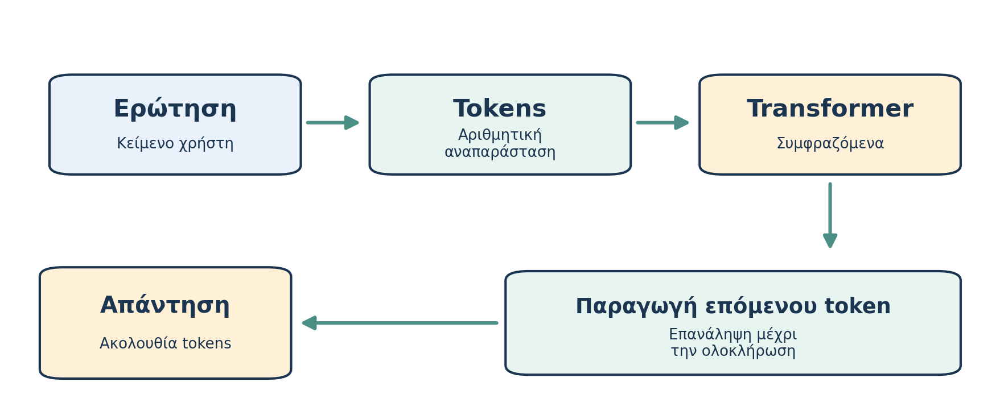

# Μέρος Α — Κατανοώ την τεχνολογία

# AL00.4 — Πώς λειτουργεί ένα μεγάλο γλωσσικό μοντέλο;

*Εκτιμώμενος χρόνος: 20 λεπτά.*

**Πριν διαβάσεις — Πρόβλεψη.** Ένα chatbot παρέχει τρεις αληθοφανείς βιβλιογραφικές αναφορές. Αποδεικνύει αυτό ότι έχει επισκεφθεί και διαβάσει τα τρία άρθρα εκείνη τη στιγμή; Τι άλλο θα χρειαζόσουν να γνωρίζεις;

### Από την ερώτηση στην απάντηση

Γράφεις: «Εξήγησέ μου τη φωτοσύνθεση σαν να είμαι πρωτοετής». Ένα γλωσσικό μοντέλο μπορεί να δημιουργήσει κείμενο με οργανωμένη εξήγηση και παραδείγματα. Η διαδικασία δεν προϋποθέτει μια βάση που περιέχει αποθηκευμένη κάθε πιθανή ερώτηση μαζί με την έτοιμη απάντησή της. Το μοντέλο επεξεργάζεται το αίτημα και δημιουργεί νέα ακολουθία εξόδου, αξιοποιώντας παραμέτρους που αποκτήθηκαν κατά την εκπαίδευση.

Η γλώσσα μετατρέπεται σε μικρότερες μονάδες, τα **tokens**. Ένα token μπορεί να είναι ολόκληρη λέξη, μέρος λέξης ή στίξη, ανάλογα με τον μηχανισμό του μοντέλου. Οι μονάδες αυτές κωδικοποιούνται αριθμητικά και επεξεργάζονται από το νευρωνικό δίκτυο. Το ακριβές tokenization και οι τεχνικές αναπαραστάσεις θα μας απασχολήσουν μόνο όσο χρειάζεται για τη χρήση του εργαλείου.

### Συμφραζόμενα και παραγωγή

Η ίδια λέξη μπορεί να έχει διαφορετική σημασία: «φύλλο δέντρου» και «φύλλο εργασίας». Το μοντέλο χρειάζεται να εξετάζει σχέσεις ανάμεσα στα διαθέσιμα τμήματα της εισόδου. Τα περισσότερα σύγχρονα LLMs βασίζονται σε παραλλαγές της αρχιτεκτονικής **Transformer**, η οποία εισήγαγε συστηματική χρήση μηχανισμών **attention** για την επεξεργασία σχέσεων μεταξύ θέσεων μιας ακολουθίας [4].

Σε ένα συνηθισμένο **αυτοπαλινδρομικό μοντέλο**, η έξοδος παράγεται διαδοχικά: από τις διαθέσιμες εισόδους και τα ήδη παραχθέντα tokens υπολογίζεται μια κατανομή πιθανών επόμενων tokens και επιλέγεται το επόμενο. Η διαδικασία επαναλαμβάνεται μέχρι να ολοκληρωθεί η απάντηση. Η περιγραφή είναι απλουστευμένη και δεν καλύπτει τις εσωτερικές λειτουργίες όλων των σύγχρονων συστημάτων.

{width=15cm}

*Σχήμα 4. Το διάγραμμα αφορά βασική παραγωγή κειμένου. Η εφαρμογή μπορεί επιπλέον να χρησιμοποιεί αναζήτηση, υπολογισμούς ή άλλα εργαλεία.*

**Προαιρετική εμβάθυνση — Attention.** Ο μηχανισμός attention υπολογίζει σχέσεις μεταξύ διαφορετικών αναπαραστάσεων της εισόδου ώστε πληροφορίες από διαφορετικές θέσεις να συμμετέχουν στην επεξεργασία. Δεν χρειάζεται να γνωρίζεις τους μαθηματικούς τύπους για να κατανοείς τα οφέλη και τα όρια ενός chatbot.

### Δεν είναι «μόνο η επόμενη λέξη»

Η πρόβλεψη επόμενου token είναι θεμελιώδης μηχανισμός πολλών LLMs, αλλά η διατύπωση «απλώς μαντεύει την επόμενη λέξη» είναι παραπλανητικά φτωχή. Η εκπαίδευση μπορεί να αναπτύξει σύνθετες εσωτερικές αναπαραστάσεις, και οι εφαρμογές μπορούν να συνδυάζουν μοντέλα με εργαλεία. Ταυτόχρονα, η διαδικασία παραγωγής κειμένου δεν εγγυάται την αλήθεια κάθε πρότασης ή την ορθή ερμηνεία κάθε πηγής.

Μετά την αρχική εκπαίδευση ενδέχεται να ακολουθούν διαδικασίες **μεταγενέστερης εκπαίδευσης (post-training)**, για καλύτερη ανταπόκριση σε οδηγίες και ασφαλέστερη συμπεριφορά. Οι τεχνικές διαφέρουν ανά μοντέλο και δεν πρέπει να ταυτίζονται με την κανονική χρήση του.

### Ένας φοιτητικός τρόπος να το κατανοήσεις

Αν ζητήσεις από ένα chatbot «Εξήγησε την κλίμακα χάρτη και κάνε μου ερωτήσεις», η εφαρμογή μπορεί να δημιουργήσει προσαρμοσμένη εξήγηση. Το γεγονός ότι φαίνεται να συζητά φυσικά δεν σημαίνει ότι όλες οι μαθηματικές ή χαρτογραφικές πληροφορίες είναι αυτομάτως έγκυρες. Το κατάλληλο τελικό βήμα είναι να εξηγήσεις την έννοια μόνος σου και να ελέγξεις αριθμητικά παραδείγματα.

**Μικρή δραστηριότητα.** Εξήγησε σε έναν υποθετικό συμφοιτητή γιατί δεν είναι σωστό να φανταζόμαστε το LLM ως βιβλιοθήκη με κάθε ερώτηση και την έτοιμη απάντησή της. Χρησιμοποίησε τους όρους «εκπαίδευση», «tokens», «συμφραζόμενα» και «παραγωγή».

**Έλεγχος κατανόησης.** (1) Τι είναι token; (2) Γιατί χρειάζονται συμφραζόμενα; (3) Πώς παράγεται σταδιακά η έξοδος ενός συνηθισμένου LLM; (4) Γιατί μια πειστική εξήγηση δεν εγγυάται ακρίβεια;

**Κράτησε:** Ένα LLM παράγει χρήσιμες απαντήσεις επεξεργαζόμενο το αίτημα με μαθημένες παραμέτρους· δεν είναι από μόνο του εγγυημένος ελεγκτής γεγονότων.

---

# Μέρος Β — Χρησιμοποιώ με κατανόηση
