# AL00.4 — Πώς λειτουργεί ένα μεγάλο γλωσσικό μοντέλο;

**AI Learning Core · Μέρος Α — Κατανοώ την τεχνολογία**

**Ενιαία συγγραφική έκδοση v3 — Source Intake (από αντιγραφή εμφανιζόμενου κειμένου)**

# 4.1 Τι είναι ένα μεγάλο γλωσσικό μοντέλο;

## Μαθησιακός σκοπός

Στην ενότητα αυτή θα γνωρίσουμε τι είναι ένα μεγάλο γλωσσικό μοντέλο (Large Language Model — LLM), πώς μπορεί να δημιουργεί απαντήσεις σε φυσική γλώσσα και σε τι διαφέρει από μια συλλογή αποθηκευμένων πληροφοριών.

Θα εξετάσουμε επίσης τη σχέση ανάμεσα στο γλωσσικό μοντέλο και στην εφαρμογή chatbot που χρησιμοποιούμε.

Δεν χρειάζονται προηγούμενες γνώσεις Πληροφορικής ή προγραμματισμού.

## 4.1.1 Πριν ξεκινήσουμε — Ποιος έγραψε αυτή την απάντηση;

Φαντάσου ότι προετοιμάζεσαι για μια εξέταση και δυσκολεύεσαι να κατανοήσεις μια έννοια.

Ανοίγεις ένα chatbot και γράφεις:

> «Εξήγησέ μου με απλά λόγια τι σημαίνει επιστημονική υπόθεση. Δώσε μου και ένα παράδειγμα».

Στην οθόνη εμφανίζεται η απάντηση:

> «Επιστημονική υπόθεση είναι μια προτεινόμενη εξήγηση ή πρόβλεψη που μπορεί να εξεταστεί με παρατηρήσεις ή δεδομένα. Για παράδειγμα, ένας ερευνητής μπορεί να υποθέσει ότι οι φοιτητές που κοιμούνται επαρκώς πριν από μια εξέταση επιτυγχάνουν καλύτερες επιδόσεις. Για να εξετάσει την υπόθεση, χρειάζεται να συγκεντρώσει και να αναλύσει κατάλληλα δεδομένα».

Η απάντηση είναι σχετική με το ερώτημα. Χρησιμοποιεί κατανοητή γλώσσα και περιλαμβάνει ένα παράδειγμα.

Αλλά πώς δημιουργήθηκε;

Ποια εξήγηση περιγράφει καλύτερα τη βασική λειτουργία ενός chatbot που χρησιμοποιεί LLM;

Κάποιος έχει αποθηκεύσει εκ των προτέρων ακριβώς αυτή την ερώτηση και απάντηση.

Ένας άνθρωπος πληκτρολογεί την απάντηση τη στιγμή που υποβάλλεται το αίτημα.

Ένα εκπαιδευμένο γλωσσικό μοντέλο επεξεργάζεται το αίτημα και παράγει κείμενο.

Ένα σύγχρονο γλωσσικό μοντέλο δεν χρειάζεται να διαθέτει μία ξεχωριστή έτοιμη απάντηση για κάθε πιθανή ερώτηση.

Αντίθετα, χρησιμοποιεί δυνατότητες που έχει αναπτύξει κατά την εκπαίδευσή του για να επεξεργάζεται το αίτημα και να παράγει μια απάντηση.

Αυτή είναι η πρώτη σημαντική διάκριση που θα χρειαστούμε.
::: {dropdown} Έλεγχος κατανόησης — Quiz 3 επιλογών
Η βασική λειτουργία του LLM είναι η επεξεργασία της εισόδου και η παραγωγή κειμένου. Η εφαρμογή μπορεί επιπλέον να χρησιμοποιεί εξωτερικές πηγές ή εργαλεία.
:::
::: {dropdown} Ενδεικτική απάντηση και ανατροφοδότηση
Σωστές επιλογές: **3**.

Η βασική λειτουργία του LLM είναι η επεξεργασία της εισόδου και η παραγωγή κειμένου. Η εφαρμογή μπορεί επιπλέον να χρησιμοποιεί εξωτερικές πηγές ή εργαλεία.
:::

## 4.1.2 Τι ονομάζουμε μεγάλο γλωσσικό μοντέλο;

Ένα μεγάλο γλωσσικό μοντέλο είναι ένα υπολογιστικό μοντέλο που εκπαιδεύεται με μεγάλες ποσότητες δεδομένων, κυρίως γλωσσικών, ώστε να μπορεί να επεξεργάζεται και να παράγει γλώσσα.

Κατά την εκπαίδευσή του διαμορφώνονται αριθμητικές παράμετροι και εσωτερικές αναπαραστάσεις που του επιτρέπουν να αξιοποιεί σύνθετες σχέσεις μέσα στα δεδομένα.

Έτσι μπορεί να εκτελεί διαφορετικές εργασίες.

Ένας φοιτητής Οικονομικών μπορεί να γράψει:

> «Εξήγησέ μου τον πληθωρισμό με ένα παράδειγμα από την καθημερινή ζωή».

Μια φοιτήτρια Παιδαγωγικού Τμήματος μπορεί να ζητήσει:

> «Πρότεινέ μου μια δραστηριότητα συνεργατικής μάθησης για παιδιά δημοτικού».

Ένας φοιτητής Γεωπληροφορικής μπορεί να ρωτήσει:

> «Ποια είναι η διαφορά ανάμεσα σε έναν έντυπο και έναν διαδραστικό ψηφιακό χάρτη;»

Τα ερωτήματα αφορούν διαφορετικά επιστημονικά αντικείμενα.

Ωστόσο, η βασική λειτουργία του γλωσσικού μοντέλου παραμένει κοινή: επεξεργάζεται την είσοδο και παράγει μια σχετική έξοδο.

Αυτός είναι ένας από τους λόγους για τους οποίους η τεχνολογία μπορεί να χρησιμοποιηθεί σε τόσους διαφορετικούς τομείς.

Δεν σημαίνει, βέβαια, ότι το μοντέλο διαθέτει την ίδια αξιοπιστία σε κάθε αντικείμενο ή ότι κάθε απάντησή του είναι σωστή.

Η δυνατότητα παραγωγής μιας απάντησης και η πραγματολογική ορθότητά της είναι δύο διαφορετικά ζητήματα.

## 4.1.3 Γιατί ονομάζεται «μεγάλο»;

Ο χαρακτηρισμός μεγάλο σχετίζεται κυρίως με την κλίμακα του μοντέλου.

Ένα σημαντικό χαρακτηριστικό είναι το πλήθος των παραμέτρων του.

Οι παράμετροι είναι αριθμητικές τιμές που διαμορφώνονται κατά την εκπαίδευση και επηρεάζουν τον τρόπο με τον οποίο το μοντέλο επεξεργάζεται πληροφορίες.

Ένα μεγάλο γλωσσικό μοντέλο μπορεί να διαθέτει δισεκατομμύρια παραμέτρους.

Δεν χρειάζεται να γνωρίζουμε πώς υπολογίζονται αυτές οι τιμές. Αρκεί να κατανοήσουμε ότι αποτελούν μέρος του εκπαιδευμένου μηχανισμού.

Πρέπει όμως να αποφύγουμε μια συνηθισμένη παρανόηση.

Περισσότερες παράμετροι δεν σημαίνουν αυτομάτως καλύτερες απαντήσεις.

Η καταλληλότητα ενός μοντέλου εξαρτάται από την εκπαίδευσή του, την αρχιτεκτονική του, το είδος της εργασίας και άλλους παράγοντες.

Ένα μικρότερο μοντέλο μπορεί να είναι περισσότερο κατάλληλο για μια συγκεκριμένη εφαρμογή.

Η πραγματική του αποτελεσματικότητα πρέπει να αξιολογείται.

Αυτό συνδέεται με όσα γνωρίσαμε στο AL00.3: η αξιολόγηση ενός μοντέλου δεν μπορεί να βασίζεται μόνο στο μέγεθος ή στην πολυπλοκότητά του.

## 4.1.4 Είναι το γλωσσικό μοντέλο μια τεράστια ψηφιακή βιβλιοθήκη;

Ας υποθέσουμε ότι ένας φοιτητής γράφει:

> «Εξήγησέ μου την πιθανότητα σαν να μιλάς σε έναν μαθητή γυμνασίου. Χρησιμοποίησε ένα παιχνίδι με ζάρια».

Το chatbot δημιουργεί μια απλή εξήγηση.

Στη συνέχεια ο φοιτητής ζητά:

> «Τώρα εξήγησέ το σε έναν πρωτοετή φοιτητή και πρόσθεσε μια βασική μαθηματική σχέση».

Το μοντέλο μπορεί να δημιουργήσει μια δεύτερη, διαφορετική εξήγηση.

Οι δύο απαντήσεις αφορούν την ίδια έννοια, αλλά προσαρμόζονται σε διαφορετικές οδηγίες.

Δεν είναι απαραίτητο να υπάρχουν αποθηκευμένες δύο έτοιμες παράγραφοι που αντιστοιχούν ακριβώς στα συγκεκριμένα αιτήματα.

Το μοντέλο μπορεί να παράγει νέες ακολουθίες κειμένου, αξιοποιώντας την είσοδο και τις μαθημένες παραμέτρους του.

Αυτό δεν σημαίνει ότι ένα LLM δεν μπορεί ποτέ να αναπαράγει περιεχόμενο που έχει συναντήσει κατά την εκπαίδευση. Η απομνημόνευση ορισμένων αποσπασμάτων είναι δυνατή.

Σημαίνει ότι η συνήθης λειτουργία του δεν περιγράφεται σωστά ως απλή επιλογή μιας αποθηκευμένης απάντησης από έναν κατάλογο.

Στην 4.6 θα γνωρίσουμε και μια διαφορετική δυνατότητα: τις εφαρμογές που αναζητούν πραγματικά πληροφορίες σε έγγραφα ή εξωτερικές πηγές.

Η αναζήτηση αυτή δεν πρέπει να συγχέεται με τον βασικό μηχανισμό παραγωγής κειμένου.

## 4.1.5 Το γλωσσικό μοντέλο και το chatbot δεν είναι το ίδιο πράγμα

Στην καθημερινή χρήση συχνά αντιμετωπίζουμε το chatbot και το γλωσσικό μοντέλο ως ταυτόσημες έννοιες.

Υπάρχει όμως μια σημαντική διαφορά.

Το γλωσσικό μοντέλο είναι ο εκπαιδευμένος υπολογιστικός μηχανισμός που επεξεργάζεται την είσοδο και παράγει έξοδο.

Το chatbot είναι η εφαρμογή μέσα από την οποία επικοινωνούμε με το μοντέλο.

Η εφαρμογή μπορεί να προσφέρει πρόσθετες δυνατότητες, όπως διαχείριση συνομιλιών, αποστολή αρχείων, αναζήτηση πληροφοριών και χρήση υπολογιστικών εργαλείων.

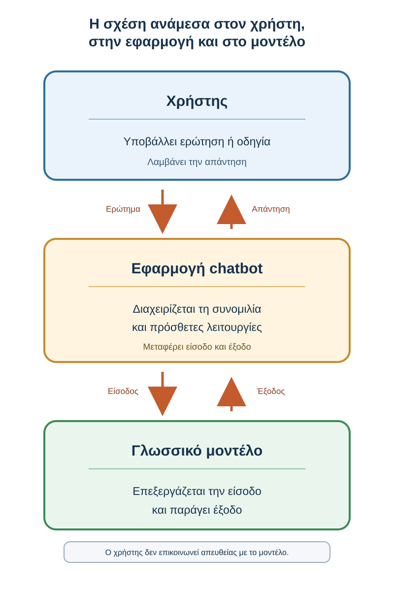
Σχήμα 4.1 — Η σχέση ανάμεσα στον χρήστη, στην εφαρμογή και στο μοντέλο

Εννοιολογικό σχήμα. Μια πραγματική εφαρμογή μπορεί να αξιοποιεί περισσότερα από ένα μοντέλα ή εργαλεία.

Ας εξετάσουμε ένα παράδειγμα από την πανεπιστημιακή μάθηση.

Ένας φοιτητής ζητά:

> «Δημιούργησε πέντε ερωτήσεις αυτοαξιολόγησης για την επιστημονική μέθοδο».

Το γλωσσικό μοντέλο μπορεί να δημιουργήσει τις ερωτήσεις με βάση το αίτημα.

Αν όμως ο φοιτητής ανεβάσει ένα PDF και ζητήσει ερωτήσεις που βασίζονται αποκλειστικά στο τρίτο κεφάλαιο, η εφαρμογή πρέπει να διαθέσει στο μοντέλο τις κατάλληλες πληροφορίες από το συγκεκριμένο έγγραφο.

Επομένως, όταν εξετάζουμε τι μπορεί να κάνει ένα chatbot, είναι χρήσιμο να αναγνωρίζουμε ποιες δυνατότητες προέρχονται από το μοντέλο και ποιες από την εφαρμογή.

## 4.1.6 Πώς μπορεί να απαντά σε τόσο διαφορετικές ερωτήσεις;

Ας φανταστούμε τρεις φοιτητές που χρησιμοποιούν το ίδιο chatbot.

Ο πρώτος ζητά βοήθεια για μια ιστορική εργασία.

Ο δεύτερος θέλει να του εξηγηθεί ένα οικονομικό διάγραμμα.

Ο τρίτος ζητά να βελτιώσει τη διατύπωση μιας επιστημονικής περίληψης.

Η δυνατότητα ανταπόκρισης σε διαφορετικές εργασίες συνδέεται με τις γενικότερες ικανότητες επεξεργασίας γλώσσας που αναπτύσσονται κατά την εκπαίδευση.

Το μοντέλο μπορεί να αξιοποιεί πληροφορίες από το αίτημα και να προσαρμόζει την έξοδο: να εξηγεί, να συγκρίνει, να συνοψίζει ή να αναδιατυπώνει.

Ωστόσο, δεν πρέπει να θεωρούμε ότι κάθε γνωστικό αντικείμενο αντιμετωπίζεται με την ίδια επιτυχία.

Ένα μοντέλο μπορεί να ανταποκρίνεται ικανοποιητικά σε μια απλή γλωσσική εργασία και ταυτόχρονα να δυσκολεύεται σε μια εξειδικευμένη επιστημονική ερώτηση.

Η ευρεία δυνατότητα χρήσης δεν αποτελεί εγγύηση επιστημονικής επάρκειας σε κάθε πεδίο.

## 4.1.7 Η φυσική συνομιλία σημαίνει ανθρώπινη κατανόηση;

Όταν χρησιμοποιούμε ένα chatbot, συχνά δημιουργείται η αίσθηση ότι συνομιλούμε με κάποιον που κατανοεί όσα γράφουμε.

Η εφαρμογή μπορεί να απαντά σε διευκρινιστικές ερωτήσεις, να αλλάζει ύφος και να προσαρμόζει την εξήγηση όταν δυσκολευόμαστε.

Αυτό είναι ιδιαίτερα χρήσιμο στην εκπαίδευση.

Όμως χρειάζεται να διακρίνουμε τη συμπεριφορά που παρατηρούμε από τα συμπεράσματα που κάνουμε για τον εσωτερικό τρόπο λειτουργίας του συστήματος.

Το ότι ένα μοντέλο παράγει φυσικό και σχετικό κείμενο δεν αποδεικνύει από μόνο του ότι κατανοεί με τον ίδιο τρόπο που κατανοεί ένας άνθρωπος.

Ούτε μια επιτυχημένη απάντηση αποτελεί απόδειξη ανθρώπινης εμπειρίας, πρόθεσης ή προσωπικής κρίσης.

Για τις ανάγκες αυτού του μαθήματος δεν χρειάζεται να επιλύσουμε τα φιλοσοφικά ερωτήματα για τη φύση της κατανόησης ή της συνείδησης.

Χρειάζεται κυρίως να αναγνωρίζουμε τι μπορεί να κάνει η τεχνολογία και πώς αξιολογούμε τις δυνατότητές της.

Μπορούμε, επομένως, να αξιοποιούμε ένα chatbot ως εργαλείο μάθησης χωρίς να θεωρούμε ότι η φυσικότητα της συνομιλίας αποδεικνύει ανθρώπινο τρόπο σκέψης.

## 4.1.8 Δραστηριότητα — Μοντέλο ή εφαρμογή;

Ένας φοιτητής χρησιμοποιεί ένα chatbot για να οργανώσει τη μελέτη του.

Για καθεμία από τις παρακάτω περιπτώσεις, προσπάθησε να αποφασίσεις αν αφορά κυρίως τη γλωσσική παραγωγή του μοντέλου ή μια πρόσθετη λειτουργία της εφαρμογής.

<a href="/al00_4_1_8.html" target="_blank" rel="noopener" onclick="const u=new URL(this.href,window.location.href);u.searchParams.set('return',window.location.href);this.href=u.href;">Άνοιξε τη διαδραστική δραστηριότητα 4.1.8 σε νέα καρτέλα</a>

## 4.1.9 Εξήγησέ το με δικά σου λόγια

Ένας συμφοιτητής σου λέει:

> «Νομίζω ότι το chatbot έχει αποθηκευμένες όλες τις ερωτήσεις που μπορεί να του κάνει κάποιος και επιλέγει κάθε φορά τη σωστή απάντηση».

Προσπάθησε να εξηγήσεις, με δύο ή τρεις προτάσεις, γιατί αυτή η περιγραφή δεν αποδίδει σωστά τη βασική λειτουργία ενός LLM.

Ενδεικτική απάντηση

::: {dropdown} Ενδεικτική απάντηση
Ένα μεγάλο γλωσσικό μοντέλο δεν χρειάζεται να διαθέτει αποθηκευμένη απάντηση για κάθε πιθανή ερώτηση.

Χρησιμοποιεί τις παραμέτρους και τις δυνατότητες που ανέπτυξε κατά την εκπαίδευσή του, ώστε να επεξεργάζεται το αίτημα και να παράγει κείμενο.

Μια εφαρμογή μπορεί επιπλέον να αναζητά εξωτερικές πληροφορίες, αλλά αυτό αποτελεί διαφορετική λειτουργία.
:::

## 4.1.10 Τι κρατάμε από την ενότητα

Ένα μεγάλο γλωσσικό μοντέλο είναι ένα εκπαιδευμένο υπολογιστικό μοντέλο που μπορεί να επεξεργάζεται και να παράγει γλώσσα.

Η λειτουργία του βασίζεται σε μαθημένες παραμέτρους και αριθμητικές αναπαραστάσεις. Δεν χρειάζεται να διαθέτει μια ξεχωριστή έτοιμη απάντηση για κάθε πιθανή ερώτηση.

Το chatbot είναι η εφαρμογή μέσα από την οποία επικοινωνούμε με το μοντέλο και μπορεί να προσφέρει πρόσθετες λειτουργίες.

Η ικανότητα δημιουργίας σχετικών και κατανοητών απαντήσεων είναι ιδιαίτερα χρήσιμη στη μάθηση, αλλά δεν εγγυάται την ορθότητα κάθε πληροφορίας.

Το σημαντικότερο είναι ότι ένα LLM αποτελεί έναν εκπαιδευμένο μηχανισμό επεξεργασίας και παραγωγής γλώσσας, όχι μια απλή αποθήκη έτοιμων απαντήσεων.

### Μετάβαση στην 4.2

Γνωρίζουμε πλέον τι είναι ένα LLM και γιατί μπορεί να χρησιμοποιείται σε διαφορετικές εργασίες.

Όμως όταν γράφουμε μια πρόταση, τι ακριβώς λαμβάνει και επεξεργάζεται το μοντέλο;

Ο υπολογιστής δεν επεξεργάζεται απευθείας τις λέξεις όπως τις αντιλαμβάνεται ένας άνθρωπος.

Το κείμενο μετατρέπεται πρώτα σε μικρότερες μονάδες, που ονομάζονται tokens.

Αυτή τη μετατροπή θα γνωρίσουμε στη συνέχεια.

# 4.2 Πώς μετατρέπεται το κείμενο σε tokens;

Στην προηγούμενη ενότητα γνωρίσαμε ότι ένα μεγάλο γλωσσικό μοντέλο μπορεί να επεξεργάζεται ερωτήσεις και να δημιουργεί απαντήσεις προσαρμοσμένες στο αίτημα του χρήστη.

Πώς μπορεί όμως να επεξεργάζεται υπολογιστικά το κείμενο που γράφουμε;

Ας υποθέσουμε ότι ένας φοιτητής πληκτρολογεί:

> «Εξήγησέ μου τι είναι μια επιστημονική υπόθεση».

Εμείς αναγνωρίζουμε τις λέξεις και κατανοούμε το αίτημα.

Το γλωσσικό μοντέλο, όμως, λειτουργεί μέσω αριθμητικών αναπαραστάσεων.

Για να επεξεργαστεί το κείμενο, αυτό μετατρέπεται αρχικά σε μικρότερες μονάδες, τα tokens.

Στην ενότητα αυτή θα παρακολουθήσουμε τη διαδρομή από το κείμενο στις αριθμητικές αναπαραστάσεις, χωρίς μαθηματικούς τύπους ή προγραμματισμό.

## Μαθησιακός σκοπός

Να κατανοήσεις τι είναι ένα token, γιατί δεν αντιστοιχεί υποχρεωτικά σε μία λέξη, πώς συνδέεται με αριθμητικά αναγνωριστικά και αναπαραστάσεις και γιατί το πλήθος των tokens έχει πρακτική σημασία.

## 4.2.1 Πριν ξεκινήσουμε — Είναι κάθε λέξη ένα token;

Διάβασε τις προτάσεις:

> «Ο φοιτητής διαβάζει ένα βιβλίο».

> «Μελετώ τη διεπιστημονικότητα».

Η πρώτη περιλαμβάνει περισσότερες λέξεις από τη δεύτερη.

Θα μπορούσαμε, λοιπόν, να υποθέσουμε ότι χρειάζεται οπωσδήποτε περισσότερα tokens.

Είναι όμως σωστή αυτή η σκέψη;

Σκέψου πριν αποκαλύψεις

Η διάκριση που πρέπει να συγκρατήσουμε είναι απλή:

Η λέξη είναι μια γλωσσική έννοια. Το token είναι μια μονάδα της υπολογιστικής αναπαράστασης του κειμένου.
::: {dropdown} Σκέψου πριν αποκαλύψεις
Όχι απαραίτητα.

Μια λέξη μπορεί να αναπαρίσταται από ένα ή περισσότερα tokens, ανάλογα με τον μηχανισμό διαχωρισμού.

Συνεπώς, το πλήθος των λέξεων δεν αρκεί για να γνωρίζουμε πόσα tokens περιέχει ένα κείμενο.

Για τον ακριβή αριθμό χρειάζεται ο συγκεκριμένος tokenizer.
:::

## 4.2.2 Τι είναι ένα token;

Ένα token είναι μια μονάδα στην οποία μετατρέπεται το κείμενο, ώστε να μπορεί να υποβληθεί σε επεξεργασία από το γλωσσικό μοντέλο.

Η διαδικασία μετατροπής ονομάζεται tokenization.

Ανάλογα με τον μηχανισμό που χρησιμοποιείται, ένα token μπορεί να αντιστοιχεί σε μια ολόκληρη λέξη, σε μέρος μιας λέξης, σε σημείο στίξης ή σε μια ακολουθία χαρακτήρων που περιλαμβάνει και κενά.

Ας εξετάσουμε τη λέξη «πανεπιστημιακός».

Σε έναν υποθετικό μηχανισμό tokenization, θα μπορούσε να χωριστεί σε περισσότερα τμήματα.

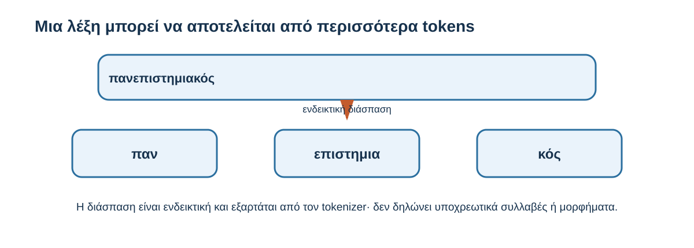
Σχήμα 4.2 — Μια λέξη μπορεί να αποτελείται από περισσότερα tokens

#### Υποθετικός διαχωρισμός της λέξης «πανεπιστημιακός»

- **παν**
- **επιστημια**
- **κός**

Υποθετικός διαχωρισμός για εκπαιδευτικούς σκοπούς. Δεν αποτελεί πραγματική έξοδο συγκεκριμένου tokenizer.

Το παράδειγμα δεν σημαίνει ότι η λέξη χωρίζεται έτσι σε κάποιο συγκεκριμένο μοντέλο.

Διαφορετικοί tokenizers μπορούν να παράγουν διαφορετικά αποτελέσματα.

Επίσης, τα tokens δεν χρειάζεται να αντιστοιχούν σε συλλαβές ή σε τμήματα που έχουν ανεξάρτητο νόημα.

Μπορεί να αποτελούν συχνές ακολουθίες χαρακτήρων, ακόμη και όταν αυτές δεν αντιστοιχούν σε φυσικές γλωσσικές μονάδες.

Αυτό είναι ιδιαίτερα σημαντικό όταν χρησιμοποιούμε σύνθετες λέξεις, εξειδικευμένη ορολογία ή περισσότερες από μία γλώσσες.

## 4.2.3 Γιατί δεν χρησιμοποιούνται απλώς ολόκληρες λέξεις;

Ας εξετάσουμε τις λέξεις:

«φοιτητής», «φοιτήτρια», «φοιτητές», «φοιτητών».

Σχετίζονται μεταξύ τους, αλλά έχουν διαφορετικές μορφές.

Επιπλέον, υπάρχουν κύρια ονόματα, νέοι τεχνικοί όροι και σύνθετες λέξεις.

Αν χρησιμοποιούσαμε μόνο ένα περιορισμένο σύνολο ολόκληρων λέξεων, θα χρειαζόμασταν έναν τρόπο αναπαράστασης όσων δεν περιλαμβάνονται σε αυτό.

Η χρήση μικρότερων μονάδων επιτρέπει σε πολλούς σύγχρονους tokenizers να αναπαριστούν πολύ μεγάλη ποικιλία κειμένων με ένα διαχειρίσιμο λεξιλόγιο tokens.

Ας δούμε ορισμένους επιστημονικούς όρους.

Ένας φοιτητής Ιατρικής μπορεί να συναντήσει τη λέξη «ανοσοϊστοχημεία».

Μια φοιτήτρια Οικονομικών μπορεί να χρησιμοποιήσει τον όρο «μακροοικονομικός».

Ένας φοιτητής Μηχανικών μπορεί να συναντήσει τη λέξη «γεωαναφορά».

Οι όροι αυτοί μπορούν να αναπαρασταθούν ακόμη και όταν δεν αντιστοιχούν σε ένα μόνο token.

Αυτό δεν σημαίνει ότι το μοντέλο γνωρίζει αυτομάτως τη σωστή επιστημονική σημασία τους.

Σημαίνει ότι διαθέτει έναν τρόπο υπολογιστικής αναπαράστασης του κειμένου που τους περιλαμβάνει.

Πρέπει, λοιπόν, να διακρίνουμε τη δυνατότητα αναπαράστασης μιας λέξης από την ορθή ερμηνεία της σημασίας της.

## 4.2.4 Από τα tokens στους αριθμούς

Σε έναν συνηθισμένο tokenizer, κάθε token αντιστοιχίζεται σε ένα αριθμητικό αναγνωριστικό, το token ID.

Ας φανταστούμε ένα υποθετικό λεξιλόγιο.

| Token         | Υποθετικό token ID |
| ------------- | ------------------ |
| «Η»           | 104                |
| « έρευνα»     | 528                |
| « χρειάζεται» | 316                |
| « δεδομένα»   | 872                |
| «.»           | 19                 |

Οι αριθμοί είναι κατασκευασμένοι αποκλειστικά για το παράδειγμα.

Δεν προέρχονται από πραγματικό μοντέλο.

Η πρόταση:

> «Η έρευνα χρειάζεται δεδομένα.»

θα μπορούσε, με βάση αυτό το υποθετικό λεξιλόγιο, να αναπαρασταθεί ως ακολουθία IDs.

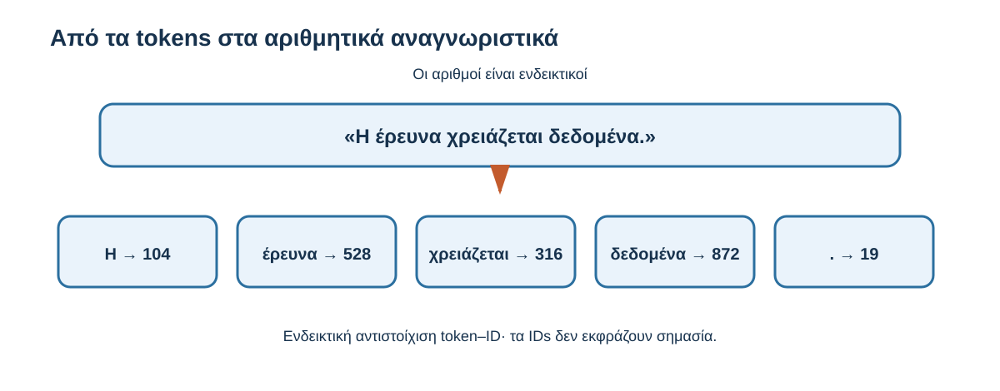
Σχήμα 4.3 — Από τα tokens στα αριθμητικά αναγνωριστικά

«Η έρευνα χρειάζεται δεδομένα.»

| Token | Υποθετικό token ID |
|---|---:|
| Η | 104 |
| έρευνα | 528 |
| χρειάζεται | 316 |
| δεδομένα | 872 |
| . | 19 |

Απλουστευμένη αντιστοίχιση. Τα κενά αποτελούν μέρος ορισμένων υποθετικών tokens αλλά δεν απεικονίζονται χωριστά.

Τα IDs είναι αναγνωριστικά.

Δεν εκφράζουν από μόνα τους τη σημασία ή τη σπουδαιότητα μιας λέξης.

Για παράδειγμα, το ID 872 δεν σημαίνει ότι η λέξη «δεδομένα» είναι σημαντικότερη από τη λέξη «έρευνα», με ID 528.

Οι αριθμοί λειτουργούν ως τρόπος αναγνώρισης των μονάδων από το υπολογιστικό σύστημα.

Για να γίνει η επεξεργασία, το μοντέλο χρησιμοποιεί κατάλληλες αριθμητικές αναπαραστάσεις τους.

## 4.2.5 Τι είναι οι αριθμητικές αναπαραστάσεις;

Το επόμενο στάδιο είναι η σύνδεση των token IDs με αριθμητικές αναπαραστάσεις που μπορούν να χρησιμοποιηθούν από το νευρωνικό δίκτυο.

Αυτές ονομάζονται συχνά embeddings.

Μπορούμε να τις φανταστούμε ως ομάδες αριθμών που έχουν διαμορφωθεί κατά την εκπαίδευση και χρησιμοποιούνται στην επεξεργασία.

Δεν χρειάζεται να γνωρίζουμε τη μαθηματική μορφή τους.

Το σημαντικό είναι ότι το μοντέλο δεν βασίζεται απλώς στο αριθμητικό αναγνωριστικό του token.

Χρησιμοποιεί μαθημένες αναπαραστάσεις που μετασχηματίζονται στη συνέχεια μέσα στο δίκτυο.

Η βασική διαδρομή είναι η ακόλουθη:

| Στάδιο | Τι σημαίνει |
|---|---|
| **Κείμενο** | «Η έρευνα χρειάζεται δεδομένα» |
| **Tokens** | Μονάδες του κειμένου |
| **Token IDs** | Αριθμητικά αναγνωριστικά |
| **Embeddings** | Μαθημένες αριθμητικές αναπαραστάσεις |
| **Επεξεργασία** | Αξιοποίηση πληροφοριών μέσα στο μοντέλο |

Εδώ χρειάζεται μια διευκρίνιση.

Δεν πρέπει να φανταζόμαστε ότι κάθε λέξη αποκτά μία απλή και αμετάβλητη αριθμητική σημασία.

Οι αρχικές αναπαραστάσεις αξιοποιούνται στη συνέχεια σε συνδυασμό με άλλες πληροφορίες του κειμένου.

Για παράδειγμα, η λέξη «φύλλο» μπορεί να εμφανίζεται στη φράση «φύλλο δέντρου» ή «φύλλο εργασίας».

Η κατάλληλη επεξεργασία εξαρτάται από τα συμφραζόμενα.

Αυτή τη δυνατότητα θα εξετάσουμε στην 4.3.

## 4.2.6 Γιατί έχει σημασία το πλήθος των tokens;

Ίσως αναρωτιέσαι γιατί ένας φοιτητής που χρησιμοποιεί ένα chatbot χρειάζεται να γνωρίζει τι είναι τα tokens.

Η απάντηση είναι ότι έχουν και πρακτική σημασία.

Τα γλωσσικά μοντέλα λειτουργούν με περιορισμούς στην ποσότητα πληροφορίας που μπορούν να επεξεργάζονται σε ένα δεδομένο πλαίσιο.

Το διαθέσιμο εύρος σχετίζεται με το παράθυρο συμφραζομένων (context window), το οποίο συνήθως μετριέται σε tokens.

Ας υποθέσουμε ότι θέλεις να χρησιμοποιήσεις ένα chatbot για να μελετήσεις ένα μεγάλο εκπαιδευτικό εγχειρίδιο.

Το υλικό μπορεί να περιλαμβάνει πολλές σελίδες, πίνακες και παραδείγματα.

Ανάλογα με το μοντέλο και την εφαρμογή, μπορεί να μην είναι δυνατόν να διατεθεί ολόκληρο το υλικό ταυτόχρονα σε μία επεξεργασία.

Η εφαρμογή μπορεί να επιλέξει σχετικά αποσπάσματα, να συνοψίσει προηγούμενες πληροφορίες ή να χρησιμοποιήσει μηχανισμούς ανάκτησης.

Αυτό δεν σημαίνει ότι κάθε μεγάλο αρχείο απορρίπτεται ή ότι όλες οι εφαρμογές λειτουργούν με τον ίδιο τρόπο.

Για τον φοιτητή, το πρακτικό συμπέρασμα είναι ότι η ποσότητα και η οργάνωση του διαθέσιμου κειμένου μπορούν να επηρεάζουν τη χρήση του εργαλείου.

Σε ορισμένες υπηρεσίες, το πλήθος των tokens συνδέεται επίσης με το κόστος ή τον χρόνο επεξεργασίας.

Δεν χρειάζεται, όμως, να υπολογίζεις συνεχώς πόσα tokens περιέχει κάθε αίτημα.

Αρκεί να γνωρίζεις γιατί υπάρχουν όρια και γιατί η σταδιακή, οργανωμένη επεξεργασία μπορεί να είναι χρήσιμη όταν εργάζεσαι με εκτενή έγγραφα.

## 4.2.7 Δραστηριότητα — Τι κατάλαβες για τα tokens;

<a href="/al00_4_2_7.html" target="_blank" rel="noopener">Άνοιξε τη διαδραστική δραστηριότητα 4.2.7 σε νέα καρτέλα</a>

## 4.2.8 Εξήγησέ το με δικά σου λόγια

Ένας συμφοιτητής σου λέει:

> «Αφού το chatbot επεξεργάζεται ελληνικά, γιατί χρειάζεται να μετατρέπει τις λέξεις σε αριθμούς;»

Προσπάθησε να απαντήσεις με δύο ή τρεις προτάσεις.

Χρησιμοποίησε, αν θέλεις, τους όρους «token», «αριθμητική αναπαράσταση» και «υπολογιστική επεξεργασία».

Ενδεικτική απάντηση

::: {dropdown} Ενδεικτική απάντηση
Το γλωσσικό μοντέλο δεν επεξεργάζεται το κείμενο με τον ίδιο τρόπο που το διαβάζει ένας άνθρωπος.

Το κείμενο μετατρέπεται σε tokens, τα οποία αντιστοιχίζονται σε αριθμητικά αναγνωριστικά και στη συνέχεια σε κατάλληλες αριθμητικές αναπαραστάσεις.

Αυτές χρησιμοποιούνται από το μοντέλο για την υπολογιστική επεξεργασία των πληροφοριών.
:::

## 4.2.9 Τι κρατάμε από την ενότητα

Το κείμενο μετατρέπεται σε μικρότερες μονάδες, τα tokens.

Ένα token δεν αντιστοιχεί υποχρεωτικά σε μία ολόκληρη λέξη. Ο τρόπος διαχωρισμού εξαρτάται από τον tokenizer.

Τα tokens αντιστοιχίζονται σε αριθμητικά αναγνωριστικά και χρησιμοποιούνται κατάλληλες μαθημένες αριθμητικές αναπαραστάσεις.

Αυτές επιτρέπουν στο μοντέλο να επεξεργάζεται τις διαθέσιμες πληροφορίες.

Το πλήθος των tokens έχει πρακτική σημασία, επειδή συνδέεται με το παράθυρο συμφραζομένων και με ορισμένα χαρακτηριστικά της χρήσης.

Η βασική ιδέα είναι ότι η μετατροπή του κειμένου σε tokens και αριθμητικές αναπαραστάσεις αποτελεί ένα αρχικό στάδιο της υπολογιστικής επεξεργασίας της γλώσσας.

### Μετάβαση στην 4.3

Γνωρίζουμε πλέον πώς μια πρόταση μπορεί να μετατραπεί σε αριθμητικές αναπαραστάσεις.

Αυτό όμως δεν αρκεί για να εξηγήσουμε γιατί μια λέξη μπορεί να έχει διαφορετική σημασία σε διαφορετικές προτάσεις.

Ας εξετάσουμε:

> «Το φύλλο του δέντρου κιτρίνισε».

> «Συμπλήρωσε το φύλλο εργασίας».

Η λέξη «φύλλο» εμφανίζεται και στις δύο, αλλά το νόημά της διαφέρει.

Πώς μπορεί το μοντέλο να αξιοποιεί τις υπόλοιπες πληροφορίες;

Η απάντηση συνδέεται με τα συμφραζόμενα.

# 4.3 Συμφραζόμενα: γιατί η ίδια λέξη δεν σημαίνει πάντα το ίδιο πράγμα;

Στην προηγούμενη ενότητα γνωρίσαμε πώς το κείμενο μετατρέπεται σε tokens και αριθμητικές αναπαραστάσεις.

Αυτή η μετατροπή καθιστά δυνατή την υπολογιστική επεξεργασία, δεν αρκεί όμως από μόνη της για να παραχθεί μια απάντηση που ανταποκρίνεται στο νόημα μιας ερώτησης.

Ας εξετάσουμε ξανά τις δύο προτάσεις:

> «Το φύλλο του δέντρου άρχισε να κιτρινίζει».

> «Συμπλήρωσε το φύλλο εργασίας πριν από το μάθημα».

Στην πρώτη, η λέξη «φύλλο» αναφέρεται σε μέρος ενός φυτού.

Στη δεύτερη, αναφέρεται σε εκπαιδευτικό έγγραφο.

Η διαφορά προκύπτει από τις πληροφορίες που περιβάλλουν τη λέξη.

Οι πληροφορίες αυτές ονομάζονται συμφραζόμενα (context).

## Μαθησιακός σκοπός

Να κατανοήσεις τι είναι τα συμφραζόμενα, πώς επηρεάζουν την επεξεργασία του κειμένου και γιατί η παροχή κατάλληλων πληροφοριών βοηθά ένα γλωσσικό μοντέλο να δημιουργεί πιο σχετικές απαντήσεις.

Θα εξετάσουμε επίσης πώς το προηγούμενο ιστορικό μιας συνομιλίας μπορεί να επηρεάζει την απάντηση και τι περιορισμοί υπάρχουν στην ποσότητα πληροφοριών που μπορεί να αξιοποιήσει ένα μοντέλο.

## 4.3.1 Πριν ξεκινήσουμε — Τι σημαίνει «κλίμακα»;

Φαντάσου ότι ένας φοιτητής γράφει:

> «Εξήγησέ μου τι σημαίνει κλίμακα».

Η ερώτηση μπορεί να έχει διαφορετικές ερμηνείες.

Στη Μουσική, μια κλίμακα αφορά μια οργανωμένη ακολουθία μουσικών φθόγγων.

Στη Χαρτογραφία, εκφράζει τη σχέση ανάμεσα σε μια απόσταση στον χάρτη και στην αντίστοιχη πραγματική απόσταση.

Στις κοινωνικές επιστήμες, μια κλίμακα αξιολόγησης μπορεί να χρησιμοποιείται για τη μέτρηση στάσεων ή απόψεων.

Ας προσθέσουμε τώρα μια πληροφορία:

> «Στο μάθημα Χαρτογραφίας εξετάζουμε την κλίμακα 1:25.000. Μπορείς να μου εξηγήσεις τι σημαίνει;»

Η ερώτηση γίνεται σαφέστερη.

Τι άλλαξε ανάμεσα στα δύο αιτήματα;

Η δραστηριότητα αναδεικνύει μια βασική αρχή:

Μια λέξη ή μια ερώτηση δεν ερμηνεύεται πάντοτε σωστά όταν εξετάζεται απομονωμένα από τις υπόλοιπες πληροφορίες.
::: {dropdown} Σκέψου πριν αποκαλύψεις
Στο πρώτο αίτημα η λέξη «κλίμακα» μπορεί να έχει διαφορετικές σημασίες.

Το δεύτερο αίτημα παρέχει επιπλέον το γνωστικό αντικείμενο και έναν συγκεκριμένο τρόπο έκφρασης κλίμακας.

Αυτές οι πληροφορίες περιορίζουν την ασάφεια και βοηθούν το μοντέλο να δημιουργήσει μια απάντηση σχετική με τον πραγματικό σκοπό του φοιτητή.

Δεν εγγυώνται, ωστόσο, ότι κάθε αριθμητικός υπολογισμός της απάντησης θα είναι σωστός.
:::

## 4.3.2 Τι ονομάζουμε συμφραζόμενα;

Στην καθημερινή επικοινωνία χρησιμοποιούμε συνεχώς συμφραζόμενα.

Αν ένας συμφοιτητής σου πει:

> «Μπορείς να μου το εξηγήσεις ξανά;»

χρειάζεται να γνωρίζεις τι συζητούσατε για να καταλάβεις σε τι αναφέρεται το «το».

Αν συζητούσατε μια μαθηματική άσκηση, πιθανότατα ζητά να του εξηγήσεις ξανά τη λύση.

Αν συζητούσατε μια θεωρία, μπορεί να ζητά μια απλούστερη παρουσίασή της.

Το νόημα της ίδιας πρότασης εξαρτάται από το περιβάλλον της συζήτησης.

Κάτι αντίστοιχο συμβαίνει όταν ένα γλωσσικό μοντέλο επεξεργάζεται ένα αίτημα.

Τα συμφραζόμενα μπορεί να περιλαμβάνουν προηγούμενες λέξεις και προτάσεις, το θέμα της συζήτησης, τις οδηγίες που έχουν δοθεί ή πρόσθετο υλικό που είναι διαθέσιμο στο μοντέλο.

Για παράδειγμα, ένας φοιτητής γράφει:

> «Εξήγησέ μου το διάγραμμα».

Το αίτημα είναι ασαφές αν δεν γνωρίζουμε σε ποιο διάγραμμα αναφέρεται.

Αν όμως η εφαρμογή έχει διαθέσιμο το διάγραμμα ή μια περιγραφή του, το μοντέλο μπορεί να αξιοποιήσει αυτές τις πληροφορίες.

Η βασική ιδέα είναι ότι η επεξεργασία και η παραγωγή της γλώσσας επηρεάζονται από το διαθέσιμο περιβάλλον πληροφοριών.

## 4.3.3 Η ίδια λέξη, διαφορετική σημασία

Ας επιστρέψουμε στη λέξη «φύλλο».

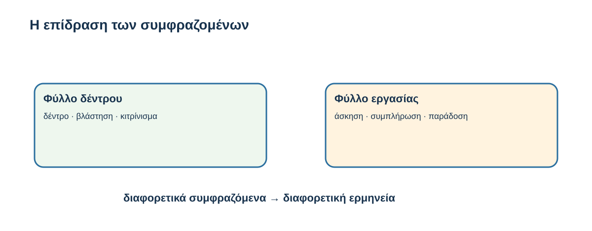
Σχήμα 4.4 — Η επίδραση των συμφραζομένων

| Χρήση της λέξης «φύλλο» | Σχετικές πληροφορίες | Ερμηνεία |
|---|---|---|
| Φύλλο δέντρου | δέντρο · βλάστηση · κιτρίνισμα | Μέρος ενός φυτού |
| Φύλλο εργασίας | άσκηση · συμπλήρωση · παράδοση | Εκπαιδευτικό έγγραφο |

Εννοιολογική απεικόνιση. Δεν παρουσιάζει πραγματικούς εσωτερικούς υπολογισμούς ενός LLM.

Η ερμηνεία μιας λέξης μπορεί να επηρεάζεται από άλλες λέξεις της ίδιας πρότασης.

Το ίδιο συμβαίνει και σε πιο σύνθετα κείμενα.

Ας εξετάσουμε:

> «Η ερευνήτρια παρουσίασε τα αποτελέσματα της μελέτης και στη συνέχεια εξήγησε γιατί ορισμένα από αυτά χρειάζονται περαιτέρω διερεύνηση».

Για να επεξεργαστεί κατάλληλα την πρόταση, είναι χρήσιμο το μοντέλο να αξιοποιήσει τη σχέση ανάμεσα στη φράση «ορισμένα από αυτά» και στα «αποτελέσματα της μελέτης».

Οι σχετικές πληροφορίες δεν βρίσκονται απαραίτητα δίπλα η μία στην άλλη.

Τα σύγχρονα γλωσσικά μοντέλα μπορούν να αξιοποιούν σχέσεις μεταξύ διαφορετικών θέσεων του διαθέσιμου κειμένου.

Αυτό δεν σημαίνει ότι συμβουλεύονται ένα απλό λεξικό και επιλέγουν μία προκαθορισμένη σημασία για κάθε λέξη.

Η επεξεργασία πραγματοποιείται μέσω αριθμητικών αναπαραστάσεων που μετασχηματίζονται μέσα στο δίκτυο.

Στην 4.5 θα δούμε πώς ο μηχανισμός attention συμβάλλει στην αξιοποίηση τέτοιων σχέσεων.

## 4.3.4 Τα συμφραζόμενα μιας συνομιλίας

Μέχρι τώρα εξετάσαμε συμφραζόμενα μέσα σε προτάσεις.

Όταν χρησιμοποιούμε ένα chatbot, όμως, η συνομιλία μπορεί να περιλαμβάνει περισσότερα μηνύματα.

Ας παρακολουθήσουμε το ακόλουθο παράδειγμα.

Φοιτητής

Εξήγησέ μου τι είναι η ερευνητική υπόθεση.

Chatbot

Η ερευνητική υπόθεση είναι μια πρόταση που μπορεί να εξεταστεί με κατάλληλα δεδομένα ή παρατηρήσεις.

Φοιτητής

Μπορείς να μου δώσεις ένα παράδειγμα από την εκπαίδευση;

Στην τελευταία ερώτηση ο φοιτητής δεν επαναλαμβάνει τη φράση «ερευνητική υπόθεση».

Το chatbot μπορεί να δημιουργήσει μια σχετική συνέχεια, επειδή η εφαρμογή ενδέχεται να παρέχει στο μοντέλο τα προηγούμενα μηνύματα ως μέρος της εισόδου.

Έτσι μπορεί να παραχθεί μια απάντηση όπως:

> «Μια ερευνητική υπόθεση θα μπορούσε να είναι ότι η χρήση μικρών δραστηριοτήτων αυτοαξιολόγησης βελτιώνει την επίδοση των φοιτητών σε ένα μάθημα».

Αν το μοντέλο λάμβανε μόνο την τελευταία ερώτηση, το αίτημα θα ήταν λιγότερο συγκεκριμένο.

Το παράδειγμα δείχνει γιατί τα συμφραζόμενα της συνομιλίας μπορούν να βελτιώνουν τη συνέχεια της επικοινωνίας.

Υπάρχει όμως μια σημαντική διάκριση:

Η αξιοποίηση προηγούμενων μηνυμάτων δεν σημαίνει ότι το γλωσσικό μοντέλο εκπαιδεύεται ξανά κάθε φορά που συνομιλούμε μαζί του.

Η εφαρμογή μπορεί απλώς να συμπεριλαμβάνει το προηγούμενο ιστορικό στην τρέχουσα είσοδο.

Η εκπαίδευση είναι διαφορετική διαδικασία, κατά την οποία διαμορφώνονται ή προσαρμόζονται οι μαθημένες παράμετροι του μοντέλου.

## 4.3.5 Τι είναι το παράθυρο συμφραζομένων;

Στην προηγούμενη ενότητα γνωρίσαμε ότι το πλήθος των tokens σχετίζεται με τους περιορισμούς επεξεργασίας ενός γλωσσικού μοντέλου.

Το παράθυρο συμφραζομένων (context window) αναφέρεται στο εύρος πληροφοριών που μπορεί να χρησιμοποιήσει το μοντέλο σε μια συγκεκριμένη επεξεργασία.

Συνήθως μετριέται σε tokens.

Μπορεί να περιλαμβάνει το τρέχον αίτημα, προηγούμενα μηνύματα, οδηγίες και πρόσθετο υλικό που παρέχει η εφαρμογή.

Ας υποθέσουμε ότι ένας φοιτητής χρησιμοποιεί chatbot για να μελετήσει ένα μεγάλο επιστημονικό σύγγραμμα.

Προσθέτει διαδοχικά κεφάλαια, ερωτήσεις και σημειώσεις.

Κάποια στιγμή, το συνολικό υλικό μπορεί να υπερβεί το διαθέσιμο παράθυρο συμφραζομένων.

Ανάλογα με την εφαρμογή, ορισμένα προηγούμενα μηνύματα μπορεί να μη συμπεριληφθούν, να συνοψιστούν ή να ανακτηθούν επιλεκτικά.

Αυτό εξηγεί γιατί ένα chatbot ενδέχεται να μην αξιοποιήσει κάποια πληροφορία που είχε αναφερθεί πολύ νωρίτερα.

Δεν σημαίνει απαραίτητα ότι «ξέχασε» με τον ανθρώπινο τρόπο.

Μπορεί η πληροφορία να μην είναι πλέον διαθέσιμη στο τρέχον πλαίσιο.

Επίσης, ακόμη και όταν ένα μεγάλο κείμενο χωρά στο παράθυρο συμφραζομένων, δεν είναι βέβαιο ότι το μοντέλο θα αξιοποιήσει σωστά κάθε λεπτομέρειά του.

Το μέγεθος του παραθύρου είναι τεχνικό χαρακτηριστικό, όχι εγγύηση πλήρους και ακριβούς επεξεργασίας.

## 4.3.6 Περισσότερες πληροφορίες σημαίνουν πάντοτε καλύτερη απάντηση;

Ένας φοιτητής γράφει:

> «Βοήθησέ με να γράψω μια εργασία».

Το αίτημα δεν προσδιορίζει αντικείμενο, επίπεδο, έκταση ή είδος βοήθειας.

Ας εξετάσουμε μια δεύτερη διατύπωση:

> «Ετοιμάζω εργασία πρώτου έτους για τη σημασία της ανακύκλωσης. Θέλω να με βοηθήσεις να οργανώσω τη δομή της σε εισαγωγή, κύριο μέρος και συμπεράσματα, χωρίς να γράψεις ολόκληρη την εργασία για μένα».

Το δεύτερο αίτημα είναι σαφέστερο.

Προσδιορίζει το θέμα, το επίπεδο, το επιθυμητό αποτέλεσμα και έναν σημαντικό περιορισμό.

Ο φοιτητής ζητά βοήθεια στην οργάνωση, όχι πλήρη συγγραφή.

Αυτές είναι χρήσιμες πληροφορίες.

Ας φανταστούμε, όμως, ότι ο φοιτητής προσθέτει πολλές σελίδες άσχετων πληροφοριών για άλλα μαθήματα και προηγούμενες εργασίες.

Θα βελτιωθεί υποχρεωτικά η απάντηση;

Όχι.

Οι πληροφορίες βοηθούν όταν είναι σχετικές και αρκετά σαφείς.

Οι άσχετες, αντιφατικές ή υπερβολικά πολλές πληροφορίες μπορούν να δυσκολεύουν την επεξεργασία του αιτήματος.

Επομένως, στόχος δεν είναι να γράφουμε όσο περισσότερο κείμενο μπορούμε.

Είναι να παρέχουμε τις κατάλληλες πληροφορίες για τη συγκεκριμένη εργασία.

## 4.3.7 Καθοδηγούμενη δραστηριότητα — Ποιο αίτημα είναι καταλληλότερο;

Μια φοιτήτρια προετοιμάζεται για το μάθημα «Μεθοδολογία Έρευνας».

Θέλει να κατανοήσει τη διαφορά ανάμεσα σε ερευνητική υπόθεση και ερευνητικό ερώτημα.

Ποιο αίτημα δίνει τα καταλληλότερα συμφραζόμενα;

Αίτημα Α — «Πες μου για την έρευνα».

Αίτημα Β — «Εξήγησέ μου τη διαφορά ανάμεσα σε ερευνητικό ερώτημα και ερευνητική υπόθεση, σαν να είμαι πρωτοετής φοιτητής. Δώσε ένα απλό παράδειγμα από την εκπαίδευση».

Αίτημα Γ — «Θέλω τα πάντα για επιστήμη, έρευνα, βιβλιογραφία, στατιστική, πανεπιστήμια, εξετάσεις και εργασίες».
::: {dropdown} Ενδεικτική απάντηση και ανατροφοδότηση
Σωστές επιλογές: **2**.

Το αίτημα Β προσδιορίζει τις έννοιες, το επίπεδο και το είδος του παραδείγματος χωρίς άσχετες πληροφορίες.
:::

## 4.3.8 Μικρή άσκηση — Τι συμβαίνει όταν λείπουν τα συμφραζόμενα;

Ένας φοιτητής γράφει:

> «Μπορείς να το συγκρίνεις με το προηγούμενο;»

Η εφαρμογή δεν παρέχει στο μοντέλο τα προηγούμενα μηνύματα.

Ποιο είναι το πρόβλημα και πώς θα μπορούσε να διατυπώσει καλύτερα το αίτημα;

Ενδεικτική απάντηση

::: {dropdown} Ενδεικτική απάντηση
Το μοντέλο δεν διαθέτει επαρκείς πληροφορίες για να προσδιορίσει σε τι αναφέρονται το «το» και το «προηγούμενο».

Ο φοιτητής θα μπορούσε να κατονομάσει τα δύο αντικείμενα.

Για παράδειγμα:

«Σύγκρινε την ποιοτική με την ποσοτική έρευνα ως προς τον σκοπό τους, τα δεδομένα που χρησιμοποιούν και τα βασικά πλεονεκτήματά τους».

Έτσι, το αίτημα γίνεται κατανοητό ακόμη και χωρίς το ιστορικό της συνομιλίας.
:::

## 4.3.9 Τι κρατάμε από την ενότητα

Τα συμφραζόμενα είναι οι πληροφορίες που επιτρέπουν σε ένα γλωσσικό μοντέλο να επεξεργάζεται μια λέξη, πρόταση ή ερώτημα σε σχέση με το περιβάλλον τους.

Η ίδια λέξη μπορεί να έχει διαφορετική σημασία ανάλογα με τις υπόλοιπες πληροφορίες.

Σε μια συνομιλία, το μοντέλο μπορεί να αξιοποιεί προηγούμενα μηνύματα, εφόσον αυτά περιλαμβάνονται στο διαθέσιμο πλαίσιο.

Το παράθυρο συμφραζομένων περιορίζει την ποσότητα πληροφορίας που μπορεί να χρησιμοποιηθεί σε μια συγκεκριμένη επεξεργασία.

Η παροχή κατάλληλων πληροφοριών μπορεί να βοηθήσει στη δημιουργία πιο σχετικών απαντήσεων, αλλά η μεγάλη έκταση ενός αιτήματος δεν εγγυάται καλύτερη επεξεργασία.

Η βασική αρχή είναι ότι ένα σαφές αίτημα, με τις κατάλληλες πληροφορίες, βοηθά το μοντέλο να ανταποκριθεί στον πραγματικό σκοπό του χρήστη.

### Μετάβαση στην 4.4

Γνωρίσαμε πώς το κείμενο μετατρέπεται σε tokens και γιατί τα συμφραζόμενα επηρεάζουν την επεξεργασία του.

Αλλά πώς δημιουργείται η ίδια η απάντηση;

Όταν ζητάμε:

> «Εξήγησέ μου τι είναι η επιστημονική μέθοδος με τρεις απλές προτάσεις».

πώς προκύπτουν οι λέξεις που εμφανίζονται στην οθόνη;

Παράγεται ολόκληρο το κείμενο ταυτόχρονα ή σχηματίζεται σταδιακά;

Αυτό είναι το αντικείμενο της επόμενης ενότητας.

---

# 4.4 Πώς παράγεται μια απάντηση; Από το επόμενο token στο ολοκληρωμένο κείμενο

Στις προηγούμενες ενότητες γνωρίσαμε δύο βασικά στοιχεία της λειτουργίας ενός μεγάλου γλωσσικού μοντέλου.

Στην 4.2 είδαμε πώς το κείμενο μετατρέπεται σε tokens και αριθμητικές αναπαραστάσεις. Στην 4.3 εξετάσαμε γιατί τα συμφραζόμενα είναι σημαντικά για την επεξεργασία της γλώσσας.

Τώρα θα εξετάσουμε το επόμενο βήμα:

Πώς δημιουργείται η απάντηση που βλέπουμε στην οθόνη μας;

Ας υποθέσουμε ότι ένας φοιτητής γράφει:

> «Εξήγησέ μου τι είναι η επιστημονική μέθοδος με τρεις απλές προτάσεις».

Το chatbot εμφανίζει μια σύντομη και οργανωμένη εξήγηση.

Πώς δημιουργήθηκε αυτό το κείμενο;

Παρήχθη ολόκληρο ταυτόχρονα ή σχηματίστηκε σταδιακά;

Σε πολλά σύγχρονα γλωσσικά μοντέλα η απάντηση παράγεται διαδοχικά, με την επιλογή νέων tokens με βάση τις διαθέσιμες πληροφορίες και όσα έχουν ήδη παραχθεί.

Αυτή τη διαδικασία θα γνωρίσουμε μέσα από απλά παραδείγματα.

## Μαθησιακός σκοπός

Μετά τη μελέτη της ενότητας θα μπορείς να εξηγείς πώς ένα συνηθισμένο γλωσσικό μοντέλο παράγει κείμενο σταδιακά, τι σημαίνει πρόβλεψη του επόμενου token, γιατί το ίδιο αίτημα μπορεί να οδηγήσει σε διαφορετικές διατυπώσεις και γιατί η πιθανότητα μιας γλωσσικής συνέχειας δεν αποτελεί από μόνη της εγγύηση ορθότητας.

## 4.4.1 Πριν ξεκινήσουμε — Πώς θα συνέχιζες αυτή την πρόταση;

Διάβασε την ημιτελή πρόταση:

> «Η βιβλιοθήκη του πανεπιστημίου προσφέρει στους φοιτητές πρόσβαση σε…»

Πώς θα μπορούσε να συνεχιστεί;

Ίσως σκεφτείς «βιβλία».

Ίσως «επιστημονικά περιοδικά».

Ή «ηλεκτρονικές βάσεις δεδομένων».

Όλες αυτές οι συνέχειες μπορούν να είναι κατάλληλες.

Δεν υπάρχει υποχρεωτικά μόνο ένας σωστός τρόπος να ολοκληρωθεί η πρόταση.

Ας αλλάξουμε τώρα το αρχικό κείμενο:

> «Η ψηφιακή βιβλιοθήκη του πανεπιστημίου προσφέρει εξ αποστάσεως πρόσβαση σε…»

Οι πιθανές συνέχειες ενδέχεται να διαφοροποιηθούν, επειδή άλλαξαν οι διαθέσιμες πληροφορίες.

Γιατί επηρεάζεται η συνέχεια της πρότασης;

Η δραστηριότητα μάς εισάγει στην κεντρική αρχή της ενότητας: η παραγωγή του κειμένου εξαρτάται από τις πληροφορίες που προηγούνται.
::: {dropdown} Σκέψου πριν αποκαλύψεις
Οι λέξεις «ψηφιακή» και «εξ αποστάσεως» μεταβάλλουν τα συμφραζόμενα.

Στη δεύτερη πρόταση γίνεται περισσότερο αναμενόμενη μια συνέχεια σχετική με ηλεκτρονικές πηγές ή διαδικτυακές υπηρεσίες.

Τα συμφραζόμενα δεν καθορίζουν πάντοτε μία μοναδική συνέχεια. Επηρεάζουν όμως ποιες συνέχειες είναι πιθανότερες.
:::

## 4.4.2 Τι σημαίνει «πρόβλεψη του επόμενου token»;

Στην 4.2 γνωρίσαμε ότι ένα token μπορεί να αντιστοιχεί σε μία λέξη, σε τμήμα λέξης ή σε διαφορετική ακολουθία χαρακτήρων.

Σε πολλά γλωσσικά μοντέλα που χρησιμοποιούνται για την παραγωγή κειμένου, η διαδικασία βασίζεται στην επιλογή του επόμενου token.

Τα μοντέλα αυτά χαρακτηρίζονται συχνά ως αυτοπαλινδρομικά (autoregressive).

Ο όρος ακούγεται τεχνικός, αλλά η βασική ιδέα είναι απλή.

Το μοντέλο χρησιμοποιεί τα διαθέσιμα προηγούμενα tokens για να υπολογίσει ποιο token μπορεί να ακολουθήσει.

Αφού επιλεγεί το επόμενο token, αυτό προστίθεται στην ακολουθία και η διαδικασία επαναλαμβάνεται.

Ας εξετάσουμε ένα υποθετικό παράδειγμα.

Ο φοιτητής γράφει:

> «Συμπλήρωσε την πρόταση: Η επιστημονική έρευνα βασίζεται σε…»

Το μοντέλο μπορεί να δημιουργήσει μια συνέχεια όπως:

> «Η επιστημονική έρευνα βασίζεται σε δεδομένα…»

Στη συνέχεια:

> «Η επιστημονική έρευνα βασίζεται σε δεδομένα και…»

Και τελικά:

> «Η επιστημονική έρευνα βασίζεται σε δεδομένα και συστηματική εξέταση των ευρημάτων».

Στο παράδειγμα παρουσιάζουμε ολόκληρες λέξεις και φράσεις, επειδή είναι ευκολότερο να τις παρακολουθήσουμε.

Στην πραγματικότητα, κάθε βήμα παραγωγής αφορά ένα token, που δεν αντιστοιχεί υποχρεωτικά σε ολόκληρη λέξη.

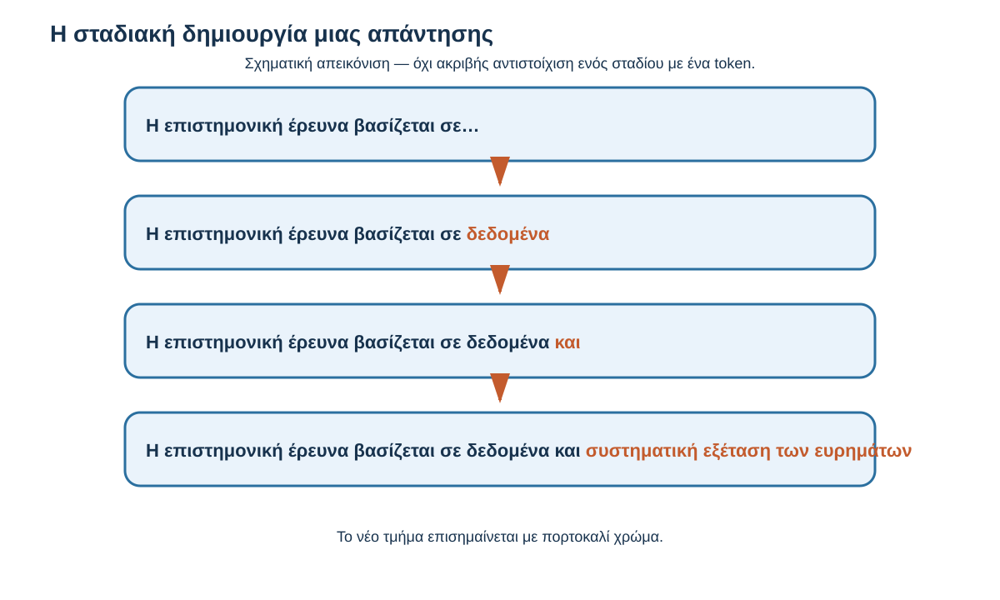
Σχήμα 4.5 — Η σταδιακή δημιουργία μιας απάντησης

Αρχικό κείμενο

Η επιστημονική έρευνα βασίζεται σε…

Ενδεικτικό στάδιο 1

…σε δεδομένα

Ενδεικτικό στάδιο 2

…σε δεδομένα και

Ενδεικτικό στάδιο 3

…σε δεδομένα και συστηματική εξέταση των ευρημάτων

Εννοιολογική απεικόνιση. Κάθε εμφανιζόμενο στάδιο μπορεί να περιλαμβάνει πολλά πραγματικά βήματα παραγωγής tokens. Δεν αποτελεί έξοδο συγκεκριμένου μοντέλου.

Η διαδικασία συνεχίζεται μέχρι να ολοκληρωθεί η απάντηση, για παράδειγμα όταν παραχθεί ειδικό σήμα τέλους ή επιτευχθεί κάποιο όριο παραγωγής.

Το σημαντικό είναι ότι σε κάθε βήμα η νέα επιλογή βασίζεται στο διαθέσιμο προηγούμενο κείμενο.

## 4.4.3 Πώς επιλέγεται το επόμενο token;

Ένα συνηθισμένο γλωσσικό μοντέλο υπολογίζει μια κατανομή πιθανοτήτων για τα tokens που μπορούν να ακολουθήσουν.

Ας εξετάσουμε την πρόταση:

> «Ο φοιτητής μελετά για την αυριανή…»

Μια κατάλληλη συνέχεια θα μπορούσε να είναι η λέξη «εξέταση».

Άλλες συνέχειες μπορεί επίσης να είναι δυνατές, ανάλογα με το κείμενο.

Για να κατανοήσουμε την ιδέα, ας φανταστούμε τέσσερις υποθετικές επιλογές.

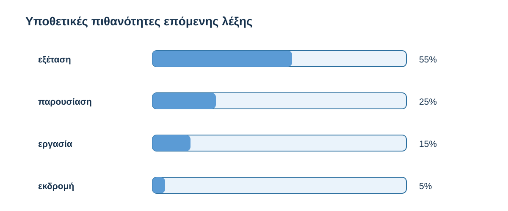
Σχήμα 4.6 — Υποθετικές πιθανότητες επόμενης λέξης

«Ο φοιτητής μελετά για την αυριανή…»

0%15%30%45%60%εξέτασηπαρουσίασηεργασίαεκδρομή

Κατασκευασμένες πιθανότητες αποκλειστικά για εκπαιδευτικούς σκοπούς. Εμφανίζονται λέξεις αντί πραγματικών tokens. Δεν αποτελούν έξοδο LLM.

Στο παράδειγμα, η λέξη «εξέταση» έχει τη μεγαλύτερη πιθανότητα.

Αυτό δεν σημαίνει ότι πρέπει να επιλεγεί υποχρεωτικά κάθε φορά.

Υπάρχουν διαφορετικές μέθοδοι επιλογής του επόμενου token.

Μία απλή προσέγγιση είναι να επιλέγεται το token με τη μεγαλύτερη πιθανότητα.

Μια άλλη είναι η δειγματοληψία (sampling), δηλαδή η επιλογή ανάμεσα σε περισσότερα πιθανά tokens, λαμβάνοντας υπόψη τις πιθανότητές τους.

Στη δεύτερη περίπτωση, διαφορετικές εκτελέσεις μπορούν να παράγουν διαφορετικές συνέχειες ακόμη και όταν το αρχικό αίτημα είναι ίδιο.

## 4.4.4 Γιατί δεν επιλέγεται πάντοτε η πιθανότερη συνέχεια;

Ας υποθέσουμε ότι ζητάς:

> «Γράψε μια σύντομη εισαγωγή για μια εργασία σχετικά με τη σημασία της ανακύκλωσης».

Μια απάντηση μπορεί να αρχίζει:

> «Η ανακύκλωση αποτελεί μια σημαντική διαδικασία για τη μείωση των αποβλήτων…»

Μια άλλη μπορεί να αρχίζει:

> «Η διαχείριση των απορριμμάτων αποτελεί μία από τις σημαντικές προκλήσεις των σύγχρονων κοινωνιών…»

Και οι δύο διατυπώσεις μπορούν να είναι κατάλληλες.

Η δυνατότητα επιλογής διαφορετικών συνεχειών επιτρέπει την παραγωγή ποικιλίας κειμένων.

Αυτό μπορεί να είναι ιδιαίτερα χρήσιμο στη δημιουργική γραφή, στην αναδιατύπωση παραγράφων και στη δημιουργία εναλλακτικών εξηγήσεων.

Δεν είναι όμως εξίσου επιθυμητή η ποικιλία σε όλες τις εργασίες.

Αν ζητάμε μια δημιουργική ιστορία, οι διαφορετικές διατυπώσεις μπορεί να αποτελούν πλεονέκτημα.

Αν ζητάμε έναν αριθμητικό υπολογισμό, το σημαντικότερο είναι η ορθότητα του αποτελέσματος.

Επομένως, η καταλληλότητα μιας απάντησης εξαρτάται και από το είδος της εργασίας.

## 4.4.5 Μπορεί η ίδια ερώτηση να δώσει διαφορετικές απαντήσεις;

Ναι, μπορεί.

Ας υποθέσουμε ότι δύο φοιτητές χρησιμοποιούν το ίδιο chatbot και γράφουν:

> «Εξήγησέ μου τη διαφορά ανάμεσα στην ποιοτική και στην ποσοτική έρευνα».

Η πρώτη απάντηση μπορεί να αρχίζει:

> «Η ποιοτική έρευνα επικεντρώνεται στην εις βάθος διερεύνηση εμπειριών και νοημάτων…»

Η δεύτερη μπορεί να χρησιμοποιεί παράδειγμα:

> «Αν θέλουμε να μάθουμε πόσοι φοιτητές χρησιμοποιούν μια ψηφιακή πλατφόρμα, μπορούμε να συγκεντρώσουμε αριθμητικά δεδομένα…»

Οι απαντήσεις μπορεί να είναι διαφορετικές ως προς το ύφος και τον τρόπο παρουσίασης.

Αυτό μπορεί να σχετίζεται με τη μέθοδο επιλογής των επόμενων tokens.

Μπορεί επίσης να επηρεάζεται από άλλους παράγοντες, όπως οι διαθέσιμες οδηγίες, το ιστορικό της συνομιλίας ή οι ρυθμίσεις της εφαρμογής.

Δεν μπορούμε επομένως να αποδώσουμε κάθε διαφορά αποκλειστικά στην τυχαιότητα.

Η διαφορετική διατύπωση δεν συνεπάγεται υποχρεωτικά διαφορετική ορθότητα.

Δύο απαντήσεις μπορεί να είναι διαφορετικές και ταυτόχρονα σωστές.

Αντίστοιχα, δύο απαντήσεις μπορεί να παρουσιάζουν την ίδια λανθασμένη πληροφορία με διαφορετικά λόγια.

## 4.4.6 Προαιρετική εμβάθυνση — Τι είναι η temperature;

Προαιρετική τεχνική πληροφορία

Διάβασε περισσότερα
::: {dropdown} Προαιρετική εμβάθυνση: temperature
Σε ορισμένες εφαρμογές ή υπηρεσίες ανάπτυξης μοντέλων υπάρχει μια ρύθμιση που ονομάζεται **temperature**.

Η ρύθμιση αυτή επηρεάζει τον τρόπο με τον οποίο οι διαφορές μεταξύ των πιθανών tokens λαμβάνονται υπόψη κατά τη δειγματοληψία.

Σε γενικές γραμμές, χαμηλότερες τιμές τείνουν να ευνοούν περισσότερο τις πιθανότερες επιλογές, ενώ υψηλότερες τιμές μπορούν να επιτρέπουν μεγαλύτερη ποικιλία.

Η ακριβής συμπεριφορά εξαρτάται από το μοντέλο και τις υπόλοιπες ρυθμίσεις.

Δεν χρειάζεται να γνωρίζεις τον μαθηματικό τύπο ούτε να μπορείς να τροποποιείς αυτή τη ρύθμιση.

Αρκεί να κατανοείς ότι υπάρχουν διαφορετικοί τρόποι επιλογής των tokens.

Η temperature δεν μετατρέπει αυτομάτως μια ανακριβή απάντηση σε σωστή.
:::

## 4.4.7 Είναι ένα LLM απλώς μια μηχανή που μαντεύει λέξεις;

Έχοντας γνωρίσει την πρόβλεψη του επόμενου token, ίσως δημιουργείται η εντύπωση ότι το γλωσσικό μοντέλο «απλώς μαντεύει λέξεις».

Η περιγραφή αυτή βασίζεται σε ένα πραγματικό στοιχείο της λειτουργίας πολλών LLMs, αλλά είναι υπερβολικά περιορισμένη.

Για να υπολογίσει τις πιθανές συνέχειες, το μοντέλο αξιοποιεί σύνθετες αριθμητικές αναπαραστάσεις, μαθημένες παραμέτρους και σχέσεις μέσα στο διαθέσιμο κείμενο.

Η διαδικασία αυτή μπορεί να υποστηρίζει δραστηριότητες που απαιτούν σύνθετη γλωσσική επεξεργασία.

Για παράδειγμα, ένα μοντέλο μπορεί να συγκρίνει δύο επιχειρήματα, να συνοψίσει ένα εκτενές κείμενο ή να προτείνει διαφορετικούς τρόπους παρουσίασης μιας έννοιας.

Οι δυνατότητες αυτές δεν περιγράφονται επαρκώς με την εικόνα ενός συστήματος που επιλέγει τυχαία λέξεις χωρίς να αξιοποιεί το περιβάλλον τους.

Από την άλλη πλευρά, η παραγωγή σύνθετων και χρήσιμων απαντήσεων δεν αποδεικνύει από μόνη της ότι το μοντέλο σκέφτεται ή κατανοεί όπως ένας άνθρωπος.

Η καταλληλότερη περιγραφή για τον σκοπό του μαθήματος είναι ότι ένα LLM αποτελεί εκπαιδευμένο υπολογιστικό μοντέλο που αξιοποιεί σύνθετους υπολογισμούς για να παράγει ακολουθίες κειμένου.

## 4.4.8 Η πιθανότερη συνέχεια δεν είναι υποχρεωτικά αληθής

Ας εξετάσουμε μια σημαντική διάκριση.

Όταν το μοντέλο υπολογίζει ότι ένα token είναι πιθανό να ακολουθεί ένα συγκεκριμένο κείμενο, δεν υπολογίζει υποχρεωτικά την πιθανότητα να είναι αληθής ο ισχυρισμός που διατυπώνεται.

Ας υποθέσουμε ότι ζητάς:

> «Ποια χρονιά δημοσιεύτηκε για πρώτη φορά μια συγκεκριμένη επιστημονική θεωρία;»

Το μοντέλο μπορεί να παράγει μια χρονολογία με φυσικό και πειστικό τρόπο.

Αυτό δεν αποτελεί απόδειξη ότι η χρονολογία είναι σωστή.

Η παραγωγή πιθανών γλωσσικών συνεχειών και η ανεξάρτητη επαλήθευση των πραγματικών γεγονότων είναι διαφορετικές διαδικασίες.

Ένα chatbot μπορεί να χρησιμοποιεί εξωτερικά εργαλεία ή πηγές για να υποστηρίξει την απάντησή του, αλλά αυτό εξαρτάται από την εφαρμογή.

Στην 4.7 θα εξετάσουμε αναλυτικά την αξιοπιστία των απαντήσεων.

Εδώ συγκρατούμε μόνο τη βασική διάκριση:

Η πιθανότητα ενός token να ακολουθεί το προηγούμενο κείμενο δεν είναι το ίδιο πράγμα με την πιθανότητα να είναι αληθής μια ολόκληρη απάντηση.

## 4.4.9 Καθοδηγούμενη δραστηριότητα — Τι μπορούμε να συμπεράνουμε;

<a href="/al00_4_4_9.html" target="_blank" rel="noopener">Άνοιξε τη διαδραστική δραστηριότητα 4.4.9 σε νέα καρτέλα</a>

## 4.4.10 Εξήγησέ το με δικά σου λόγια

Ένας συμφοιτητής σου λέει:

> «Αφού το μοντέλο επιλέγει το επόμενο token, γιατί μπορεί να γράφει τόσο μεγάλες και οργανωμένες απαντήσεις;»

Προσπάθησε να απαντήσεις με δύο ή τρεις προτάσεις.

Ενδεικτική απάντηση

::: {dropdown} Ενδεικτική απάντηση
Το μοντέλο παράγει την απάντηση σταδιακά, αλλά σε κάθε βήμα αξιοποιεί πληροφορίες από το αίτημα και τα ήδη παραχθέντα tokens.

Οι μαθημένες αναπαραστάσεις και οι υπολογιστικοί μηχανισμοί του επιτρέπουν να επεξεργάζεται σύνθετες σχέσεις μέσα στο κείμενο.

Έτσι μπορούν να δημιουργούνται εκτενείς και οργανωμένες απαντήσεις, χωρίς αυτό να εγγυάται ότι κάθε πληροφορία τους είναι σωστή.
:::

## 4.4.11 Τι κρατάμε από την ενότητα

Σε πολλά σύγχρονα γλωσσικά μοντέλα, η παραγωγή κειμένου γίνεται σταδιακά, με την επιλογή διαδοχικών tokens.

Σε κάθε βήμα, το μοντέλο αξιοποιεί τις διαθέσιμες πληροφορίες και όσα έχουν ήδη παραχθεί, ώστε να υπολογίσει πιθανές συνέχειες.

Η επιλογή μπορεί να πραγματοποιείται με διαφορετικούς τρόπους. Γι' αυτό το ίδιο αίτημα μπορεί να οδηγήσει σε διαφορετικές διατυπώσεις.

Η διαδικασία δεν είναι απλή τυχαία επιλογή λέξεων. Βασίζεται σε σύνθετες μαθημένες αναπαραστάσεις και υπολογισμούς.

Ωστόσο, η πιθανότητα μιας γλωσσικής συνέχειας δεν αποτελεί από μόνη της εγγύηση πραγματολογικής ορθότητας.

Η βασική ιδέα είναι ότι ένα LLM μπορεί να δημιουργεί ολόκληρες απαντήσεις μέσα από τη σταδιακή παραγωγή νέων tokens, αξιοποιώντας όσα έχουν προηγηθεί και τις δυνατότητες που απέκτησε κατά την εκπαίδευσή του.

### Μετάβαση στην 4.5

Μέχρι τώρα γνωρίσαμε τη διαδρομή από το κείμενο στα tokens, τη σημασία των συμφραζομένων και τη σταδιακή παραγωγή απάντησης.

Απομένει όμως ένα ερώτημα:

Πώς μπορεί το μοντέλο να αξιοποιεί σχέσεις ανάμεσα σε διαφορετικά σημεία μιας πρότασης ή ενός εκτενούς κειμένου;

Ας εξετάσουμε:

> «Η φοιτήτρια διάβασε το άρθρο και στη συνέχεια το παρουσίασε στην ομάδα της».

Για να επεξεργαστεί κατάλληλα αυτή την πρόταση, είναι χρήσιμο το μοντέλο να συσχετίσει τη λέξη «το» με το «άρθρο».

Στην επόμενη ενότητα θα δούμε πώς η αρχιτεκτονική Transformer και ο μηχανισμός attention συμβάλλουν στην επεξεργασία τέτοιων σχέσεων.

# 4.5 Τι προσφέρει η αρχιτεκτονική Transformer; Πώς αξιοποιούνται οι σχέσεις μέσα στο κείμενο

Στις προηγούμενες ενότητες γνωρίσαμε πώς το κείμενο μετατρέπεται σε tokens, πώς αξιοποιούνται τα συμφραζόμενα και πώς πολλά γλωσσικά μοντέλα παράγουν σταδιακά τις απαντήσεις τους.

Ας εξετάσουμε όμως ένα ερώτημα που δεν έχουμε απαντήσει πλήρως.

Πώς μπορεί το μοντέλο να συνδέει πληροφορίες που εμφανίζονται σε διαφορετικά σημεία μιας πρότασης;

Διάβασε:

> «Η φοιτήτρια διάβασε το άρθρο, το συζήτησε με τους συμφοιτητές της και στη συνέχεια το παρουσίασε στην τάξη».

Η λέξη «το» εμφανίζεται δύο φορές.

Και στις δύο περιπτώσεις αναφέρεται στο άρθρο.

Για να επεξεργαστούμε σωστά την πρόταση, δεν αρκεί να εξετάσουμε κάθε λέξη ξεχωριστά.

Χρειάζεται να αξιοποιήσουμε σχέσεις ανάμεσα στις λέξεις, ακόμη και όταν αυτές βρίσκονται σε διαφορετικά σημεία του κειμένου.

Μια αρχιτεκτονική νευρωνικών δικτύων που έχει συμβάλει καθοριστικά στην ανάπτυξη των σύγχρονων γλωσσικών μοντέλων είναι ο Transformer.

Στην ενότητα αυτή θα γνωρίσουμε τη βασική ιδέα της λειτουργίας του, με έμφαση στον μηχανισμό attention.

Δεν θα εξετάσουμε μαθηματικούς τύπους ή λεπτομέρειες προγραμματισμού.

## Μαθησιακός σκοπός

Να κατανοήσεις γιατί ένα γλωσσικό μοντέλο χρειάζεται να αξιοποιεί σχέσεις μεταξύ διαφορετικών σημείων του κειμένου, τι προσφέρει ο μηχανισμός attention, γιατί έχει σημασία η σειρά των λέξεων και γιατί η δυνατότητα σύνθετης γλωσσικής επεξεργασίας δεν εγγυάται την ορθότητα μιας απάντησης.

## 4.5.1 Πριν ξεκινήσουμε — Σε τι αναφέρεται η λέξη «το»;

Διάβασε:

> «Ο καθηγητής έδωσε στους φοιτητές ένα άρθρο. Τους ζήτησε να το διαβάσουν πριν από το επόμενο μάθημα».

Σε τι αναφέρεται το «το»;

Πιθανότατα απάντησες: στο άρθρο.

Η λέξη «άρθρο» βρίσκεται στην πρώτη πρόταση, ενώ το «το» στη δεύτερη.

Η μεταξύ τους σχέση είναι σημαντική για το νόημα.

Ας αλλάξουμε τώρα το κείμενο:

> «Ο καθηγητής έδωσε στους φοιτητές ένα άρθρο και ένα ερωτηματολόγιο. Τους ζήτησε να το συμπληρώσουν πριν από το επόμενο μάθημα».

Τώρα η λέξη «το» αναφέρεται πιθανότερα στο ερωτηματολόγιο.

Το ρήμα «συμπληρώσουν» παρέχει μια χρήσιμη πληροφορία για τη σχέση αυτή.

Αρκεί ένας κανόνας που συνδέει το «το» με το πλησιέστερο ουσιαστικό;

::: {dropdown} Σκέψου πριν αποκαλύψεις
Όχι.

Η καταλληλότερη σύνδεση εξαρτάται από τις σχέσεις ανάμεσα στις λέξεις και από το νόημα της πρότασης.

Στο δεύτερο παράδειγμα, το ρήμα «συμπληρώσουν» βοηθά να συσχετίσουμε την αντωνυμία με το ερωτηματολόγιο.

Η επεξεργασία της γλώσσας δεν μπορεί να βασίζεται πάντοτε σε απλούς κανόνες απόστασης μεταξύ λέξεων.
:::

## 4.5.2 Τι είναι ο Transformer;

Ο Transformer είναι μια αρχιτεκτονική νευρωνικών δικτύων που παρουσιάστηκε το 2017 και αποτέλεσε σημαντική εξέλιξη στην επεξεργασία ακολουθιών, όπως το κείμενο.

Πολλά σύγχρονα μεγάλα γλωσσικά μοντέλα βασίζονται σε παραλλαγές της.

Στην 4.2 είδαμε ότι το μοντέλο χρησιμοποιεί αριθμητικές αναπαραστάσεις των tokens.

Αυτές υποβάλλονται στη συνέχεια σε επεξεργασία, ώστε να αξιοποιηθούν πληροφορίες από το διαθέσιμο κείμενο.

Ο Transformer επιτρέπει τον συνδυασμό πληροφοριών από διαφορετικές θέσεις μιας ακολουθίας, αξιοποιώντας μηχανισμούς attention.

Ας επιστρέψουμε στην πρόταση:

> «Ο καθηγητής έδωσε στους φοιτητές ένα άρθρο και τους ζήτησε να το διαβάσουν».

Για να δημιουργήσει μια σχετική συνέχεια, το μοντέλο μπορεί να χρειάζεται πληροφορίες για το άρθρο, τους φοιτητές και την ενέργεια που τους ζητήθηκε.

Η αρχιτεκτονική επιτρέπει την επεξεργασία τέτοιων σχέσεων.

Δεν σημαίνει ότι το μοντέλο ακολουθεί έναν απλό, χειροκίνητο κανόνα για κάθε πιθανή σύνδεση.

Οι σχέσεις αξιοποιούνται μέσα από μαθημένες αριθμητικές αναπαραστάσεις και υπολογισμούς.

Για τον σκοπό του μαθήματος, αυτό είναι το σημαντικότερο χαρακτηριστικό του Transformer που χρειάζεται να γνωρίζουμε.

## 4.5.3 Η βασική ιδέα του attention

Η αγγλική λέξη attention σημαίνει «προσοχή».

Στα γλωσσικά μοντέλα, όμως, αποτελεί τεχνικό όρο.

Δεν σημαίνει ότι το σύστημα διαθέτει ανθρώπινη συγκέντρωση, πρόθεση ή συνειδητή προσοχή.

Ο μηχανισμός attention επιτρέπει να υπολογίζεται με ποιον τρόπο πληροφορίες από διαφορετικές θέσεις μιας ακολουθίας συνεισφέρουν στην επεξεργασία μιας συγκεκριμένης θέσης.

Ας εξετάσουμε:

> «Η Μαρία διάβασε το βιβλίο και το επέστρεψε στη βιβλιοθήκη».

Η λέξη «το» σχετίζεται με το «βιβλίο».

Όταν το μοντέλο επεξεργάζεται την πρόταση, είναι χρήσιμο να αξιοποιεί αυτή τη σχέση.

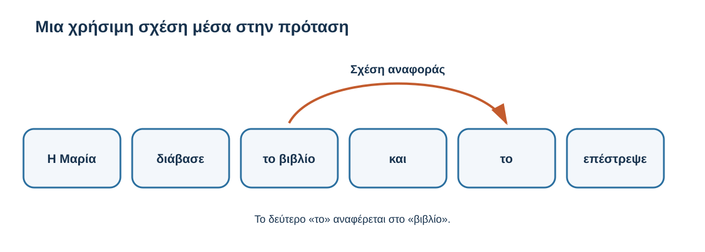
Σχήμα 4.7 — Μια χρήσιμη σχέση μέσα στην πρόταση

«Η Μαρία διάβασε το βιβλίο και το επέστρεψε στη βιβλιοθήκη».

Εννοιολογική απεικόνιση γλωσσικής σχέσης. Δεν παρουσιάζει πραγματικά βάρη attention ούτε τους υπολογισμούς συγκεκριμένου μοντέλου.

Το σχήμα παρουσιάζει μόνο μία χρήσιμη σχέση.

Στην πραγματικότητα, ο μηχανισμός attention μπορεί να συνδυάζει πληροφορίες από πολλές θέσεις.

Δεν επιλέγει απλώς μία σημαντική λέξη και αγνοεί όλες τις υπόλοιπες.

Οι συνεισφορές υπολογίζονται αριθμητικά και η επεξεργασία πραγματοποιείται σε περισσότερα επίπεδα του νευρωνικού δικτύου.

Δεν χρειάζεται να γνωρίζουμε τους υπολογισμούς.

Αρκεί να συγκρατήσουμε ότι η επεξεργασία μιας μονάδας κειμένου μπορεί να επηρεάζεται από άλλες μονάδες που βρίσκονται σε διαφορετικά σημεία της διαθέσιμης ακολουθίας.

## 4.5.4 Γιατί έχει σημασία η σειρά των λέξεων;

Ας εξετάσουμε δύο προτάσεις:

> «Ο φοιτητής βοήθησε τον καθηγητή».

> «Ο καθηγητής βοήθησε τον φοιτητή».

Οι δύο προτάσεις περιλαμβάνουν σχεδόν τις ίδιες λέξεις.

Ωστόσο, περιγράφουν διαφορετικές καταστάσεις.

Στην πρώτη, εκείνος που προσφέρει βοήθεια είναι ο φοιτητής.

Στη δεύτερη, εκείνος που προσφέρει βοήθεια είναι ο καθηγητής.

Αν γνωρίζαμε μόνο ποιες λέξεις εμφανίζονται, χωρίς πληροφορίες για τη σειρά τους, θα δυσκολευόμασταν να διακρίνουμε τη διαφορά.

Για τον λόγο αυτό, τα μοντέλα που βασίζονται σε Transformer αξιοποιούν και πληροφορίες σχετικά με τη θέση των tokens.

Οι πληροφορίες αυτές επιτρέπουν στο μοντέλο να επεξεργάζεται τη σειρά και τις μεταξύ τους σχέσεις.

Δεν είναι απαραίτητο να γνωρίζουμε τους διαφορετικούς τεχνικούς τρόπους με τους οποίους ενσωματώνεται η πληροφορία θέσης.

Το ουσιαστικό είναι ότι η παρουσία των λέξεων δεν αρκεί πάντοτε· έχει σημασία και ο τρόπος με τον οποίο συνδέονται μέσα στην πρόταση.

## 4.5.5 Τι προσφέρει αυτή η δυνατότητα στην πράξη;

Ας δούμε τρία παραδείγματα από την πανεπιστημιακή ζωή.

Παράδειγμα Α — Κατανόηση μιας οδηγίας

Ένας διδάσκων γράφει:

> «Διαβάστε το άρθρο, εντοπίστε τα βασικά επιχειρήματα και συγκρίνετέ τα με εκείνα της προηγούμενης μελέτης».

Για να δημιουργήσει μια κατάλληλη εξήγηση, το μοντέλο χρειάζεται να αξιοποιήσει τις σχέσεις ανάμεσα στα δύο άρθρα και στις ενέργειες που ζητούνται.

Παράδειγμα Β — Περίληψη κειμένου

Ένας φοιτητής παρέχει κείμενο στο οποίο παρουσιάζονται τα πλεονεκτήματα και οι περιορισμοί μιας εκπαιδευτικής μεθόδου.

Για να δημιουργηθεί χρήσιμη περίληψη, το μοντέλο χρειάζεται να συνδυάσει πληροφορίες που μπορεί να βρίσκονται σε διαφορετικές παραγράφους.

Παράδειγμα Γ — Επεξήγηση επιστημονικής έννοιας

Μια φοιτήτρια ζητά:

> «Εξήγησέ μου τη διαφορά ανάμεσα στη συσχέτιση και στην αιτιότητα, με παράδειγμα από την υγεία».

Το μοντέλο χρειάζεται να αξιοποιήσει τόσο τη σχέση ανάμεσα στις έννοιες όσο και την οδηγία για το επίπεδο και το είδος του παραδείγματος.

Σε όλες αυτές τις περιπτώσεις, η επεξεργασία δεν περιορίζεται στην ανεξάρτητη εξέταση κάθε λέξης.

Η αξιοποίηση σχέσεων ανάμεσα σε διαφορετικά σημεία του κειμένου συμβάλλει στην παραγωγή σχετικών απαντήσεων.

Δεν σημαίνει όμως ότι το μοντέλο θα κατανοήσει ή θα εκτελέσει πάντοτε σωστά κάθε σύνθετη οδηγία.

## 4.5.6 Μπορούμε να δούμε ακριβώς «τι σκέφτεται» το μοντέλο;

Ορισμένες παρουσιάσεις της Τεχνητής Νοημοσύνης περιλαμβάνουν διαγράμματα που δείχνουν συνδέσεις ανάμεσα σε λέξεις.

Μπορεί να εμφανίζονται γραμμές διαφορετικού πάχους ή χρωματικές ενδείξεις που αντιπροσωπεύουν αριθμητικά βάρη attention.

Τέτοιες απεικονίσεις μπορούν να προσφέρουν χρήσιμες πληροφορίες για συγκεκριμένους υπολογισμούς.

Δεν αποτελούν όμως από μόνες τους πλήρη εξήγηση του τρόπου με τον οποίο δημιουργήθηκε η τελική απάντηση.

Ένα σύγχρονο γλωσσικό μοντέλο περιλαμβάνει περισσότερα επίπεδα και μηχανισμούς επεξεργασίας.

Η τελική συμπεριφορά προκύπτει από τη συνδυασμένη λειτουργία τους.

Επομένως, δεν πρέπει να θεωρούμε ότι ένα διάγραμμα attention αποκαλύπτει αυτομάτως τη «σκέψη» του μοντέλου ή αποδεικνύει ότι κατανοεί όπως ένας άνθρωπος.

Μια οπτική αναπαράσταση μάς βοηθά να κατανοήσουμε μια λειτουργία, αλλά πρέπει να γνωρίζουμε τι παρουσιάζει και τι δεν αποδεικνύει.

## 4.5.7 Προαιρετική εμβάθυνση — Τι σημαίνει self-attention;

Προαιρετική τεχνική πληροφορία

Διάβασε περισσότερα
::: {dropdown} Προαιρετική εμβάθυνση: self-attention
Ο βασικός μηχανισμός που χρησιμοποιούν οι Transformers αναφέρεται συχνά ως **self-attention**.

Ο όρος περιγράφει την αξιοποίηση σχέσεων ανάμεσα στις θέσεις της ίδιας ακολουθίας αναπαραστάσεων.

Σε πολλά γλωσσικά μοντέλα που παράγουν κείμενο από αριστερά προς τα δεξιά χρησιμοποιείται μια μορφή που ονομάζεται *causal self-attention*.

Σε αυτήν, η επεξεργασία μιας θέσης περιορίζεται σε επιτρεπόμενες προηγούμενες θέσεις και στην ίδια τη θέση, χωρίς πρόσβαση σε μελλοντικά tokens της ακολουθίας.

Αυτό συνδέεται με τη σταδιακή παραγωγή που γνωρίσαμε στην 4.4.

Άλλες παραλλαγές Transformer μπορούν να χρησιμοποιούν διαφορετικούς τρόπους πρόσβασης στις θέσεις της ακολουθίας.

Δεν χρειάζεται να απομνημονεύσεις αυτούς τους όρους. Το σημαντικό είναι ότι το μοντέλο αξιοποιεί σχέσεις ανάμεσα στις διαθέσιμες αναπαραστάσεις του κειμένου.
:::

## 4.5.8 Καθοδηγούμενη δραστηριότητα — Ποιες πληροφορίες συνδέονται;

Διάβασε:

> «Η ερευνήτρια ολοκλήρωσε τη μελέτη και τη δημοσίευσε σε ένα επιστημονικό περιοδικό».

Έλεγχος κατανόησης

0/3

1\. Σε τι αναφέρεται η λέξη «τη»;

Στην ερευνήτρια

Στη μελέτη

Στο περιοδικό

2\. Γιατί έχει σημασία η σύνδεση πληροφοριών από διαφορετικές θέσεις;

Επειδή βοηθά στην επεξεργασία σχέσεων μέσα στο κείμενο.

Επειδή όλες οι λέξεις έχουν μόνο μία σημασία.

Επειδή εγγυάται ότι κάθε απάντηση είναι σωστή.

3\. Τι μπορούμε να συμπεράνουμε από ένα διάγραμμα attention;

Ότι γνωρίζουμε πλήρως τι σκέφτεται το μοντέλο.

Ότι το μοντέλο διαθέτει ανθρώπινη κατανόηση.

Ότι παρουσιάζονται ορισμένες αριθμητικές συνεισφορές, όχι απαραίτητα πλήρης εξήγηση της απάντησης.
::: {dropdown} Ενδεικτική απάντηση και ανατροφοδότηση
Σωστές επιλογές: **2, 1, 3**.

Η αντωνυμία αναφέρεται στη μελέτη που δημοσιεύτηκε.

Οι σχέσεις ανάμεσα στις θέσεις συμβάλλουν στην επεξεργασία του διαθέσιμου κειμένου.

Τα βάρη attention αποτελούν μέρος της λειτουργίας, αλλά δεν αρκούν μόνα τους για πλήρη ερμηνεία.
:::

## 4.5.9 Εξήγησέ το με δικά σου λόγια

Ένας συμφοιτητής σου λέει:

> «Δεν καταλαβαίνω γιατί το μοντέλο πρέπει να εξετάζει σχέσεις ανάμεσα στις λέξεις. Δεν αρκεί να γνωρίζει τι σημαίνει η καθεμία;»

Προσπάθησε να του απαντήσεις χρησιμοποιώντας ένα παράδειγμα.

Ενδεικτική απάντηση

::: {dropdown} Ενδεικτική απάντηση
Η σημασία μιας πρότασης εξαρτάται όχι μόνο από τις επιμέρους λέξεις αλλά και από τις μεταξύ τους σχέσεις.

Οι προτάσεις «Ο φοιτητής βοήθησε τον καθηγητή» και «Ο καθηγητής βοήθησε τον φοιτητή» περιλαμβάνουν σχεδόν τις ίδιες λέξεις, αλλά περιγράφουν διαφορετικές καταστάσεις.

Το μοντέλο χρειάζεται να αξιοποιεί πληροφορίες για τις σχέσεις και τη σειρά των λέξεων ώστε να επεξεργάζεται κατάλληλα το κείμενο.
:::

## 4.5.10 Τι κρατάμε από την ενότητα

Ο Transformer είναι μια αρχιτεκτονική νευρωνικών δικτύων που χρησιμοποιείται σε πολλά σύγχρονα LLMs.

Ο μηχανισμός attention επιτρέπει την αξιοποίηση πληροφοριών από διαφορετικές θέσεις μιας ακολουθίας.

Αυτό βοηθά στην επεξεργασία σχέσεων ανάμεσα σε λέξεις και φράσεις, ακόμη και όταν δεν βρίσκονται δίπλα η μία στην άλλη.

Η σειρά των tokens έχει επίσης σημασία, επειδή μπορεί να επηρεάζει το νόημα του κειμένου.

Ωστόσο, η δυνατότητα σύνθετης επεξεργασίας δεν εγγυάται ανθρώπινο τρόπο κατανόησης ούτε την ορθότητα κάθε απάντησης.

Η βασική ιδέα είναι ότι ο Transformer επιτρέπει στο μοντέλο να αξιοποιεί σχέσεις μέσα στο κείμενο, συμβάλλοντας στην παραγωγή απαντήσεων που ανταποκρίνονται στα διαθέσιμα συμφραζόμενα.

### Μετάβαση στην 4.6

Έχουμε πλέον γνωρίσει τα βασικά στοιχεία λειτουργίας ενός γλωσσικού μοντέλου.

Το κείμενο μετατρέπεται σε tokens, οι αριθμητικές αναπαραστάσεις υποβάλλονται σε επεξεργασία και το μοντέλο αξιοποιεί σχέσεις μέσα στο διαθέσιμο πλαίσιο για να παράγει απάντηση.

Ένα σύγχρονο chatbot, όμως, μπορεί να προσφέρει περισσότερες δυνατότητες.

Μπορεί να ακολουθεί συγκεκριμένες οδηγίες, να χρησιμοποιεί εξωτερικά εργαλεία ή να αξιοποιεί έγγραφα που του παρέχουμε.

Πώς προκύπτουν αυτές οι δυνατότητες;

# 4.6 Από το βασικό γλωσσικό μοντέλο στο chatbot: οδηγίες, εργαλεία και πρόσθετες δυνατότητες

Στις προηγούμενες ενότητες παρακολουθήσαμε τη βασική λειτουργία ενός μεγάλου γλωσσικού μοντέλου.

Γνωρίσαμε πώς το κείμενο μετατρέπεται σε tokens, πώς αξιοποιούνται τα συμφραζόμενα και πώς παράγονται σταδιακά απαντήσεις.

Όμως ένα σύγχρονο chatbot μπορεί να προσφέρει δυνατότητες που δεν εξηγούνται μόνο από τον βασικό μηχανισμό παραγωγής κειμένου.

Για παράδειγμα, μπορείς να γράψεις:

> «Εξήγησέ μου τη διαφορά ανάμεσα σε επιστημονική υπόθεση και ερευνητικό ερώτημα. Μη μου δώσεις αμέσως όλες τις απαντήσεις· θέλω να προσπαθήσω πρώτα μόνος μου».

Το chatbot μπορεί να προσαρμόσει τη συμπεριφορά του και να σε καθοδηγήσει με ερωτήσεις.

Μπορεί επίσης, εφόσον διαθέτει κατάλληλες λειτουργίες, να αναζητήσει πρόσφατες πληροφορίες, να επεξεργαστεί ένα αρχείο ή να πραγματοποιήσει υπολογισμούς.

Για να κατανοήσουμε αυτές τις δυνατότητες, θα εξετάσουμε τη βασική εκπαίδευση του μοντέλου, τη μεταγενέστερη προσαρμογή του σε οδηγίες και τις πρόσθετες λειτουργίες που μπορεί να προσφέρει μια εφαρμογή chatbot.

## Μαθησιακός σκοπός

Να κατανοήσεις γιατί το chatbot δεν ταυτίζεται με το βασικό γλωσσικό μοντέλο, ποιος είναι ο ρόλος της μεταγενέστερης εκπαίδευσης, πώς χρησιμοποιούνται εξωτερικά εργαλεία και έγγραφα και γιατί η εμφάνιση μιας απάντησης δεν αποδεικνύει από μόνη της ότι πραγματοποιήθηκε συγκεκριμένη ενέργεια.

## 4.6.1 Πριν ξεκινήσουμε — Ποιος έκανε πραγματικά τον υπολογισμό;

Ένας φοιτητής ετοιμάζει εργασία για την κατανάλωση ηλεκτρικής ενέργειας.

Ζητά:

> «Ένας ηλεκτρικός θερμαντήρας έχει ισχύ 1.000 W και λειτουργεί για δύο ώρες. Πόση ηλεκτρική ενέργεια καταναλώνει σε kWh;»

Το chatbot απαντά:

> «Καταναλώνει 2 kWh».

Η απάντηση είναι σωστή εφόσον ο θερμαντήρας λειτουργεί συνεχώς στην αναφερόμενη ισχύ.

Αλλά μπορούμε να συμπεράνουμε ότι χρησιμοποιήθηκε αριθμομηχανή;

Όχι απαραίτητα.

Το γλωσσικό μοντέλο μπορεί να παράγει τη σωστή αριθμητική απάντηση χωρίς εξωτερικό υπολογιστικό εργαλείο.

Αντίθετα, μια εφαρμογή μπορεί να διαθέτει αριθμομηχανή ή δυνατότητα εκτέλεσης κώδικα και να χρησιμοποιήσει αυτό το εργαλείο.

Πώς θα γνωρίζαμε τι συνέβη πραγματικά;

Από το τελικό αποτέλεσμα δεν μπορούμε πάντοτε να γνωρίζουμε τη διαδικασία με την οποία δημιουργήθηκε.
::: {dropdown} Σκέψου πριν αποκαλύψεις
Θα χρειαζόμασταν αξιόπιστες πληροφορίες για τη λειτουργία της εφαρμογής ή ένδειξη ότι ενεργοποιήθηκε συγκεκριμένο εργαλείο.

Η ορθότητα της απάντησης δεν αποδεικνύει ότι χρησιμοποιήθηκε αριθμομηχανή.

Αντίστοιχα, η χρήση εργαλείου δεν εγγυάται ότι το τελικό αποτέλεσμα θα είναι πάντοτε σωστό. Μπορεί να έχει δοθεί λανθασμένη είσοδος ή να έχει γίνει εσφαλμένη ερμηνεία.
:::

## 4.6.2 Γιατί δεν αρκεί πάντοτε η αρχική εκπαίδευση;

Στο AL00.3 γνωρίσαμε τη διαδικασία εκπαίδευσης ενός μοντέλου Τεχνητής Νοημοσύνης.

Στην περίπτωση πολλών μεγάλων γλωσσικών μοντέλων, ένα βασικό αρχικό στάδιο είναι η προεκπαίδευση (pretraining).

Κατά το στάδιο αυτό, το μοντέλο εκπαιδεύεται χρησιμοποιώντας μεγάλες ποσότητες δεδομένων και κατάλληλους μαθησιακούς στόχους.

Έτσι αναπτύσσει δυνατότητες επεξεργασίας και παραγωγής γλώσσας.

Η ικανότητα αυτή δεν σημαίνει απαραίτητα ότι το μοντέλο ανταποκρίνεται με τον επιθυμητό τρόπο σε συγκεκριμένες οδηγίες.

Ας υποθέσουμε ότι ένας φοιτητής γράφει:

> «Θέλω να κατανοήσω μια μαθηματική άσκηση. Μη μου δώσεις αμέσως τη λύση. Κάνε μου πρώτα μια ερώτηση που θα με βοηθήσει να ξεκινήσω».

Το αίτημα δεν αφορά μόνο το περιεχόμενο.

Περιλαμβάνει και μια οδηγία για τον τρόπο συνεργασίας του chatbot με τον φοιτητή.

Ένας χρήσιμος εκπαιδευτικός βοηθός θα πρέπει να αναγνωρίσει ότι ο φοιτητής ζητά καθοδήγηση και όχι την τελική λύση.

Η επιθυμητή συμπεριφορά, επομένως, δεν είναι απλώς η παραγωγή σχετικού κειμένου.

Είναι και η κατάλληλη ανταπόκριση στην οδηγία.

Για τον λόγο αυτό μπορούν να πραγματοποιούνται πρόσθετες διαδικασίες, οι οποίες αναφέρονται συνολικά ως μεταγενέστερη εκπαίδευση (post-training).

## 4.6.3 Πώς προσαρμόζεται ένα μοντέλο ώστε να ακολουθεί οδηγίες;

Μια κατηγορία μεταγενέστερης εκπαίδευσης ονομάζεται προσαρμογή σε οδηγίες (instruction tuning).

Η βασική ιδέα είναι να εκπαιδεύεται περαιτέρω το μοντέλο με κατάλληλα παραδείγματα αιτημάτων και επιθυμητών απαντήσεων.

Με αυτόν τον τρόπο επιδιώκεται να βελτιωθεί η ανταπόκρισή του στις οδηγίες των χρηστών.

Ας εξετάσουμε παραδείγματα από την καθημερινή πανεπιστημιακή ζωή.

| Οδηγία φοιτητή                                     | Επιθυμητή συμπεριφορά                            |
| -------------------------------------------------- | ------------------------------------------------ |
| «Εξήγησέ μου την έννοια με απλά λόγια».            | Κατανοητή εξήγηση                                |
| «Δώσε μου τρία βασικά σημεία».                     | Σύντομη και οργανωμένη παρουσίαση                |
| «Κάνε μου ερωτήσεις χωρίς να αποκαλύψεις τη λύση». | Καθοδήγηση που υποστηρίζει την ενεργητική μάθηση |
| «Αναδιατύπωσε το κείμενο σε πιο επίσημο ύφος».     | Προσαρμογή της διατύπωσης                        |

Για τη μεταγενέστερη εκπαίδευση μπορούν επίσης να αξιοποιούνται συγκρίσεις απαντήσεων, ανθρώπινη ανατροφοδότηση ή άλλες διαδικασίες βελτίωσης.

Οι μέθοδοι διαφέρουν ανάμεσα στα μοντέλα.

Δεν χρειάζεται να γνωρίζουμε τις τεχνικές τους λεπτομέρειες.

Αρκεί να συγκρατήσουμε ότι:

Η αρχική εκπαίδευση αναπτύσσει βασικές δυνατότητες επεξεργασίας της γλώσσας, ενώ η μεταγενέστερη εκπαίδευση μπορεί να βελτιώνει τον τρόπο ανταπόκρισης σε οδηγίες.

Αυτό δεν σημαίνει ότι όλες οι οδηγίες ακολουθούνται πάντοτε σωστά.

## 4.6.4 Το chatbot ως ολοκληρωμένη εφαρμογή

Ας υποθέσουμε ότι μια φοιτήτρια έχει συγκεντρώσει βαθμολογίες από πέντε εργασίες.

| Εργασία | Βαθμολογία |
| ------- | ---------- |
| 1η      | 7          |
| 2η      | 8          |
| 3η      | 6          |
| 4η      | 9          |
| 5η      | 10         |

Η φοιτήτρια γράφει:

> «Υπολόγισε τον μέσο όρο των βαθμολογιών μου και εξήγησέ μου τον τρόπο υπολογισμού».

Το γλωσσικό μοντέλο μπορεί να δημιουργήσει μια απάντηση χρησιμοποιώντας τις αριθμητικές πληροφορίες του αιτήματος.

Μια εφαρμογή με κατάλληλο εργαλείο μπορεί επίσης να εκτελέσει τον υπολογισμό μέσω κώδικα ή αριθμομηχανής.

Ο μέσος όρος είναι:

\\[ \frac{7+8+6+9+10}{5}=8 \\]

Αν χρησιμοποιηθεί εργαλείο, το γλωσσικό μοντέλο μπορεί στη συνέχεια να αξιοποιήσει το αποτέλεσμά του για να δημιουργήσει μια κατανοητή εξήγηση.

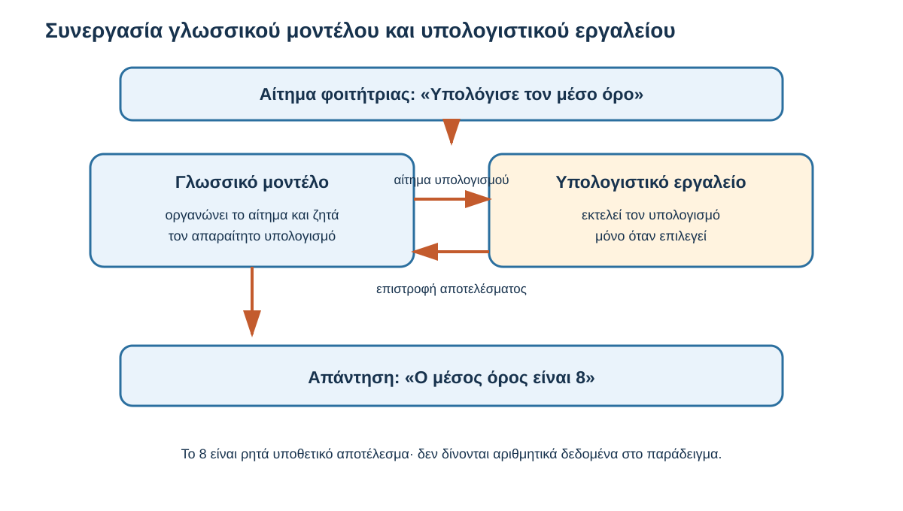
Σχήμα 4.8 — Συνεργασία γλωσσικού μοντέλου και υπολογιστικού εργαλείου

Αίτημα φοιτήτριας

«Υπολόγισε τον μέσο όρο»

Εφαρμογή chatbot

Γλωσσικό μοντέλο

Επεξεργασία αιτήματος και σύνταξη εξήγησης

Εργαλείο

Υπολογισμός, εφόσον χρησιμοποιηθεί

Ανταλλαγή πληροφοριών

Απάντηση

«Ο μέσος όρος είναι 8» και επεξήγηση

Εννοιολογικό σχήμα. Η χρήση εξωτερικού εργαλείου εξαρτάται από την εφαρμογή και τις συνθήκες εκτέλεσης του αιτήματος.

Το διάγραμμα παρουσιάζει μια πιθανή συνεργασία ανάμεσα στο μοντέλο και στην εφαρμογή.

Δεν σημαίνει ότι χρησιμοποιείται υποχρεωτικά εργαλείο σε κάθε αριθμητικό πρόβλημα.

Η εφαρμογή μπορεί να επεκτείνει τις δυνατότητες του γλωσσικού μοντέλου μέσω κατάλληλων μηχανισμών και εργαλείων.

## 4.6.5 Ποιες πρόσθετες δυνατότητες μπορεί να διαθέτει ένα chatbot;

Ανάλογα με την υπηρεσία, μια εφαρμογή μπορεί να προσφέρει διαφορετικές πρόσθετες λειτουργίες.

| Δυνατότητα             | Ενδεικτική χρήση                                      |
| ---------------------- | ----------------------------------------------------- |
| Διαδικτυακή αναζήτηση  | Εντοπισμός πρόσφατων επιστημονικών δημοσιεύσεων       |
| Υπολογιστικά εργαλεία  | Υπολογισμός μέσων όρων και επεξεργασία πινάκων        |
| Ανάγνωση αρχείων       | Εξέταση εκπαιδευτικού εγγράφου ή άρθρου               |
| Συνδεδεμένες υπηρεσίες | Πρόσβαση σε επιτρεπόμενες πληροφορίες άλλων εφαρμογών |

Οι δυνατότητες αυτές δεν είναι απαραίτητο να υπάρχουν σε κάθε chatbot.

Επιπλέον, το μοντέλο μπορεί να γράψει ότι πρόκειται να χρησιμοποιήσει ένα εργαλείο χωρίς να έχει πραγματοποιηθεί η ενέργεια.

Για παράδειγμα:

> «Θα αναζητήσω πρόσφατες δημοσιεύσεις».

Η φράση αυτή δεν αποδεικνύει από μόνη της ότι πραγματοποιήθηκε πραγματική διαδικτυακή αναζήτηση.

Για να γνωρίζουμε τι συνέβη, χρειάζεται να εξετάζουμε τις διαθέσιμες ενδείξεις και λειτουργίες της εφαρμογής.

Αυτό είναι ιδιαίτερα σημαντικό στη βιβλιογραφική έρευνα.

Μια αληθοφανής βιβλιογραφική αναφορά δεν σημαίνει υποχρεωτικά ότι η εφαρμογή εντόπισε και έλεγξε την αντίστοιχη δημοσίευση.

## 4.6.6 Πώς μπορεί ένα chatbot να χρησιμοποιεί ένα έγγραφο;

Ας υποθέσουμε ότι ένας φοιτητής διαθέτει ένα εκπαιδευτικό εγχειρίδιο σε μορφή PDF.

Θέλει να μελετήσει το τρίτο κεφάλαιο και γράφει:

> «Με βάση το τρίτο κεφάλαιο του εγχειριδίου, δημιούργησε πέντε ερωτήσεις αυτοαξιολόγησης».

Αν η εφαρμογή υποστηρίζει επεξεργασία αρχείων, μπορεί να αναγνώσει το διαθέσιμο περιεχόμενο και να παράσχει στο γλωσσικό μοντέλο τις κατάλληλες πληροφορίες.

Σε ορισμένες περιπτώσεις, η εφαρμογή μπορεί να αναζητά τα τμήματα του εγγράφου που είναι περισσότερο σχετικά με την ερώτηση.

Μια γνωστή προσέγγιση που συνδυάζει την ανάκτηση πληροφοριών με την παραγωγή απαντήσεων ονομάζεται Retrieval-Augmented Generation (RAG).

Η βασική ιδέα είναι απλή:

Η εφαρμογή ανακτά σχετικές πληροφορίες από μια εξωτερική πηγή και τις παρέχει στο μοντέλο, ώστε να χρησιμοποιηθούν κατά τη δημιουργία της απάντησης.

Δεν σημαίνει ότι κάθε ανάγνωση ή επεξεργασία PDF χρησιμοποιεί υποχρεωτικά RAG.

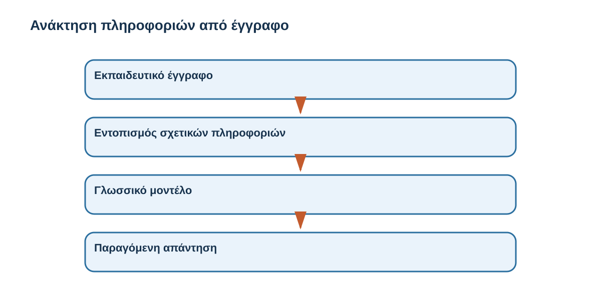
Σχήμα 4.9 — Ανάκτηση πληροφοριών από έγγραφο

Εκπαιδευτικό έγγραφο

Εντοπισμός σχετικών πληροφοριών

Ανάκτηση ή επιλογή κατάλληλων τμημάτων

Γλωσσικό μοντέλο

Αξιοποίηση του αιτήματος και του διαθέσιμου υλικού

Παραγόμενη απάντηση

Ερωτήσεις αυτοαξιολόγησης

Απλουστευμένο παράδειγμα ανάκτησης και παραγωγής. Οι εφαρμογές μπορεί να χρησιμοποιούν διαφορετικές μεθόδους επεξεργασίας εγγράφων.

Η δυνατότητα αυτή μπορεί να είναι ιδιαίτερα χρήσιμη στην πανεπιστημιακή μάθηση.

Ο φοιτητής μπορεί να ζητά εξηγήσεις, περιλήψεις ή ερωτήσεις βασισμένες στο υλικό ενός μαθήματος.

Ωστόσο, η πρόσβαση σε ένα έγγραφο δεν εγγυάται ότι κάθε απάντηση αποδίδει σωστά το περιεχόμενό του.

Το μοντέλο μπορεί να παραλείψει μια πληροφορία ή να συνδυάσει λανθασμένα διαφορετικά αποσπάσματα.

Γι' αυτό, όταν η ακρίβεια είναι σημαντική, είναι χρήσιμο να ζητούμε αναφορά στα συγκεκριμένα σημεία του εγγράφου και να ελέγχουμε ότι η απάντηση συμφωνεί με αυτά.

## 4.6.7 Τι σημαίνει όταν ένα chatbot «θυμάται» προηγούμενες πληροφορίες;

Ένας φοιτητής χρησιμοποιεί συχνά ένα chatbot για την προετοιμασία των μαθημάτων του.

Σε μια προηγούμενη συνομιλία είχε αναφέρει:

> «Προτιμώ σύντομες εξηγήσεις και ένα πρακτικό παράδειγμα για κάθε έννοια».

Σε μεταγενέστερη συνομιλία, η εφαρμογή μπορεί να λάβει υπόψη αυτή την προτίμηση, εφόσον διαθέτει κατάλληλη λειτουργία και η πληροφορία είναι διαθέσιμη.

Αυτό δεν σημαίνει υποχρεωτικά ότι το βασικό μοντέλο εκπαιδεύτηκε ξανά για τον συγκεκριμένο φοιτητή.

Η εφαρμογή μπορεί να διατηρεί ορισμένες πληροφορίες και να τις παρέχει στο μοντέλο όταν χρειάζονται.

Ας διακρίνουμε τις σχετικές διαδικασίες.

| Διαδικασία                        | Τι συμβαίνει                                                 |
| --------------------------------- | ------------------------------------------------------------ |
| Χρήση συμφραζομένων               | Αξιοποιούνται πληροφορίες της τρέχουσας εισόδου              |
| Ανάκτηση προηγούμενων πληροφοριών | Η εφαρμογή παρέχει αποθηκευμένα στοιχεία ή προτιμήσεις       |
| Ανάκτηση εγγράφων                 | Η εφαρμογή παρέχει σχετικό περιεχόμενο εξωτερικών πηγών      |
| Εκπαίδευση μοντέλου               | Πραγματοποιείται διαδικασία προσαρμογής μαθημένων παραμέτρων |

Οι διαδικασίες μπορούν να συνεργάζονται, αλλά δεν είναι ταυτόσημες.

Η διάκριση έχει και πρακτική σημασία για την προστασία προσωπικών δεδομένων.

Όταν χρησιμοποιούμε μια εφαρμογή, είναι σημαντικό να γνωρίζουμε τι πληροφορίες παρέχουμε, ποιες ενδέχεται να αποθηκεύονται και ποιες δυνατότητες ελέγχου προσφέρει η υπηρεσία.

Δεν πρέπει να υποθέτουμε ότι όλες οι εφαρμογές έχουν τις ίδιες ρυθμίσεις ή πολιτικές.

## 4.6.8 Καθοδηγούμενη δραστηριότητα — Ποιο εργαλείο θα επέλεγες;

Στην 4.1 εξετάσαμε τη διαφορά ανάμεσα στο μοντέλο και στην εφαρμογή.

Τώρα θα χρησιμοποιήσουμε τη νέα γνώση μας για να επιλέξουμε ποια πρόσθετη λειτουργία είναι καταλληλότερη για μια συγκεκριμένη εργασία.

Ένας φοιτητής ετοιμάζει εργασία σχετικά με την εξοικονόμηση ενέργειας.

Έχει τέσσερις διαφορετικές ανάγκες.

Επέλεξε την καταλληλότερη λειτουργία

1. **Θέλει να βρει τα τελευταία δημοσιευμένα επίσημα στοιχεία για την κατανάλωση ηλεκτρικής ενέργειας.**
   - Διαδικτυακή αναζήτηση σε επίσημες πηγές
   - Ανάγνωση μόνο προηγούμενης συνομιλίας
   - Αναδιατύπωση παραγράφου

2. **Έχει έναν πίνακα με 500 αριθμητικές τιμές και θέλει να υπολογίσει τον μέσο όρο.**
   - Αναζήτηση άσχετων άρθρων
   - Υπολογιστικό εργαλείο ή εκτέλεση κώδικα
   - Αλλαγή ύφους της απάντησης

3. **Θέλει απαντήσεις που βασίζονται σε συγκεκριμένο PDF του μαθήματος.**
   - Τυχαία επιλογή γενικών πληροφοριών
   - Μόνο μια νέα γενική ερώτηση
   - Επεξεργασία του εγγράφου και αξιοποίηση σχετικών αποσπασμάτων

4. **Θέλει η ίδια εισαγωγή να διατυπωθεί με πιο απλή γλώσσα.**
   - Βασική δυνατότητα αναδιατύπωσης του γλωσσικού μοντέλου
   - Υποχρεωτική διαδικτυακή αναζήτηση
   - Υποχρεωτική εκτέλεση κώδικα

Η δραστηριότητα μάς βοηθά να αποφύγουμε μια ακόμη παρανόηση: δεν χρειάζεται κάθε εργασία εξωτερικό εργαλείο.

Το σημαντικό είναι να κατανοούμε τι απαιτεί το πρόβλημα και ποια λειτουργία μπορεί να προσφέρει την κατάλληλη υποστήριξη.
::: {dropdown} Ενδεικτική απάντηση και ανατροφοδότηση
Σωστές επιλογές: **1, 2, 3, 1**.

Τα πρόσφατα στοιχεία απαιτούν ενημερωμένες κατάλληλες πηγές.

Ο υπολογισμός μπορεί να πραγματοποιηθεί και να ελεγχθεί με κατάλληλο υπολογιστικό εργαλείο.

Χρειάζεται να διατεθεί στο μοντέλο το κατάλληλο περιεχόμενο του εγγράφου.

Η γλωσσική αναδιατύπωση μπορεί να πραγματοποιηθεί χωρίς πρόσθετο εργαλείο.
:::

## 4.6.9 Εξήγησέ το με δικά σου λόγια

Ένας συμφοιτητής σου λέει:

> «Αν ανεβάσω ένα PDF σε ένα chatbot και μου απαντήσει σε ερωτήσεις για το περιεχόμενό του, τότε το γλωσσικό μοντέλο έχει εκπαιδευτεί με το συγκεκριμένο βιβλίο».

Συμφωνείς;

Ενδεικτική απάντηση

::: {dropdown} Ενδεικτική απάντηση
Όχι απαραίτητα.

Η εφαρμογή μπορεί να επεξεργάζεται το έγγραφο και να παρέχει στο γλωσσικό μοντέλο τα σχετικά τμήματά του ως μέρος της εισόδου.

Το μοντέλο μπορεί να αξιοποιεί αυτές τις πληροφορίες χωρίς να τροποποιούνται οι μαθημένες παράμετροί του.

Η χρήση ενός εγγράφου κατά τη δημιουργία απάντησης και η εκπαίδευση με αυτό είναι διαφορετικές διαδικασίες.
:::

## 4.6.10 Τι κρατάμε από την ενότητα

Ένα σύγχρονο chatbot είναι μια ολοκληρωμένη εφαρμογή που μπορεί να αξιοποιεί ένα ή περισσότερα γλωσσικά μοντέλα και πρόσθετους μηχανισμούς.

Το βασικό μοντέλο μπορεί να έχει περάσει από αρχική και μεταγενέστερη εκπαίδευση, ώστε να αναπτύξει δυνατότητες επεξεργασίας γλώσσας και καλύτερης ανταπόκρισης σε οδηγίες.

Η εφαρμογή μπορεί να προσθέτει εργαλεία αναζήτησης, υπολογισμούς, ανάγνωση εγγράφων και ανάκτηση πληροφοριών.

Αυτές οι λειτουργίες δεν σημαίνουν ότι το βασικό μοντέλο εκπαιδεύεται ξανά σε κάθε χρήση.

Επίσης, η εμφάνιση μιας σωστής απάντησης δεν αποδεικνύει από μόνη της ότι χρησιμοποιήθηκε συγκεκριμένο εργαλείο.

Η βασική ιδέα είναι ότι οι δυνατότητες ενός chatbot προκύπτουν από τον συνδυασμό του γλωσσικού μοντέλου, της εκπαίδευσής του και των πρόσθετων λειτουργιών της εφαρμογής.

### Μετάβαση στην 4.7

Έχουμε πλέον γνωρίσει πώς ένα γλωσσικό μοντέλο παράγει κείμενο και πώς μια εφαρμογή chatbot μπορεί να χρησιμοποιεί πρόσθετες πληροφορίες και εργαλεία.

Απομένει όμως ένα ιδιαίτερα σημαντικό ερώτημα:

Αν ένα chatbot παράγει μια καλογραμμένη απάντηση, πώς μπορούμε να γνωρίζουμε ότι οι πληροφορίες του είναι σωστές;

Ας υποθέσουμε ότι ζητάμε μια επιστημονική δημοσίευση και το chatbot μάς δίνει έναν τίτλο, συγγραφείς και χρονολογία.

Αρκεί η παρουσίαση αυτών των στοιχείων για να θεωρήσουμε ότι η δημοσίευση υπάρχει;

Στην 4.7 θα εξετάσουμε τους περιορισμούς αξιοπιστίας και τους τρόπους με τους οποίους μπορούμε να ελέγχουμε σημαντικές πληροφορίες.

---

# 4.7 Τι γνωρίζει και τι δεν γνωρίζει ένα γλωσσικό μοντέλο; Αξιοπιστία, λάθη και όρια

Στις προηγούμενες ενότητες γνωρίσαμε πώς ένα μεγάλο γλωσσικό μοντέλο επεξεργάζεται το κείμενο και παράγει απαντήσεις.

Είδαμε επίσης ότι ένα σύγχρονο chatbot μπορεί να συνδυάζει το γλωσσικό μοντέλο με πρόσθετες λειτουργίες, όπως διαδικτυακή αναζήτηση, επεξεργασία εγγράφων και υπολογιστικά εργαλεία.

Οι δυνατότητες αυτές είναι ιδιαίτερα χρήσιμες στην πανεπιστημιακή μάθηση. Μπορούμε να ζητήσουμε μια απλούστερη εξήγηση, να εξετάσουμε διαφορετικά παραδείγματα, να οργανώσουμε τη μελέτη μας ή να υποστηρίξουμε την αναζήτηση επιστημονικών πληροφοριών.

Ωστόσο, υπάρχει ένα ζήτημα που πρέπει να κατανοήσουμε πριν χρησιμοποιήσουμε τέτοιες απαντήσεις στις εργασίες μας.

Μια απάντηση μπορεί να είναι καλογραμμένη, σχετική και πειστική, χωρίς να είναι απαραίτητα σωστή.

Ας υποθέσουμε ότι ένας φοιτητής ζητά από ένα chatbot:

> «Πρότεινέ μου τρεις επιστημονικές δημοσιεύσεις για την επίδραση της χρήσης κινητών τηλεφώνων στη μάθηση».

Το chatbot παρουσιάζει τρεις αναφορές με συγγραφείς, έτη δημοσίευσης και τίτλους επιστημονικών περιοδικών.

Μπορούμε να τις χρησιμοποιήσουμε αμέσως;

Όχι. Πρώτα χρειάζεται να επιβεβαιώσουμε ότι οι δημοσιεύσεις υπάρχουν και ότι το περιεχόμενό τους υποστηρίζει πραγματικά τους ισχυρισμούς που θέλουμε να τεκμηριώσουμε.

Στην ενότητα αυτή θα γνωρίσουμε τους βασικούς περιορισμούς αξιοπιστίας των γλωσσικών μοντέλων και θα αναπτύξουμε έναν πρακτικό τρόπο αντιμετώπισής τους.

Δεν θα εξετάσουμε εξειδικευμένες τεχνικές αξιολόγησης της Τεχνητής Νοημοσύνης. Θα επικεντρωθούμε σε όσα χρειάζεται να γνωρίζει ένας φοιτητής οποιουδήποτε γνωστικού αντικειμένου.

## Μαθησιακός σκοπός

Μετά τη μελέτη της ενότητας θα μπορείς να εξηγείς γιατί ένα γλωσσικό μοντέλο μπορεί να παράγει λανθασμένες ή ατεκμηρίωτες πληροφορίες, τι περιγράφει ο όρος hallucination, γιατί η βεβαιότητα της διατύπωσης δεν αποδεικνύει την ορθότητα ενός ισχυρισμού και πώς να ελέγχεις τις σημαντικές πληροφορίες πριν τις χρησιμοποιήσεις.

## 4.7.1 Πριν ξεκινήσουμε — Μια επιστημονική αναφορά που φαίνεται πραγματική

Μια φοιτήτρια ετοιμάζει εργασία με θέμα την επίδραση του ύπνου στην ακαδημαϊκή επίδοση.

Ζητά από ένα chatbot:

> «Βρες μου μια επιστημονική δημοσίευση που εξετάζει τη σχέση ανάμεσα στη διάρκεια του ύπνου και στην επίδοση των φοιτητών».

Το chatbot εμφανίζει την ακόλουθη αναφορά:

Υποθετική βιβλιογραφική αναφορά

Papadopoulos, A., & Miller, J. (2025). Sleep Duration and Academic Success in University Students: A Comprehensive Study. International Journal of Student Performance, 18(2), 115–129.

Κατασκευασμένο εκπαιδευτικό παράδειγμα. Δεν παρουσιάζεται ως πραγματική επιστημονική δημοσίευση.

Η αναφορά μοιάζει με μια κανονική βιβλιογραφική καταχώριση.

Περιλαμβάνει ονόματα συγγραφέων, έτος, τίτλο, περιοδικό, τόμο, τεύχος και σελίδες.

Η μορφή της είναι πειστική.

Αρκεί αυτό για να τη χρησιμοποιήσει η φοιτήτρια;

Σκέψου πριν αποκαλύψεις

Η επιστημονική εμφάνιση μιας απάντησης δεν αποτελεί απόδειξη επιστημονικής τεκμηρίωσης.
::: {dropdown} Σκέψου πριν αποκαλύψεις
Όχι.

Η σωστή μορφή μιας βιβλιογραφικής αναφοράς δεν αποδεικνύει ότι η δημοσίευση υπάρχει.

Η φοιτήτρια πρέπει να αναζητήσει την εργασία σε κατάλληλη επιστημονική βάση, στον ιστότοπο του εκδότη ή μέσω αναγνωριστικού DOI, εφόσον υπάρχει.

Αν η δημοσίευση εντοπιστεί, πρέπει να επιβεβαιώσει ότι τα βιβλιογραφικά στοιχεία είναι σωστά και ότι το περιεχόμενο υποστηρίζει τον ισχυρισμό για τον οποίο θέλει να τη χρησιμοποιήσει.

Δεν αρκεί να υπάρχει μια δημοσίευση με παρόμοιο τίτλο.
:::

## 4.7.2 Τι σημαίνει ότι ένα γλωσσικό μοντέλο «γνωρίζει» κάτι;

Στην καθημερινή επικοινωνία χρησιμοποιούμε συχνά εκφράσεις όπως:

«Το chatbot ξέρει την απάντηση».

«Το μοντέλο γνωρίζει πολλά για την Ιστορία».

«Η Τεχνητή Νοημοσύνη καταλαβαίνει το κείμενο».

Οι εκφράσεις αυτές είναι βολικές, αλλά μπορεί να δημιουργούν λανθασμένες εντυπώσεις.

Ένα γλωσσικό μοντέλο έχει εκπαιδευτεί ώστε να επεξεργάζεται πληροφορίες και να παράγει απαντήσεις. Κατά την εκπαίδευσή του αναπτύσσει σύνθετες αριθμητικές αναπαραστάσεις και δυνατότητες που μπορούν να υποστηρίζουν πολλές διαφορετικές εργασίες.

Έτσι, μπορεί να εξηγήσει μια ιστορική περίοδο, να περιγράψει μια οικονομική έννοια ή να συνοψίσει ένα εκπαιδευτικό κείμενο.

Ωστόσο, δεν πρέπει να φανταζόμαστε ότι διαθέτει μια συλλογή από ανεξάρτητα, πλήρως επαληθευμένα γεγονότα, τα οποία ανασύρει πάντοτε χωρίς σφάλματα.

Η παραγωγή μιας απάντησης βασίζεται στη λειτουργία του εκπαιδευμένου μοντέλου και στις πληροφορίες που είναι διαθέσιμες κατά τη χρήση του.

Αυτό μας οδηγεί σε δύο διαφορετικές έννοιες.

Ικανότητα παραγωγής πληροφορίας: Το μοντέλο μπορεί να δημιουργήσει μια απάντηση σχετική με το ερώτημα.

Τεκμηριωμένη ορθότητα: Υπάρχουν επαρκή στοιχεία που υποστηρίζουν ότι η συγκεκριμένη απάντηση είναι σωστή.

Για παράδειγμα, ένα chatbot μπορεί να γράψει μια κατανοητή παράγραφο για την κλιματική αλλαγή.

Για να χρησιμοποιήσουμε όμως συγκεκριμένες τιμές θερμοκρασίας, χρονολογίες ή επιστημονικά συμπεράσματα σε μια εργασία, πρέπει να εξετάσουμε τις κατάλληλες πηγές.

Επομένως, η ικανότητα παραγωγής πληροφορίας και η αξιοπιστία της πληροφορίας είναι δύο διαφορετικά ζητήματα.

## 4.7.3 Τι είναι τα hallucinations;

Ένας γνωστός περιορισμός των μεγάλων γλωσσικών μοντέλων είναι ότι μπορούν να παράγουν πληροφορίες που φαίνονται πειστικές, αλλά είναι λανθασμένες, ανύπαρκτες ή δεν υποστηρίζονται από τις διαθέσιμες πηγές.

Το φαινόμενο περιγράφεται συχνά με τον όρο hallucination.

Ο όρος χρησιμοποιείται μεταφορικά. Δεν σημαίνει ότι το μοντέλο βιώνει ανθρώπινες ψευδαισθήσεις.

Στο πλαίσιο των γλωσσικών μοντέλων περιγράφει, μεταξύ άλλων, την παραγωγή περιεχομένου που παρουσιάζεται ως πληροφορία, χωρίς να ανταποκρίνεται στα πραγματικά δεδομένα ή στο υλικό στο οποίο υποτίθεται ότι βασίζεται.

Ας δούμε τρία παραδείγματα από διαφορετικές πανεπιστημιακές δραστηριότητες.

Παράδειγμα Α — Ανύπαρκτη βιβλιογραφική αναφορά

Ένας φοιτητής ζητά πηγές για μια εργασία Ιστορίας.

Το chatbot παρουσιάζει έναν τίτλο βιβλίου, έναν συγγραφέα και μια χρονολογία που φαίνονται εύλογα, αλλά δεν αντιστοιχούν σε πραγματική έκδοση.

Παράδειγμα Β — Ανακριβής απόδοση περιεχομένου

Μια φοιτήτρια ανεβάζει ένα επιστημονικό άρθρο και ζητά περίληψη.

Το chatbot αναφέρει ότι οι ερευνητές κατέληξαν σε ένα συγκεκριμένο συμπέρασμα, ενώ το άρθρο δεν υποστηρίζει αυτόν τον ισχυρισμό.

Παράδειγμα Γ — Κατασκευασμένη λεπτομέρεια

Ένας φοιτητής ζητά πληροφορίες για μια ιστορική συνάντηση.

Το chatbot παρουσιάζει μια ακριβή ημερομηνία και μια δήλωση συμμετέχοντος, χωρίς να υπάρχει επαρκής τεκμηρίωση για τα στοιχεία αυτά.

Και στις τρεις περιπτώσεις, η γλώσσα μπορεί να είναι φυσική και ιδιαίτερα πειστική.

Το πρόβλημα δεν βρίσκεται απαραίτητα στον τρόπο διατύπωσης, αλλά στο περιεχόμενο.

Χρειάζεται επίσης μια διευκρίνιση.

Δεν είναι κάθε λανθασμένη απάντηση υποχρεωτικά hallucination με τη στενότερη έννοια του όρου.

Ένα μοντέλο μπορεί να κάνει αριθμητικό λάθος, να παρερμηνεύσει μια οδηγία ή να χρησιμοποιήσει ανεπαρκή δεδομένα.

Για τον χρήστη έχει μεγαλύτερη σημασία να αναγνωρίζει ποιο συγκεκριμένο στοιχείο της απάντησης είναι προβληματικό παρά να αποδίδει την ίδια ονομασία σε κάθε σφάλμα.

## 4.7.4 Γιατί μπορεί να παράγονται ανακρίβειες;

Στην 4.4 γνωρίσαμε ότι πολλά γλωσσικά μοντέλα παράγουν απαντήσεις μέσω της σταδιακής επιλογής tokens.

Η διαδικασία αυτή επιτρέπει την παραγωγή χρήσιμου και συχνά ακριβούς κειμένου.

Δεν περιλαμβάνει όμως υποχρεωτικά έναν ανεξάρτητο έλεγχο αλήθειας για κάθε ισχυρισμό που εμφανίζεται.

Επιπλέον, η ποιότητα της απάντησης μπορεί να επηρεάζεται από διαφορετικούς παράγοντες.

Ένα μοντέλο μπορεί να έχει εκπαιδευτεί με δεδομένα που περιλαμβάνουν λάθη ή αντιφάσεις.

Μπορεί να μην έχει επαρκείς πληροφορίες για ένα εξειδικευμένο θέμα.

Μπορεί να μην διαθέτει πρόσβαση στις πιο πρόσφατες εξελίξεις ή να παρερμηνεύσει πληροφορίες που δίνονται στο αίτημα.

Ας εξετάσουμε μια περίπτωση από την καθημερινή ζωή.

Ένας φοιτητής ρωτά:

> «Πόσο κοστίζει σήμερα ένα συγκεκριμένο μοντέλο φορητού υπολογιστή;»

Η τιμή μπορεί να διαφέρει ανάμεσα στα καταστήματα και να αλλάζει με τον χρόνο.

Ένα γλωσσικό μοντέλο χωρίς πρόσβαση σε ενημερωμένες πηγές δεν μπορεί να θεωρείται αυτομάτως αξιόπιστη πηγή για την τρέχουσα τιμή.

Ακόμη και αν η εφαρμογή πραγματοποιήσει αναζήτηση, χρειάζεται να γνωρίζουμε πότε δημοσιεύτηκαν τα στοιχεία, αν αφορούν ακριβώς το ίδιο προϊόν και αν η τιμή εξακολουθεί να ισχύει.

Το παράδειγμα δείχνει ότι η αξιοπιστία δεν εξαρτάται μόνο από το μοντέλο.

Εξαρτάται και από τη φύση της ερώτησης, τη διαθεσιμότητα πληροφοριών και τη δυνατότητα επαλήθευσης.

## 4.7.5 Η βεβαιότητα της διατύπωσης δεν είναι απόδειξη

Ας υποθέσουμε ότι ένας φοιτητής ζητά από ένα chatbot να υπολογίσει τον μέσο όρο πέντε βαθμολογιών:

7, 8, 6, 9 και 10.

Το chatbot απαντά:

> «Ο μέσος όρος είναι 8,5. Το αποτέλεσμα είναι απολύτως σωστό».

Η απάντηση είναι λανθασμένη.

Ο σωστός υπολογισμός είναι:

\\[ \frac{7+8+6+9+10}{5}=\frac{40}{5}=8 \\]

Η φράση «το αποτέλεσμα είναι απολύτως σωστό» δεν προσθέτει καμία απόδειξη.

Η ορθότητα προκύπτει από τον έλεγχο του υπολογισμού.

Ας εξετάσουμε μια δεύτερη περίπτωση.

Μια φοιτήτρια ζητά:

> «Ποια είναι η ακριβής επίδραση της καθημερινής χρήσης κοινωνικών δικτύων στην ακαδημαϊκή επίδοση όλων των φοιτητών;»

Μια απάντηση που παρουσιάζει έναν μοναδικό, βέβαιο αριθμό χωρίς να προσδιορίζει πληθυσμό, μέθοδο, πηγές και συνθήκες μελέτης θα ήταν προβληματική.

Το ερώτημα είναι σύνθετο. Μπορεί να απαιτεί τη συνεκτίμηση διαφορετικών παραγόντων και ερευνητικών ευρημάτων.

Μια καταλληλότερη απάντηση θα αναγνώριζε ότι χρειάζονται συγκεκριμένες μελέτες και σαφής προσδιορισμός του ζητήματος.

Αυτό μας οδηγεί σε μια σημαντική δεξιότητα:

Να διακρίνουμε πότε τα διαθέσιμα στοιχεία επιτρέπουν ένα συγκεκριμένο συμπέρασμα και πότε πρέπει να αναγνωρίζουμε την αβεβαιότητα.

## 4.7.6 Πώς ελέγχουμε μια απάντηση chatbot;

Δεν χρειάζεται κάθε απλή ερώτηση να μετατρέπεται σε εκτεταμένη βιβλιογραφική έρευνα.

Αν χρησιμοποιούμε ένα chatbot για να πάρουμε μια πρώτη εξήγηση μιας έννοιας, μπορεί να αρκεί να τη συγκρίνουμε με το εκπαιδευτικό υλικό του μαθήματος.

Αν όμως θέλουμε να χρησιμοποιήσουμε αριθμούς, επιστημονικούς ισχυρισμούς ή βιβλιογραφικές αναφορές σε μια πανεπιστημιακή εργασία, ο έλεγχος πρέπει να είναι περισσότερο συστηματικός.

Μπορούμε να ακολουθήσουμε τέσσερα βασικά ερωτήματα.

| Ερώτημα                                | Τι εξετάζουμε                                    |
| -------------------------------------- | ------------------------------------------------ |
| 1. Είναι συγκεκριμένος ο ισχυρισμός;   | Τι ακριβώς υποστηρίζει η απάντηση;               |
| 2. Υπάρχουν επαρκή στοιχεία;           | Ποιες πληροφορίες, δεδομένα ή πηγές απαιτούνται; |
| 3. Μπορώ να επαληθεύσω την πληροφορία; | Συμφωνεί με αξιόπιστες και κατάλληλες πηγές;     |
| 4. Μπορώ να τη χρησιμοποιήσω;          | Η τεκμηρίωση επαρκεί για τον σκοπό της εργασίας; |

Ας εφαρμόσουμε τα ερωτήματα σε ένα παράδειγμα.

Ένας φοιτητής ζητά:

> «Ποια είναι η σημαντικότερη αιτία της ανεργίας των νέων στην Ευρώπη;»

Το chatbot παρουσιάζει έναν συγκεκριμένο παράγοντα ως τη μοναδική αιτία.

Πριν χρησιμοποιήσει την απάντηση, ο φοιτητής χρειάζεται να εξετάσει αν το ερώτημα επιδέχεται μία και μοναδική αιτία, ποια δεδομένα υποστηρίζουν τον ισχυρισμό και αν υπάρχουν διαφορετικές επιστημονικές προσεγγίσεις.

Μια σύνθετη κοινωνική ή οικονομική κατάσταση δεν πρέπει να περιορίζεται αυθαίρετα σε μία απόλυτη εξήγηση.

Αντίστοιχα, όταν ένα chatbot παρουσιάζει μια αριθμητική πληροφορία, πρέπει να ελέγχουμε την προέλευση, τις μονάδες και τη μέθοδο υπολογισμού της.

## 4.7.7 Πώς ελέγχουμε μια βιβλιογραφική αναφορά;

Επειδή τα chatbots χρησιμοποιούνται συχνά στην προετοιμασία πανεπιστημιακών εργασιών, αξίζει να εξετάσουμε λίγο πιο συγκεκριμένα τον έλεγχο της βιβλιογραφίας.

Ας υποθέσουμε ότι ένα chatbot προτείνει μια επιστημονική δημοσίευση.

Ο φοιτητής μπορεί να ακολουθήσει την εξής διαδικασία.

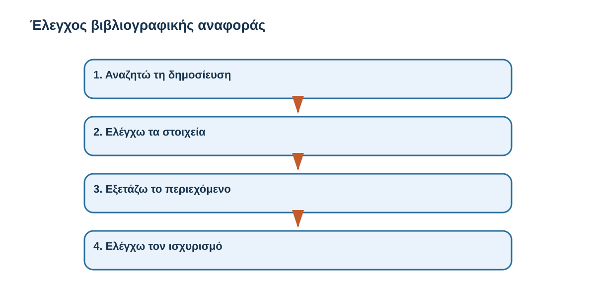
Σχήμα 4.10 — Έλεγχος βιβλιογραφικής αναφοράς

1. **Αναζητώ τη δημοσίευση**
   Εντοπίζω την εργασία σε αξιόπιστη βάση ή στον εκδότη.

2. **Ελέγχω τα στοιχεία**
   Επιβεβαιώνω τίτλο, συγγραφείς, έτος και αναγνωριστικό, όπου υπάρχει.

3. **Εξετάζω το περιεχόμενο**
   Διαβάζω τα σχετικά τμήματα της πραγματικής πηγής.

4. **Ελέγχω τον ισχυρισμό**
   Βεβαιώνομαι ότι η πηγή υποστηρίζει όσα της αποδίδονται.

Η ύπαρξη μιας πραγματικής δημοσίευσης δεν αρκεί αν το περιεχόμενό της δεν υποστηρίζει τον συγκεκριμένο ισχυρισμό.

Ιδιαίτερη προσοχή χρειάζεται στο τέταρτο βήμα.

Ένα chatbot μπορεί να αναφέρει μια πραγματική δημοσίευση, αλλά να της αποδίδει συμπέρασμα που δεν προκύπτει από αυτήν.

Για παράδειγμα, μια μελέτη μπορεί να διαπιστώνει συσχέτιση ανάμεσα σε δύο παράγοντες.

Αυτό δεν σημαίνει ότι τεκμηριώνει υποχρεωτικά σχέση αιτίας και αποτελέσματος.

Επομένως, δεν ελέγχουμε μόνο αν η πηγή υπάρχει· ελέγχουμε και αν έχει χρησιμοποιηθεί σωστά.

## 4.7.8 Πόσο σημαντικός είναι ο έλεγχος ανάλογα με τη χρήση;

Δεν έχουν όλες οι απαντήσεις τις ίδιες συνέπειες.

Ας συγκρίνουμε τρεις περιπτώσεις.

Περίπτωση Α — Βοήθεια στη μελέτη

Ένας φοιτητής ζητά μια απλή εξήγηση για την έννοια της δημοκρατίας.

Το chatbot χρησιμοποιείται ως αρχικό βοήθημα κατανόησης.

Ο φοιτητής μπορεί να συγκρίνει την εξήγηση με το εκπαιδευτικό υλικό του μαθήματος.

Περίπτωση Β — Πανεπιστημιακή εργασία

Μια φοιτήτρια χρησιμοποιεί επιστημονικές αναφορές και στατιστικά στοιχεία σε εργασία που θα υποβάλει για αξιολόγηση.

Εδώ χρειάζεται σαφέστερη τεκμηρίωση των πληροφοριών και των πηγών.

Περίπτωση Γ — Απόφαση με πραγματικές συνέπειες

Ένας επαγγελματίας χρησιμοποιεί πληροφορίες από chatbot για να υποστηρίξει μια απόφαση σχετικά με την υγεία, την ασφάλεια ή ένα σημαντικό οικονομικό ζήτημα.

Σε αυτή την περίπτωση, ένα σφάλμα μπορεί να έχει σοβαρές συνέπειες.

Απαιτούνται κατάλληλες πηγές, ανεξάρτητοι έλεγχοι και η αναγκαία επιστημονική ή επαγγελματική κρίση.

Από τα παραδείγματα προκύπτει μια βασική αρχή:

Όσο σημαντικότερες είναι οι συνέπειες ενός πιθανού λάθους, τόσο ισχυρότερη πρέπει να είναι η διαδικασία επαλήθευσης.

Η αρχή αυτή δεν αφορά μόνο την Τεχνητή Νοημοσύνη.

Ισχύει γενικότερα για την υπεύθυνη χρήση πληροφοριών.

## 4.7.9 Δραστηριότητα — Μπορώ να εμπιστευτώ αυτή την πληροφορία;

Ένας φοιτητής χρησιμοποιεί chatbot για να προετοιμάσει εργασία σχετικά με την ψηφιακή εκπαίδευση.

Εξετάζει τέσσερις περιπτώσεις.

<a href="/al00_4_7_9.html" target="_blank" rel="noopener">Άνοιξε τη διαδραστική δραστηριότητα 4.7.9 σε νέα καρτέλα</a>

## 4.7.10 Εξήγησέ το με δικά σου λόγια

Ένας συμφοιτητής σου λέει:

> «Το chatbot μού έδωσε μια επιστημονική αναφορά με DOI. Αφού υπάρχει DOI, είμαι σίγουρος ότι μπορώ να χρησιμοποιήσω το συμπέρασμά του».

Προσπάθησε να εξηγήσεις γιατί η ύπαρξη ενός DOI, ακόμη και όταν είναι πραγματικό, δεν επαρκεί από μόνη της για να τεκμηριώσει έναν ισχυρισμό.

Ενδεικτική απάντηση

::: {dropdown} Ενδεικτική απάντηση
Το DOI μπορεί να βοηθήσει στον εντοπισμό μιας δημοσίευσης, αλλά πρώτα πρέπει να επιβεβαιώσουμε ότι αντιστοιχεί πράγματι στην εργασία που αναφέρεται.

Στη συνέχεια χρειάζεται να εξετάσουμε το περιεχόμενό της και να βεβαιωθούμε ότι υποστηρίζει τον συγκεκριμένο ισχυρισμό.

Μια πραγματική δημοσίευση μπορεί να έχει χρησιμοποιηθεί λανθασμένα ή να μην αφορά ακριβώς το ζήτημα που εξετάζουμε.
:::

## 4.7.11 Τι κρατάμε από την ενότητα

Ένα μεγάλο γλωσσικό μοντέλο μπορεί να παράγει χρήσιμες και συχνά σωστές πληροφορίες, αλλά δεν αποτελεί από μόνο του αλάνθαστη πηγή γνώσης.

Μπορεί να δημιουργήσει ανακριβείς ή ατεκμηρίωτους ισχυρισμούς, ακόμη και όταν χρησιμοποιεί φυσική και επιστημονικά πειστική γλώσσα.

Το φαινόμενο αυτό περιγράφεται συχνά με τον όρο hallucination, αν και δεν είναι κάθε λάθος ίδιας φύσης.

Η ύπαρξη πηγών ή η χρήση εξωτερικών εργαλείων μπορεί να βοηθήσει στην τεκμηρίωση, αλλά δεν καταργεί την ανάγκη ελέγχου.

Για την ακαδημαϊκή χρήση είναι σημαντικό να εντοπίζουμε τους ουσιαστικούς ισχυρισμούς, να ελέγχουμε τις πηγές και να επιβεβαιώνουμε ότι τα διαθέσιμα στοιχεία υποστηρίζουν πραγματικά τα συμπεράσματα.

Η βασική αρχή είναι ότι μια απάντηση δεν γίνεται αξιόπιστη επειδή είναι πειστική· γίνεται κατάλληλη για χρήση όταν διαθέτουμε επαρκή τεκμηρίωση για όσα υποστηρίζει.

### Μετάβαση στην 4.8

Γνωρίσαμε τους σημαντικότερους περιορισμούς αξιοπιστίας των γλωσσικών μοντέλων και τους βασικούς τρόπους με τους οποίους μπορούμε να ελέγχουμε μια απάντηση.

Τώρα θα εφαρμόσουμε αυτές τις γνώσεις σε μια ολοκληρωμένη εκπαιδευτική δραστηριότητα.

Ένας φοιτητής θα χρησιμοποιήσει chatbot για να προετοιμάσει μια σύντομη εργασία. Η υποθετική απάντηση που θα εξετάσουμε περιλαμβάνει χρήσιμες πληροφορίες, αλλά και ισχυρισμούς που χρειάζονται επαλήθευση.

Θα εξετάσουμε βήμα προς βήμα τι μπορούμε να αποδεχτούμε, τι πρέπει να ελέγξουμε και πώς μπορούμε να δημιουργήσουμε μια περισσότερο τεκμηριωμένη διατύπωση.

# 4.8 Καθοδηγούμενη εφαρμογή: αξιολογούμε και βελτιώνουμε μια απάντηση chatbot

Στις προηγούμενες ενότητες γνωρίσαμε πώς λειτουργεί ένα μεγάλο γλωσσικό μοντέλο και γιατί μπορεί να παράγει χρήσιμες, κατανοητές και συχνά σωστές απαντήσεις, χωρίς αυτό να σημαίνει ότι είναι αλάνθαστο.

Στην 4.7 εξετάσαμε τους βασικούς περιορισμούς αξιοπιστίας. Είδαμε ότι ένα chatbot μπορεί να παρουσιάσει ανακριβείς πληροφορίες, να αποδώσει σε μια επιστημονική δημοσίευση συμπεράσματα που δεν υποστηρίζει ή να δημιουργήσει βιβλιογραφικές αναφορές που μοιάζουν πραγματικές αλλά δεν έχουν επαληθευτεί.

Τώρα θα εφαρμόσουμε αυτές τις γνώσεις σε μια ολοκληρωμένη εκπαιδευτική δραστηριότητα.

Θα ακολουθήσουμε έναν φοιτητή που χρησιμοποιεί chatbot για να προετοιμάσει μια σύντομη πανεπιστημιακή εργασία. Θα εξετάσουμε την απάντηση που λαμβάνει, θα εντοπίσουμε τους ισχυρισμούς της, θα ελέγξουμε ποιοι μπορούν να υποστηριχθούν και θα δημιουργήσουμε μια καλύτερη εκδοχή.

Το παράδειγμα αφορά ένα θέμα κοινό σε πολλά επιστημονικά πεδία: τη σχέση ανάμεσα στον ύπνο και στην ακαδημαϊκή επίδοση.

Δεν απαιτούνται γνώσεις Ιατρικής, Ψυχολογίας ή Στατιστικής. Η δραστηριότητα επικεντρώνεται στον τρόπο με τον οποίο αξιολογούμε πληροφορίες.

Το ίδιο σκεπτικό μπορεί να εφαρμοστεί σε εργασίες Παιδαγωγικών, Οικονομικών, Μηχανικών, Επιστημών Υγείας, Κοινωνικών Επιστημών και άλλων τμημάτων.

## Μαθησιακός σκοπός

Μετά την ολοκλήρωση της δραστηριότητας θα μπορείς να διαχωρίζεις μια απάντηση chatbot σε επιμέρους ισχυρισμούς, να αναγνωρίζεις ατεκμηρίωτες γενικεύσεις, να ελέγχεις αριθμητικά αποτελέσματα και βιβλιογραφικές αναφορές και να αναδιατυπώνεις μια απάντηση χωρίς να παρουσιάζεις ως βέβαιες πληροφορίες που δεν έχουν επαληθευτεί.

## 4.8.1 Το σενάριο — Μια σύντομη πανεπιστημιακή εργασία

Ένας πρωτοετής φοιτητής ετοιμάζει εργασία με θέμα:

«Ο ύπνος και η σημασία του για τη μελέτη των φοιτητών»

Θέλει να γράψει μια σύντομη εισαγωγή και να εντοπίσει ορισμένες επιστημονικές πηγές.

Επειδή δεν γνωρίζει καλά το θέμα, αποφασίζει να χρησιμοποιήσει ένα chatbot ως βοήθημα.

Γράφει:

> «Ετοιμάζω μια εργασία πρώτου έτους για τη σχέση ανάμεσα στον ύπνο και στην ακαδημαϊκή επίδοση. Εξήγησέ μου με απλά λόγια τη σχέση τους, δώσε μου ένα αριθμητικό παράδειγμα και πρότεινέ μου μια επιστημονική δημοσίευση».

Η ερώτηση είναι σχετικά σαφής.

Προσδιορίζει το θέμα, το επίπεδο σπουδών και τα στοιχεία που επιθυμεί ο φοιτητής.

Το chatbot επιστρέφει την ακόλουθη απάντηση.

Υποθετική απάντηση chatbot

Κατασκευασμένο εκπαιδευτικό παράδειγμα. Δεν προέρχεται από πραγματική εκτέλεση chatbot.

Ο ύπνος είναι σημαντικός για τη μνήμη, τη συγκέντρωση και τη μάθηση. Η διάρκεια και η ποιότητα του ύπνου μπορούν να σχετίζονται με την ακαδημαϊκή επίδοση.

Οι φοιτητές που κοιμούνται ακριβώς οκτώ ώρες κάθε βράδυ επιτυγχάνουν πάντοτε καλύτερους βαθμούς από όσους κοιμούνται λιγότερο.

Για παράδειγμα, ένας φοιτητής με βαθμούς 6, 7, 8, 9 και 10 έχει μέσο όρο 8,5.

Σύμφωνα με τη δημοσίευση Papadopoulos and Miller (2025), Sleep Duration and University Achievement: A Comprehensive Study, οι φοιτητές που κοιμούνται οκτώ ώρες έχουν 35% υψηλότερη ακαδημαϊκή επίδοση σε όλες τις πανεπιστημιακές σχολές.

Επομένως, μπορούμε να συμπεράνουμε ότι εάν ένας φοιτητής κοιμάται οκτώ ώρες κάθε βράδυ, η επιτυχία του στις εξετάσεις είναι εξασφαλισμένη.

Η απάντηση είναι σύντομη, κατανοητή και περιλαμβάνει όσα ζήτησε ο φοιτητής.

Με μια πρώτη ματιά φαίνεται κατάλληλη για την εργασία του.

Όμως περιέχει διαφορετικά είδη πληροφοριών: έναν γενικό επιστημονικό ισχυρισμό, μια απόλυτη γενίκευση, έναν αριθμητικό υπολογισμό, μια βιβλιογραφική αναφορά και ένα τελικό συμπέρασμα.

Η αποστολή μας είναι να εξετάσουμε καθένα από αυτά ξεχωριστά.

## 4.8.2 Βήμα 1 — Διαχωρίζουμε την απάντηση σε ισχυρισμούς

Ένα συνηθισμένο λάθος είναι να χαρακτηρίζουμε ολόκληρη την απάντηση ως «σωστή» ή «λανθασμένη».

Στην πραγματικότητα, μια απάντηση μπορεί να συνδυάζει σωστές πληροφορίες και σφάλματα.

Για να την αξιολογήσουμε, πρέπει πρώτα να εντοπίσουμε τι ακριβώς υποστηρίζει.

Στο παράδειγμά μας διακρίνουμε πέντε ισχυρισμούς.

| Κωδικός | Ισχυρισμός                                                                      |
| ------- | ------------------------------------------------------------------------------- |
| Ι1      | Ο ύπνος έχει σημασία για τη μνήμη, τη συγκέντρωση και τη μάθηση.                |
| Ι2      | Όποιος κοιμάται ακριβώς οκτώ ώρες επιτυγχάνει πάντοτε καλύτερους βαθμούς.       |
| Ι3      | Ο μέσος όρος των βαθμών 6, 7, 8, 9 και 10 είναι 8,5.                            |
| Ι4      | Μια συγκεκριμένη δημοσίευση τεκμηριώνει βελτίωση ακαδημαϊκής επίδοσης κατά 35%. |
| Ι5      | Ο ύπνος οκτώ ωρών εξασφαλίζει την επιτυχία στις εξετάσεις.                      |

Παρατηρούμε ότι οι ισχυρισμοί δεν έχουν την ίδια μορφή.

Ο Ι1 παρουσιάζει μια γενική σχέση.

Ο Ι2 διατυπώνει έναν απόλυτο κανόνα.

Ο Ι3 περιλαμβάνει έναν αριθμητικό υπολογισμό.

Ο Ι4 επικαλείται επιστημονική τεκμηρίωση.

Ο Ι5 διατυπώνει ένα συμπέρασμα.

Η διάκριση αυτή είναι σημαντική, επειδή κάθε είδος ισχυρισμού απαιτεί διαφορετικό τρόπο ελέγχου.

## 4.8.3 Βήμα 2 — Ποιοι ισχυρισμοί χρειάζονται επαλήθευση;

Σκέψου ποιοι από τους πέντε ισχυρισμούς πρέπει να ελεγχθούν πριν χρησιμοποιηθούν σε ακαδημαϊκή εργασία.

Επίλεξε τους ισχυρισμούς που θεωρείς ότι χρειάζονται έλεγχο.

Ι1 — Σχέση ύπνου, μνήμης και μάθησης

Ι2 — Ακριβώς οκτώ ώρες εγγυώνται καλύτερους βαθμούς

Ι3 — Υπολογισμός μέσου όρου

Ι4 — Δημοσίευση και βελτίωση 35%

Ι5 — Εξασφαλισμένη επιτυχία στις εξετάσεις

Έλεγχος επιλογήςΕπαναφορά

Ένα χρήσιμο πρώτο συμπέρασμα είναι ότι η επαλήθευση δεν περιορίζεται μόνο στις πληροφορίες που φαίνονται ύποπτες.

Ακόμη και ένας εύλογος ισχυρισμός χρειάζεται τεκμηρίωση όταν παρουσιάζεται ως επιστημονικό δεδομένο.
::: {dropdown} Ενδεικτική απάντηση και ανατροφοδότηση
Σωστές επιλογές: **1, 2, 3, 4, 5**.

Και οι πέντε ισχυρισμοί χρειάζονται έλεγχο πριν από την ακαδημαϊκή χρήση τους. Η ανάγκη επαλήθευσης δεν σημαίνει ότι είναι όλοι λανθασμένοι.

Σημείωση QA: 4.8.3: select ALL five checkboxes
:::

## 4.8.4 Βήμα 3 — Εξετάζουμε έναν γενικό επιστημονικό ισχυρισμό

Ας ξεκινήσουμε από τον Ι1:

> «Ο ύπνος είναι σημαντικός για τη μνήμη, τη συγκέντρωση και τη μάθηση».

Η πληροφορία είναι γενικά συμβατή με τη σύγχρονη επιστημονική κατανόηση του ύπνου.

Ωστόσο, αν θέλουμε να τη χρησιμοποιήσουμε σε πανεπιστημιακή εργασία, χρειάζεται να την υποστηρίξουμε με κατάλληλη πηγή.

Για παράδειγμα, μπορούμε να αναζητήσουμε μια επιστημονική ανασκόπηση που εξετάζει τη σχέση ύπνου και μνήμης.

Η διαδικασία ελέγχου δεν περιορίζεται στην εύρεση οποιουδήποτε άρθρου που περιλαμβάνει τη λέξη «ύπνος».

Χρειάζεται να εξετάσουμε αν η πηγή αφορά πράγματι τη μνήμη, τη μάθηση ή τις σχετικές γνωστικές λειτουργίες.

Έτσι διακρίνουμε δύο στάδια.

Πρώτο στάδιο: Ο ισχυρισμός φαίνεται εύλογος και συμφωνεί με όσα γνωρίζουμε γενικά.

Δεύτερο στάδιο: Εντοπίζουμε κατάλληλη πηγή και επιβεβαιώνουμε ότι πράγματι τον υποστηρίζει.

Το δεύτερο στάδιο είναι απαραίτητο όταν ο ισχυρισμός πρόκειται να αποτελέσει τεκμηριωμένο μέρος μιας επιστημονικής εργασίας.

## 4.8.5 Βήμα 4 — Αναγνωρίζουμε μια αδικαιολόγητη γενίκευση

Ο δεύτερος ισχυρισμός αναφέρει:

> «Οι φοιτητές που κοιμούνται ακριβώς οκτώ ώρες κάθε βράδυ επιτυγχάνουν πάντοτε καλύτερους βαθμούς από όσους κοιμούνται λιγότερο».

Ας προσέξουμε τις λέξεις «ακριβώς» και «πάντοτε».

Η διατύπωση υποστηρίζει ότι υπάρχει ένας κανόνας που ισχύει χωρίς εξαίρεση για όλους τους φοιτητές.

Για να τεκμηριωθεί κάτι τέτοιο, θα έπρεπε να υπάρχουν εξαιρετικά ισχυρά δεδομένα.

Η ακαδημαϊκή επίδοση, όμως, επηρεάζεται από πολλούς παράγοντες: προετοιμασία, προηγούμενες γνώσεις, συνθήκες εξέτασης και άλλες ατομικές ή περιβαλλοντικές μεταβλητές.

Επιπλέον, οι ανάγκες ύπνου δεν είναι ίδιες για όλους τους ανθρώπους.

Επομένως, ο ισχυρισμός είναι υπερβολικά απόλυτος.

Δεν χρειάζεται να συμπεράνουμε ότι ο ύπνος δεν σχετίζεται με τη μάθηση.

Χρειάζεται να αποφύγουμε την αδικαιολόγητη γενίκευση.

Αρχική διατύπωση

> «Όποιος κοιμάται ακριβώς οκτώ ώρες επιτυγχάνει πάντοτε καλύτερους βαθμούς».

Καταλληλότερη διατύπωση

> «Η επαρκής διάρκεια και η καλή ποιότητα του ύπνου μπορούν να υποστηρίζουν λειτουργίες σημαντικές για τη μάθηση. Η ακαδημαϊκή επίδοση, ωστόσο, επηρεάζεται και από πολλούς άλλους παράγοντες».

Η δεύτερη διατύπωση είναι προσεκτικότερη.

Δεν παρουσιάζει μια γενική σχέση ως απόλυτο και καθολικό κανόνα.

Για να συμπεριληφθεί σε ακαδημαϊκή εργασία, θα πρέπει επίσης να συνοδεύεται από κατάλληλη επιστημονική τεκμηρίωση.

## 4.8.6 Βήμα 5 — Ελέγχουμε τον αριθμητικό υπολογισμό

Ο τρίτος ισχυρισμός είναι:

> «Ένας φοιτητής με βαθμούς 6, 7, 8, 9 και 10 έχει μέσο όρο 8,5».

Εδώ δεν χρειαζόμαστε βιβλιογραφική έρευνα.

Χρειάζεται να ελέγξουμε τον υπολογισμό.

Ο αριθμητικός μέσος όρος υπολογίζεται από το άθροισμα των τιμών, διαιρεμένο με το πλήθος τους.

Στο παράδειγμά μας:

\\[ \bar{x}=\frac{6+7+8+9+10}{5} \\]

\\[ \bar{x}=\frac{40}{5}=8 \\]

Άρα ο μέσος όρος είναι 8 και όχι 8,5.

Το λάθος είναι εύκολο να εντοπιστεί με έναν απλό ανεξάρτητο υπολογισμό.

Η άσκηση δείχνει ότι διαφορετικοί ισχυρισμοί απαιτούν διαφορετικά εργαλεία επαλήθευσης.

Για έναν μαθηματικό υπολογισμό μπορούμε να χρησιμοποιήσουμε χειροκίνητη διαδικασία, αριθμομηχανή ή κατάλληλο λογισμικό.

Για έναν επιστημονικό ισχυρισμό μπορεί να χρειάζεται μελέτη της σχετικής βιβλιογραφίας.

Για μια πρόσφατη στατιστική πληροφορία μπορεί να χρειάζεται αναζήτηση επίσημων δεδομένων.

Δεν υπάρχει μία μόνο μέθοδος επαλήθευσης που να είναι κατάλληλη για κάθε πληροφορία.

## 4.8.7 Βήμα 6 — Ελέγχουμε την υποτιθέμενη επιστημονική δημοσίευση

Ο τέταρτος ισχυρισμός αναφέρει:

> «Σύμφωνα με τη δημοσίευση Papadopoulos and Miller (2025), οι φοιτητές που κοιμούνται οκτώ ώρες έχουν 35% υψηλότερη ακαδημαϊκή επίδοση σε όλες τις πανεπιστημιακές σχολές».

Στο εκπαιδευτικό μας παράδειγμα, η αναφορά είναι κατασκευασμένη.

Δεν αποτελεί πραγματική, επαληθευμένη πηγή.

Επομένως, δεν επιτρέπεται να χρησιμοποιηθεί ως βιβλιογραφική τεκμηρίωση.

Ας υποθέσουμε, όμως, ότι ένα πραγματικό chatbot μάς παρουσίαζε αντίστοιχη αναφορά.

Η διαδικασία ελέγχου θα περιλάμβανε την αναζήτηση της δημοσίευσης, την επιβεβαίωση των βιβλιογραφικών στοιχείων και την εξέταση του πραγματικού περιεχομένου της.

Ακόμη και αν εντοπίζαμε μια υπαρκτή εργασία που παρουσίαζε κάποια αριθμητική σχέση ανάμεσα στον ύπνο και στην ακαδημαϊκή επίδοση, θα έπρεπε να εξετάσουμε τι ακριβώς μετρήθηκε.

Για παράδειγμα, θα θέλαμε να γνωρίζουμε ποιοι φοιτητές συμμετείχαν στη μελέτη, πώς μετρήθηκε η διάρκεια του ύπνου, πώς αξιολογήθηκε η επίδοση και τι ακριβώς σημαίνει το αναφερόμενο ποσοστό.

Επίσης, θα έπρεπε να εξετάσουμε αν τα δεδομένα επιτρέπουν γενίκευση σε όλους τους φοιτητές.

Μια μελέτη σε συγκεκριμένο πληθυσμό δεν τεκμηριώνει αυτομάτως έναν καθολικό κανόνα.

Επιπλέον, ακόμη και αν εντοπιστεί στατιστική σχέση ανάμεσα σε δύο μεταβλητές, αυτή δεν αποδεικνύει πάντοτε σχέση αιτίας και αποτελέσματος.

Τα συμπεράσματα που διατυπώνουμε πρέπει να περιορίζονται σε όσα μπορούν πραγματικά να υποστηριχθούν από τα διαθέσιμα δεδομένα.

### Μια πραγματική πηγή για σύγκριση

Αφού αναγνωρίσαμε το πρόβλημα της κατασκευασμένης αναφοράς, ας εξετάσουμε μια πραγματική επιστημονική δημοσίευση.

Επαληθευμένη επιστημονική πηγή

Hershner, S. D., & Chervin, R. D. (2014). Causes and consequences of sleepiness among college students. Nature and Science of Sleep, 6, 73–84.

DOI: [10.2147/NSS.S62907](https://doi.org/10.2147/NSS.S62907?utm_source=chatgpt.com)

Καταχώριση: [PubMed](https://pubmed.ncbi.nlm.nih.gov/25018659/?utm_source=chatgpt.com)

Δημοσιευμένη επιστημονική ανασκόπηση, της οποίας τα βιβλιογραφικά στοιχεία επιβεβαιώνονται από την εγγραφή PubMed και την ιστοσελίδα του εκδότη.&#x20;

[image](https://www.google.com/s2/favicons?domain=https://pubmed.ncbi.nlm.nih.gov\&sz=32)

PubMed+1

Η δημοσίευση εξετάζει την υπνηλία και τη στέρηση ύπνου στους φοιτητές, καθώς και τις πιθανές επιπτώσεις τους στη μάθηση, στη μνήμη και στην ακαδημαϊκή επίδοση.

Οι συγγραφείς παρουσιάζουν ευρήματα προηγούμενων μελετών και συζητούν τους περιορισμούς τους. Αναγνωρίζουν ότι η ακαδημαϊκή επίδοση επηρεάζεται από πολλούς παράγοντες και ότι τα διαθέσιμα ευρήματα δεν επιτρέπουν απλές γενικεύσεις για όλους τους φοιτητές.&#x20;

[image](https://www.google.com/s2/favicons?domain=https://doi.org\&sz=32)

Dove Medical Press

Ας συγκρίνουμε δύο ισχυρισμούς.

| Ισχυρισμός                                                                                               | Υποστηρίζεται από την πηγή;                                     |
| -------------------------------------------------------------------------------------------------------- | --------------------------------------------------------------- |
| Η στέρηση ύπνου και η υπνηλία μπορούν να συνδέονται με δυσκολίες στη μάθηση και στην ακαδημαϊκή επίδοση. | Ναι, αποτελεί αντικείμενο της ανασκόπησης.                      |
| Κάθε φοιτητής που κοιμάται οκτώ ώρες αυξάνει υποχρεωτικά την επίδοσή του κατά 35%.                       | Όχι. Η ανασκόπηση δεν τεκμηριώνει αυτόν τον καθολικό ισχυρισμό. |

Η άσκηση δείχνει ότι η εύρεση μιας πραγματικής πηγής δεν σημαίνει πως μπορούμε να της αποδώσουμε οποιοδήποτε συμπέρασμα σχετίζεται γενικά με το θέμα της.

Η σωστή χρήση της βιβλιογραφίας απαιτεί να συμφωνούν ο ισχυρισμός, το περιεχόμενο της πηγής και τα όρια των δεδομένων.

Μικρή δραστηριότητα — Πώς θα χρησιμοποιούσες την πηγή;

Διάβασε την περίληψη της πραγματικής δημοσίευσης και επέλεξε την καταλληλότερη ενέργεια.

Θα χρησιμοποιούσα το 35% επειδή η δημοσίευση αφορά τον ύπνο.

Θα περιέγραφα μόνο όσα υποστηρίζει η ανασκόπηση και θα απέφευγα το μη τεκμηριωμένο ποσοστό.

Θα θεωρούσα ότι κάθε δημοσίευση για τον ύπνο αποδεικνύει αιτιότητα.
::: {dropdown} Ενδεικτική απάντηση και ανατροφοδότηση
Σωστές επιλογές: **2**.

Η πραγματική ύπαρξη μιας δημοσίευσης δεν δικαιολογεί τη χρήση ενός αριθμού ή συμπεράσματος που δεν προκύπτει από το περιεχόμενό της.
:::

## 4.8.8 Βήμα 7 — Ελέγχουμε το τελικό συμπέρασμα

Ο πέμπτος ισχυρισμός αναφέρει:

> «Εάν ένας φοιτητής κοιμάται οκτώ ώρες κάθε βράδυ, η επιτυχία του στις εξετάσεις είναι εξασφαλισμένη».

Αυτό το συμπέρασμα δεν προκύπτει από τις προηγούμενες πληροφορίες.

Ακόμη και αν μια επιστημονική μελέτη έδειχνε ότι ο επαρκής ύπνος σχετίζεται με καλύτερες επιδόσεις, δεν θα μπορούσαμε να ισχυριστούμε ότι εξασφαλίζει την επιτυχία κάθε φοιτητή.

Για να καταλάβουμε το πρόβλημα, ας συγκρίνουμε δύο προτάσεις.

Πρόταση Α

> «Ο επαρκής ύπνος μπορεί να συμβάλλει στη συγκέντρωση και στη μάθηση».

Πρόταση Β

> «Ο επαρκής ύπνος εγγυάται την επιτυχία στις εξετάσεις».

Η πρώτη διατυπώνει μια σχέση που μπορεί να εξεταστεί επιστημονικά.

Η δεύτερη μετατρέπει αυτή τη σχέση σε απόλυτη εγγύηση.

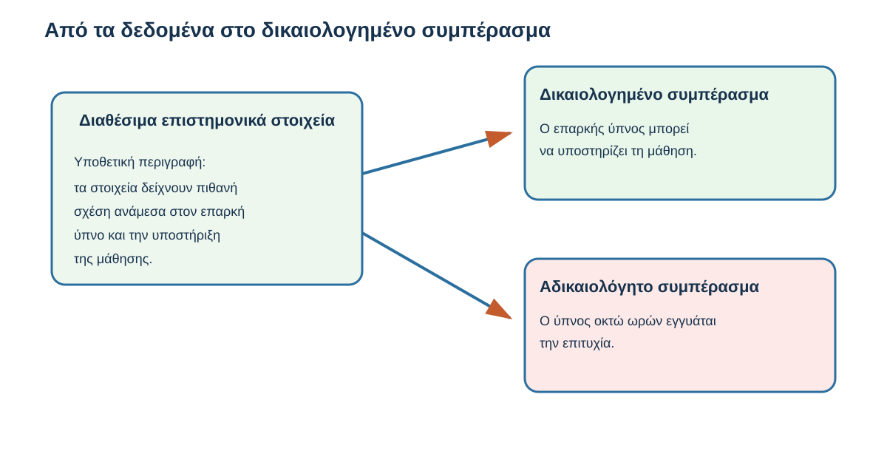
Σχήμα 4.11 — Από τα δεδομένα στο δικαιολογημένο συμπέρασμα

Διαθέσιμα επιστημονικά στοιχεία

Ερευνητικά ευρήματα για τη σχέση ύπνου και γνωστικών λειτουργιών

Δικαιολογημένο

«Ο επαρκής ύπνος μπορεί να υποστηρίζει τη μάθηση».

Αδικαιολόγητο

«Ο ύπνος οκτώ ωρών εγγυάται την επιτυχία».

Εννοιολογική σύγκριση. Η καταλληλότητα συγκεκριμένων επιστημονικών ισχυρισμών εξακολουθεί να απαιτεί έλεγχο των πηγών.

Το παράδειγμα αναδεικνύει ένα σημαντικό είδος σφάλματος.

Μια απάντηση μπορεί να ξεκινά από εύλογη πληροφορία και να καταλήγει σε συμπέρασμα που δεν δικαιολογείται από αυτήν.

Γι' αυτό δεν ελέγχουμε μόνο τους επιμέρους αριθμούς ή τις βιβλιογραφικές αναφορές.

Ελέγχουμε και τη λογική σύνδεση ανάμεσα στα στοιχεία και στα συμπεράσματα.

## 4.8.9 Βήμα 8 — Αναδιατυπώνουμε την απάντηση

Έχοντας εξετάσει τους πέντε ισχυρισμούς, μπορούμε να δημιουργήσουμε μια αναθεωρημένη απάντηση.

Στόχος μας δεν είναι να απορρίψουμε ολόκληρο το αρχικό κείμενο.

Θέλουμε να διατηρήσουμε τις χρήσιμες πληροφορίες, να διορθώσουμε τον υπολογισμό, να αφαιρέσουμε τους ατεκμηρίωτους ισχυρισμούς και να αποδώσουμε με μεγαλύτερη ακρίβεια τα συμπεράσματα.

Αναθεωρημένη ενδεικτική απάντηση

Ο ύπνος αποτελεί σημαντικό παράγοντα για τη φυσιολογική λειτουργία του ανθρώπου και συνδέεται με γνωστικές λειτουργίες, όπως η μνήμη και η συγκέντρωση.

Η επαρκής διάρκεια και η καλή ποιότητα του ύπνου μπορούν να υποστηρίζουν τη μάθηση. Ωστόσο, η ακαδημαϊκή επίδοση επηρεάζεται από πολλούς παράγοντες και δεν μπορούμε να υποστηρίξουμε ότι μια συγκεκριμένη διάρκεια ύπνου εξασφαλίζει την επιτυχία στις εξετάσεις.

Στο αριθμητικό παράδειγμα με βαθμούς 6, 7, 8, 9 και 10, ο μέσος όρος είναι 8.

Μια πραγματική επιστημονική ανασκόπηση που μπορούμε να εξετάσουμε είναι εκείνη των Hershner και Chervin (2014), η οποία συζητά τη σχέση ύπνου, υπνηλίας, μάθησης και ακαδημαϊκής επίδοσης στους φοιτητές.

Δεν διαθέτουμε τεκμηρίωση για τον κατασκευασμένο ισχυρισμό ότι ο ύπνος οκτώ ωρών αυξάνει υποχρεωτικά την επίδοση κατά 35%.

Η αναθεωρημένη απάντηση δεν περιλαμβάνει αυθαίρετο ποσοστό βελτίωσης.

Δεν παρουσιάζει μία συγκεκριμένη διάρκεια ύπνου ως καθολική εγγύηση επιτυχίας.

Διορθώνει τον αριθμητικό υπολογισμό και αποφεύγει τη χρήση κατασκευασμένης βιβλιογραφικής αναφοράς.

Παράλληλα, διατηρεί τη βασική ιδέα της αρχικής εξήγησης και προσδιορίζει μια πραγματική πηγή για περαιτέρω μελέτη.

Για να αποτελέσει τελικό κείμενο πανεπιστημιακής εργασίας, ο φοιτητής πρέπει να διαβάσει τα σχετικά τμήματα της πηγής και να τεκμηριώσει κάθε ουσιαστικό επιστημονικό ισχυρισμό.

Η δραστηριότητα, επομένως, δεν ολοκληρώνει τη βιβλιογραφική έρευνα του φοιτητή.

Του δείχνει πώς να μετατρέπει μια πρώτη απάντηση chatbot σε ασφαλέστερο σημείο εκκίνησης για την εργασία του.

## 4.8.10 Μπορεί το chatbot να βοηθήσει στη διαδικασία ελέγχου;

Μέχρι τώρα αξιολογήσαμε την απάντηση ανεξάρτητα από το chatbot.

Μπορούμε όμως να χρησιμοποιήσουμε το ίδιο εργαλείο για να οργανώσουμε καλύτερα τον έλεγχο.

Για παράδειγμα, ο φοιτητής θα μπορούσε να γράψει:

Ενδεικτικό αίτημα προς chatbot

«Εντόπισε τους επιμέρους πραγματολογικούς ισχυρισμούς της προηγούμενης απάντησής σου. Για καθέναν εξήγησε τι είδους στοιχεία ή πηγές χρειάζονται για να επαληθευτεί. Εντόπισε απόλυτες γενικεύσεις και συμπεράσματα που δεν υποστηρίζονται επαρκώς. Μην παρουσιάσεις βιβλιογραφικές αναφορές ως πραγματικές αν δεν έχεις επαληθεύσει την ύπαρξή τους».

&#x20;Αντιγραφή αιτήματος

Το αίτημα μπορεί να βοηθήσει στον εντοπισμό πιθανών προβλημάτων.

Δεν πρέπει όμως να θεωρούμε ότι ο αυτοέλεγχος του chatbot αποτελεί ανεξάρτητη επαλήθευση.

Το μοντέλο μπορεί να μην αναγνωρίσει ένα δικό του λάθος ή να δημιουργήσει νέα ανακρίβεια κατά την προσπάθεια διόρθωσης.

Ο φοιτητής παραμένει υπεύθυνος για τον έλεγχο των πηγών και των ουσιαστικών ισχυρισμών που θα χρησιμοποιήσει.

Χρησιμοποιούμε το chatbot για να υποστηρίξουμε τη διαδικασία αξιολόγησης, όχι ως τη μοναδική πηγή που πιστοποιεί την ορθότητα των απαντήσεών του.

## 4.8.11 Τελική δραστηριότητα — Ποια απάντηση θα επέλεγες;

Ένας φοιτητής ζητά από chatbot να εξηγήσει τη σχέση ανάμεσα στη χρήση ψηφιακών εκπαιδευτικών εργαλείων και στην ακαδημαϊκή επίδοση.

Το chatbot θα μπορούσε να δώσει τρεις διαφορετικές απαντήσεις.

Ποια απάντηση είναι περισσότερο δικαιολογημένη ως γενική διατύπωση;

Απάντηση Α — «Όλοι οι φοιτητές που χρησιμοποιούν ψηφιακά εκπαιδευτικά εργαλεία επιτυγχάνουν καλύτερες επιδόσεις».

Απάντηση Β — «Τα ψηφιακά εκπαιδευτικά εργαλεία μπορούν να υποστηρίζουν τη μάθηση, αλλά η αποτελεσματικότητά τους εξαρτάται από τον τρόπο χρήσης, το εκπαιδευτικό πλαίσιο και άλλους παράγοντες. Οι συγκεκριμένοι ισχυρισμοί χρειάζονται κατάλληλη τεκμηρίωση».

Απάντηση Γ — «Τα ψηφιακά εκπαιδευτικά εργαλεία δεν μπορούν ποτέ να προσφέρουν μαθησιακά οφέλη».
::: {dropdown} Ενδεικτική απάντηση και ανατροφοδότηση
Σωστές επιλογές: **2**.

Η απάντηση Β αναγνωρίζει ότι η αποτελεσματικότητα εξαρτάται από τις συνθήκες και αποφεύγει τις καθολικές γενικεύσεις. Για χρήση σε εργασία χρειάζονται επιπλέον κατάλληλες πηγές.
:::

## 4.8.12 Η διαδικασία που μπορούμε να εφαρμόσουμε σε οποιοδήποτε μάθημα

Ας επιστρέψουμε στο αρχικό ερώτημα:

Πώς μπορούμε να αξιολογήσουμε μια απάντηση chatbot πριν τη χρησιμοποιήσουμε;

Η δραστηριότητα που ολοκληρώσαμε μπορεί να οργανωθεί σε πέντε διαδοχικές ενέργειες.

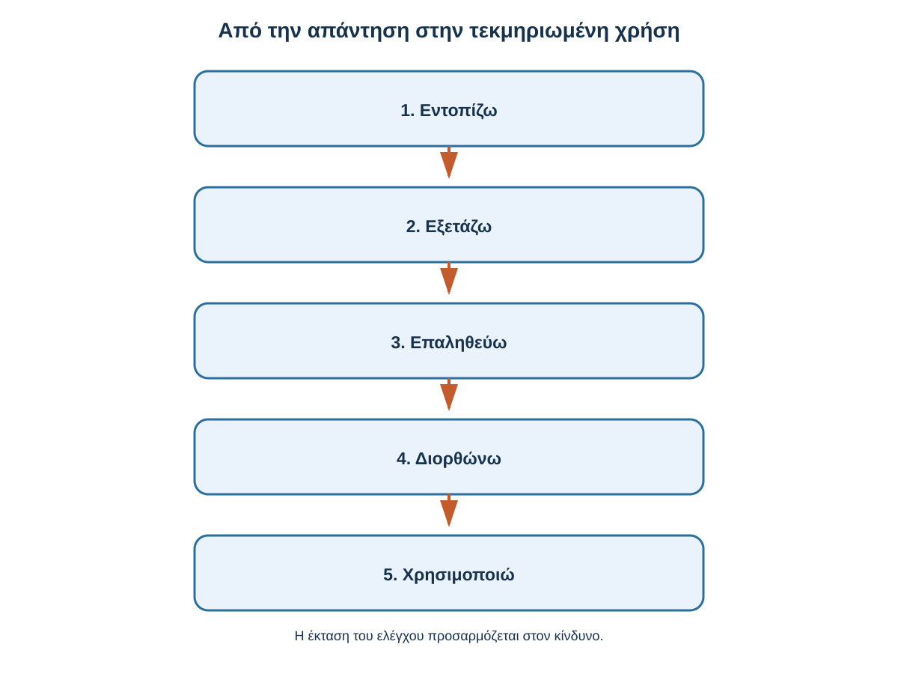
Σχήμα 4.12 — Από την απάντηση στην τεκμηριωμένη χρήση

1

Εντοπίζω

Ξεχωρίζω τους επιμέρους ισχυρισμούς της απάντησης.

2

Εξετάζω

Αναγνωρίζω τι μπορεί να είναι αβέβαιο, υπερβολικό ή ελλιπές.

3

Επαληθεύω

Ελέγχω στοιχεία, υπολογισμούς και επιστημονικές πηγές.

4

Διορθώνω

Αφαιρώ ανακρίβειες και αναδιατυπώνω αδικαιολόγητα συμπεράσματα.

5

Χρησιμοποιώ

Ενσωματώνω στην εργασία μόνο όσα υποστηρίζονται επαρκώς.

Γενική διαδικασία κριτικής αξιολόγησης. Η έκταση του ελέγχου προσαρμόζεται στη σημασία και στις πιθανές συνέπειες της χρήσης.

Η διαδικασία μπορεί να χρησιμοποιηθεί σε διαφορετικά γνωστικά αντικείμενα.

Ένας φοιτητής Οικονομικών μπορεί να ελέγχει στατιστικούς ισχυρισμούς.

Μια φοιτήτρια Φιλολογίας μπορεί να επαληθεύει αποσπάσματα και βιβλιογραφικές αναφορές.

Ένας φοιτητής Μηχανικών μπορεί να ελέγχει υπολογισμούς και τεχνικές παραδοχές.

Μια φοιτήτρια Επιστημών Υγείας μπορεί να εξετάζει αν ένας ισχυρισμός υποστηρίζεται από κατάλληλη επιστημονική τεκμηρίωση.

Σε όλες τις περιπτώσεις, η λογική είναι κοινή:

Δεν χρησιμοποιούμε μια απάντηση μόνο επειδή είναι καλογραμμένη. Εξετάζουμε αν όσα υποστηρίζει μπορούν πράγματι να τεκμηριωθούν.

## 4.8.13 Τι κρατάμε από τη δραστηριότητα

Στην ενότητα αυτή εξετάσαμε μια υποθετική απάντηση chatbot που περιλάμβανε έναν εύλογο επιστημονικό ισχυρισμό, μια υπερβολική γενίκευση, ένα λανθασμένο αριθμητικό αποτέλεσμα, μια κατασκευασμένη βιβλιογραφική αναφορά και ένα αδικαιολόγητο τελικό συμπέρασμα.

Δεν απορρίψαμε μηχανικά ολόκληρη την απάντηση.

Εντοπίσαμε τα επιμέρους στοιχεία της και επιλέξαμε τον κατάλληλο τρόπο ελέγχου για το καθένα.

Εξετάσαμε επίσης μια πραγματική επιστημονική δημοσίευση και διαπιστώσαμε γιατί δεν αρκεί να υπάρχει μια πηγή: πρέπει και να υποστηρίζει πραγματικά τον ισχυρισμό.

Στη συνέχεια δημιουργήσαμε μια νέα, προσεκτικότερη διατύπωση, διατηρώντας το χρήσιμο περιεχόμενο και αφαιρώντας όσα δεν μπορούσαν να υποστηριχθούν.

Το σημαντικότερο μαθησιακό αποτέλεσμα δεν είναι η απόκτηση γνώσεων για τον ύπνο ή την ακαδημαϊκή επίδοση.

Είναι η ανάπτυξη μιας δεξιότητας που μπορούμε να χρησιμοποιούμε σε οποιοδήποτε επιστημονικό αντικείμενο:

Να αξιοποιούμε τις δυνατότητες ενός γλωσσικού μοντέλου, διατηρώντας τον δικό μας έλεγχο στην αξιολόγηση και στη χρήση των πληροφοριών.

### Μετάβαση στην 4.9

Έχουμε πλέον γνωρίσει τα βασικά στάδια λειτουργίας ενός μεγάλου γλωσσικού μοντέλου και εφαρμόσαμε τις γνώσεις μας σε μια πανεπιστημιακή δραστηριότητα.

Ξεκινήσαμε από το τι είναι ένα LLM, συνεχίσαμε με τα tokens, τα συμφραζόμενα, την παραγωγή απαντήσεων και τον Transformer και εξετάσαμε τον ρόλο της μεταγενέστερης εκπαίδευσης και των εργαλείων.

Τέλος, γνωρίσαμε τους περιορισμούς αξιοπιστίας και μάθαμε να αξιολογούμε μια απάντηση πριν τη χρησιμοποιήσουμε.

Στην επόμενη και τελευταία ενότητα θα συνδέσουμε αυτές τις γνώσεις σε μία ενιαία εξήγηση.

Θα προσπαθήσουμε να απαντήσουμε, με δικά μας λόγια, στο ερώτημα:

«Τι συμβαίνει όταν γράφω μια ερώτηση σε ένα chatbot, πώς δημιουργείται η απάντηση και τι πρέπει να γνωρίζω πριν τη χρησιμοποιήσω;»

# 4.9 Η συνολική εικόνα: από την ερώτηση στην απάντηση

Στις προηγούμενες ενότητες γνωρίσαμε σταδιακά τον τρόπο λειτουργίας ενός μεγάλου γλωσσικού μοντέλου (Large Language Model — LLM).

Ξεκινήσαμε από μια απλή απορία: πώς είναι δυνατόν ένα chatbot να απαντά σε τόσο διαφορετικές ερωτήσεις, να δημιουργεί κατανοητές εξηγήσεις και να προσαρμόζει τον τρόπο με τον οποίο παρουσιάζει τις πληροφορίες;

Για να απαντήσουμε, εξετάσαμε τι είναι ένα γλωσσικό μοντέλο, πώς το κείμενο μετατρέπεται σε tokens, πώς αξιοποιούνται τα συμφραζόμενα και πώς παράγεται σταδιακά μια απάντηση.

Γνωρίσαμε επίσης τον βασικό ρόλο της αρχιτεκτονικής Transformer, τη διαφορά ανάμεσα στο μοντέλο και στην εφαρμογή chatbot, καθώς και τις δυνατότητες χρήσης πρόσθετων εργαλείων.

Τέλος, εξετάσαμε γιατί μια καλογραμμένη απάντηση δεν είναι υποχρεωτικά σωστή και εφαρμόσαμε μια διαδικασία αξιολόγησης πληροφοριών.

Στην τελευταία αυτή ενότητα δεν θα προσθέσουμε νέες τεχνικές έννοιες.

Θα συνδέσουμε όσα μάθαμε και θα εξετάσουμε αν μπορούμε πλέον να εξηγήσουμε τη βασική λειτουργία ενός LLM με δικά μας λόγια.

## Μαθησιακός σκοπός

Μετά την ολοκλήρωση της ενότητας θα μπορείς να περιγράφεις τη βασική διαδρομή από την ερώτηση του χρήστη μέχρι την παραγωγή της απάντησης, να διακρίνεις τις λειτουργίες του μοντέλου από εκείνες της εφαρμογής, να αναγνωρίζεις συνηθισμένες παρανοήσεις και να αξιολογείς πότε χρειάζεται ανεξάρτητη επαλήθευση των πληροφοριών.

## 4.9.1 Ας επιστρέψουμε στην αρχική μας ερώτηση

Φαντάσου ότι ένας πρωτοετής φοιτητής χρησιμοποιεί για πρώτη φορά ένα chatbot.

Γράφει:

> «Εξήγησέ μου τι είναι η επιστημονική μέθοδος με απλά λόγια και δώσε μου ένα παράδειγμα».

Το chatbot δημιουργεί μια σύντομη απάντηση.

Αν παρακολουθούσαμε σε εννοιολογικό επίπεδο τι συμβαίνει από τη στιγμή που υποβάλλεται το αίτημα μέχρι την εμφάνιση του αποτελέσματος, θα αναγνωρίζαμε τα βασικά στάδια που μελετήσαμε.

Η εφαρμογή λαμβάνει το αίτημα και το καθιστά διαθέσιμο στο μοντέλο, μαζί με όποιες πρόσθετες οδηγίες ή πληροφορίες χρειάζονται.

Το κείμενο μετατρέπεται σε tokens, τα οποία αντιστοιχίζονται σε αριθμητικές αναπαραστάσεις.

Το μοντέλο επεξεργάζεται αυτές τις αναπαραστάσεις, αξιοποιώντας τις σχέσεις ανάμεσα στις πληροφορίες που βρίσκονται στο διαθέσιμο πλαίσιο.

Σε ένα συνηθισμένο αυτοπαλινδρομικό γλωσσικό μοντέλο, η απάντηση παράγεται διαδοχικά, με την επιλογή νέων tokens.

Τελικά, η παραγόμενη ακολουθία μετατρέπεται σε κείμενο και εμφανίζεται στον χρήστη.

Αυτή είναι η βασική διαδρομή που πρέπει να μπορούμε να περιγράψουμε.

Δεν χρειάζεται να γνωρίζουμε όλες τις μαθηματικές πράξεις που πραγματοποιούνται στο εσωτερικό του μοντέλου.

## 4.9.2 Η συνολική λειτουργία σε ένα διάγραμμα

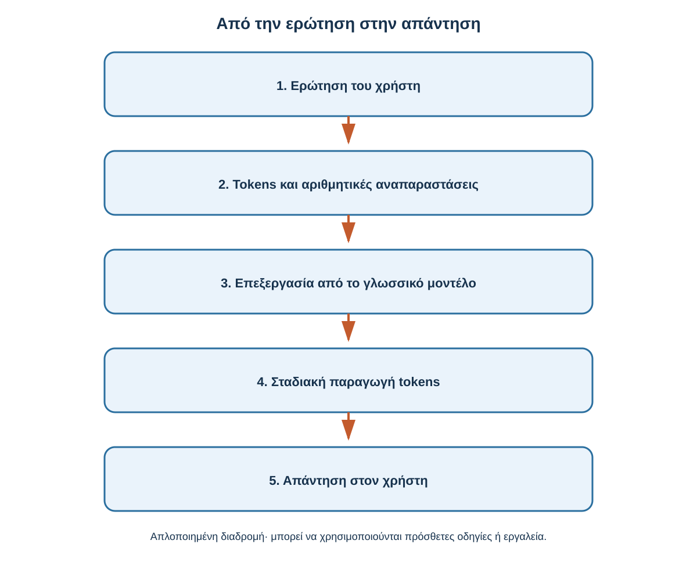
Σχήμα 4.13 — Από την ερώτηση στην απάντηση

1\. Ερώτηση του χρήστη

«Εξήγησέ μου τι είναι η επιστημονική μέθοδος»

2\. Tokens και αριθμητικές αναπαραστάσεις

Το κείμενο μετατρέπεται σε μορφή κατάλληλη για υπολογιστική επεξεργασία.

3\. Επεξεργασία από το γλωσσικό μοντέλο

Συμφραζόμενα και σχέσεις

Μαθημένες παράμετροι

4\. Σταδιακή παραγωγή tokens

Δημιουργείται η ακολουθία της απάντησης.

5\. Απάντηση στον χρήστη

Το παραγόμενο κείμενο εμφανίζεται στην εφαρμογή.

Εννοιολογικό διάγραμμα της βασικής λειτουργίας ενός συνηθισμένου LLM παραγωγής κειμένου. Ανάλογα με την εφαρμογή, μπορεί να χρησιμοποιούνται εξωτερικά εργαλεία ή πρόσθετες πληροφορίες.

Το σχήμα συγκεντρώνει όσα παρουσιάσαμε αναλυτικά στις προηγούμενες ενότητες.

Δεν αποτελεί πλήρη τεχνική περιγραφή όλων των σύγχρονων συστημάτων παραγωγικής Τεχνητής Νοημοσύνης.

Αποτυπώνει, όμως, τα βασικά στάδια που χρειάζεται να γνωρίζει ένας φοιτητής για να κατανοήσει τη γενική λειτουργία τους.

## 4.9.3 Τι γνωρίζουμε πλέον για το γλωσσικό μοντέλο;

Ας συγκεντρώσουμε τις πέντε βασικές έννοιες του κεφαλαίου.

| Έννοια                    | Τι σημαίνει                                                                             |
| ------------------------- | --------------------------------------------------------------------------------------- |
| Γλωσσικό μοντέλο (LLM)    | Εκπαιδευμένο υπολογιστικό μοντέλο που επεξεργάζεται και παράγει γλώσσα.                 |
| Token                     | Μονάδα στην οποία μετατρέπεται το κείμενο για επεξεργασία.                              |
| Συμφραζόμενα (context)    | Οι διαθέσιμες πληροφορίες που επηρεάζουν την επεξεργασία και την απάντηση.              |
| Transformer και attention | Αρχιτεκτονική και μηχανισμός που επιτρέπουν την αξιοποίηση σχέσεων μέσα στην ακολουθία. |
| Παραγωγή απάντησης        | Σε πολλά LLMs, σταδιακή δημιουργία κειμένου μέσω επιλογής διαδοχικών tokens.            |

Οι έννοιες αυτές συνδέονται μεταξύ τους.

Δεν είναι πέντε ανεξάρτητες λειτουργίες που συμβαίνουν χωρίς σχέση.

Το κείμενο μετατρέπεται σε κατάλληλη μορφή, το μοντέλο αξιοποιεί τις διαθέσιμες πληροφορίες και δημιουργεί την απάντηση.

Η συνολική διαδικασία βασίζεται στις μαθημένες παραμέτρους και στους υπολογιστικούς μηχανισμούς του.

Αν μπορούμε να περιγράψουμε αυτή τη σύνδεση, έχουμε κατανοήσει τον βασικό μηχανισμό λειτουργίας ενός μεγάλου γλωσσικού μοντέλου.

## 4.9.4 Τι προσθέτει η εφαρμογή chatbot;

Στην 4.6 γνωρίσαμε τη διάκριση ανάμεσα στο γλωσσικό μοντέλο και στην εφαρμογή chatbot.

Ας τη θυμηθούμε με ένα παράδειγμα.

Ένας φοιτητής ζητά:

> «Εξήγησέ μου τι είναι ο πληθωρισμός».

Το γλωσσικό μοντέλο μπορεί να δημιουργήσει μια σχετική εξήγηση αξιοποιώντας τις δυνατότητές του.

Στη συνέχεια ο φοιτητής γράφει:

> «Βρες τα πιο πρόσφατα επίσημα στοιχεία πληθωρισμού για τη χώρα μου και παρουσίασέ τα σε έναν πίνακα».

Το δεύτερο αίτημα απαιτεί πρόσφατες πληροφορίες.

Μια εφαρμογή που διαθέτει κατάλληλες λειτουργίες μπορεί να πραγματοποιήσει αναζήτηση, να αξιοποιήσει τα αποτελέσματα και να δημιουργήσει έναν πίνακα.

Η διαφορά είναι σημαντική.

Το μοντέλο επεξεργάζεται και παράγει πληροφορίες. Η εφαρμογή μπορεί επιπλέον να ανακτά δεδομένα, να χρησιμοποιεί εργαλεία και να οργανώνει τη διαδικασία αλληλεπίδρασης.

Δεν σημαίνει ότι όλα τα chatbots διαθέτουν τις ίδιες δυνατότητες ή ότι χρησιμοποιούν πάντοτε εργαλεία.

Γι' αυτό είναι χρήσιμο να γνωρίζουμε τις δυνατότητες της συγκεκριμένης εφαρμογής που χρησιμοποιούμε.

## 4.9.5 Τέσσερις παρανοήσεις που πρέπει να αποφεύγουμε

Η κατανόηση της λειτουργίας ενός LLM μάς βοηθά να αποφεύγουμε ορισμένες συνηθισμένες παρανοήσεις.

Παρανόηση 1 — «Το chatbot έχει αποθηκευμένη μια έτοιμη απάντηση για κάθε ερώτηση».

Η βασική λειτουργία πολλών LLMs είναι η παραγωγή κειμένου και όχι η απλή αναζήτηση μιας έτοιμης απάντησης.

Παρανόηση 2 — «Το μοντέλο εκπαιδεύεται ξανά κάθε φορά που του γράφω κάτι».

Η αξιοποίηση πληροφοριών της συνομιλίας δεν σημαίνει υποχρεωτικά ότι μεταβάλλονται οι μαθημένες παράμετροι του μοντέλου.

Παρανόηση 3 — «Αν το chatbot απαντά με φυσικό τρόπο, κατανοεί υποχρεωτικά όπως ένας άνθρωπος».

Η φυσικότητα της γλωσσικής παραγωγής δεν αποδεικνύει ανθρώπινο τρόπο κατανόησης.

Παρανόηση 4 — «Αν η απάντηση είναι καλογραμμένη και περιλαμβάνει πηγές, είναι σίγουρα σωστή».

Η ορθότητα των πληροφοριών και η καταλληλότητα των πηγών χρειάζονται επαλήθευση.

Οι παρανοήσεις αυτές δεν σημαίνουν ότι τα γλωσσικά μοντέλα είναι άχρηστα ή ότι πρέπει να αποφεύγουμε τη χρήση τους.

Αντίθετα, η αναγνώρισή τους μας βοηθά να χρησιμοποιούμε την τεχνολογία με περισσότερο κατάλληλο τρόπο.

## 4.9.6 Αυτοαξιολόγηση — Έλεγξε τι κατανόησες

Απάντησε στις έξι ερωτήσεις που ακολουθούν.

Στόχος δεν είναι να θυμάσαι αυτούσιους ορισμούς, αλλά να αναγνωρίζεις τη σωστή εξήγηση.

<a href="/al00_4_9_6.html" target="_blank" rel="noopener">Άνοιξε τη διαδραστική αυτοαξιολόγηση 4.9.6 σε νέα καρτέλα</a>

## 4.9.7 Μπορείς να εξηγήσεις ολόκληρη τη διαδικασία;

Η τελευταία δραστηριότητα είναι διαφορετική.

Δεν θα επιλέξεις μια έτοιμη απάντηση.

Θα προσπαθήσεις να εξηγήσεις τη βασική λειτουργία ενός γλωσσικού μοντέλου χρησιμοποιώντας δικά σου λόγια.

Φαντάσου ότι ένας συμφοιτητής σου λέει:

> «Χρησιμοποιώ συχνά chatbots, αλλά δεν ξέρω τι συμβαίνει όταν γράφω μια ερώτηση. Μπορείς να μου το εξηγήσεις χωρίς δύσκολους τεχνικούς όρους;»

Η αποστολή σου: Γράψε μια σύντομη εξήγηση περίπου 100–150 λέξεων.

Προσπάθησε να συμπεριλάβεις τη μετατροπή του κειμένου σε tokens, την αξιοποίηση συμφραζομένων, τη σταδιακή παραγωγή απαντήσεων, τη δυνατότητα χρήσης πρόσθετων εργαλείων και την ανάγκη αξιολόγησης των σημαντικών πληροφοριών.

0 λέξεις · επιθυμητή έκταση περίπου 100–150 Αντιγραφή κειμένου

Ενδεικτική εξήγηση

Μια καλή εξήγηση δεν χρειάζεται να περιλαμβάνει όλες τις τεχνικές λεπτομέρειες που γνωρίσαμε.

Χρειάζεται να αποδίδει σωστά τη βασική λογική λειτουργίας του μοντέλου και να διακρίνει τι γνωρίζουμε από όσα δεν μπορούμε να συμπεράνουμε μόνο από την εμφάνιση μιας απάντησης.
::: {dropdown} Ενδεικτική εξήγηση 100–150 λέξεων
Όταν γράφουμε μια ερώτηση σε ένα chatbot, το κείμενο μετατρέπεται σε μικρότερες μονάδες, που ονομάζονται tokens. Αυτές συνδέονται με αριθμητικές αναπαραστάσεις που μπορεί να επεξεργαστεί το γλωσσικό μοντέλο.

Το μοντέλο αξιοποιεί τις σχέσεις ανάμεσα στις διαθέσιμες πληροφορίες και τα συμφραζόμενα. Σε πολλά γλωσσικά μοντέλα, η απάντηση δημιουργείται σταδιακά, με την επιλογή διαδοχικών tokens.

Η εφαρμογή chatbot μπορεί επιπλέον να χρησιμοποιεί εργαλεία, όπως διαδικτυακή αναζήτηση ή υπολογισμούς, ανάλογα με τις δυνατότητές της.

Το γεγονός ότι μια απάντηση φαίνεται σωστά διατυπωμένη δεν σημαίνει ότι είναι πάντοτε ακριβής. Γι' αυτό, όταν χρησιμοποιούμε σημαντικά στοιχεία σε μια εργασία, πρέπει να ελέγχουμε τις πηγές, τους αριθμούς και τους ουσιαστικούς ισχυρισμούς.
:::

## 4.9.8 Τι μπορώ να κάνω πλέον ως φοιτητής;

Η κατανόηση του τρόπου λειτουργίας ενός μεγάλου γλωσσικού μοντέλου δεν έχει αξία μόνο ως θεωρητική γνώση.

Μπορεί να επηρεάζει τον τρόπο με τον οποίο χρησιμοποιούμε την Τεχνητή Νοημοσύνη στην καθημερινή μας μελέτη.

Για παράδειγμα, γνωρίζοντας τη σημασία των συμφραζομένων, μπορούμε να διατυπώνουμε σαφέστερα τα αιτήματά μας και να παρέχουμε τις κατάλληλες πληροφορίες.

Γνωρίζοντας τη διαφορά ανάμεσα στο μοντέλο και στην εφαρμογή, μπορούμε να εξετάζουμε αν υπάρχουν διαθέσιμα εργαλεία για συγκεκριμένες εργασίες.

Κατανοώντας τη σταδιακή παραγωγή κειμένου, μπορούμε να αντιληφθούμε γιατί η ίδια ερώτηση μπορεί να οδηγήσει σε διαφορετικές διατυπώσεις.

Και γνωρίζοντας τους περιορισμούς αξιοπιστίας, μπορούμε να αποφεύγουμε τη μηχανική αποδοχή μιας απάντησης μόνο και μόνο επειδή φαίνεται πειστική.

Αυτές οι δυνατότητες είναι χρήσιμες ανεξάρτητα από το τμήμα σπουδών.

Ένας φοιτητής μπορεί να χρησιμοποιεί ένα chatbot για να κατανοήσει μια έννοια, να οργανώσει τη μελέτη του, να προετοιμάσει ερωτήσεις αυτοαξιολόγησης ή να εξετάσει τη σαφήνεια ενός κειμένου.

Σε κάθε περίπτωση, η χρήση του εργαλείου πρέπει να υποστηρίζει τη δική του μάθηση και κρίση.

## 4.9.9 Τελικό συμπέρασμα του κεφαλαίου

Τα μεγάλα γλωσσικά μοντέλα αποτελούν μια σημαντική εξέλιξη στην επεξεργασία και παραγωγή γλώσσας.

Η λειτουργία τους βασίζεται σε εκπαιδευμένες αριθμητικές αναπαραστάσεις και υπολογιστικούς μηχανισμούς που επιτρέπουν την αξιοποίηση πληροφοριών από το διαθέσιμο κείμενο.

Σε πολλά σύγχρονα LLMs, η απάντηση παράγεται σταδιακά, με την επιλογή διαδοχικών tokens.

Η αρχιτεκτονική Transformer και οι μηχανισμοί attention έχουν συμβάλει σημαντικά στην ανάπτυξη αυτών των δυνατοτήτων.

Οι εφαρμογές chatbot μπορούν να επεκτείνουν τις λειτουργίες του μοντέλου μέσω αναζήτησης, υπολογιστικών εργαλείων και πρόσθετων πηγών πληροφορίας.

Ωστόσο, η φυσικότητα της γλώσσας και η τεχνολογική πολυπλοκότητα δεν εγγυώνται την ορθότητα κάθε απάντησης.

Το σημαντικότερο που χρειάζεται να κρατήσουμε είναι ότι ένα γλωσσικό μοντέλο μπορεί να αποτελέσει ισχυρό εργαλείο μάθησης, όταν κατανοούμε τις βασικές αρχές λειτουργίας του και διατηρούμε τον έλεγχο στην αξιολόγηση των πληροφοριών που χρησιμοποιούμε.
