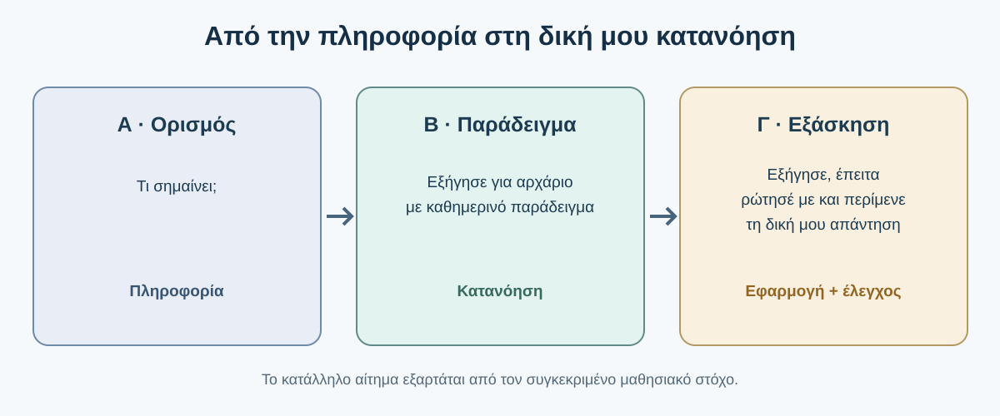
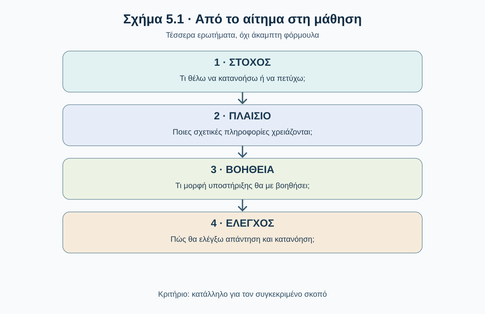
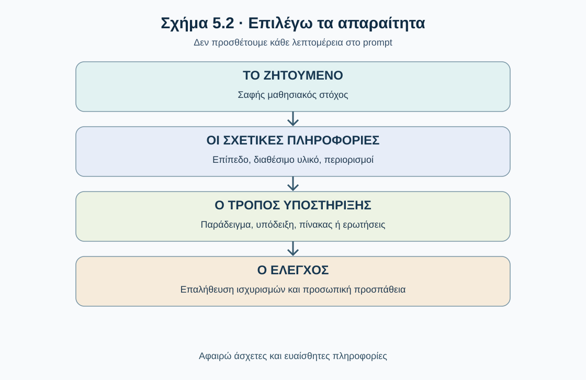
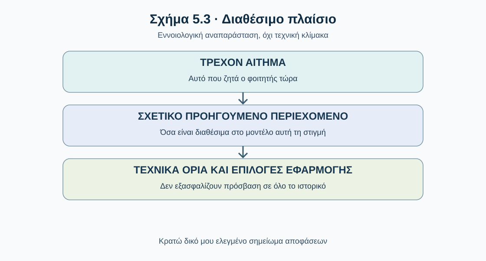
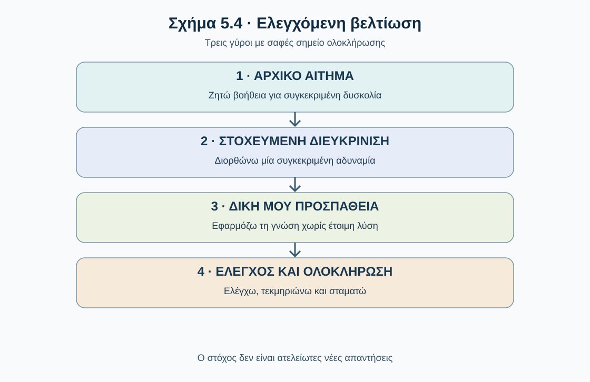
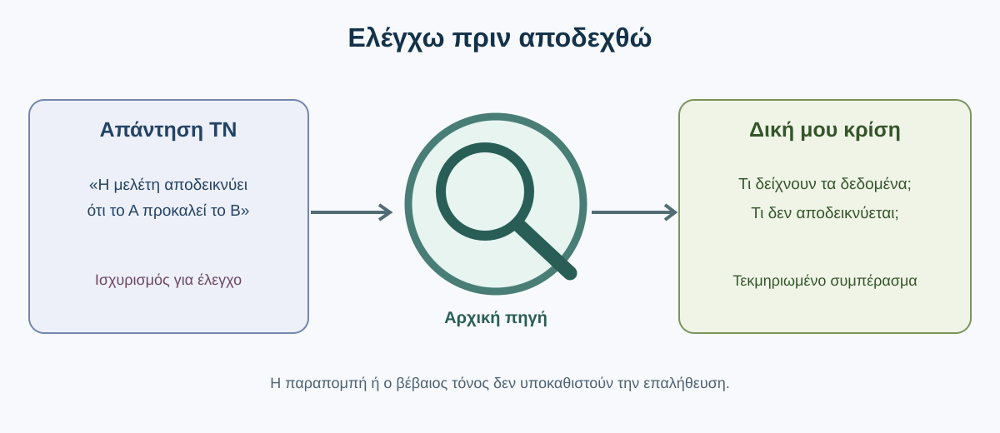

# AL00.5 — Prompts, tokens και συμφραζόμενα στην πράξη

> **Κατάσταση:** τοπικό staging draft v4 · 29/10/2026. **Υπό τεχνική και παιδαγωγική αξιολόγηση· δεν αποτελεί οριστικοποιημένη δημόσια έκδοση.**
>
> **Κοινό:** φοιτήτριες και φοιτητές όλων των επιστημονικών ειδικοτήτων, χωρίς απαίτηση προηγούμενων γνώσεων προγραμματισμού ή Γεωπληροφορικής.
>
> **Προαπαιτούμενο:** AL00.4 (βασική ιδέα της παραγωγής κειμένου από γλωσσικά μοντέλα, tokens και διαθέσιμα συμφραζόμενα). Δεν επαναλαμβάνουμε την εσωτερική αρχιτεκτονική.


## Πώς θα εργαστείς σε αυτή την ενότητα

Η Τεχνητή Νοημοσύνη μπορεί να εξηγήσει μια δύσκολη έννοια, να προτείνει έναν τρόπο μελέτης, να θέσει ερωτήσεις ή να δώσει ανατροφοδότηση σε ένα προσχέδιο. Η χρησιμότητα όμως αυτής της βοήθειας επηρεάζεται από το τι ζητάμε, τι πληροφορίες παρέχουμε και πώς ελέγχουμε όσα λαμβάνουμε. Στην ενότητα αυτή δεν θα απομνημονεύσεις «μαγικές εντολές». Θα δοκιμάσεις, θα συγκρίνεις, θα επανεξετάσεις και θα επιλέξεις τον κατάλληλο τρόπο συνεργασίας με την ΤΝ.

**Μαθησιακά αποτελέσματα.** Μετά την ολοκλήρωση θα μπορείς να: (α) μετατρέπεις ένα ασαφές αίτημα σε ένα σαφές και κατάλληλο για τον σκοπό σου· (β) παρέχεις χρήσιμο πλαίσιο χωρίς περιττές ή ευαίσθητες πληροφορίες· (γ) κατανοείς πρακτικά τι σημαίνουν τα tokens και το περιορισμένο διαθέσιμο πλαίσιο· (δ) χρησιμοποιείς παραδείγματα και διαδοχικές διευκρινίσεις· (ε) ελέγχεις απαντήσεις και να ξεχωρίζεις τη βοήθεια από την τεκμηριωμένη γνώση· (στ) σχεδιάζεις μια μικρή προσωπική μαθησιακή διαδικασία με υπεύθυνη χρήση ΤΝ.

Στα παραδείγματα που ακολουθούν οι απαντήσεις της ΤΝ είναι **συνθετικές εκπαιδευτικές προσομοιώσεις**: δείχνουν *πιθανές* απαντήσεις, όχι μετρήσεις από συγκεκριμένο μοντέλο. Δεν εγγυώνται ότι κάθε εργαλείο θα απαντήσει με τον ίδιο τρόπο.

**Διαδρομή:** 5.1 Αποτελεσματικό αίτημα · 5.2 Συστατικά αιτήματος · 5.3 Tokens και συμφραζόμενα · 5.4 Παραδείγματα και καθοδήγηση · 5.5 Συνομιλία και αναθεώρηση · 5.6 Ποιοτικός έλεγχος και όρια · 5.7 Ολοκληρωμένη αποστολή · 5.8 Αυτοαξιολόγηση και μεταφορά δεξιότητας.

---

## 5.1 — Από την ερώτηση στο αποτελεσματικό αίτημα

### 5.1.1 — Γιατί δεν αρκεί πάντα μια απλή ερώτηση;

Όταν χρησιμοποιούμε ένα σύστημα ΤΝ, συνήθως ξεκινάμε με μια ερώτηση ή οδηγία: «Εξήγησέ μου αυτή την έννοια», «Βοήθησέ με να οργανώσω τις σημειώσεις μου», «Πώς μπορώ να ελέγξω τη λύση μου;». Η διαδικασία είναι εύκολη, αλλά υπάρχει διαφορά ανάμεσα στο **να λάβουμε μια απάντηση** και στο **να λάβουμε μια απάντηση που μας βοηθά να μάθουμε**.

Ένας φοιτητής συναντά τις έννοιες *συσχέτιση* και *αιτιότητα* και γράφει: **«Εξήγησέ μου τη συσχέτιση και την αιτιότητα.»** Το αίτημα δεν είναι λανθασμένο. Δεν αναφέρει όμως αν πρόκειται για την πρώτη επαφή με το θέμα, αν ο φοιτητής χρειάζεται απλό ορισμό ή παράδειγμα, ή αν θέλει να προετοιμαστεί για εξετάσεις. Το σύστημα μπορεί να δώσει ορθή αλλά υπερβολικά αφηρημένη εξήγηση. Δεν μπορούμε να συναγάγουμε από αυτή τη διατύπωση ποιος είναι ο ακριβής μαθησιακός σκοπός.

**Πριν συνεχίσεις — πρόβλεψη.** Ποια είναι η βασική αδυναμία; (Α) Είναι πολύ σύντομο, άρα λανθασμένο. (Β) Δεν προσδιορίζει επίπεδο γνώσεων και μαθησιακό στόχο. (Γ) Η ΤΝ δεν μπορεί να εξηγήσει στατιστική. *Σκέψου πρώτα και μετά διάβασε την ανατροφοδότηση.*

```{dropdown} Έλεγχος κατανόησης — ενδεικτική απάντηση
:class: dropdown
**Β.** Το μήκος δεν αποτελεί κριτήριο ορθότητας. Μια σύντομη ερώτηση μπορεί να είναι εξαιρετική όταν ο στόχος είναι ήδη σαφής.
```

Η ίδια έννοια μπορεί να απασχολεί φοιτητές διαφορετικών επιστημών. Στις Επιστήμες Υγείας η διάκριση μπορεί να προκύψει από την ερμηνεία μιας παρατηρούμενης σχέσης ανάμεσα σε συμπεριφορές και αποτελέσματα υγείας. Στα Οικονομικά από τη σχέση εισοδήματος και κατανάλωσης. Στα Παιδαγωγικά από τη σχέση χρόνου μελέτης και επίδοσης. Ο βασικός επιστημονικός κανόνας παραμένει ο ίδιος, αλλά τα παραδείγματα και η μορφή της εξήγησης διαφέρουν.

Ο φοιτητής μπορεί να ζητήσει: **«Δεν έχω προηγούμενες γνώσεις στατιστικής. Εξήγησέ μου με απλά λόγια τη διαφορά συσχέτισης και αιτιότητας. Χρησιμοποίησε καθημερινό παράδειγμα και εξήγησε γιατί μια συσχέτιση δεν αποδεικνύει μόνη της αιτιότητα.»** Η διατύπωση προσθέτει επίπεδο, μορφή εξήγησης και ειδικό σημείο δυσκολίας.

Δεν ισχύει όμως ότι περισσότερες λέξεις σημαίνουν πάντα καλύτερο αίτημα. Για το «Τι σημαίνουν τα αρχικά DNA;» πιθανότατα αρκεί μια σύντομη ερώτηση. Για μια δύσκολη ερευνητική ή μαθησιακή εργασία χρειάζονται περισσότερα στοιχεία. Κριτήριο είναι **τι εξυπηρετεί την εργασία**, όχι το μέγεθος του κειμένου.

Μερικές φορές δεν ξέρουμε ούτε τι να ζητήσουμε. Τότε μπορούμε να γράψουμε: «Προσπαθώ να καταλάβω τη διαφορά συσχέτισης και αιτιότητας αλλά δεν ξέρω τι με δυσκολεύει. Κάνε μου λίγες απλές ερωτήσεις, μία κάθε φορά, για να διαπιστώσουμε τι γνωρίζω και τι χρειάζεται να εξασκήσω». Η ΤΝ υποστηρίζει τη διερεύνηση· δεν μπορεί από μόνη της να εγγυηθεί ότι διαγνώσθηκε σωστά η δυσκολία.


**Δύο πιθανές απαντήσεις, δύο διαφορετικές χρήσεις.** Στο ίδιο αρχικό αίτημα το μοντέλο μπορεί να απαντήσει με ακαδημαϊκούς ορισμούς ή με ένα καθημερινό περιστατικό. Η πρώτη μορφή είναι χρήσιμη όταν επαναλαμβάνεις την ορολογία· η δεύτερη όταν χρειάζεσαι μια πρώτη νοητική εικόνα. Καμία δεν αρκεί από μόνη της για να δείξει ότι κατάλαβες. Δοκίμασε, μετά την εξήγηση, να διατυπώσεις ένα δικό σου παράδειγμα και να εξηγήσεις γιατί δεν αποδεικνύεται αιτιότητα.

**Μικρό αντιπαράδειγμα.** Το αίτημα «Απάντησε οπωσδήποτε με βεβαιότητα και χωρίς επιφυλάξεις» δεν βελτιώνει τη μάθηση: μπορεί να αποκρύψει αμφιβολίες που είναι ουσιαστικές. Είναι προτιμότερο να ζητήσεις «Αν υπάρχει αβεβαιότητα ή χρειάζονται επιπλέον δεδομένα, πες το καθαρά». Έτσι η σαφήνεια αφορά και τα όρια της γνώσης, όχι μόνο την εκφορά της εξήγησης.

**Μια ακόμη δοκιμή πριν δούμε την απάντηση.** Φαντάσου ότι ένας συμφοιτητής γράφει «Δεν καταλαβαίνω τη θεωρία». Πριν του προτείνεις καλύτερο prompt, σκέψου τι θα τον ρωτούσες αν βρισκόταν δίπλα σου. Πιθανότατα θα ζητούσες να σου πει ποια θεωρία μελετά, ποια εξήγηση έχει ήδη διαβάσει και πού ακριβώς δυσκολεύεται. Οι ίδιες διευκρινίσεις μπορούν να βοηθήσουν και μια συνομιλία με ΤΝ. Δεν χρειάζεται να συγκεντρώσουμε κάθε διαθέσιμη πληροφορία· χρειάζεται να βρούμε αυτές που επηρεάζουν τη βοήθεια.

**Εφαρμογή σε διαφορετικά πεδία.** Ένας φοιτητής Νομικής μπορεί να ζητήσει τη διάκριση δύο συγγενικών εννοιών χωρίς να κοινοποιήσει πραγματική υπόθεση πελάτη. Μια φοιτήτρια Βιολογίας μπορεί να ζητήσει να εξηγήσει με δικά της λόγια τη σχέση δύο κυτταρικών διαδικασιών. Ένας φοιτητής Μηχανικής μπορεί να ζητήσει ένα ποιοτικό παράδειγμα πριν περάσει σε υπολογισμούς. Η γενική αρχή παραμένει η ίδια: προσδιορίζουμε τι θέλουμε να μάθουμε και σε ποιο σημείο χρειαζόμαστε υποστήριξη.


### 5.1.2 — Το ίδιο θέμα, διαφορετικά αιτήματα

Ας κρατήσουμε σταθερό τον μαθησιακό στόχο: να καταλάβει ο φοιτητής γιατί μια συσχέτιση δεν αποδεικνύει αιτιώδη σχέση. Συγκρίνουμε τρία αιτήματα και πιθανές απαντήσεις.

**Αίτημα Α — Γενικό:** «Ποια είναι η διαφορά ανάμεσα στη συσχέτιση και την αιτιότητα;»

> *Ενδεικτική απάντηση:* Συσχέτιση είναι η στατιστική σχέση μεταξύ δύο μεταβλητών. Αιτιότητα σημαίνει ότι μια μεταβολή σε έναν παράγοντα προκαλεί μεταβολή σε έναν άλλον. Από μια συσχέτιση και μόνο δεν τεκμηριώνεται αιτιότητα.

Η απάντηση δίνει τη βασική διάκριση, αλλά δεν ελέγχει αν κατανοήθηκε.

**Αίτημα Β — Για αρχάριο:** «Δεν έχω προηγούμενες γνώσεις στατιστικής. Εξήγησε με ένα απλό καθημερινό παράδειγμα τη διαφορά.»

> *Ενδεικτική απάντηση:* Έστω ότι το καλοκαίρι αυξάνονται ταυτόχρονα οι πωλήσεις παγωτού και τα περιστατικά πνιγμού. Δεν συνεπάγεται ότι η κατανάλωση παγωτού προκαλεί πνιγμούς: μπορεί να σχετίζονται και τα δύο με τη ζέστη και τις περισσότερες δραστηριότητες στο νερό.

Πρόκειται για **υποθετικό διδακτικό παράδειγμα**, όχι για παρουσίαση συγκεκριμένης εμπειρικής έρευνας. Το παράδειγμα συνδέει την αφηρημένη έννοια με μια οικεία κατάσταση.

**Αίτημα Γ — Ενεργητική μάθηση:** «Δεν έχω προηγούμενες γνώσεις στατιστικής. Εξήγησε τη διαφορά συσχέτισης και αιτιότητας με ένα καθημερινό παράδειγμα. Έπειτα δώσε μου μια άλλη περίπτωση και ζήτησέ μου να εξηγήσω αν προκύπτει αιτιότητα. Μη μου δείξεις αμέσως τη λύση· δώσε ανατροφοδότηση αφού απαντήσω.»

> *Ενδεικτική αρχή απάντησης:* Αφού εξηγήσουμε τη διάκριση, σκέψου: σε μια ομάδα παρατηρείται σχέση ανάμεσα στις ώρες μελέτης και στις επιδόσεις. Αυτό αποδεικνύει ότι οι επιπλέον ώρες μελέτης προκάλεσαν την υψηλότερη επίδοση; Ποιοι άλλοι παράγοντες θα μπορούσαν να παίζουν ρόλο; Γράψε τη δική σου αιτιολόγηση πριν συνεχίσουμε.



Το Γ ζητά μια διαδικασία όπου ο φοιτητής **προσπαθεί πριν λάβει τη λύση**. Δεν είναι όμως πάντοτε καλύτερο: για μια γρήγορη υπενθύμιση μπορεί να αρκεί το Α, για αρχική κατανόηση το Β, για εξάσκηση το Γ.

| Κριτήριο | Α | Β | Γ |
|---|---|---|---|
| Προσδιορίζει το θέμα | Ναι | Ναι | Ναι |
| Δηλώνει επίπεδο γνώσεων | Όχι | Ναι | Ναι |
| Ζητά κατανοητό παράδειγμα | Όχι | Ναι | Ναι |
| Ζητά εφαρμογή και ανατροφοδότηση | Όχι | Όχι | Ναι |

**Δραστηριότητα — άλλαξε τον στόχο.** Γράψε ένα αίτημα για φοιτητή που *γνωρίζει* τους ορισμούς, αλλά δυσκολεύεται να διακρίνει υποθετικές αιτιώδεις εξηγήσεις από απλές παρατηρούμενες σχέσεις. Μη ζητήσεις ξανά μια γενική παράθεση ορισμών. Ζήτησε δύο διαφορετικές περιπτώσεις για να εξασκηθεί και έναν τρόπο ανατροφοδότησης.

```{dropdown} Ενδεικτική απάντηση — σύγκρινε με τη δική σου
:class: dropdown
«Γνωρίζω τους ορισμούς συσχέτισης και αιτιότητας, αλλά δυσκολεύομαι να τους εφαρμόσω. Δώσε μου δύο σύντομες υποθετικές περιπτώσεις από διαφορετικούς τομείς και ζήτησέ μου να εντοπίσω τι συμπεραίνεται και τι όχι. Μη μου δώσεις τη λύση πριν γράψω τη σκέψη μου. Στο τέλος εξήγησε με σαφήνεια την ανατροφοδότησή σου.»
```


**Τι θα ελέγχαμε σε πραγματική δοκιμή;** Θα υποβάλλαμε τα τρία αιτήματα στο ίδιο εργαλείο, κατά προτίμηση σε χωριστές συνομιλίες ώστε οι προηγούμενες απαντήσεις να μην επηρεάζουν τις επόμενες. Θα καταγράφαμε όχι μόνο ποια απάντηση ήταν πιο ευχάριστη στην ανάγνωση, αλλά αν περιείχε την κρίσιμη διάκριση, κατανοητό παράδειγμα, πιθανές παρερμηνείες και ερώτηση που απαιτεί δική μας αιτιολόγηση. Επειδή τα μοντέλα δεν απαντούν πάντα πανομοιότυπα, ένα μόνο αποτέλεσμα δεν αποδεικνύει καθολική υπεροχή ενός prompt.

**Αντιπαράδειγμα:** Μια απάντηση μπορεί να είναι πολύ φιλική και να τελειώνει με «Μπράβο, το κατάλαβες!», χωρίς να έχει ζητήσει από τον φοιτητή καμία εξήγηση. Ο ενθαρρυντικός τόνος δεν είναι τεκμήριο κατανόησης. Ζήτησε ερώτηση εφαρμογής και έλεγξε το σκεπτικό σου, όχι μόνο το ύφος της ανατροφοδότησης.

**Δοκιμή σύγκρισης απαντήσεων στην πράξη.** Αν έχεις πρόσβαση σε εργαλείο συνομιλίας, άνοιξε τρεις νέες συνομιλίες και υπέβαλε τα αιτήματα Α, Β, Γ ξεχωριστά. Μη βασίσεις το συμπέρασμά σου στο ποια απάντηση είναι μεγαλύτερη. Κατάγραψε αν η κάθε απάντηση (α) δίνει σωστό ορισμό, (β) χρησιμοποιεί κατανοητό παράδειγμα, (γ) αποφεύγει να συναγάγει αιτιότητα χωρίς αποδείξεις και (δ) σε καλεί να διατυπώσεις δική σου αιτιολόγηση. Επειδή οι αποκρίσεις μπορεί να διαφέρουν από εκτέλεση σε εκτέλεση, διατύπωσε περιορισμένο συμπέρασμα: «Στη δοκιμή μου το Γ υποστήριξε καλύτερα την εξάσκηση», όχι «το Γ είναι πάντα ανώτερο».

**Ερώτηση αναστοχασμού.** Αν το Γ δημιουργήσει μια ερώτηση αλλά αποκαλύψει αμέσως τη λύση, τι θα αλλάξεις; Μια χρήσιμη απάντηση είναι: «Δώσε μία περίπτωση, περίμενε πρώτα τη δική μου αιτιολόγηση και μετά σχολίασε συγκεκριμένα το σκεπτικό μου». Η επόμενη οδηγία διορθώνει ένα παρατηρήσιμο πρόβλημα αντί να ζητά αόριστα «καλύτερη απάντηση».


### 5.1.3 — Βελτιώνω το αίτημά μου

Πώς μετατρέπουμε ένα ασαφές αίτημα σε χρήσιμο χωρίς να στηριζόμαστε σε μια «τέλεια» συνταγή; Ας δούμε έναν φοιτητή που έχει ένα δύσκολο επιστημονικό κείμενο και λέει: **«Δεν καταλαβαίνω αυτό το κείμενο. Εξήγησέ το.»** Η πρόταση δηλώνει τη δυσκολία, αλλά δεν εξηγεί ποιο κείμενο αφορά, τι δεν έγινε κατανοητό και πώς θα ελεγχθεί η πρόοδος.

**Βήμα 1 — Στόχος.** Ο φοιτητής αποφασίζει ότι δεν θέλει απλώς έτοιμη περίληψη. Θέλει να κατανοήσει τις βασικές έννοιες και το κύριο επιχείρημα. Το διατυπώνει: «Θέλω να κατανοήσω το βασικό επιχείρημα και τα σημαντικότερα σημεία ενός επιστημονικού κειμένου».

**Βήμα 2 — Πλαίσιο.** Εξηγεί ότι το κείμενο είναι από εισαγωγικό πανεπιστημιακό μάθημα, έχει διαβάσει το απόσπασμα, γνωρίζει μερικούς βασικούς όρους αλλά δυσκολεύεται να παρακολουθήσει τον συλλογισμό. Παρέχει μόνο υλικό που επιτρέπεται να κοινοποιήσει, χωρίς προσωπικά δεδομένα τρίτων ή εμπιστευτικές πληροφορίες. Αν δεν το ανεβάσει ή παραθέσει, το σύστημα δεν γνωρίζει με βεβαιότητα το περιεχόμενό του.

**Βήμα 3 — Τρόπος βοήθειας.** Ζητά πρώτα απλή εξήγηση του κεντρικού επιχειρήματος, διάκριση ανάμεσα σε πραγματικό περιεχόμενο του συγγραφέα και πρόσθετη επεξήγηση της ΤΝ, και σταδιακή καθοδήγηση αντί για απλή αντικατάσταση της μελέτης.

**Βήμα 4 — Έλεγχος.** Ζητά να αποδώσει το επιχείρημα με δικά του λόγια και να λάβει τεκμηριωμένη ανατροφοδότηση. Ελέγχει την ανατροφοδότηση στο πρωτότυπο κείμενο και, όπου χρειάζεται, με τον διδάσκοντα.

**Το ολοκληρωμένο αίτημα:**

> «Μελετώ ένα επιστημονικό κείμενο για εισαγωγικό πανεπιστημιακό μάθημα και θα σου παραθέσω ένα απόσπασμα που επιτρέπεται να κοινοποιήσω. Θέλω να κατανοήσω το βασικό επιχείρημα και τις κύριες έννοιες, όχι απλώς να πάρω περίληψη. Εξήγησε με απλά λόγια το επιχείρημα και ξεχώρισε όσα λέει ο συγγραφέας από τις δικές σου διευκρινίσεις. Έπειτα ζήτησέ μου να το αποδώσω με δικά μου λόγια· μην αποκαλύψεις αμέσως την ενδεικτική απάντηση. Αφού προσπαθήσω, επισήμανε τυχόν παρανοήσεις με αναφορές στο συγκεκριμένο απόσπασμα. Αν κάτι δεν προκύπτει από το κείμενο, δήλωσέ το.»



Η τετραπλή διαδικασία **Στόχος → Πλαίσιο → Βοήθεια → Έλεγχος** είναι εργαλείο σκέψης, όχι υποχρεωτικό καλούπι. Δεν χρειάζονται πάντα τέσσερις μεγάλες παράγραφοι. Αν ο στόχος είναι απλός, αρκεί μικρότερο αίτημα.

**Δραστηριότητα — συμπλήρωσε μόνος σου.** Αρχικό αίτημα: «Δεν μπορώ να λύσω αυτή την άσκηση· δώσε μου τη λύση». Αντί να αντιγράψεις τελικό αποτέλεσμα, γράψε αίτημα που δηλώνει (1) ποιο μάθημα αφορά, (2) τι έχεις δοκιμάσει, (3) σε ποιο βήμα σταματάς, (4) ότι προτιμάς υπόδειξη πριν από λύση και (5) πώς θα ελέγξεις ότι μπορείς να λύσεις ανάλογο πρόβλημα μόνος σου.

```{dropdown} Ενδεικτική απάντηση
:class: dropdown
«Μελετώ [μάθημα/θέμα]. Έχω προσπαθήσει να λύσω την άσκηση με [σύντομη περιγραφή], αλλά δυσκολεύομαι στο [συγκεκριμένο βήμα]. Μη μου δώσεις αμέσως ολοκληρωμένη λύση. Κάνε μου πρώτα μία καθοδηγητική ερώτηση ή δώσε μια μικρή υπόδειξη. Αφού προσπαθήσω, έλεγξε τη συλλογιστική μου και πρότεινε ένα παρόμοιο πρόβλημα για εξάσκηση.»
```


**Πότε δεν προσθέτουμε άλλο πλαίσιο;** Αν ο στόχος είναι να ορίσουμε μια λέξη, η περιγραφή ολόκληρου του εξαμήνου συνήθως δεν βοηθά. Αν ο στόχος είναι να ερμηνεύσουμε επιχείρημα συγκεκριμένου άρθρου, όμως, η αποστολή του σχετικού αποσπάσματος και της ερευνητικής ερώτησης μπορεί να είναι αναγκαία. Κάθε πληροφορία έχει κόστος: χρόνο ανάγνωσης, πιθανότητα σύγχυσης και, μερικές φορές, κίνδυνο ιδιωτικότητας.

**Έλεγχος σε δύο στάδια.** Πρώτα ελέγχεις αν το αίτημα περιγράφει επαρκώς την εργασία. Έπειτα, αφού έρθει η απάντηση, ελέγχεις αν η βοήθεια ταιριάζει στον στόχο. Αν όχι, μη γράφεις απλώς «προσπάθησε ξανά». Δήλωσε τι ήταν χρήσιμο και τι χρειάζεται αλλαγή: «Το παράδειγμα με βοήθησε, αλλά δεν εξηγεί τη διαφορά ανάμεσα στις δύο έννοιες. Πρόσθεσε ένα αντιπαράδειγμα και κάνε μου μία ερώτηση εφαρμογής».

**Ελέγχω αν πράγματι διατηρώ τον έλεγχο της μάθησης.** Το αίτημα για ένα επιστημονικό κείμενο μπορεί να μοιάζει άριστο επειδή ζητά εξηγήσεις, όμως ο φοιτητής εξακολουθεί να χρειάζεται να επιστρέψει στο απόσπασμα. Για παράδειγμα, αν η ΤΝ ισχυριστεί ότι ο συγγραφέας «αποδεικνύει» μια σχέση ενώ στο κείμενο αναφέρει απλώς «ενδείξεις», έχουμε αλλοίωση του βαθμού βεβαιότητας. Ζήτησε να εντοπιστεί η ακριβής πρόταση που στηρίζει την ερμηνεία και σύγκρινέ την με το πρωτότυπο. Αν δεν υπάρχει τέτοια πρόταση, καταγράφεις την αβεβαιότητα αντί να αποδέχεσαι μια εύγλωττη αναδιατύπωση.

**Μικρό εργαστήριο αναθεώρησης.** Ξεκίνα από το αίτημα «Δώσε μου τη λύση της άσκησης». Γράψε πρώτα: «Εξήγησέ μου το πρώτο βήμα χωρίς να ολοκληρώσεις τη λύση». Έπειτα πρόσθεσε τι προσπάθησες και πού σταμάτησες. Τέλος ζήτησε ένα ανάλογο πρόβλημα. Συγκρίνοντας τις τρεις εκδοχές, εξήγησε ποια προσθήκη αλλάζει περισσότερο τη δική σου συμμετοχή. Δεν υπάρχει υποχρέωση όλες οι ασκήσεις να αντιμετωπίζονται με τον ίδιο τρόπο· αν χρειάζεσαι μια απλή επαλήθευση αριθμητικού αποτελέσματος, ένα σύντομο αίτημα ίσως αρκεί.


### 5.1.4 — Πρακτική αποστολή: το πρώτο μου βελτιωμένο αίτημα

**Αποστολή.** Επίλεξε μια πραγματική δυσκολία της τρέχουσας μελέτης σου: κατανόηση έννοιας, άσκηση, επιστημονικό κείμενο, ανατροφοδότηση σε παράγραφο ή οργάνωση μελέτης. Δεν χρειάζεται να αποκαλύψεις προσωπικά ή εμπιστευτικά στοιχεία. Μπορείς να χρησιμοποιήσεις επινοημένο παράδειγμα αν δεν διαθέτεις κατάλληλο υλικό.

1. **Γράψε το πρώτο αυθόρμητο αίτημα** όπως θα το έστελνες συνήθως (μία ή δύο προτάσεις).
2. **Δήλωσε τον σκοπό** σε μία ξεχωριστή πρόταση: «Θα θεωρήσω ότι βοηθήθηκα όταν μπορώ να…».
3. **Βελτίωσε το αίτημα**, προσθέτοντας μόνο τα στοιχεία που χρειάζονται (επίπεδο, πληροφορίες, ζητούμενη διαδικασία, έλεγχος).
4. **Δοκίμασε και τα δύο**, εφόσον διαθέτεις ένα κατάλληλο εργαλείο, και κράτησε σύντομη σημείωση για την πρώτη απάντηση. Αν δεν έχεις πρόσβαση, χρησιμοποίησε τις υποθετικές απαντήσεις του παραδείγματος της 5.1.2 και αξιολόγησέ τες ως προς τον δικό σου στόχο.
5. **Αξιολόγησε** όχι μόνο ποια απάντηση σου άρεσε αλλά τι σε βοήθησε να μάθεις, τι παραμένει ατεκμηρίωτο και ποια ερώτηση θα ακολουθούσε.

| Στοιχείο εργασίας | Η δική σου καταγραφή |
|---|---|
| Αρχικό αίτημα | … |
| Πραγματικός στόχος | … |
| Βελτιωμένο αίτημα | … |
| Ουσιαστική διαφορά στις απαντήσεις ή στις αναμενόμενες απαντήσεις | … |
| Τι χρειάζεται επαλήθευση | … |
| Τι θα κάνω μόνος/η μου στη συνέχεια | … |

**Πότε ολοκληρώθηκε η αποστολή;** Όταν μπορείς να αιτιολογήσεις τουλάχιστον *δύο* αλλαγές που έκανες στο αίτημα και να εντοπίσεις *ένα* σημείο όπου η απάντηση χρειάζεται έλεγχο. Δεν βαθμολογείται ο αριθμός των λέξεων.

```{dropdown} Οδηγός αυτοελέγχου — όχι έτοιμη λύση
:class: dropdown
Ρώτησε: Μπορεί ένας άλλος φοιτητής να καταλάβει τι θέλω να πετύχω; Έβαλα σημαντικό πλαίσιο ή μόνο άσχετες λεπτομέρειες; Ζήτησα τρόπο μάθησης και όχι μόνο τελικό αποτέλεσμα; Τι θα κάνω αν η απάντηση φαίνεται πειστική αλλά δεν στηρίζεται σε πηγή;
```


**Παραδειγματική εκτέλεση της αποστολής.** Μια φοιτήτρια θέλει να ξεχωρίζει υπόθεση και συμπέρασμα σε μια μικρή ερευνητική αναφορά. Αρχικό αίτημα: «Βοήθησέ με με την έρευνα». Αναθεωρημένο: «Διαβάζω μια εισαγωγική ερευνητική αναφορά. Θέλω να διακρίνω την ερευνητική υπόθεση από το συμπέρασμα. Δώσε πρώτα ένα μικρό φανταστικό παράδειγμα και ζήτησέ μου να υποδείξω τα δύο στοιχεία πριν εμφανίσεις τη λύση». Η αλλαγή είναι ουσιαστική επειδή επιλέγει συγκεκριμένη δεξιότητα και προσθέτει μέθοδο αυτοελέγχου.

**Για να μην παρακάμψεις την προσπάθεια:** πριν ανοίξεις την ενδεικτική λύση, γράψε μια πρόταση που αρχίζει «Άλλαξα το αίτημά μου επειδή…». Αν δυσκολεύεσαι να εξηγήσεις την αλλαγή, αναζήτησε ποια πληροφορία πρόσθεσες και τι λειτουργία εξυπηρετεί.

## 5.2 — Τα βασικά στοιχεία ενός χρήσιμου αιτήματος

### 5.2.1 — Ο στόχος είναι το σημείο εκκίνησης

«Γράψε μου κάτι για την κλιματική αλλαγή» μπορεί να σημαίνει εισαγωγική εξήγηση, σχέδιο ομιλίας ή σύνοψη άρθρου. Για τη μάθηση, ένα καλύτερο σημείο εκκίνησης είναι ο **παρατηρήσιμος στόχος**. Για παράδειγμα: «Θέλω να μπορώ να ξεχωρίζω τον καιρό από το κλίμα και να εξηγώ με δικά μου λόγια τη διαφορά». Ένας τέτοιος στόχος μάς βοηθά να επιλέξουμε όχι μόνο την απάντηση αλλά και μια κατάλληλη άσκηση.

Διακρίνουμε τον στόχο από το προϊόν: «Φτιάξε δέκα διαφάνειες» περιγράφει ένα παραδοτέο· «να εξηγήσω σε συμφοιτητές τις τρεις βασικές ιδέες χωρίς να παραποιήσω την πηγή» περιγράφει τι χρειάζεται να πετύχει ο φοιτητής. Μερικές φορές χρειαζόμαστε και τα δύο, αλλά δεν πρέπει να τα συγχέουμε.

**Δοκίμασε.** Μετάτρεψε το «Κάνε μου μια εργασία για τις ανανεώσιμες πηγές ενέργειας» σε αίτημα που ζητά σχέδιο μελέτης, εντοπισμό ερωτημάτων και ανατροφοδότηση στο δικό σου προσχέδιο, όχι τελική εργασία προς υποβολή.

```{dropdown} Ενδεικτική αναδιατύπωση
:class: dropdown
«Πρέπει να μελετήσω τις ανανεώσιμες πηγές ενέργειας. Βοήθησέ με να διατυπώσω τρία ερευνητικά ερωτήματα, να οργανώσω ένα πλάνο ανάγνωσης και να εντοπίσω τι είδους πηγές χρειάζομαι. Θα γράψω εγώ το κείμενο· μετά μπορείς να μου δώσεις κριτική ανατροφοδότηση στην τεκμηρίωση και τη σαφήνειά του.»
```


**Από το αόριστο στο παρατηρήσιμο.** Ο στόχος «να καταλάβω τις ανανεώσιμες πηγές» είναι αφετηρία, όχι ακόμη κριτήριο μάθησης. Μπορούμε να τον κάνουμε συγκεκριμένο: «να συγκρίνω δύο τεχνολογίες ως προς τη μεταβλητότητα παραγωγής και να δικαιολογήσω ποια πληροφορία χρειάζεται για μια επιλογή». Ο δεύτερος στόχος δεν είναι κατ’ ανάγκη πιο δύσκολος· είναι πιο ελέγξιμος, επειδή υποδεικνύει τι θα επιχειρήσει ο φοιτητής.

**Άσκηση διαβάθμισης.** Βάλε σε σειρά τα αιτήματα: Α «Πες μου για το νερό», Β «Εξήγησε τον κύκλο του νερού», Γ «Εξήγησε τον κύκλο του νερού με ένα σκίτσο και ζήτησέ μου να προβλέψω τι συμβαίνει όταν μειώνεται η βροχόπτωση σε μια περιοχή». Για μια πρώτη διερεύνηση θα μπορούσε να επαρκεί το Β· για ελεγχόμενη εφαρμογή, το Γ είναι καταλληλότερο. Μην καταλήγεις ότι το Γ υπερέχει σε κάθε περίσταση.

### 5.2.2 — Χρήσιμο πλαίσιο, όχι «όλα τα δεδομένα μου»

Το *πλαίσιο* είναι οι πληροφορίες που χρειάζεται το σύστημα για να καταλάβει την κατάσταση: τι γνωρίζεις, τι έχει προηγηθεί, ποιο υλικό εξετάζεις, ποιους περιορισμούς έχεις. Αν ζητάς εξήγηση μαθηματικής απόδειξης, μπορεί να έχει νόημα να αναφέρεις ποιο βήμα δεν καταλαβαίνεις. Δεν έχει νόημα να στείλεις ολόκληρο τον προσωπικό σου φάκελο ή τα δεδομένα συμφοιτητών.

Η πιο χρήσιμη ερώτηση είναι: **«Αν αφαιρέσω αυτή την πληροφορία, θα αλλάξει ουσιαστικά η βοήθεια που χρειάζομαι;»** Αν όχι, πιθανότατα δεν χρειάζεται. Μπορείς να αντικαταστήσεις πραγματικά πρόσωπα και ευαίσθητες λεπτομέρειες με γενικούς ή συνθετικούς περιγραφικούς όρους.

**Μικρή άσκηση.** Για να ζητήσεις βοήθεια στην κατανόηση ενός δημοσιευμένου επιστημονικού άρθρου, διάλεξε ποιες πληροφορίες είναι σχετικές: τίτλος/απόσπασμα που έχεις δικαίωμα να μοιραστείς, σημείο δυσκολίας, επίπεδο σπουδών, αριθμός μητρώου, στοιχεία υγείας συμφοιτητή. Εξήγησε γιατί τα δύο τελευταία δεν χρειάζονται.


**Παράδειγμα επιλογής πλαισίου.** Θέλεις βοήθεια για τη δομή μιας πανεπιστημιακής παρουσίασης. Χρήσιμες πληροφορίες είναι το θέμα, το κοινό, ο προβλεπόμενος χρόνος και το αν παρουσιάζεις αποτελέσματα ή κάνεις εισαγωγή. Δεν χρειάζεται να αποκαλύψεις τα ονόματα των συμφοιτητών, στοιχεία επικοινωνίας ή προσωπικές αξιολογήσεις τους. Αν έχεις παρατηρήσεις διδάσκοντα που περιέχουν προσωπικά δεδομένα, μπορείς να τις αποδώσεις ανώνυμα ή να κρατήσεις μόνο τις οδηγίες που επιτρέπεται να μοιραστείς.

**Προσπάθησε να αφαιρέσεις.** Γράψε πρώτα πέντε στοιχεία για ένα δικό σου μαθησιακό πρόβλημα. Για καθένα ρώτησε: «Επηρεάζει τη φύση της απάντησης;» και «Έχω δικαίωμα να το μοιραστώ;». Αν η δεύτερη απάντηση είναι όχι, δεν το αποστέλλεις μόνο και μόνο επειδή ίσως βελτίωνε τη συνάφεια.

### 5.2.3 — Μορφή, έκταση και περιορισμοί

Μπορούμε να ζητήσουμε τη μορφή που υποστηρίζει τη μάθηση: σύντομη παράγραφο, πίνακα σύγκρισης, ερωτήσεις μία-μία, αναλυτικά βήματα, παράδειγμα και αντιπαράδειγμα. Οι περιορισμοί πρέπει να έχουν λόγο ύπαρξης: «μη μου δώσεις τη λύση πριν προσπαθήσω» ενισχύει την εξάσκηση· «γράψε ακριβώς 700 λέξεις» σπάνια βοηθά από μόνο του έναν αρχάριο.

Στο αίτημα «Εξήγησέ μου την επιστημονική μέθοδο» μπορούμε να προσθέσουμε: «σε πέντε σύντομα βήματα, με παράδειγμα από φοιτητικό πείραμα, ξεχώρισε την υπόθεση από το συμπέρασμα». Η μορφή κάνει την απάντηση πιο αξιοποιήσιμη, όχι αυτόματα αληθινή.

**Δραστηριότητα επιλογής.** Έχεις δέκα λεπτά πριν από μια συζήτηση στο μάθημα. Είναι πιο κατάλληλο να ζητήσεις «αναλυτικό εγχειρίδιο 30 σελίδων» ή «σύντομη σύγκριση τριών εννοιών με ένα παράδειγμα ανά έννοια και δύο ερωτήσεις ελέγχου»; Δικαιολόγησε ποια επιλογή ταιριάζει στον χρόνο και στον στόχο.


**Η μορφή υπηρετεί τη χρήση.** Ένας πίνακας είναι κατάλληλος όταν συγκρίνουμε κριτήρια· μια αλληλουχία βημάτων όταν εκτελούμε διαδικασία· ένα παράδειγμα με ερώτηση όταν εξασκούμαστε. Αν ζητήσουμε πίνακα για ένα περίπλοκο ηθικό δίλημμα, μπορεί να χαθούν αποχρώσεις. Αν ζητήσουμε μια ενιαία παράγραφο για δώδεκα διαδοχικά πειραματικά βήματα, η εκτέλεση δυσκολεύει.

**Διόρθωση ακατάλληλου περιορισμού.** Αν η ΤΝ σου δώσει τόσο σύντομη εξήγηση ώστε να λείπει κρίσιμο βήμα, άλλαξε την οδηγία «σε δύο προτάσεις» σε «σύντομα, αλλά χωρίς να παραλειφθούν οι προϋποθέσεις και ένα παράδειγμα». Αν αντιθέτως η απάντηση σε κατακλύζει, ζήτησε «δώσε πρώτα την κεντρική ιδέα και μία εφαρμογή· θα ζητήσω περισσότερη λεπτομέρεια αν χρειαστεί».

**Παράδειγμα περιορισμού που βοηθά.** Η οδηγία «Απάντησε σε 120 λέξεις και χρησιμοποίησε έναν πίνακα» μπορεί να είναι χρήσιμη όταν ετοιμάζεις σημείωμα επανάληψης. Μπορεί όμως να γίνει εμπόδιο όταν εξετάζεις μια σύνθετη επιστημονική διαφωνία: η αυστηρή συντομία ίσως αποκρύψει προϋποθέσεις ή εξαιρέσεις. Γι' αυτό οι περιορισμοί πρέπει να υπηρετούν τον στόχο και όχι να γίνονται μηχανικός κανόνας.

**Σύγκρινε δύο αποτελέσματα.** Ζήτησε πρώτα μια συνοπτική εξήγηση τριών βασικών παραγόντων ενός προβλήματος. Έπειτα ζήτησε να προστεθεί μία περίπτωση όπου η αρχική απλούστευση παύει να ισχύει. Παρατήρησε αν η δεύτερη απάντηση βελτιώνει την ακρίβεια χωρίς να γίνεται άσκοπα δυσνόητη. Ούτε η συντομία ούτε η πληρότητα αποτελούν από μόνες τους απόδειξη ποιότητας.


### 5.2.4 — Ρόλοι και οπτική: χρήσιμοι αλλά όχι αυθεντία

Μπορείς να ζητήσεις: «Λειτούργησε ως υποστηρικτικός συνομιλητής που μου κάνει ερωτήσεις» ή «Εξήγησε σαν διδάσκων εισαγωγικού μαθήματος». Αυτό καθορίζει *ύφος και μορφή βοήθειας*. Δεν σημαίνει ότι το σύστημα έγινε πραγματικός εκπαιδευτικός, γιατρός, δικηγόρος ή επιστημονικός κριτής. Η φράση «είσαι ειδικός» δεν αποτελεί απόδειξη εγκυρότητας.

Σύγκρινε: (Α) «Είσαι κορυφαίος επιστήμονας, άρα όλες οι απαντήσεις σου είναι σωστές». (Β) «Εξήγησε σαν υπομονετικός διδάσκων, αναγνώρισε αβεβαιότητες και ξεχώρισε συμπεράσματα από υποθέσεις». Το Β ζητά χρήσιμη συμπεριφορά χωρίς να αποδίδει στο μοντέλο αυθεντία.


**Τρεις διαφορετικές χρήσεις ενός ρόλου.** «Κάνε μου ερωτήσεις ως εξεταστής» καθοδηγεί το είδος της αλληλεπίδρασης. «Εξήγησε ως υπομονετικός εκπαιδευτής» καθοδηγεί το ύφος και το επίπεδο ανάλυσης. «Αντιμετώπισε την εξήγησή μου ως κριτικός συνομιλητής και δείξε μία αδυναμία κάθε φορά» καθοδηγεί την ανατροφοδότηση. Σε καμία περίπτωση δεν αποκτά το σύστημα επαγγελματική πιστοποίηση ή πρόσβαση σε περισσότερα πραγματικά δεδομένα χάρη στη διατύπωση.

**Δοκίμασε μια μεταβολή.** Σύγκρινε «Είσαι ο μεγαλύτερος ειδικός στον κόσμο· δώσε τη βέβαιη απάντηση» με «Λειτούργησε ως βοηθός μελέτης· διατύπωσε καθαρά τις παραδοχές, παρουσίασε πού αμφιβάλλεις και πρότεινε τι να ελέγξω». Η δεύτερη οδηγία προτείνει παρατηρήσιμη συμπεριφορά. Δεν καθιστά τις απαντήσεις αυτόματα σωστές, αλλά σε βοηθά να τις αξιολογήσεις.

```{dropdown} Ενδεικτική ανατροφοδότηση
:class: dropdown
Ο «ρόλος» είναι οδηγία για τη μορφή συνεργασίας, όχι τίτλος αξιοπιστίας. Πάντοτε εξετάζουμε την τεκμηρίωση και, όταν χρειάζεται, ζητάμε ανθρώπινη καθοδήγηση.
```

### 5.2.5 — Όταν λείπουν στοιχεία, ζητώ διευκρίνιση

Αν ένα αίτημα είναι αμφίσημο, δεν θέλουμε το σύστημα να συμπληρώνει αθόρυβα τα κενά. Ας υποθέσουμε ότι ζητάμε: «Πρότεινέ μου πρόγραμμα προετοιμασίας για την εξέταση». Χωρίς να γνωρίζει μάθημα, διαθέσιμες ημέρες και ύλη, μια πολύ συγκεκριμένη πρόταση θα στηριχθεί σε υποθέσεις.

Μπορούμε να γράψουμε: «Αν λείπει κρίσιμη πληροφορία, κάνε μου έως τρεις στοχευμένες ερωτήσεις πριν προτείνεις σχέδιο. Μην υποθέσεις αυθαίρετα ημερομηνίες ή επίπεδο δυσκολίας». Δεν χρειάζεται πάντα να ζητάμε διευκρινίσεις: αν η εργασία είναι απλή, η συνεχής ανάκριση μπορεί να δυσκολέψει χωρίς λόγο.



**Έλεγχος 5.2 — Πρόβλεψη.** Αίτημα: «Μάθε μου την ομαδική εργασία». Ποια δύο στοιχεία θα πρόσθετες πρώτα, αν ο στόχος είναι να προετοιμάσεις μια πραγματική ομαδική εργασία εξαμήνου; Προτεινόμενη κατεύθυνση: ποιο είναι το ζητούμενο της εργασίας και τι μορφή καθοδήγησης χρειάζεσαι (π.χ. κατανομή εργασιών και κανόνες συνεργασίας). Μην προσθέσεις προσωπικά στοιχεία μελών χωρίς λόγο.


**Διευκρίνιση ή εύλογη υπόθεση;** Αν ζητήσεις «δώσε μου τρεις τρόπους να θυμάμαι όρους», το σύστημα μπορεί να παρουσιάσει γενικές τεχνικές χωρίς να σε ανακρίνει για την ειδικότητά σου. Αν ζητήσεις «φτιάξε ημερήσιο πρόγραμμα μέχρι την εξέταση», η ημερομηνία και ο διαθέσιμος χρόνος αλλάζουν ουσιαστικά το αποτέλεσμα. Το αίτημα μπορεί τότε να απαιτεί στοχευμένη ερώτηση.

**Άσκηση δύο περιπτώσεων.** (1) «Εξήγησε τι είναι μεταβλητή». (2) «Οργάνωσε το διάβασμά μου μέχρι την εξέταση». Για ποια θα ζητούσες πρώτα κρίσιμο στοιχείο και ποιο; Ενδεικτικά, στη δεύτερη χρειάζονται τουλάχιστον χρονικό περιθώριο και ύλη. Στην πρώτη αρκεί συχνά μια εισαγωγική απάντηση με δυνατότητα διευκρίνισης.

## 5.3 — Tokens και συμφραζόμενα στην πράξη

### 5.3.1 — Τι θυμόμαστε από τα tokens και τι δεν χρειάζεται να απομνημονεύσουμε

Στην AL00.4 είδαμε ότι τα γλωσσικά μοντέλα επεξεργάζονται το κείμενο μέσα από μονάδες που ονομάζουμε *tokens*. Ένα token δεν είναι απαραίτητα μια ολόκληρη λέξη: μια λέξη μπορεί να αναλυθεί σε περισσότερες μονάδες, ενώ η ακριβής διάσπαση εξαρτάται από τον tokenizer του συστήματος. Στην AL00.5 δεν μας ενδιαφέρει να μετράμε χειροκίνητα κάθε token. Μας ενδιαφέρει να κατανοήσουμε μια πρακτική συνέπεια: **το κείμενο που δίνουμε και το κείμενο που παράγεται καταλαμβάνουν χώρο στο διαθέσιμο πλαίσιο**.

Αν επικολλήσουμε ένα τεράστιο κείμενο, μπορεί να μην είναι δυνατόν να αξιοποιηθεί ολόκληρο στην ίδια ανταλλαγή. Τα ακριβή όρια ποικίλλουν ανά μοντέλο, έκδοση, εφαρμογή και ρύθμιση. Δεν απομνημονεύουμε αριθμούς που μπορούν να αλλάξουν.

**Μικρή ερώτηση.** Ισχύει ότι «μία ελληνική λέξη = ένα token»; Όχι. Γιατί αυτό έχει σημασία όταν θέλουμε να χρησιμοποιήσουμε μεγάλα κείμενα; Επειδή το διαθέσιμο όριο αφορά tokens, όχι απλώς πλήθος λέξεων ή σελίδων.


**Γιατί δεν υπολογίζουμε tokens ως λέξεις.** Η διάσπαση μπορεί να επηρεάζεται από τη γλώσσα, τη στίξη, τους αριθμούς και τη γραφή. Δύο κείμενα ίδιου πλήθους λέξεων δεν καταναλώνουν αναγκαστικά τον ίδιο αριθμό tokens. Επιπλέον, στο πλαίσιο μπορεί να συνυπολογίζονται οδηγίες, παλιότερα μηνύματα και άλλα στοιχεία που διαχειρίζεται η εφαρμογή. Επομένως δεν μπορούμε να υπολογίσουμε αξιόπιστα το περιθώριο ενός μοντέλου κοιτώντας μόνο πόσες σελίδες στείλαμε.

**Δραστηριότητα κατανόησης.** Ποια από τις δύο προτάσεις είναι ορθότερη; Α «Ένα έγγραφο 20 σελίδων θα χωρά πάντα στο μοντέλο επειδή έχει λίγες λέξεις». Β «Πρέπει να λαμβάνω υπόψη τα όρια του εργαλείου και να ελέγχω ποιο υλικό χρησιμοποιήθηκε πραγματικά». Ενδεικτική απάντηση: Β. Η ακριβής χωρητικότητα χρειάζεται πληροφορίες από το συγκεκριμένο εργαλείο.

### 5.3.2 — Τι σημαίνει «διαθέσιμο πλαίσιο»

Με τον όρο *διαθέσιμο πλαίσιο* (context window) εννοούμε την πληροφορία που μπορεί να επεξεργάζεται το μοντέλο για την τρέχουσα παραγωγή απάντησης, εντός των τεχνικών ορίων του. Δεν είναι απεριόριστη μνήμη, ούτε εγγύηση ότι το σύστημα θα χρησιμοποιήσει σωστά κάθε λεπτομέρεια. Η εφαρμογή μπορεί να περικόπτει, να συνοψίζει ή να ανακτά προηγούμενο περιεχόμενο με τρόπο που δεν είναι πάντοτε ορατός στον χρήστη.

Σκέψου μια μακρά συνομιλία για εργασία εξαμήνου. Στην αρχή συμφωνήσαμε να μελετήσουμε τρία ερευνητικά ερωτήματα. Πολλές ανταλλαγές αργότερα το σύστημα προτείνει ένα τέταρτο, σαν να μην ίσχυε η προηγούμενη απόφαση. Αυτό *μπορεί* να οφείλεται σε έλλειμμα διαθέσιμου πλαισίου, αλλά και σε απλή αστοχία της απάντησης. Δεν μπορούμε να συναγάγουμε με βεβαιότητα τον μηχανισμό από το αποτέλεσμα.




**Τι σημαίνει πρακτικά ότι μια λεπτομέρεια “χάθηκε”;** Ίσως η εφαρμογή να μη μετέφερε ένα παλιό μήνυμα στο τρέχον πλαίσιο· ίσως να το συμπύκνωσε· ίσως το μοντέλο να το αγνόησε παρότι ήταν παρόν. Από μια λανθασμένη απάντηση δεν μπορούμε να διαγνώσουμε ποιο από αυτά συνέβη. Μπορούμε όμως να εργαστούμε καλύτερα: υπενθυμίζουμε τις κρίσιμες αποφάσεις, ζητάμε από το σύστημα να τις επαναδιατυπώσει και διορθώνουμε τις αποκλίσεις πριν συνεχίσουμε.

**Παράδειγμα.** Σε μια παρουσίαση συμφωνήσαμε «να μη χρησιμοποιήσουμε μη επαληθευμένα στατιστικά». Αν αργότερα προταθεί αριθμός χωρίς πηγή, δεν ρωτάμε απλώς «Γιατί ξέχασες;». Γράφουμε «Ισχύει η προηγούμενη απόφαση να χρησιμοποιούμε μόνο επαληθευμένους αριθμούς. Αφαίρεσε τον μη τεκμηριωμένο αριθμό ή παρουσίασε κατάλληλη πρωτογενή πηγή».

**Παράδειγμα χαμένου συμφραζομένου.** Σε μια εκτενή συνομιλία ο φοιτητής έχει συμφωνήσει ότι επιθυμεί μόνο μικρές υποδείξεις και όχι πλήρη λύση. Μετά από πολλές ανταλλαγές το σύστημα προτείνει ολοκληρωμένη απάντηση. Αυτό δεν αποδεικνύει ότι «ξέχασε» με συγκεκριμένο τεχνικό μηχανισμό· η συμπεριφορά μπορεί να οφείλεται σε διαφορετικούς παράγοντες, ανάμεσά τους και σε περιορισμούς διαθέσιμου πλαισίου. Η πρακτική αντιμετώπιση είναι να επαναδιατυπώσουμε τις κρίσιμες συμφωνίες: «Θυμίζω ότι θέλω μία υπόδειξη ανά βήμα. Αυτή τη στιγμή βρισκόμαστε στο δεύτερο ερώτημα».

**Προσοχή στη διαφορά ανάμεσα στο ιστορικό και στην αξιοποίηση του ιστορικού.** Το ότι βλέπεις παλιότερα μηνύματα στην οθόνη δεν σημαίνει ότι κάθε λεπτομέρεια θα χρησιμοποιηθεί με τον τρόπο που περιμένεις στην επόμενη απόκριση. Αν μια συγκεκριμένη προϋπόθεση είναι καθοριστική, επανέφερέ την με λίγες σαφείς λέξεις. Μη συμπεριλαμβάνεις ολόκληρες προηγούμενες συνομιλίες χωρίς λόγο.


### 5.3.3 — Επιλέγω ουσιώδη αποσπάσματα χωρίς να αλλοιώνω το νόημα

Αν έχεις ένα μεγάλο επιστημονικό άρθρο και θέλεις βοήθεια σε μια συγκεκριμένη παράγραφο, μπορεί να αρκούν το απόσπασμα, ο τίτλος της ενότητας, η ερευνητική ερώτηση και το σημείο που δυσκολεύεσαι. Αν όμως ρωτάς για το **συνολικό συμπέρασμα** του άρθρου, μια απομονωμένη παράγραφος δεν αρκεί. Χρειάζεται να γνωρίζεις τι υλικό έχει εξεταστεί και ποιο όχι.

Αντί για «Ανάλυσε όλο το έγγραφο και πες μου αν έχει δίκιο», δοκίμασε: «Παραθέτω την ενότητα *Συμπεράσματα* και την περιγραφή της μεθόδου. Πες τι υποστηρίζουν αυτά τα συγκεκριμένα αποσπάσματα, τι δεν μπορούμε να συναγάγουμε χωρίς τα αποτελέσματα, και ποια επιπλέον σημεία χρειάζεται να διαβάσω». Η αποτελεσματική επιλογή υλικού δεν σημαίνει αυθαίρετη περικοπή περιεχομένου· σημαίνει **ρητή οριοθέτηση του τι μπορεί να τεκμηριωθεί**.


**Παράδειγμα με κίνδυνο αποκοπής συμφραζομένων.** Σε ένα άρθρο διαβάζεις: «Η νέα μέθοδος συσχετίστηκε με βελτιωμένη επίδοση». Αν παραλείψεις τη γειτονική πρόταση «το δείγμα ήταν μικρό και η σύγκριση μη τυχαιοποιημένη», η απομονωμένη αναφορά μπορεί να δημιουργήσει υπερβολική βεβαιότητα. Σωστό αίτημα είναι: «Εξήγησε αυτό το αποτέλεσμα μαζί με τους περιορισμούς που παραθέτει ο συγγραφέας. Τι δεν μπορούμε να συμπεράνουμε;».

**Δραστηριότητα επιλογής υλικού.** Έχεις μόνο την περίληψη ενός άρθρου. Μπορείς να ζητήσεις α) να εξηγήσει το δηλωμένο ερευνητικό ερώτημα, β) να κρίνει με βεβαιότητα την ποιότητα όλων των μετρήσεων; Το α είναι συνήθως εφικτό με σαφή αναφορά στην περίληψη· το β απαιτεί τουλάχιστον μεθοδολογία και αποτελέσματα. Η σωστή χρήση πλαισίου περιλαμβάνει ομολογία των ορίων του αποσπάσματος.

**Τι σημαίνει «δεν αλλοιώνω το νόημα»;** Έστω ότι ένα άρθρο δηλώνει: «Στο εξεταζόμενο δείγμα παρατηρήθηκε συσχέτιση, χωρίς να τεκμηριώνεται αιτιώδης σχέση». Μια ακατάλληλη συντόμευση είναι «Το άρθρο απέδειξε ότι ο παράγοντας Α προκαλεί το αποτέλεσμα Β». Η δεύτερη πρόταση αλλάζει το επίπεδο βεβαιότητας και το είδος συμπεράσματος. Μια χρήσιμη σύντομη αναφορά θα διατηρούσε το πεδίο εφαρμογής («στο εξεταζόμενο δείγμα») και τον περιορισμό («δεν τεκμηριώθηκε αιτιότητα»).

**Άσκηση επιλογής αποσπάσματος.** Έχεις μία ερευνητική περίληψη, τη μέθοδο και τα συμπεράσματα. Θέλεις να μάθεις αν δικαιολογείται ένας αιτιώδης ισχυρισμός. Ποιο τμήμα θα εξέταζες πρώτο και γιατί; Η περίληψη βοηθά στον προσανατολισμό, αλλά τα στοιχεία της μεθόδου, το είδος μελέτης και οι δηλωμένοι περιορισμοί είναι συχνά κρίσιμα. Η σωστή επιλογή δεν είναι πάντα «στείλε το μεγαλύτερο δυνατό απόσπασμα».


### 5.3.4 — Χρησιμοποιώ μια σύντομη περίληψη συμφωνημένων αποφάσεων

Σε πολυήμερη εργασία, μπορεί να είναι χρήσιμο να κρατάς ένα μικρό, ενημερωμένο αρχείο αποφάσεων: στόχος, βασικές παραδοχές, πηγές, όσα έχουν ολοκληρωθεί, ανοιχτά ζητήματα. Μπορείς να το παρέχεις εκ νέου σε μια συνομιλία, με δικό σου έλεγχο.

**Παράδειγμα σημειώματος συνέχειας (συνθετικό):**

> Θέμα: προετοιμασία παρουσίασης για τη βιώσιμη κινητικότητα. Στόχος: εξήγηση βασικών επιλογών πολιτικής σε συμφοιτητές. Έχουμε αποφασίσει: 6 διαφάνειες, ένα παράδειγμα ανά επιλογή, χρήση επαληθεύσιμων πηγών. Έχει ολοκληρωθεί: διάρθρωση. Εκκρεμούν: διασταύρωση πηγών και πρόβα παρουσίασης. Μη γράψεις τελικό κείμενο πριν εξετάσουμε μαζί τα τεκμήρια.

Το σημείωμα βοηθά στη συνέχεια, αλλά δεν είναι μηχανισμός αλάνθαστης μνήμης. Εσύ πρέπει να διαπιστώσεις αν παραμένει ενημερωμένο.

**Δραστηριότητα.** Υποθέτουμε ότι είχες συνομιλία 30 μηνυμάτων για μελέτη βιβλιογραφίας. Σύνταξε ένα «σημείωμα συνέχειας» 5–7 γραμμών με τον σκοπό, τις αποδεκτές πηγές, δύο βασικές αποφάσεις και τις εκκρεμότητες. Μην επινοήσεις στοιχεία που δεν έχουν συμφωνηθεί.


**Πώς ξεχωρίζουμε γεγονότα από αποφάσεις στο σημείωμα;** Γράψε «Απόφαση της ομάδας: θα συγκρίνουμε τρεις μελέτες» αντί για «Υπάρχουν μόνο τρεις σημαντικές μελέτες». Το πρώτο καταγράφει επιλογή εργασίας· το δεύτερο κάνει ισχυρισμό για τον επιστημονικό κόσμο και χρειάζεται τεκμηρίωση. Πρόσθεσε ημερομηνία ενημέρωσης ώστε να μην μπερδεύεις ένα παλιό σχέδιο με τη σημερινή κατάσταση.

**Πρακτικό πρότυπο:**

```text
Θέμα και μαθησιακός στόχος:
Τελευταία ενημέρωση:
Πηγές που ελέγχθηκαν:
Αποφάσεις που συμφωνήθηκαν:
Εργασίες που ολοκληρώθηκαν:
Εκκρεμότητες και ερωτήματα:
Τι ΔΕΝ πρέπει να θεωρηθεί επιβεβαιωμένο:
```

Ένα σύντομο σημείωμα είναι χρήσιμο μόνο αν ο συντάκτης το διαβάζει και το διορθώνει. Δεν αντικαθιστά τα πλήρη πρωτότυπα τεκμήρια.

### 5.3.5 — Ιδιωτικότητα και πλαίσιο: παρέχω λιγότερα αλλά σωστά

Η παροχή περισσότερου πλαισίου δεν σημαίνει ότι πρέπει να μοιράζεσαι προσωπικές πληροφορίες. Δεν ανεβάζουμε αδιακρίτως εξετάσεις ασθενών, στοιχεία συμμετεχόντων σε έρευνα, προσωπικές συνομιλίες, αδημοσίευτες εργασίες τρίτων ή κλειδιά πρόσβασης. Ακόμη κι αν μια εφαρμογή επιτρέπει την αποστολή αρχείων, ελέγχουμε τους κανόνες χρήσης και τα δικαιώματα κοινοποίησης.

Αν χρειάζεται παράδειγμα, δημιούργησε συνθετικά δεδομένα. Αν πρόκειται για αυθεντικό δημοσιευμένο απόσπασμα, διατήρησε την αναφορά προέλευσης και έλεγξε αν επιτρέπεται η κοινοποίηση. Η υπεύθυνη επιλογή δεδομένων είναι μέρος ενός αποτελεσματικού αιτήματος.

**Έλεγχος 5.3.** Χρειάζεσαι βοήθεια με την οργάνωση συνεντεύξεων για εργασία. Θα ανέβαζες αυτούσια ονόματα, τηλέφωνα και ευαίσθητες απαντήσεις συμμετεχόντων; Όχι χωρίς τεκμηριωμένη άδεια και νόμιμη/θεμιτή βάση. Προτιμότερη είναι μια γενική περιγραφή της μεθοδολογίας ή προσεκτικά αποπροσωποποιημένα/συνθετικά παραδείγματα κατά περίπτωση.


**Σενάριο ανωνυμοποίησης.** Μια φοιτητική ομάδα θέλει να ταξινομήσει ανοικτές απαντήσεις ερωτηματολογίου. Αν οι απαντήσεις περιέχουν ονόματα, τηλέφωνα ή πληροφορίες που μπορούν να ταυτοποιήσουν πρόσωπα, δεν αρκεί να πούμε στην ΤΝ «κράτησέ τα μυστικά». Χρειάζεται να ελέγξουμε τους κανόνες της έρευνας και της εφαρμογής, να αφαιρέσουμε τα αναγνωριστικά στοιχεία όταν επιτρέπεται και να χρησιμοποιήσουμε συνθετικά παραδείγματα για απλή εξάσκηση.

**Άσκηση.** Θέλεις να δοκιμάσεις αν η ΤΝ μπορεί να ξεχωρίσει θετικά και αρνητικά σχόλια. Χρειάζεσαι πραγματικές αξιολογήσεις με ονόματα ή αρκούν έξι κατασκευασμένες φράσεις; Για την εκμάθηση της διαδικασίας οι συνθετικές φράσεις είναι συχνά αρκετές. Για πραγματική ερευνητική ανάλυση απαιτούνται ξεχωριστοί κανόνες πρόσβασης και δεοντολογίας.

## 5.4 — Παραδείγματα και καθοδήγηση της απάντησης

### 5.4.1 — Πότε ένα παράδειγμα εξηγεί περισσότερο από έναν κανόνα

Η οδηγία «γράψε με σαφήνεια» μπορεί να ερμηνευθεί με πολλούς τρόπους. Ένα μικρό παράδειγμα επιθυμητού αποτελέσματος συχνά αποσαφηνίζει τι εννοούμε. Αν ζητάς βοήθεια για να μετατρέψεις μια ασαφή ερευνητική ερώτηση σε ελέγξιμη, μπορείς να δείξεις μία μετατροπή και να ζητήσεις μια ανάλογη προσπάθεια.

**Παράδειγμα:** Ασαφές: «Είναι καλό το διάβασμα;» Πιο ελέγξιμο: «Πώς σχετίζεται ο καταγεγραμμένος χρόνος μελέτης με την επίδοση σε ένα συγκεκριμένο τεστ, σε μια καθορισμένη ομάδα φοιτητών;». Η δεύτερη διατύπωση δεν αποδεικνύει αιτιότητα και δεν αποτελεί πλήρες ερευνητικό πρωτόκολλο, αλλά δείχνει τι σημαίνει πιο μετρήσιμο ερώτημα.


**Πότε το παράδειγμα βοηθά πραγματικά;** Όταν δείχνει ένα κρίσιμο χαρακτηριστικό που ο γενικός ορισμός αφήνει ασαφές. Η διάκριση «υπόθεση–συμπέρασμα» γίνεται πιο κατανοητή αν δεις μια μικρή μελέτη: «Υποθέτουμε ότι ο φωτισμός επηρεάζει τη συγκέντρωση» έναντι «Στο συγκεκριμένο δείγμα παρατηρήσαμε την εξής διαφορά». Ο ορισμός εξηγεί τους όρους· το παράδειγμα σε υποχρεώνει να αναγνωρίσεις τη χρήση τους.

**Πρόβλεψε πριν αποκαλύψεις.** Ζήτησε: «Δώσε δύο σύντομες προτάσεις από μια υποθετική μελέτη, μία υπόθεση και ένα συμπέρασμα, χωρίς να τις επισημάνεις. Θα επιχειρήσω να τις ξεχωρίσω και μετά θα μου εξηγήσεις». Αν εμφανιστούν από την αρχή οι ετικέτες, το παράδειγμα γίνεται εύκολη ανάγνωση και όχι άσκηση.

### 5.4.2 — Χωρίς παράδειγμα, με ένα παράδειγμα, με περισσότερα

Μερικές φορές περιγράφουμε μόνο τον κανόνα· άλλες δίνουμε ένα ή περισσότερα παραδείγματα. Οι όροι *zero-shot*, *one-shot* και *few-shot* περιγράφουν συμβατικά αυτή τη διαφορά ως προς τα παραδείγματα που περιλαμβάνονται στο αίτημα. Δεν χρειάζεται να απομνημονεύεις την ορολογία για να ασκείς τη δεξιότητα.

**Χωρίς παράδειγμα:** «Για κάθε πρόταση, γράψε αν είναι ισχυρισμός ή τεκμήριο». **Με ένα παράδειγμα:** «“Οι μαθητές προτιμούν την πρακτική άσκηση” → ισχυρισμός». **Με δύο παραδείγματα:** προσθέτουμε «“Σε δείγμα 80 φοιτητών, 54 επέλεξαν την πρακτική άσκηση” → περιγραφή εμπειρικού ευρήματος (δυνητικό τεκμήριο, αν η πηγή και η μέθοδος είναι αξιόπιστες)».

Ο δεύτερος τύπος δεν είναι αυτομάτως αξιόπιστος: ένα κακό παράδειγμα μπορεί να οδηγήσει σε συστηματικό λάθος. Γι’ αυτό ελέγχουμε όχι μόνο την απάντηση αλλά και τα ίδια τα παραδείγματα που παρέχουμε.


**Τι κερδίζουμε και τι χάνουμε προσθέτοντας παραδείγματα;** Χωρίς παράδειγμα, το σύστημα πρέπει να συμπεράνει τη μορφή που εννοούμε. Με ένα παράδειγμα, καταλαβαίνει πιο συγκεκριμένα το ύφος ή τη δομή. Με πολλά, μπορεί να διακρίνει μοτίβο, αλλά υπάρχει και κίνδυνος να αντιγράψει τυχαία χαρακτηριστικά ή σφάλματα των παραδειγμάτων. Δεν υπάρχει κανόνας ότι περισσότερα παραδείγματα σημαίνουν καλύτερο αποτέλεσμα.

**Σύντομη δοκιμή.** Ζήτησε δημιουργία ερωτήσεων κατανόησης για μια μικρή παράγραφο, πρώτα χωρίς δείγμα και μετά με ένα δείγμα «ερώτηση → ενδεικτικό κριτήριο απάντησης». Σύγκρινε αν οι νέες ερωτήσεις ελέγχουν την ουσία και όχι μόνο τις ίδιες λέξεις. Αν το παράδειγμα έχει λάθος, το μοντέλο μπορεί να το μιμηθεί: η ποιότητα του δείγματος έχει σημασία.

### 5.4.3 — Παράδειγμα και αντιπαράδειγμα

Μπορούμε να ενισχύσουμε τη σαφήνεια δείχνοντας **τι θέλουμε** και **τι δεν θέλουμε**. Σκέψου ότι ζητάς ανατροφοδότηση για μια παράγραφο επιστημονικής εργασίας. Μη χρήσιμο σχόλιο: «Πολύ καλό κείμενο, συνέχισε έτσι». Χρήσιμο σχόλιο: «Η πρόταση 2 κάνει γενίκευση χωρίς πηγή. Μπορείς να τη μετριάσεις ή να προσθέσεις τεκμηρίωση;». Το αντιπαράδειγμα αποσαφηνίζει ότι ζητούμε συγκεκριμένη, αιτιολογημένη ανατροφοδότηση αντί για κολακεία.

**Άσκηση.** Γράψε ένα καλό και ένα κακό παράδειγμα ανατροφοδότησης για απάντηση σε προφορική εξέταση. Ζήτησε από την ΤΝ να μιμηθεί τα χαρακτηριστικά του καλού, όχι τη φρασεολογία του αυτολεξεί.


**Παράδειγμα μαζί με αντιπαράδειγμα.** Για την έννοια της τεκμηρίωσης, το «Η μελέτη αναφέρει δείγμα 120 ατόμων και δημοσιεύτηκε στο περιοδικό Χ» περιγράφει πληροφορία που μπορεί να ελεγχθεί. Το «Είναι σίγουρα αληθινό επειδή ακούγεται επιστημονικό» είναι αντιπαράδειγμα κακής αιτιολόγησης. Η αντιπαραβολή αποκαλύπτει το ουσιώδες κριτήριο: η δυνατότητα ανεξάρτητου ελέγχου, όχι η εντύπωση εγκυρότητας.

**Δραστηριότητα.** Ζήτησε από την ΤΝ «ένα σωστό και ένα παραπλανητικό παράδειγμα του ίδιου κανόνα, χωρίς να αποκαλύψεις ποιο είναι ποιο». Εξήγησε εσύ τη διάκριση. Κατόπιν ζήτησε την αιτιολόγηση και σύγκρινέ την με το εγκεκριμένο διδακτικό υλικό.

**Ενδεικτική δυάδα παραδείγματος–αντιπαραδείγματος.** Καλό παράδειγμα τεκμηριωμένου ισχυρισμού: «Σύμφωνα με το συγκεκριμένο απόσπασμα, η έρευνα παρατήρησε μια σχέση σε αυτό το δείγμα». Αντιπαράδειγμα: «Άρα η ίδια σχέση ισχύει για κάθε πληθυσμό». Η δεύτερη διατύπωση κάνει γενίκευση που δεν στηρίζεται αναγκαστικά στα δεδομένα. Ζήτησε από την ΤΝ να παρουσιάσει *γιατί* το αντιπαράδειγμα παραβιάζει το κριτήριο και έπειτα δοκίμασε να κατασκευάσεις δικό σου.

**Αποφυγή μηχανικής μίμησης.** Όταν παρέχουμε ένα παράδειγμα επιθυμητής απάντησης, υπάρχει κίνδυνος να αναπαραχθεί το ύφος αλλά όχι η ουσία του. Για να το εντοπίσεις, άλλαξε το θέμα διατηρώντας τον ίδιο μαθησιακό στόχο και εξέτασε αν το σύστημα εξακολουθεί να διακρίνει υπόθεση, στοιχείο και συμπέρασμα. Το παράδειγμα καθοδηγεί τη μορφή, δεν αντικαθιστά την τεκμηρίωση.


### 5.4.4 — Η καλύτερη βοήθεια αφήνει χώρο για δική μου προσπάθεια

Ένα αίτημα μπορεί να περιγράφει την εκπαιδευτική αλληλουχία: πρώτα μικρή υπόδειξη, μετά δική μου απόπειρα, έπειτα ανατροφοδότηση και τελικά επεξήγηση. Για μια δύσκολη άσκηση, αυτό συχνά βοηθά περισσότερο από την άμεση εμφάνιση μιας ολοκληρωμένης λύσης.

> «Δώσε μου μια νέα άσκηση που ελέγχει την κατανόηση της έννοιας. Περίμενε την απάντησή μου, επισήμανε πρώτα ποιο μέρος του συλλογισμού μου είναι σωστό και δώσε μία υπόδειξη για το λάθος. Μόνο όταν σου ζητήσω λύση, παρουσίασέ τη και εξήγησέ τη.»

Ωστόσο, δεν χρειάζεται κάθε διάλογος να μετατρέπεται σε εξεταστική διαδικασία. Αν χρειάζεσαι απλώς μια διευκρίνιση, μια σύντομη και άμεση εξήγηση είναι απολύτως θεμιτή.

**Μικρή αναστοχαστική ερώτηση:** Σε ποια περίπτωση θα ζητούσες από την ΤΝ *να μη σου αποκαλύψει* τη λύση; Σε ποια θα ζητούσες άμεση απάντηση; Αιτιολόγησε με βάση τον σκοπό μάθησης.


**Ακολουθία υποδείξεων αντί έτοιμης λύσης.** Έστω ότι δυσκολεύεσαι να εντοπίσεις το κεντρικό επιχείρημα μιας παραγράφου. Η πρώτη βοήθεια μπορεί να είναι «βρες ποια πρόταση υποστηρίζεται από τις υπόλοιπες». Αν δεν αρκεί, η δεύτερη «υπογράμμισε τις λέξεις που δηλώνουν συμπέρασμα». Μόνο αφού προσπαθήσεις ξανά έχει νόημα να δεις ενδεικτική λύση. Έτσι μπορείς να εντοπίσεις ποια υπόδειξη πραγματικά σε ξεμπλόκαρε.

**Δοκίμασε μια οδηγία κλιμάκωσης:** «Μη μου δώσεις αμέσως τη λύση. Ξεκίνα με μία μικρή υπόδειξη, περίμενε την προσπάθειά μου και, αν χρειαστεί, πρόσθεσε δεύτερη πιο συγκεκριμένη. Στο τέλος εξήγησε την πλήρη λύση και ένα συχνό λάθος». Η τεχνική είναι χρήσιμη όταν η δυσκολία είναι κατάλληλη για εξάσκηση· δεν είναι υποχρεωτική σε επείγουσες ή απλές πληροφοριακές ερωτήσεις.

## Quiz ενδιάμεσου σταδίου 5.1–5.4

<p class="geoskills-quiz-link"><a href="/al00_5_q1.html" target="_blank" rel="noopener" onclick="const u=new URL(this.href,window.location.href);u.searchParams.set('return',window.location.href);this.href=u.href;">Άνοιγμα quiz «Από το αίτημα στο πλαίσιο» σε νέα καρτέλα</a></p>

Περιλαμβάνει πραγματική επιλογή απάντησης, βαθμολόγηση, αιτιολόγηση και επαναφορά.

## 5.5 — Από ένα prompt σε μια χρήσιμη συνομιλία

### 5.5.1 — Η πρώτη απάντηση δεν είναι το τέλος

Η πρώτη διατύπωση είναι συχνά μια αφετηρία. Αν η απάντηση είναι πολύ τεχνική, μπορούμε να ζητήσουμε απλούστερη εξήγηση. Αν είναι υπερβολικά γενική, μπορούμε να ζητήσουμε συγκεκριμένο παράδειγμα. Αν φαίνεται να παρανοεί το ερώτημα, μπορούμε να το διευκρινίσουμε. Η βελτίωση είναι μια **ελεγχόμενη συνομιλία** και όχι ατελείωτη παραγωγή κειμένου.

Ας υποθέσουμε ότι μελετάς τι είναι μια *υπόθεση* στην επιστημονική έρευνα. Πρώτο αίτημα: «Εξήγησέ μου την ερευνητική υπόθεση». Πιθανή απάντηση: ορισμός με ορολογία που δεν έχεις διδαχθεί. Επόμενο αίτημα: «Δεν καταλαβαίνω τι κάνει μια υπόθεση ελέγξιμη. Δώσε μου ένα παράδειγμα και ένα αντιπαράδειγμα». Τρίτο: «Δώσε μου μια περίπτωση να κρίνω μόνος μου». Κάθε βήμα έχει σαφή λόγο.


**Η απάντηση είναι δοκιμή, όχι ετυμηγορία.** Αν ζήτησες εξήγηση του πληθωρισμού και έλαβες ορισμό γεμάτο άγνωστους όρους, δεν χρειάζεται να πετάξεις όλη τη συνομιλία. Μπορείς να πεις ποιο σημείο ήταν χρήσιμο και τι παραμένει θολό: «Κατάλαβα ότι αφορά το γενικό επίπεδο τιμών. Δεν καταλαβαίνω γιατί διαφέρει από την αύξηση της τιμής ενός μόνο αγαθού. Δώσε αντιπαράδειγμα».

**Πρακτική άσκηση.** Συμπλήρωσε: «Από την πρώτη απάντηση κατάλαβα …· εξακολουθώ να δυσκολεύομαι στο …· για να ελέγξω την κατανόησή μου θα …». Η διατύπωση αυτή μετατρέπει το αόριστο «ξαναπές το» σε χρήσιμη συνέχεια.

### 5.5.2 — Ανατροφοδότηση που οδηγεί σε βελτίωση

Το «Δεν μου αρέσει, ξαναγράψ' το» μεταφέρει λίγη πληροφορία. Πιο χρήσιμο είναι: «Η εξήγηση με βοήθησε να καταλάβω τον ορισμό, αλλά το παράδειγμα είναι πολύ σύνθετο. Δώσε νέο παράδειγμα από καθημερινή πανεπιστημιακή ζωή και κράτησε την ίδια επιστημονική ακρίβεια». Έτσι κατονομάζουμε τι λειτουργεί, τι δεν λειτουργεί και τι θέλουμε να αλλάξει.

Μπορούμε να ζητάμε και αντίστροφη κριτική: «Ποια υπόθεση κάνεις στην απάντησή σου; Ποια πληροφορία σου λείπει;». Δεν σημαίνει ότι το σύστημα θα έχει πλήρη επίγνωση των εσωτερικών διεργασιών του. Σημαίνει ότι ζητάμε να εκθέσει τις *δηλωμένες παραδοχές και τους περιορισμούς της απάντησης*, τους οποίους ελέγχουμε ανεξάρτητα.


**Ανατροφοδότηση που μπορεί να αξιοποιηθεί.** «Δεν μου άρεσε» δεν προσδιορίζει αλλαγή. «Ο πίνακας βοηθά, αλλά λείπει μία περίπτωση στην οποία ο κανόνας δεν ισχύει» δίνει σαφή στόχο αναθεώρησης. Προσπάθησε να διαχωρίζεις τρία στοιχεία: τι κρατάς, τι δεν λειτουργεί και ποια συγκεκριμένη βελτίωση ζητάς.

**Παράδειγμα δύο γύρων.** Πρώτο αίτημα: «Εξήγησε την έννοια της προκατάληψης σε μια έρευνα». Δεύτερο: «Η εξήγηση για τη δειγματοληψία ήταν κατανοητή, αλλά θέλω ένα παράδειγμα για το πώς ένα ερωτηματολόγιο μπορεί να κατευθύνει τις απαντήσεις. Δώσε επίσης μια ουδέτερη εναλλακτική ερώτηση». Η δεύτερη οδηγία δεν επαναλαμβάνει την πρώτη· εστιάζει σε πραγματικό κενό.

**Μικρό παράδειγμα χρήσιμης ανατροφοδότησης.** Αρχική απάντηση ΤΝ: «Η κλιματική αλλαγή επηρεάζει τη γεωργία». Αόριστη συνέχεια: «Κάν' το καλύτερο». Στοχευμένη συνέχεια: «Ξεχώρισε επιδράσεις από υψηλές θερμοκρασίες, αλλαγή βροχοπτώσεων και ακραία φαινόμενα· δώσε από ένα σαφές παράδειγμα για καθεμία και σήμανε ποια απαιτούν πρόσθετη πηγή». Η δεύτερη οδηγία δηλώνει τι λείπει και πώς θα αναγνωριστεί μια βελτίωση.

**Πρακτική σύγκριση.** Γράψε μία αόριστη παρατήρηση για μια απάντηση που δεν σε ικανοποιεί. Μετέτρεψέ τη σε δύο προτάσεις: «Αυτό το μέρος με βοήθησε επειδή…» και «Χρειάζεται να αλλάξει το… επειδή…». Έτσι η συνομιλία γίνεται διαδικασία αναθεώρησης με σαφή κριτήρια, όχι ατελείωτη παραγωγή νέων εκδοχών.


### 5.5.3 — Τι διατηρώ και τι επαναφέρω σε μια μεγάλη συζήτηση

Σε σύνθετη εργασία, είναι εύκολο να χαθεί ο αρχικός στόχος. Όταν συμβεί αυτό, μπορούμε να επαναφέρουμε ρητά τα συμφωνημένα στοιχεία: «Η εργασία αφορά αρχάριους φοιτητές, θέλουμε κριτική κατανόηση και όχι έτοιμο παραδοτέο, έχουμε ήδη επιλέξει δύο ερωτήματα, συνεχίζουμε από το δεύτερο». Αν η συνομιλία γίνει πολύ μεγάλη, μια ελεγμένη σύνοψη μπορεί να αποτελέσει νέα αφετηρία.

Σκέψου το σαν σημειωματάριο προόδου. Δεν αφήνεις την πορεία της εργασίας να εξαρτάται αποκλειστικά από το τι «θυμάται» μια εφαρμογή, αλλά διατηρείς τα δικά σου σαφή τεκμήρια αποφάσεων.


**Τι επαναφέρουμε όταν αλλάζει η κατεύθυνση;** Σε πολύωρη εργασία, η νέα ερώτηση μπορεί να χρησιμοποιεί λέξεις που έχουν ήδη συμφωνημένη σημασία. Αν η εργασία είναι «να συγκρίνουμε τρεις πηγές, όχι να επιλέξουμε νικητή», μια νέα απάντηση που κατατάσσει τις πηγές ως «καλύτερη–χειρότερη» αποκλίνει από τον στόχο. Επανέφερε την απόφαση και ζήτησε έλεγχο των κριτηρίων σύγκρισης.

**Ελάχιστο σημείωμα για επανεκκίνηση:** «Στόχος: … / Συμφωνημένες αποφάσεις: … / Έγκυρες πηγές: … / Ανοιχτό ερώτημα: …». Απόφυγε να γράψεις ότι μια πηγή ελέγχθηκε αν απλώς την πρότεινε το μοντέλο. Η συνέχεια βελτιώνεται όταν τα σημειώματα είναι ακριβή, όχι όταν είναι απλώς σύντομα.

### 5.5.4 — Πότε σταματώ να ζητώ νέες απαντήσεις

Μπορούμε πάντα να ζητήσουμε «μία ακόμη εκδοχή». Αυτό όμως δεν σημαίνει ότι μαθαίνουμε περισσότερο. Κριτήριο ολοκλήρωσης είναι η δική μας ικανότητα να εξηγήσουμε ή να εφαρμόσουμε την έννοια, να ελέγξουμε τις πηγές και να τεκμηριώσουμε την επιλογή μας. Όταν οι πρόσθετες απαντήσεις δεν αλλάζουν κάτι ουσιαστικό, περνάμε στη δική μας εργασία.

**Δραστηριότητα — τρεις γύροι και τέλος.** Πάρε μια έννοια από το μάθημά σου. Γύρος 1: ζήτησε εξήγηση. Γύρος 2: εντόπισε μία συγκεκριμένη αδυναμία και ζήτησε διόρθωση. Γύρος 3: ζήτησε μία άσκηση και απάντησε χωρίς βοήθεια. Κατάγραψε τι άλλαξε στη δική σου κατανόηση. Αν δεν έχεις εργαλείο, γράψε υποθετικό διάλογο με τις τρεις δικές σου παρεμβάσεις και περιέγραψε τις αναμενόμενες βελτιώσεις.




**Πότε η επιπλέον συνομιλία δεν βοηθά;** Όταν ζητάς συνεχώς νέες διατυπώσεις χωρίς να έχεις δοκιμάσει τη γνώση, όταν οι απαντήσεις διαφωνούν και απαιτείται πρωτογενής πηγή, ή όταν έχεις πια κατανοήσει το σημείο και χρειάζεται να εργαστείς μόνος σου. Περισσότερες εναλλακτικές δεν σημαίνουν αναγκαστικά περισσότερη κατανόηση.

**Κριτήριο διακοπής:** κλείσε προσωρινά τη συνομιλία και γράψε μόνος σου τη λύση ή τον ορισμό. Αν μπορείς να την αιτιολογήσεις και να τη δοκιμάσεις σε νέα περίπτωση, το επόμενο βήμα είναι η ανεξάρτητη εργασία. Αν όχι, εντόπισε συγκεκριμένο κενό πριν ξαναζητήσεις βοήθεια. Σε αμφιλεγόμενο ή κρίσιμο θέμα, το επόμενο βήμα ίσως είναι έλεγχος βιβλιογραφίας ή συζήτηση με διδάσκοντα, όχι νέο prompt.

## 5.6 — Ελέγχω την απάντηση, όχι μόνο τη διατύπωση

### 5.6.1 — Τέσσερα κριτήρια ποιότητας

Ένα καλά διατυπωμένο prompt δεν αποτελεί απόδειξη ότι η απάντηση είναι σωστή. Για κάθε ουσιαστική απάντηση εξετάζουμε τουλάχιστον τέσσερα κριτήρια:

**Συνάφεια:** απαντά στο πραγματικό ερώτημα; **Σαφήνεια:** μπορεί ο αναγνώστης να παρακολουθήσει την εξήγηση; **Τεκμηρίωση/ορθότητα:** στηρίζονται οι ισχυρισμοί σε αξιόπιστα στοιχεία και ορθή λογική; **Χρησιμότητα για μάθηση:** μπορώ να εφαρμόσω όσα έμαθα ή απλώς διαβάζω ένα ωραίο κείμενο;

Μια απάντηση μπορεί να είναι σαφής αλλά λανθασμένη. Μπορεί να είναι τεχνικά σωστή αλλά ακατάλληλη για αρχάριο. Μπορεί να δίνει έτοιμη λύση αλλά να μη με βοηθά να την κατανοήσω.


**Τα τέσσερα κριτήρια στην ίδια απάντηση.** Ας υποθέσουμε ότι ζητάς εξήγηση «γιατί τα ποσοστά μεταβολής έχουν σημασία» και λαμβάνεις μια καλοδομημένη παράγραφο με ακριβή αλλά μη επαληθευμένο αριθμό. Η απάντηση μπορεί να είναι σαφής (την καταλαβαίνεις), σχετική (αναφέρεται στο ζητούμενο), αλλά ανεπαρκώς τεκμηριωμένη (ο αριθμός δεν συνοδεύεται από πρωτότυπη πηγή). Αν δεν μπορείς να την εφαρμόσεις σε νέο υποθετικό παράδειγμα, η χρησιμότητά της για τη μάθηση παραμένει περιορισμένη.

**Άσκηση.** Πάρε μία απάντηση ΤΝ και γράψε ξεχωριστή πρόταση για κάθε κριτήριο. Μη δίνεις συνολικό χαρακτηρισμό «καλή» ή «κακή» χωρίς αιτιολόγηση. Μπορεί ένα κείμενο να βαθμολογείται διαφορετικά ανά κριτήριο.

### 5.6.2 — Πειστικός τόνος δεν σημαίνει απόδειξη

Τα γλωσσικά μοντέλα μπορούν να παράγουν καλογραμμένο και πειστικό κείμενο ακόμη και όταν μια πληροφορία είναι εσφαλμένη ή ανεπαρκώς τεκμηριωμένη. Μην εμπιστεύεσαι έναν ισχυρισμό επειδή διατυπώθηκε με βεβαιότητα ή συνοδεύεται από έναν φαινομενικά ακριβή αριθμό.

Στο παράδειγμα «Όλοι οι φοιτητές αποδίδουν καλύτερα με μουσική», η λέξη «όλοι» είναι γενίκευση που θα χρειαζόταν ισχυρή τεκμηρίωση. Μια υπεύθυνη απάντηση πρέπει να ξεχωρίζει την εμπειρική παρατήρηση, τη μελέτη συγκεκριμένου δείγματος, τη γενίκευση και την αιτιώδη απόδοση.

**Άσκηση.** Ζήτησε από την ΤΝ να διακρίνει σε ένα δικό σου σύντομο κείμενο: γεγονότα που χρειάζονται επαλήθευση, ερμηνείες, υποθέσεις και προτάσεις. Έλεγξε αν οι κατηγορίες που έδωσε είναι λογικές· μη θεωρήσεις τη σήμανση αυτομάτως σωστή.




**Εξήγηση με πολλές λεπτομέρειες μπορεί να παραμένει λάθος.** Αν ένα μοντέλο παραθέσει ακριβείς ημερομηνίες, ονόματα ή αριθμούς, οι λεπτομέρειες αυτές αυξάνουν την εντύπωση αξιοπιστίας αλλά δεν προσφέρουν από μόνες τους αποδείξεις. Αντί να ρωτήσεις «Είσαι σίγουρο;», μπορείς να ζητήσεις «Ποια ακριβώς πρωτογενής πηγή υποστηρίζει αυτόν τον αριθμό; Ποια είναι τα όρια ή οι προϋποθέσεις;» και να το ελέγξεις εκτός συνομιλίας.

**Μικρή σύγκριση.** Η διατύπωση «Η μέθοδος βελτιώνει πάντα τη μάθηση» απαιτεί πολύ ισχυρότερη τεκμηρίωση από «Σε αυτή τη συγκεκριμένη μελέτη αναφέρθηκε βελτίωση σε αυτά τα μέτρα». Μάθε να προσέχεις λέξεις όπως *πάντα, όλοι, αποδεικνύει, χωρίς εξαίρεση*, ειδικά όταν δεν παρατίθενται στοιχεία.

### 5.6.3 — Πηγές και παραπομπές: ελέγχω στην αρχική δημοσίευση

Αν το σύστημα παρέχει συγγραφέα, τίτλο, έτος, DOI ή URL, αυτά είναι **ισχυρισμοί προς επαλήθευση**, όχι αυτόματα αξιόπιστες παραπομπές. Μια παραπομπή μπορεί να είναι ανύπαρκτη ή να παραπέμπει σε πραγματικό άρθρο που δεν στηρίζει το συγκεκριμένο συμπέρασμα.

Για σημαντικό ισχυρισμό, ακολουθούμε μια πρακτική διαδρομή: (1) εντοπίζω την πρωτότυπη πηγή, (2) ελέγχω ότι όντως υπάρχει, (3) διαβάζω το κατάλληλο απόσπασμα και το πλαίσιο, (4) συγκρίνω αν η πηγή στηρίζει *ακριβώς* τη διατύπωση, (5) καταγράφω τη δική μου κρίση. Σε πεδία υψηλού κινδύνου (υγεία, νομικά, ασφάλεια), η ανεξάρτητη επαλήθευση και η κατάλληλη ανθρώπινη εξειδίκευση είναι ακόμη πιο σημαντικές.


**Μια υπαρκτή πηγή δεν αρκεί.** Μπορεί να υπάρχει πραγματικό άρθρο με σωστό DOI, αλλά η ΤΝ να του αποδίδει συμπέρασμα που δεν περιέχεται στις σελίδες του. Έλεγξε επίσης αν η μελέτη αφορά τον ίδιο πληθυσμό, περίοδο και ερώτημα που περιγράφει η απάντηση. Μια παρατήρηση σε μικρό ειδικό δείγμα δεν μεταφέρεται αυτόματα σε κάθε φοιτητή ή κάθε κοινωνία.

**Συμπλήρωσε το φύλλο επαλήθευσης:** «Ισχυρισμός: … / Προτεινόμενη πηγή: … / Βρέθηκε; … / Σημείο που στηρίζει τον ισχυρισμό: … / Περιορισμοί: … / Τελική μου διατύπωση: …». Αν δεν μπορείς να εντοπίσεις την πρωτότυπη πηγή, σημείωσε «μη επαληθευμένο» αντί να γεμίσεις το κενό με εικασία.

**Παράδειγμα ελέγχου παραπομπής.** Η ΤΝ παραθέτει υποτιθέμενο άρθρο για τη μαθησιακή επίδραση μιας εφαρμογής, με τίτλο, συγγραφείς και χρονολογία. Δεν αρκεί η παραπομπή να μοιάζει βιβλιογραφικά πλήρης. Αναζήτησε αν υπάρχει στην πραγματικότητα, αν τα στοιχεία ταιριάζουν στην πρωτότυπη δημοσίευση και, κυρίως, αν το άρθρο υποστηρίζει πράγματι τον συγκεκριμένο ισχυρισμό. Μια υπαρκτή πηγή μπορεί να χρησιμοποιείται με λανθασμένο τρόπο.

**Τρία διαφορετικά προβλήματα.** (1) Η πηγή δεν εντοπίζεται. (2) Η πηγή υπάρχει αλλά αφορά άλλο θέμα ή άλλο πληθυσμό. (3) Η πηγή είναι σχετική, αλλά το συμπέρασμα της ΤΝ είναι ισχυρότερο από εκείνο που επιτρέπει η μελέτη. Για το καθένα γράψε μια ασφαλή επόμενη ενέργεια: αναζήτηση πρωτοτύπου, έλεγχος σχετικότητας, προσεκτική αναδιατύπωση του ισχυρισμού. Δεν παραθέτουμε ως ελεγμένη βιβλιογραφία κάτι που δεν έχουμε επαληθεύσει.


### 5.6.4 — Η ΤΝ ως κριτής της δικής μου απάντησης: χρήσιμη αλλά όχι αλάνθαστη

Όταν δίνουμε στην ΤΝ τη δική μας απάντηση, μπορεί να μας βοηθήσει να εντοπίσουμε ελλείψεις, ασάφειες ή αντιφάσεις. Η ανατροφοδότησή της όμως μπορεί επίσης να είναι λανθασμένη, υπερβολικά επιεικής ή υπερβολικά αυστηρή. Γι’ αυτό ζητούμε **συγκεκριμένα σημεία με αιτιολόγηση** και τα συγκρίνουμε με το εκπαιδευτικό υλικό ή με αξιόπιστο κριτήριο.

Προτεινόμενο αίτημα: «Παραθέτω τη δική μου εξήγηση. Μην την ξαναγράψεις αμέσως. Σημείωσε έως τρία σημεία που χρειάζονται διευκρίνιση και εξήγησε γιατί, με βάση το απόσπασμα της ύλης που σου δίνω. Αν δεν υπάρχει αρκετή πληροφορία για αξιολόγηση, πες τι λείπει».


**Παράδειγμα ελέγχου ανατροφοδότησης.** Εσύ γράφεις: «Η συσχέτιση αποδεικνύει ότι η μία μεταβλητή προκαλεί την άλλη». Η ΤΝ μπορεί σωστά να υποδείξει ότι αυτό είναι λάθος, αλλά μπορεί επίσης να δώσει υπερβολικά περίπλοκη εξήγηση που δεν αφορά το μάθημα. Ζήτησε «εντόπισε την προβληματική πρόταση, εξήγησε με ένα αντιπαράδειγμα και άφησέ με να τη διορθώσω». Έπειτα σύγκρινε τη διόρθωσή σου με το διδακτικό βιβλίο.

**Όριο αξιολόγησης:** η ΤΝ δεν γνωρίζει απαραίτητα τα κριτήρια του διδάσκοντα ούτε το πλήρες περιεχόμενο της ύλης. Αν ζητάς «τι βαθμό θα πάρω;», η εκτίμησή της δεν αποτελεί επίσημη αξιολόγηση. Μπορεί όμως να βοηθήσει στον εντοπισμό συγκεκριμένων ασυνεπειών.

### 5.6.5 — Ηθική, προσωπικά δεδομένα και ακαδημαϊκή ακεραιότητα

Οι κανόνες του μαθήματος ή του ιδρύματος έχουν σημασία. Η ΤΝ μπορεί να υποστηρίξει τη μελέτη, αλλά δεν πρέπει να χρησιμοποιείται για να παρουσιάζουμε ως προσωπική εργασία ένα κείμενο ή μια λύση που δεν κατανοούμε ή δεν επιτρέπεται να υποβάλουμε. Δεν κοινοποιούμε εμπιστευτικές πληροφορίες, προσωπικά δεδομένα τρίτων ή υλικό χωρίς τα σχετικά δικαιώματα.

**Σενάριο επιλογής.** Έχεις ατομική εργασία και επιτρέπεται η χρήση ΤΝ για ανατροφοδότηση, όχι για αυτόματη συγγραφή. Ποια επιλογή είναι πιο συμβατή; (Α) Ζητώ έτοιμη εργασία και τη δίνω ως δική μου. (Β) Γράφω δικό μου προσχέδιο, ζητώ συγκεκριμένες παρατηρήσεις και ελέγχω κάθε αλλαγή. **Ενδεικτική απάντηση: Β**, με την προϋπόθεση ότι τηρούνται και οι συγκεκριμένοι κανόνες του μαθήματος.


**Δύο όμοιες φαινομενικά χρήσεις με διαφορετική παιδαγωγική αξία.** Η χρήση «γράψε ολόκληρη την απάντηση της ατομικής μου εξέτασης» παρακάμπτει τον σκοπό αξιολόγησης όταν τέτοια βοήθεια δεν επιτρέπεται. Η χρήση «έχω γράψει αυτή τη δική μου εξήγηση· εντόπισε ασάφειες χωρίς να την αντικαταστήσεις» μπορεί να συνάδει με μαθησιακή υποστήριξη, εφόσον επιτρέπεται από τους κανόνες του μαθήματος. Δεν αρκεί η προσωπική μας πρόθεση· έχουν σημασία οι ρητοί κανόνες χρήσης.

**Υποχρέωση διαφάνειας.** Όπου ζητείται, δήλωσε ποιο εργαλείο χρησιμοποίησες και για ποια λειτουργία, χωρίς να εμφανίζεις μη ελεγμένες διατυπώσεις ως προσωπικά ερευνητικά ευρήματα. Διαφοροποίησε την παραγωγή ιδεών, την ανατροφοδότηση, τη γλωσσική επιμέλεια και τη συγγραφή του τελικού παραδοτέου.

### 5.6.6 — Εργαλείο ελέγχου πριν εμπιστευτώ μια απάντηση

| Ερώτηση ελέγχου | Τι κάνω πρακτικά |
|---|---|
| Απαντά στο σωστό ερώτημα; | Συγκρίνω την απάντηση με τον αρχικό στόχο. |
| Καταλαβαίνω την εξήγηση; | Προσπαθώ να τη διατυπώσω με δικά μου λόγια. |
| Υπάρχουν ισχυρισμοί που χρειάζονται πηγές; | Τους σημειώνω και αναζητώ πρωτότυπη τεκμηρίωση. |
| Υπάρχουν παραδοχές ή κενά; | Ζητώ διευκρινίσεις και ελέγχω ανεξάρτητα. |
| Μπορώ να εφαρμόσω τη γνώση; | Λύνω παρόμοια μικρή άσκηση χωρίς βοήθεια. |
| Επιτρέπεται να χρησιμοποιήσω/κοινοποιήσω το υλικό; | Ελέγχω κανόνες και δικαιώματα. |

<p class="geoskills-quiz-link"><a href="/al00_5_q2.html" target="_blank" rel="noopener" onclick="const u=new URL(this.href,window.location.href);u.searchParams.set('return',window.location.href);this.href=u.href;">Άνοιγμα αυτοαξιολόγησης 5.6 σε νέα καρτέλα</a></p>

Αν η HTML έκδοση δεν είναι διαθέσιμη, απάντησε γραπτώς: (1) Γιατί μια καλογραμμένη απάντηση μπορεί να μην είναι σωστή; (2) Τι ελέγχουμε σε μια βιβλιογραφική παραπομπή; (3) Ποιος είναι ο ρόλος της δικής μας προσπάθειας; Οι ενδεικτικές απαντήσεις βρίσκονται στο τέλος του αρχείου, στην ενότητα «Κλειδί ερωτήσεων».


**Παράδειγμα συμπληρωμένης μικρής κάρτας ελέγχου.** Στόχος: «Να καταλάβω τη διαφορά συσχέτισης/αιτιότητας». Απάντηση ΤΝ: περιέχει σωστό ορισμό και παράδειγμα. Έλεγχος: συγκρίνω τον ορισμό με το βιβλίο του μαθήματος, απομονώνω έναν ισχυρισμό για τον οποίο λείπουν δεδομένα και δοκιμάζω νέα περίπτωση. Αποτέλεσμα: «κατάλαβα το βασικό νόημα, αλλά δεν μπορώ ακόμη να αναγνωρίσω συγχυτικούς παράγοντες χωρίς υπόδειξη». Αυτή η καταγραφή είναι πιο χρήσιμη από το «η απάντηση ήταν τέλεια».

**Αυτοαξιολόγηση.** Επέλεξε μια απάντηση που έλαβες πρόσφατα και τσέκαρε με ειλικρίνεια τις γραμμές του πίνακα. Η μη ολοκλήρωση ενός ελέγχου δεν σημαίνει αποτυχία· σημαίνει ότι η απάντηση παραμένει υπό εξέταση.

**Εφαρμογή του ελέγχου σε ένα πραγματικό είδος εργασίας.** Ζήτησες από την ΤΝ μια σύντομη σύγκριση δύο επιστημονικών προσεγγίσεων. Η απάντηση είναι άρτια οργανωμένη, αλλά δεν παρουσιάζει πηγές και αγνοεί μια σημαντική εξαίρεση. Μην τη χαρακτηρίσεις «σωστή» επειδή είναι καλογραμμένη. Σημείωσε: *χρήσιμη για αρχικό προσανατολισμό*, *ανεπαρκής ως τελική τεκμηρίωση*. Η επόμενη ενέργεια είναι να αναζητήσεις πρωτογενείς ή κατάλληλες αξιόπιστες πηγές και να διασταυρώσεις το σημείο της εξαίρεσης.

**Μικρή εργασία ελέγχου.** Διατύπωσε δύο ερωτήσεις που μπορείς να κάνεις ανεξάρτητα από την ΤΝ: «Ποιο στοιχείο υποστηρίζει αυτόν τον ισχυρισμό;» και «Τι θα με έκανε να αμφισβητήσω το συμπέρασμα;». Αν δεν μπορείς να απαντήσεις, το αποτέλεσμα δεν είναι ακόμη έτοιμο να χρησιμοποιηθεί ως τεκμηριωμένη γνώση.


## 5.7 — Ολοκληρωμένη μαθησιακή αποστολή

### 5.7.1 — Η πρόκληση: από μια δυσκολία σε τεκμηριωμένη κατανόηση

Επίλεξε *μία* έννοια, πρόβλημα ή μικρό απόσπασμα από μάθημα της ειδικότητάς σου. Πρέπει να είναι αρκετά συγκεκριμένο ώστε να μπορείς να ελέγξεις την πρόοδό σου και αρκετά ουσιαστικό ώστε να μη λύνεται με έναν ορισμό. Ενδεικτικές θεματικές: η διάκριση συσχέτισης/αιτιότητας, μια ιστορική ερμηνεία, ένα βήμα μαθηματικής λύσης, μια τεχνική διαδικασία, η ανάγνωση ενός διαγράμματος, μια αρχή οικονομικής θεωρίας ή ένα πειραματικό αποτέλεσμα. Δεν χρειάζονται ειδικές γνώσεις GIS.

**Παραδοτέο:** μία μικρή *κάρτα μάθησης* που θα δείχνει το αρχικό σου ερώτημα, το βελτιωμένο αίτημα, ένα σημαντικό σημείο της απάντησης, τον έλεγχο που έκανες και τι μπορείς πλέον να εξηγήσεις μόνος/η σου. Δεν υποβάλλεις ολόκληρο ιδιωτικό ιστορικό συνομιλίας.


**Πώς επιλέγεις κατάλληλο θέμα.** Πολύ γενικό: «να μάθω Βιολογία». Πολύ στενό: «τι σημαίνουν τρία γράμματα σε μια συντομογραφία». Κατάλληλο: «να εξηγήσω γιατί μια παρατηρούμενη σχέση δεν αποδεικνύει αιτιότητα και να το δείξω με δικό μου παράδειγμα». Το θέμα επιτρέπει πρόβλεψη, λανθασμένη αρχική εκτίμηση, αναθεώρηση και έλεγχο — δηλαδή πραγματική μαθησιακή πορεία.

**Χρονική οργάνωση (ενδεικτική, όχι υποχρεωτική):** 5 λεπτά για τον στόχο, 10 για το πρώτο αίτημα και την απόκριση, 10 για τη βελτίωση, 10 για τον ανεξάρτητο έλεγχο και 10 για τη δική σου εξήγηση. Αν μια πηγή απαιτεί περισσότερο χρόνο, προτεραιότητα έχει η τεκμηρίωση και όχι η τήρηση ενός αυθαίρετου χρονομέτρου.

### 5.7.2 — Φάση Α: διατυπώνω το πρόβλημα

Γράψε τρεις προτάσεις: (1) Τι προσπαθώ να μάθω; (2) Τι γνωρίζω ήδη; (3) Πώς θα καταλάβω ότι το έμαθα; Απόφυγε στόχους όπως «να πάρω μια ωραία απάντηση». Προτίμησε «να εξηγήσω τη διαφορά με δικό μου παράδειγμα» ή «να εφαρμόσω σωστά τον κανόνα σε καινούργια περίπτωση».


**Πλήρες παράδειγμα Φάσης Α.** Θέμα: διάκριση συσχέτισης/αιτιότητας. «Θέλω να μπορώ να εξηγήσω γιατί η παράλληλη μεταβολή δύο φαινομένων δεν αρκεί για απόδειξη αιτίας». «Γνωρίζω ότι τα δύο μπορεί να σχετίζονται, αλλά με μπερδεύει ο ρόλος ενός τρίτου παράγοντα». «Θα θεωρήσω ότι προχώρησα όταν μπορέσω να αναλύσω μια καινούργια υπόθεση και να προτείνω τι επιπλέον στοιχεία θα αναζητούσα».

**Δικό σου βήμα.** Γράψε τον στόχο σου ως ρήμα που μπορείς να παρατηρήσεις: *συγκρίνω, εντοπίζω, αιτιολογώ, εφαρμόζω, ελέγχω*. Απόφυγε να χρησιμοποιήσεις μόνο το «γνωρίζω», χωρίς να εξηγήσεις πώς θα φανεί αυτό.

**Παράδειγμα πραγματικού στόχου.** Αν το θέμα σου είναι «δεν καταλαβαίνω μια επιστημονική μέθοδο», γράψε τι θα μπορούσες να κάνεις μετά τη μάθηση: «να εξηγήσω πότε εφαρμόζεται, ποιες προϋποθέσεις έχει και να αναγνωρίσω μία περίπτωση στην οποία δεν ενδείκνυται». Αυτή η φράση θα καθοδηγήσει τόσο το prompt όσο και την αξιολόγηση. Απέφυγε στόχους όπως «να μου γράψει μια καλή απάντηση», επειδή μετρούν μόνο το παραγόμενο προϊόν της ΤΝ.


### 5.7.3 — Φάση Β: κατασκευάζω και δοκιμάζω το αίτημα

Φτιάξε πρώτο αίτημα με στόχο, κατάλληλο πλαίσιο, μορφή βοήθειας και τρόπο ελέγχου. Αν λείπει κρίσιμη πληροφορία, ζήτησε διευκρίνιση. Μην επικολλάς δεδομένα τρίτων ή υλικό χωρίς δικαίωμα κοινοποίησης. Δοκίμασέ το με εργαλείο ΤΝ, αν είναι διαθέσιμο και επιτρέπεται από το μάθημά σου. Εναλλακτικά, συνεργάσου με συμφοιτητή που θα παίξει τον ρόλο συνομιλητή: διαβάζει το αίτημά σου και εντοπίζει τι χρειάζεται διευκρίνιση, χωρίς να προσποιείται ότι αποτελεί μοντέλο ΤΝ.


**Πλήρες παράδειγμα Φάσης Β.** Πρώτο αίτημα: «Εξήγησέ μου τη συσχέτιση». Βελτιωμένο: «Είμαι αρχάριος. Εξήγησε σε απλή γλώσσα τη διαφορά συσχέτισης/αιτιότητας με παράδειγμα και δώσε νέα υποθετική περίπτωση για δική μου εξήγηση. Μην εμφανίσεις τη λύση πριν δοκιμάσω». Το δεύτερο προσθέτει επίπεδο γνώσεων, ακριβή στόχο και ενεργητική δοκιμή.

**Καταγραφή χωρίς πλασματικά αποτελέσματα.** Αν χρησιμοποιήσεις πραγματικό μοντέλο, γράψε στο φύλλο σου «απάντησε ότι…» μόνο όσα πράγματι έλαβες. Αν δεν έχεις πρόσβαση, σημείωσε «υποθετική δοκιμή» και περιέγραψε ποια στοιχεία θα αξιολογούσες. Δεν παρουσιάζουμε προσομοιώσεις ως πραγματικές μετρήσεις.

**Κανόνας δίκαιης δοκιμής.** Αν συγκρίνεις αρχικό και αναθεωρημένο prompt, προσπάθησε να κρατήσεις σταθερό το θέμα και την ανάγκη. Κατάγραψε τι άλλαξες: στόχο, επίπεδο, παράδειγμα, τρόπο ανατροφοδότησης. Εάν οι απαντήσεις έχουν διαφορετική ποιότητα, μην αποδώσεις με βεβαιότητα όλη τη διαφορά στο prompt από μία μόνο δοκιμή. Περιέγραψε τι παρατήρησες και γιατί θεωρείς ότι η αλλαγή βοήθησε.


### 5.7.4 — Φάση Γ: βελτιώνω χωρίς να παραδίδω τη σκέψη μου

Μετά την πρώτη απάντηση, εντόπισε **ένα** χρήσιμο στοιχείο και **μία** συγκεκριμένη αδυναμία. Γράψε δεύτερο, στοχευμένο αίτημα. Αν η απάντηση περιλαμβάνει ατεκμηρίωτο ισχυρισμό, μην τον αποδεχτείς μέχρι να ελέγξεις αξιόπιστη πηγή. Αν χρειάζεται άσκηση, ζήτησέ την και απάντησε πριν εμφανιστεί η λύση.


**Πλήρες παράδειγμα Φάσης Γ.** Έστω ότι η απάντηση δίνει το παράδειγμα με τις πωλήσεις παγωτού, αλλά γράφει «η ζέστη είναι σίγουρα η αιτία και των δύο». Χρήσιμο μέρος: το παράδειγμα προσφέρει τρίτο πιθανό παράγοντα. Αδυναμία: η βεβαιότητα δεν τεκμηριώνεται από δεδομένα. Δεύτερο αίτημα: «Διατύπωσε τη ζέστη ως πιθανό κοινό παράγοντα, όχι αποδεδειγμένη αιτία, και εξήγησε τι δεδομένα θα χρειάζονταν για να ελεγχθεί η υπόθεση».

**Εκπαίδευση στη διάκριση.** Η αναθεώρηση δεν είναι προσπάθεια να συμφωνήσει το μοντέλο μαζί σου. Είναι προσπάθεια να κάνεις τον ισχυρισμό πιο ακριβή, να αναγνωρίσεις τα όρια των διαθέσιμων τεκμηρίων και να ξαναδοκιμάσεις τη γνώση.

**Παράδειγμα διαλόγου δύο κύκλων.** Φοιτητής: «Δώσε μου μια σύντομη εξήγηση της διαφοράς μεταξύ υπόθεσης και ερευνητικού συμπεράσματος». ΤΝ: δίνει ορισμούς, αλλά χωρίς παράδειγμα. Φοιτητής: «Οι ορισμοί είναι σαφείς· πρόσθεσε μία μικρή υποθετική έρευνα και ζήτησέ μου να αναγνωρίσω την υπόθεση πριν δείξεις τη λύση». Μετά τη νέα απάντηση ο φοιτητής προσπαθεί μόνος του. Η ουσιαστική βελτίωση δεν είναι ότι το σύστημα έγραψε περισσότερα, αλλά ότι η μάθηση περιλαμβάνει προσωπική εφαρμογή.


### 5.7.5 — Φάση Δ: επαληθεύω και παρουσιάζω τη δική μου κατανόηση

Κατάγραψε μία ανεξάρτητη πηγή ή έναν κατάλληλο έλεγχο που χρησιμοποίησες (π.χ. σελίδα του διδακτικού βιβλίου, πρωτότυπη δημοσίευση, επίλυση σε δοκιμαστικό παράδειγμα). Πες τι επαληθεύει και τι *δεν* επαληθεύει. Έπειτα γράψε 100–150 λέξεις **χωρίς να αντιγράφεις την απάντηση της ΤΝ**, εξηγώντας την έννοια ή τη λύση με δικά σου λόγια.


**Πλήρες παράδειγμα Φάσης Δ.** Ο φοιτητής επιστρέφει σε εγκεκριμένο κεφάλαιο εισαγωγικής στατιστικής του μαθήματός του (δεν επινοούμε τίτλο ή σελίδα), επιβεβαιώνει ότι η συσχέτιση μόνη της δεν αποδεικνύει αιτιότητα και καταγράφει ότι η συγκεκριμένη πηγή *δεν* αποδεικνύει τι προκαλεί τα φαινόμενα στο φανταστικό παράδειγμα. Έπειτα γράφει: «Αν δύο μεταβλητές αλλάζουν μαζί, μπορεί η μία να επηρεάζει την άλλη, μπορεί όμως να υπάρχει κοινός παράγοντας ή άλλη εξήγηση. Για να μιλήσουμε για αιτιότητα χρειάζονται κατάλληλα ερευνητικά στοιχεία, όχι μόνο κοινή μεταβολή». Αυτό είναι ένα δείγμα ιδίας διατύπωσης, όχι υποκατάστατο της δικής σου εργασίας.

**Ποιοτικός έλεγχος:** μπορείς να εξηγήσεις με λόγια που δεν αντέγραψες; Αναγνωρίζεις τουλάχιστον μία εναλλακτική εξήγηση; Ξέρεις τι παραμένει μη αποδεδειγμένο; Αν όχι, έχεις εντοπίσει πού χρειάζεται επιπλέον μελέτη.

**Τι αποτελεί επαρκή επαλήθευση;** Αν ο στόχος αφορά ορισμό από συγκεκριμένο σύγγραμμα, σύγκρινε την απάντηση με το αντίστοιχο σημείο του συγγράμματος. Αν αφορά στοιχεία έρευνας, εντόπισε την αρχική δημοσίευση και εξέτασε τη μέθοδο και τους περιορισμούς. Αν αφορά υπολογισμό, έλεγξε τα δεδομένα, τις μονάδες και τη διαδικασία σε ανεξάρτητη λύση ή αξιόπιστο εργαλείο. Αν δεν έχεις διαθέσιμο τρόπο ελέγχου, σημείωσε ρητά ότι το στοιχείο παραμένει ανεπιβεβαίωτο και μην το χρησιμοποιήσεις ως βεβαιότητα.


### 5.7.6 — Η κάρτα μάθησης και τα κριτήρια ολοκλήρωσης

**Υπόδειγμα κάρτας (συμπλήρωσέ το):**

| Πεδίο | Καταγραφή |
|---|---|
| Επιστημονικό πεδίο / θέμα | … |
| Αρχικός μαθησιακός στόχος | … |
| Πρώτο αίτημα | … |
| Βελτιωμένο αίτημα και λόγος αλλαγής | … |
| Τι με βοήθησε / τι δεν με βοήθησε | … |
| Ισχυρισμός που έλεγξα και πώς | … |
| Δική μου εξήγηση (100–150 λέξεις) | … |
| Τι χρειάζομαι ακόμη να μάθω | … |

**Κριτήρια αυτοαξιολόγησης (0 = όχι ακόμη, 1 = μερικώς, 2 = τεκμηριωμένα):** σαφής στόχος· ουσιώδες πλαίσιο· συνειδητός τρόπος βοήθειας· ουσιαστική αναθεώρηση· ανεξάρτητος έλεγχος· προσωπική κατανόηση. Μέγιστη αυτοβαθμολόγηση: 12 μονάδες. Το άθροισμα είναι **εργαλείο αναστοχασμού**, όχι επίσημη βαθμολογία επίδοσης ή πιστοποίηση μάθησης.

```{dropdown} Παράδειγμα μερικής κάρτας — για έλεγχο της διαδικασίας
:class: dropdown
**Θέμα:** συσχέτιση και αιτιότητα. **Πρώτο αίτημα:** «Εξήγησέ μου τα δύο». **Βελτιωμένο:** «Εξήγησε για αρχάριο με ένα παράδειγμα και ζήτησέ μου να κρίνω δεύτερη περίπτωση χωρίς πρόωρη λύση». **Αδυναμία απάντησης:** παρουσίασε κοινό παράγοντα ως βέβαιη αιτία, χωρίς δεδομένα. **Έλεγχος:** επιστροφή σε εγκεκριμένο διδακτικό υλικό στατιστικής. **Δική μου κατανόηση:** μια παρατηρούμενη σχέση δεν αρκεί για απόδειξη αιτιότητας. Η κάρτα είναι *μερική*: στο δικό σου παραδοτέο συμπλήρωσε πραγματικά στοιχεία και τη δική σου αιτιολόγηση.
```


**Ενδεικτικά συμπληρωμένη κάρτα μάθησης (συνθετική προσομοίωση — όχι πραγματική χρήση μοντέλου).**

| Πεδίο | Ενδεικτική συμπλήρωση |
|---|---|
| Θέμα | Συσχέτιση και αιτιότητα |
| Στόχος | Να αιτιολογώ γιατί μια συσχέτιση δεν αποδεικνύει μόνη της αιτία |
| Πρώτο αίτημα | «Εξήγησε τη συσχέτιση» |
| Αναθεωρημένο | «Εξήγησε σε αρχάριο τη διαφορά με αντιπαράδειγμα· έπειτα ζήτησέ μου να κρίνω νέα περίπτωση» |
| Λόγος αλλαγής | Προσδιορίζει τη δυσκολία και ζητά εφαρμογή πριν τη λύση |
| Χρήσιμο στοιχείο | Μια σαφής υποθετική περίπτωση τρίτου παράγοντα |
| Αδυναμία | Παρουσιάστηκε ως βέβαιος ένας μη επαληθευμένος μηχανισμός |
| Έλεγχος | Σύγκριση του γενικού κανόνα με το διδακτικό υλικό στατιστικής· ο ειδικός ισχυρισμός παραμένει ανεπιβεβαίωτος |
| Τι μπορώ να πω μόνος μου | Η παρατηρούμενη σχέση δεν επιτρέπει από μόνη της να αποφασίσω ποια μεταβλητή προκαλεί ποια |
| Εκκρεμεί | Να μάθω πώς σχεδιάζονται μελέτες για έλεγχο αιτιωδών εξηγήσεων |

Το παράδειγμα αναδεικνύει και κάτι ακόμη: δεν χρειάζεται να δείξεις ότι όλα πήγαν τέλεια. Μια καλή κάρτα αποτυπώνει τι κατάλαβες, τι έλεγξες και τι παραμένει ανοιχτό.

**Κανόνας αξιολόγησης:** αν μια κάρτα δηλώνει «επαλήθευσα» χωρίς να προσδιορίζει με ποια πηγή ή δοκιμή, το κριτήριο δεν τεκμηριώνεται. Αν παραθέτει πηγή αλλά δεν εξηγεί ποιον ισχυρισμό στηρίζει, χρειάζεται συμπλήρωση.

## 5.8 — Τι έμαθα και πώς μεταφέρω τη δεξιότητα

### 5.8.1 — Από το «γράφω prompt» στο «οργανώνω τη μάθησή μου»

Το ουσιαστικό αποτέλεσμα δεν είναι ότι έμαθες να γράφεις μακροσκελείς οδηγίες. Είναι ότι μπορείς να διαχωρίζεις τον μαθησιακό σου στόχο από το έτοιμο παραδοτέο, να επιλέγεις σχετικές πληροφορίες, να ζητάς κατάλληλη υποστήριξη και να αξιολογείς τι πραγματικά έμαθες.

Αν αλλάξεις μάθημα, οι ίδιες αρχές παραμένουν χρήσιμες. Σε Μαθηματικά ίσως ζητήσεις υπόδειξη για ένα βήμα. Σε Ιστορία μπορεί να ζητήσεις διάκριση πηγής και ερμηνείας. Σε Μηχανική μπορεί να ζητήσεις έλεγχο παραδοχών. Σε Επιστήμες Υγείας να διακρίνεις τι γνωρίζουμε από μια μελέτη και τι δεν αποδεικνύεται. Η αρχή δεν εξαρτάται από το αντικείμενο.


**Η δεξιότητα μεταφέρεται όταν αλλάζει το περιεχόμενο αλλά μένει η μέθοδος.** Για ένα δύσκολο μαθηματικό πρόβλημα μπορεί να ζητήσεις βαθμιαίες υποδείξεις· για ένα ιστορικό τεκμήριο να ξεχωρίσεις το πρωτογενές από την ερμηνεία· για μια πειραματική αναφορά να διακρίνεις δεδομένα, παραδοχές και συμπέρασμα. Δεν χρησιμοποιείς το ίδιο prompt αυτούσιο. Επαναχρησιμοποιείς τις ερωτήσεις: τι θέλω να πετύχω, ποιο πλαίσιο χρειάζεται, πώς θα δοκιμάσω τη γνώση, τι θα επαληθεύσω;

**Δραστηριότητα μεταφοράς.** Πάρε την τελευταία σου κάρτα μάθησης και άλλαξε αντικείμενο. Αν η αρχική κάρτα αφορούσε συσχέτιση/αιτιότητα, δοκίμασε μια έννοια από άλλο μάθημα. Γράψε τι κράτησες ίδιο στη διαδικασία και τι χρειάστηκε προσαρμογή.

### 5.8.2 — Πέντε ερωτήσεις για προσωπικό αναστοχασμό

Απάντησε σύντομα, με δικά σου παραδείγματα: (1) Πότε με βοήθησε να δώσω περισσότερο πλαίσιο και πότε όχι; (2) Πότε μια μικρή υπόδειξη ήταν χρησιμότερη από έτοιμη λύση; (3) Πώς επηρέασε το παράδειγμα τη δική μου κατανόηση; (4) Ποιος ισχυρισμός της ΤΝ χρειάστηκε έλεγχο; (5) Ποια προσωπική συνήθεια θα κρατήσω στην επόμενη εργασία;

Δεν υπάρχει μία υποχρεωτική απάντηση για όλους. Σημασία έχει η σαφής σύνδεση της εμπειρίας σου με μια παρατηρήσιμη επιλογή.


**Ο αναστοχασμός χρειάζεται συγκεκριμένα ίχνη.** Αν απαντήσεις «η ΤΝ με βοήθησε πολύ», δεν γνωρίζεις τι θα επαναλάβεις στο μέλλον. Αν γράψεις «όταν ζήτησα ένα αντιπαράδειγμα, εντόπισα ότι μπέρδευα τη συσχέτιση με την αιτιότητα», αναγνωρίζεις μια κίνηση που μπορείς να μεταφέρεις και αλλού.

**Συμπλήρωσε τρεις μικρές φράσεις:** «Πριν τη δραστηριότητα νόμιζα ότι …», «Αλλάζοντας το αίτημα έμαθα ότι …», «Σε επόμενο μάθημα θα δοκιμάσω …». Η τελευταία πρόταση χρειάζεται να περιγράφει πράξη που μπορείς να πραγματοποιήσεις, όχι απλώς επιθυμία.

**Ενδεικτική αναστοχαστική απάντηση.** «Στην αρχή ζητούσα μια πλήρη περίληψη. Όταν προσδιόρισα ότι δεν καταλάβαινα τη διαφορά δύο εννοιών, ζήτησα παράδειγμα και αντιπαράδειγμα. Κατάφερα να διατυπώσω δική μου εξήγηση, αλλά δεν έλεγξα ακόμη μία αναφορά που εμφανίστηκε στην απάντηση. Στην επόμενη προσπάθεια θα αναζητήσω την πρωτότυπη πηγή πριν χρησιμοποιήσω αυτόν τον ισχυρισμό». Η αξία του αναστοχασμού βρίσκεται στις συγκεκριμένες παρατηρήσεις και στις επόμενες ενέργειες, όχι σε γενική δήλωση ότι «η ΤΝ με βοήθησε».


### 5.8.3 — Τελικό quiz αυτοαξιολόγησης

<p class="geoskills-quiz-link"><a href="/al00_5_q3.html" target="_blank" rel="noopener" onclick="const u=new URL(this.href,window.location.href);u.searchParams.set('return',window.location.href);this.href=u.href;">Άνοιξε το τελικό quiz AL00.5 σε νέα καρτέλα</a></p>

Απαντάς σε ερωτήσεις για στόχο, πλαίσιο, tokens, παραδείγματα, αναθεώρηση, έλεγχο και υπεύθυνη χρήση. Το quiz δίνει ανατροφοδότηση, αλλά **δεν υποκαθιστά** την ολοκληρωμένη αποστολή 5.7. Αν δεν λειτουργεί το quiz, απάντησε γραπτώς στις ερωτήσεις στο «Κλειδί ερωτήσεων» παρακάτω και σύγκρινε τις ενδεικτικές εξηγήσεις.


**Πώς χρησιμοποιείς σωστά το αποτέλεσμα του quiz.** Αν μια ερώτηση είναι λάθος, μη μείνεις στο συνολικό σκορ. Αναζήτησε ποια διάκριση δεν κατανόησες και επέστρεψε στο αντίστοιχο παράδειγμα. Αν μια ερώτηση είναι σωστή αλλά την απάντησες τυχαία, δοκίμασε να αιτιολογήσεις προφορικά την επιλογή σου. Ακόμη και πλήρης επιτυχία σε ερωτήσεις πολλαπλής επιλογής δεν αποδεικνύει ότι μπορείς να εφαρμόσεις τη δεξιότητα σε πραγματική εργασία.

**Δραστηριότητα μετά το quiz:** επίλεξε μία ερώτηση και γράψε γιατί η σωστή επιλογή ισχύει και γιατί μία από τις λανθασμένες δεν ισχύει. Σύνδεσε την εξήγηση με μια δική σου περίπτωση από μάθημα της ειδικότητάς σου.

### 5.8.4 — Η προσωπική μου δέσμευση για την επόμενη φορά

Συμπλήρωσε μία πρόταση με συγκεκριμένη συμπεριφορά: **«Στην επόμενη μαθησιακή μου εργασία, πριν χρησιμοποιήσω ΤΝ, θα …· μετά την απάντηση θα …»**. Για παράδειγμα: «θα γράφω με μία πρόταση τι θέλω να κατανοήσω· μετά θα λύνω ένα νέο μικρό παράδειγμα χωρίς βοήθεια και θα ελέγχω όσα χρειάζονται πηγή».

**Ουσία της AL00.5.** Δεν είναι σκοπός να εντυπωσιάζεις το σύστημα με τη διατύπωσή σου. Σκοπός είναι να χρησιμοποιείς την ΤΝ με τρόπο που ενισχύει τη δική σου κατανόηση, την κριτική σκέψη, την ανεξάρτητη εργασία και την ευθύνη απέναντι στις πληροφορίες.


**Από τη γενική πρόθεση σε μικρή εφαρμόσιμη συνήθεια.** «Θα χρησιμοποιώ υπεύθυνα την ΤΝ» είναι σωστή κατεύθυνση αλλά αόριστη. «Πριν ανοίξω chatbot, γράφω σε μία πρόταση τι θέλω να μάθω· μετά ελέγχω τουλάχιστον έναν κρίσιμο ισχυρισμό στο μάθημα ή στην πρωτότυπη πηγή» περιγράφει δύο σαφείς ενέργειες που μπορούν να επαναληφθούν.

**Μικρός αυτοέλεγχος σε επόμενη εβδομάδα:** θυμήσου μια πραγματική χρήση και σημείωσε αν έγραψες στόχο, αν έκανες δική σου προσπάθεια πριν τη λύση και αν έλεγξες τις κρίσιμες πληροφορίες. Αν παρέλειψες κάτι, μην προσπαθήσεις να αποδείξεις ότι όλα ήταν σωστά· προσδιόρισε μία συγκεκριμένη αλλαγή για την επόμενη φορά.


## Κλειδί ερωτήσεων / προσβάσιμη εναλλακτική των HTML quiz

Οι ερωτήσεις εδώ επιτρέπουν αυτοέλεγχο ακόμη και όταν δεν λειτουργεί JavaScript. **Προσπάθησε πρώτα και μετά άνοιξε την εξήγηση.**

**Ε1.** Τι κάνει ένα αίτημα αποτελεσματικό; Α: το μέγεθος· Β: η σχέση του με συγκεκριμένο σκοπό· Γ: ο αριθμός τεχνικών λέξεων.

```{dropdown} Ε1 — απάντηση
:class: dropdown
**Β.** Ο στόχος καθορίζει την κατάλληλη ποσότητα πληροφορίας και μορφή βοήθειας.
```

**Ε2.** Τι είναι προτιμότερο όταν θέλεις να εξασκηθείς; Α: έτοιμη λύση πριν προσπαθήσεις· Β: μικρή υπόδειξη, δική σου προσπάθεια και έπειτα ανατροφοδότηση· Γ: παράλειψη της άσκησης.

```{dropdown} Ε2 — απάντηση
:class: dropdown
**Β.** Η ανεξάρτητη προσπάθεια επιτρέπει να διαπιστώσεις τι γνωρίζεις.
```

**Ε3.** Τα tokens αντιστοιχούν πάντα σε ολόκληρες λέξεις; Α: ναι· Β: όχι.

```{dropdown} Ε3 — απάντηση
:class: dropdown
**Β.** Η διάσπαση εξαρτάται από τον tokenizer, άρα λέξη και token δεν ταυτίζονται.
```

**Ε4.** Αν το μοντέλο δώσει DOI, ο ισχυρισμός τεκμηριώνεται αυτόματα; Α: ναι· Β: όχι.

```{dropdown} Ε4 — απάντηση
:class: dropdown
**Β.** Ελέγχουμε ότι η δημοσίευση υπάρχει και όντως υποστηρίζει τον ισχυρισμό.
```

**Ε5.** Σε μακρά εργασία, τι βοηθά; Α: προσωπικό ελεγμένο σημείωμα αποφάσεων· Β: να υποθέσουμε ότι το σύστημα θυμάται πάντα όλα· Γ: να ξαναρχίζουμε τυχαία.

```{dropdown} Ε5 — απάντηση
:class: dropdown
**Α.** Η τεκμηρίωση στόχων και αποφάσεων επιτρέπει συνέχεια χωρίς αβέβαιες υποθέσεις.
```

**Ε6.** Όταν λείπει κρίσιμη πληροφορία, τι προτιμάμε; Α: αυθαίρετη βέβαιη υπόθεση· Β: στοχευμένη διευκρίνιση· Γ: παραίτηση από κάθε προσπάθεια.

```{dropdown} Ε6 — απάντηση
:class: dropdown
**Β.** Μία διευκρίνιση μπορεί να αποτρέψει ολόκληρη αλυσίδα λανθασμένων βημάτων.
```

**Ε7.** Πότε είναι ορθή μια απάντηση; Α: όταν διατυπώνεται με αυτοπεποίθηση· Β: όταν είναι σαφής και επαληθεύσιμη ως προς τους ουσιαστικούς ισχυρισμούς· Γ: όταν είναι μεγάλη.

```{dropdown} Ε7 — απάντηση
:class: dropdown
**Β.** Ο πειστικός τόνος δεν εγγυάται την επιστημονική εγκυρότητα.
```

**Ε8.** Τι κάνουμε με προσωπικά δεδομένα τρίτων; Α: τα ανεβάζουμε για περισσότερο πλαίσιο· Β: τα αποκλείουμε εκτός αν υπάρχει σαφής νόμιμη και θεμιτή ανάγκη/άδεια και κατάλληλη προστασία· Γ: τα αναφέρουμε πάντα ονομαστικά.

```{dropdown} Ε8 — απάντηση
:class: dropdown
**Β.** Η ιδιωτικότητα δεν θυσιάζεται για ένα πλουσιότερο prompt.
```

---
