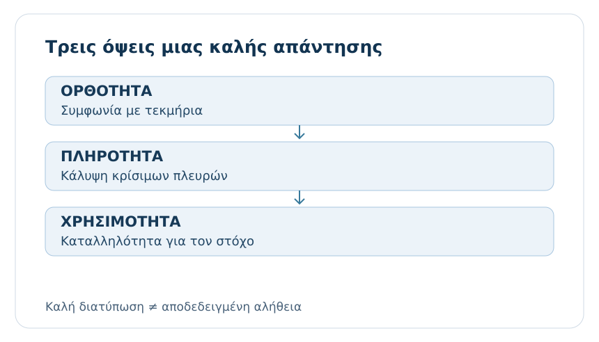
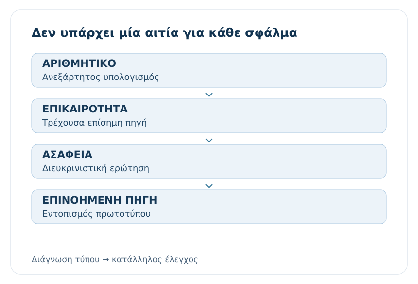
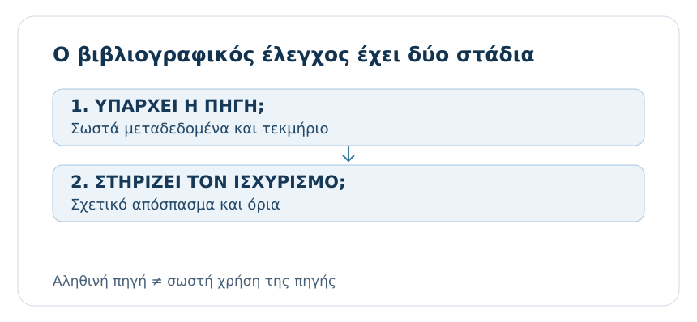
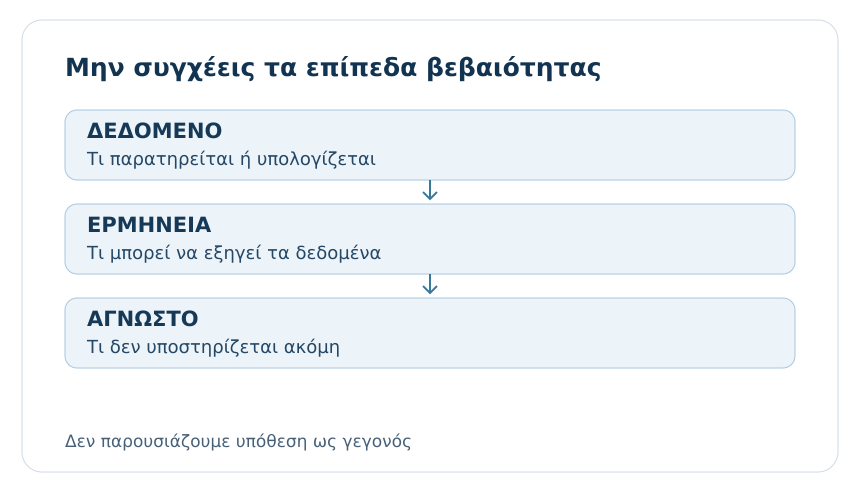
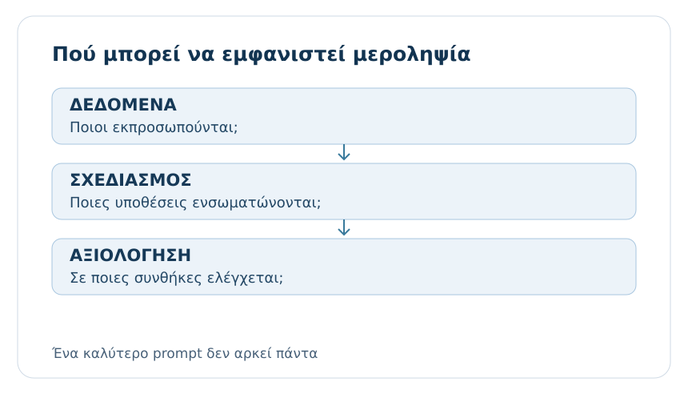
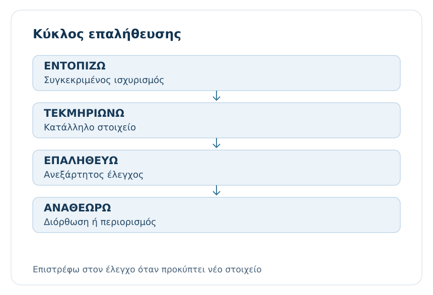

# AL00.6 — Γιατί η Τεχνητή Νοημοσύνη μπορεί να δώσει λανθασμένες απαντήσεις;

> **GeoSkills · AI Learning Core · Ενιαία εκδοτική έκδοση v4.0 · 29/10/2026**
> **Κατάσταση:** τοπικό staging draft v4 · 29/10/2026. **Υπό τεχνική και παιδαγωγική αξιολόγηση· δεν αποτελεί οριστικοποιημένη δημόσια έκδοση.**
> **Απευθύνεται:** σε φοιτητές όλων των επιστημονικών ειδικοτήτων. Δεν απαιτεί γνώσεις προγραμματισμού ή στατιστικής.

## Γιατί υπάρχει αυτό το κεφάλαιο

Στις προηγούμενες ενότητες εξετάσαμε πώς λειτουργούν τα μεγάλα γλωσσικά μοντέλα και πώς διατυπώνουμε αποτελεσματικά αιτήματα. Τώρα θα ασχοληθούμε με ένα δυσκολότερο ερώτημα: **πώς διακρίνουμε μια χρήσιμη, τεκμηριωμένη απάντηση από μια απάντηση που απλώς ακούγεται πειστική;**

Η ΤΝ μπορεί να μας βοηθήσει να κατανοήσουμε έννοιες, να εξασκηθούμε, να οργανώσουμε ιδέες και να εξετάσουμε εναλλακτικές λύσεις. Μπορεί επίσης να κάνει λάθη: να παρανοήσει την ερώτηση, να παραλείψει κρίσιμους περιορισμούς, να παρουσιάσει ανακριβείς πληροφορίες ή να αναφέρει πηγές που δεν υπάρχουν. Το πρόβλημα δεν λύνεται ούτε με τυφλή εμπιστοσύνη ούτε με γενική απόρριψη της ΤΝ. Χρειάζεται μια **μέθοδος ελέγχου ανάλογη με τον κίνδυνο**.

### Μαθησιακά αποτελέσματα

Μετά την ολοκλήρωση της AL00.6 θα μπορείς:

1. Να εξηγείς γιατί η γλωσσική ευχέρεια ή η βεβαιότητα δεν αποδεικνύει την ορθότητα μιας απάντησης.
2. Να ξεχωρίζεις διαφορετικούς τύπους σφάλματος: πραγματολογική ανακρίβεια, αυθαίρετο συμπέρασμα, παρανόηση, ατελή κάλυψη, επινοημένη παραπομπή και μεροληψία.
3. Να αναγνωρίζεις τι μπορεί να ελεγχθεί με το παρεχόμενο υλικό και πότε απαιτείται ανεξάρτητη πηγή.
4. Να αποφεύγεις τη μετατροπή ανεπιβεβαίωτων ισχυρισμών σε «γεγονότα» μέσα σε εργασίες.
5. Να εφαρμόζεις μια πρακτική διαδικασία εντοπισμού, επαλήθευσης και αναθεώρησης προβληματικών απαντήσεων.
6. Να προσαρμόζεις το βάθος ελέγχου στη σημασία της απόφασης και να περιγράφεις τα όρια όσων επαλήθευσες.

**Προαπαιτούμενα:** οι βασικές ιδέες της AL00.4 για την παραγωγή κειμένου και της AL00.5 για τα αιτήματα και τα συμφραζόμενα. Δεν θα επαναδιδαχθούν εδώ.

**Κεντρικό μαθησιακό νήμα:** ένας φοιτητής ζητά βοήθεια για μια μικρή πανεπιστημιακή εργασία σχετικά με τον ύπνο και τη συγκέντρωση. Καθώς λαμβάνει απαντήσεις, ανακαλύπτει πόσο εύκολο είναι να περάσει από ένα εύλογο επιχείρημα σε ένα ατεκμηρίωτο συμπέρασμα. Το σενάριο είναι **συνθετικό εκπαιδευτικό παράδειγμα**, όχι περιγραφή πραγματικής μελέτης ή σύσταση υγείας.

---

## 6.1 — Μια πειστική απάντηση δεν είναι απαραίτητα σωστή

### 6.1.1 — Η πρώτη εντύπωση μπορεί να μας παραπλανήσει

Φαντάσου ότι προετοιμάζεις μια σύντομη εργασία για τη σχέση ανάμεσα στον ύπνο και τη συγκέντρωση των φοιτητών. Ζητάς από ένα σύστημα ΤΝ: «Πώς επηρεάζει ο ύπνος την απόδοση στη μελέτη;». Λαμβάνεις ένα καλογραμμένο κείμενο, με επιστημονικό λεξιλόγιο, σαφή δομή και συμπέρασμα. Ίσως σου φαίνεται ήδη έτοιμο να μπει στην εργασία σου.

Διάβασε όμως τις δύο ακόλουθες *κατασκευασμένες για την άσκηση* απαντήσεις:

> **Απάντηση Α:** «Ο ύπνος σχετίζεται με λειτουργίες όπως η προσοχή και η μνήμη. Η επίδρασή του στην απόδοση εξαρτάται από πολλούς παράγοντες, επομένως μια εργασία χρειάζεται συγκεκριμένες πηγές για τους ισχυρισμούς της.»
>
> **Απάντηση Β:** «Όλοι οι φοιτητές που κοιμούνται ακριβώς οκτώ ώρες αυξάνουν την επίδοσή τους κατά 35%. Αυτό έχει αποδειχθεί οριστικά σε κάθε επιστημονικό πεδίο.»

Η Β φαίνεται ακριβής επειδή περιλαμβάνει αριθμό και κατηγορηματική διατύπωση. Ακριβώς όμως αυτές οι λέξεις —«όλοι», «ακριβώς», «οριστικά», «σε κάθε»— μας δίνουν λόγο να ζητήσουμε τεκμηρίωση. Το ποσοστό **35% είναι σκόπιμα επινοημένο για τη δραστηριότητα** και δεν πρέπει να επαναχρησιμοποιηθεί ως εμπειρικό εύρημα.

Η Α δεν είναι αυτόματα αληθής επειδή είναι επιφυλακτική. Είναι όμως πιο κατάλληλη αφετηρία, γιατί δεν εμφανίζει αβέβαιες λεπτομέρειες ως αποδείξεις. Για να χρησιμοποιήσουμε οποιονδήποτε πραγματολογικό ισχυρισμό, πρέπει να ελέγξουμε τη βιβλιογραφία που τον υποστηρίζει.

**Σκέψου πριν προχωρήσεις:** Ποιο στοιχείο της Β θα σε έκανε να εμπιστευτείς την απάντηση; Είναι το ίδιο στοιχείο που θα έπρεπε να σε κάνει πιο προσεκτικό;

::: {dropdown} Ενδεικτική απάντηση
Ο συγκεκριμένος αριθμός μπορεί να δημιουργήσει αίσθηση ακρίβειας. Χωρίς ταυτοποιήσιμη μελέτη, όμως, δεν είναι τεκμήριο. Οι απόλυτοι ισχυρισμοί είναι ιδιαίτερα δύσκολο να υποστηριχθούν.
:::

### 6.1.2 — Ορθότητα, πληρότητα και χρησιμότητα είναι διαφορετικά κριτήρια

Μια απάντηση μπορεί να είναι σωστή αλλά ακατάλληλη για τον σκοπό μας. Αν ρωτήσουμε «Τι είναι μια μεταβλητή;» και λάβουμε ακριβή αλλά εξαιρετικά σύνθετη εξήγηση για προχωρημένους ερευνητές, ίσως δεν μας βοηθά να μάθουμε. Αντίστροφα, μια ευχάριστη και απλή εξήγηση μπορεί να παραλείπει μια κρίσιμη εξαίρεση.

Χρειάζεται λοιπόν να ξεχωρίζουμε τουλάχιστον τρεις ερωτήσεις:

- **Είναι ο ισχυρισμός σωστός;** Συμφωνεί με τα διαθέσιμα τεκμήρια;
- **Είναι η απάντηση επαρκής;** Καλύπτει τις πλευρές που ζητήσαμε, χωρίς κρίσιμες παραλείψεις;
- **Είναι χρήσιμη για τη δουλειά μου;** Ταιριάζει στο επίπεδο γνώσεων, στην εργασία και στους περιορισμούς μου;

Σκέψου έναν φοιτητή Νομικής που ζητά γενική επεξήγηση ενός νομικού όρου. Μια σωστή γενική περιγραφή δεν επαρκεί απαραίτητα για συγκεκριμένη υπόθεση ή ισχύον δίκαιο. Αντίστοιχα, ένας φοιτητής Μηχανικής δεν πρέπει να θεωρήσει ασφαλή μια τεχνική οδηγία απλώς επειδή παρουσιάζεται με ωραία βήματα. Η χρησιμότητα και η ορθότητα αξιολογούνται χωριστά.

### 6.1.3 — Τα προειδοποιητικά σημάδια

Ενδείξεις που δικαιολογούν επιπλέον έλεγχο είναι η υπερβολική βεβαιότητα χωρίς πηγή, η χρήση ακριβών ποσοστών χωρίς αναφορά μεθόδου, οι γενικεύσεις τύπου «πάντα» και «ποτέ», η αναφορά σε «επιστήμονες» χωρίς ονόματα ή μελέτες και οι παραπομπές που δεν μπορούν να εντοπιστούν. Επίσης, μια απάντηση μπορεί να χρησιμοποιεί σωστούς τεχνικούς όρους αλλά να συνδέει λανθασμένα τα βήματα ενός επιχειρήματος.

Αυτά είναι **σημάδια ελέγχου, όχι αυτόματες αποδείξεις σφάλματος**. Μια ακριβής αριθμητική τιμή μπορεί να είναι απολύτως έγκυρη, όταν προκύπτει από επαληθεύσιμο υπολογισμό ή αξιόπιστη πηγή.

**Δραστηριότητα — επισήμανση ισχυρισμών.** Στο κείμενο «Έρευνες απέδειξαν ότι κάθε φοιτητής που μελετά με μουσική αποδίδει καλύτερα, κατά 22%, ανεξάρτητα από το μάθημα», υπογράμμισε τα σημεία που χρειάζονται τεκμηρίωση. Για καθένα γράψε ποια πληροφορία θα ζητούσες: τον πληθυσμό, τον τρόπο μέτρησης, την πηγή ή τον ορισμό της «απόδοσης».

::: {dropdown} Ενδεικτική ανατροφοδότηση
Ελέγχουμε την ύπαρξη των «ερευνών», τη γενίκευση «κάθε», το ποσοστό 22%, τον ορισμό της «καλύτερης απόδοσης» και το «ανεξάρτητα από το μάθημα». Ο αριθμός είναι επινοημένος για την άσκηση.
:::

#### Εργασμένο παράδειγμα — όταν το λάθος δεν φαίνεται αμέσως

Δύο ενδεικτικές απαντήσεις σε φοιτητή που ρωτά αν οι διαδικτυακές διαλέξεις βελτιώνουν τη μάθηση χρησιμοποιούν εξίσου προσεκτικό ύφος.

**Απάντηση Α:** «Η αποτελεσματικότητα μιας διαδικτυακής διάλεξης εξαρτάται, μεταξύ άλλων, από τον σχεδιασμό της, την αλληλεπίδραση, το μαθησιακό αντικείμενο και την πρόσβαση των φοιτητών. Για να συγκρίνουμε μορφές διδασκαλίας, χρειάζεται να προσδιορίσουμε τι μετράμε ως μάθηση και ποιες ομάδες συγκρίνουμε. Μια προσωπική εμπειρία μπορεί να είναι χρήσιμη, αλλά δεν αρκεί για γενικό συμπέρασμα».

**Απάντηση Β:** «Οι διαδικτυακές διαλέξεις μπορούν να είναι αποτελεσματικές, ειδικά όταν συνοδεύονται από αλληλεπίδραση και ανατροφοδότηση. Συνεπώς, αν ένα τμήμα αναφέρει αυξημένη ικανοποίηση μετά τη μετάβαση στο διαδίκτυο, έχει επιβεβαιωθεί ότι οι φοιτητές έμαθαν περισσότερα. Η ικανοποίηση αποτελεί αξιόπιστη ένδειξη της ποιότητας της διδασκαλίας».

Και οι δύο απαντήσεις ακούγονται μετρημένες. Η δεύτερη όμως εισάγει μια **μη δικαιολογημένη μετάβαση**: από την αναφερόμενη ικανοποίηση σε συμπέρασμα για μαθησιακή επίδοση. Οι δύο έννοιες μπορούν να σχετίζονται, αλλά δεν είναι το ίδιο μέτρο. Ακόμη κι αν ένα ερωτηματολόγιο ικανοποίησης είναι αξιόπιστο, δεν αποτελεί αυτομάτως μέτρηση απόκτησης γνώσεων.

**Δοκίμασε πριν διαβάσεις την εξήγηση:** Υπογράμμισε στην Α μία πρόταση που δηλώνει όριο και στη Β τη φράση όπου γίνεται άλμα από δεδομένο σε συμπέρασμα. Έπειτα γράψε τη μικρότερη δυνατή διόρθωση της Β.

::: {dropdown} Ενδεικτική αναθεώρηση
«Η αυξημένη ικανοποίηση των φοιτητών αποτελεί εύρημα για την εμπειρία τους, όχι από μόνη της απόδειξη καλύτερης μάθησης. Για να εκτιμηθεί η μάθηση χρειάζονται κατάλληλα μαθησιακά μέτρα και σύγκριση υπό ελεγχόμενες συνθήκες». Δεν χρειάζεται να απορρίψουμε το σωστό πρώτο μέρος της απάντησης.
:::

Το δεύτερο παράδειγμα δείχνει ότι ο έλεγχος δεν βασίζεται μόνο σε εντυπωσιακούς αριθμούς ή απόλυτες λέξεις. Μερικές φορές το ουσιαστικό σφάλμα βρίσκεται στη σχέση ανάμεσα σε μια παρατήρηση και το συμπέρασμα που της αποδίδουμε.

### 6.1.4 — Μικρός αυτοέλεγχος

Διάλεξε ποια διατύπωση εκφράζει καλύτερα έναν υπεύθυνο τρόπο χρήσης της ΤΝ: (α) «Αν είναι καλογραμμένο, το χρησιμοποιώ», (β) «Αν έχει αριθμούς, είναι επιστημονικό», (γ) «Αναγνωρίζω τον ισχυρισμό και ελέγχω ό,τι χρειάζεται πριν τον χρησιμοποιήσω». Αιτιολόγησε με ένα δικό σου παράδειγμα.

::: {dropdown} Ενδεικτική απάντηση
Η (γ). Η ποιότητα της διατύπωσης δεν αντικαθιστά την επαλήθευση, ιδιαίτερα όταν ένα κείμενο χρησιμοποιείται ως τεκμήριο σε εργασία ή για λήψη αποφάσεων.
:::

<a href="/al00_6_q1.html" target="_blank" rel="noopener" onclick="const u=new URL(this.href,window.location.href);u.searchParams.set('return',window.location.href);this.href=u.href;">Άνοιγμα δραστηριότητας ελέγχου AL00.6 σε νέα καρτέλα</a>

---

## 6.2 — Γιατί προκύπτουν λάθη στα συστήματα ΤΝ

### 6.2.1 — Το μοντέλο παράγει απαντήσεις, δεν πραγματοποιεί αυτόματα έλεγχο γεγονότων

Όπως είδαμε στην AL00.4, ένα γλωσσικό μοντέλο παράγει περιεχόμενο με βάση πρότυπα που έχει μάθει και το διαθέσιμο πλαίσιο της συνομιλίας. Αυτό του επιτρέπει να διατυπώνει ευέλικτες εξηγήσεις και να συνδέει πληροφορίες. Δεν σημαίνει όμως ότι κάθε πρόταση περνά αυτομάτως από ανεξάρτητο έλεγχο ορθότητας.

Το γεγονός ότι μια πρόταση *μοιάζει* με πρόταση επιστημονικού άρθρου δεν συνεπάγεται ότι περιγράφει πραγματική μελέτη. Αν ο χρήστης ζητήσει κάτι πολύ ειδικό, το μοντέλο μπορεί να παράγει μια εύλογη αλλά ανακριβή απάντηση, ιδίως όταν δεν διαθέτει αρκετά τεκμήρια. Ούτε η μεγαλύτερη έκταση ούτε οι περισσότεροι τεχνικοί όροι λειτουργούν ως απόδειξη.

**Παράδειγμα:** «Ποιος είναι ο αριθμός της σελίδας όπου ο συγκεκριμένος συγγραφέας αναφέρει αυτόν τον ορισμό;». Αν δεν έχει δοθεί το ίδιο το βιβλίο ή προσβάσιμη πηγή, το σύστημα ενδέχεται να μην έχει τα στοιχεία για ακριβή απάντηση. Η κατάλληλη ανταπόκριση μπορεί να είναι να ζητήσει το βιβλίο ή να πει ότι δεν μπορεί να επιβεβαιώσει τη σελίδα.

### 6.2.2 — Περιορισμοί και ποιότητα των πληροφοριών

Τα δεδομένα στα οποία βασίζεται ένα μοντέλο ή τα τεκμήρια που λαμβάνει κατά τη συνομιλία μπορεί να είναι ελλιπή, παρωχημένα, αντιφατικά ή ακατάλληλα για το ερώτημα. Μερικές φορές δεν υπάρχουν αρκετές πληροφορίες για να απαντήσουμε με ασφάλεια — ακόμη κι αν το ερώτημα είναι πολύ καλά γραμμένο.

Ας υποθέσουμε ότι ζητάμε: «Ποια είναι η ισχύουσα προθεσμία υποβολής της αίτησης στο πανεπιστήμιό μου;». Η απάντηση μπορεί να εξαρτάται από πρόσφατη ανακοίνωση, διαφορετικό τμήμα ή τρέχον ακαδημαϊκό έτος. Μια παλαιότερη γενική απάντηση μπορεί να είναι παραπλανητική. Για ζητήματα που αλλάζουν, χρειαζόμαστε την **αρμόδια και πρόσφατη επίσημη πηγή**.

Η ύπαρξη πρόσβασης σε αναζήτηση δεν αποτελεί εγγύηση: πρέπει να εξετάζουμε τι βρέθηκε, ποια είναι η ημερομηνία, σε ποιον οργανισμό αναφέρεται και αν πράγματι υποστηρίζει το συμπέρασμα.

### 6.2.3 — Ασάφεια της ερώτησης και λανθασμένες υποθέσεις

Συχνά το πρόβλημα αρχίζει από ένα ερώτημα με περισσότερες από μία εύλογες ερμηνείες. «Πόσο κοστίζει το πρόγραμμα;» μπορεί να αναφέρεται σε αγορά λογισμικού, συνδρομή, υπηρεσία ή εκπαιδευτικό πρόγραμμα. Αν το μοντέλο επιλέξει μία εκδοχή χωρίς να το δηλώσει, ίσως δώσει άχρηστη ή παραπλανητική απάντηση.

Η ασάφεια δεν οφείλεται πάντοτε στον χρήστη. Ακόμη και ένα αρκετά σαφές αίτημα μπορεί να περιέχει όρους με διαφορετική σημασία ανά ειδικότητα. Για παράδειγμα, «μοντέλο» σημαίνει διαφορετικά πράγματα στη στατιστική, στην αρχιτεκτονική και στη μηχανική μάθηση.

**Μικρή εφαρμογή:** Δώσε δύο διαφορετικές ερμηνείες της ερώτησης «Ποια είναι η καλύτερη μέθοδος αξιολόγησης;». Πρόσθεσε ένα διευκρινιστικό ερώτημα που θα έπρεπε να προηγηθεί.

::: {dropdown} Ενδεικτική απάντηση
Μπορεί να αφορά αξιολόγηση φοιτητών ή αξιολόγηση ενός αλγορίθμου. Κατάλληλη διευκρίνιση: «Για ποιο αντικείμενο, με ποιον στόχο και με ποια διαθέσιμα δεδομένα ή κριτήρια;»
:::

### 6.2.4 — Λάθη λογικής, υπολογισμών και ακολουθίας βημάτων

Ακόμη και αν κάθε πρόταση μιας απάντησης μοιάζει εύλογη, το συμπέρασμα μπορεί να μη συνάγεται από τις προκείμενες. Ένα μοντέλο μπορεί να κάνει αριθμητικό λάθος, να παραλείψει μονάδες, να συγκρίνει ανόμοια μεγέθη ή να χρησιμοποιήσει μια ακατάλληλη μέθοδο.

**Παράδειγμα ελέγχου:** Ένας φοιτητής υπολογίζει τον μέσο όρο των βαθμών 6, 8 και 10. Η απάντηση «9» είναι λανθασμένη: το άθροισμα είναι 24, οι τιμές τρεις και ο μέσος όρος 8. Η επαλήθευση δεν απαιτεί να γνωρίζουμε πώς ακριβώς το μοντέλο έκανε το λάθος. Αρκεί να εκτελέσουμε ανεξάρτητα τον υπολογισμό.

Σε σύνθετες πράξεις χρησιμοποιούμε κατάλληλο λογισμικό ή αριθμομηχανή, ελέγχουμε εισόδους και μονάδες και δεν εκλαμβάνουμε το επεξηγηματικό κείμενο του μοντέλου ως μαθηματική απόδειξη.

#### Διαγνωστικό περιστατικό — το ίδιο ερώτημα, τέσσερα διαφορετικά προβλήματα

Ένας φοιτητής δίνει στην ΤΝ ένα **συνθετικό** αρχείο με αποτελέσματα εργαστηριακών δοκιμών: 8, 10, 12 και 14 μονάδες. Ζητά: «Ποιος είναι ο μέσος όρος και τι συμπεραίνουμε;». Οι ακόλουθες απαντήσεις είναι παραδείγματα διαφορετικών μηχανισμών σφάλματος, όχι πραγματικές έξοδοι μοντέλων.

| Απάντηση | Τι συνέβη | Κατάλληλος επόμενος έλεγχος |
|---|---|---|
| «Ο μέσος όρος είναι 12» | Λάθος υπολογισμός: το άθροισμα είναι 44 και ο μέσος όρος 11 | Ανεξάρτητη αριθμητική πράξη |
| «Ο μέσος όρος 11 αποδεικνύει ότι η νέα μέθοδος είναι αποτελεσματική» | Σωστός αριθμός, ατεκμηρίωτη ερμηνεία χωρίς ομάδα σύγκρισης | Εξέταση ερευνητικού σχεδιασμού |
| «Σύμφωνα με τον πίνακα, μετρήθηκαν 14 δείγματα» | Ανάγνωση της τελευταίας τιμής ως πλήθος εγγραφών | Επιστροφή στο δοσμένο πρωτότυπο |
| «Η μέτρηση έγινε με πιστοποιημένο όργανο ακρίβειας 0,01» | Επινοημένη λεπτομέρεια που δεν περιέχεται στο αρχείο | Ζήτηση μεταδεδομένων, αποφυγή επινόησης |

Η διάκριση έχει πρακτική αξία: ένας αριθμομηχανικός έλεγχος λύνει το πρώτο πρόβλημα, όχι όμως τα άλλα τρία. Αντίστοιχα, η επιβεβαίωση ότι ο μέσος όρος είναι 11 δεν μας επιτρέπει να θεωρήσουμε τεκμηριωμένο το συμπέρασμα περί αποτελεσματικότητας. **Η ορθότητα ενός τμήματος της απάντησης δεν μεταφέρεται αυτομάτως στα υπόλοιπα.**

**Άσκηση αντιστοίχισης:** Για κάθε γραμμή σημείωσε ποιο πρόσθετο στοιχείο θα ζητούσες από τον φοιτητή ή το σύστημα. Η λύση πρέπει να αναφέρει *τι εξετάζεις* και όχι απλώς «θα το ξαναρωτούσα».

::: {dropdown} Ενδεικτική ανατροφοδότηση
Για την αποτελεσματικότητα χρειάζεται πληροφορία για σύγκριση ή κατάλληλο πείραμα. Για το πλήθος απαιτείται καταμέτρηση εγγραφών. Για το όργανο χρειάζονται πραγματικά μεταδεδομένα μέτρησης. Καμία νέα απάντηση του ίδιου chatbot δεν αντικαθιστά μόνη της αυτά τα τεκμήρια.
:::

Οι περιπτώσεις που μόλις εξετάσαμε έχουν διαφορετικές αιτίες. Γι’ αυτό η επόμενη ερώτηση δεν είναι απλώς «Πώς διορθώνω μια απάντηση;», αλλά «Ποιος έλεγχος ταιριάζει στο συγκεκριμένο σφάλμα;».

### 6.2.5 — Διαφορετικά λάθη χρειάζονται διαφορετική αντιμετώπιση

Δεν διορθώνονται όλα με «γράψε καλύτερο prompt». Αν λείπει επίσημη πηγή, χρειάζεται αναζήτηση ή πρωτογενές τεκμήριο. Αν είναι λανθασμένος ένας υπολογισμός, χρειάζεται ανεξάρτητη εκτέλεση. Αν το μοντέλο παρερμήνευσε τον σκοπό, χρειάζεται διευκρίνιση. Αν μια απάντηση είναι μεροληπτική, χρειάζεται εξέταση των υποθέσεων και των διαφορετικών σχετικών οπτικών.

**Δραστηριότητα ταξινόμησης:** Ταξινόμησε τις ακόλουθες περιπτώσεις: (Α) λανθασμένος μέσος όρος, (Β) προθεσμία περυσινής ανακοίνωσης ως τρέχουσα, (Γ) απάντηση για λάθος νόημα της λέξης «μοντέλο», (Δ) επινοημένο άρθρο. Για καθεμία πρότεινε διαφορετικό έλεγχο.

::: {dropdown} Ενδεικτική απάντηση
Α: ανεξάρτητος υπολογισμός. Β: τρέχουσα επίσημη ανακοίνωση. Γ: αποσαφήνιση συμφραζομένων. Δ: αναζήτηση της ακριβούς βιβλιογραφικής εγγραφής και έλεγχος του πραγματικού τεκμηρίου.
:::

---

## 6.3 — Κατασκευασμένες πληροφορίες και βιβλιογραφικές αναφορές

### 6.3.1 — Τι σημαίνει «κατασκευασμένη πληροφορία»

Μερικές φορές ένα σύστημα ΤΝ παράγει πληροφορία που δεν στηρίζεται στα πραγματικά δεδομένα: ένα ανύπαρκτο γεγονός, μια λανθασμένη ιδιότητα, μια ψευδή λεπτομέρεια ή μια πηγή που δεν μπορεί να εντοπιστεί. Στη συζήτηση για τα γλωσσικά μοντέλα αυτό συχνά ονομάζεται *hallucination*. Στο μάθημά μας θα χρησιμοποιούμε κυρίως τον περιγραφικό όρο **μη τεκμηριωμένη ή κατασκευασμένη πληροφορία**, επειδή περιγράφει καλύτερα αυτό που πρέπει να ελέγξουμε.

Η διαφορά ανάμεσα σε «δεν γνωρίζω» και «δημιουργώ μια πιθανή απάντηση» είναι κρίσιμη. Για δημιουργική γραφή, η επινόηση είναι επιθυμητή όταν έχει ζητηθεί. Για βιβλιογραφική ανασκόπηση ή επιστημονική τεκμηρίωση, η επινόηση στοιχείων είναι σφάλμα.

### 6.3.2 — Μια παραπομπή που μοιάζει πραγματική

Ένας φοιτητής ζητά: «Δώσε μου τρεις επιστημονικές πηγές για τη χρήση ΤΝ στη μελέτη». Το σύστημα παρουσιάζει μια εγγραφή με ονόματα συγγραφέων, χρονολογία, τίτλο περιοδικού, τόμο και σελίδες. Η μορφή μπορεί να μοιάζει απόλυτα ακαδημαϊκή. Αυτό δεν αποδεικνύει ότι το άρθρο υπάρχει.

**Εξ ολοκλήρου φανταστική εγγραφή για εξάσκηση — όχι πραγματική βιβλιογραφία:**

> Papadopoulos, N. & Rivera, L. (2025). *Perfect Learning with AI: Universal Gains in Every University Course*. Journal of Guaranteed Education, 99(9), 999–1009.

Η εγγραφή είναι **ρητά επινοημένη**, ώστε να εξασκηθούμε στον έλεγχο και όχι να τη χρησιμοποιήσουμε. Δεν αρκεί να ελέγξουμε αν «ακούγεται πιθανή». Χρειαζόμαστε έναν πραγματικό εκδότη ή αποθετήριο, αναζητήσιμο τίτλο, ορθά στοιχεία και πρόσβαση στο τεκμήριο όταν είναι διαθέσιμο.

#### Δούλεψε με δύο διαφορετικά σφάλματα παραπομπών

Μια αναφορά μπορεί να είναι λανθασμένη με τουλάχιστον δύο τρόπους. Στην πρώτη περίπτωση **δεν υπάρχει το τεκμήριο**: τίτλος, περιοδικό ή συγγραφείς έχουν κατασκευαστεί. Στη δεύτερη περίπτωση το άρθρο **υπάρχει**, αλλά τα στοιχεία του έχουν μεταφερθεί λανθασμένα: άλλο έτος, άλλος τίτλος, λανθασμένο DOI ή λανθασμένη απόδοση συμπεράσματος. Η δεύτερη περίπτωση είναι πιο ύπουλη, γιατί η αναζήτηση μπορεί να επιστρέψει πράγματι κάποιο σχετικό αποτέλεσμα.

**Μικρό παράδειγμα (συνθετικό):** Η απάντηση γράφει «Η μελέτη Α έδειξε ότι το 90% των φοιτητών βελτίωσε τη μάθησή του». Ακόμη και αν βρεθεί μελέτη Α, πρέπει να διαπιστώσουμε: τι μετρούσε ως «βελτίωση», ποιοι συμμετείχαν, αν το 90% αφορά τους ίδιους τους συμμετέχοντες ή κάποιο διαφορετικό μέτρο και αν η μελέτη ήταν πειραματική. Ο αριθμός 90% εδώ είναι αποκλειστικά στοιχείο της επινοημένης άσκησης.

**Έλεγξε τον εαυτό σου:** Έχεις βρει τον τίτλο και τους συγγραφείς ενός άρθρου. Αρκεί αυτό για να χρησιμοποιήσεις στην εργασία σου ένα συγκεκριμένο ποσοστό που αποδίδει η ΤΝ στο άρθρο; **Όχι.** Χρειάζεται να εντοπίσεις το αντίστοιχο σημείο του πρωτοτύπου και να ελέγξεις τι μετρήθηκε, σε ποια ομάδα και υπό ποιους περιορισμούς.

### 6.3.3 — Το ότι υπάρχει ένα άρθρο δεν σημαίνει ότι λέει αυτό που ισχυρίζεται η ΤΝ

Υπάρχουν δύο διαφορετικοί έλεγχοι:

**Έλεγχος ύπαρξης:** Είναι πραγματικό το τεκμήριο; Ταυτίζονται τίτλος, συγγραφείς, έτος, περιοδικό, αναγνωριστικό και σύνδεσμος;

**Έλεγχος συνάφειας και στήριξης:** Το τεκμήριο λέει πράγματι αυτό που αποδίδει σε αυτό η απάντηση; Αφορά τον ίδιο πληθυσμό, την ίδια μέθοδο, το ίδιο αποτέλεσμα και τους ίδιους περιορισμούς;

Ένα άρθρο μπορεί να αφορά μικρό δείγμα, προκαταρκτική διερεύνηση ή διαφορετική ομάδα συμμετεχόντων. Δεν μπορούμε να μετατρέψουμε αυτόματα ένα περιορισμένο εύρημα σε καθολικό συμπέρασμα.

**Εφαρμογή:** Το σύστημα γράφει «Η μελέτη Χ αποδεικνύει ότι κάθε φοιτητής μαθαίνει καλύτερα με ΤΝ». Βρίσκεις τη μελέτη, αλλά διαπιστώνεις ότι εξέτασε μόνο μια μικρή ομάδα σε ένα συγκεκριμένο μάθημα. Ποιο είναι το λάθος;

::: {dropdown} Ενδεικτική απάντηση
Το τεκμήριο μπορεί να υπάρχει, αλλά η γενίκευση «κάθε φοιτητής» δεν δικαιολογείται. Χρειάζεται πιστή περιγραφή πληθυσμού, μεθόδου, ευρημάτων και περιορισμών.
:::

### 6.3.4 — Μια πρακτική διαδικασία βιβλιογραφικού ελέγχου

Όταν η ΤΝ προτείνει πηγή, μην ξεκινάς αντιγράφοντάς την στη βιβλιογραφία. Κατάγραψε τον ισχυρισμό που θέλεις να υποστηρίξεις. Αναζήτησε την εγγραφή σε κατάλληλο βιβλιογραφικό κατάλογο, εκδότη, επιστημονική βάση ή αποθετήριο. Επιβεβαίωσε τα μεταδεδομένα. Διάβασε τουλάχιστον το σχετικό μέρος του πρωτοτύπου και, όπου είναι αναγκαίο, τη μεθοδολογία. Μόνο τότε κρίνεις αν μπορεί να στηρίξει το συγκεκριμένο σημείο της εργασίας σου.

Οι αναγνωριστικοί αριθμοί, όπως DOI, μπορεί να βοηθήσουν στην ταυτοποίηση, αλλά πρέπει και αυτοί να επαληθεύονται. Η ύπαρξη DOI δεν εγγυάται την ποιότητα ενός άρθρου ούτε ότι υποστηρίζει κάθε ισχυρισμό που του αποδίδεται.

#### Παράδειγμα πλήρους ελέγχου, χωρίς πραγματολογικές υποθέσεις

Έστω ότι λαμβάνεις την πρόταση: «Σύμφωνα με τη μελέτη Χ, η χρήση σημειώσεων με ΤΝ μειώνει στο μισό τον απαιτούμενο χρόνο μελέτης». Η **μελέτη Χ είναι υποθετική** και δεν επιτρέπεται να χρησιμοποιηθεί ως βιβλιογραφία. Η σωστή διαδικασία δεν είναι να συμπληρώσεις μια πιθανή βιβλιογραφική εγγραφή. Γράφεις πρώτα τον ακριβή προς έλεγχο ισχυρισμό: *μείωση χρόνου μελέτης κατά 50%*. Έπειτα αναζητάς πραγματικό τεκμήριο, διαβάζεις τον ορισμό του χρόνου μελέτης, εξετάζεις την ομάδα σύγκρισης, τον αριθμό συμμετεχόντων και τις συνθήκες της έρευνας. Αν δεν βρεις τεκμήριο, αφαιρείς τον αριθμό αντί να τον διατηρήσεις με γενικόλογη φράση «έρευνες δείχνουν».

| Ερώτηση ελέγχου | Τι καταγράφω |
|---|---|
| Υπάρχει η πηγή; | Επαληθευμένος τίτλος, δημιουργός, έτος, εκδότης ή αποθετήριο |
| Τι μετρήθηκε; | Ακριβής μεταβλητή, μονάδα, πληθυσμός και μέθοδος |
| Τι αναφέρει το τεκμήριο; | Το σχετικό απόσπασμα ή παράφρασή του με εντοπισμό θέσης |
| Τι μπορώ να γράψω; | Συμπέρασμα που δεν υπερβαίνει τα ευρήματα |
| Τι μένει ανοικτό; | Περιορισμοί, αβεβαιότητες και ανάγκες πρόσθετης έρευνας |

**Άσκηση σε ζευγάρια:** Ο πρώτος φοιτητής διατυπώνει έναν ισχυρισμό από *πραγματική* πηγή του μαθήματος. Ο δεύτερος τον ελέγχει χωρίς να βλέπει αρχικά την πηγή, ζητώντας συγκεκριμένα στοιχεία. Στη συνέχεια αντιστρέφουν ρόλους και σημειώνουν ποια ερώτηση αποδείχθηκε πιο χρήσιμη. Δεν απαιτείται να χρησιμοποιήσουν ΤΝ για να πραγματοποιήσουν τον έλεγχο.

#### Εργαστήριο ανάγνωσης μιας πηγής — πλήρως αυτοτελές συνθετικό τεκμήριο

Για να κάνουμε τον έλεγχο χωρίς εξωτερική αναζήτηση, χρησιμοποιούμε την παρακάτω **επινοημένη εκπαιδευτική πηγή**. Δεν αποτελεί πραγματική δημοσίευση και δεν επιτρέπεται να αναφερθεί ως αληθινή βιβλιογραφική εγγραφή.

**Φύλλο Πηγής Σ1 (συνθετικό):** Τίτλος: «Σύντομα επαναληπτικά κουίζ και αυτοαξιολόγηση». Δημιουργός: Εκπαιδευτική Ομάδα Παραδείγματος. Έτος: 2026 (εντός του σεναρίου). Είδος: συνθετική αναφορά διδακτικής άσκησης. Σκοπός: σύγκριση επίδοσης σε δοκιμασία μιας μικρής ομάδας μετά από διαφορετικούς τρόπους επανάληψης. Δείγμα: 20 εθελοντές από ένα εισαγωγικό μάθημα. Διαδικασία: οι 10 έκαναν αυτοέλεγχο με κουίζ και οι 10 επανάληψη σημειώσεων. Αποτέλεσμα: μέση βαθμολογία 76/100 και 72/100, αντίστοιχα, σε μία δοκιμασία αμέσως μετά την άσκηση. Δεν αναφέρεται τυχαιοποίηση ούτε μέτρηση μακροχρόνιας διατήρησης γνώσεων.

**Προβληματική απάντηση ΤΝ (επίσης συνθετική):** «Μεγάλη πανεπιστημιακή έρευνα απέδειξε ότι τα κουίζ αυξάνουν κατά 4% τη μακροχρόνια μάθηση όλων των φοιτητών».

Ας κάνουμε τον έλεγχο βήμα προς βήμα. Πρώτον, το τεκμήριο **υπάρχει μόνο ως εκπαιδευτικό φύλλο**· δεν είναι εξωτερική ερευνητική δημοσίευση. Δεύτερον, τα 76 και 72 είναι βαθμολογικές μονάδες: η διαφορά είναι **4 μονάδες στις 100**, όχι αυτονόητα «4% αύξηση της μάθησης». Τρίτον, οι συμμετέχοντες είναι 20, όχι μια μεγάλη αντιπροσωπευτική ομάδα. Τέταρτον, η μέτρηση έγινε αμέσως μετά την άσκηση· δεν υπάρχει αποτέλεσμα μακροχρόνιας διατήρησης. Πέμπτον, η αναφορά δεν τεκμηριώνει αιτιώδη βεβαιότητα ούτε γενίκευση σε όλους.

**Πιστή αναδιατύπωση:** «Στο συνθετικό εκπαιδευτικό σενάριο 20 συμμετεχόντων, η ομάδα αυτοελέγχου είχε κατά 4 βαθμολογικές μονάδες υψηλότερη μέση επίδοση στην άμεση δοκιμασία. Με τα δοσμένα στοιχεία δεν μπορούμε να βγάλουμε γενικό ή μακροχρόνιο αιτιώδες συμπέρασμα». Η διατύπωση διατηρεί όσα προσφέρει η πηγή, χωρίς να της αποδίδει κάτι περισσότερο.

| Σημείο ελέγχου | Τεκμήριο | Απόφαση |
|---|---|---|
| Δύο μέσες βαθμολογίες | 76 και 72 στο φύλλο Σ1 | Διατηρώ, με αναφορά στο συνθετικό σενάριο |
| Αύξηση μακροχρόνιας μάθησης | Δεν υπάρχει μεταγενέστερη μέτρηση | Αφαιρώ |
| Ισχύει για όλους τους φοιτητές | Μόνο 20 εθελοντές ενός μαθήματος | Αφαιρώ τη γενίκευση |
| Αποδείχθηκε αιτιότητα | Δεν δίνεται επαρκής σχεδιασμός | Περιορίζω σε περιγραφική σύγκριση |

**Δική σου προσπάθεια:** Φτιάξε δύο προτάσεις για το ίδιο φύλλο: μία που μπορείς να τεκμηριώσεις και μία που πρέπει να απορρίψεις. Αιτιολόγησε και τις δύο με συγκεκριμένη αναφορά στο δοσμένο κείμενο. Η πλήρης διαδικασία αναζήτησης και αξιολόγησης πραγματικών διαδικτυακών πηγών θα διδαχθεί στην AL00.7.

Το συνθετικό φύλλο πηγής μάς επέτρεψε να ασκηθούμε στην πιστή ανάγνωση χωρίς να προσποιηθούμε ότι πραγματοποιήσαμε πραγματική βιβλιογραφική αναζήτηση. Στην ακαδημαϊκή εργασία απαιτείται και το επόμενο βήμα: έλεγχος της πραγματικής πηγής στο κατάλληλο περιβάλλον.

### 6.3.5 — Διαφορετική αντιμετώπιση σε διαφορετικές εργασίες

Σε εργασία Ιστορίας, μια λανθασμένη χρονολογία μπορεί να αλλάξει την αλληλουχία γεγονότων. Σε εργασία Υγείας, μια κατασκευασμένη θεραπευτική οδηγία μπορεί να έχει πραγματικές συνέπειες. Σε εργασία Οικονομικών, ένας επινοημένος δείκτης μπορεί να οδηγήσει σε άκυρη ανάλυση. Σε εργαστηριακή αναφορά, ένα φανταστικό αποτέλεσμα μέτρησης δεν είναι απλώς ανακρίβεια: αλλοιώνει την ίδια την ερευνητική διαδικασία.

Σε όλα αυτά τα πεδία, η ευθύνη του φοιτητή παραμένει η ίδια: **δεν παρουσιάζουμε ως ελεγμένο κάτι που δεν ελέγξαμε**.

**Δραστηριότητα — κάρτα βιβλιογραφικού ελέγχου:** Για μία πραγματική πηγή που επέλεξες από τη βιβλιογραφία του μαθήματός σου, συμπλήρωσε: πλήρης εγγραφή, επίσημη θέση εντοπισμού, ποιος συγκεκριμένος ισχυρισμός υποστηρίζεται, πού ακριβώς στο κείμενο, και ένας περιορισμός. Μην επινοήσεις δεδομένα που δεν υπάρχουν στο άρθρο.

<a href="/al00_6_q2.html" target="_blank" rel="noopener" onclick="const u=new URL(this.href,window.location.href);u.searchParams.set('return',window.location.href);this.href=u.href;">Άνοιγμα δραστηριότητας βιβλιογραφικού ελέγχου σε νέα καρτέλα</a>

---

## 6.4 — Ελλιπή συμφραζόμενα, παρερμηνείες και αβεβαιότητα

### 6.4.1 — Το ερώτημα μπορεί να μην περιέχει όλα τα απαραίτητα στοιχεία

Στην AL00.5 μάθαμε να δίνουμε χρήσιμα συμφραζόμενα. Εδώ εξετάζουμε το αντίστροφο: τι συμβαίνει όταν μια απάντηση παράγεται χωρίς κρίσιμες πληροφορίες. Αν ζητήσουμε «Σύγκρινε τα αποτελέσματα των δύο ομάδων» χωρίς να δώσουμε τον πίνακα, η ΤΝ δεν έχει πραγματικά αποτελέσματα για σύγκριση. Μια υπεύθυνη απάντηση οφείλει να ζητήσει τα δεδομένα ή να περιγράψει τη μέθοδο σύγκρισης, όχι να κατασκευάσει τιμές.

Το ίδιο ισχύει για μια φράση αποσπασμένη από το συμφραζόμενό της. Χωρίς ολόκληρη παράγραφο μπορεί να παρερμηνεύσουμε ειρωνεία, εξαίρεση, άρνηση ή τον ορισμό ενός τεχνικού όρου.

### 6.4.2 — Το συμπέρασμα πρέπει να συμφωνεί με τα δεδομένα που δώσαμε

Ακολουθεί **συνθετικό μικρό dataset**, μόνο για εκπαιδευτική χρήση:

| Συμμετέχων | Ώρες μελέτης | Βαθμολογία |
|---|---:|---:|
| Α | 1 | 60 |
| Β | 2 | 70 |
| Γ | 3 | 75 |
| Δ | 4 | 85 |

Ένα μοντέλο μπορεί να σχολιάσει ότι σε αυτές τις τέσσερις εγγραφές οι περισσότερες ώρες μελέτης συνυπάρχουν με υψηλότερη βαθμολογία. **Δεν μπορεί να τεκμηριώσει αιτιότητα**, να γενικεύσει σε όλους τους φοιτητές ή να συμπεράνει ότι κάθε επιπλέον ώρα προκαλεί συγκεκριμένη αύξηση, χωρίς κατάλληλη μελέτη.

**Ερώτηση:** Ποια από τις δύο διατυπώσεις είναι συνεπής με τα στοιχεία; «Οι περισσότερες ώρες προκαλούν υψηλότερο βαθμό για κάθε φοιτητή» ή «Στο συγκεκριμένο μικρό δείγμα εμφανίζεται θετική σχέση»;

::: {dropdown} Ενδεικτική απάντηση
Η δεύτερη. Το δείγμα είναι μικρό και συνθετικό. Δεν τεκμηριώνεται ούτε αιτιότητα ούτε δυνατότητα γενίκευσης.
:::

#### Γιατί η αύξηση στον πίνακα δεν επιτρέπει πρόβλεψη για έναν νέο φοιτητή

Ο πίνακας δείχνει τέσσερα ζεύγη τιμών, όχι μια ερευνητική μελέτη αντιπροσωπευτικού πληθυσμού. Μπορούμε να περιγράψουμε τις τέσσερις παρατηρήσεις, να υπολογίσουμε τη μέση βαθμολογία και να εξετάσουμε τη σχέση των τιμών. Δεν γνωρίζουμε, όμως, την προέλευση των δεδομένων, αν οι συμμετέχοντες είχαν ίδιες συνθήκες εξετάσεων, αν η δυσκολία των μαθημάτων ήταν συγκρίσιμη ή αν άλλοι παράγοντες επηρέασαν το αποτέλεσμα.

Αν η ΤΝ απαντήσει «με πέντε ώρες μελέτης ο επόμενος φοιτητής θα πάρει 95», έχει δημιουργήσει μια **πρόβλεψη χωρίς τεκμηριωμένο μοντέλο**. Ακόμη και ένα αριθμητικό μοντέλο που προσαρμόζεται τέλεια σε λίγα σημεία μπορεί να έχει κακή απόδοση σε νέα δεδομένα. Δεν χρειάζεται να ξέρουμε προχωρημένη στατιστική για να καταλάβουμε τη διάκριση ανάμεσα στην περιγραφή τεσσάρων εγγραφών και στη γενίκευση σε άγνωστες περιπτώσεις.

**Δοκίμασε:** Πρόσθεσε υποθετικά πέμπτη εγγραφή με πέντε ώρες μελέτης και βαθμό 65. Τι αλλάζει; Η προηγούμενη διαπίστωση για τις τέσσερις πρώτες εγγραφές παραμένει σωστή, αλλά η απλή γενίκευση για «πάντα υψηλότερη βαθμολογία» διαψεύδεται. Το νέο σημείο είναι αποκλειστικά διδακτικό, όχι πραγματική μέτρηση.

### 6.4.3 — Όταν υπάρχουν πολλαπλές ερμηνείες

Η ίδια παρατήρηση μπορεί να έχει περισσότερες εξηγήσεις. Αν η απάντηση της ΤΝ επιλέξει μία χωρίς να παρουσιάσει τις εναλλακτικές, κινδυνεύουμε να αποκτήσουμε ψευδή αίσθηση βεβαιότητας.

Για παράδειγμα, μια πτώση στις απαντήσεις ενός ερωτηματολογίου μπορεί να οφείλεται σε μειωμένο ενδιαφέρον, τεχνικό πρόβλημα, αλλαγή στη διατύπωση ή στον χρόνο αποστολής. Αν δεν έχουμε επιπλέον στοιχεία, δεν είναι έντιμο να παρουσιάζουμε μία αιτία ως δεδομένη.

Ένα καλύτερο αίτημα θα ήταν: «Δώσε δύο ή τρεις εύλογες εξηγήσεις για το εύρημα και πες μου ποια πρόσθετα δεδομένα θα χρειαζόμουν για να τις διακρίνω». Η απάντηση που θα λάβουμε παραμένει προς έλεγχο, αλλά τουλάχιστον δεν συγχέει την υπόθεση με τη διαπίστωση.

### 6.4.4 — Πώς διατυπώνουμε την αβεβαιότητα

Η αβεβαιότητα δεν είναι αδυναμία. Είναι χαρακτηριστικό μιας ακριβούς απάντησης όταν τα στοιχεία έχουν όρια. Μπορούμε να ξεχωρίζουμε:

- **Επιβεβαιωμένο:** στηρίζεται σε συγκεκριμένο τεκμήριο ή επαληθεύσιμο υπολογισμό.
- **Πιθανή ερμηνεία:** συμβατή με τα δεδομένα, αλλά όχι η μόνη δυνατή.
- **Άγνωστο ή μη ελεγμένο:** δεν διαθέτουμε επαρκή στοιχεία.

Οι κατηγορίες αυτές δεν είναι ποσοστά πιθανότητας. Δεν δίνουμε αυθαίρετα «95% βεβαιότητα» απλώς επειδή το ζητά ο χρήστης. Όταν μια ποσοτική εκτίμηση απαιτεί εξειδικευμένη μεθοδολογία, δεν τη μεταχειριζόμαστε ως διακοσμητικό αριθμό.

#### Η σωστή αβεβαιότητα είναι συγκεκριμένη, όχι αόριστη

Σύγκρινε τις προτάσεις «Ίσως η μέθοδος να λειτουργεί» και «Στα συγκεκριμένα δεδομένα παρατηρείται βελτίωση, αλλά δεν διαθέτουμε ομάδα σύγκρισης, επομένως δεν μπορούμε να αποδώσουμε τη μεταβολή στη μέθοδο». Η δεύτερη εξηγεί *ποιο στοιχείο* γνωρίζουμε και *ποιο συμπέρασμα* δεν επιτρέπεται. Δεν είναι απλώς πιο προσεκτική· είναι πιο πληροφοριακή.

Η αβεβαιότητα μπορεί να αφορά την **ποιότητα της πηγής**, το **μέγεθος ή την αντιπροσωπευτικότητα του δείγματος**, τη **χρονολογική επικαιρότητα** ή την **έλλειψη κρίσιμων μεταβλητών**. Μην προσθέτεις τη λέξη «ενδεχομένως» σε κάθε πρόταση μηχανικά. Δώσε στον αναγνώστη να καταλάβει τι ακριβώς θα χρειαζόταν για ασφαλέστερο συμπέρασμα.

**Μικρή αναδιατύπωση:** Μετέτρεψε τη φράση «Η εφαρμογή αυτή είναι η καλύτερη για όλους» σε δύο προτάσεις που διαχωρίζουν ένα πιθανό πλεονέκτημα από τις άγνωστες ανάγκες διαφορετικών χρηστών. *Ενδεικτική απάντηση:* «Η εφαρμογή διαθέτει χαρακτηριστικά που μπορεί να ταιριάζουν σε ορισμένες εργασίες. Δεν έχουμε συγκριτικά δεδομένα για να τη θεωρήσουμε καταλληλότερη για όλους τους χρήστες».

#### Παράδειγμα παρερμηνείας κειμένου λόγω αποκομμένου συμφραζομένου

Ένας φοιτητής παραθέτει μόνο τη φράση από ένα **επινοημένο για την άσκηση** ακαδημαϊκό σημείωμα: «Η παρέμβαση ήταν επιτυχής». Η ΤΝ απαντά: «Η παρέμβαση βελτίωσε την επίδοση των συμμετεχόντων». Όταν διαβάζουμε ολόκληρο το μικρό σημείωμα, η προηγούμενη πρόταση λέει: «Ως επιτυχία ορίσαμε ότι ολοκληρώθηκε η διαδικασία χωρίς τεχνικές διακοπές». Η επόμενη πρόταση αναφέρει: «Δεν μετρήθηκε η μαθησιακή επίδοση».

Το πρόβλημα δεν είναι ότι η λέξη «επιτυχής» είναι λάθος. Η ερμηνεία της είναι λάθος **χωρίς τον επιχειρησιακό ορισμό** που δίνει ο συγγραφέας. Το chatbot συνέδεσε μια εύλογη καθημερινή σημασία με κάτι που το αρχικό κείμενο δεν μετρούσε.

| Τι γνωρίζουμε | Τι δεν γνωρίζουμε | Τι πρέπει να ζητήσουμε |
|---|---|---|
| Η διαδικασία ολοκληρώθηκε χωρίς διακοπές | Αν βελτιώθηκε η μάθηση | Ορισμό «επιτυχίας», προηγούμενη και επόμενη παράγραφο, διαθέσιμες μετρήσεις |

**Άσκηση:** Γράψε μία απάντηση που δεν υποτιμά το πραγματικό επίτευγμα της διαδικασίας αλλά δεν το μετατρέπει σε αποτέλεσμα μάθησης.

::: {dropdown} Ενδεικτική απάντηση
«Στο απόσπασμα ο όρος “επιτυχής” αφορά την ομαλή τεχνική ολοκλήρωση της παρέμβασης. Δεν αναφέρονται δεδομένα για βελτίωση της επίδοσης, άρα αυτή η ερμηνεία δεν τεκμηριώνεται».
:::

### 6.4.5 — Πρακτική δραστηριότητα: Τρία επίπεδα βεβαιότητας

Για τους ισχυρισμούς «Οι τιμές του συνθετικού πίνακα αυξάνονται», «Η μελέτη αποδεικνύει αιτιότητα», «Η ίδια σχέση θα εμφανιστεί σε όλους τους φοιτητές», διάλεξε μία από τις κατηγορίες: επιβεβαιωμένο από τον πίνακα, πιθανή υπόθεση, μη τεκμηριωμένο. Πρόσθεσε μία πρόταση που θα μπορούσε να χρησιμοποιηθεί σε υπεύθυνη αναφορά.

::: {dropdown} Ενδεικτική λύση
Η πρώτη διατύπωση περιγράφει επαληθεύσιμη ιδιότητα του συγκεκριμένου πίνακα. Οι άλλες δύο δεν στηρίζονται στα παρεχόμενα δεδομένα. Κατάλληλη αναφορά: «Στο μικρό συνθετικό παράδειγμα παρατηρείται μια αυξανόμενη τάση· δεν εξάγεται αιτιώδες ή γενικεύσιμο συμπέρασμα».
:::

---

## 6.5 — Μεροληψία και περιορισμοί των δεδομένων

### 6.5.1 — Τι εννοούμε με τον όρο «μεροληψία»

Μεροληψία μπορεί να εμφανιστεί όταν δεδομένα, επιλογές σχεδιασμού ή διαδικασίες αξιολόγησης ευνοούν συστηματικά ορισμένες περιπτώσεις έναντι άλλων. Αυτό δεν σημαίνει ότι κάθε διαφορά στην απάντηση είναι μεροληψία ούτε ότι μια μεμονωμένη απάντηση αποδεικνύει συστημικό πρόβλημα. Χρειάζονται ενδείξεις, συγκρίσεις και κατάλληλο πλαίσιο.

Οι αιτίες μπορεί να είναι διαφορετικές: υπερεκπροσώπηση συγκεκριμένων γλωσσών ή ομάδων στα διαθέσιμα δεδομένα, στερεότυπα στο υλικό εκπαίδευσης, μη αντιπροσωπευτικά παραδείγματα ή κριτήρια αξιολόγησης που δεν καλύπτουν όλες τις συνθήκες χρήσης.

#### Πώς ένα μη αντιπροσωπευτικό σύνολο δεδομένων επηρεάζει τα αποτελέσματα

Φαντάσου ότι κατασκευάζουμε ένα σύστημα που αναγνωρίζει αν μια απάντηση εξετάσεων είναι σωστή. Για να το αξιολογήσουμε, χρησιμοποιούμε σχεδόν αποκλειστικά απαντήσεις γραμμένες με μια συγκεκριμένη γλωσσική διατύπωση και από ένα μόνο μάθημα. Ενδέχεται να πετύχουμε υψηλή ακρίβεια **στο συγκεκριμένο δείγμα**, αλλά δεν έχουμε αποδείξει ότι λειτουργεί εξίσου καλά σε φοιτητές με άλλη μητρική γλώσσα, σε μαθήματα με διαφορετική ορολογία ή σε σύντομες δημιουργικές απαντήσεις.

Ο περιορισμός δεν σημαίνει ότι το σύστημα «προκαλεί διάκριση» σε κάθε περίπτωση. Σημαίνει ότι η αξιολόγηση δεν έχει ακόμη καλύψει αρκετά διαφορετικές συνθήκες. Για να εξετάσουμε τη μεροληψία, ορίζουμε ποιες ομάδες ή περιπτώσεις συγκρίνουμε, με ποιο μέτρο απόδοσης και με ποιο μέγεθος δείγματος. Χωρίς αυτές τις πληροφορίες, μια γενική δήλωση περί «ουδετερότητας» είναι ανεπαρκής.

### 6.5.2 — Μεροληψία στα παραδείγματα και στη γλώσσα

Ας ζητήσουμε «Περιέγραψε έναν επιτυχημένο επιστήμονα». Αν μια απάντηση παρουσιάζει μόνο ένα στενό προφίλ ανθρώπων ή αγνοεί διαφορετικούς επιστημονικούς χώρους, αξίζει να αναρωτηθούμε ποια υπονοούμενα πρότυπα καθοδηγούν την επιλογή παραδειγμάτων.

Μπορούμε να ζητήσουμε ευρύτερο φάσμα παραδειγμάτων, αλλά αυτό δεν αρκεί ως τελικός έλεγχος. Χρειάζεται να εξετάσουμε αν οι συγκεκριμένοι άνθρωποι, ιδιότητες και συνεισφορές παρουσιάζονται με ακρίβεια, όχι απλώς αν η λίστα φαίνεται ποικιλόμορφη.

### 6.5.3 — Όταν ένα μέτρο «μέσης απόδοσης» κρύβει σημαντικές διαφορές

Μια εφαρμογή μπορεί να φαίνεται αποτελεσματική κατά μέσο όρο, ενώ αποδίδει διαφορετικά σε μικρότερες ομάδες, γλώσσες ή συνθήκες χρήσης. Για να το διαπιστώσουμε, χρειάζονται κατάλληλα δεδομένα και ορθές συγκρίσεις. Δεν μπορούμε να συναγάγουμε το μέγεθος μιας τέτοιας απόκλισης από μία απάντηση chatbot.

**Συνθετικό παράδειγμα:** Ένα σύστημα αυτόματης αναγνώρισης όρων λειτουργεί καλύτερα σε τυποποιημένα ελληνικά επιστημονικά κείμενα από ό,τι σε κείμενα με ιδιωματισμούς. Αυτό θα ήταν σημαντικό να εξεταστεί με χωριστή αξιολόγηση ανά κατηγορία κειμένων, αντί να αρκεστούμε στη συνολική επίδοση.

#### Εργασμένο παράδειγμα: Ο μέσος όρος κρύβει δύο διαφορετικές επιδόσεις

Ας υποθέσουμε, αποκλειστικά για την άσκηση, ότι ένα σύστημα αναγνωρίζει σωστά 90 από 100 απαντήσεις στην Ομάδα Α και 60 από 100 στην Ομάδα Β. Η συνολική του επιτυχία είναι 150 στις 200 απαντήσεις, δηλαδή **75%**. Αν ακούσεις μόνο το «75%», δεν μπορείς να αντιληφθείς ότι οι επιδόσεις ανά ομάδα είναι **90%** και **60%** αντίστοιχα.

| Συνθετική ομάδα | Σωστές / Σύνολο | Ποσοστό |
|---|---:|---:|
| Α | 90 / 100 | 90% |
| Β | 60 / 100 | 60% |
| Σύνολο | 150 / 200 | 75% |

Η διαφορά **δεν αποδεικνύει από μόνη της την αιτία**. Μπορεί να σχετίζεται με το είδος των ερωτήσεων, τη γλώσσα, την κατανομή δυσκολίας ή με διαδικασίες του μοντέλου. Για να διερευνήσουμε το θέμα, πρέπει να εξετάσουμε τα δεδομένα και τον σχεδιασμό της αξιολόγησης. Η «μέση επίδοση» είναι πληροφορία, όχι πλήρης εικόνα.

**Ερώτηση πρόβλεψης:** Αν η Ομάδα Α έχει 900 απαντήσεις και η Β 100, θα αρκούσε ένας απλός μέσος όρος των 90% και 60%; Όχι: ο συνολικός δείκτης χρειάζεται να σταθμίζει το πλήθος κάθε ομάδας, ενώ οι ξεχωριστές επιδόσεις πρέπει να αναφέρονται παράλληλα.

#### Δύο διαφορετικές συνολικές επιδόσεις με την ίδια επιμέρους ανισότητα

Έστω δύο **υποθετικά** σύνολα αξιολόγησης ενός συστήματος ταξινόμησης. Και στα δύο, το σύστημα αναγνωρίζει σωστά το 90% των περιπτώσεων της ομάδας Α και το 60% της ομάδας Β. Αυτό δεν σημαίνει ότι ο συνολικός δείκτης θα είναι ίδιος.

| Σύνολο | Ομάδα Α | Ομάδα Β | Συνολική ακρίβεια |
|---|---|---|---|
| Ισομεγέθεις ομάδες | 90/100 | 60/100 | 150/200 = **75%** |
| Άνισες ομάδες | 900/1000 | 60/100 | 960/1100 ≈ **87,3%** |

Στο δεύτερο σύνολο η συνολική ακρίβεια φαίνεται πολύ υψηλότερη επειδή η πολυπληθέστερη ομάδα Α επηρεάζει περισσότερο τον συνολικό μέσο όρο. **Η απόδοση της ομάδας Β δεν βελτιώθηκε καθόλου**: παρέμεινε στο 60%. Αν βλέπαμε μόνο το 87,3%, θα μπορούσαμε να χάσουμε μια σημαντική διαφορά.

Η διαφορά 90% έναντι 60% αξίζει διερεύνηση, αλλά δεν μας λέει από μόνη της *γιατί* προκύπτει. Μπορεί να εμπλέκονται ποιότητα δεδομένων, διαφορετικές συνθήκες, μέγεθος δείγματος, είδος περιστατικών ή σφάλματα επισημείωσης. Ούτε αποδεικνύει αυτομάτως συγκεκριμένη πρόθεση ή διάκριση. Για τεκμηριωμένο συμπέρασμα χρειάζονται ορισμός ομάδων, ακριβές μέτρο απόδοσης, αβεβαιότητα και ανάλυση των πιθανών μηχανισμών.

**Δοκίμασε:** Ένα ενημερωτικό δελτίο αναφέρει μόνο «ακρίβεια 87,3%». Ποιες τρεις πληροφορίες θα ζητούσες πριν αποφασίσεις αν το σύστημα είναι επαρκές για όλες τις ομάδες;

::: {dropdown} Ενδεικτική ανατροφοδότηση
Ζήτησε τουλάχιστον το πλήθος περιπτώσεων ανά ομάδα, τις επιμέρους επιδόσεις και το είδος/σοβαρότητα των σφαλμάτων. Μπορείς επιπλέον να εξετάσεις τη διαδικασία επιλογής δειγμάτων και την αβεβαιότητα των εκτιμήσεων.
:::

#### Πέρα από τους αριθμούς — γλωσσική ποικιλία χωρίς στερεότυπα

Φαντάσου ένα εκπαιδευτικό chatbot που έχει δοκιμαστεί κυρίως σε ερωτήσεις με πολύ τυπική γλώσσα. Ένας άλλος φοιτητής γράφει την ίδια έννοια με καθημερινές εκφράσεις και διαφορετικό γλωσσικό ύφος. Αν το σύστημα αποδίδει χειρότερα στη δεύτερη περίπτωση, το πρόβλημα μπορεί να αφορά τη **διαφορετική κάλυψη μορφών γλώσσας κατά την αξιολόγηση**, όχι την ικανότητα του φοιτητή. Θα χρειαζόταν σύγκριση ισοδύναμων ερωτήσεων με ελεγχόμενη μεταβολή ύφους και σαφές κριτήριο ορθότητας. Αποφεύγουμε να αποδίδουμε ελλείμματα σε πληθυσμιακές ομάδες χωρίς στοιχεία.

### 6.5.4 — Η μεροληψία δεν διορθώνεται με ένα μόνο prompt

Η αλλαγή διατύπωσης μπορεί να μας βοηθήσει να ζητήσουμε διαφορετικές οπτικές ή να μειώσουμε αυθαίρετες υποθέσεις σε μια απάντηση. Δεν διορθώνει όμως από μόνη της περιορισμούς του συστήματος και των δεδομένων. Σε εφαρμογές με επιπτώσεις σε ανθρώπους ή ευαίσθητες αποφάσεις, απαιτούνται σχεδιασμός, ανεξάρτητη αξιολόγηση, κατάλληλα δεδομένα και ανθρώπινη λογοδοσία.

**Δραστηριότητα:** Ένας φοιτητής ζητά «Ποια επαγγέλματα είναι κατάλληλα για γυναίκες και ποια για άνδρες;» και λαμβάνει στερεοτυπική απάντηση. Αναδιατύπωσε το ερώτημα με βάση δεξιότητες, απαιτήσεις και ενδιαφέροντα, χωρίς να θεωρείς το φύλο καθοριστικό κριτήριο.

::: {dropdown} Ενδεικτική απάντηση
«Ποιες δεξιότητες, εκπαιδευτικές διαδρομές, συνθήκες εργασίας και προσωπικές προτιμήσεις συνδέονται με διαφορετικά επαγγέλματα; Δώσε τεκμηριωμένες επιλογές χωρίς στερεοτυπικές υποθέσεις».
:::

---

#### Δραστηριότητα: Επανασχεδίασε την αξιολόγηση

Μια ομάδα ανακοινώνει ότι το chatbot της είναι «εξίσου κατανοητό για όλους τους φοιτητές», επειδή το δοκίμασε με δέκα άτομα από ένα μόνο τμήμα. Πρότεινε **τρεις πρόσθετους ελέγχους** που θα ενίσχυαν τη μελέτη: για παράδειγμα, αξιολόγηση σε περισσότερα γνωστικά αντικείμενα, διαφορετικά επίπεδα προηγούμενων γνώσεων και διαφορετικά γλωσσικά συμφραζόμενα. Για κάθε έλεγχο γράψε *τι ερώτηση απαντά* και *τι παραμένει άγνωστο*.

::: {dropdown} Ενδεικτική ανατροφοδότηση
Με περισσότερες ειδικότητες διερευνούμε αν η αποτελεσματικότητα εξαρτάται από την ορολογία του αντικειμένου. Με διαφορετικά επίπεδα γνώσης εξετάζουμε αν οι εξηγήσεις είναι κατανοητές τόσο σε αρχάριους όσο και σε προχωρημένους. Με διαφορετικά γλωσσικά συμφραζόμενα εξετάζουμε τη συνέπεια στη γλωσσική κατανόηση. Κανένας μεμονωμένος έλεγχος δεν αρκεί για το «όλους».
:::

## 6.6 — Πώς ελέγχουμε συστηματικά μια απάντηση

### 6.6.1 — Αρχίζουμε με τη διάσπαση σε επιμέρους ισχυρισμούς

Μια μεγάλη απάντηση είναι δύσκολο να ελεγχθεί ως ενιαίο σύνολο. Πρώτα ξεχωρίζουμε τι ακριβώς ισχυρίζεται. Άλλο είναι ένας ορισμός, άλλο ένας αριθμός, άλλο μια αιτιώδης εξήγηση και άλλο μια σύσταση.

Ας υποθέσουμε ότι η ΤΝ γράφει: «Η μέθοδος Χ χρησιμοποιείται από όλα τα πανεπιστήμια, μειώνει τον χρόνο μάθησης κατά 40% και έχει αποδειχθεί η αποτελεσματικότερη». Η πρόταση περιέχει τουλάχιστον τρεις διαφορετικούς ελέγξιμους ισχυρισμούς: καθολική χρήση, ποσοτική επίδραση και σύγκριση αποτελεσματικότητας. Δεν αρκεί μια γενική αναζήτηση για τη μέθοδο Χ· κάθε ισχυρισμός χρειάζεται αντίστοιχο τεκμήριο.

#### Εργασμένο παράδειγμα: Από μία πρόταση σε τέσσερις ελέγχους

Έστω ότι η ΤΝ γράφει «Το διαδικτυακό μάθημα χρησιμοποιήθηκε από 1.000 φοιτητές, βελτίωσε τις επιδόσεις τους κατά 20% και γι' αυτό είναι η καλύτερη επιλογή για κάθε πανεπιστήμιο». Η πρόταση κρύβει διακριτούς ισχυρισμούς: (1) συμμετείχαν 1.000 φοιτητές, (2) υπήρξε βελτίωση 20%, (3) η βελτίωση οφείλεται στο μάθημα, (4) είναι η καλύτερη επιλογή παντού. Κάθε ισχυρισμός χρειάζεται διαφορετικό είδος απόδειξης. Οι αριθμοί και το περιστατικό είναι πλήρως **επινοημένα**.

| Ισχυρισμός | Κατάλληλη ερώτηση |
|---|---|
| 1.000 συμμετοχές | Ποιος μέτρησε τις συμμετοχές και τι θεωρήθηκε «συμμετοχή»; |
| Βελτίωση 20% | Ποιο μέτρο συγκρίθηκε, πριν και μετά, με ποια μέθοδο; |
| Αιτιακή επίδραση | Υπήρχε κατάλληλη ομάδα σύγκρισης ή άλλος σχεδιασμός; |
| Καταλληλότητα για όλους | Ποιες ανάγκες και ποια ιδρύματα εξετάστηκαν; |

Δεν αντιμετωπίζουμε την παράγραφο ως ενιαίο πακέτο «σωστό/λάθος». Μπορεί κάποιοι ισχυρισμοί να επαληθεύονται και άλλοι όχι.

### 6.6.2 — Ξεχωρίζουμε το είδος ελέγχου

Για έναν αριθμητικό υπολογισμό, ξανακάνουμε την πράξη. Για ένα ιστορικό γεγονός, αναζητούμε αξιόπιστη τεκμηρίωση και ελέγχουμε χρόνο και πλαίσιο. Για μια επιστημονική μελέτη, ελέγχουμε την πρωτότυπη πηγή και τη μέθοδο. Για μια διοικητική προθεσμία, αναζητούμε την τρέχουσα επίσημη ανακοίνωση. Για μια ερμηνεία κειμένου, επιστρέφουμε στις ακριβείς λέξεις του αρχικού αποσπάσματος.

Η «αναζήτηση στο διαδίκτυο» δεν είναι ενιαία μέθοδος ελέγχου. Η επιλογή πηγής πρέπει να ταιριάζει στο ερώτημα, ενώ η διασταύρωση είναι ουσιαστική όταν οι πηγές είναι ανεξάρτητες και σχετικές — όχι απλώς διαφορετικές σελίδες που επαναλαμβάνουν την ίδια πληροφορία.

### 6.6.3 — Η διαδικασία ΕΝΤΟΠΙΖΩ → ΤΕΚΜΗΡΙΩΝΩ → ΕΠΑΛΗΘΕΥΩ → ΑΝΑΘΕΩΡΩ

**1. Εντοπίζω.** Ποιες ακριβώς προτάσεις μπορούν να είναι σωστές ή λανθασμένες; Ποια είναι τα κρίσιμα σημεία;

**2. Τεκμηριώνω.** Τι στοιχείο θα στήριζε καθεμία; Ποια πηγή ή διαδικασία ελέγχου είναι κατάλληλη;

**3. Επαληθεύω.** Εξετάζω το πρωτότυπο τεκμήριο, επαναλαμβάνω την πράξη ή συγκρίνω με την τρέχουσα αρμόδια πηγή. Καταγράφω τι όντως έλεγξα.

**4. Αναθεωρώ.** Διορθώνω, περιορίζω ή αποσύρω τον ισχυρισμό. Αν δεν μπορεί να ελεγχθεί, το δηλώνω αντί να τον αφήνω κρυφά ως γεγονός.

Η διαδικασία δεν τελειώνει όταν η ΤΝ συμφωνήσει με τη διόρθωση. Το κριτήριο είναι το εξωτερικό τεκμήριο ή ο ανεξάρτητος έλεγχος, όχι η επιδοκιμασία του chatbot.

#### Πώς μοιάζει ένα συμπληρωμένο ίχνος επαλήθευσης

Στο συνθετικό παράδειγμα της 6.4.2, ελέγχουμε τη φράση «Η μέση βαθμολογία είναι 80». **ΕΝΤΟΠΙΖΩ:** πρόκειται για αριθμητικό ισχυρισμό. **ΤΕΚΜΗΡΙΩΝΩ:** διαθέτω τις τέσσερις τιμές 60, 70, 75, 85. **ΕΠΑΛΗΘΕΥΩ:** τις αθροίζω και διαιρώ με τέσσερα: (60+70+75+85)/4 = 72,5. **ΑΝΑΘΕΩΡΩ:** αντικαθιστώ το 80 με 72,5 και αναφέρω ότι υπολογίστηκε από συνθετικές εγγραφές.

Παρατήρησε ότι εδώ δεν απαιτείται εξωτερική βιβλιογραφία για τον συγκεκριμένο υπολογισμό. Χρειάζεται ανεξάρτητη εκτέλεσή του. Αν όμως ο ισχυρισμός ήταν «η ίδια μέση επίδοση ισχύει σε όλα τα πανεπιστήμια», ο πίνακας δεν θα αποτελούσε επαρκές τεκμήριο, όσο σωστά κι αν κάναμε τις πράξεις.

**Δραστηριότητα με ανατροφοδότηση:** Επίλεξε έναν ισχυρισμό που χρειάζεται (α) ανεξάρτητο υπολογισμό, (β) πρωτότυπο έγγραφο, (γ) πρόσφατη επίσημη ανακοίνωση. Γράψε γιατί δεν θα χρησιμοποιούσες ακριβώς την ίδια μέθοδο και για τους τρεις.

::: {dropdown} Ενδεικτική απάντηση
Ο υπολογισμός ελέγχεται με δεδομένα και μαθηματικές πράξεις, η απόδοση κειμένου με ανάγνωση του πρωτοτύπου και μια τρέχουσα προθεσμία με αρμόδια επίσημη ανακοίνωση κατάλληλης ημερομηνίας. Η μέθοδος ακολουθεί το είδος του ισχυρισμού.
:::

#### Πλήρες παράδειγμα: τρεις ισχυρισμοί, τρία τεκμήρια, τρεις αποφάσεις

Σε μια φοιτητική εργασία για την αξιολόγηση μιας υποθετικής εκπαιδευτικής εφαρμογής, η ΤΝ γράφει: «Από 20 απαντήσεις, οι 15 ήταν θετικές, άρα 85% των συμμετεχόντων ήταν ικανοποιημένο. Το απόσπασμα της αξιολόγησης επιβεβαιώνει ότι αυξήθηκε η επίδοση. Πρόσφατες δημοσιεύσεις απέδειξαν πως η εφαρμογή είναι αποτελεσματική σε όλα τα πανεπιστήμια».

**Τεκμήριο 1 — Πίνακας (συνθετικός):** 15 θετικές, 3 ουδέτερες, 2 αρνητικές απαντήσεις, σύνολο 20. **Τεκμήριο 2 — Απόσπασμα (συνθετικό):** «Οι συμμετέχοντες αξιολόγησαν τη χρηστικότητα της εφαρμογής. Δεν συλλέχθηκαν βαθμολογίες πριν ή μετά». **Τεκμήριο 3 — Βιβλιογραφία:** Δεν δόθηκε καμία συγκεκριμένη επαληθεύσιμη δημοσίευση. Τα τρία τεκμήρια έχουν διαφορετικό βαθμό επάρκειας.

| Ισχυρισμός | Έλεγχος | Απόφαση και λόγος |
|---|---|---|
| «85% θετικές απαντήσεις» | 15/20 = 75% | **Αναθεωρώ** τον αριθμό σε 75% |
| «Αυξήθηκε η επίδοση» | Το απόσπασμα αφορά χρηστικότητα, όχι βαθμούς | **Αφαιρώ** τον ισχυρισμό περί επίδοσης |
| «Αποδείχθηκε σε όλα τα πανεπιστήμια» | Δεν προσδιορίζεται πηγή ή πληθυσμός | **Δεν υιοθετώ** τον ισχυρισμό χωρίς τεκμήριο |

**Πριν από τον έλεγχο:** «Το 85% ήταν ικανοποιημένο και η εφαρμογή αύξησε αποδεδειγμένα τη μάθηση παντού».

**Μετά τον έλεγχο:** «Στο συνθετικό σύνολο 20 απαντήσεων, 15 (75%) ήταν θετικές ως προς την αξιολόγηση της εφαρμογής. Το διαθέσιμο απόσπασμα αφορά τη χρηστικότητα και δεν τεκμηριώνει επίδραση στη μαθησιακή επίδοση. Δεν έχει προσκομιστεί ανεξάρτητη δημοσίευση που να επιτρέπει γενικό συμπέρασμα».

Παρατήρησε ότι δεν απορρίψαμε τα πάντα. **Διατηρήσαμε** το τεκμηριωμένο πλήθος θετικών απαντήσεων, **διορθώσαμε** το ποσοστό, **αφαιρέσαμε** το μη τεκμηριωμένο αποτέλεσμα και **δηλώσαμε** τι λείπει για τον τρίτο ισχυρισμό.

**Άσκηση με ελάχιστη υπόδειξη:** Ποιο από τα τρία ευρήματα θα μπορούσε να αλλάξει αν δοθούν νέα στοιχεία, και ποιο μπορείς ήδη να διορθώσεις με βεβαιότητα; Ο υπολογισμός 15/20 είναι οριστικός για τον δοσμένο πίνακα. Τα συμπεράσματα περί επίδοσης και γενικευσιμότητας απαιτούν νέα στοιχεία και πιθανώς νέα μελέτη.

Αφού είδαμε μια ολοκληρωμένη αναθεώρηση, χρειάζεται να αποφασίσουμε και πόσο εκτενή έλεγχο απαιτεί κάθε περίπτωση. Η ίδια διαδικασία μπορεί να γίνει σύντομη ή πολύ αυστηρή, ανάλογα με τις συνέπειες ενός λάθους.

### 6.6.4 — Το βάθος του ελέγχου εξαρτάται από τον κίνδυνο

Για μια ιδέα δημιουργικής γραφής αρκεί συχνά να αξιολογήσουμε αν εξυπηρετεί τον σκοπό μας. Για μια βιβλιογραφική αναφορά χρειάζεται ταυτοποίηση και ανάγνωση του τεκμηρίου. Για πληροφορίες που θα επηρεάσουν υγεία, ασφάλεια, δικαιώματα ή σημαντικές οικονομικές αποφάσεις, δεν αρκεί η απάντηση ενός γενικού chatbot: αναζητούμε πρωτογενείς, επίσημες ή επαγγελματικά κατάλληλες πηγές και, όταν χρειάζεται, αρμόδιο ειδικό.

Δεν σημαίνει ότι η ΤΝ δεν μπορεί να βοηθήσει καθόλου σε κρίσιμα ζητήματα. Μπορεί να βοηθήσει να διατυπώσουμε ερωτήσεις, να κατανοήσουμε γενικούς όρους ή να οργανώσουμε τα στοιχεία που θα θέσουμε σε έναν ειδικό. Η τελική κρίσιμη απόφαση όμως δεν στηρίζεται σε ανεπιβεβαίωτο κείμενο.

#### Δύο αποφάσεις, διαφορετικό βάθος ελέγχου

Αν μια απάντηση ΤΝ προτείνει τρία θέματα για μια προαιρετική συζήτηση στην τάξη, αρκεί αρχικά να εξετάσουμε αν είναι σχετικά και κατανοητά. Αν η απάντηση χρησιμοποιείται για να επιλέξουμε ιατρική αγωγή, να καθορίσουμε ηλεκτρική εγκατάσταση ή να ερμηνεύσουμε ισχύουσα νομική υποχρέωση, η απαίτηση τεκμηρίωσης είναι πολύ μεγαλύτερη. Δεν επιτρέπεται να υποκαταστήσουμε αρμόδιο ειδικό με ανεξέλεγκτη απάντηση chatbot.

Η ίδια αρχή ισχύει μέσα σε μια επιστημονική εργασία: ένα παράδειγμα που δηλώνεται φανταστικό δεν έχει τις ίδιες απαιτήσεις με ένα ποσοστό που παρουσιάζεται ως πραγματικό ερευνητικό αποτέλεσμα. Προσαρμόζουμε τον έλεγχο στη **σημασία, την αναστρεψιμότητα και τις πιθανές συνέπειες** του λάθους.

### 6.6.5 — Κάρτα επαλήθευσης για τις εργασίες σου

| Πεδίο | Τι συμπληρώνω |
|---|---|
| Ισχυρισμός | Η ακριβής πρόταση που ελέγχω |
| Γιατί έχει σημασία | Πώς επηρεάζει το συμπέρασμα ή την εργασία |
| Είδος ελέγχου | Πηγή, πρωτότυπο κείμενο, υπολογισμός, επίσημη ανακοίνωση κ.λπ. |
| Τι βρήκα | Συγκεκριμένο τεκμήριο, όχι γενική εντύπωση |
| Απόφαση | Διατηρώ / διορθώνω / περιορίζω / αφαιρώ |
| Όριο | Τι παραμένει άγνωστο ή δεν ελέγχθηκε |

**Εφαρμογή:** Πάρε έναν ισχυρισμό από δικό σου μάθημα. Συμπλήρωσε την κάρτα χρησιμοποιώντας ένα πραγματικό τεκμήριο. Αν δεν έχεις πηγή, μην επινοήσεις· γράψε «Δεν έχει επαληθευτεί ακόμη» και περιέγραψε την επόμενη ενέργεια.

### 6.6.6 — Τι μπορεί να μας βοηθήσει να κάνει η ίδια η ΤΝ

Μπορούμε να ζητήσουμε: «Εντόπισε τους επιμέρους πραγματολογικούς ισχυρισμούς», «Ποιες υποθέσεις κάνει η απάντηση;», «Δείξε πού χρειάζεται πηγή» ή «Πρότεινε ασφαλέστερη διατύπωση που να μην υπερβαίνει τα τεκμήρια». Αυτά είναι χρήσιμα βήματα οργάνωσης.

**Όμως η αυτοκριτική της ΤΝ δεν αποτελεί ανεξάρτητη επαλήθευση.** Αν το ίδιο σύστημα επινοήσει μια βιβλιογραφική πηγή και αργότερα τη χαρακτηρίσει έγκυρη, δεν έχουμε αποκτήσει νέο εξωτερικό τεκμήριο.

---

## 6.7 — Πρακτικό εργαστήριο: Εντοπίζω και διορθώνω σφάλματα

### 6.7.1 — Η αποστολή

Θα εργαστείς ως ελεγκτής μιας απάντησης ΤΝ που προορίζεται για πανεπιστημιακή εργασία. Σκοπός δεν είναι να βρεις όσο το δυνατόν περισσότερα «λάθη» με εικασίες, αλλά να ξεχωρίσεις τι γνωρίζεις, τι δεν γνωρίζεις και τι πρέπει να ελεγχθεί.

Η αποστολή μπορεί να γίνει σε ατομική εργασία ή σε ζευγάρια. Μπορείς να χρησιμοποιήσεις chatbot, αλλά **η ουσιαστική βαθμολόγηση αφορά τη δική σου τεκμηρίωση**, όχι την ευχέρεια με την οποία παρήγαγες κείμενο.

### 6.7.2 — Το συνθετικό περιστατικό

Ένας φοιτητής ζητά βοήθεια για μια εισαγωγική εργασία με θέμα «Χρόνος μελέτης και επίδοση». Παρέχει τον μικρό συνθετικό πίνακα της 6.4.2. Το chatbot του επιστρέφει την παρακάτω **εσκεμμένα προβληματική εκπαιδευτική απάντηση**:

> «Οι τέσσερις συμμετέχοντες απέδειξαν ότι κάθε επιπλέον ώρα μελέτης αυξάνει υποχρεωτικά τον βαθμό κατά 10 μονάδες. Το αποτέλεσμα ισχύει για όλους τους πανεπιστημιακούς φοιτητές. Η μέση βαθμολογία του πίνακα είναι 80. Η διεθνής μελέτη “Universal Student Success” (2025) επιβεβαίωσε ακριβώς το ίδιο, άρα δεν χρειάζεται περαιτέρω έλεγχος.»

Η αναφορά “Universal Student Success” είναι **επινοημένη ως στοιχείο του σεναρίου**. Δεν παρουσιάζεται ως πραγματική μελέτη. Οι τέσσερις βαθμολογίες είναι 60, 70, 75 και 85.

#### Πριν δεις τη λύση, κάνε μια πρώτη πρόβλεψη

Διάβασε ξανά την προβληματική απάντηση και σημείωσε ποιο στοιχείο θα σου φαινόταν αρχικά πιο πειστικό: ο υποτιθέμενος «σταθερός» ρυθμός, ο ακριβής μέσος όρος ή η διεθνής βιβλιογραφική αναφορά. Κατάγραψε *γιατί*. Αυτή η προσωπική παρατήρηση θα βοηθήσει στον τελικό αναστοχασμό: δεν αρκεί να βρεις ένα σφάλμα εκ των υστέρων· χρειάζεται να αναγνωρίσεις και ποιο χαρακτηριστικό σε έκανε να αποδεχθείς έναν ατεκμηρίωτο ισχυρισμό.

**Οργάνωση χρόνου για την αποστολή (ενδεικτική):** 5 λεπτά ανάγνωση και πρόβλεψη, 10 λεπτά διάσπαση ισχυρισμών, 10 λεπτά έλεγχος, 10 λεπτά σύνταξη διορθωμένου κειμένου και 5 λεπτά αναστοχασμός. Η διαδικασία δεν χρειάζεται υποχρεωτικά chatbot: μπορεί να υλοποιηθεί με πίνακα, χαρτί και αριθμομηχανή.

### 6.7.3 — Βήμα Α: Σπάσε την απάντηση σε ισχυρισμούς

Κατάγραψε χωριστά: (α) την αιτιώδη βεβαιότητα, (β) τον σταθερό ρυθμό αύξησης, (γ) τη γενίκευση σε όλους τους φοιτητές, (δ) τον αριθμητικό μέσο όρο και (ε) την εξωτερική πηγή. Για καθέναν σημείωσε αν μπορείς να τον ελέγξεις μόνο με τον πίνακα ή αν απαιτούνται άλλες πληροφορίες.

::: {dropdown} Ενδεικτική λύση — άνοιξέ τη αφού προσπαθήσεις
Η αιτιότητα δεν αποδεικνύεται από τον πίνακα. Η αύξηση των βαθμών δεν είναι σταθερά 10 μονάδες ανά επιπλέον ώρα: οι διαφορές είναι +10, +5, +10. Η γενίκευση σε όλους τους φοιτητές δεν τεκμηριώνεται από τέσσερις συνθετικές εγγραφές. Ο μέσος όρος είναι (60+70+75+85)/4 = 72,5, όχι 80. Η αναφορά είναι φανταστική και δεν μπορεί να χρησιμοποιηθεί ως βιβλιογραφία.
:::

### 6.7.4 — Βήμα Β: Επίλεξε κατάλληλο έλεγχο

Για το αριθμητικό λάθος αρκεί ανεξάρτητος υπολογισμός. Για την αιτιότητα χρειάζεται κατάλληλος ερευνητικός σχεδιασμός και όχι απλώς ο συγκεκριμένος πίνακας. Για τη γενίκευση πρέπει να εξεταστεί η αντιπροσωπευτικότητα και η στατιστική τεκμηρίωση. Για τη βιβλιογραφία απαιτείται πραγματική ταυτοποίηση.

Μια συχνή παγίδα είναι να ρωτήσουμε το ίδιο chatbot «Είσαι σίγουρο;» και να αποδεχθούμε τη νέα απάντηση ως τελικό έλεγχο. Μπορούμε να το χρησιμοποιήσουμε για να οργανώσουμε τις ερωτήσεις μας, όχι ως μοναδικό δικαστή της αρχικής απάντησης.

### 6.7.5 — Βήμα Γ: Γράψε διορθωμένο επιστημονικά υπεύθυνο κείμενο

Σύνταξε τρεις έως πέντε προτάσεις που δεν υπερβαίνουν τα διαθέσιμα στοιχεία. Απέφυγε άσκοπη υπερβολική επιφυλακτικότητα για όσα πραγματικά προκύπτουν από τον πίνακα. Στόχος δεν είναι να πούμε «δεν ξέρουμε τίποτε», αλλά να περιγράψουμε **ακριβώς** τι γνωρίζουμε.

::: {dropdown} Ενδεικτική απάντηση
«Στο συνθετικό σύνολο τεσσάρων εγγραφών, η βαθμολογία αυξάνεται καθώς αυξάνονται οι ώρες μελέτης. Ο μέσος όρος βαθμολογίας είναι 72,5. Η αύξηση δεν είναι σταθερή ανά επιπλέον ώρα. Τα δεδομένα δεν επαρκούν για αιτιώδη ερμηνεία ή γενίκευση σε όλους τους φοιτητές. Για τέτοια συμπεράσματα θα χρειαζόταν κατάλληλα σχεδιασμένη μελέτη με πραγματικά δεδομένα».
:::

#### Γιατί η διορθωμένη απάντηση είναι επιστημονικά πιο ισχυρή

Η αναθεωρημένη διατύπωση δεν προσπαθεί να εντυπωσιάσει με μια νέα βέβαιη ιστορία. Κρατά τα **επαληθεύσιμα** στοιχεία, διορθώνει τον υπολογισμό και απορρίπτει τις υπερβολικές γενικεύσεις. Αυτό είναι πιο απαιτητικό από το να διαγράψουμε απλώς ολόκληρη την παράγραφο: αναγνωρίζουμε τι από το αρχικό περιεχόμενο αξίζει να διατηρηθεί.

**Δοκίμασε μια δεύτερη παραλλαγή:** Ένας συμφοιτητής γράφει «Δεν γνωρίζουμε τίποτε, γιατί το δείγμα είναι μικρό». Είναι κι αυτό υπερβολή. Γνωρίζουμε συγκεκριμένες τιμές, παρατηρούμε ότι σε αυτές τις εγγραφές η βαθμολογία αυξάνεται και μπορούμε να υπολογίσουμε μέσους όρους. Εκείνο που δεν διαθέτουμε είναι αιτιώδης και γενικεύσιμη τεκμηρίωση. Η επιστημονική υπευθυνότητα αποφεύγει τόσο την υπερβολική βεβαιότητα όσο και την αδικαιολόγητη άρνηση κάθε γνώσης.

### 6.7.6 — Βήμα Δ: Μετάφερε τη δεξιότητα στη δική σου ειδικότητα

Επίλεξε ένα σύντομο απόσπασμα από πραγματικό εκπαιδευτικό υλικό που επιτρέπεται να χρησιμοποιήσεις ή μια γενική απάντηση ΤΝ πάνω σε θέμα της ειδικότητάς σου. Μην περιλαμβάνεις προσωπικά, εμπιστευτικά ή αδειοδοτικά μη επιτρεπτά δεδομένα. Εντόπισε τουλάχιστον τρεις πραγματολογικούς ισχυρισμούς και συμπλήρωσε την κάρτα ελέγχου της 6.6.5.

Ενδεικτικές κατευθύνσεις: ορισμός μιας έννοιας στις Ανθρωπιστικές Επιστήμες, σύγκριση δύο οικονομικών δεικτών, μια βασική ιδέα της Βιολογίας, περιγραφή ενός τεχνολογικού συστήματος ή ανάγνωση συμπεράσματος από επιστημονικό άρθρο. Το κριτήριο είναι η **ελεγξιμότητα**, όχι το αντικείμενο.

#### Εναλλακτική πρακτική αποστολή Β — η παραπλανητική περίληψη

Αντί για το αριθμητικό περιστατικό, μπορείς να επιλέξεις το παρακάτω **ανεξάρτητο συνθετικό σενάριο**. Η εργασία έχει το ίδιο παραδοτέο και την ίδια ρουμπρίκα.

**Πρωτότυπο απόσπασμα:** «Σε ένα εισαγωγικό μάθημα ζητήσαμε από 18 εθελοντές να δοκιμάσουν έναν ψηφιακό οδηγό. Οι συμμετέχοντες αξιολόγησαν θετικά την ευκολία πλοήγησης. Δεν υπήρχε ομάδα σύγκρισης και δεν εξετάστηκε αν μεταβλήθηκαν οι τελικοί βαθμοί. Η διερεύνηση αποσκοπούσε σε πρώιμη ανατροφοδότηση για τη χρηστικότητα, όχι στην αξιολόγηση μαθησιακής αποτελεσματικότητας».

**Απάντηση ΤΝ προς έλεγχο:** «Ελεγχόμενη πανεπιστημιακή μελέτη απέδειξε ότι ο ψηφιακός οδηγός βελτιώνει την επίδοση όλων των φοιτητών. Η υψηλή ικανοποίηση και οι αυξημένοι βαθμοί επιβεβαιώνουν την εκπαιδευτική αποτελεσματικότητα».

**Εργασία:** (α) υπογράμμισε τρεις ισχυρισμούς της απάντησης, (β) εντόπισε τα ακριβή σημεία του πρωτοτύπου που τους υποστηρίζουν ή τους διαψεύδουν, (γ) σημείωσε τι *δεν* γνωρίζουμε, (δ) ξαναγράψε την απάντηση χωρίς νέα επινοημένα στοιχεία. Μην αρκεστείς στο «η ΤΝ κάνει λάθη»: για κάθε διόρθωση χρειάζεται ίχνος τεκμηρίου.

::: {dropdown} Ενδεικτικό αποτέλεσμα — μετά την προσπάθειά σου
Το πρωτότυπο δεν αναφέρει ελεγχόμενη μελέτη: αναφέρει 18 εθελοντές χωρίς ομάδα σύγκρισης. Δεν μετρά βαθμολογίες, επομένως οι «αυξημένοι βαθμοί» έχουν επινοηθεί. Τα ευρήματα αφορούν θετική αξιολόγηση πλοήγησης, όχι αποδεδειγμένη βελτίωση μάθησης. Πιστή αναδιατύπωση: «Σε πρώιμη δοκιμή με 18 εθελοντές, ο ψηφιακός οδηγός αξιολογήθηκε θετικά ως προς την ευκολία πλοήγησης. Η δοκιμή δεν εξέτασε τη μαθησιακή επίδοση και δεν επιτρέπει συμπέρασμα για αποτελεσματικότητα σε όλους τους φοιτητές».
:::

Αυτή η επιλογή ελέγχει την ίδια δεξιότητα χωρίς να απαιτεί αριθμητικό υπολογισμό. Δίνει επίσης σε φοιτητές από διαφορετικές ειδικότητες ισότιμη ευκαιρία να επιδείξουν αναλυτική ανάγνωση.

Τα δύο σενάρια ακολουθούν την ίδια λογική αξιολόγησης: όχι πόσα προβλήματα υποψιάστηκες, αλλά πόσα μπόρεσες να τεκμηριώσεις και πώς αναθεώρησες την απάντηση.

### 6.7.7 — Παραδοτέο και ρουμπρίκα

Παράδωσε: (1) το αρχικό προβληματικό απόσπασμα, (2) έναν πίνακα τουλάχιστον τριών ισχυρισμών, (3) τα τεκμήρια και τους περιορισμούς, (4) τη διορθωμένη εκδοχή, (5) ένα σύντομο κείμενο αναστοχασμού 100–150 λέξεων για το τι σε παραπλάνησε αρχικά και πώς το έλεγξες.

| Κριτήριο | Βαρύτητα | Τι εξετάζεται |
|---|---:|---|
| Αναγνώριση ισχυρισμών | 25% | Διαχωρισμός συγκεκριμένων, ελέγξιμων προτάσεων |
| Καταλληλότητα τεκμηρίων | 30% | Σωστή πηγή ή ανεξάρτητος έλεγχος ανά ισχυρισμό |
| Ποιότητα αναθεώρησης | 30% | Ακριβές, μετρημένο, κατανοητό διορθωμένο κείμενο |
| Αναστοχασμός | 15% | Αναγνώριση προσωπικών ορίων και επόμενων βημάτων |

Η χρήση ΤΝ επιτρέπεται ως βοήθημα όπου το επιτρέπουν οι κανόνες του μαθήματος. Δεν αντικαθιστά την απαιτούμενη προσωπική προσπάθεια ή την τεκμηρίωση.

#### Πώς χρησιμοποιείται η ρουμπρίκα στην πράξη

Η αξιολόγηση δεν βασίζεται στο πόσο καλογραμμένο είναι το τελικό διορθωμένο κείμενο. Ένας φοιτητής μπορεί να γράψει εξαιρετικά ομαλές προτάσεις και παρ' όλα αυτά να μην έχει ελέγξει τον μέσο όρο ή την προέλευση μιας πηγής. Η ρουμπρίκα δίνει μεγαλύτερο βάρος στον **έλεγχο τεκμηρίων (30%)** και στην **ποιότητα αναθεώρησης (30%)**, ώστε να ενθαρρύνει την εφαρμογή και όχι την απλή αναπαραγωγή της θεωρίας.

**Παράδειγμα ανατροφοδότησης:** «Εντόπισες σωστά τον αριθμητικό ισχυρισμό και τη γενίκευση. Ωστόσο, δεν κατέγραψες πώς υπολόγισες τον μέσο όρο και διατήρησες μια ανεπιβεβαίωτη αναφορά. Για να βελτιώσεις το παραδοτέο, πρόσθεσε τον υπολογισμό και αφαίρεσε ή επαλήθευσε τη βιβλιογραφική πηγή». Πρόκειται για συγκεκριμένη ενέργεια βελτίωσης, όχι για γενικό χαρακτηρισμό «καλή προσπάθεια».

---

## 6.8 — Αυτοαξιολόγηση και υπεύθυνη χρήση

### 6.8.1 — Τι άλλαξε στον τρόπο που διαβάζουμε τις απαντήσεις

Στην αρχή του κεφαλαίου, μια καλογραμμένη παράγραφος με ποσοστά και τεχνικούς όρους μπορούσε να μας φαίνεται εξαιρετικά πειστική. Τώρα έχουμε περισσότερα εργαλεία: διαχωρίζουμε ισχυρισμούς, αναγνωρίζουμε το είδος του ελέγχου που χρειάζεται και δεν συγχέουμε μια πιθανή εξήγηση με μια επιβεβαιωμένη διαπίστωση.

Αυτό δεν σημαίνει ότι πρέπει να αμφισβητούμε μηχανικά κάθε πρόταση. Σημαίνει ότι μαθαίνουμε να **κατανέμουμε την προσοχή μας**: ελέγχουμε περισσότερο ό,τι είναι κρίσιμο, ακριβές, ασυνήθιστο, πρόσφατο, εξειδικευμένο ή δυνητικά επιβλαβές αν είναι λανθασμένο.

### 6.8.2 — Πέντε ερωτήσεις πριν χρησιμοποιήσω μια απάντηση

1. **Τι ακριβώς ισχυρίζεται;** Μπορώ να απομονώσω τις προτάσεις που απαιτούν έλεγχο;
2. **Τι στοιχεία διαθέτω;** Πρόκειται για δεδομένα, πηγή, υπόθεση ή απλώς βεβαιωτικό ύφος;
3. **Πώς μπορώ να το επαληθεύσω;** Ποιος ανεξάρτητος έλεγχος είναι κατάλληλος;
4. **Τι δεν γνωρίζω ακόμη;** Υπάρχουν ελλείψεις, περιορισμοί ή εναλλακτικές εξηγήσεις;
5. **Τι συνέπειες έχει ένα λάθος;** Χρειάζεται αυξημένος έλεγχος ή αρμόδιος ειδικός;

#### Μια κάρτα μιας σελίδας για πραγματική χρήση

Πριν παραδώσεις μια εργασία ή αναπαραγάγεις μια πληροφορία στην παρουσίασή σου, διάλεξε **τον σημαντικότερο πραγματολογικό ισχυρισμό**. Συμπλήρωσε: (1) ποια ακριβώς πρόταση θα χρησιμοποιήσεις, (2) ποια πηγή ή δεδομένα διαθέτεις, (3) τι έλεγξες μόνος σου, (4) ποιον περιορισμό θα δηλώσεις και (5) τι θα έκανες αν η πληροφορία αποδεικνυόταν λάθος. Αν το τρίτο πεδίο είναι κενό, δεν έχεις ολοκληρώσει επαλήθευση — ακόμη κι αν το ίδιο το chatbot απαντά «επιβεβαιώνω».

**Παράδειγμα συμπληρωμένης μίνι κάρτας (συνθετικό):** Ισχυρισμός: «Ο μέσος όρος των τεσσάρων τιμών είναι 72,5». Τεκμήριο: ο πίνακας της 6.4.2. Δικός μου έλεγχος: πρόσθεση 60+70+75+85 και διαίρεση διά 4. Περιορισμός: ο υπολογισμός αφορά μόνο τις τέσσερις συνθετικές τιμές. Επόμενο βήμα: αν χρειαστεί πραγματική γενίκευση, αναζητώ κατάλληλη εμπειρική μελέτη αντί να χρησιμοποιήσω τον εκπαιδευτικό πίνακα.

### 6.8.3 — Τελικό quiz γνώσεων

Το τελικό διαδραστικό quiz περιλαμβάνει οκτώ ερωτήσεις με feedback και δυνατότητα νέας προσπάθειας. Μπορείς επίσης να απαντήσεις στο χαρτί πριν ανοίξεις το HTML.

<a href="/al00_6_q3.html" target="_blank" rel="noopener" onclick="const u=new URL(this.href,window.location.href);u.searchParams.set('return',window.location.href);this.href=u.href;">Άνοιγμα τελικού quiz AL00.6 σε νέα καρτέλα</a>

1. Γιατί μια ακριβής αριθμητική τιμή δεν αρκεί ως τεκμήριο;
2. Ποια είναι η διαφορά ανάμεσα στον έλεγχο ύπαρξης πηγής και στον έλεγχο στήριξης ισχυρισμού;
3. Τι επιτρέπεται να συμπεράνουμε από τέσσερις συνθετικές εγγραφές με αυξανόμενες τιμές;
4. Ποιος είναι ο κατάλληλος έλεγχος για λανθασμένο μέσο όρο;
5. Τι κάνουμε όταν μια προθεσμία μπορεί να έχει αλλάξει;
6. Γιατί η αυτοεπιβεβαίωση της ΤΝ δεν αποτελεί ανεξάρτητη επαλήθευση;
7. Πότε απαιτείται αυξημένη προσοχή στη χρήση απάντησης;
8. Πώς διορθώνουμε μια ατεκμηρίωτη καθολική γενίκευση;

**Αυτοαξιολόγηση:** Ξαναδιάβασε μία απάντηση ΤΝ που χρησιμοποίησες πρόσφατα. Αν δεν μπορείς να περιγράψεις τι έλεγξες, μην τη χαρακτηρίσεις «επιβεβαιωμένη». Κατάγραψε μία συγκεκριμένη επόμενη ενέργεια.

#### Τελική πρόκληση — τι μπορεί να μείνει ανοιχτό;

Δύο συστήματα δίνουν απάντηση στην ερώτηση: «Η συχνή συμμετοχή στο μάθημα εξασφαλίζει καλύτερη επίδοση;»

**Απάντηση Α:** «Η συμμετοχή μπορεί να συνδέεται με την επίδοση, αλλά για να συναγάγουμε αιτιώδη σχέση χρειάζονται κατάλληλα στοιχεία και μελέτη άλλων παραγόντων». **Απάντηση Β:** «Οι πιο δραστήριοι φοιτητές συχνά έχουν καλύτερες επιδόσεις. Επομένως, η συχνή συμμετοχή είναι η αποδεδειγμένη αιτία των υψηλών βαθμών». Οι απαντήσεις αποτελούν επινοημένες μαθησιακές περιπτώσεις, όχι ευρήματα έρευνας.

Πριν δεις την επεξήγηση, γράψε: (1) ποια απάντηση είναι καλύτερα οριοθετημένη, (2) ποια πληροφορία εξακολουθεί να λείπει ακόμη κι από αυτήν, (3) ποιο θα ήταν το επόμενο ανεξάρτητο τεκμήριο που θα ζητούσες.

::: {dropdown} Ενδεικτική εξήγηση
Η Α διακρίνει συσχέτιση από αιτιότητα και επομένως είναι προσεκτικότερη. Όμως *δεν προσφέρει από μόνη της πραγματική πηγή ή δεδομένα* για τη συγκεκριμένη σχέση. Θα αναζητούσαμε ορισμό «συμμετοχής», έγκυρες μετρήσεις επίδοσης και κατάλληλη μελέτη. Το να επιλέξουμε την προσεκτικότερη απάντηση δεν σημαίνει ότι την έχουμε επαληθεύσει.
:::

### 6.8.4 — Μια συνήθεια που αξίζει να κρατήσουμε

Πριν μεταφέρεις μια πληροφορία από την ΤΝ σε εργασία, παρουσίαση ή απόφαση, σταμάτα σε μία κρίσιμη ερώτηση: **«Πώς το γνωρίζουμε;»**. Αν μπορείς να απαντήσεις με συγκεκριμένο τεκμήριο, προχώρα αναφέροντάς το σωστά. Αν όχι, συνέχισε τον έλεγχο ή διατύπωσε καθαρά τον περιορισμό.

Η ΤΝ είναι χρήσιμος συνεργάτης για τη μάθηση όταν μας βοηθά να σκεφτούμε, όχι όταν καταργεί την ανάγκη να σκεφτόμαστε. Η τελική ευθύνη για την τεκμηρίωση και τη χρήση του αποτελέσματος παραμένει στον άνθρωπο.

#### Τελική μεταφορά στη δική σου ειδικότητα

Διάλεξε μία από τις παρακάτω γενικές δραστηριότητες, αλλά προσάρμοσέ τη στο μάθημά σου: (α) έλεγχος ορισμού σε επιστημονικό σύγγραμμα, (β) επαλήθευση ποσοστού σε πίνακα, (γ) έλεγχος αν μια βιβλιογραφική πηγή στηρίζει ένα συμπέρασμα, (δ) εντοπισμός περιορισμού σε σύγκριση δύο προσεγγίσεων. Γράψε σε 80–120 λέξεις τι επέλεξες, τι επαλήθευσες και τι δεν μπόρεσες να επιβεβαιώσεις.

Η άσκηση δεν απαιτεί να μοιραστείς προσωπικά δεδομένα ή μη επιτρεπτά αποσπάσματα με κάποιο σύστημα. Αν δεν υπάρχει διαθέσιμη πηγή, δήλωσε καθαρά ότι η επαλήθευση εκκρεμεί. Το σημαντικότερο μαθησιακό αποτέλεσμα είναι **να αναγνωρίζεις τα όρια του ελέγχου σου**.

### 6.8.5 — Γέφυρα προς την AL00.7

Στο επόμενο κεφάλαιο θα εξετάσουμε πώς αναζητούμε αξιόπιστες πηγές και πώς συνεργάζονται τα εργαλεία ΤΝ με μηχανές αναζήτησης και άλλα εργαλεία. Εδώ μάθαμε **γιατί** χρειάζεται επαλήθευση· εκεί θα εμβαθύνουμε περισσότερο στο **πού** και **πώς** την πραγματοποιούμε. Έτσι αποφεύγουμε να επαναλάβουμε άσκοπα τις ίδιες τεχνικές.

---

## Συγκεντρωτική τράπεζα δραστηριοτήτων

| Κωδικός | Θέμα | Είδος | Παραδοτέο |
|---|---|---|---|
| Α6.1 | Σημάδια υπερβολικής βεβαιότητας | Σύντομη ανάλυση | Επισημασμένοι ισχυρισμοί |
| Α6.2 | Αντιστοίχιση σφάλματος και ελέγχου | Ταξινόμηση | Πίνακας τεσσάρων περιπτώσεων |
| Α6.3 | Έλεγχος πραγματικής βιβλιογραφικής πηγής | Έρευνα | Κάρτα πηγής και ορίου |
| Α6.4 | Δεδομένο / ερμηνεία / άγνωστο | Κριτική ανάγνωση | Τρεις χαρακτηρισμοί με αιτιολόγηση |
| Α6.5 | Αποφυγή στερεοτυπικής υπόθεσης | Αναδιατύπωση | Νέο αίτημα και αιτιολόγηση |
| Α6.6 | Κάρτα επαλήθευσης | Εφαρμογή | Ελεγμένος ισχυρισμός |
| Α6.7 | Εντοπισμός και αναθεώρηση προβληματικής απάντησης | Capstone | Πίνακας ελέγχου και αναθεωρημένο κείμενο |
| Α6.8 | Πέντε ερωτήσεις αυτοαξιολόγησης | Αναστοχασμός | Προσωπικό σχέδιο ελέγχου |
