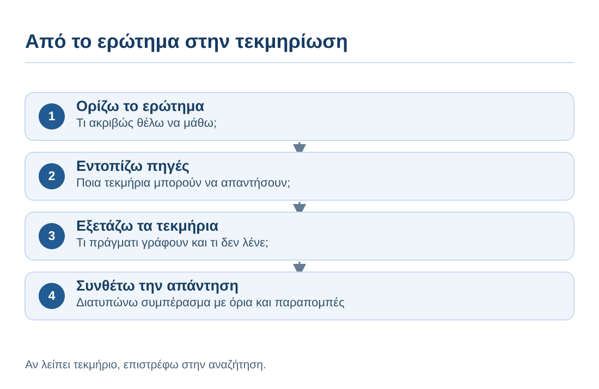
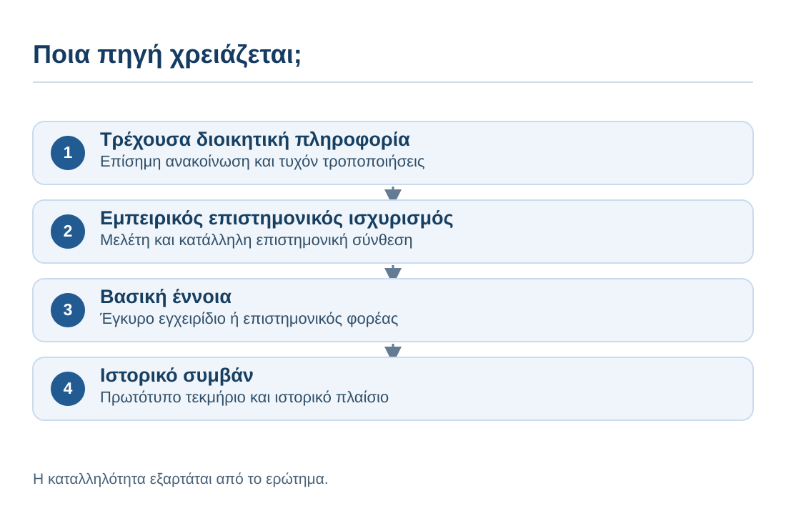
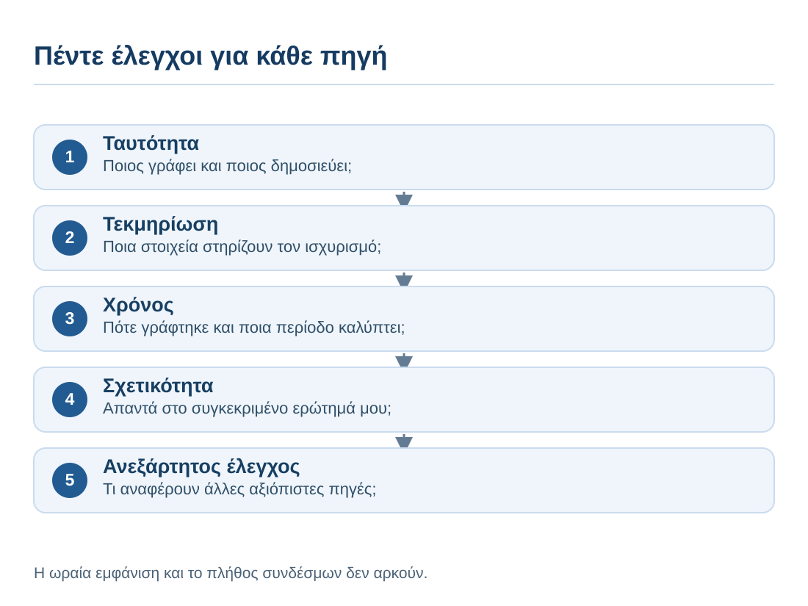
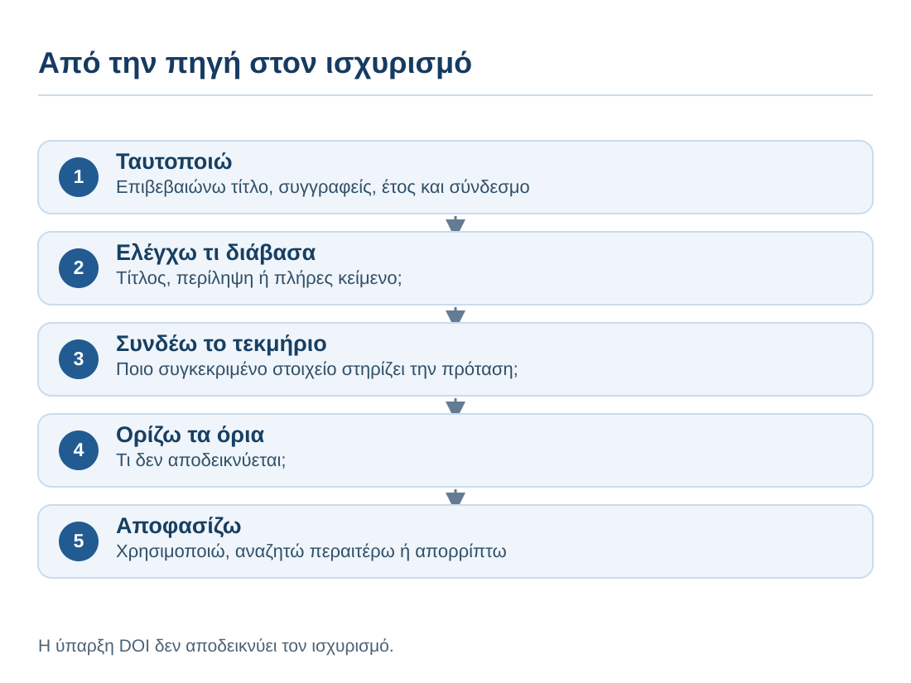

# AL00.7 — Αναζήτηση πληροφοριών, πηγές και εργαλεία Τεχνητής Νοημοσύνης

## Γιατί χρειαζόμαστε αυτή την ενότητα;

Έχεις μια ερώτηση για μια πανεπιστημιακή εργασία. Μπορείς να αναζητήσεις στον Ιστό, να χρησιμοποιήσεις τον κατάλογο της βιβλιοθήκης, να ανατρέξεις σε ένα επιστημονικό άρθρο ή να ζητήσεις από ένα σύστημα ΤΝ να σου δώσει μια απάντηση. Αυτές οι επιλογές δεν είναι ισοδύναμες. Η ΤΝ μπορεί να σε βοηθήσει να ορίσεις το ερώτημα, να βρεις εναλλακτικές λέξεις αναζήτησης ή να οργανώσεις όσα διάβασες. Δεν αποτελεί από μόνη της τεκμήριο ότι ένας ισχυρισμός είναι αληθής.

Η AL00.6 έδειξε πώς εντοπίζουμε και ελέγχουμε προβληματικούς ισχυρισμούς. Εδώ πηγαίνουμε ένα βήμα πιο πέρα: **μαθαίνουμε να σχεδιάζουμε τη διαδρομή από το ερώτημα έως την τεκμηριωμένη απάντηση**, επιλέγοντας κατάλληλες πηγές και εργαλεία. Δεν πρόκειται για κατάλογο «καλύτερων εφαρμογών», αλλά για δεξιότητα που παραμένει χρήσιμη όταν αλλάζουν οι υπηρεσίες και τα χαρακτηριστικά τους.

### Μαθησιακά αποτελέσματα

Όταν ολοκληρώσεις την ενότητα, θα μπορείς:

1. Να διακρίνεις παραγωγή απάντησης, αναζήτηση πληροφορίας, ανάκτηση τεκμηρίου και σύνθεση πηγών.
2. Να μετατρέπεις ένα γενικό θέμα σε ελέγξιμο ερευνητικό ερώτημα και λειτουργικές λέξεις-κλειδιά.
3. Να διαλέγεις ανάμεσα σε γενική αναζήτηση, ακαδημαϊκές βάσεις, πρωτογενή έγγραφα και εργαλεία ΤΝ, ανάλογα με τον στόχο.
4. Να αξιολογείς ποιος είναι ο δημιουργός ή ο φορέας της πηγής, πώς τεκμηριώνεται, πόσο πρόσφατη πρέπει να είναι και για ποιο σκοπό δημιουργήθηκε.
5. Να επαληθεύεις βιβλιογραφική ταυτότητα και συγκεκριμένους ισχυρισμούς χωρίς να συγχέεις τον τίτλο, την περίληψη και το πλήρες κείμενο.
6. Να χρησιμοποιείς την ΤΝ επικουρικά στην αναζήτηση, διατηρώντας προσωπικό αρχείο τεκμηρίων και σαφή όρια βεβαιότητας.
7. Να παραδίδεις μικρή, αναπαραγώγιμη «διαδρομή τεκμηρίωσης» που ένας τρίτος μπορεί να ακολουθήσει.

**Προαπαιτούμενα:** βασικές γνώσεις για τα γλωσσικά μοντέλα (AL00.4), τα αιτήματα (AL00.5) και τον έλεγχο σφαλμάτων (AL00.6). Δεν απαιτείται γνώση βιβλιογραφικών βάσεων ή προγραμματισμού.

**Κεντρικό παράδειγμα:** μια ομάδα φοιτητών θέλει να διερευνήσει «Πώς συνδέεται η χρήση ψηφιακών σημειώσεων με τη μάθηση;». Πρόκειται για *εκπαιδευτικό σενάριο*, όχι για έτοιμη επιστημονική θέση. Δεν θα αποδώσουμε πραγματικά αποτελέσματα σε ανύπαρκτες μελέτες.

---

## 7.1 — Η αναζήτηση δεν είναι το ίδιο με την παραγωγή απάντησης

### 7.1.1 — Τι συμβαίνει όταν απλώς ρωτάμε ένα chatbot;

Αν πληκτρολογήσεις «Οι ψηφιακές σημειώσεις βοηθούν περισσότερο από τις χειρόγραφες;», ένα σύστημα ΤΝ μπορεί να παραγάγει μια καλογραμμένη σύγκριση. Αυτή ενδέχεται να είναι χρήσιμη για να αναγνωρίσεις μεταβλητές: είδος σημειώσεων, στόχος μάθησης, διάρκεια μελέτης, τρόπος αξιολόγησης. Όμως η ύπαρξη λεπτομερούς απάντησης δεν αποδεικνύει ότι ανακτήθηκε ή εξετάστηκε συγκεκριμένη έρευνα.

Ορισμένα εργαλεία συνδυάζουν μοντέλα ΤΝ με αναζήτηση στον Ιστό ή σε αρχεία. Ακόμη και τότε πρέπει να ξεχωρίζουμε τρία πράγματα: **τι ισχυρίζεται η απάντηση**, **σε ποια πηγή παραπέμπει** και **τι γράφει πραγματικά αυτή η πηγή**. Ένας σύνδεσμος δίπλα σε μια πρόταση δεν είναι αυτομάτως απόδειξη ότι ο σύνδεσμος στηρίζει την πρόταση.

**Πριν συνεχίσεις:** αν ένα chatbot δώσει πέντε «πηγές», ποιο πρώτο βήμα θα κάνεις; Δεν επιλέγουμε αμέσως την πιο επιστημονικοφανή. Πρώτα ανοίγουμε και ταυτοποιούμε μία, ελέγχουμε αν υπάρχει και αν έχει σχέση με τον συγκεκριμένο ισχυρισμό.

::: {dropdown} Ενδεικτική εξήγηση
Η αναφορά σε πέντε τίτλους μπορεί να αποτελεί καλή αφετηρία αναζήτησης, όχι ακόμη έλεγχο. Η επαλήθευση κάθε πηγής και της σχέσης της με τον ισχυρισμό είναι ξεχωριστή εργασία.
:::

### 7.1.2 — Τέσσερις διαφορετικές ενέργειες

Όταν αναζητούμε τεκμηριωμένη γνώση, συχνά συγχέουμε τη **διατύπωση**, την **ανακάλυψη**, την **ανάγνωση** και τη **σύνθεση**. Η ΤΝ μπορεί να βοηθήσει και στις τέσσερις, αλλά με διαφορετικό ρόλο.

| Ενέργεια | Τι επιδιώκουμε | Τι θεωρείται αποτέλεσμα |
|---|---|---|
| Διατυπώνω | Να ορίσω τι ακριβώς ρωτώ | Σαφές ερώτημα, βασικές έννοιες |
| Αναζητώ | Να εντοπίσω υποψήφιες πηγές | Βιβλιογραφικά στοιχεία και σύνδεσμοι |
| Εξετάζω | Να διαπιστώσω τι υποστηρίζει η πηγή | Σημειώσεις με συγκεκριμένα αποσπάσματα/σελίδες |
| Συνθέτω | Να απαντήσω με όρια και τεκμήρια | Δική μου τεκμηριωμένη διατύπωση |

Στο κεφάλαιο, «τεκμήριο» είναι ένα συγκεκριμένο στοιχείο, δεδομένο ή απόσπασμα που μπορεί να στηρίξει έναν ισχυρισμό. «Τεκμηρίωση» είναι η διαδικασία και το σύνολο των κατάλληλων στοιχείων με τα οποία συνδέουμε τον ισχυρισμό με την πηγή. Η ύπαρξη μιας πηγής, ενός DOI ή μιας βιβλιογραφικής εγγραφής δεν αποδεικνύει αυτομάτως την ορθότητα του ισχυρισμού.

Αν παραλείψουμε την εξέταση και περάσουμε κατευθείαν από έναν κατάλογο αποτελεσμάτων στη σύνθεση, είναι εύκολο να αποδώσουμε στις πηγές συμπεράσματα που δεν περιέχουν. Το ακόλουθο διάγραμμα παρουσιάζει τη διαδρομή αυτή, μαζί με τη δυνατότητα επιστροφής στα προηγούμενα βήματα.

### 7.1.3 — Τρεις απαντήσεις στο ίδιο ερώτημα

Σκέψου τρεις εκδοχές: «Οι ψηφιακές σημειώσεις είναι καλύτερες», «Εξαρτάται από τον σκοπό και τα δεδομένα» και «Στη συγκεκριμένη μελέτη Χ, με πληθυσμό Ψ, αξιολογήθηκε Ζ». Η πρώτη διατυπώνει απόλυτο συμπέρασμα χωρίς τεκμήρια. Η δεύτερη αναγνωρίζει πολυπλοκότητα αλλά δεν απαντά πλήρως. Η τρίτη μπορεί να είναι ελέγξιμη **μόνο εφόσον** η μελέτη υπάρχει και το συμπέρασμα αποδίδεται σωστά.

**Άσκηση:** γράψε δύο πράγματα που θα πρέπει να ξέρεις για τη «μελέτη Χ» πριν αποδεχθείς το συμπέρασμα: ενδεικτικά, τι ακριβώς συγκρίθηκε και ποιο ήταν το μέτρο μάθησης.

### 7.1.4 — Πότε χρειαζόμαστε πηγή και πότε απλή εξήγηση;

Για να καταλάβεις τι σημαίνει «μεταβλητή», μια σύντομη εξήγηση μπορεί να είναι αρκούντως χρήσιμη ως αρχή. Για να υποστηρίξεις στην εργασία ότι μια συγκεκριμένη εκπαιδευτική μέθοδος βελτιώνει την επίδοση κατά 20%, χρειάζεσαι τεκμήριο. Το κριτήριο δεν είναι μόνο πόσο περίπλοκη ακούγεται η πρόταση, αλλά αν αποτελεί **εμπειρικό ισχυρισμό** που θα παρουσιάσεις ως γεγονός.

Η καλή πρακτική είναι να ρωτάς: «Θέλω τώρα να *κατανοήσω*, να *εντοπίσω πηγές* ή να *τεκμηριώσω έναν ισχυρισμό που θα παρουσιάσω σε ακαδημαϊκή εργασία ή δημοσίευση*;». Το τρίτο απαιτεί διαφορετικό επίπεδο ελέγχου από το πρώτο.

---

## 7.2 — Από το γενικό θέμα στο αναζητήσιμο ερώτημα

### 7.2.1 — Γιατί το γενικό θέμα δεν είναι ακόμη ερώτημα

«ΤΝ και εκπαίδευση» είναι πεδίο ενδιαφέροντος, όχι συγκεκριμένο ερευνητικό ερώτημα. Μπορεί να περιλαμβάνει επιδράσεις στη μάθηση, αξιολόγηση, ιδιωτικότητα, προσβασιμότητα ή δημιουργικότητα. Αν ξεκινήσουμε από μια αόριστη διατύπωση, θα λάβουμε εκατοντάδες ετερογενή αποτελέσματα και θα δυσκολευτούμε να αποφασίσουμε τι είναι σχετικό.

Μια πρώτη αναδιατύπωση είναι: «Πώς χρησιμοποιούν οι πρωτοετείς φοιτητές την παραγωγική ΤΝ για να κατανοούν δύσκολες έννοιες;». Είναι ήδη καλύτερη, αλλά χρειάζεται να εξετάσουμε αν μας ενδιαφέρει περιγραφή χρήσεων, μετρήσιμη επίδραση ή απόψεις φοιτητών. Το είδος του ερωτήματος καθορίζει και τις πηγές που θα αναζητήσουμε.

### 7.2.2 — Οι τέσσερις αποφάσεις για τον περιορισμό ενός ερωτήματος

Δοκίμασε να καθορίσεις **ποιον/τι** εξετάζεις, **ποια δραστηριότητα**, **ποιο αποτέλεσμα** και **σε ποιο πλαίσιο**. Για το σενάριο των σημειώσεων μπορεί να προκύψει: «Σε προπτυχιακούς φοιτητές, πώς σχετίζεται ο τρόπος λήψης σημειώσεων κατά τη διάλεξη με την ανάκληση βασικών εννοιών σε σύντομη αξιολόγηση;».

Η διατύπωση αυτή δεν προεξοφλεί αιτιότητα. Ακόμη και αν μια έρευνα εντοπίσει διαφορά, πρέπει να εξετάσουμε τον σχεδιασμό της πριν μιλήσουμε για αποτέλεσμα μιας παρέμβασης. Αν το δικό μας ερώτημα ενδιαφέρεται για προτιμήσεις και εμπειρίες, θα το διατυπώσουμε διαφορετικά: «Πώς περιγράφουν οι φοιτητές την εμπειρία τους;».

### 7.2.3 — Λέξεις-κλειδιά, συνώνυμα και εναλλακτικοί όροι

Ένα άρθρο μπορεί να χρησιμοποιεί άλλον όρο από εκείνον που γράψαμε. Για παράδειγμα, το «ψηφιακές σημειώσεις» μπορεί να εμφανίζεται ως `digital note-taking`, `laptop notes`, `typed notes` ή `electronic notes`, ενώ το «μάθηση» ως `learning outcomes`, `recall` ή `retention`. Δεν σημαίνουν όλα ακριβώς το ίδιο. Οι εναλλακτικοί όροι αυξάνουν το πεδίο αναζήτησης, αλλά πρέπει να ελέγχουμε αν ανταποκρίνονται στο ερώτημά μας.

| Έννοια | Πιθανοί όροι αναζήτησης |
|---|---|
| Μέσο σημειώσεων | `handwritten notes`, `typed notes`, `digital note-taking` |
| Μαθησιακό αποτέλεσμα | `recall`, `comprehension`, `learning outcomes` |
| Πληθυσμός | `university students`, `undergraduates` |

**Δοκίμασε:** γράψε μία λέξη-κλειδί από το αντικείμενό σου και βρες δύο πιθανές εναλλακτικές. Εξήγησε σε ποια περίπτωση η κάθε μία θα έφερνε άσχετα αποτελέσματα.

#### Αναλυτικά λυμένο παράδειγμα: από τις λέξεις στη στρατηγική

Η έρευνα δεν ξεκινά αναγκαστικά με την «τέλεια» φράση. Ξεκινά με ένα ερώτημα που μετατρέπεται σε ομάδες όρων. Για τη σύγκριση των σημειώσεων μπορούμε να δοκιμάσουμε πρώτα `note taking university students` και να καταγράψουμε ποια ζητήματα εμφανίζονται συχνά. Έπειτα περιορίζουμε το ενδιαφέρον σε `handwritten notes typed notes recall`. Αν η αναζήτηση είναι υπερβολικά στενή, επανεξετάζουμε τους όρους· αν είναι υπερβολικά πλατιά, προσθέτουμε πληθυσμό ή αποτέλεσμα.

Στις υπηρεσίες που υποστηρίζουν τελεστές Boolean, μια δοκιμαστική φράση είναι `("handwritten notes" OR "typed notes") AND (recall OR comprehension) AND students`. Η ακριβής σύνταξη διαφέρει μεταξύ συστημάτων: δεν υποθέτουμε ότι κάθε μηχανή αναζήτησης ερμηνεύει τα εισαγωγικά, το `AND`, το `OR` ή τους παρενθετικούς όρους με τον ίδιο τρόπο. Ελέγχουμε τις οδηγίες της υπηρεσίας και εξετάζουμε δείγματα αποτελεσμάτων.

Στο κεφάλαιο, «κατάλογος βιβλιοθήκης» σημαίνει υπηρεσία που καταγράφει τις συλλογές και τις βιβλιογραφικές εγγραφές ενός ιδρύματος. «Βιβλιογραφική βάση» σημαίνει υπηρεσία που ευρετηριάζει βιβλιογραφία, μεταδεδομένα ή/και πλήρη κείμενα. «Υπηρεσία αναζήτησης» είναι ο ευρύτερος όρος για το εργαλείο με το οποίο αναζητούμε πληροφορίες· δεν σημαίνει κατ’ ανάγκη ότι παρέχει το πλήρες κείμενο ή ότι λειτουργεί ως επιστημονική βάση.

**Δραστηριότητα:** Θέλεις να διερευνήσεις πώς οι πρωτοετείς οργανώνουν τον χρόνο μελέτης τους. Σχεδίασε μία γενική και μία στοχευμένη αναζήτηση. Εξήγησε ποια θα έδινες σε ακαδημαϊκή βάση και ποια σε γενική μηχανή αναζήτησης.

::: {dropdown} Ενδεικτική εξήγηση
Μια πρώτη γενική αναζήτηση θα μπορούσε να είναι `university students study habits`. Μια πιο στοχευμένη, `first year undergraduates time management study habits`. Η δεύτερη μπορεί να περιορίσει τα άσχετα αποτελέσματα, αλλά χρειάζεται έλεγχο μήπως αποκλείει σχετικές εργασίες που χρησιμοποιούν διαφορετικούς όρους.
:::

### 7.2.4 — Συνδυασμός όρων και σταδιακή αναζήτηση

Σε αρκετές μηχανές και ακαδημαϊκές βάσεις μπορούμε να χρησιμοποιούμε εισαγωγικά για συγκεκριμένες φράσεις και λογικούς τελεστές όπως `AND` και `OR`. Όμως η ακριβής συμπεριφορά τους εξαρτάται από την υπηρεσία. Δεν θεωρούμε ότι κάθε μηχανή λειτουργεί με τους ίδιους κανόνες.

Ενδεικτική αναζήτηση σε βάση που υποστηρίζει αντίστοιχη σύνταξη: `("handwritten notes" OR "typed notes") AND (recall OR comprehension) AND students`. Πρώτα εκτελούμε ευρύτερη αναζήτηση, ελέγχουμε τα πρώτα αποτελέσματα, αναγνωρίζουμε όρους που χρησιμοποιεί το πεδίο και στη συνέχεια περιορίζουμε. Δεν «βελτιώνουμε» μια αναζήτηση μόνο επειδή επιστρέφει λιγότερα αποτελέσματα: μπορεί απλώς να αποκλείσαμε χρήσιμες μελέτες.

### 7.2.5 — Δραστηριότητα: τρία ερωτήματα, τρεις στρατηγικές

Για την πρόταση «Η ΤΝ βελτιώνει τη μάθηση», γράψε: (α) ένα περιγραφικό ερώτημα, (β) ένα ερώτημα σύγκρισης και (γ) ένα ερώτημα για εμπειρίες χρηστών. Έπειτα επίλεξε ποιο θα ήταν πιο κατάλληλο να διερευνηθεί με συνεντεύξεις και ποιο με συγκριτικά αποτελέσματα επίδοσης.

::: {dropdown} Ενδεικτική απάντηση
Περιγραφικό: «Σε ποιες εργασίες χρησιμοποιούν οι φοιτητές την ΤΝ;». Σύγκρισης: «Υπάρχει διαφορά στην επίδοση ανάμεσα σε δύο συγκεκριμένες συνθήκες μάθησης;». Εμπειριών: «Πώς αντιλαμβάνονται οι φοιτητές τα οφέλη και τις δυσκολίες;». Οι συνεντεύξεις ταιριάζουν κυρίως στο τρίτο ερώτημα, ενώ η συγκριτική επίδοση απαιτεί κατάλληλη ποσοτική μέτρηση και σχεδιασμό.
:::

<a href="/al00_7_q1.html" target="_blank" rel="noopener" onclick="const u=new URL(this.href,window.location.href);u.searchParams.set('return',window.location.href);this.href=u.href;">Άνοιγμα Quiz 1 — Ερώτημα και αναζήτηση σε νέα καρτέλα</a>

---

## 7.3 — Επιλέγω πού θα αναζητήσω

### 7.3.1 — Δεν υπάρχει μία πηγή για όλες τις ανάγκες

Για ένα ισχύον διοικητικό έγγραφο, προέχει η αρμόδια επίσημη αρχή. Για αποτελέσματα δημοσιευμένης έρευνας, χρειάζεται το πρωτογενές άρθρο ή άλλη κατάλληλη επιστημονική πηγή. Για έναν βασικό ορισμό, ένα έγκυρο εγχειρίδιο μπορεί να είναι καταλληλότερο από την τελευταία ειδική μελέτη. Για ιστορική μαρτυρία, το πρωτότυπο τεκμήριο μπορεί να έχει κεντρική σημασία, αλλά χρειάζεται πλαίσιο και κριτική ανάγνωση.

Πριν ανοίξεις μια μηχανή αναζήτησης, διάλεξε **τι είδους τεκμήριο θα μπορούσε να απαντήσει**. Το ακόλουθο σχήμα απεικονίζει μια απλή αντιστοίχιση ερώτησης και πηγής.

### 7.3.2 — Γενικές μηχανές αναζήτησης

Μια γενική μηχανή είναι χρήσιμη για γρήγορο προσανατολισμό, εντοπισμό επίσημων φορέων, οδηγών, ορολογίας και διαθέσιμων εγγράφων. Όμως το πρώτο αποτέλεσμα δεν σημαίνει κατ' ανάγκη το πιο αξιόπιστο ή το πιο κατάλληλο. Η κατάταξη επηρεάζεται από παράγοντες που δεν ταυτίζονται με την επιστημονική ποιότητα μιας πηγής.

Αν η αναζήτηση εμφανίζει αυτόματη περίληψη ΤΝ, τη χρησιμοποιούμε ως **χάρτη πιθανών θεμάτων**, όχι ως υποκατάστατο επίσκεψης στις πηγές. Η ίδια η τεκμηρίωση της Google προειδοποιεί ότι τέτοιες συνόψεις μπορούν να περιέχουν λάθη και συστήνει έλεγχο πολλών πηγών. Αυτό δεν σημαίνει ότι κάθε σύνοψη είναι λανθασμένη, αλλά ότι η δημιουργική διατύπωση και η ανάκτηση τεκμηρίων παραμένουν διακριτές εργασίες.

### 7.3.3 — Ακαδημαϊκή αναζήτηση και βιβλιοθήκες

Οι κατάλογοι βιβλιοθηκών, οι επιστημονικές βάσεις, οι αποθετήριοι οργανισμών και οι υπηρεσίες ακαδημαϊκής αναζήτησης εξυπηρετούν διαφορετικούς σκοπούς. Ο κατάλογος βιβλιοθήκης καταγράφει κυρίως τις συλλογές και τις βιβλιογραφικές εγγραφές του ιδρύματος. Η βιβλιογραφική βάση ευρετηριάζει βιβλιογραφία, μεταδεδομένα ή/και πλήρη κείμενα, ενώ μια υπηρεσία αναζήτησης μπορεί να παρέχει ευρύτερο σημείο εντοπισμού πληροφοριών. Κάποιες υπηρεσίες παρέχουν περιλήψεις ή πρόσβαση μέσω συνδρομής. Μια εγγραφή δεν σημαίνει ότι διαθέτουμε αυτομάτως το πλήρες άρθρο.

Σε πανεπιστημιακή εργασία μπορείς να ξεκινήσεις από τη βιβλιοθήκη του ιδρύματός σου, να εντοπίσεις τον ακριβή τίτλο και να ελέγξεις τον εκδότη, το περιοδικό, το έτος και τον μόνιμο αναγνωριστικό σύνδεσμο. Αν έχεις μόνο περίληψη, μην αποδίδεις στο άρθρο λεπτομέρειες των μεθόδων ή των αποτελεσμάτων που δεν διάβασες.

### 7.3.4 — Πρωτογενής, δευτερογενής και τριτογενής πηγή

Σε ερευνητικό πλαίσιο, πρωτογενής μπορεί να είναι η αρχική δημοσίευση αποτελεσμάτων ή το πρωτότυπο αρχείο δεδομένων. Μια συστηματική ανασκόπηση αποτελεί συνήθως δευτερογενή σύνθεση της βιβλιογραφίας. Ένα εγχειρίδιο ή μια εγκυκλοπαιδική επισκόπηση μπορεί να λειτουργεί ως τριτογενής πηγή. Οι κατηγορίες δεν αποδίδουν αυτόματα βαθμό αξιοπιστίας· αλλάζουν ανάλογα με το ερώτημα.

Για να μάθεις μια έννοια, ένα αξιόπιστο εγχειρίδιο μπορεί να είναι ιδανικό. Για να ελέγξεις «τι ακριβώς βρήκε η μελέτη», πρέπει να διαβάσεις τη μελέτη. Για να δεις τη συνολική εικόνα ενός πεδίου, μια προσεκτική ανασκόπηση μπορεί να είναι καταλληλότερη από την τυχαία επιλογή ενός άρθρου.

#### Μία ερώτηση, τρία διαφορετικά είδη τεκμηρίων

Ας πάρουμε τη γενική φράση «Θέλω να μάθω για την ασφάλεια των δεδομένων». Αν ενδιαφέρεσαι για **τι προβλέπει μια ισχύουσα ρύθμιση**, θα αναζητήσεις πρωτίστως το επίσημο κανονιστικό κείμενο και τις ενημερώσεις του. Αν θέλεις να εξετάσεις **πώς βιώνουν οι φοιτητές τις πρακτικές ιδιωτικότητας**, θα χρειαστείς κατάλληλη εμπειρική έρευνα. Αν θέλεις να κατανοήσεις **τι σημαίνει κρυπτογράφηση**, μπορείς να ξεκινήσεις με αξιόπιστο εισαγωγικό εγχειρίδιο. Η λέξη «ασφάλεια» είναι ίδια, αλλά το αποδεικτικό υλικό διαφέρει.

Μην επιλέγεις την πηγή μόνο από την αναγνωρισιμότητα του ιστοτόπου. Μια μεγάλη επιστημονική βάση δεν αντικαθιστά μια επίσημη πράξη όταν το ερώτημα είναι «τι ισχύει σήμερα;», όπως μια επίσημη ανακοίνωση δεν αντικαθιστά μόνη της πειραματική αξιολόγηση της αποτελεσματικότητας μιας εκπαιδευτικής παρέμβασης.

### 7.3.5 — Δραστηριότητα επιλογής πηγής

Ποια αρχική πηγή θα επέλεγες για: (α) την τρέχουσα ημερομηνία υποβολής μιας δημόσιας αίτησης, (β) την επίδραση μιας συγκεκριμένης μεθόδου μελέτης, (γ) τον ορισμό ενός νέου τεχνικού όρου; Σημείωσε επίσης ποια πηγή **δεν** θα αρκούσε.

::: {dropdown} Ενδεικτική απάντηση
(α) Επίσημη ανακοίνωση/αρμόδιος φορέας· όχι ανώνυμο ιστολόγιο. (β) Πρωτογενείς μελέτες ή ποιοτικές ανασκοπήσεις· όχι ατεκμηρίωτη αυτόματη σύνοψη. (γ) Έγκυρο εισαγωγικό εγχειρίδιο ή ορισμός επιστημονικού φορέα· όχι απαραίτητα μια πολύ εξειδικευμένη μελέτη.
:::

---

## 7.4 — Πώς αξιολογώ μια πηγή

### 7.4.1 — Ποιος είναι ο δημιουργός ή ο φορέας της πληροφορίας;

Το όνομα μιας ιστοσελίδας, η καλαίσθητη σχεδίαση ή ένα λογότυπο δεν αρκούν για να αποδείξουν αξιοπιστία. Χρειάζεται να βρούμε ποιος υπογράφει την πληροφορία, ποιος τη δημοσιεύει, ποια είναι η σχετική αρμοδιότητα ή ειδίκευσή του και αν υπάρχει σύγκρουση συμφερόντων. Ένας ισχυρισμός για δημόσια πολιτική μπορεί να εμφανίζεται σε σελίδα με επίσημη αισθητική αλλά να προέρχεται από ιδιωτικό φορέα.

Αν δεν αναγνωρίζεις τον εκδότη, μην μένεις μόνο στη σελίδα «Σχετικά με εμάς». Αναζήτησε πώς τον περιγράφουν **ανεξάρτητες πηγές**. Αυτή η πρακτική είναι γνωστή ως *πλάγια ανάγνωση* (lateral reading) και χρησιμοποιείται στην εκπαίδευση ψηφιακού ελέγχου πληροφοριών.

#### Παράδειγμα ελέγχου φορέα χωρίς να εμπιστευόμαστε την εμφάνιση

**Συνθετικό σενάριο:** μια σελίδα με τίτλο «Εθνικό Κέντρο Αποτελεσματικής Μελέτης» γράφει ότι μια εμπορική πλατφόρμα αυξάνει τη μάθηση κατά 60%. Το όνομα ακούγεται επίσημο, η σελίδα έχει σφραγίδες και επαγγελματικό σχεδιασμό, αλλά δεν αναφέρει με σαφήνεια αν πρόκειται για δημόσιο φορέα, ιδιωτική εταιρεία ή ομάδα επαγγελματιών.

Αντί να αποφασίσεις βάσει εμφάνισης, αναζήτησε το ακριβές όνομα εκτός του ιστοτόπου, εντόπισε τη νομική ή οργανωτική ταυτότητα και έλεγξε αν ο φορέας πουλά την πλατφόρμα για την οποία διατυπώνει ισχυρισμούς. Έπειτα ζήτησε το πρωτογενές τεκμήριο: πόσοι συμμετείχαν, τι μετρήθηκε, ποια ήταν η ομάδα σύγκρισης, πότε έγινε η μέτρηση και πώς υπολογίστηκε το 60%; Η εμπορική σχέση δεν αποδεικνύει ότι ο ισχυρισμός είναι ψευδής, αλλά αποτελεί σημαντικό συμφραζόμενο που πρέπει να εξετάσουμε.

**Ερώτηση πρόβλεψης:** Αν η σελίδα παραπέμπει σε «ανεξάρτητη μελέτη» χωρίς τίτλο, συγγραφείς ή σύνδεσμο, τι έχεις πράγματι επαληθεύσει;

::: {dropdown} Ενδεικτική απάντηση
Μόνο ότι ο ιστότοπος *ισχυρίζεται* πως υπάρχει ανεξάρτητη μελέτη. Δεν έχουμε ταυτοποιήσει ούτε ελέγξει τη μελέτη, άρα δεν δικαιολογείται να παρουσιάσουμε το 60% ως τεκμηριωμένο εύρημα.
:::

### 7.4.2 — Τι τεκμήρια προσφέρει η πηγή;

Μια σελίδα μπορεί να έχει γνωστό συντάκτη και πάλι να παρουσιάζει αδύναμο επιχείρημα. Εξέτασε αν ο ισχυρισμός στηρίζεται σε μετρήσεις, πρωτογενή έγγραφα, μεθόδους που περιγράφονται, παραπομπές ή επαληθεύσιμα δεδομένα. Πρόσεξε ιδιαίτερα την αλυσίδα «ιστολόγιο → είδηση → άλλο ιστολόγιο»: πολλές σελίδες μπορούν να επαναλαμβάνουν **την ίδια** ανεξέλεγκτη αναφορά.

Η ποσότητα των συνδέσμων δεν υποκαθιστά την ποιότητα. Αν ένας ισχυρισμός αφορά «το 80% των φοιτητών», χρειάζεται να μάθουμε 80% **ποιων**, σε ποια περίοδο, με ποιον ορισμό και με ποια μέθοδο. Το παράδειγμα είναι υποθετικό· δεν δηλώνει πραγματικό ποσοστό.

### 7.4.3 — Πότε έχει σημασία η ημερομηνία;

Η παλαιότητα δεν καθιστά αυτομάτως ένα τεκμήριο άχρηστο. Κλασικές θεωρίες και ιστορικές πηγές μπορεί να είναι θεμελιώδεις. Για τρέχουσες προθεσμίες, εκδόσεις λογισμικού ή κανόνες που μεταβάλλονται, όμως, η ημερομηνία ενημέρωσης είναι κρίσιμη. Ακόμη και ένα πρόσφατο άρθρο μπορεί να παραπέμπει σε παλιά δεδομένα.

Διακρίνουμε **πότε δημοσιεύτηκε μια ιστοσελίδα**, **πότε συνέβη το γεγονός** και **ποια χρονική περίοδο καλύπτουν τα δεδομένα**. Η σύγχυση των τριών οδηγεί εύκολα σε λανθασμένες διατυπώσεις όπως «σήμερα ισχύει…» με βάση παλιότερη ανακοίνωση.

### 7.4.4 — Είναι η πηγή κατάλληλη για το συγκεκριμένο ερώτημα;

Μια αξιόπιστη πηγή μπορεί να είναι άσχετη με τον ισχυρισμό μας. Έρευνα για μαθητές γυμνασίου δεν τεκμηριώνει από μόνη της συμπέρασμα για όλους τους πανεπιστημιακούς φοιτητές. Μελέτη που εξετάζει «ικανοποίηση χρήστη» δεν αποδεικνύει βελτίωση «μαθησιακής επίδοσης». Πρέπει να συγκρίνουμε πληθυσμό, μεταβλητές, σχεδιασμό και πραγματικό αποτέλεσμα.

**Άσκηση:** μια πηγή με τίτλο «Απόψεις φοιτητών για τα εργαλεία ΤΝ» χρησιμοποιείται για τη φράση «Η ΤΝ αύξησε τους βαθμούς κατά 30%». Ποια είναι η αναντιστοιχία; Η πηγή μπορεί να είναι υπαρκτή και καλοσχεδιασμένη, αλλά ο τίτλος υποδηλώνει ότι αφορά απόψεις, όχι κατ' ανάγκη μετρημένη αλλαγή βαθμολογίας.

### 7.4.5 — Πλάγια ανάγνωση: βγαίνω από τη σελίδα

Ας υποθέσουμε ότι βρίσκεις έναν ιστότοπο με τίτλο «Ινστιτούτο Ψηφιακής Μάθησης» που ισχυρίζεται ότι μια νέα εφαρμογή διπλασιάζει την απόδοση. Πρόκειται για **φανταστικό παράδειγμα**. Αντί να διαβάσεις μόνο την εντυπωσιακή αρχική σελίδα, άνοιξε νέες αναζητήσεις: ποιος λειτουργεί το ινστιτούτο; Υπάρχει ανεξάρτητη καταγραφή της μελέτης; Η διαφημιζόμενη εφαρμογή χρηματοδοτεί την έρευνα; Άλλοι ερευνητές αναφέρουν τα ίδια ευρήματα;

Το δίδαγμα δεν είναι να απορρίπτουμε ιδιωτικούς φορείς, αλλά να ελέγχουμε ανεξάρτητα την ταυτότητα, τα κίνητρα και τα τεκμήρια. Η πλάγια ανάγνωση συμπληρώνει, δεν αντικαθιστά, την προσεκτική ανάγνωση του ίδιου του τεκμηρίου.

#### Τρία διαφορετικά κριτήρια που δεν πρέπει να συγχέουμε

Στην αξιολόγηση πηγής κάνουμε τουλάχιστον τρεις χωριστές κρίσεις. **Αξιοπιστία ταυτότητας:** ξέρουμε ποιος έγραψε ή δημοσίευσε; **Ποιότητα τεκμηρίου:** υπάρχουν ελέγξιμα στοιχεία και κατάλληλη μέθοδος; **Καταλληλότητα:** το περιεχόμενο απαντά στο δικό μας ερώτημα; Μια πηγή μπορεί να είναι ισχυρή στην πρώτη διάσταση και αδύναμη στην τρίτη.

Σκέψου μια επίσημη έκθεση για τη χρήση ψηφιακών εργαλείων από μαθητές σχολείου. Μπορεί να είναι ακριβής για τον πληθυσμό της, αλλά να μην επιτρέπει συμπέρασμα για όλους τους προπτυχιακούς φοιτητές. Το σφάλμα δεν είναι ότι η έκθεση «είναι αναξιόπιστη». Το σφάλμα θα ήταν η **μεταφορά ενός συμπεράσματος πέρα από τα όρια των δεδομένων**.

### 7.4.6 — Μικρή άσκηση σύγκρισης δύο πηγών

**Συνθετική περίπτωση:** η Πηγή Α είναι ανώνυμο κείμενο με απόλυτο ισχυρισμό και χωρίς μέθοδο. Η Πηγή Β είναι αναφορά ενός ερευνητικού φορέα με συγγραφείς, ημερομηνία, περιγραφή δείγματος και περιορισμών, αλλά αφορά διαφορετική ηλικιακή ομάδα από εκείνη που σε ενδιαφέρει. Ποια θα αξιοποιήσεις;

::: {dropdown} Ενδεικτική λύση
Η Β επιτρέπει περισσότερο έλεγχο, αλλά δεν απαντά αναγκαστικά στο δικό σου ερώτημα. Η Α δεν προσφέρει επαρκή τεκμηρίωση. Η ορθή απόφαση μπορεί να είναι «δεν χρησιμοποιώ καμία ως επαρκή απόδειξη· συνεχίζω την αναζήτηση».
:::

---

## 7.5 — Πρακτική χρήση εργαλείων ΤΝ κατά την αναζήτηση

### 7.5.1 — Η ΤΝ ως βοηθός σχεδιασμού της αναζήτησης

Ένα κατάλληλο αίτημα προς ΤΝ είναι: «Μελετώ πώς συνδέεται η μορφή σημειώσεων με τη μάθηση φοιτητών. Πρότεινε συνώνυμους αγγλικούς όρους, πιθανούς παράγοντες σύγχυσης και τρία εναλλακτικά ερευνητικά ερωτήματα. Μη δημιουργήσεις βιβλιογραφικές αναφορές». Έτσι ζητάς **εργασία προετοιμασίας**, όχι παραγωγή ανεπιβεβαίωτης τεκμηρίωσης.

Το αποτέλεσμα χρειάζεται ανθρώπινο έλεγχο. Η ΤΝ μπορεί να προτείνει όρους που χρησιμοποιούνται σε γειτονικό πεδίο ή να παραλείψει έναν βασικό τεχνικό όρο. Μπορείς να συγκρίνεις τις προτάσεις της με την ορολογία που εμφανίζεται σε πραγματικούς τίτλους και περιλήψεις.

#### Δύο διαφορετικές ροές εργασίας

**Ροή Α — Επισκόπηση θέματος:** ζητάς από την ΤΝ «ποιες όψεις του ερωτήματος θα έπρεπε να διερευνήσω;». Κρατάς τις προτάσεις ως *υποψήφιες κατευθύνσεις*, όχι ως δημοσιευμένα ευρήματα. Τις μετατρέπεις σε λέξεις-κλειδιά και ψάχνεις για πραγματικές πηγές.

**Ροή Β — Έλεγχος συγκεκριμένου ισχυρισμού:** η σύνοψη ισχυρίζεται «η πρακτική Χ αυξάνει κατά 30% την επίδοση». Πρώτα εντοπίζεις το ακριβές σημείο του παραπεμπόμενου τεκμηρίου. Διαπιστώνεις αν το 30% αναφέρεται σε μέση βαθμολογία, σχετική μεταβολή, ποσοστό επιτυχίας ή κάτι άλλο. Αν η πηγή μιλά για αυτοαναφερόμενη ικανοποίηση, δεν μπορείς να μεταφέρεις τον αριθμό σε μαθησιακή επίδοση.

Αν το εργαλείο δεν δείχνει αν διάβασε πλήρες κείμενο ή μόνο απόσπασμα, μην προσποιείσαι ότι έχεις ελέγξει ολόκληρη μελέτη. Κατάγραψε το επίπεδο πραγματικής πρόσβασης.

**Μικρή άσκηση:** Η σύνοψη της ΤΝ γράφει «Η μέθοδος ήταν αποτελεσματική σε όλες τις ηλικίες», αλλά η συνδεδεμένη πηγή αφορά 35 άτομα ηλικίας 18–22 ετών. Πώς θα αναδιατύπωνες τον ισχυρισμό;

::: {dropdown} Ενδεικτική απάντηση
Δεν μπορούμε να υποστηρίξουμε «σε όλες τις ηλικίες». Αν επαληθευτούν τα πραγματικά ευρήματα, μπορούμε να αναφερθούμε μόνο στον πληθυσμό και στο αποτέλεσμα της συγκεκριμένης μελέτης, με τους κατάλληλους περιορισμούς.
:::

### 7.5.2 — Εργαλεία αναζήτησης με συνόψεις ΤΝ

Ορισμένες υπηρεσίες επιστρέφουν συνδυασμό συνδέσμων και παραγόμενης σύνοψης. Αυτό μπορεί να επιταχύνει τον προσανατολισμό σε ένα θέμα, αλλά ο φοιτητής οφείλει να ελέγχει αν οι παραπομπές είναι σχετικές και τι αναφέρουν στην πραγματικότητα. Η ύπαρξη συνδέσμου δεν αποτελεί πιστοποίηση του ισχυρισμού.

**Πρακτική οδηγία:** αντιγράφεις έναν συγκεκριμένο ισχυρισμό από τη σύνοψη, ανοίγεις την αναφερόμενη πηγή και σημειώνεις τη φράση ή τα δεδομένα που πράγματι τον υποστηρίζουν. Αν δεν τα βρίσκεις, η ένδειξη δεν είναι «επαληθεύτηκε» αλλά «δεν τεκμηριώθηκε με την πηγή που δόθηκε».

### 7.5.3 — ΤΝ που εργάζεται πάνω σε δικά σου έγγραφα

Αν ένα εργαλείο επιτρέπει την προσθήκη αρχείων, μπορεί να βοηθήσει στον εντοπισμό βασικών ιδεών ή στη σύγκριση αποσπασμάτων. Προτού ανεβάσεις ένα αρχείο, εξέτασε τα δικαιώματα χρήσης, τους κανόνες του μαθήματος και την ιδιωτικότητα. Μην κοινοποιείς προσωπικά δεδομένα άλλων ανθρώπων, αδημοσίευτες αξιολογήσεις ή εμπιστευτικά έγγραφα χωρίς την απαιτούμενη εξουσιοδότηση.

Ζήτησε από το σύστημα να διακρίνει «τι λέει το έγγραφο» από «δική του ερμηνεία» και, αν διαθέτει την ικανότητα, να παραπέμπει σε σελίδα ή ενότητα. Έπειτα έλεγξε το πρωτότυπο: η ΤΝ μπορεί να αποδώσει λανθασμένα έναν πίνακα, να αγνοήσει εξαίρεση ή να χάσει το νόημα μιας υποσημείωσης.

### 7.5.4 — Τι δεν πρέπει να αναθέτουμε άκριτα

Δεν είναι ασφαλές να ζητούμε «βρες δέκα πραγματικά άρθρα και γράψε έτοιμη βιβλιογραφία» και να αντιγράφουμε το αποτέλεσμα χωρίς επαλήθευση. Ούτε να ζητούμε «διάβασε αυτόν τον σύνδεσμο» χωρίς να γνωρίζουμε αν το εργαλείο πράγματι απέκτησε πρόσβαση στο περιεχόμενο. Αν η υπηρεσία δεν διαθέτει πρόσβαση ή δεν βλέπει το πλήρες άρθρο, μπορεί να παράγει εύλογο κείμενο βασισμένο σε περιορισμένες πληροφορίες.

Το όριο της ανάθεσης είναι απλό: η ΤΝ μπορεί να προτείνει, να οργανώνει και να βοηθά στην ανάγνωση· **δεν μεταφέρει αυτομάτως στον φοιτητή τεκμηρίωση που δεν έχει ελεγχθεί**.

#### Χρησιμοποιώντας την ΤΝ για να εντοπίσουμε *κενά* και όχι να τα κρύψουμε

Έστω ότι έχεις βρει δύο άρθρα με φαινομενικά αντίθετα συμπεράσματα. Ένα κακό αίτημα θα ήταν «διάλεξε ποιο έχει δίκιο και γράψε μια βέβαιη παράγραφο». Καλύτερη οδηγία: «Θα σου δώσω τις δικές μου επαληθευμένες σημειώσεις από δύο άρθρα. Βοήθησέ με να συγκρίνω πληθυσμό, μεθοδολογία, μεταβλητές και περιορισμούς. Ξεχώρισε ρητά όσα δεν γνωρίζουμε και μη συμπληρώσεις κενά με υποθέσεις».

Η χρήσιμη απάντηση ενδέχεται να είναι «δεν έχουμε ακόμη αρκετά στοιχεία για σύγκριση». Αυτό αποτελεί πρόοδο: μας δείχνει ποιο τμήμα του πλήρους κειμένου πρέπει να μελετήσουμε ή ποιον ορισμό πρέπει να αποσαφηνίσουμε.

### 7.5.5 — Άσκηση διατύπωσης κατάλληλου αιτήματος

Μετάτρεψε το ακατάλληλο αίτημα «γράψε μου εργασία με δέκα επιστημονικές πηγές για τη μάθηση» σε ένα αίτημα που υποστηρίζει τη δική σου αναζήτηση και κατανόηση.

::: {dropdown} Ενδεικτικό αίτημα
«Βοήθησέ με να περιορίσω το θέμα σε ερευνητικό ερώτημα. Πρότεινε λέξεις-κλειδιά στα ελληνικά και αγγλικά και εξήγησε ποια είδη τεκμηρίων θα χρειαστώ. Μη συντάξεις έτοιμη εργασία και μη δημιουργήσεις βιβλιογραφικές αναφορές. Αφού βρω πραγματικές πηγές, θα σου δώσω τα στοιχεία τους για να με βοηθήσεις να οργανώσω μια κάρτα ανάγνωσης».
:::

---

## 7.6 — Από μια πηγή σε τεκμηριωμένο ισχυρισμό

### 7.6.1 — Ταυτοποίηση: υπάρχει πραγματικά η πηγή;

Όταν βρίσκουμε μια βιβλιογραφική αναφορά, ελέγχουμε τίτλο, δημιουργούς, έτος, περιοδικό/εκδότη και, όπου υπάρχει, DOI ή άλλο σταθερό αναγνωριστικό. Μπορούμε να συγκρίνουμε τα μεταδεδομένα στη σελίδα του εκδότη, σε αξιόπιστες βιβλιογραφικές υπηρεσίες ή στο θεσμικό αποθετήριο. Ένα DOI είναι χρήσιμο για ταυτοποίηση, αλλά **δεν εγγυάται την ποιότητα ή την ορθή ερμηνεία του περιεχομένου**.

Για να χρησιμοποιούμε τους όρους με ακρίβεια: **ταυτοποίηση** είναι η επιβεβαίωση των βιβλιογραφικών στοιχείων μιας πηγής· **επαλήθευση** είναι ο έλεγχος ότι η πηγή υπάρχει, ότι είχαμε πρόσβαση σε αυτήν και ποιο μέρος του περιεχομένου εξετάσαμε· **τεκμηρίωση** είναι η σύνδεση ενός συγκεκριμένου ισχυρισμού με κατάλληλα στοιχεία της πηγής. Επομένως, η ύπαρξη μιας πηγής, ενός DOI ή μιας βιβλιογραφικής εγγραφής δεν αποδεικνύει αυτομάτως την ορθότητα ενός ισχυρισμού.

Αν ένα στοιχείο δεν ταιριάζει, δεν «διορθώνουμε» δημιουργικά την παραπομπή. Σημειώνουμε την ασυμφωνία και αναζητούμε την ακριβή εγγραφή. Αν δεν επιβεβαιώσουμε την ύπαρξη, δεν την παρουσιάζουμε ως επαληθευμένη.

#### Πραγματικό τεκμήριο για την ίδια τη μέθοδο ελέγχου

Ως παράδειγμα αυθεντικής βιβλιογραφικής εγγραφής, μπορείς να εντοπίσεις τη δημοσίευση των Wineburg και McGrew (2019), *Lateral Reading and the Nature of Expertise: Reading Less and Learning More When Evaluating Digital Information*, με DOI [10.1177/016146811912101102](https://doi.org/10.1177/016146811912101102). Η ερευνητική της περιγραφή αφορά τον τρόπο με τον οποίο διαφορετικοί συμμετέχοντες αξιολόγησαν διαδικτυακές πληροφορίες. Είναι σχετική όταν συζητάμε **στρατηγικές ελέγχου διαδικτυακών πηγών**. Δεν την χρησιμοποιούμε, όμως, ως τεκμήριο για το ότι οι χειρόγραφες σημειώσεις βελτιώνουν τη μνήμη: αυτό είναι άλλο ερώτημα.

Άσκηση: γράψε δύο προτάσεις. Η πρώτη να περιγράφει τι μπορεί να υποστηρίξει η συγκεκριμένη δημοσίευση με βάση τα δηλωμένα ευρήματα. Η δεύτερη να περιγράφει τι **δεν** μπορεί να υποστηρίξει σχετικά με τις σημειώσεις των φοιτητών.

::: {dropdown} Ενδεικτική απόκριση
Η μελέτη εξετάζει στρατηγικές αξιολόγησης διαδικτυακής πληροφορίας και παρέχει σχετικά ευρήματα για την πλάγια ανάγνωση. Δεν προσφέρει από μόνη της τεκμηρίωση για την αποτελεσματικότητα κάποιας μεθόδου λήψης σημειώσεων.
:::

#### Παράδειγμα πραγματικής ταυτοποίησης χωρίς υπερερμηνεία

Ένα DOI αποτελεί σημείο εκκίνησης. Στο [Crossref Metadata Search](https://search.crossref.org/) μπορείς να αναζητήσεις τίτλο, συγγραφέα ή DOI και να συγκρίνεις τα πεδία της εγγραφής. Αν βρεις αντιστοιχία, έχεις ενισχύσει την **ταυτοποίηση**. Δεν έχεις ακόμη ελέγξει αν η πηγή περιέχει τον ισχυρισμό που επιθυμείς να χρησιμοποιήσεις. Γι' αυτό η κάρτα πρέπει να έχει ξεχωριστά πεδία «Ταυτότητα επιβεβαιωμένη;» και «Το συγκεκριμένο συμπέρασμα τεκμηριώνεται;».

Εάν εξετάσεις μόνο μια περίληψη, γράψε «περίληψη» στο πεδίο κάλυψης και μην προσθέτεις δήθεν συγκεκριμένες σελίδες ή αριθμητικά ευρήματα που δεν είδες. Όταν επαληθεύσεις το πλήρες άρθρο, αναθεώρησε την κάρτα, όχι την ιστορία της διαδικασίας.

### 7.6.2 — Σχετικότητα: απαντά η πηγή στο ερώτημά μου;

Υποθέτουμε ότι βρήκες μια πραγματική μελέτη σχετικά με το πόσο αρέσουν στους φοιτητές οι ψηφιακές σημειώσεις. Η πηγή είναι σχετική με την **εμπειρία χρήσης**, όχι αναγκαστικά με τη **μάθηση**. Αν στην εργασία σου θέλεις να υποστηρίξεις επίδραση στην ανάκληση, χρειάζεσαι δεδομένα που αξιολογούν ανάκληση ή άλλα κατάλληλα μαθησιακά αποτελέσματα.

Στο στάδιο αυτό μπορείς να γράψεις: «Η πηγή απαντά σε διαφορετικό ερώτημα από το δικό μου». Αυτό δεν είναι αποτυχία της αναζήτησης· είναι καλή απόφαση επιστημονικής επιλογής.

### 7.6.3 — Κάλυψη: τι είδα πραγματικά;

Άλλο να έχεις διαβάσει τον τίτλο, άλλο την περίληψη και άλλο το πλήρες κείμενο. Η περίληψη περιέχει συνοπτικές επιλογές των συγγραφέων και μπορεί να μην παρουσιάζει όλες τις προϋποθέσεις, τις εξαιρέσεις ή τους περιορισμούς. Όταν συντάσσεις κάρτα πηγής, γράψε ρητά «έλεγχος μόνο περίληψης» ή «έλεγχος πλήρους κειμένου, ενότητα Χ».

Αν δεν έχεις πρόσβαση στο πλήρες κείμενο, μην επινοείς τη μεθοδολογία. Μπορείς να αναφέρεις μόνο όσα τεκμηριώνονται από το διαθέσιμο μέρος, με κατάλληλη επιφύλαξη, ή να συνεχίσεις την αναζήτηση για πηγή που μπορείς να εξετάσεις επαρκώς.

### 7.6.4 — Διατύπωση με σωστά όρια

**Συνθετικό εκπαιδευτικό παράδειγμα:** υποθέτουμε ότι μια έρευνα με 40 συμμετέχοντες βρήκε διαφορά στην επίδοση σε ένα συγκεκριμένο τεστ. Δεν δικαιούμαστε να γράψουμε «αποδείχθηκε ότι όλοι οι φοιτητές μαθαίνουν καλύτερα». Πιο προσεκτική διατύπωση: «Στο υποθετικό συγκεκριμένο δείγμα και τεστ παρατηρήθηκε διαφορά· για γενίκευση χρειάζεται εξέταση σχεδιασμού και άλλων μελετών».

Δεν σημαίνει ότι αποφεύγουμε κάθε συμπέρασμα. Σημαίνει ότι ο βαθμός βεβαιότητας και το εύρος του συμπεράσματος πρέπει να συμβαδίζουν με τα διαθέσιμα τεκμήρια.

Μετά τον έλεγχο ταυτότητας, σχετικότητας και κάλυψης, χρειάζεται να καταγράψουμε τις αποφάσεις μας. Διαφορετικά, όταν συντάξουμε την εργασία, μπορεί να μη θυμόμαστε ποιο μέρος της πηγής υποστήριζε κάθε πρόταση.

### 7.6.5 — Η κάρτα τεκμηρίωσης

Χρησιμοποίησε μια μικρή, σταθερή φόρμα για κάθε πηγή. Δεν είναι περίπλοκη βιβλιογραφική τεχνική· είναι ίχνος της δικής σου διαδικασίας.

| Πεδίο | Τι καταγράφω |
|---|---|
| Ερώτημα | Σε ποιο υποερώτημα χρειάζομαι την πηγή; |
| Ταυτότητα | Τίτλος, δημιουργοί, έτος, URL/DOI |
| Τι εξέτασα | Τίτλο, περίληψη, πλήρες κείμενο, πίνακα/σελίδα |
| Ισχυρισμός | Τι ακριβώς θέλω να στηρίξω; |
| Τεκμήριο | Ποιο συγκεκριμένο μέρος της πηγής το στηρίζει; |
| Όριο | Τι δεν μπορώ να συναγάγω; |
| Απόφαση | Χρήση, περαιτέρω έλεγχος ή απόρριψη |

### 7.6.6 — Πλήρως αναλυμένο παράδειγμα κάρτας

Για να μη δημιουργήσουμε ψευδή βιβλιογραφία, χρησιμοποιούμε ένα **φανταστικό εκπαιδευτικό τεκμήριο που δεν αποτελεί πραγματική δημοσίευση**: «Φύλλο Α — Συνθετική μελέτη για δύο μεθόδους σημειώσεων». Το φύλλο αναφέρει ότι δύο μικρές ομάδες πραγματοποίησαν διαφορετικές δραστηριότητες και αξιολογήθηκαν με μικρό τεστ ανάκλησης. Δεν παρέχει στοιχεία τυχαιοποίησης ούτε επανάληψης της διαδικασίας.

- **Ερώτημα:** Επηρεάζει ο τρόπος σημειώσεων την ανάκληση;
- **Ταυτότητα:** Φύλλο Α, εκπαιδευτικό σενάριο· **όχι πραγματική βιβλιογραφική πηγή**.
- **Τι εξέτασα:** Όλο το σύντομο φύλλο.
- **Ισχυρισμός:** «Η μία μέθοδος είναι καλύτερη για όλους».
- **Τεκμήριο:** Μια διαφορά στις βαθμολογίες ενός μικρού τεστ.
- **Όριο:** Ανεπαρκή στοιχεία για αιτιότητα και γενίκευση.
- **Απόφαση:** Δεν χρησιμοποιείται ως πηγή σε πραγματική εργασία· μόνο ως εξάσκηση στην αναγνώριση ορίων.

Το παράδειγμα δείχνει τη διαδικασία, όχι ένα πραγματικό επιστημονικό αποτέλεσμα. Σε αληθινή εργασία αντικαθιστούμε το φύλλο με πηγή που ταυτοποιήσαμε και εξετάσαμε.

<a href="/al00_7_q2.html" target="_blank" rel="noopener" onclick="const u=new URL(this.href,window.location.href);u.searchParams.set('return',window.location.href);this.href=u.href;">Άνοιγμα Quiz 2 — Πηγές και τεκμηρίωση σε νέα καρτέλα</a>

---

## 7.7 — Πρακτικό εργαστήριο: «Βρες, έλεγξε, τεκμηρίωσε»

### 7.7.1 — Η αποστολή

Θα δημιουργήσεις μια μικρή τεκμηριωμένη απάντηση 180–250 λέξεων σε ερώτημα σχετικό με το μάθημά σου. Δεν ζητείται πλήρης βιβλιογραφική ανασκόπηση. Ζητείται να αποδείξεις **πώς βρήκες και πώς έλεγξες** τουλάχιστον δύο κατάλληλες πηγές.

Αν δεν έχεις επιλέξει θέμα, μπορείς να δουλέψεις με το κοινό ερώτημα: «Πώς μπορεί να βοηθήσει η ενεργητική ανάκληση στη μελέτη;». Εφόσον αυτό αφορά πραγματικές εκπαιδευτικές επιδράσεις, η απάντησή σου πρέπει να βασιστεί σε πραγματικά ελεγμένες πηγές. Δεν προδιαγράφουμε το συμπέρασμα.

### 7.7.2 — Πριν την αναζήτηση: προβλέπω τι χρειάζομαι

Γράψε το ερώτημά σου σε μία πρόταση. Σημείωσε τι είδους πληροφορία θα απαντούσε σε αυτό: ορισμός, μελέτη, επίσημο έγγραφο ή ιστορικό τεκμήριο; Γράψε επίσης τι δεν θα ήταν επαρκές, π.χ. μια ανώνυμη δημοσίευση ή μια αυτόματη σύνοψη χωρίς ελεγχόμενη πηγή.

Ο προγραμματισμός δεν χρειάζεται να είναι τέλειος. Σκοπός του είναι να μπορείς αργότερα να εξηγήσεις γιατί άλλαξες στρατηγική.

### 7.7.3 — Εντοπίζω υποψήφιες πηγές

Δοκίμασε τουλάχιστον δύο διαφορετικές προσεγγίσεις, για παράδειγμα κατάλογο πανεπιστημιακής βιβλιοθήκης και ακαδημαϊκή αναζήτηση, ή επίσημη ιστοσελίδα και αρχικό τεχνικό έγγραφο. Κατάγραψε 2–4 φράσεις αναζήτησης. Αν χρησιμοποιήσεις ΤΝ για συνώνυμα ή ταξινόμηση όρων, σημείωσέ το.

Μην αναφέρεις αριθμό αποτελεσμάτων που δεν έχεις πράγματι ελέγξει. Αν η υπηρεσία δεν εμφανίζει σαφή πλήθος, δεν χρειάζεται να το εφεύρεις. Η ποιότητα της διαδικασίας μετρά περισσότερο από το να γράψεις ότι «βρήκα 500 άρθρα».

### 7.7.4 — Ελέγχω δύο πηγές

Για κάθε πηγή, συμπλήρωσε την κάρτα της 7.6.5. Έλεγξε συγγραφέα/φορέα, ημερομηνία, είδος τεκμηρίου, σχέση με το ερώτημα και ποιο ακριβώς μέρος διάβασες. Αν μια πηγή δεν κάνει, μπορείς να την απορρίψεις και να τεκμηριώσεις γιατί. Αυτή η απόφαση έχει εκπαιδευτική αξία.

**Κρίσιμη δοκιμασία:** μπορεί ένας συμφοιτητής να βρει την ίδια πηγή από τα στοιχεία που κατέγραψες; Αν όχι, λείπει η δυνατότητα αναπαραγωγής του ελέγχου.

### 7.7.5 — Συνθέτω τη μικρή απάντηση

Γράψε ένα σύντομο κείμενο που να απαντά στο ερώτημα χωρίς να υπερβαίνει τα στοιχεία των πηγών σου. Κάθε εμπειρικός ισχυρισμός πρέπει να συνδέεται με ελεγμένη πηγή. Ξεχώρισε, όπου χρειάζεται, το τι υποστηρίζουν τα τεκμήρια από τη δική σου ερμηνεία. Αν οι πηγές διαφωνούν, μην εξαφανίσεις τη διαφωνία για να προκύψει «καθαρό» συμπέρασμα.

Αν χρησιμοποίησες ΤΝ για γλωσσική βελτίωση ή οργάνωση, η τελική ευθύνη των ισχυρισμών παραμένει δική σου. Ακολούθησε τους κανόνες του μαθήματός σου για την αναφορά της χρήσης ΤΝ.

#### Δύο πραγματικές αποφάσεις που μπορεί να πάρει ο φοιτητής

Η πρώτη είναι να **μη χρησιμοποιήσει** ένα αποτέλεσμα. Για παράδειγμα, μια γενική ιστοσελίδα μπορεί να περιγράφει εύστοχα την πλάγια ανάγνωση αλλά να μη δίνει πρωτογενή ερευνητικά δεδομένα. Είναι χρήσιμη για εισαγωγή, όχι απαραίτητα επαρκής για εμπειρικό συμπέρασμα. Η δεύτερη είναι να **περιορίσει** τον ισχυρισμό του: αντί για «η μέθοδος Χ δουλεύει παντού», να δηλώσει σε ποιο πλαίσιο εξετάστηκε και ποια ερωτήματα μένουν ανοικτά.

**Έλεγχος από συμφοιτητή:** Ανταλλάξτε τις κάρτες τεκμηρίωσης. Ο ένας προσπαθεί να εντοπίσει την πηγή μόνο από τα στοιχεία της κάρτας· ο άλλος ελέγχει αν το κείμενο που συντάχθηκε υπερβαίνει όσα τεκμηριώνονται. Καταγράψτε τουλάχιστον μία διόρθωση που προέκυψε από τον έλεγχο.

#### Πλήρες παράδειγμα μιας σύντομης ερευνητικής διαδρομής

Έχοντας πλέον δει τα βήματα της αναζήτησης, του ελέγχου και της σύνθεσης, μπορούμε να παρακολουθήσουμε πώς εφαρμόζονται σε ένα δεύτερο, κοινό για όλες τις ειδικότητες, θέμα. Το παράδειγμα δείχνει την απόφαση που παίρνει ο ερευνητής σε κάθε στάδιο· δεν υποκαθιστά τη δική σου ανεξάρτητη αναζήτηση.

**Ερώτημα επίδειξης:** «Ποιες στρατηγικές χρησιμοποιούν ικανοί αξιολογητές όταν ελέγχουν την αξιοπιστία διαδικτυακών ιστοτόπων;». Πρόκειται για ερώτημα που μπορούμε να εξετάσουμε με πραγματική βιβλιογραφία χωρίς να προεξοφλήσουμε το αποτέλεσμα.

**Αναζήτηση:** δοκιμάζουμε `lateral reading online information evaluation` και `Wineburg McGrew lateral reading 2019`. Δεν δηλώνουμε πόσα αποτελέσματα εμφανίστηκαν αν δεν καταγράψαμε πράγματι την εκτέλεση της αναζήτησης. Ως πρώτο πιθανό τεκμήριο εντοπίζουμε τη βιβλιογραφική εγγραφή Wineburg & McGrew (2019) με DOI `10.1177/016146811912101102`. Ως δεύτερο πιθανό τεκμήριο εξετάζουμε τη μελέτη *Improving college students’ fact-checking strategies through lateral reading instruction in a general education civics course* (2021), DOI `10.1186/s41235-021-00291-4`.

**Έλεγχος καταλληλότητας:** η πρώτη εργασία εξετάζει πώς αξιολογούν ιστοτόπους διαφορετικές ομάδες συμμετεχόντων· η δεύτερη εξετάζει τη διδασκαλία στρατηγικών πλάγιας ανάγνωσης σε φοιτητές. Οι εργασίες σχετίζονται, αλλά δεν απαντούν ακριβώς στο ίδιο ερώτημα ούτε έχουν υποχρεωτικά τα ίδια μέτρα αξιολόγησης. Για μια τελική ακαδημαϊκή απάντηση ο φοιτητής πρέπει να προσδιορίσει τι ακριβώς διάβασε και να ελέγξει μεθόδους και όρια.

**Σύνθεση περιορισμένης βεβαιότητας (με βάση τη διαθέσιμη περιγραφή των πηγών):** «Η πλάγια ανάγνωση αποτελεί αναγνωρισμένη στρατηγική αξιολόγησης διαδικτυακής πληροφορίας, η οποία περιλαμβάνει έλεγχο πληροφοριών για τον ιστότοπο σε ανεξάρτητες σελίδες». Η διατύπωση αυτή είναι στενότερη από το «όσοι ανοίγουν περισσότερες καρτέλες βρίσκουν πάντα την αλήθεια», το οποίο δεν δικαιολογείται.

**Για να ολοκληρωθεί η επαλήθευση:** μπορείς να εντοπίσεις για κάθε ισχυρισμό το πρωτότυπο έργο, το ακριβές συμπέρασμα και τον περιορισμό του; Αν όχι, ο έλεγχος δεν έχει ολοκληρωθεί.

### 7.7.6 — Αξιολογώ τη διαδρομή μου

Ο έλεγχος ολοκληρώνεται όταν μπορείς να εξηγήσεις τις επιλογές σου. Σημείωσε μία αρχική αναζήτηση που δεν απέδωσε, μία αλλαγή που έκανες και έναν ισχυρισμό που αποφάσισες **να μην** περιλάβεις επειδή δεν τεκμηριωνόταν αρκετά.

**Κριτήρια αξιολόγησης (σύνολο 10 μονάδες):** σαφές ερώτημα (2), κατάλληλη στρατηγική αναζήτησης (2), έλεγχος πηγών και αναπαραγωγιμότητα (3), τεκμηριωμένη σύνθεση με όρια (2), σύντομος αναστοχασμός (1). Η βαθμολογία αφορά τη διαδικασία και την ποιότητα τεκμηρίωσης, όχι το αν το συμπέρασμα συμφωνεί με μια προαποφασισμένη θέση.

### 7.7.7 — Δεύτερο σενάριο χωρίς ακαδημαϊκή βάση

**Συνθετικό σενάριο:** ένας φοιτητικός σύλλογος θέλει να ενημερώσει τα μέλη του για μια πρόσφατη προθεσμία αίτησης. Εμφανίζονται δύο αναρτήσεις με διαφορετικές ημερομηνίες. Εδώ δεν θα αναζητήσεις πειραματική μελέτη αλλά την ισχύουσα επίσημη ανακοίνωση, τυχόν διόρθωση και τις ακριβείς χρονικές αναφορές.

Στόχος είναι να μεταφέρεις τη μέθοδο στο είδος της πηγής που απαιτεί το πρόβλημα. Μια επιστημονική βάση μπορεί να είναι εξαιρετικό εργαλείο για άρθρα, αλλά ακατάλληλο σημείο εκκίνησης για την τρέχουσα διοικητική προθεσμία.

::: {dropdown} Ενδεικτική διαδρομή επίλυσης
Εντοπίζω τον αρμόδιο φορέα → αναζητώ την επίσημη τρέχουσα ανακοίνωση και τυχόν τροποποίησή της → συγκρίνω ημερομηνίες δημοσίευσης/ισχύος → καταγράφω σύνδεσμο και στιγμή ελέγχου → ενημερώνω μόνο για όσα επιβεβαιώθηκαν. Αν παραμένει ασάφεια, τη δηλώνω και παραπέμπω στον φορέα.
:::

---

## 7.8 — Αυτοαξιολόγηση και μεταφορά της δεξιότητας

### 7.8.1 — Τι αλλάζει στον τρόπο που χρησιμοποιώ την ΤΝ;

Στην αρχή μπορεί να περιμέναμε ότι ένα καλό εργαλείο θα μας δώσει γρήγορα «τη σωστή απάντηση». Τώρα γνωρίζουμε ότι μια τεκμηριωμένη απάντηση προκύπτει από ορισμένο ερώτημα, κατάλληλα τεκμήρια, προσεκτική ανάγνωση και σύνθεση με όρια. Η ΤΝ μπορεί να υποστηρίξει όλα αυτά τα στάδια, αλλά δεν εξαφανίζει την ανάγκη προσωπικής κρίσης.

Μια πρακτική συνήθεια είναι να κρατάς δύο ξεχωριστές σημειώσεις: «Τι μου πρότεινε το εργαλείο» και «Τι επιβεβαίωσα εγώ από την πηγή». Η διάκριση αποτρέπει τη μετατροπή μιας εύλογης πρότασης σε ανύπαρκτο τεκμήριο.

### 7.8.2 — Έξι σύντομες ερωτήσεις αναστοχασμού

1. Ποιο στοιχείο του αρχικού ερωτήματός μου ήταν υπερβολικά γενικό;
2. Ποιον όρο αναζήτησης άλλαξα και γιατί;
3. Πώς διαπίστωσα ποιος είναι ο δημιουργός ή ο φορέας της σημαντικότερης πηγής;
4. Τι ακριβώς από την πηγή διάβασα και πού βρίσκεται;
5. Ποιον ισχυρισμό απέφυγα ή περιόρισα επειδή έλειπε τεκμηρίωση;
6. Σε ποιο βήμα με βοήθησε η ΤΝ και ποιο έλεγξα ανεξάρτητα;

Δεν υπάρχει μία μοναδική σωστή προσωπική απάντηση. Χρειάζονται, όμως, συγκεκριμένα παραδείγματα από τη δική σου εργασία.

#### Μεταφορά σε μια διαφορετική ειδικότητα

Φαντάσου ότι παρακολουθείς μάθημα τεχνολογίας και θέλεις να μάθεις «ποια έκδοση μιας βιβλιοθήκης λογισμικού υποστηρίζεται σήμερα;». Μια γενική εξήγηση ΤΝ μπορεί να είναι παλιά· η κατάλληλη αφετηρία είναι η επίσημη τεκμηρίωση έκδοσης και το ιστορικό αλλαγών. Αντίθετα, αν μελετάς την ιστορική εξέλιξη μιας ιδέας, μπορεί να απαιτείται αναζήτηση παλαιότερων πρωτογενών κειμένων. Και στις δύο περιπτώσεις εφαρμόζεις τις ίδιες αρχές **σαφές ερώτημα → κατάλληλη πηγή → άμεσος έλεγχος → προσεκτικό συμπέρασμα**, παρότι τα εργαλεία διαφέρουν.

**Άσκηση αναστοχασμού:** γράψε ένα ερώτημα από τη δική σου ειδικότητα. Επίλεξε δύο πιθανές πηγές διαφορετικού τύπου και εξήγησε τι θα μπορούσε, αλλά και τι δεν θα μπορούσε, να τεκμηριώσει καθεμία.

**Πρόσθετη άσκηση μεταφοράς:** Σε ένα μάθημα Ιστορίας, ένα ιστολόγιο παραθέτει μια φράση ως δήθεν απόσπασμα ιστορικού προσώπου. Ποια πηγή θα αναζητούσες πρώτα, τι θα κατέγραφες ως τεκμήριο και πότε θα απέφευγες να χρησιμοποιήσεις τη φράση;

::: {dropdown} Ενδεικτική πορεία ελέγχου
Ξεκινώ από την ακριβή φράση και το υποτιθέμενο πρωτογενές έργο, αναζητώ αξιόπιστη έκδοση ή αρχειακό τεκμήριο, ελέγχω τη διατύπωση και το συμφραζόμενο και σημειώνω την έκδοση/σελίδα. Εάν η απόδοση δεν επιβεβαιώνεται, δεν παρουσιάζω τη φράση ως αυθεντική. Μια δευτερογενής αναπαραγωγή δεν ισοδυναμεί με πρωτογενή επιβεβαίωση.
:::

### 7.8.3 — Ερωτήσεις κατανόησης πριν το τελικό quiz

**Ερώτηση Α.** Μια σύνοψη ΤΝ παραπέμπει σε άρθρο με υπαρκτό DOI. Είναι αυτό αρκετό;
**Ερώτηση Β.** Πότε μια παλιά πηγή μπορεί να παραμένει κατάλληλη;
**Ερώτηση Γ.** Τι κάνεις όταν δύο πηγές που έχουν ελεγχθεί καταλήγουν σε διαφορετικά ευρήματα;
**Ερώτηση Δ.** Ποια διαφορά υπάρχει ανάμεσα στην αναζήτηση ενός συνώνυμου και στην τεκμηρίωση ενός εμπειρικού ισχυρισμού;

::: {dropdown} Ενδεικτικές απαντήσεις
**Α:** Όχι. Το DOI βοηθά στην ταυτοποίηση, αλλά χρειάζεται να ελεγχθεί αν το άρθρο στηρίζει τον συγκεκριμένο ισχυρισμό. **Β:** Όταν απαντά στο ερώτημα και δεν απαιτείται επικαιροποίηση, π.χ. ιστορικό πρωτογενές τεκμήριο. **Γ:** Εξετάζουμε πληθυσμούς, μεθόδους, χρονικά πλαίσια και περιορισμούς· δεν κρύβουμε τη διαφωνία. **Δ:** Το πρώτο βοηθά να βρούμε πηγές· το δεύτερο απαιτεί εξέταση του περιεχομένου πραγματικής πηγής.
:::

### 7.8.4 — Τελικός κανόνας εργασίας

**Πριν χρησιμοποιήσω πληροφορία, μπορώ να απαντήσω: «Από πού προέρχεται, τι ακριβώς στηρίζει, πόσο κατάλληλη είναι για το ερώτημά μου και τι παραμένει άγνωστο;»** Αν όχι, χρειάζεται ακόμη έλεγχος. Δεν πρόκειται για δυσπιστία προς κάθε πληροφορία, αλλά για επιστημονική υπευθυνότητα.

Στην AL00.8 θα χρησιμοποιήσουμε αυτή τη συνήθεια για να οργανώσουμε τη δική μας μάθηση με ΤΝ, χωρίς να μετατρέψουμε τη μελέτη σε παθητική κατανάλωση απαντήσεων.

---

---

## Προαιρετικοί πόροι για περαιτέρω εξάσκηση

- [Civic Online Reasoning — Digital Inquiry Group](https://cor.stanford.edu/): εκπαιδευτικές δραστηριότητες αξιολόγησης διαδικτυακών πληροφοριών.
- [Crossref Metadata Search](https://search.crossref.org/): αναζήτηση και αντιπαραβολή βιβλιογραφικών μεταδεδομένων.

Οι παραπάνω πόροι βοηθούν στην εξάσκηση. Καμία υπηρεσία αναζήτησης ή μεταδεδομένων δεν αντικαθιστά την ανάγνωση της ίδιας της πηγής.
