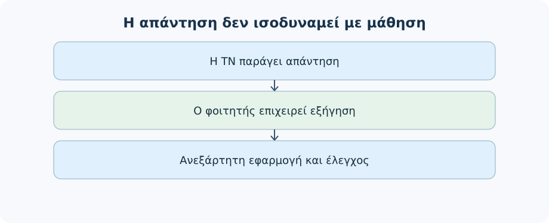
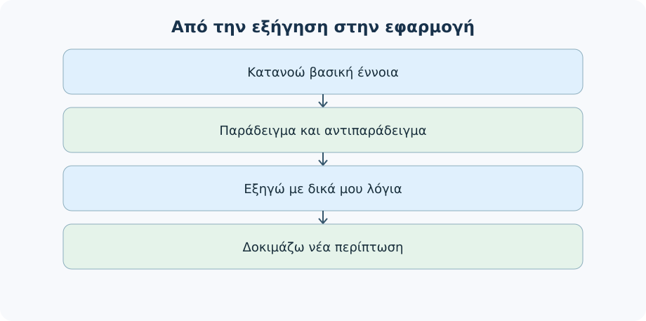
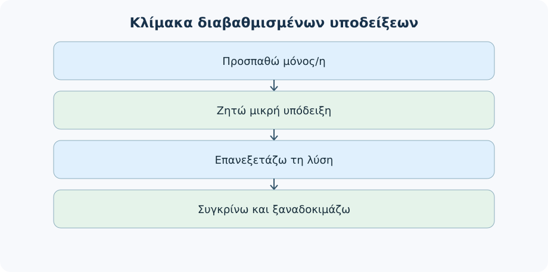
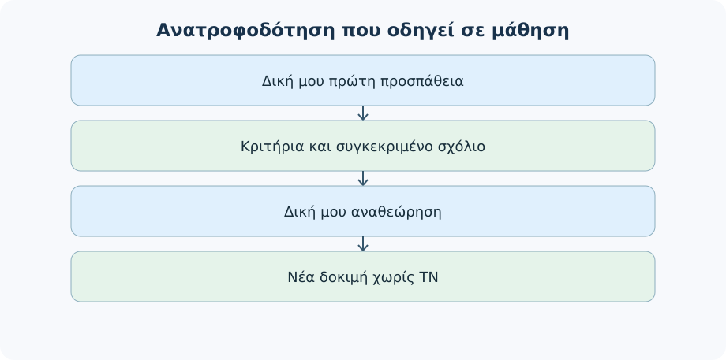
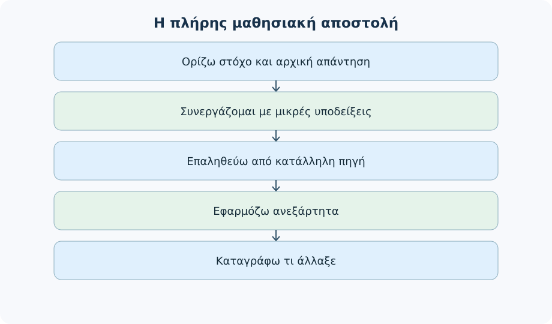

# AL00.8 — Η Τεχνητή Νοημοσύνη ως υποστήριξη της μάθησης

> **Εκδοτικά ενοποιημένη έκδοση v3 — 29 Οκτωβρίου 2026.** Εκπαιδευτικό υλικό για φοιτητές κάθε ειδικότητας. Όλα τα προσωπικά σενάρια, τα μαθησιακά διαλόγια και οι επιδόσεις που εμφανίζονται παρακάτω είναι **συνθετικά εκπαιδευτικά παραδείγματα**, όχι αποτελέσματα εμπειρικής έρευνας.

## Γιατί χρειαζόμαστε αυτή την ενότητα;

Μπορεί ένα εργαλείο ΤΝ να μας βοηθήσει να μάθουμε καλύτερα; Ναι, όταν το χρησιμοποιούμε για να **σκεφτούμε, να εξασκηθούμε, να ελέγξουμε την κατανόησή μας και να βελτιώσουμε τη δική μας εργασία**. Η ίδια τεχνολογία, όμως, μπορεί να περιορίσει τη μαθησιακή προσπάθεια αν ζητάμε έτοιμες λύσεις πριν επιχειρήσουμε να κατανοήσουμε το πρόβλημα. Το κρίσιμο ερώτημα δεν είναι «πόσο εντυπωσιακή ήταν η απάντηση της ΤΝ;» αλλά «τι μπορώ να εξηγήσω, να κάνω και να ελέγξω μόνος μου ή μόνη μου ύστερα από τη συνεργασία;».

Στην AL00.5 μάθαμε να ζητάμε βοήθεια με σαφή στόχο. Στην AL00.6 μάθαμε γιατί μια πειστική απάντηση μπορεί να είναι λανθασμένη. Στην AL00.7 μάθαμε να αναζητάμε και να τεκμηριώνουμε πληροφορίες. Τώρα συνδυάζουμε τις δεξιότητες αυτές σε **μαθησιακή διαδικασία**. Το ενδιαφέρον μετατοπίζεται από την ποιότητα της παραγόμενης απάντησης στο τεκμήριο της προσωπικής κατανόησης. Δεν θα παρουσιάσουμε μια λίστα εφαρμογών ούτε μια συλλογή «μαγικών prompts». Θα μάθουμε να επιλέγουμε πότε, πόσο και με ποιον τρόπο η ΤΝ μπορεί να βοηθήσει χωρίς να αναλαμβάνει την προσπάθεια που χρειάζεται να κάνουμε εμείς.

**Μαθησιακά αποτελέσματα.** Όταν ολοκληρώσεις την AL00.8, θα μπορείς: (α) να μετατρέπεις μια δυσκολία σε συγκεκριμένο μαθησιακό στόχο, (β) να ζητάς εξηγήσεις, παραδείγματα και διαβαθμισμένες υποδείξεις, (γ) να χρησιμοποιείς ερωτήσεις ανάκλησης και ανατροφοδότηση χωρίς να αποκαλύπτεται αμέσως η λύση, (δ) να ελέγχεις κριτικά την ανατροφοδότηση της ΤΝ, (ε) να διακρίνεις μάθηση από παραγωγή ολοκληρωμένου παραδοτέου, (στ) να προστατεύεις προσωπικά δεδομένα και να σέβεσαι τους κανόνες του μαθήματος, και (ζ) να τεκμηριώνεις τη δική σου μαθησιακή πρόοδο.

**Προαπαιτούμενα:** AL00.4–AL00.7. Δεν απαιτείται γνώση προγραμματισμού ή συγκεκριμένου επιστημονικού αντικειμένου. Σε κάθε άσκηση μπορείς να επιλέξεις παράδειγμα από τις δικές σου σπουδές.

**Κεντρικό νήμα:** Ένας φοιτητής δυσκολεύεται να κατανοήσει τη διαφορά ανάμεσα στη *συσχέτιση* και την *αιτιότητα*. Θα τον παρακολουθήσουμε από μια παθητική ερώτηση έως μια δική του εξήγηση, έλεγχο και νέα εφαρμογή. Ενδιάμεσα θα δουλέψουμε και με άσχετα αντικείμενα — ιστορία, οικονομικά, βιολογία, τεχνολογία — ώστε να μη συγχέουμε τη γνώση του παραδείγματος με την ίδια τη μαθησιακή δεξιότητα.

---
## 8.1 — Πότε η ΤΝ υποστηρίζει πραγματικά τη μάθηση;

### 8.1.1 — Η ευκολία της απάντησης και η δυσκολία της μάθησης

Φαντάσου ότι διαβάζεις ένα δύσκολο κεφάλαιο και ζητάς από ένα chatbot: «Γράψε μου τι πρέπει να ξέρω». Σε δευτερόλεπτα εμφανίζεται ένα καλοδομημένο κείμενο. Η πληροφορία μπορεί να είναι χρήσιμη, αλλά η ανάγνωσή της δεν αποδεικνύει ότι έχεις αποκτήσει τη δεξιότητα να τη χρησιμοποιήσεις. Ίσως αναγνωρίζεις τη σωστή απάντηση όταν τη βλέπεις, αλλά να μην μπορείς να την αναπαραγάγεις, να εξηγήσεις το σκεπτικό της ή να εφαρμόσεις την έννοια σε νέο παράδειγμα.

Ας διακρίνουμε τρεις δραστηριότητες: **παίρνω μια εξήγηση**, **ελέγχω αν μπορώ να ανακαλέσω την ιδέα** και **χρησιμοποιώ την ιδέα σε καινούργια περίπτωση**. Είναι διαφορετικά στάδια και κανένα δεν αντικαθιστά αυτόματα τα άλλα. Η ΤΝ μπορεί να βοηθήσει σε όλα, αρκεί το επόμενο βήμα να ζητά κάτι και από τον φοιτητή.

**Πρόβλεψη:** Δύο φοιτητές προετοιμάζονται για εξέταση. Ο Α ζητά πέντε φορές μια ολοένα καλύτερη περίληψη. Η Β διαβάζει μία εξήγηση, κλείνει το κείμενο, προσπαθεί να απαντήσει σε ερώτηση και ζητά ανατροφοδότηση. Ποιος διαθέτει σαφέστερο τεκμήριο του τι κατάλαβε; Η Β, επειδή παράγει δική της απάντηση. Αυτό δεν μας επιτρέπει να προβλέψουμε ποιος θα βαθμολογηθεί καλύτερα χωρίς πραγματική αξιολόγηση.

::: {dropdown} Ενδεικτική απάντηση
Η βελτίωση ενός παραδοτέου δεν αποδεικνύει από μόνη της βελτίωση του ανθρώπου που το χρησιμοποιεί. Χρειαζόμαστε παρατηρήσιμη προσπάθεια του φοιτητή: δική του εξήγηση, λύση, αιτιολόγηση ή αναγνώριση σφάλματος.
:::

### 8.1.2 — Τρεις ρόλοι της ΤΝ και τα όριά τους

Η ΤΝ μπορεί να λειτουργεί ως **επεξηγητής**, όταν παρουσιάζει μια έννοια σε κατανοητό επίπεδο· ως **συνομιλητής εξάσκησης**, όταν θέτει ερωτήσεις και προσαρμόζει την επόμενη υπόδειξη· και ως **βοηθός ανατροφοδότησης**, όταν σχολιάζει μια δική μας προσπάθεια. Δεν είναι αυτομάτως αξιόπιστος εξεταστής ούτε γνωρίζει από μόνη της το πραγματικό επίπεδο γνώσεων. Οι εκτιμήσεις της μπορεί να είναι εσφαλμένες ή υπερβολικά καθησυχαστικές.

| Ρόλος | Χρήσιμη ενέργεια | Τι δεν συμπεραίνουμε |
|---|---|---|
| Επεξηγητής | Εξηγεί με δύο διαφορετικούς τρόπους | Ότι κάθε λεπτομέρεια είναι σωστή |
| Συνομιλητής | Δίνει μία ερώτηση και περιμένει απάντηση | Ότι η ερώτηση μετρά πλήρως την ικανότητα |
| Βοηθός ανατροφοδότησης | Επισημαίνει αδύναμα σημεία στο επιχείρημά μου | Ότι η κρίση του είναι αλάνθαστη |

### 8.1.3 — «Η ΤΝ το έκανε» ή «έμαθα να το κάνω»;

Ας δούμε μια εργασία: «Εξήγησε γιατί η συσχέτιση δεν αποδεικνύει αιτιότητα και δώσε νέο παράδειγμα». Αν αντιγράψεις μία άρτια απάντηση, έχεις προϊόν αλλά όχι απαραίτητα τεκμήριο κατανόησης. Αν διαβάσεις την απάντηση, την κλείσεις και γράψεις δική σου εξήγηση με καινούργιο παράδειγμα, δημιουργείς τεκμήριο που μπορεί να αξιολογηθεί.

**Μικρή άσκηση:** Αναδιατύπωσε το «Βγάλε μου έτοιμη την εργασία» σε αίτημα μαθησιακής υποστήριξης. Μια κατάλληλη εκδοχή είναι: «Θα δοκιμάσω μόνος μου να απαντήσω. Κάνε μου δύο ερωτήσεις που αποκαλύπτουν πιθανές παρανοήσεις και δώσε ανατροφοδότηση χωρίς να γράψεις εσύ την τελική απάντηση». Η ενδεικτική λύση δεν είναι υποχρεωτικό λεκτικό πρότυπο: ο στόχος είναι να αλλάξει **ποιος παράγει τη μαθησιακή προσπάθεια**.

<a href="quiz/al00_8_q1.html" target="_blank" rel="noopener">Άνοιγμα αυτοαξιολόγησης 1</a>

### 8.1.4 — Ο προσωπικός κανόνας πριν ανοίξω ένα εργαλείο

Πριν ζητήσεις βοήθεια, γράψε με μία πρόταση: «Στο τέλος θέλω να μπορώ να…». Αν δυσκολεύεσαι, ξεκίνησε από ρήματα όπως *εξηγώ, συγκρίνω, υπολογίζω, αιτιολογώ, εφαρμόζω, ελέγχω*. Πρόσεξε τη διαφορά ανάμεσα στο «να έχω μια περίληψη» και στο «να μπορώ να εξηγήσω τα τρία επιχειρήματα του συγγραφέα χωρίς να βλέπω την περίληψη».

**Έλεγχος:** Μπορείς να περιγράψεις πώς θα καταλάβεις ότι πέτυχες τον στόχο; Αν όχι, ο στόχος χρειάζεται να γίνει πιο συγκεκριμένος.

---

## 8.2 — Μετατρέπω τη δυσκολία σε προσωπική μαθησιακή αποστολή

### 8.2.1 — Από το «δεν καταλαβαίνω» στο «δυσκολεύομαι εδώ»

Ένας φοιτητής γράφει: «Δεν καταλαβαίνω στατιστική». Η πρόταση περιγράφει ένα συναίσθημα, όχι ακόμη ένα ελέγξιμο εμπόδιο. Με περισσότερη διερεύνηση αποκαλύπτεται ότι μπορεί να δώσει ορισμό της συσχέτισης, αλλά θεωρεί λανθασμένα πως δύο μεταβλητές που αυξάνονται μαζί έχουν αναγκαστικά σχέση αιτίας και αποτελέσματος. Τώρα διαθέτουμε συγκεκριμένο μαθησιακό σημείο: **να ξεχωρίζει την παρατηρούμενη σχέση από την τεκμηρίωση αιτιότητας**.

Το ίδιο ισχύει σε κάθε πεδίο: «δεν καταλαβαίνω ιστορία» μπορεί να σημαίνει δυσκολία διάκρισης πρωτογενούς πηγής και ιστορικής ερμηνείας· «δεν καταλαβαίνω προγραμματισμό» μπορεί να σημαίνει δυσκολία με την επανάληψη· «δεν καταλαβαίνω οικονομικά» μπορεί να σημαίνει σύγχυση ανάμεσα σε έσοδα και κέρδος. Η ΤΝ μπορεί να μας βοηθήσει να εντοπίσουμε μια πιθανή δυσκολία, αλλά εμείς επιβεβαιώνουμε αν αυτή είναι πράγματι το πρόβλημά μας.

### 8.2.2 — Η αρχική αυτοδοκιμή

Πριν πάρεις νέα εξήγηση, προσπάθησε για δύο ή τρία λεπτά να απαντήσεις μόνος σου: «Τι ξέρω; Ποιο παράδειγμα μπορώ να δώσω; Τι ακριβώς δεν μπορώ να εξηγήσω;». Η αυτοδοκιμή δεν χρειάζεται να είναι βαθμολογούμενη. Μας προσφέρει ένα σημείο αναφοράς ώστε να δούμε τι αλλάζει μετά τη συνεργασία.

**Αναλυμένο παράδειγμα.** Αρχική απάντηση: «Αν περισσότερες ώρες μελέτης συνδέονται με καλύτερο βαθμό, οι επιπλέον ώρες προκαλούν οπωσδήποτε τον καλύτερο βαθμό». Η απάντηση δείχνει παρανόηση. Καλύτερο αίτημα: «Θα σου δώσω τη σκέψη μου. Μην απαντήσεις αμέσως. Ρώτησέ με ποιοι άλλοι παράγοντες θα μπορούσαν να επηρεάζουν και τα δύο μεγέθη». Η ερώτηση καθοδηγεί χωρίς να αντικαθιστά την προσπάθεια.

### 8.2.3 — Η μαθησιακή κάρτα

Δημιούργησε μια μικρή κάρτα με τα εξής πεδία: **στόχος**, **ό,τι ξέρω ήδη**, **συγκεκριμένη δυσκολία**, **βοήθεια που θα ζητήσω**, **δοκιμή χωρίς ΤΝ**, **κριτήριο επιτυχίας**. Η κάρτα δεν είναι γραφειοκρατικό έντυπο· προστατεύει την αυτονομία μας, γιατί κάνει σαφές ποιο μέρος της εργασίας αναλαμβάνει ο φοιτητής.

| Πεδίο | Συμπληρωμένο συνθετικό παράδειγμα |
|---|---|
| Στόχος | Να εξηγώ γιατί μια συσχέτιση δεν αρκεί για αιτιότητα |
| Ξέρω ήδη | Μπορώ να αναγνωρίσω δύο μεταβλητές που μεταβάλλονται μαζί |
| Δυσκολεύομαι | Θεωρώ την ταυτόχρονη μεταβολή απόδειξη αιτίας |
| Ζητώ από ΤΝ | Δύο παραδείγματα, μία υπόδειξη κάθε φορά |
| Δοκιμάζω μόνος μου | Νέα περίπτωση με δύο πιθανούς τρίτους παράγοντες |
| Επιτυχία | Δική μου εξήγηση χωρίς βοήθεια και έλεγχος από πηγή/διδάσκοντα |

### 8.2.4 — Η βοήθεια αλλάζει ανάλογα με τον στόχο

Μια έννοια απαιτεί ίσως εξήγηση, ενώ μια δεξιότητα απαιτεί άσκηση. Για απομνημόνευση ορολογίας μπορεί να χρησιμεύουν ερωτήσεις ανάκλησης. Για επίλυση προβλήματος χρειάζεται εφαρμογή σε νέα δεδομένα. Για επιχειρηματολογία χρειάζεται κριτήριο και τεκμηρίωση. Η επιλογή εργαλείου ακολουθεί το μαθησιακό πρόβλημα, όχι αντίστροφα.

**Δραστηριότητα:** Διάλεξε έναν από τους στόχους «να θυμηθώ τους ορισμούς», «να λύσω νέα άσκηση», «να κρίνω δύο αντικρουόμενα επιχειρήματα». Γράψε για τον καθένα μία κατάλληλη δοκιμή. Ενδεικτικά: ανάκληση χωρίς σημειώσεις· νέα άσκηση με διαφορετικά δεδομένα· συγκριτικός πίνακας τεκμηρίων και αδύναμων σημείων. Μια καλή περίληψη δεν υποκαθιστά καμία από αυτές τις δοκιμές.

---

## 8.3 — Μαθαίνω μέσα από εξηγήσεις, παραδείγματα και ερωτήσεις

### 8.3.1 — Μία εξήγηση δεν ταιριάζει σε όλους

Όταν μια εξήγηση είναι πολύ τεχνική, μπορούμε να ζητήσουμε διαφορετική προσέγγιση: «Χρησιμοποίησε απλή γλώσσα, αλλά κράτησε την επιστημονική ακρίβεια». Μπορούμε επίσης να ζητήσουμε διαφορετικές αναπαραστάσεις: σύντομο παράδειγμα, πίνακα σύγκρισης ή διάγραμμα. Η απλοποίηση έχει όριο: αν αφαιρεί τη συνθήκη που κάνει μια πρόταση σωστή, δημιουργεί νέα παρανόηση.

Παράδειγμα στην οικονομία: «Έσοδα είναι τα χρήματα που εισπράττει μια επιχείρηση από πωλήσεις· κέρδος προκύπτει αφού αφαιρεθούν τα σχετικά έξοδα». Η χρήσιμη απλοποίηση δεν πρέπει να καταλήγει στο λάθος «όσα εισπράττω είναι κέρδος». Ζήτησε από την ΤΝ και **ένα αντιπαράδειγμα** που αποκαλύπτει το όριο της απλής εξήγησης.

#### Όταν απλοποιούμε χωρίς να χάνουμε την ακρίβεια

Σκέψου ότι ένας φοιτητής Οικονομικών ρωτά τι σημαίνει κέρδος. Μια υπεραπλουστευμένη απάντηση είναι: «Κέρδος είναι όσα χρήματα μπαίνουν στο ταμείο». Η πρόταση μπερδεύει τις εισπράξεις με το οικονομικό αποτέλεσμα. Μια χρησιμότερη αρχική εξήγηση λέει: «Το κέρδος προκύπτει όταν από τα έσοδα αφαιρέσουμε τα έξοδα που αντιστοιχούν στην περίοδο, με τις απαραίτητες λογιστικές διακρίσεις». Για πρώτο παράδειγμα, μια μικρή δραστηριότητα έχει έσοδα 500 € και σχετικά έξοδα 380 €· η απλή διαφορά είναι 120 €. Δεν ισχυριζόμαστε ότι αυτή η αριθμητική περιγράφει πλήρως κάθε λογιστική περίπτωση.

**Δοκίμασε:** Ζήτησε από την ΤΝ μία εξήγηση για μαθητή λυκείου και μία για φοιτητή του πρώτου εξαμήνου. Εντόπισε μία πληροφορία που παραμένει σωστή και στις δύο, καθώς και ένα κρίσιμο όριο που δεν πρέπει να εξαφανιστεί.

::: {dropdown} Ενδεικτική ανατροφοδότηση
Οι διατυπώσεις μπορεί να διαφέρουν ως προς τον όρο και τη λεπτομέρεια, αλλά δεν πρέπει να ταυτίζουν τα έσοδα με το κέρδος. Μια υπερβολικά σύντομη εξήγηση που οδηγεί σε λάθος υπολογισμό είναι μαθησιακά ανεπαρκής ακόμη και αν ακούγεται εύκολη.
:::

### 8.3.2 — Το παράδειγμα και το αντιπαράδειγμα

Ας εξετάσουμε τη συσχέτιση: «Τα άτομα με περισσότερες ώρες μελέτης έχουν κατά μέσο όρο καλύτερους βαθμούς». Η πρόταση, αν προέρχεται από συγκεκριμένα δεδομένα, περιγράφει παρατηρούμενη σχέση, όχι απόδειξη αιτιότητας. Ένα **αντιπαράδειγμα** μάς αναγκάζει να σκεφτούμε εναλλακτικές εξηγήσεις: προηγούμενες γνώσεις, συνθήκες μελέτης ή επιλογή του δείγματος. Δεν αποδεικνύουμε έτσι ότι οι ώρες δεν παίζουν ρόλο· αποδεικνύουμε ότι η μοναδική ερμηνεία δεν είναι δικαιολογημένη.

Αντίστοιχα στην ιστορία, μία πηγή μπορεί να καταγράφει την οπτική ενός συμμετέχοντα χωρίς να αποτυπώνει όλα τα γεγονότα. Στη βιολογία, ένα παράδειγμα αλληλεπίδρασης δύο παραγόντων δεν επιτρέπει γενίκευση σε κάθε οργανισμό. Τα αντιπαραδείγματα εκπαιδεύουν στη **διάκριση κανόνα, προϋπόθεσης και ορίου**.

#### Εφαρμογή του αντιπαραδείγματος στη βιολογία

Σκεφτόμαστε τη γενική ιδέα «οι οργανισμοί χρειάζονται κατάλληλες συνθήκες για να αναπτυχθούν». Ένα παράδειγμα είναι ένα φυτό που αναπτύσσεται σε συνθήκες επαρκούς φωτισμού και νερού. Δεν συνεπάγεται όμως ότι «όσο περισσότερο νερό, τόσο μεγαλύτερη ανάπτυξη» χωρίς όριο. Η υπερβολική παροχή νερού μπορεί να δημιουργήσει προβλήματα στις ρίζες. Το αντιπαράδειγμα δεν αναιρεί ότι το νερό είναι απαραίτητο· δείχνει ότι η σχέση εξαρτάται από συνθήκες.

**Τρία ερωτήματα εφαρμογής:** (α) Ποιος είναι ο αρχικός κανόνας; (β) Ποια συνθήκη παραλείφθηκε από την υπεργενίκευση; (γ) Πώς θα αναδιατύπωνες τον κανόνα ώστε να μη γίνεται απόλυτος;

::: {dropdown} Ενδεικτική λύση
Το νερό είναι αναγκαίο αλλά η ποσότητα και οι συνθήκες έχουν σημασία. Μια πιο ακριβής διατύπωση είναι ότι η ανάπτυξη απαιτεί επαρκές νερό εντός κατάλληλων ορίων, μαζί με άλλους παράγοντες. Η συγκεκριμένη ανάγκη διαφέρει ανά είδος και συνθήκες.
:::

### 8.3.3 — Από την εξήγηση στην ερώτηση

Η ΤΝ μπορεί να δημιουργήσει ερωτήσεις, όμως η αξία τους εξαρτάται από το αν απαιτούν σκέψη. «Τι είναι η αιτιότητα;» ελέγχει κυρίως ανάκληση ορισμού. «Ποια άλλα στοιχεία θα χρειαζόσουν πριν ισχυριστείς αιτιότητα σε αυτό το παράδειγμα;» απαιτεί αιτιολόγηση. «Δώσε δικό σου παράδειγμα και εξήγησε πού θα μπορούσε να γίνει λάθος» ζητά μεταφορά γνώσης.

Ένα λειτουργικό αίτημα: «Εξήγησε σύντομα την έννοια. Έπειτα κάνε μου **μία ερώτηση τη φορά**, περίμενε τη δική μου απάντηση και δώσε υπόδειξη αντί για πλήρη λύση αν κάνω λάθος. Μετά από δύο προσπάθειες μπορούμε να δούμε την ενδεικτική λύση».

#### Από την ανάκληση στην κριτική τεκμηρίωση

Ας μελετήσουμε τη διάκριση «πρωτογενής πηγή — ιστορική ερμηνεία». Μια ερώτηση **ανάκλησης** είναι: «Τι ονομάζουμε πρωτογενή πηγή;». Μια ερώτηση **εφαρμογής** είναι: «Ένα ημερολόγιο της εποχής και μια σύγχρονη ιστορική μελέτη έχουν τον ίδιο ρόλο; Εξήγησε». Μια ερώτηση **κριτικής τεκμηρίωσης** είναι: «Γιατί μια αυθεντική μαρτυρία δεν αρκεί από μόνη της για να περιγράψουμε ολόκληρο ένα ιστορικό γεγονός;».

Η τρίτη ερώτηση δεν είναι αυτομάτως ανώτερη σε κάθε περίσταση: όποιος δεν γνωρίζει ακόμη τι είναι πηγή μπορεί να χρειάζεται πρώτα την πρώτη. Μπορούμε λοιπόν να ζητάμε από την ΤΝ να διαλέγει το επόμενο επίπεδο **με βάση τις απαντήσεις μας**, όχι να ανεβάζει μηχανικά τη δυσκολία.

**Άσκηση:** Για ένα μάθημα της ειδικότητάς σου, σύνταξε μία ερώτηση ανάκλησης και μία μεταφοράς της γνώσης. Απάντησε τη δεύτερη χωρίς ΤΝ. Στη συνέχεια εντόπισε από το εκπαιδευτικό υλικό ένα κριτήριο ορθότητας.

### 8.3.4 — Δύο διαφορετικές εξηγήσεις: τι συγκρίνω;

Αν ζητήσουμε δύο εξηγήσεις, δεν επιλέγουμε απλώς την πιο ευχάριστη. Ελέγχουμε αν κρατούν το ίδιο επιστημονικό νόημα, αν αποφεύγουν αυθαίρετες γενικεύσεις, αν το παράδειγμα ταιριάζει στον ορισμό και αν μπορεί να μεταφερθεί σε νέα περίπτωση.

**Άσκηση κρίσης:** Εξήγηση Α: «Η συσχέτιση αποδεικνύει ότι ένα γεγονός προκαλεί το άλλο». Εξήγηση Β: «Η συσχέτιση δείχνει σχέση ανάμεσα σε μεταβλητές, αλλά χρειάζονται περισσότερα στοιχεία για αιτιώδες συμπέρασμα». Ποια διατηρεί τον ουσιαστικό περιορισμό; Η Β. Αν η ΤΝ επέλεγε την Α επειδή είναι «πιο απλή», θα έπρεπε να τη διορθώσουμε.

### 8.3.5 — Μικρό εργαστήριο: εξήγησέ το σε άλλον

Επίλεξε μια έννοια από το μάθημά σου. Ζήτησε από την ΤΝ μία σύντομη εξήγηση και ένα αντιπαράδειγμα. Κλείσε την απάντηση. Γράψε δικό σου κείμενο περίπου 100–150 λέξεων σαν να εξηγούσες την έννοια σε συμφοιτητή. Στη συνέχεια άνοιξε ξανά την πηγή του μαθήματος και έλεγξε: ποια κρίσιμη προϋπόθεση ξέχασες; Ποιο σημείο χρειάζεται διόρθωση; Τι μπορείς να πεις πλέον χωρίς να δεις το αρχικό κείμενο;

::: {dropdown} Οδηγός αυτοαξιολόγησης
Μην αξιολογήσεις το κείμενό σου μόνο για ορθογραφία και ροή. Χρειάζεται σωστή έννοια, σχετικό παράδειγμα, όρια εφαρμογής και δυνατότητα να απαντήσεις σε μια διαφορετική ερώτηση. Η ΤΝ μπορεί να προτείνει διορθώσεις, αλλά η τελική τεκμηρίωση προέρχεται από το εκπαιδευτικό υλικό ή άλλες αξιόπιστες πηγές.
:::

---

## 8.4 — Εξάσκηση χωρίς να μου αποκαλύπτεται αμέσως η λύση

### 8.4.1 — Γιατί η πρόωρη λύση μπορεί να στερήσει εξάσκηση

Ας υποθέσουμε ότι προσπαθείς να λύσεις μια εξίσωση και η ΤΝ δίνει αμέσως όλα τα βήματα. Μπορεί να καταλάβεις την παρουσίαση, αλλά δεν ξέρεις ακόμη αν θα επέλεγες μόνος σου το πρώτο βήμα. Στη μάθηση χρειαζόμαστε ευκαιρίες επιλογής, λάθους και αναθεώρησης. Η έγκαιρη βοήθεια είναι χρήσιμη όταν έχουμε κολλήσει· η άμεση πλήρης λύση δεν είναι η μόνη μορφή βοήθειας.

Το θέμα δεν είναι να δυσκολευόμαστε άσκοπα. Αν μια άσκηση ξεπερνά τις διαθέσιμες γνώσεις, η αναγκαία εξήγηση είναι μέρος της διδασκαλίας. Αν όμως γνωρίζουμε αρκετά για να προσπαθήσουμε, μπορούμε να ζητήσουμε η ΤΝ να μη μας αφαιρέσει αυτό το μέρος της προσπάθειας.

### 8.4.2 — Κλίμακα υποδείξεων

Μια χρήσιμη διαδικασία είναι: **προσπαθώ → λαμβάνω μία μικρή υπόδειξη → ξαναπροσπαθώ → ζητώ περισσότερο συγκεκριμένη βοήθεια → συγκρίνω με ενδεικτική λύση → λύνω νέο πρόβλημα μόνος μου**. Δεν είναι άκαμπτη συνταγή· τη σταματάμε ή τη συντομεύουμε όπου χρειάζεται.

#### Πότε ανεβαίνουμε και πότε κατεβαίνουμε την κλίμακα;

Η υπόδειξη πρέπει να είναι όσο μικρή χρειάζεται, αλλά όχι τόσο αόριστη ώστε να προκαλεί άσκοπη απογοήτευση. Σε ένα μαθηματικό πρόβλημα, το «σκέψου καλύτερα» δεν βοηθά. Η φράση «ποια δεδομένα δίνονται και ποιο μέγεθος αναζητάς;» είναι πρώτο σκαλοπάτι· το «ποια σχέση συνδέει αυτά τα μεγέθη;» είναι δεύτερο· η επίδειξη ενός παρόμοιου λυμένου παραδείγματος μπορεί να είναι τρίτο.

Αν μετά από δύο προσπάθειες ο φοιτητής δεν γνωρίζει ούτε την απαιτούμενη βασική έννοια, το να συνεχίζουμε με κρυπτικές υποδείξεις δεν είναι αποτελεσματική στήριξη. Χρειάζεται σύντομη επαναδιδασκαλία και έπειτα νέα δοκιμή. Αν, αντίθετα, λύνει με μικρή βοήθεια, μπορούμε να αποσύρουμε σταδιακά τις υποδείξεις.

**Δραστηριότητα κρίσης:** Διάλεξε ποια από τις δύο παρεμβάσεις είναι καταλληλότερη για φοιτητή που έχει κολλήσει στην αρχή: Α «Η λύση είναι 12, αντέγραψέ την» ή Β «Σημείωσε πρώτα ποια ποσότητα σου ζητά η εκφώνηση». Η Β διατηρεί δυνατότητα προσπάθειας, αλλά δεν αρκεί αν ο φοιτητής αγνοεί όλες τις προαπαιτούμενες έννοιες.

### 8.4.3 — Εργασμένος διάλογος με τρεις προσπάθειες

**Άσκηση (συνθετική):** Σε ένα σύνολο παρατηρήσεων, οι ώρες προετοιμασίας και η επίδοση εμφανίζουν θετική συσχέτιση. Μπορούμε να πούμε ότι οι επιπλέον ώρες *οπωσδήποτε* προκαλούν καλύτερη επίδοση;

**Φοιτητής, προσπάθεια 1:** «Ναι, γιατί αυξάνονται μαζί». **ΤΝ, υπόδειξη 1:** «Μπορείς να σκεφτείς έναν τρίτο παράγοντα που επηρεάζει και τα δύο;». **Φοιτητής, προσπάθεια 2:** «Ίσως το ενδιαφέρον για το μάθημα ή οι προηγούμενες γνώσεις». **ΤΝ, υπόδειξη 2:** «Τι αλλάζει αυτό στο πόσο βέβαιος μπορεί να είναι ο αρχικός ισχυρισμός;». **Φοιτητής, προσπάθεια 3:** «Η συσχέτιση δεν αρκεί για να αποδειχθεί αιτιότητα, γιατί υπάρχουν εναλλακτικές εξηγήσεις». **ΤΝ, ανατροφοδότηση:** «Η απάντηση διαχωρίζει σωστά παρατήρηση και αιτιώδη ερμηνεία. Πρόσθεσε τι είδους πρόσθετη μελέτη ή τεκμηρίωση θα χρειαζόταν για ισχυρότερο αιτιώδες συμπέρασμα».

Ο διάλογος είναι **σχεδιασμένη εκπαιδευτική προσομοίωση**, όχι καταγραφή πραγματικής συνομιλίας. Η ουσιαστική πρόοδος βρίσκεται στις **απαντήσεις του φοιτητή**, όχι στο πόσο εντυπωσιακές είναι οι υποδείξεις.

#### Η ίδια μέθοδος σε ένα αριθμητικό πρόβλημα

**Συνθετικό πρόβλημα:** Σε μια μικρή εκδήλωση πωλήθηκαν 18 εισιτήρια των 5 € και 12 εισιτήρια των 3 €. Ποια είναι τα συνολικά έσοδα;

**Φοιτήτρια:** «Έκανα 18 + 12 και βρήκα 30 ευρώ». **ΤΝ (διάγνωση χωρίς λύση):** «Τα 18 και 12 είναι ποσότητες εισιτηρίων. Με ποια μονάδα μετριούνται τα έσοδα;» **Φοιτήτρια:** «Με ευρώ. Άρα πρέπει να λάβω υπόψη τις τιμές». **ΤΝ (υπόδειξη):** «Πώς βρίσκεις τα έσοδα για κάθε κατηγορία χωριστά;». **Φοιτήτρια:** «18 × 5 = 90 € και 12 × 3 = 36 €, συνολικά 126 €». **ΤΝ (ανατροφοδότηση):** «Ο υπολογισμός είναι σωστός. Έλεγξε ότι πρόσθεσες ευρώ με ευρώ και όχι εισιτήρια με ευρώ».

Τώρα δοκίμασε **χωρίς ΤΝ**: 15 εισιτήρια των 4 € και 9 των 6 €. Πόσα είναι τα συνολικά έσοδα; Πριν δεις την απάντηση, γράψε τις πράξεις και τις μονάδες τους.

::: {dropdown} Έλεγχος της ανεξάρτητης προσπάθειας
Τα συνολικά έσοδα είναι **114 €**: 15 × 4 + 9 × 6 = 60 + 54. Δεν αρκεί το 114· χρειάζεται να εξηγήσεις ότι πολλαπλασιάζουμε πλήθος εισιτηρίων με τιμή ανά εισιτήριο και προσθέτουμε χρηματικά ποσά.
:::

::: {dropdown} Τι διδάσκει το παράδειγμα;
Η ανατροφοδότηση εντόπισε σφάλμα μονάδων και πράξης, δεν αποκάλυψε από την αρχή το τελικό ποσό, και ακολούθησε νέα άσκηση. Αν οι απαιτούμενες πράξεις ήταν τελείως άγνωστες, θα χρειαζόταν πρώτα απλή επεξήγηση του πολλαπλασιασμού.
:::

### 8.4.4 — Τι γίνεται όταν η υπόδειξη είναι λανθασμένη;

Η ΤΝ μπορεί να κατευθύνει προς λάθος λύση. Αν μια υπόδειξη έρχεται σε αντίθεση με το βιβλίο, με δοσμένες προϋποθέσεις ή με τα δεδομένα της άσκησης, δεν τη δεχόμαστε επειδή «φαίνεται λογική». Μπορούμε να ζητήσουμε: «Δείξε ποια υπόθεση χρησιμοποιείς», να συγκρίνουμε με την αρχική εκφώνηση και να ελέγξουμε με διαφορετικό τρόπο. Αν παραμένει διαφωνία, ζητάμε τεκμηρίωση από το υλικό μαθήματος ή τον διδάσκοντα.

#### Παράδειγμα εσφαλμένης υπόδειξης που ακούγεται βέβαιη

Στο προηγούμενο παράδειγμα εισιτηρίων, φαντάσου ότι η ΤΝ επιμένει: «Τα συνολικά έσοδα είναι 30 €, επειδή πουλήθηκαν 30 εισιτήρια». Η απάντηση δεν είναι απλώς αριθμητικά λανθασμένη· συγχέει **πλήθος τεμαχίων** με **χρηματική αξία**. Μπορούμε να ελέγξουμε την υπόδειξη ανεξάρτητα με τον πίνακα ποσότητα × τιμή.

**Μικρή αποστολή:** Γράψε πώς θα διαφωνούσες τεκμηριωμένα, χωρίς να ζητήσεις απλώς «ξανασκέψου». Ενδεικτικά: «Η απάντηση 30 μετρά εισιτήρια, όχι ευρώ. Υπολόγισε ξεχωριστά ποσότητα επί τιμή για κάθε κατηγορία και έλεγξε τις μονάδες». Η χρήσιμη διόρθωση ονομάζει το σφάλμα και το κριτήριο ελέγχου.

### 8.4.5 — Άσκηση χωρίς chatbot

Ένας συμφοιτητής διαβάζει μια άσκηση και σου λέει αμέσως τη λύση. Γράψε δύο ερωτήσεις που θα μπορούσε αντί αυτού να σου κάνει για να σε βοηθήσει να σκεφτείς. Δοκίμασε τη διαδικασία σε χαρτί. **Η δεξιότητα των κατάλληλων ερωτήσεων δεν εξαρτάται από το εργαλείο**: η ΤΝ είναι μια δυνατότητα εφαρμογής της.

::: {dropdown} Ενδεικτική προσέγγιση
Οι ερωτήσεις μπορούν να είναι «Τι γνωρίζεις από την εκφώνηση;» και «Ποιο πρώτο βήμα μπορείς να δικαιολογήσεις;». Η αποτελεσματικότητά τους εξαρτάται από το συγκεκριμένο πρόβλημα· δεν αρκεί να επαναλαμβάνονται μηχανικά.
:::

<a href="quiz/al00_8_q2.html" target="_blank" rel="noopener">Άνοιγμα αυτοαξιολόγησης 2</a>

---

## 8.5 — Ανατροφοδότηση, λάθη και ανεξάρτητη επανάληψη

### 8.5.1 — Ζητώ κριτήρια, όχι απλώς έπαινο

Έχεις γράψει μια μικρή απάντηση και ζητάς: «Είναι καλή;». Το chatbot μπορεί να σου απαντήσει «Εξαιρετική!», χωρίς να επισημάνει ουσιαστικές αδυναμίες. Αποτελεσματικότερο είναι να ζητήσεις ανατροφοδότηση **ως προς συγκεκριμένα κριτήρια**: επιστημονική ορθότητα, σαφήνεια, τεκμηρίωση, λογική ακολουθία και τήρηση της εκφώνησης. Καλύτερα να ζητάμε να αναφέρει πού στηρίζεται κάθε παρατήρηση.

Παράδειγμα: «Αξιολόγησε την απάντησή μου ως προς τον σωστό διαχωρισμό συσχέτισης και αιτιότητας, την επάρκεια του παραδείγματος και την αποφυγή βεβαιότητας χωρίς στοιχεία. Για κάθε σημείο, παράθεσε σύντομο απόσπασμα της δικής μου απάντησης και πρότεινε μία ερώτηση που θα με βοηθήσει να τη βελτιώσω. Μην ξαναγράψεις όλη την εργασία».

#### Σύγκριση ανατροφοδότησης σε ένα γραπτό

**Απάντηση φοιτητή:** «Η εργασία από το σπίτι βελτιώνει πάντοτε την παραγωγικότητα επειδή δεν χάνουμε χρόνο στη μετακίνηση». Η πρόταση ίσως εκφράζει μία λογική υπόθεση, αλλά δεν τεκμηριώνει τον καθολικό ισχυρισμό «πάντοτε» και παραλείπει διαφορές ανά εργασία, συνθήκες και μέτρο παραγωγικότητας.

**Ανατροφοδότηση Α:** «Εξαιρετική ανάλυση, συνέχισε έτσι!». Είναι ενθαρρυντική, αλλά δεν εντοπίζει μαθησιακό σημείο. **Ανατροφοδότηση Β:** «Ανέφερες έναν πιθανό παράγοντα, τον χρόνο μετακίνησης. Το “πάντοτε” είναι αδικαιολόγητη γενίκευση. Ποια διαφορετικά εργασιακά περιβάλλοντα θα μπορούσαν να δώσουν διαφορετικό αποτέλεσμα; Αναδιατύπωσε την πρόταση ως υπόθεση που χρειάζεται δεδομένα». Η δεύτερη παρέχει συγκεκριμένο κριτήριο και επόμενο βήμα.

**Άσκηση:** Δώσε μία δική σου προφορική ή γραπτή εξήγηση. Ζήτησε δύο παρατηρήσεις που συνδέονται με ακριβείς φράσεις της απάντησής σου και μία ερώτηση αυτοδιόρθωσης. Αν η ΤΝ αναφέρει κάτι που δεν υπάρχει στο κείμενό σου, απόρριψε εκείνο το σημείο της ανατροφοδότησης.

### 8.5.2 — Από την υπόδειξη στη δική μου διόρθωση

Η διαδικασία δεν τελειώνει όταν η ΤΝ επισημάνει ένα λάθος. Ο φοιτητής πρέπει να το εξηγήσει με δικά του λόγια και να επιλέξει τη διόρθωση. Αν το σύστημα δώσει απευθείας την τελική έκδοση, παραλείπεται το μέρος της απόφασης. Προτείνουμε επομένως: πρώτα **διάγνωση σημείου**, έπειτα **αυτοδιόρθωση**, μετά **επανέλεγχος**.

**Εργασμένο παράδειγμα.** Αρχική φράση: «Όσοι κοιμούνται περισσότερο παίρνουν σίγουρα καλύτερους βαθμούς, άρα ο ύπνος είναι η μοναδική αιτία». Αρχική παρατήρηση της ΤΝ: «Η φράση περιέχει αδικαιολόγητη βεβαιότητα». Διόρθωση του φοιτητή: «Μια συσχέτιση ανάμεσα στη διάρκεια ύπνου και την επίδοση, εφόσον παρατηρείται σε συγκεκριμένα δεδομένα, δεν αποδεικνύει από μόνη της μοναδική αιτιώδη σχέση». Το νόημα προκύπτει από νέα διατύπωση του φοιτητή — όχι από μηχανική αντιγραφή.

### 8.5.3 — Τρεις τύποι λάθους, τρεις στρατηγικές

| Τύπος δυσκολίας | Παράδειγμα | Κατάλληλη επόμενη κίνηση |
|---|---|---|
| Γνωστικό κενό | Δεν γνωρίζω τη βασική έννοια | Επεξήγηση και ένα απλό παράδειγμα |
| Παρανόηση | Γνωρίζω όρο, αλλά τον εφαρμόζω λανθασμένα | Αντιπαράδειγμα και αιτιολόγηση |
| Σφάλμα εκτέλεσης | Γνωρίζω μέθοδο, χάνω βήμα | Εντοπισμός του βήματος και νέα άσκηση |

Είναι χρήσιμο να μη αντιμετωπίζουμε όλα τα λάθη με «άλλη μία περίληψη». Η κατάλληλη βοήθεια εξαρτάται από τη φύση του προβλήματος.

#### Εφαρμογή διάγνωσης — το ίδιο λάθος μπορεί να έχει διαφορετική αιτία

Ένας φοιτητής απαντά ότι το κέρδος είναι ίσο με τα έσοδα. Μπορεί να μη γνωρίζει τον ορισμό (γνωστικό κενό), να γνωρίζει τον ορισμό αλλά να θεωρεί ότι δεν υπήρχαν έξοδα στην άσκηση (παρανόηση δεδομένων) ή να έχει αφαιρέσει λανθασμένα τα έξοδα (σφάλμα εκτέλεσης). Χωρίς να ζητήσουμε να εξηγήσει τη σκέψη του, δεν ξέρουμε ποια βοήθεια θα ωφελούσε.

**Δραστηριότητα:** Ετοίμασε τρεις διαφορετικές πρώτες ερωτήσεις προς τον φοιτητή. Ενδεικτικά: «Πώς ορίζεις το κέρδος;», «Ποια έξοδα δίνει η εκφώνηση;», «Μπορείς να μου δείξεις τον υπολογισμό σου;». Η επιλογή κατάλληλης παρέμβασης στηρίζεται σε στοιχεία της προσπάθειας, όχι σε εικασία για το τι “δεν ξέρει” το άτομο.

### 8.5.4 — Η ανατροφοδότηση της ΤΝ χρειάζεται και αυτή έλεγχο

Αν η ΤΝ χαρακτηρίσει λανθασμένη μια σωστή απάντηση, μια άκριτη αποδοχή της κρίσης μπορεί να μας απομακρύνει από τη γνώση. Ελέγχουμε αν χρησιμοποίησε τη σωστή εκφώνηση, αν εισήγαγε άγνωστες υποθέσεις και αν τεκμηριώνει τις διορθώσεις της. Σημαντικές ακαδημαϊκές ή επαγγελματικές αποφάσεις δεν πρέπει να βασίζονται σε αυτόματη αξιολόγηση χωρίς κατάλληλη ανθρώπινη κρίση.

#### Πρακτική διάκριση: εύλογη κριτική ή λανθασμένη διόρθωση;

Μια ΤΝ μπορεί να σχολιάσει ένα κείμενο: «Δεν έχεις συμπεριλάβει καθόλου πηγές», ενώ ο φοιτητής έχει παραθέσει δύο πηγές και έχει αποδώσει σωστά τους ισχυρισμούς. Πριν αποδεχθεί την κρίση, ο φοιτητής ελέγχει το πραγματικό κείμενο και ρωτά: «Δείξε ακριβώς ποιος ισχυρισμός δεν υποστηρίζεται από την παρατιθέμενη πηγή». Αν το σύστημα δεν μπορεί να στηρίξει την παρατήρηση, η γενική αρνητική αξιολόγηση δεν αποτελεί έγκυρο τεκμήριο.

Αντίστροφα, η ύπαρξη δύο παραπομπών δεν καθιστά αυτομάτως σωστό όλο το κείμενο. Χρειάζεται να ελεγχθεί η αντιστοίχιση **ισχυρισμού–πηγής**. Η ικανότητα του φοιτητή είναι να αξιολογεί τόσο την αρχική του απάντηση όσο και την κριτική που δέχεται.

### 8.5.5 — Επανάληψη σε νέα περίπτωση

Μετά την ανατροφοδότηση, ζήτησε μια νέα άσκηση με διαφορετικό επιφανειακό σενάριο αλλά τον ίδιο στόχο. Για παράδειγμα, αν μελέτησες συσχέτιση με ώρες ύπνου, εξέτασε σχέση μεταξύ χρήσης μιας εφαρμογής και επίδοσης. Αν δεν μπορείς να εξηγήσεις τη νέα περίπτωση χωρίς βοήθεια, έχεις βρει μια χρήσιμη ένδειξη ότι χρειάζεται εξάσκηση. Δεν σημαίνει αποτυχία ούτε ότι απαιτούνται άπειρες επαναλήψεις.

---

#### Από την επανάληψη στην πραγματική μεταφορά

Αν ο φοιτητής διόρθωσε την πρόταση «ο περισσότερος ύπνος εξασφαλίζει καλύτερη επίδοση», δώσε νέα υποθετική περίπτωση: «Σε ένα τμήμα οι φοιτητές που παρακολουθούν περισσότερα εργαστήρια έχουν υψηλότερη βαθμολογία. Αποδεικνύεται ότι η παρακολούθηση προκάλεσε τη διαφορά;». Μια ικανοποιητική ανεξάρτητη απάντηση αναγνωρίζει τη σχέση ως παρατηρούμενη, δεν αποκλείει άλλους παράγοντες και προτείνει τι επιπλέον δεδομένα θα βοηθούσαν.

**Ερωτήματα αναστοχασμού:** Ποιο μέρος της δεύτερης περίπτωσης ήταν νέο; Ποιο κριτήριο παρέμεινε ίδιο; Μπορώ να απαντήσω αν η ΤΝ δεν μου θυμίσει την έννοια; Αν όχι, επιστρέφω σε στοχευμένη εξάσκηση.

## 8.6 — Οργάνωση μελέτης και υπεύθυνη χρήση

Η ανατροφοδότηση και η ανεξάρτητη εφαρμογή χρειάζονται χρόνο. Γι’ αυτό, πέρα από τις τεχνικές εξάσκησης, έχει σημασία πώς οργανώνουμε τη μελέτη μας και πώς χρησιμοποιούμε τα εργαλεία με υπευθυνότητα.

### 8.6.1 — Ένα ρεαλιστικό πλάνο μελέτης

Η ΤΝ μπορεί να βοηθήσει στη διαίρεση μιας ύλης σε μικρότερες δραστηριότητες. Ωστόσο, δεν γνωρίζει από μόνη της τις πραγματικές προτεραιότητες ή τον διαθέσιμο χρόνο μας. Αν ζητήσουμε «φτιάξε μου τέλειο πρόγραμμα», μπορεί να παράγει κάτι καλαίσθητο αλλά ανέφικτο. Χρειάζεται να δηλώσουμε τις υποχρεώσεις, τα προαπαιτούμενα, τον τρόπο εξέτασης και τις προτιμήσεις μας· στη συνέχεια ελέγχουμε αν το σχέδιο χωρά στον χρόνο μας.

**Ενδεικτική σύντομη μελέτη (όχι γενικός κανόνας):** 10 λεπτά ανάκληση από μνήμη, 15 λεπτά κατανόηση ενός δύσκολου σημείου, 20 λεπτά εξάσκηση με ανεξάρτητη προσπάθεια, 10 λεπτά ανατροφοδότηση και διόρθωση, 5 λεπτά καταγραφή του επόμενου βήματος. Η κατανομή προσαρμόζεται στις απαιτήσεις του μαθήματος και τις ανάγκες του φοιτητή.

### 8.6.2 — Πότε να χρησιμοποιώ και πότε να κλείνω την ΤΝ

Ένα χρήσιμο κριτήριο: χρησιμοποίησέ την όταν χρειάζεσαι διαφορετική εξήγηση, σχεδιασμό εξάσκησης ή σχόλια σε δική σου προσπάθεια· κλείσ' την όταν είναι ώρα να δοκιμάσεις **τι μπορείς να κάνεις χωρίς αυτήν**. Το «κλείνω» δεν αποτελεί τιμωρία· δημιουργεί χώρο για ανεξάρτητη ανάκληση και εφαρμογή.

**Δραστηριότητα:** Γράψε δύο βήματα της προετοιμασίας σου όπου η ΤΝ μπορεί να βοηθήσει και δύο όπου δεν θα τη χρησιμοποιήσεις. Αιτιολόγησε γιατί. Η απάντηση κρίνεται από τον μαθησιακό σκοπό, όχι από τον χρόνο χρήσης του εργαλείου.

### 8.6.3 — Ακαδημαϊκή ακεραιότητα και δηλωμένη χρήση

Οι κανόνες για τη χρήση ΤΝ διαφέρουν ανά μάθημα, εργασία και ίδρυμα. Μια δραστηριότητα μπορεί να επιτρέπει αναζήτηση ιδεών, αλλά να απαιτεί προσωπική συγγραφή της τελικής απάντησης· άλλη μπορεί να απαγορεύει εργαλεία στη συγκεκριμένη αξιολόγηση. Πριν χρησιμοποιήσεις ΤΝ σε παραδοτέο, διάβασε τις οδηγίες και ρώτησε τον διδάσκοντα αν υπάρχει ασάφεια.

Δεν παρουσιάζουμε ως προσωπική εκπόνηση μια λύση που ουσιαστικά παρήγαγε το εργαλείο, όταν αυτό παραβιάζει τις οδηγίες. Αν απαιτείται δήλωση χρήσης, περιγράφουμε συγκεκριμένα *για ποιον σκοπό* χρησιμοποιήθηκε: εξήγηση έννοιας, δημιουργία ασκήσεων ή έλεγχος επιχειρηματολογίας. Δεν εφευρίσκουμε μία ενιαία πολιτική για όλα τα ιδρύματα.

### 8.6.4 — Προσωπικά δεδομένα, εμπιστευτικό υλικό και πνευματικά δικαιώματα

Μην εισάγεις σε chatbot προσωπικά δεδομένα συμφοιτητών, μη δημοσιευμένες εργασίες τρίτων, εμπιστευτικά περιστατικά, στοιχεία ασθενών ή υλικό που δεν επιτρέπεται να κοινοποιηθεί. Αν χρειάζεται παράδειγμα, μπορείς να χρησιμοποιήσεις συνθετικά στοιχεία, αφαιρώντας αναγνωριστικά. Η απλή αφαίρεση ονομάτων δεν εξασφαλίζει πάντοτε ανωνυμία — ειδικά όταν απομένουν λεπτομέρειες που επιτρέπουν επαναταυτοποίηση.

Η ΤΝ δεν εγγυάται ότι ένα παραγόμενο κείμενο είναι ελεύθερο δικαιωμάτων ή κατάλληλο για δημοσίευση. Για αδειοδοτημένο υλικό, παραπομπές και επαναχρησιμοποίηση ισχύουν οι σχετικοί κανόνες και άδειες· όταν αμφιβάλλεις, χρησιμοποιείς νόμιμα διαθέσιμες πηγές και ζητάς άδεια όπου απαιτείται.

### 8.6.5 — Η προσωπική καταγραφή χρήσης

Μια απλή καταγραφή τριών προτάσεων μπορεί να σε βοηθήσει: «Χρησιμοποίησα ΤΝ για…», «Η δική μου συμβολή ήταν…», «Έλεγξα το αποτέλεσμα με…». Δεν χρειάζεται να την υποβάλεις σε κάθε μάθημα, εκτός αν ζητείται. Ως μαθησιακή συνήθεια, όμως, μας βοηθά να αναγνωρίζουμε αν η διαδικασία στηρίζεται στη δική μας προσπάθεια.

::: {dropdown} Παράδειγμα υπεύθυνης καταγραφής
«Χρησιμοποίησα chatbot για να δημιουργήσει δύο ερωτήσεις εξάσκησης γύρω από τη συσχέτιση και την αιτιότητα. Απάντησα χωρίς να δω τις λύσεις, αναθεώρησα τη δεύτερη απάντηση και επαλήθευσα τον βασικό ορισμό στις σημειώσεις του μαθήματος». Η δήλωση αυτή περιγράφει διαδικασία, δεν ισχυρίζεται ότι η ΤΝ πιστοποίησε επιστημονικά την απάντηση.
:::

---

## 8.7 — Ολοκληρωμένη μαθησιακή αποστολή: «Μαθαίνω — δοκιμάζω — επαληθεύω»

Σε αυτό το εργαστήριο ενώνουμε τις επιμέρους πρακτικές του κεφαλαίου. Η αξία του τελικού παραδοτέου βρίσκεται στη διαδρομή προσπάθειας, ανατροφοδότησης και νέας εφαρμογής — όχι μόνο στο τελικό κείμενο.

### 8.7.1 — Η αποστολή και το παραδοτέο

Επίλεξε **μία έννοια από τη δική σου ειδικότητα** που δεν έχεις κατανοήσει πλήρως. Στόχος δεν είναι να παρουσιάσεις μια ωραία εργασία γραμμένη από την ΤΝ. Στόχος είναι να δείξεις τη δική σου πορεία κατανόησης σε ένα μικρό, ελέγξιμο πακέτο: αρχική αυτοδοκιμή, κατάλληλο αίτημα βοήθειας, δύο προσπάθειες, ανατροφοδότηση, έλεγχος τουλάχιστον ενός σημαντικού σημείου και νέα εφαρμογή χωρίς ΤΝ.

**Προτεινόμενο παραδοτέο:** μία μαθησιακή κάρτα 1–2 σελίδων και, αν χρησιμοποιήθηκε εργαλείο, ένα σύντομο απόσπασμα συνομιλίας ή περιγραφή των βημάτων, σύμφωνα με τους κανόνες του μαθήματος. Δεν απαιτείται κοινοποίηση προσωπικών δεδομένων ή ολόκληρων ιδιωτικών συνομιλιών.

#### Πρότυπο τεκμηρίωσης της μαθησιακής αποστολής

Στο τελικό παραδοτέο μην παραδώσεις μόνο τη «σωστή» απάντηση. Χρειάζεται σύντομη, αλλά ελέγξιμη διαδρομή: **(α)** αρχικό ερώτημα και τι ήξερες πριν· **(β)** δική σου πρώτη προσπάθεια· **(γ)** ποια βοήθεια ζήτησες και γιατί· **(δ)** ποια παρατήρηση έλεγξες στο υλικό του μαθήματος· **(ε)** δική σου αναθεωρημένη απάντηση· **(στ)** νέα εφαρμογή χωρίς ΤΝ· **(ζ)** τι παραμένει αβέβαιο.

Δεν απαιτείται να εκθέσεις προσωπικά δεδομένα ή ολόκληρο ιστορικό συνομιλίας. Μπορείς να καταγράψεις αντιπροσωπευτικά αποσπάσματα αφού αφαιρέσεις αναγνωριστικά στοιχεία και σύμφωνα με τους κανόνες του μαθήματος.

### 8.7.2 — Φάση Α: αρχική προσπάθεια χωρίς βοήθεια

Γράψε πρώτα τον στόχο και μία απάντηση *όπως μπορείς σήμερα*. Είναι σημαντικό να μην την αντικαταστήσεις αργότερα με «καθαρό» κείμενο. Η αρχική εκδοχή μάς επιτρέπει να δούμε αλλαγές. Αν δεν μπορείς να γράψεις τίποτα, σημείωσε ακριβώς σε ποιο σημείο σταματά η σκέψη σου. Αυτό είναι χρήσιμο δεδομένο για μάθηση, όχι βαθμός αποτυχίας.

### 8.7.3 — Φάση Β: συνεργασία με ΤΝ χωρίς παράδοση της λύσης

Δώσε στην ΤΝ τη δική σου προσπάθεια και ζήτησε μικρές, σχετικές υποδείξεις. Χρήσιμο αίτημα: «Αυτός είναι ο μαθησιακός μου στόχος και αυτή η πρώτη μου απάντηση. Κάνε μία διευκρινιστική ερώτηση, περίμενε τη νέα απάντησή μου και βοήθησέ με να εντοπίσω ένα λάθος. Μη γράψεις αντί για μένα την τελική απάντηση. Αν δεν έχεις αρκετά στοιχεία, πες μου τι λείπει».

Κράτησε σύντομη καταγραφή: Τι ζήτησες; Τι σου πρότεινε; Ποιο μέρος χρησιμοποίησες; Ποια πληροφορία απορρίφθηκε ή χρειάστηκε έλεγχο;

### 8.7.4 — Φάση Γ: έλεγχος και ανεξάρτητη εφαρμογή

Διάλεξε έναν ουσιώδη ισχυρισμό που εμφανίστηκε στη συνομιλία και επαλήθευσέ τον από τις σημειώσεις, το σύγγραμμα ή κατάλληλη πηγή, εφαρμόζοντας την AL00.7. Έπειτα κλείσε τη συνομιλία και αντιμετώπισε **νέα περίπτωση**. Το ζητούμενο είναι να τεκμηριώσεις την ικανότητά σου να μεταφέρεις τη γνώση πέρα από το αρχικό παράδειγμα.

### 8.7.5 — Πλήρες αναλυμένο παράδειγμα

**Συνθετικό σενάριο:** Φοιτήτρια παιδαγωγικών θέλει να καταλάβει γιατί η υψηλή συσχέτιση χρόνου μελέτης και βαθμού δεν αποδεικνύει αιτιότητα.

**Αρχική απάντηση:** «Αν δύο μεγέθη αυξάνονται μαζί, το ένα προκαλεί το άλλο». **Αίτημα:** «Κάνε μου ερωτήσεις ώστε να αναγνωρίσω ποια επιπλέον στοιχεία χρειάζονται. Μην αποκαλύψεις πρώτα την απάντηση». **Υπόδειξη:** «Τι άλλο μπορεί να επηρεάζει ταυτόχρονα χρόνο μελέτης και επίδοση;». **Νέα απάντηση:** «Οι προηγούμενες γνώσεις ή οι συνθήκες μελέτης. Άρα δεν μπορούμε να αποδείξουμε αιτιότητα από τη συσχέτιση μόνη της». **Έλεγχος:** σύγκριση της διάκρισης συσχέτισης–αιτιότητας με το εγκεκριμένο υλικό του μαθήματος. **Νέα περίπτωση:** παρατηρούμε σχέση μεταξύ χρήσης εκπαιδευτικής εφαρμογής και βαθμού· η φοιτήτρια γράφει χωρίς βοήθεια δύο πιθανές εναλλακτικές εξηγήσεις και διατυπώνει περιορισμένο συμπέρασμα.

Η κάρτα δεν ισχυρίζεται ότι η φοιτήτρια απέκτησε πλήρη στατιστική επάρκεια. Δείχνει συγκεκριμένη, παρατηρήσιμη βελτίωση σε ένα μαθησιακό αποτέλεσμα. Αν δεν καταφέρει τη νέα περίπτωση, θα χρειαστεί περισσότερη εξάσκηση ή καθοδήγηση.

#### Εφαρμογή της αποστολής σε οικονομική έννοια

**Μαθησιακός στόχος:** «Να διακρίνω έσοδα από κέρδος και να εξηγώ τη διαφορά σε νέο παράδειγμα». **Αρχική προσπάθεια:** «Αν πωλήθηκαν προϊόντα αξίας 400 €, το κέρδος είναι 400 €». Ο φοιτητής ζητά από την ΤΝ: «Μη μου δώσεις την τελική απάντηση· κάνε μου μία ερώτηση που θα με βοηθήσει να εντοπίσω τι λείπει».

**Ενδεικτική υπόδειξη της ΤΝ:** «Χρειάστηκε να πληρωθεί κάτι για να παραχθούν ή να πουληθούν τα προϊόντα;». **Αναθεώρηση του φοιτητή:** «Τα 400 € είναι έσοδα. Για το κέρδος πρέπει να ληφθούν υπόψη τα σχετικά έξοδα, τα οποία δεν δίνονται». **Έλεγχος:** επιστροφή στον ορισμό του μαθήματος, όχι αποδοχή της υπόδειξης ως αυτόματης απόδειξης.

**Νέα ανεξάρτητη εφαρμογή:** Υποθετική δραστηριότητα με έσοδα 800 € και σχετικά έξοδα 550 €· στο απλοποιημένο παράδειγμα το κέρδος είναι 250 €. Ο φοιτητής πρέπει να δικαιολογήσει ποια ποσά αφαιρεί και γιατί, όχι μόνο να γράψει το 250. **Αναστοχασμός:** «Αρχικά εξίσωνα τα έσοδα με το κέρδος. Τώρα μπορώ να ξεχωρίσω τον ορισμό, να επισημάνω τα ελλείποντα στοιχεία και να λύσω νέο πρόβλημα».

Αυτή η περίπτωση είναι **συνθετική διδακτική εφαρμογή**. Δεν αποτελεί λογιστική συμβουλή ούτε πλήρες πρότυπο οικονομικών καταστάσεων.

### 8.7.6 — Ανεξάρτητη δεύτερη περίπτωση: ιστορική ερμηνεία

Ένας φοιτητής ιστορίας διαβάζει δύο αποσπάσματα από διαφορετικές εποχές και συμπεραίνει ότι «ο ένας συγγραφέας λέει την αλήθεια και ο άλλος ψεύδεται». Ζήτησε από την ΤΝ **ερωτήσεις** για την προέλευση, το κοινό και τον σκοπό των κειμένων, όχι μια έτοιμη απόφαση. Στη συνέχεια σύγκρινε μόνος σου ποια συμπεράσματα στηρίζονται πράγματι στα αποσπάσματα και ποια χρειάζονται πρόσθετες πηγές. Η άσκηση είναι σχεδιασμένη ώστε η τεχνική να μεταφέρεται σε άλλο γνωστικό αντικείμενο.

#### Φύλλο εφαρμογής σε νέα περίπτωση

Διάλεξε ένα από τα δύο σενάρια: **Α. Ιστορία:** μια προσωπική επιστολή της εποχής περιγράφει ένα γεγονός. Πώς ελέγχεις αν αποδίδει συνολικά την ιστορική πραγματικότητα; **Β. Επιστήμες Υγείας:** ένα σύντομο δημόσιο κείμενο ισχυρίζεται ότι μια καθημερινή συνήθεια «εξασφαλίζει» θετικό αποτέλεσμα. Πώς ξεχωρίζεις το τεκμηριωμένο εύρημα από την υπεργενίκευση; Δεν χρειάζεται να δώσεις προσωπικές ιατρικές πληροφορίες.

**Εργασία:** (1) Γράψε την αρχική σου θέση σε 2–3 προτάσεις, (2) εντόπισε μία πιθανή παρανόηση, (3) ζήτησε **μία** υπόδειξη από την ΤΝ, (4) επανέλεγξε με κατάλληλη πηγή, (5) γράψε τελική θέση χωρίς να κοιτάς τη συνομιλία, (6) περιέγραψε τι θα άλλαζες αν παρουσιαζόταν αντίθετο τεκμήριο.

::: {dropdown} Οδηγός αυτοελέγχου
Στο Α, η μαρτυρία χρειάζεται τοποθέτηση στον χρόνο, κατανόηση της οπτικής του συντάκτη και σύγκριση με άλλες πηγές. Στο Β, απαιτούνται ακριβής ορισμός αποτελέσματος, είδος διαθέσιμης μελέτης, όρια γενίκευσης και αποφυγή προσωπικών συμπερασμάτων. Και στα δύο αξιολογείται η **διαδικασία κρίσης**, όχι η αντιγραφή τυποποιημένης απάντησης.
:::

### 8.7.7 — Κριτήρια αξιολόγησης της αποστολής

| Κριτήριο | Τι αναζητούμε | Ενδεικτική βαρύτητα |
|---|---|---:|
| Σαφής μαθησιακός στόχος | Συγκεκριμένο «μπορώ να…» | 15% |
| Γνήσια αρχική προσπάθεια | Καταγραφή πριν από τις υποδείξεις | 15% |
| Κατάλληλη χρήση ΤΝ | Υποδείξεις αντί αυτόματης λύσης | 20% |
| Κριτική επαλήθευση | Έλεγχος ουσιαστικού ισχυρισμού | 20% |
| Ανεξάρτητη νέα εφαρμογή | Δική μου αιτιολόγηση | 20% |
| Αναστοχασμός και διαφάνεια | Τι έμαθα, τι εκκρεμεί, πώς χρησιμοποίησα ΤΝ | 10% |

Οι συντελεστές αποτελούν **αναλυτική κλίμακα αξιολόγησης (rubric)**, όχι επίσημη βαθμολογία κάποιου μαθήματος. Κάθε διδάσκων μπορεί να τους προσαρμόσει. Το βασικό είναι να μη βαθμολογούμε την εντυπωσιακή μορφή του τελικού κειμένου στη θέση της πραγματικής μαθησιακής διαδικασίας.

#### Πώς χρησιμοποιείται η κλίμακα αξιολόγησης — παράδειγμα τεκμηρίωσης

Ένα εντυπωσιακό τελικό κείμενο μπορεί να πάρει χαμηλή αξιολόγηση στο κριτήριο «γνήσια αρχική προσπάθεια», αν δεν υπάρχει κανένα στοιχείο ότι ο φοιτητής επιχείρησε να σκεφτεί πριν από την απάντηση της ΤΝ. Αντίθετα, μια αρχική απάντηση με λάθη μπορεί να είναι ιδιαίτερα χρήσιμη όταν ο φοιτητής δείχνει πώς τα εντόπισε, πώς τα διόρθωσε και πώς εφαρμόζει πλέον τη γνώση.

Οι συντελεστές του πίνακα δεν σημαίνουν ότι η χρήση ΤΝ είναι πάντοτε επιτρεπτή σε αξιολογούμενη εργασία. Προηγούνται οι ειδικές οδηγίες του διδάσκοντα. Η κλίμακα αξιολόγησης αφορά την εκπαιδευτική άσκηση του παρόντος κεφαλαίου.

---

## 8.8 — Αυτοαξιολόγηση και μεταφορά σε νέες συνθήκες

Η ολοκλήρωση του εργαστηρίου δεν αρκεί από μόνη της για να δηλώσουμε ότι κατακτήσαμε μια δεξιότητα. Χρειάζεται να εξετάσουμε τι μπορούμε να κάνουμε πλέον ανεξάρτητα και σε ποιο σημείο χρειαζόμαστε ακόμη εξάσκηση.

### 8.8.1 — Πέντε ερωτήσεις πριν πω «έμαθα»

Ρώτησε τον εαυτό σου: **(1)** Μπορώ να εξηγήσω την έννοια χωρίς να ανοίξω τη συνομιλία; **(2)** Μπορώ να δώσω νέο παράδειγμα; **(3)** Μπορώ να αναγνωρίσω μια λανθασμένη εφαρμογή; **(4)** Μπορώ να αιτιολογήσω τη διόρθωση; **(5)** Μπορώ να δείξω ποιο σημείο ελέγχθηκε από αξιόπιστη πηγή; Οι απαντήσεις μας καθοδηγούν στην επόμενη προσπάθεια. Δεν είναι πιστοποιητικό επάρκειας.

### 8.8.2 — Μικρή δοκιμή μεταφοράς

Διάλεξε ένα θέμα που δεν χρησιμοποιήθηκε στα βασικά παραδείγματα: μια μαθηματική μέθοδο, ένα ιστορικό γεγονός, μια οικονομική έννοια ή μια βιολογική διαδικασία. Πρότεινε **δύο χρήσιμους** και **έναν ακατάλληλο** τρόπο να αξιοποιηθεί η ΤΝ για να το μάθεις. Αιτιολόγησε τις επιλογές σου. Παραδείγματα χρήσιμης χρήσης: ερωτήσεις ανάκλησης και διαδοχικές υποδείξεις σε δική σου λύση. Ακατάλληλη χρήση για τον συγκεκριμένο μαθησιακό στόχο: ανάθεση της πλήρους αξιολογούμενης απάντησης ώστε να παρουσιαστεί ως προσωπική εργασία.

### 8.8.3 — Ενδιάμεσο και τελικό quiz

Το πρώτο quiz ελέγχει τη διάκριση βοήθειας και υποκατάστασης (`quiz/al00_8_q1.html`). Το δεύτερο εξετάζει τις υποδείξεις, την ανατροφοδότηση και τον έλεγχο (`quiz/al00_8_q2.html`). Το τελικό quiz εξετάζει σύνθετες αποφάσεις με νέες περιπτώσεις (`quiz/al00_8_q3.html`). Η βαθμολογία των quiz είναι ένδειξη κατανόησης συγκεκριμένων ερωτήσεων, όχι υποκατάστατο της ανεξάρτητης πρακτικής αποστολής.

<a href="quiz/al00_8_q3.html" target="_blank" rel="noopener">Άνοιγμα τελικής αυτοαξιολόγησης</a>

::: {dropdown} Ερωτήσεις αναστοχασμού
- Πότε η ΤΝ με βοήθησε να εξηγήσω κάτι που δεν καταλάβαινα;
- Σε ποιο σημείο παρασύρθηκα να αποδεχθώ έτοιμη απάντηση;
- Τι έκανα όταν μια υπόδειξη δεν ταίριαζε με το υλικό του μαθήματος;
- Ποιο αποτέλεσμα μπορώ να παράγω πλέον χωρίς ΤΝ;
- Ποιο είναι το επόμενο συγκεκριμένο βήμα εξάσκησής μου;
:::

### 8.8.4 — Η συνήθεια που αξίζει να κρατήσεις

Πριν χρησιμοποιήσεις ΤΝ: **δοκίμασε, όσο μπορείς, να σκεφτείς μόνος σου**. Κατά τη συνεργασία: **ζήτα κατάλληλη βοήθεια, όχι αυτόματη αντικατάσταση**. Μετά τη συνεργασία: **επαλήθευσε και δοκίμασε σε νέα περίπτωση**. Η καλή χρήση της ΤΝ στη μάθηση δεν μετριέται από πόσες απαντήσεις παρήχθησαν, αλλά από το αν ο φοιτητής απέκτησε μεγαλύτερη ικανότητα να κατανοεί, να ενεργεί και να ελέγχει.

**Μετάβαση στην AL00.9:** Εκεί θα συνδυάσεις όλη τη διαδρομή AL00 — κατανόηση συστημάτων, σωστά αιτήματα, έλεγχος αξιοπιστίας, τεκμηρίωση και μαθησιακή υποστήριξη — σε μια συνολική, περισσότερο αυτόνομη εμπειρία.

---
