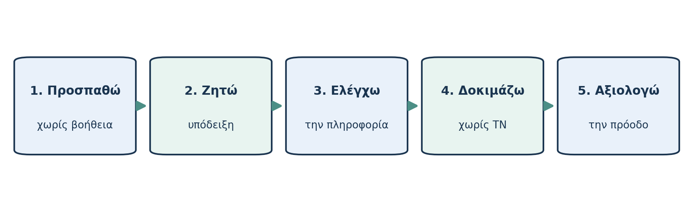

# AL00.8 — Η ΤΝ ως υποστήριξη της μάθησης

*Μέρος Β — Χρησιμοποιώ με κατανόηση*

*Εκτιμώμενος χρόνος: 18 λεπτά.*

**Πριν διαβάσεις — Πρόβλεψη.** Δύο φοιτητές λύνουν το ίδιο σύνολο ασκήσεων. Ο πρώτος ζητά κάθε τελική λύση από chatbot, ο δεύτερος προσπαθεί μόνος του και ζητά σταδιακές υποδείξεις. Ποιο επιπλέον στοιχείο θα χρειαζόσουν για να διαπιστώσεις ποιος πραγματικά έμαθε;

## Σωστό παραδοτέο και ανθρώπινη ικανότητα

Η παράδοση μιας σωστής άσκησης δεν αποτελεί επαρκή απόδειξη ότι ο φοιτητής μπορεί να την επιλύσει ανεξάρτητα. Η διάκριση υπήρχε πριν από τα LLMs, αλλά η Παραγωγική ΤΝ καθιστά ιδιαίτερα εύκολη τη δημιουργία άρτιων προϊόντων χωρίς αντίστοιχη εξάσκηση. Αν ο στόχος είναι να μάθουμε, πρέπει να σχεδιάζουμε την αλληλεπίδραση ώστε ένα μέρος της πραγματικής νοητικής εργασίας να παραμένει στον εκπαιδευόμενο.

Ένα chatbot μπορεί να δώσει **εναλλακτική εξήγηση** όταν δεν καταλαβαίνεις τη διάλεξη. Μπορεί να λειτουργήσει ως **συνομιλητής που ρωτά** αντί να απαντά, να προσφέρει **μικρές υποδείξεις** στην επίλυση προβλήματος και να δώσει **ανατροφοδότηση** σε μια πρώτη προσωπική προσπάθεια. Δεν πρέπει να υποθέτουμε ότι κάθε τέτοια βοήθεια είναι σωστή ή ότι αρκεί από μόνη της για τη μάθηση.

## Ενεργητική ανάκληση και αυτορρύθμιση

Αντί να ξαναδιαβάζεις συνεχώς το ίδιο κείμενο, προσπάθησε να απαντήσεις σε μια ερώτηση χωρίς να κοιτάζεις την εξήγηση. Η **ενεργητική ανάκληση (retrieval practice)** και η **κατανεμημένη εξάσκηση** διαθέτουν ισχυρή τεκμηρίωση ως στρατηγικές μάθησης σε ποικίλα εκπαιδευτικά πλαίσια [6]. Η ΤΝ μπορεί να διευκολύνει τη δημιουργία ερωτήσεων και τη διαμόρφωση προγράμματος επανάληψης, αλλά δεν χρειάζεται να τη χρησιμοποιείς στην ίδια την προσπάθεια ανάκλησης.

Η **μεταγνώση και αυτορρύθμιση** περιλαμβάνουν το να σχεδιάζεις τον στόχο σου, να παρακολουθείς αν καταλαβαίνεις και να αξιολογείς τι μπορείς να κάνεις μόνος σου. Πρόκειται για τεκμηριωμένες παιδαγωγικές προσεγγίσεις· η εφαρμογή τους στο πανεπιστήμιο χρειάζεται προσαρμογή στο πλαίσιο [7].

## Μια μικρή διαδικασία πέντε βημάτων

*Σχήμα 5. Η ΤΝ συμμετέχει στη φάση υποστήριξης, όχι υποχρεωτικά σε κάθε φάση της προσπάθειας.*

Πρώτα **προσπαθώ** να εξηγήσω ή να λύσω μόνος μου. Έπειτα **ζητώ στοχευμένη υποστήριξη**: μία ερώτηση, μία υπόδειξη ή μία απλούστερη αναλογία. Στη συνέχεια **ελέγχω** την εξήγηση με αξιόπιστο υλικό. **Δοκιμάζω ξανά χωρίς ΤΝ** σε νέο παράδειγμα. Τέλος **αξιολογώ** τι έμαθα και τι δυσκολεύομαι ακόμη να κάνω. Η διαδικασία αυτή είναι εργαλείο, όχι άκαμπτος κανόνας για όλες τις εργασίες.

Σκέψου τον αριθμητικό μέσο όρο και τη διάμεσο. Ένα chatbot μπορεί να σου δώσει τις αριθμητικές τιμές, αλλά αυτό δεν αποδεικνύει ότι κατανοείς γιατί διαφέρουν όταν υπάρχει ακραία παρατήρηση. Αντί για έτοιμη λύση ζήτησε: «Κάνε μου μία ερώτηση για το τι θα αλλάξει αν αυξηθεί η μεγαλύτερη τιμή». Ύστερα κλείσε το εργαλείο και δοκίμασε νέο σύνολο τιμών.

## Πότε η βοήθεια γίνεται εμπόδιο;

Αν κάθε φορά η ΤΝ κάνει το κρίσιμο γνωστικό βήμα για σένα, είναι πιθανό να αποκτάς ευκολία παραγωγής απαντήσεων χωρίς επαρκή εξάσκηση. Αυτό δεν σημαίνει ότι πρέπει να αποφεύγεις κάθε αυτοματοποίηση: αν το αντικείμενό σου είναι η ερμηνεία αποτελεσμάτων, μπορεί να είναι λογικό να αυτοματοποιήσεις έναν απλό υπολογισμό. Αν όμως ο στόχος σου είναι να **μάθεις τον υπολογισμό**, η ίδια αυτοματοποίηση μπορεί να στερήσει απαραίτητη πρακτική. Η σωστή επιλογή εξαρτάται από τον μαθησιακό στόχο.

**Μικρή δραστηριότητα.** Διάλεξε μία δυσκολία από πρόσφατο μάθημά σου. Γράψε (α) ποια προσπάθεια θα έκανες μόνος σου, (β) ποια **μία** βοήθεια θα ζητούσες, (γ) πώς θα επαλήθευες την εξήγηση, (δ) τι νέο πρόβλημα θα επιχειρούσες χωρίς ΤΝ.

**Έλεγχος κατανόησης.** (1) Γιατί η καλή τελική εργασία δεν αποτελεί από μόνη της απόδειξη μάθησης; (2) Τι είναι ενεργητική ανάκληση; (3) Πότε η έτοιμη λύση μπορεί να βλάψει τον δικό σου στόχο; (4) Πώς θα ελέγξεις την ανεξάρτητη κατανόηση;

**Κράτησε:** Μαθαίνω καλύτερα όταν η βοήθεια υποστηρίζει —και δεν αντικαθιστά— την προσωπική προσπάθεια, την επαλήθευση και την ανάκληση.

---
