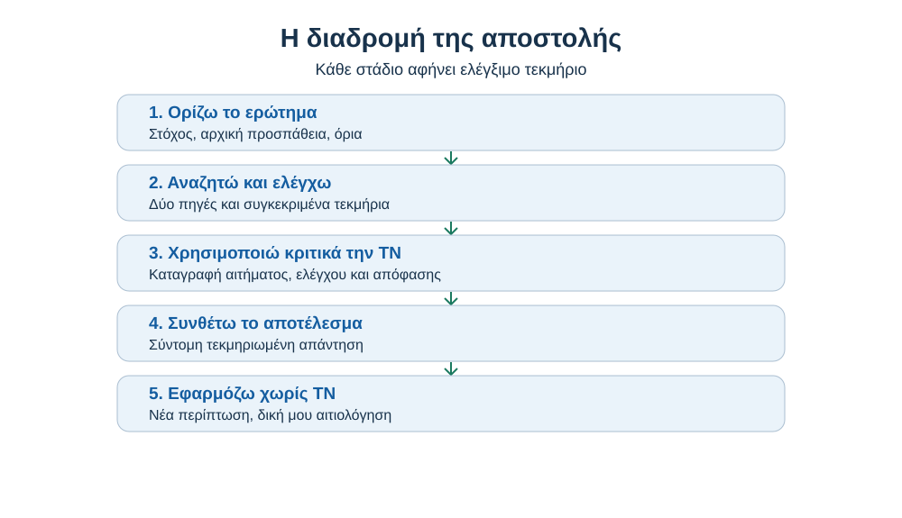
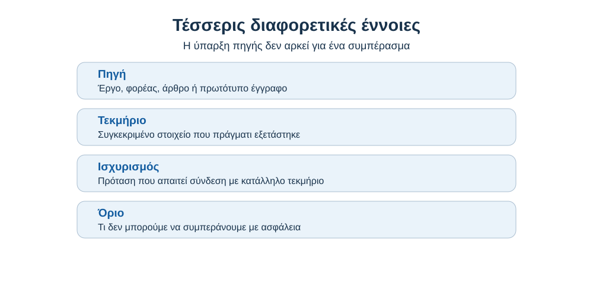
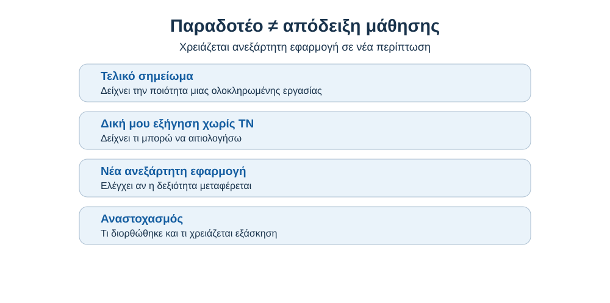

# AL00.9 — Η πρώτη ολοκληρωμένη μαθησιακή εμπειρία με Τεχνητή Νοημοσύνη

> **Διεπιστημονική εκπαιδευτική αποστολή.** Τα παραδείγματα προσώπων, μετρήσεων και αποτελεσμάτων είναι **συνθετικά εκπαιδευτικά σενάρια** και δεν παρουσιάζονται ως πραγματικά ερευνητικά ευρήματα. Στις δικές σου εργασίες χρησιμοποίησε πραγματικές, ελεγμένες πηγές.

## Γιατί αυτό το κεφάλαιο είναι διαφορετικό;

Μέχρι τώρα εξασκήσαμε χωριστά τον τρόπο με τον οποίο θέτουμε ερωτήματα στην ΤΝ, αναγνωρίζουμε πιθανά λάθη, βρίσκουμε αξιόπιστες πηγές και χρησιμοποιούμε την ΤΝ ως βοήθημα μάθησης. Εδώ **δεν θα προσθέσουμε άλλη μία μεγάλη ενότητα θεωρίας**. Θα αναλάβεις μια σύντομη, αυθεντική εργασία και θα αποδείξεις ότι μπορείς να συνδυάζεις αυτές τις δεξιότητες, να δικαιολογείς τις επιλογές σου και να επιλύεις ένα νέο πρόβλημα χωρίς την υποστήριξη της ΤΝ.

Η εργασία δεν αξιολογεί πόσο εντυπωσιακό κείμενο έγραψε το εργαλείο. Αξιολογεί **τι έκανες εσύ**: ποιο ερώτημα επέλεξες, πώς βρήκες και έλεγξες πηγές, τι αμφισβήτησες, τι βελτίωσες, ποια απόφαση πήρες και τι μπορείς να υπερασπιστείς ανεξάρτητα. Το τελευταίο βήμα είναι ουσιώδες: ένα καλαίσθητο αποτέλεσμα χωρίς ελέγξιμη δική σου εργασία δεν αρκεί.

**Στο τέλος θα μπορείς:** (1) να σχεδιάζεις μια μικρή ερευνητική ή μαθησιακή αποστολή· (2) να χρησιμοποιείς κατάλληλα την ΤΝ με διαφάνεια· (3) να ξεχωρίζεις ισχυρισμούς από τεκμήρια· (4) να καταγράφεις ελέγχους και διορθώσεις· (5) να παράγεις σύντομο παραδοτέο με δηλωμένα όρια· και (6) να αποδεικνύεις ατομικά τι έμαθες.

**Χρόνος:** ενδεικτικά 2–3 ώρες για την εργασία, σε μία ή δύο συνεδρίες. **Μορφή:** ατομική, με δυνατότητα συζήτησης στην τάξη. **Προαπαιτούμενα:** οι βασικές δεξιότητες AL00.4–AL00.8· δεν απαιτείται γνώση προγραμματισμού. Αν ο διδάσκων ή το μάθημα ορίσει διαφορετική πολιτική χρήσης ΤΝ, ακολουθείς την πολιτική του.

---

## 9.1 — Μια αποστολή, πραγματικές επιλογές

### 9.1.1 — Η κεντρική αποστολή

Η αποστολή ονομάζεται **«Ερευνώ — ελέγχω — εξηγώ — εφαρμόζω»**. Επιλέγεις ένα συγκεκριμένο ερώτημα από ένα αντικείμενο που σε ενδιαφέρει ή από τις σπουδές σου. Στη συνέχεια συγκεντρώνεις δύο κατάλληλες πηγές, εξετάζεις έναν ουσιαστικό ισχυρισμό, χρησιμοποιείς την ΤΝ μόνο σε δηλωμένα βήματα και παράγεις ένα σύντομο ενημερωτικό σημείωμα. Τέλος, απαντάς **χωρίς ΤΝ** σε μια νέα ερώτηση που συνδέεται με την εργασία σου.

Για παράδειγμα, ένας φοιτητής παιδαγωγικών μπορεί να εξετάσει πώς αξιολογείται μια συγκεκριμένη διδακτική τεχνική· μια φοιτήτρια οικονομικών να συγκρίνει δύο ορισμούς ενός δείκτη· ένας φοιτητής ιστορίας να διερευνήσει πώς διαφέρει μια πρωτογενής μαρτυρία από μια μεταγενέστερη ερμηνεία. Δεν χρειάζεται να καταλήξεις σε εντυπωσιακό ή οριστικό συμπέρασμα. Μια καλά τεκμηριωμένη απάντηση «τα στοιχεία που βρήκα δεν επαρκούν» είναι απολύτως αποδεκτή.

### 9.1.2 — Το πρόβλημα πρέπει να είναι εφικτό

Ένα ερώτημα όπως «Είναι η ΤΝ καλή για την κοινωνία;» είναι πολύ ευρύ. Ένα εφικτό ερώτημα θα ήταν «Ποιες προϋποθέσεις χρειάζεται μια φοιτητική ομάδα για να ελέγχει την αξιοπιστία μιας σύνοψης ΤΝ;». Το δεύτερο επιτρέπει συγκεκριμένους ορισμούς, κριτήρια και ελέγχους. Πριν προχωρήσεις, γράψε μία πρόταση που να ορίζει **ποιο ζήτημα**, **για ποιον πληθυσμό ή πλαίσιο** και **ποια μορφή απάντησης** αναζητάς.

**Μικρή άσκηση.** Μετέτρεψε το «Η εξ αποστάσεως εκπαίδευση είναι αποτελεσματική;» σε ερώτημα που θα μπορούσες να εξετάσεις σε δύο ώρες. Μην προσθέσεις μια αυθαίρετη αριθμητική πρόβλεψη.

::: {dropdown} Ενδεικτική επεξεργασία
«Ποιους δείκτες χρησιμοποιούν δύο πρόσφατες και επαληθεύσιμες εκπαιδευτικές δημοσιεύσεις για να εξετάσουν τη συμμετοχή φοιτητών σε εξ αποστάσεως μαθήματα;» Η εργασία μπορεί να συγκρίνει **δείκτες** χωρίς να ισχυριστεί ότι μέτρησε μόνη της την αποτελεσματικότητα.
:::

### 9.1.3 — Δύο ισότιμες διαδρομές εργασίας

Μπορείς να ακολουθήσεις τη **Διαδρομή Α — Ερευνητικό ερώτημα**, εάν θέλεις να εξετάσεις έναν ισχυρισμό βάσει εξωτερικών πηγών, ή τη **Διαδρομή Β — Μαθησιακή δυσκολία**, εάν θέλεις να κατακτήσεις μια συγκεκριμένη έννοια και να την εφαρμόσεις. Και οι δύο διαδρομές απαιτούν πηγές, διαφανή χρήση της ΤΝ, κριτικό έλεγχο και ανεξάρτητη επίδοση. Διαφέρουν μόνο στο κύριο τελικό προϊόν: στη Διαδρομή Α είναι μια τεκμηριωμένη σύνθεση· στη Διαδρομή Β είναι μια λύση ή εξήγηση με νέο πρόβλημα μεταφοράς.

| Στοιχείο | Διαδρομή Α | Διαδρομή Β |
|---|---|---|
| Κεντρική ερώτηση | Τι μπορώ να υποστηρίξω με πηγές; | Τι μπορώ να εξηγήσω και να κάνω μόνος μου; |
| Πρωτεύον αποτέλεσμα | Σύντομη τεκμηριωμένη απάντηση | Σύντομη εξήγηση και λυμένη εφαρμογή |
| Ρόλος πηγών | Στήριξη και όρια ισχυρισμών | Έλεγχος ορισμών, μεθόδων και λύσεων |
| Ανεξάρτητος έλεγχος | Κριτική σε νέο σχετικό ισχυρισμό | Λύση νέας ανάλογης περίπτωσης |

### 9.1.4 — Παραδοτέα και κανόνες

Παραδίδεις ένα σύντομο **φύλλο αποστολής** με έξι μέρη: ερώτημα, αρχική προσωπική προσπάθεια, πίνακα πηγών, ημερολόγιο χρήσης ΤΝ και ελέγχων, τελικό σημείωμα, ανεξάρτητη απάντηση. Δεν παραδίδεις κωδικούς πρόσβασης, προσωπικά δεδομένα τρίτων ή πλήρες ιστορικό ιδιωτικών συνομιλιών. Αν η πρόσβαση σε ΤΝ δεν είναι διαθέσιμη, μπορείς να καταγράψεις την απόφαση μη χρήσης και να ολοκληρώσεις το έργο με τις πηγές σου: η ποιότητα δεν εξαρτάται από τη συνδρομή σε κάποιο εργαλείο.

---

## 9.2 — Στάδιο πρώτο: Τι ξέρω πριν ζητήσω βοήθεια;

### 9.2.1 — Η αρχική προσπάθεια ως σημείο αναφοράς

Πριν ανοίξεις εργαλείο ΤΝ ή αναζήτησης, αφιέρωσε πέντε λεπτά για να σημειώσεις τι ήδη γνωρίζεις, τι υποθέτεις και τι χρειάζεται να επαληθεύσεις. Η σημείωση δεν βαθμολογείται ως «σωστή ή λανθασμένη». Χρησιμεύει για να φανεί αργότερα αν άλλαξε η κατανόησή σου. Η διατύπωση «δεν ξέρω τη διαφορά μεταξύ συσχέτισης και αιτιότητας» μπορεί να είναι πιο χρήσιμη από μια ανεξέλεγκτη παράγραφο που ακούγεται βέβαιη.

**Συμπλήρωσε:** «Αρχικά πιστεύω ότι…», «Δεν είμαι βέβαιος/η για…», «Θα μπορούσα να κάνω λάθος αν…». Ο στόχος είναι η ειλικρινής καταγραφή σκέψης, όχι να μαντέψεις αυτό που θα ήθελε να διαβάσει ο διδάσκων.

### 9.2.2 — Επιχειρησιακός μαθησιακός στόχος

Ο στόχος πρέπει να περιγράφει τι θα μπορείς να **κάνεις** στο τέλος: να συγκρίνεις, να εξηγείς, να εφαρμόζεις, να αξιολογείς ή να τεκμηριώνεις. Το «να μάθω περισσότερα για το θέμα» δεν αρκεί. Προτίμησε «να μπορώ να εξηγήσω σε συμφοιτητή γιατί δύο έγκυρες πηγές μπορεί να διαφωνούν, αναφέροντας τουλάχιστον δύο πιθανούς μεθοδολογικούς λόγους».

**Έλεγχος στόχου:** Ποια μικρή δοκιμή, διάρκειας πέντε λεπτών και χωρίς ΤΝ, θα έδειχνε αν τον πέτυχες; Αν δεν μπορείς να απαντήσεις, κάνε τον στόχο πιο συγκεκριμένο.

### 9.2.3 — Διατύπωση ορίων

Κατάγραψε τι δεν υπόσχεσαι να απαντήσεις. Για παράδειγμα: «Δεν θα κρίνω αν η τεχνική βελτιώνει τους βαθμούς όλων των φοιτητών· θα συγκρίνω μόνο τους δείκτες που χρησιμοποιούν οι πηγές». Τα όρια δεν είναι αδυναμία. Προστατεύουν την εργασία από γενικεύσεις πέρα από τα δεδομένα.

#### Παράδειγμα απόφασης πριν αρχίσει η εργασία

Η Ελένη επιλέγει αρχικά: «Να αποδείξω ότι τα βίντεο είναι καλύτερα από τα βιβλία». Το ερώτημα προϋποθέτει ήδη την απάντηση, δεν ορίζει τι σημαίνει «καλύτερα» και δεν μπορεί να εξεταστεί με δύο πηγές σε σύντομο χρόνο. Μετά τον έλεγχο το αλλάζει σε: «Πώς συγκρίνουν δύο εκπαιδευτικές πηγές τη μάθηση από βίντεο και κείμενο και ποιους δείκτες χρησιμοποιούν;». Ο νέος στόχος δεν είναι να αποδείξει μια προτίμηση, αλλά να **αναγνωρίζει αν οι δείκτες είναι συγκρίσιμοι**. Ως ανεξάρτητη δοκιμή σχεδιάζει να της δοθούν δύο μικρές περιγραφές μελετών και να εξηγήσει, χωρίς βοήθεια, τι θα ήταν θεμιτό να συμπεράνει.

**Δοκίμασε.** Το ερώτημα «Η τηλεργασία αυξάνει την παραγωγικότητα όλων;» τι θα χρειαζόταν για να περιοριστεί; Αναζήτησε έναν ορισμένο πληθυσμό, συγκεκριμένο δείκτη και χρονικό πλαίσιο. Δεν χρειάζεται να προσθέσεις αριθμητική πρόβλεψη.

::: {dropdown} Ενδεικτική βελτίωση
«Ποιους δείκτες παραγωγικότητας χρησιμοποιούν δύο επιλεγμένες μελέτες για εργαζομένους γραφείου που εργάζονται εξ αποστάσεως;». Αυτό είναι ερώτημα σύγκρισης μεθόδων και όχι απόδειξη καθολικής επίδρασης.
:::

### 9.2.4 — Σημείο ελέγχου 1

Προχώρα μόνο αν διαθέτεις: (α) ένα σαφές ερώτημα, (β) αρχική προσωπική θέση και (γ) μία εφικτή δοκιμή κατανόησης. Αν απουσιάζει ένα από αυτά, διορθώνεις το σχέδιο **πριν** συλλέξεις περισσότερες πληροφορίες. Αυτή η μικρή καθυστέρηση εξοικονομεί χρόνο αργότερα, επειδή μειώνει την άσκοπη αναζήτηση.

---

## 9.3 — Στάδιο δεύτερο: Πηγές και ισχυρισμοί

### 9.3.1 — Αναζήτησε με σκοπό

Ξεκίνα από τον τύπο ερωτήματος: επίσημη προθεσμία χρειάζεται ισχύουσα ανακοίνωση της αρμόδιας αρχής· επιστημονικό ερώτημα χρειάζεται κατάλληλη μελέτη ή επιστημονική σύνθεση· ιστορική ερμηνεία μπορεί να χρειάζεται τόσο πρωτογενή τεκμήρια όσο και ερευνητική ανάλυση. Μην επιλέγεις μια πηγή απλώς επειδή εμφανίζεται πρώτη ή επειδή η ΤΝ την παρουσίασε με βεβαιότητα.

Για το φύλλο αποστολής αρκούν **δύο πραγματικά προσβάσιμες και σχετικές πηγές**. Μπορεί να χρειαστείς περισσότερες για να βρεις αυτές τις δύο. Αν δεν έχεις πρόσβαση στο πλήρες κείμενο, δήλωσε ότι είδες μόνο μεταδεδομένα ή περίληψη. Μην επινοείς μεθόδους ή αποτελέσματα που δεν εξέτασες.

### 9.3.2 — Η κάρτα ελέγχου πηγής

Για κάθε πηγή σημείωσε τίτλο, δημιουργό/φορέα, έτος, προσβάσιμη διεύθυνση ή DOI, είδος πηγής, μέρος που πράγματι διάβασες και σχέση με το ερώτημα. Πρόσθεσε έναν περιορισμό. Η παρουσία DOI βοηθά στην ταυτοποίηση· δεν αποδεικνύει ότι μια δική σου ερμηνεία είναι σωστή.

| Πεδίο | Τι γράφεις |
|---|---|
| Ταυτοποίηση | Ελέγξιμα βιβλιογραφικά στοιχεία |
| Πρόσβαση | Πλήρες κείμενο, απόσπασμα ή μόνο περίληψη |
| Σχετικότητα | Ποια συγκεκριμένη ερώτηση φωτίζει |
| Τεκμήριο | Ποιο πραγματικό στοιχείο είδες |
| Όριο | Τι δεν τεκμηριώνεται από αυτήν |

### 9.3.3 — Από πληροφορία σε ελέγξιμο ισχυρισμό

Ένας ισχυρισμός πρέπει να είναι αρκετά συγκεκριμένος ώστε να μπορεί να ελεγχθεί. Το «η μέθοδος είναι εξαιρετική» είναι αξιολογική διατύπωση χωρίς σαφή κριτήρια. Το «η πηγή συγκρίνει την επίδοση δύο ομάδων με τον συγκεκριμένο δείκτη» είναι περιγραφή που μπορείς να επαληθεύσεις στο έγγραφο. Ακόμη και τότε, δεν συνάγεις αιτιότητα ή γενίκευση αν δεν το επιτρέπει το ερευνητικό σχέδιο.

**Δραστηριότητα:** Μετέτρεψε το «μια εφαρμογή βοηθά τους πάντες να μαθαίνουν» σε δύο χωριστές ερωτήσεις ελέγχου: «Ποια μορφή βοήθειας εξετάστηκε;» και «Σε ποιους συμμετέχοντες και με ποια μέτρηση;». Οι ερωτήσεις αυτές δείχνουν τι θα χρειαστεί να βρεις πριν αποδεχθείς τον ισχυρισμό.

### 9.3.4 — Όταν οι πηγές διαφωνούν

Δύο πηγές μπορεί να χρησιμοποιούν διαφορετικούς πληθυσμούς, ορισμούς, περιόδους ή μεθόδους. Αντί να διαλέξεις αυτήν που σε εξυπηρετεί, φτιάξε μια μικρή αντιπαραβολή: «Τι μετρά η Α; Τι μετρά η Β; Είναι πραγματικά αντίθετα τα αποτελέσματά τους ή συγκρίνω διαφορετικά πράγματα;». Αν δεν μπορείς να αποφασίσεις, το δηλώνεις. Η έντιμη αναγνώριση αβεβαιότητας είναι μέρος της επιστημονικής εργασίας.

#### Παράδειγμα: η ίδια πηγή μπορεί να είναι υπαρκτή αλλά ακατάλληλη

Υποθέτουμε ότι η Μαρία εξετάζει αν μια εκπαιδευτική δραστηριότητα βελτιώνει την επίδοση. Βρίσκει μία υπαρκτή δημοσίευση που εξετάζει **ικανοποίηση** των συμμετεχόντων και μία δεύτερη που μετρά **αποτελέσματα σε δοκιμασία**. Δεν μπορεί να γράψει «και οι δύο αποδεικνύουν βελτίωση επίδοσης». Η πρώτη, ακόμη και αν είναι αξιόπιστη, απαντά σε διαφορετικό ερώτημα. Στην κάρτα της γράφει: «Πηγή 1 — ελέγχει στάσεις· δεν προσφέρει μέτρηση μάθησης. Πηγή 2 — εξετάζει επίδοση· χρειάζεται έλεγχος του πληθυσμού, της μεθόδου και του διαθέσιμου κειμένου».

Αυτός ο τρόπος εργασίας είναι προτιμότερος από το να χαρακτηρίζουμε τις πηγές γενικά «καλές» ή «κακές». **Η σχετικότητα αξιολογείται σε σχέση με τον ισχυρισμό**. Αν μια πηγή δεν προσφέρει το απαιτούμενο τεκμήριο, μπορεί να χρησιμοποιηθεί μόνο για όσα πράγματι καλύπτει ή να αποκλειστεί τεκμηριωμένα.

**Μικρός έλεγχος.** Μια αναφορά περιλαμβάνει μόνο τα ποσοστά συμμετοχής σε μάθημα. Μπορεί να στηρίξει τη δήλωση «οι φοιτητές κατανόησαν βαθύτερα την ύλη»;

::: {dropdown} Ενδεικτική απάντηση
Όχι από μόνη της. Η συμμετοχή και η κατανόηση είναι διαφορετικές μεταβλητές. Θα χρειαζόταν κατάλληλος δείκτης κατανόησης και έλεγχος του τρόπου μέτρησης.
:::

### 9.3.5 — Σημείο ελέγχου 2

Έλεγξε τις δύο πηγές με την εξής δοκιμή: «Μπορώ να δείξω σε τρίτο πρόσωπο **πού** στηρίζεται ο ισχυρισμός μου;». Αν η απάντηση είναι «το είπε η ΤΝ» ή «φαίνεται από τον τίτλο», η τεκμηρίωση δεν έχει ολοκληρωθεί. Επιστρέφεις στην πηγή ή περιορίζεις τον ισχυρισμό.

---

## 9.4 — Στάδιο τρίτο: Διαφανής χρήση της ΤΝ

### 9.4.1 — Επίλεξε ένα χρήσιμο, όχι διακοσμητικό αίτημα

Η ΤΝ μπορεί να σε βοηθήσει να οργανώσεις όρους αναζήτησης, να δημιουργήσεις ερωτήσεις αυτοελέγχου, να προτείνει διαφορετική εξήγηση ή να ελέγξει τη συνοχή ενός δικού σου προσχεδίου. Δεν πρέπει να παρουσιάζει ανύπαρκτες πηγές ως ελεγμένες ούτε να αντικαθιστά την ανάγνωσή τους. Ένα καλό αίτημα περιγράφει τον στόχο, το διαθέσιμο υλικό, την επιθυμητή βοήθεια και τα όρια: «Μη συμπληρώνεις στοιχεία που δεν δίνονται».

**Παράδειγμα αιτήματος:** «Με βάση μόνο τις δύο σύντομες περιγραφές πηγών που ακολουθούν, πρότεινε τρεις ερωτήσεις με τις οποίες θα ελέγξω αν συγκρίνουν την ίδια μεταβλητή. Μην ισχυριστείς ότι έχεις διαβάσει τα πλήρη άρθρα. Μη γράψεις ακόμη την απάντηση της εργασίας μου».

### 9.4.2 — Κράτησε ελάχιστο, ουσιαστικό ημερολόγιο

Κατέγραψε σε 3–5 γραμμές το εργαλείο ή την κατηγορία εργαλείου, τον σκοπό χρήσης, το αίτημα με απαλοιφή προσωπικών δεδομένων, την απάντηση που επηρέασε την εργασία και τη δική σου απόφαση. Δεν χρειάζεται να δημοσιεύσεις ιδιωτική συνομιλία ολόκληρη. Αν το εργαλείο έκανε λάθος, αυτό είναι χρήσιμο τεκμήριο κριτικής χρήσης.

| Βήμα | Τι ζήτησα | Τι κράτησα | Τι έλεγξα/απέρριψα |
|---|---|---|---|
| Ερώτημα | Τρεις εναλλακτικές διατυπώσεις | Μία πιο συγκεκριμένη | Ότι δεν αλλάζει το αντικείμενο |
| Πηγές | Πιθανούς όρους αναζήτησης | Δύο όρους | Την πραγματική ύπαρξη πηγών |
| Αναθεώρηση | Σχόλιο στη δική μου παράγραφο | Μία βελτίωση σαφήνειας | Ότι ο ισχυρισμός στηρίζεται στην πηγή |

### 9.4.3 — Δύο υποχρεωτικές στιγμές ανθρώπινου ελέγχου

Πρώτα, έλεγξε **έναν ισχυρισμό που πρότεινε ή ενίσχυσε η ΤΝ**. Βρες αν υποστηρίζεται πράγματι από το προσβάσιμο τεκμήριο. Έπειτα, έλεγξε **μία δική σου απόφαση**: γιατί διατήρησες, τροποποίησες ή απέρριψες την πρόταση του εργαλείου. Χωρίς τη δεύτερη κρίση, μπορεί να έχεις απλώς αντιγράψει έναν έλεγχο χωρίς να τον κατανοείς.

### 9.4.4 — Ιδιωτικότητα και ακαδημαϊκή ακεραιότητα

Μη μεταφορτώνεις αναγνωρίσιμα δεδομένα συμφοιτητών, ασθενών, πελατών, προσωπικά μηνύματα ή μη δημοσιευμένο υλικό τρίτων χωρίς δικαίωμα και κατάλληλη άδεια. Χρησιμοποίησε επινοημένα ή ανωνυμοποιημένα παραδείγματα όπου χρειάζεται. Δήλωσε τι βοήθεια έλαβες από ΤΝ και έλεγξε τους κανόνες του μαθήματος. Ο σκοπός δεν είναι να αποκρύψεις την υποστήριξη, αλλά να μπορεί ένας τρίτος να διακρίνει τη δική σου συμβολή.

#### Μικρό υπόδειγμα διαφανούς ημερολογίου ΤΝ

Ένα καλό ημερολόγιο δεν απαιτεί δεκάδες σελίδες συνομιλίας. Αρκούν λίγες **ουσιαστικές αποφάσεις** που δείχνουν τι έγινε και γιατί. Το ακόλουθο παράδειγμα αφορά συνθετική εργασία για τη διάκριση συμμετοχής και μάθησης.

| Στάδιο | Τι ζήτησα ή αποφάσισα | Τι έκανα εγώ μετά |
|---|---|---|
| Σκοπός | «Πρότεινε τρεις ερωτήσεις που θα έλεγχαν αν συγχέω συμμετοχή και κατανόηση» | Επέλεξα μία ερώτηση σχετική με τον δείκτη της πηγής |
| Έξοδος ΤΝ | «Περισσότερη συμμετοχή σημαίνει καλύτερη κατανόηση» | Δεν υιοθέτησα την εξίσωση· δεν αποδεικνύεται από τον δείκτη |
| Έλεγχος | Επέστρεψα στον ορισμό της μεταβλητής στην πηγή | Διόρθωσα το σημείωμα ώστε να μιλά μόνο για συμμετοχή |
| Τελική επιλογή | Χρησιμοποίησα την ΤΝ ως αφορμή ελέγχου | Το συμπέρασμα διατυπώθηκε από εμένα, με περιορισμό |

**Προσέχουμε τη διαφορά:** η φράση «η ΤΝ με βοήθησε να γράψω» δεν επιτρέπει να καταλάβουμε αν ο φοιτητής έλεγξε κάτι. Η καταγραφή «απέρριψα συγκεκριμένο συμπέρασμα επειδή δεν υπήρχε αντίστοιχος δείκτης» αποτελεί σαφέστερο στοιχείο κριτικής χρήσης. Αν δεν χρησιμοποιήθηκε ΤΝ, το ημερολόγιο μπορεί να περιλαμβάνει «Δεν χρησιμοποίησα ΤΝ· έλεγξα τον ορισμό από τις δύο επιλεγμένες πηγές».

### 9.4.5 — Σημείο ελέγχου 3

Πριν φτιάξεις το τελικό παραδοτέο, απάντησε: «Μπορώ να εξηγήσω γιατί αποδέχθηκα αυτή τη διατύπωση;», «Έλεγξα τουλάχιστον έναν κρίσιμο ισχυρισμό;», «Θα μπορούσα να συνεχίσω αν το εργαλείο έκλεινε τώρα;». Αν όχι, χρειάζεσαι μία ακόμη δική σου προσπάθεια, όχι περισσότερη αυτόματη παραγωγή κειμένου.

---

## 9.5 — Στάδιο τέταρτο: Το τελικό σημείωμα

### 9.5.1 — Μικρό, σαφές και τεκμηριωμένο

Το κύριο σημείωμα έχει ενδεικτικά 250–400 λέξεις. Περιλαμβάνει τίτλο, το ερώτημά σου, 2–3 σαφείς προτάσεις που απαντούν στο ερώτημα, στήριξη με πηγές και μία παράγραφο ορίων. Δεν χρειάζεται να μοιάζει με επιστημονικό άρθρο. Απαιτείται όμως κάθε ουσιαστικός πραγματολογικός ισχυρισμός να είναι ανάλογος με τα στοιχεία που εξέτασες.

Η φράση «Οι δύο πηγές χρησιμοποιούν διαφορετικούς δείκτες συμμετοχής, άρα δεν συγκρίνονται απευθείας οι αριθμοί τους» μπορεί να αποτελεί ισχυρό και ακριβές συμπέρασμα. Η φράση «Αποδείχθηκε ότι η μέθοδος είναι καλύτερη για όλους» δεν είναι αποδεκτή όταν δεν έχουν ελεγχθεί τα αντίστοιχα στοιχεία.

### 9.5.2 — Ένα τεκμήριο για κάθε βασικό συμπέρασμα

Βάλε δίπλα στις κύριες προτάσεις την αντίστοιχη πηγή. Προτίμησε σύντομες, σαφείς παραπομπές με αρκετά στοιχεία ώστε να μπορεί κάποιος να αναζητήσει το τεκμήριο. Αν μια πρόταση στηρίζεται μόνο στην ερμηνεία σου, δήλωσέ το ως ερμηνεία και τεκμηρίωσε το σκεπτικό. Μην προσθέτεις πηγές στο τέλος σαν διακοσμητικό στοιχείο που δεν συνδέεται με το κείμενο.

#### Παράδειγμα βελτίωσης της τελικής σύνθεσης

**Πρόχειρη διατύπωση:** «Οι δύο πηγές συμφωνούν ότι η μέθοδος είναι αποτελεσματική. Η ΤΝ επιβεβαίωσε πως λειτουργεί, επομένως καλό είναι να εφαρμοστεί παντού». Η παράγραφος δεν περιγράφει τι μετρήθηκε, πού εντοπίζεται η συμφωνία ούτε σε ποιο περιβάλλον ισχύουν τα συμπεράσματα. Η «επιβεβαίωση» της ΤΝ δεν αποτελεί τεκμήριο.

**Ελεγχόμενη αναδιατύπωση:** «Στις δύο πηγές που εξέτασα οι συγγραφείς χρησιμοποιούν διαφορετικούς δείκτες. Η πρώτη αφορά τη δηλωμένη εμπειρία των συμμετεχόντων, ενώ η δεύτερη περιγράφει επίδοση σε συγκεκριμένη δοκιμασία. Επομένως, δεν αντιμετωπίζω τα αποτελέσματα ως ισοδύναμες μετρήσεις και δεν συμπεραίνω ότι η μέθοδος είναι αποτελεσματική σε κάθε πλαίσιο. Για γενικότερο συμπέρασμα θα χρειαζόταν συγκρίσιμη μέτρηση και περισσότερα στοιχεία». Πρόκειται για **υπόδειγμα συλλογισμού με φανταστικό αντικείμενο**· δεν αποτελεί σύνοψη πραγματικών μελετών.

**Ερώτηση επεξεργασίας:** εντόπισε στην αναδιατύπωση (α) τι είναι παρατήρηση, (β) τι αποτελεί συμπέρασμα και (γ) ποιο είναι το όριο. Αν δεν μπορείς να τα ξεχωρίσεις στο δικό σου σημείωμα, πιθανότατα χρειάζεται αναθεώρηση πριν από την υποβολή.

### 9.5.3 — Ο έλεγχος του δύσπιστου αναγνώστη

Πριν παραδώσεις, διάβασε το κείμενο σαν να ήσουν συμφοιτητής που διαφωνεί ευγενικά. Θα μπορούσε να ρωτήσει «Πώς το ξέρεις;», «Ποια πηγή το λέει;», «Αναφέρεται στην ίδια ομάδα ανθρώπων;», «Τι θα σε έκανε να αλλάξεις γνώμη;». Σημείωσε μία τέτοια ερώτηση και πρόσθεσε στο κείμενο σύντομη απάντηση ή δίκαιη επιφύλαξη.

### 9.5.4 — Οπτική παρουσίαση: χρήσιμη ή περιττή;

Ένα μικρό σχήμα ή πίνακας μπορεί να βοηθήσει όταν αποσαφηνίζει μια πραγματική σύγκριση. Μην προσθέτεις εικόνες μόνο για εντύπωση. Αν κατασκευάσεις πίνακα, οι τίτλοι και οι τιμές πρέπει να προέρχονται από τις πηγές σου ή να δηλώνονται ως ενδεικτικό παράδειγμα. Δεν επιτρέπεται να φτιάξεις «αποτελέσματα έρευνας» με επινοημένα ποσοστά και να τα παρουσιάσεις ως πραγματικά.

---

## 9.6 — Στάδιο πέμπτο: Τι μπορείς να κάνεις χωρίς ΤΝ;

### 9.6.1 — Η ανεξάρτητη δοκιμή δεν είναι τυπικό παράρτημα

Κλείσε το εργαλείο ΤΝ και μην κοιτάξεις το τελικό σημείωμα για λίγα λεπτά. Γράψε με δικά σου λόγια: «Τι έμαθα; Ποια πηγή με έκανε να αλλάξω ή να περιορίσω την αρχική μου θέση; Ποιο όριο πρέπει να αναφέρω;». Η απάντηση μπορεί να είναι σύντομη, αλλά πρέπει να αποτελεί **δική σου επεξεργασία**, όχι αναπαραγωγή μιας απομνημονευμένης παραγράφου.

### 9.6.2 — Μεταφορά σε νέο παράδειγμα

Επίλεξε μια νέα περίπτωση που δεν υπάρχει αυτούσια στο σημείωμά σου. Στη Διαδρομή Α, αξιολόγησε έναν νέο ισχυρισμό ως προς τις πηγές που θα απαιτούνταν. Στη Διαδρομή Β, εξήγησε ή επίλυσε μια ανάλογη εφαρμογή χωρίς ΤΝ. Αν δυσκολευτείς, αυτό δεν ακυρώνει την εργασία. Δείχνει με ακρίβεια τι χρειάζεται νέα εξάσκηση.

**Παράδειγμα Α:** Αν εξέτασες αν ένας ισχυρισμός για τη μάθηση βασίζεται σε μία δημοσίευση, τώρα αξιολόγησε τον νέο ισχυρισμό «Αφού οι συμμετέχοντες δήλωσαν μεγαλύτερη ικανοποίηση, βελτιώθηκε αναγκαστικά η επίδοσή τους». Χωρίς αναζήτηση, γράψε ποια πληροφορία λείπει. Ενδεικτικά: λείπει πραγματική μέτρηση επίδοσης και κατάλληλο ερευνητικό σχέδιο· η ικανοποίηση είναι διαφορετικό αποτέλεσμα.

**Παράδειγμα Β:** Αν έμαθες να συγκρίνεις ποσοστά, λύσε νέο πρόβλημα με διαφορετικές τιμές και εξήγησε γιατί επέλεξες τον παρονομαστή. Δεν αρκεί να θυμάσαι την αριθμητική πράξη· πρέπει να αιτιολογήσεις σε ποιο σύνολο αναφέρεται το ποσοστό.

#### Δοκιμή μεταφοράς: ίδιος κανόνας, διαφορετικό πλαίσιο

Ένας φοιτητής έμαθε να συγκρίνει ποσοστά μεταξύ ομάδων διαφορετικού μεγέθους. Αν η τελική άσκηση επαναλάβει τους ίδιους αριθμούς, είναι δύσκολο να ξεχωρίσουμε την κατανόηση από την απομνημόνευση. Η νέα περίπτωση πρέπει να αλλάζει τα δεδομένα και την επιφανειακή ιστορία, **αλλά να διατηρεί την κρίσιμη δεξιότητα**. Για παράδειγμα, από προτιμήσεις πελατών σε συμμετοχή φοιτητών: 9 από 30 έναντι 18 από 90. Ο φοιτητής εξηγεί ότι συγκρίνουμε 30% με 20% και όχι 9 με 18. Η ουσία είναι να επιλέξει ο ίδιος τον σωστό παρονομαστή.

Στη Διαδρομή Α η αντίστοιχη δοκιμή μπορεί να παρουσιάζει νέο ισχυρισμό: «Η έρευνα δείχνει αύξηση ικανοποίησης, άρα αυξήθηκε η μάθηση». Ο φοιτητής πρέπει να εξηγήσει ποιο τεκμήριο λείπει. **Δεν ζητείται να επαναλάβει την τελική του παράγραφο**, αλλά να εφαρμόσει τον έλεγχο σε κάτι που δεν είχε προετοιμάσει.

### 9.6.3 — Η σύγκριση πριν και μετά

Βάλε δίπλα στην αρχική σου σημείωση την τελική ανεξάρτητη απάντηση. Σημείωσε ένα στοιχείο που διορθώθηκε, ένα που παρέμεινε αβέβαιο και μία επόμενη άσκηση. Απόφυγε δηλώσεις όπως «έμαθα πλήρως το θέμα» εφόσον δεν διαθέτεις αντίστοιχες δοκιμές. Η αναστοχαστική ακρίβεια είναι προτιμότερη από μια υπερβολική αυτοαξιολόγηση.

### 9.6.4 — Αν δεν πέτυχες τον στόχο

Επανέλαβε την ανεξάρτητη δοκιμή με μικρότερο βήμα. Αν η δυσκολία είναι ο ορισμός, εξήγησε πρώτα την έννοια χωρίς παραδείγματα. Αν η δυσκολία είναι η εφαρμογή, δούλεψε με ένα καινούργιο παράδειγμα. Αν η δυσκολία είναι η τεκμηρίωση, επέστρεψε στο πραγματικό κείμενο της πηγής. Η ΤΝ μπορεί να βοηθήσει ξανά, αλλά μόνο **μετά** την καταγραφή της δυσκολίας και με νέο, συγκεκριμένο μαθησιακό στόχο.

---

## 9.7 — Δύο ολοκληρωμένα εκπαιδευτικά παραδείγματα

Τα δύο παραδείγματα δείχνουν διαφορετικά τελικά προϊόντα, αλλά την ίδια αρχή: ο φοιτητής αφήνει ίχνη των δικών του ελέγχων και επιβεβαιώνει ότι μπορεί να ανταποκριθεί σε νέο ερώτημα χωρίς ΤΝ. Παρακολούθησε ειδικά **πού** αλλάζει η αρχική σκέψη και **ποιο τεκμήριο** δικαιολογεί αυτή την αλλαγή.

### 9.7.1 — Παράδειγμα Α: ένας ισχυρισμός για τη φοιτητική μάθηση

Η Άννα, φοιτήτρια κοινωνικών επιστημών, θέλει να εξετάσει τον ισχυρισμό «Η χρήση σύντομων αυτοδοκιμών κάνει τους φοιτητές να μαθαίνουν καλύτερα». **Το παράδειγμα είναι συνθετικό**: δεν παρουσιάζουμε πραγματικά αποτελέσματα ή ανύπαρκτες βιβλιογραφικές παραπομπές. Η Άννα περιορίζει το ερώτημα: «Πώς διακρίνεται η επίδοση σε δοκιμασία ανάκλησης από την αυτοαναφερόμενη ικανοποίηση;». Αρχικά γράφει: «Υποθέτω ότι όποιος δηλώνει πως έμαθε κάτι θα το θυμάται». Η ίδια παρατηρεί ότι αυτό δεν είναι βέβαιο.

Για τις πηγές της αναζητά δύο πραγματικές μελέτες, καταγράφει πλήρη βιβλιογραφικά στοιχεία και επισημαίνει αν έχει πρόσβαση μόνο σε περίληψη. Ζητά από την ΤΝ **ερωτήσεις ελέγχου**, όχι έτοιμη σύνθεση: «Ποιες μεταβλητές πρέπει να συγκρίνω για να μη συγχέω ικανοποίηση και ανάκληση;». Η ΤΝ προτείνει επίσης να υποθέσει ότι οι αυτοδοκιμές είχαν «μεγάλη επίδραση». Η Άννα **απορρίπτει** αυτή την πρόταση επειδή δεν έχει ελέγξει αντίστοιχο αριθμητικό εύρημα.

Το τελικό σημείωμα περιγράφει μόνο τι επιτρέπουν οι πηγές που πραγματικά εξέτασε. Στην ανεξάρτητη δοκιμή αντιμετωπίζει την καινούργια πρόταση «αυξήθηκαν τα θετικά σχόλια, επομένως βελτιώθηκε η μνήμη». Απαντά: «Η πρόταση δεν τεκμηριώνεται χωρίς μέτρο ανάκλησης και κατάλληλη σύγκριση». Αυτή η απάντηση αποτελεί σαφέστερο τεκμήριο κατανόησης από ένα καλογραμμένο κείμενο που θα είχε παραγάγει αυτόματα η ΤΝ.

#### Υπόδειγμα τελικού σημειώματος — Διαδρομή Α

Το ακόλουθο αποτελεί **συνθετικό υπόδειγμα μορφής και επιχειρηματολογίας**, όχι πραγματικό ερευνητικό εύρημα. Στην πραγματική αποστολή οι γενικές αναφορές «Πηγή 1» και «Πηγή 2» πρέπει να αντικατασταθούν από δύο υπαρκτές, ελεγμένες βιβλιογραφικές εγγραφές και ακριβείς παραπομπές στα σημεία που διαβάστηκαν.

> **Ερώτημα.** Πώς διαφέρει η μέτρηση της δηλωμένης ικανοποίησης από τη μέτρηση ανάκλησης γνώσεων;\
> **Αρχική θέση.** Αρχικά θεωρούσα ότι ένας συμμετέχων που δηλώνει ικανοποιημένος πιθανότατα έμαθε περισσότερο. Αναγνωρίζω ότι αυτό δεν είναι μετρημένη επίδοση.\
> **Έλεγχος πηγών.** Από την Πηγή 1 θα καταγράψω μόνο τις ερωτήσεις και τους δείκτες ικανοποίησης που πράγματι είδα. Από την Πηγή 2 θα καταγράψω μόνο τον τρόπο ελέγχου ανάκλησης, εφόσον υπάρχει διαθέσιμο κείμενο που τον περιγράφει. Αν έχω μόνο περίληψη, θα δηλώσω αυτόν τον περιορισμό.\
> **Χρήση ΤΝ.** Ζήτησα προτάσεις για το τι πρέπει να συγκρίνω. Απέρριψα πρόταση περί «μεγάλης βελτίωσης» επειδή δεν είχα ελέγξει αντίστοιχο αποτέλεσμα.\
> **Συμπέρασμα.** Η δηλωμένη ικανοποίηση και η επίδοση σε δοκιμασία ανάκλησης δεν είναι ταυτόσημες μετρήσεις. Για να διατυπώσω ισχυρισμό περί βελτίωσης της μάθησης χρειάζομαι κατάλληλο δείκτη και στοιχεία από το συγκεκριμένο ερευνητικό πλαίσιο.\
> **Όριο.** Με τα στοιχεία που έχουν παρουσιαστεί στο παράδειγμα δεν δικαιολογείται συμπέρασμα για την αποτελεσματικότητα μιας συγκεκριμένης εκπαιδευτικής πρακτικής σε όλους τους φοιτητές.

Η μορφή βοηθά στην οργάνωση του επιχειρήματος, **αλλά δεν πρέπει να αντιγραφεί ως ολοκληρωμένη βιβλιογραφική εργασία**: λείπουν εκ προθέσεως πραγματικές πηγές, πραγματικά αποσπάσματα και μετρήσεις. Στη δική σου εργασία θα συμπληρώσεις τα πεδία με τεκμήρια που έχεις εξετάσει.

### 9.7.2 — Πώς καταγράφεται το παράδειγμα Α

| Στάδιο | Καταγραφή της Άννας | Γιατί έχει σημασία |
|---|---|---|
| Αρχική υπόθεση | «Ικανοποίηση = μάθηση;» | Εκθέτει μια πιθανή σύγχυση |
| Ερώτημα | «Πώς μετριέται η ανάκληση;» | Περιορίζει το αντικείμενο |
| Πηγές | Δύο ελεγμένες εγγραφές με πραγματική πρόσβαση | Αποφεύγει πλαστές παραπομπές |
| ΤΝ | Ερωτήσεις σύγκρισης μεταβλητών | Υποστηρίζει σκέψη, δεν γράφει το συμπέρασμα |
| Κριτική | Απόρριψη ατεκμηρίωτου μεγέθους επίδρασης | Αναγνωρίζει όριο |
| Ανεξάρτητη επίδοση | Διάκριση ικανοποίησης/ανάκλησης | Μεταφέρει τη δεξιότητα |

Δεν βαθμολογούμε τις πραγματικές δημοσιεύσεις που θα μπορούσε να βρει η Άννα, επειδή δεν προσδιορίζονται εδώ. Ο πίνακας παρουσιάζει τη **διαδικασία**, όχι εμπειρική απόδειξη για τις αυτοδοκιμές.

### 9.7.3 — Παράδειγμα Β: επιλογή κατάλληλης οικονομικής σύγκρισης

Ο Νίκος, φοιτητής διοίκησης, δυσκολεύεται να συγκρίνει δύο ποσοστά όταν αλλάζει ο πληθυσμός αναφοράς. Το συνθετικό πρόβλημα είναι: «Σε ομάδα 40 ατόμων, 12 επέλεξαν μια υπηρεσία. Σε άλλη ομάδα 80 ατόμων, 20 επέλεξαν την ίδια υπηρεσία. Ποια ομάδα εμφανίζει μεγαλύτερο ποσοστό;». Αρχικά ο Νίκος γράφει ότι η δεύτερη ομάδα έχει μεγαλύτερο ποσοστό «επειδή 20 είναι μεγαλύτερο από 12».

Αντί να ζητήσει τελική λύση, γράφει στην ΤΝ: «Δώσε μου μόνο μία υπόδειξη για το τι πρέπει να συγκρίνω, όχι αριθμητικό αποτέλεσμα». Η ΤΝ τον ρωτά «Σε ποιο σύνολο αντιστοιχεί κάθε αριθμός;». Ο Νίκος υπολογίζει 12/40 = 30% και 20/80 = 25% και διορθώνει την αρχική θέση: η πρώτη ομάδα έχει υψηλότερο **ποσοστό**, παρότι η δεύτερη έχει περισσότερα άτομα που επέλεξαν την υπηρεσία. Η λύση εδώ είναι ελέγξιμη αριθμητική, όχι αποτέλεσμα της ΤΝ.

Για ανεξάρτητη εφαρμογή, αντιμετωπίζει νέο πρόβλημα: 18 από 60 και 14 από 35. Χωρίς ΤΝ βρίσκει 30% και 40% αντίστοιχα. Εξηγεί ότι ο παρονομαστής είναι το πλήθος κάθε ομάδας. Η μεταφορά δεν αφορά την απομνημόνευση του 30% αλλά την επιλογή του σωστού μέτρου σύγκρισης.

#### Πλήρες φύλλο πορείας — Διαδρομή Β

Παρακολουθούμε τώρα όλες τις φάσεις του Νίκου, από το πρώτο λάθος έως τη νέα εφαρμογή. Πρόκειται για συνθετική άσκηση αριθμητικής και όχι για πραγματικά οικονομικά δεδομένα.

1. **Ερώτημα:** «Πώς συγκρίνω δίκαια επιλογές όταν οι ομάδες έχουν διαφορετικό πλήθος;»
2. **Αρχική λύση χωρίς ΤΝ:** «20 είναι μεγαλύτερο από 12, άρα η δεύτερη ομάδα έχει μεγαλύτερο ποσοστό». Πρόκειται για συγκεκριμένο λάθος: σύγκριση απόλυτων πλήθων αντί ποσοστών.
3. **Πηγή 1:** βασικό εκπαιδευτικό εγχειρίδιο με τον ορισμό ποσοστού. **Πηγή 2:** ανεξάρτητη εκπαιδευτική πηγή με αναλυμένα παραδείγματα. Στην πραγματική εργασία καταγράφονται τίτλοι, σύνδεσμοι, έκδοση και τι πράγματι ελέγχθηκε· εδώ δεν επινοούνται αναφορές.
4. **Στοχευμένη βοήθεια ΤΝ:** «Μη δώσεις τελικό αριθμό. Κάνε μου μία ερώτηση για τον παρονομαστή». Η υπόδειξη μεταφέρει την προσοχή στο σύνολο αναφοράς.
5. **Διόρθωση με δικό του υπολογισμό:** 12/40 = 30% και 20/80 = 25%. Ο Νίκος εξηγεί γιατί η πρώτη ομάδα έχει υψηλότερο ποσοστό.
6. **Ανεξάρτητη νέα δοκιμή:** 18/60 = 30% και 14/35 = 40%. Εξηγεί χωρίς ΤΝ ποια ομάδα έχει μεγαλύτερο ποσοστό και γιατί.
7. **Αναστοχασμός:** «Αρχικά συνέκρινα αριθμητές. Τώρα γνωρίζω ότι οφείλω να συγκρίνω ποσοστά με παρονομαστή το μέγεθος κάθε ομάδας».

**Μίνι άσκηση μεταφοράς:** Σε δύο τμήματα, ολοκλήρωσαν μια δραστηριότητα 15 από 25 και 21 από 42 φοιτητές. Ποιο τμήμα εμφανίζει υψηλότερο ποσοστό ολοκλήρωσης; Γράψε πρώτα τη δική σου απάντηση.

::: {dropdown} Ενδεικτική λύση με αιτιολόγηση
15/25 = 60% και 21/42 = 50%. Το πρώτο τμήμα έχει μεγαλύτερο ποσοστό ολοκλήρωσης, παρότι στο δεύτερο ολοκλήρωσαν περισσότεροι φοιτητές σε απόλυτο πλήθος. Η επιλογή ποσοστού είναι αναγκαία επειδή τα δύο τμήματα δεν έχουν ίδιο πλήθος φοιτητών.
:::

### 9.7.4 — Τι θα ήταν ανεπαρκής εργασία;

Ανεπαρκής εκδοχή του παραδείγματος Β θα ήταν: «Ζήτησα από την ΤΝ να λύσει το πρόβλημα, αντέγραψα το 30% και 25%, και στη συνέχεια έγραψα ότι κατανόησα τα ποσοστά». Δεν υπάρχει αρχική προσπάθεια, εξήγηση παρονομαστή ή ανεξάρτητη δοκιμή. Αντίστοιχα, στο παράδειγμα Α δεν αρκεί να εμφανιστούν δύο τίτλοι άρθρων και μία περίληψη που δεν έχει ελεγχθεί. Η επαλήθευση δεν είναι διακοσμητικό στάδιο.

### 9.7.5 — Τρεις δυνατότητες προσαρμογής σε άλλες ειδικότητες

**Ιστορία:** σύγκρινε δύο διαφορετικού τύπου πηγές για συγκεκριμένο γεγονός και εξήγησε γιατί μαρτυρία και μεταγενέστερη ερμηνεία δεν ταυτίζονται. **Επιστήμες Υγείας:** σύγκρινε πώς παρουσιάζουν δύο αξιόπιστες ενημερωτικές πηγές έναν γενικό όρο πρόληψης, χωρίς να ζητάς εξατομικευμένη διάγνωση ή θεραπεία. **Γεωπληροφορική:** εξήγησε γιατί δύο χάρτες με διαφορετική κλίμακα ή χρονική περίοδο δεν μπορούν να συγκριθούν απευθείας για κάθε συμπέρασμα. Σε κάθε περίπτωση ο κορμός της διαδικασίας παραμένει ίδιος, ενώ αλλάζει το ειδικό επιστημονικό περιεχόμενο.

### 9.7.6 — Άσκηση αναθεώρησης ενός προβληματικού παραδοτέου

Διάβασε τη συνθετική πρόταση: «Έκανα αναζήτηση με ΤΝ, βρήκα δύο DOI, άρα ο ισχυρισμός μου είναι σωστός. Η αναφορά δείχνει ότι το μέτρο λειτουργεί για όλους». Βρες **τουλάχιστον τρία** διαφορετικά προβλήματα και ξαναγράψε τη δήλωση σε 3–4 προτάσεις που να μην υπερβάλλουν.

::: {dropdown} Ενδεικτική ανάλυση
Πρώτον, ένα DOI δεν επιβεβαιώνει ότι εξετάστηκε το άρθρο. Δεύτερον, η ύπαρξη πραγματικής πηγής δεν αποδεικνύει αυτόματα τον συγκεκριμένο ισχυρισμό. Τρίτον, η γενίκευση «για όλους» απαιτεί τεκμήρια για πληθυσμό, μέθοδο και όρια. Μια ακριβέστερη διατύπωση είναι: «Εντόπισα δύο βιβλιογραφικές εγγραφές και χρειάζεται να ελέγξω τα προσβάσιμα κείμενα. Θα διατυπώσω συμπέρασμα μόνο για τον πληθυσμό και τους δείκτες που πράγματι εξετάζουν. Αν δεν έχω τα απαιτούμενα στοιχεία, δεν θα γενικεύσω το αποτέλεσμα».
:::

---

## 9.8 — Αξιολόγηση, αυτοέλεγχος και επόμενο βήμα

Η ολοκλήρωση του φύλλου αποστολής δεν αρκεί από μόνη της. Το τελευταίο στάδιο ελέγχει αν κάθε ουσιαστική απόφαση συνοδεύεται από πραγματικά τεκμήρια και αν η ανεξάρτητη επίδοση ανταποκρίνεται στον αρχικό μαθησιακό στόχο.

### 9.8.1 — Αναλυτική κλίμακα αξιολόγησης

Η παρακάτω κλίμακα περιγράφει τι αναζητούμε στα **τεκμήρια ανθρώπινης εργασίας**. Δεν αποτελεί αυτόματη βαθμολόγηση από ΤΝ. Κάθε κριτήριο μπορεί να αποτιμηθεί από 0 έως 2 μονάδες, συνολικά 12, με προσαρμογές σύμφωνα με την πολιτική του μαθήματος.

| Κριτήριο | 0 — Απουσιάζει | 1 — Μερικώς | 2 — Τεκμηριωμένα |
|---|---|---|---|
| Ερώτημα και όρια | Πολύ αόριστο | Κάποια εστίαση | Συγκεκριμένο και εφικτό |
| Αρχική προσπάθεια | Δεν καταγράφεται | Γενική δήλωση | Σαφής αρχική θέση/δυσκολία |
| Έλεγχος πηγών | Μη ελεγμένες αναφορές | Μερική ταυτοποίηση | Δύο ελεγμένες πηγές και όρια |
| Κριτική χρήση ΤΝ | Μη δηλωμένη/άκριτη | Δηλώνεται, λίγο ελέγχεται | Καταγράφεται απόφαση και έλεγχος |
| Τελική σύνθεση | Ατεκμηρίωτη | Μερική σύνδεση | Σαφή συμπεράσματα με αντίστοιχα τεκμήρια |
| Ανεξάρτητη επίδοση | Απουσιάζει | Περιορισμένη εξήγηση | Νέα εφαρμογή με δική του αιτιολόγηση |

Η κλίμακα βοηθά να δούμε **πού** χρειάζεται βελτίωση. Ένα άρτιο τελικό κείμενο δεν αντισταθμίζει από μόνο του την πλήρη απουσία ανεξάρτητης επίδοσης.

#### Δοκιμαστική βαθμολόγηση δύο διαφορετικών παραδοτέων

Για να χρησιμοποιήσεις σωστά την κλίμακα, σύγκρινε τα επόμενα **συνθετικά προφίλ**. Ο βαθμός δεν υπολογίζεται από την ΤΝ, αλλά τεκμηριώνεται από την ανθρώπινη αξιολόγηση των έξι κριτηρίων.

**Παραδοτέο Κ:** σαφές ερώτημα, αρχική προσπάθεια, δύο ελεγμένες πηγές, καταγεγραμμένη απόρριψη ατεκμηρίωτης πρότασης της ΤΝ, σύνθεση με όρια και επιτυχής ανεξάρτητη νέα εφαρμογή. Αν τα τεκμήρια είναι πλήρη, κάθε κριτήριο μπορεί να λάβει 2, δηλαδή 12/12. Το παράδειγμα δείχνει την περίπτωση πλήρους τεκμηρίωσης· δεν επιβάλλει αυτόματη άριστη βαθμολογία.

**Παραδοτέο Λ:** καλογραμμένο τελικό κείμενο, αλλά χωρίς αρχική προσπάθεια, χωρίς ελεγμένες πηγές και χωρίς ανεξάρτητη δοκιμή. Στα αντίστοιχα τρία κριτήρια η περιγραφή αντιστοιχεί σε 0. Ακόμη και αν το ερώτημα είναι σαφές και η σύνθεση καλογραμμένη, το παραδοτέο δεν αποδεικνύει την ανθρώπινη μάθηση που εξετάζει η αποστολή. Η αξιολόγηση δεν είναι «ποινή για χρήση ΤΝ»· είναι διαπίστωση ότι λείπουν κρίσιμα τεκμήρια.

**Αυτοέλεγχος:** ποια μία προσθήκη θα βελτίωνε πιο ουσιαστικά το Παραδοτέο Λ; Μην απαντήσεις «περισσότερο κείμενο». Προτίμησε ένα πραγματικό στοιχείο διαδικασίας, όπως ανεξάρτητη λύση νέας περίπτωσης ή ελεγμένη πηγή συνδεδεμένη με συγκεκριμένο ισχυρισμό.

### 9.8.2 — Έλεγχος πληρότητας πριν από την υποβολή

Σημείωσε μόνο όσα έχεις πράγματι ολοκληρώσει:

- [ ] Έχω συγκεκριμένο ερώτημα και δηλωμένα όρια.
- [ ] Έχω κρατήσει την αρχική μου σκέψη πριν από τη βοήθεια.
- [ ] Έχω ελέγξει δύο πηγές και καταγράψει τι διάβασα.
- [ ] Έχω συνδέσει κάθε βασικό ισχυρισμό με κατάλληλο τεκμήριο.
- [ ] Έχω δηλώσει τη χρήση ΤΝ και τουλάχιστον έναν έλεγχο ή απόρριψη πρότασής της.
- [ ] Έχω γράψει και εξετάσει το τελικό σημείωμα.
- [ ] Έχω απαντήσει σε νέο παράδειγμα χωρίς ΤΝ.
- [ ] Δεν έχω εκθέσει προσωπικά ή μη εξουσιοδοτημένα δεδομένα.

### 9.8.3 — Αυτοαξιολόγηση αποφάσεων

Τα quiz ελέγχουν αποφάσεις που μπορεί να προκύψουν **κατά τη διάρκεια της αποστολής**. Δεν αντικαθιστούν το φύλλο εργασίας ή την ανεξάρτητη εφαρμογή. Στο πρώτο quiz εξετάζεις σχεδιασμό, πηγές και ισχυρισμούς· στο δεύτερο, χρήση ΤΝ, όρια και τεκμήρια μάθησης. Οι ακόλουθοι σύνδεσμοι οδηγούν στις δύο αυτοαξιολογήσεις. Τα quiz υποστηρίζουν την αυτοδοκιμή, αλλά δεν αντικαθιστούν την αποστολή και την ανεξάρτητη εφαρμογή.

<a href="quiz/al00_9_q1.html" target="_blank" rel="noopener">Άνοιγμα Quiz 1 — Σχεδιασμός και τεκμηρίωση (σε νέα καρτέλα)</a>

<a href="quiz/al00_9_q2.html" target="_blank" rel="noopener">Άνοιγμα Quiz 2 — Κριτική χρήση ΤΝ και ανεξάρτητη επίδοση (σε νέα καρτέλα)</a>

### 9.8.4 — Η αναφορά που μπορείς να υπερασπιστείς

Στο τέλος, σκέψου ότι ο διδάσκων σε ρωτά: «Αν αφαιρέσουμε ό,τι πρότεινε η ΤΝ, τι μπορείς να μου εξηγήσεις για την εργασία σου;». Μια καλή απάντηση περιγράφει το ερώτημα, δύο συγκεκριμένα στοιχεία, ένα όριο και μία απόφαση που πήρες. Δεν απαιτεί να αποστηθίσεις το παραδοτέο. Απαιτεί να γνωρίζεις πώς κατασκευάστηκε και πού τελειώνει η βεβαιότητά του.

### 9.8.5 — Τι μεταφέρουμε στο επόμενο κεφάλαιο

Από την AL00.9 κρατάμε τη διαδικασία ως επαναχρησιμοποιήσιμη ικανότητα: **ορίζω στόχο → προσπαθώ → αναζητώ → ελέγχω → συνεργάζομαι κριτικά με την ΤΝ → τεκμηριώνω → δοκιμάζω μόνος μου**. Αυτή τη διαδικασία μπορείς να τη χρησιμοποιήσεις ξανά σε πιο σύνθετες εργασίες, σε συνεργασία με άλλους ή σε διαφορετικά επιστημονικά πεδία.

---

## Παράρτημα Α — Φύλλο αποστολής προς συμπλήρωση

**Α. Θέμα και διαδρομή:** Τίτλος· Διαδρομή Α ή Β· Ερώτημα· Τι δεν εξετάζω.

**Β. Πριν από τη βοήθεια:** Αρχική θέση/λύση (3–5 προτάσεις)· ένα σημείο αβεβαιότητας· πώς θα ελέγξω αν έμαθα.

**Γ. Δύο πραγματικές πηγές:** Για καθεμία, τίτλος/φορέας/έτος/URL ή DOI· πρόσβαση· σχετικό τεκμήριο· περιορισμός.

**Δ. Χρήση ΤΝ:** Σκοπός και σύντομη περιγραφή αιτήματος· τι πρότεινε· τι έλεγξα· τι κράτησα ή απέρριψα. Αν δεν έγινε χρήση, δήλωσέ το.

**Ε. Κύριο σημείωμα:** 250–400 λέξεις· συγκεκριμένη απάντηση· σύνδεση ισχυρισμών με πηγές· σαφείς περιορισμοί.

**ΣΤ. Χωρίς ΤΝ:** Απάντηση σε νέο παράδειγμα· ένα σημείο που άλλαξα από την αρχική προσπάθεια· επόμενο βήμα μάθησης.

## Παράρτημα Β — Σημειώσεις για τον διδάσκοντα

Η αποστολή μπορεί να εφαρμοστεί με μικρή προφορική παρουσίαση διάρκειας 2–3 λεπτών, ανταλλαγή ερωτήσεων ανά ζεύγη ή ατομικό έλεγχο σύντομης νέας περίπτωσης. Αποφύγετε να βαθμολογήσετε την επιμέλεια της παραγόμενης γλώσσας ως υποκατάστατο της ανθρώπινης γνώσης. Αν πρόκειται να χρησιμοποιηθούν πραγματικά παραδείγματα από συγκεκριμένο επιστημονικό πεδίο, ελέγξτε εκ των προτέρων τη διαθεσιμότητα κατάλληλων πηγών και τη δυσκολία της ανεξάρτητης δοκιμής. Ο χρόνος και οι μονάδες της κλίμακας είναι ενδεικτικά, όχι θεσμικός κανόνας.
