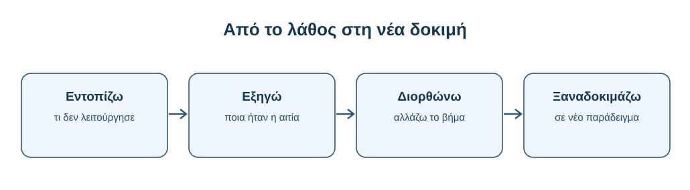
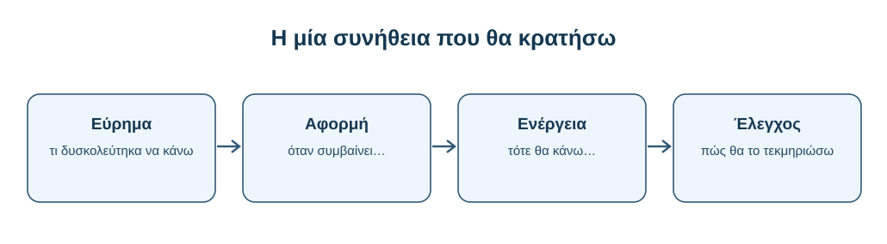
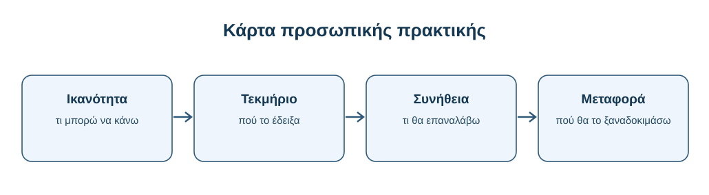

# AL00.10 — Τι έμαθα και ποια συνήθεια θα κρατήσω;

> **Προσωπικός αναστοχασμός και σχέδιο εφαρμογής.** Η ενότητα απευθύνεται σε φοιτητές όλων των ειδικοτήτων. Τα παραδείγματα είναι συνθετικά εκπαιδευτικά σενάρια· δεν αποτελούν πραγματικά στοιχεία έρευνας.

Η AL00.9 σε κάλεσε να ολοκληρώσεις μια ουσιαστική μαθησιακή αποστολή. Η AL00.10 σε καλεί να δεις τι έμεινε από αυτήν: ποια βήματα μπορείς να επαναλάβεις ανεξάρτητα, σε ποια σημεία χρειάζεσαι ακόμη προσοχή και ποια **μία συνήθεια** θα μεταφέρεις στις επόμενες σπουδές σου.

**Στο τέλος θα μπορείς:** να ξεχωρίζεις προϊόν, διαδικασία και ικανότητα· να αιτιολογείς προσωπική πρόοδο με μικρά τεκμήρια· να περιγράφεις ένα λάθος και μια διορθωτική δοκιμή· να επιλέγεις συγκεκριμένη επαναλαμβανόμενη συνήθεια· να σχεδιάζεις εφαρμογή της σε νέο πλαίσιο.

**Ενδεικτικός χρόνος:** 45–75 λεπτά. **Παραδοτέο:** προσωπική κάρτα μίας σελίδας. **Προαπαιτούμενα:** έχεις εργαστεί σε προηγούμενη ενότητα AL00, κατά προτίμηση AL00.9. Δεν χρειάζεται να δημοσιοποιήσεις πραγματικές συνομιλίες ή προσωπικά δεδομένα.

---

## 10.1 — Από την ολοκλήρωση στην προσωπική αποτίμηση

### 10.1.1 — Γιατί χρειάζεται αυτό το τελευταίο βήμα

Η ολοκλήρωση της AL00.9 σημαίνει ότι δοκίμασες να συνδυάσεις αναζήτηση, έλεγχο, χρήση της ΤΝ και ανεξάρτητη εφαρμογή. Δεν σημαίνει αυτομάτως ότι όλες αυτές οι δεξιότητες έγιναν σταθερές συνήθειες. Σε αυτή την ενότητα δεν θα δημιουργήσεις νέα μεγάλη εργασία. Θα εξετάσεις τη δική σου πορεία, θα εντοπίσεις μια συγκεκριμένη βελτίωση και θα οργανώσεις πώς θα την εφαρμόζεις χωρίς να χρειάζεσαι συνεχείς υπενθυμίσεις.

Ο αναστοχασμός εδώ δεν είναι γενική εντύπωση, όπως «μου άρεσε το μάθημα». Είναι μια σύντομη, τεκμηριωμένη απάντηση σε τρία ερωτήματα: **τι έκανα**, **τι έμαθα από αυτό** και **τι θα κάνω διαφορετικά την επόμενη φορά**. Μια καλή αποτίμηση μπορεί να αναγνωρίζει και περιορισμούς.

### 10.1.2 — Τρία διαφορετικά πράγματα: προϊόν, διαδικασία, ικανότητα

Το **προϊόν** είναι αυτό που παρέδωσες: σημείωμα, λύση, παρουσίαση ή σύνθεση. Η **διαδικασία** είναι οι επιλογές που σε οδήγησαν εκεί: πώς όρισες το ερώτημα, πότε χρησιμοποίησες ΤΝ, τι έλεγξες και τι διόρθωσες. Η **ικανότητα** είναι αυτό που μπορείς να επαναλάβεις σε νέα κατάσταση, ακόμη και όταν το εργαλείο δεν βρίσκεται δίπλα σου.

Ένα καλογραμμένο προϊόν δεν αποδεικνύει από μόνο του ότι απέκτησες την αντίστοιχη ικανότητα. Αντίστροφα, μια εργασία με ατέλειες μπορεί να συνοδεύεται από αξιόλογη μάθηση όταν μπορείς να εντοπίσεις με ακρίβεια το λάθος σου και να το διορθώσεις. Στην αποτίμηση χρειάζονται στοιχεία και για τα τρία: το προϊόν, τη διαδικασία και την ικανότητα.

**Παράδειγμα διάκρισης σε μία εργασία.** Σε μια εργασία ιστορίας, ο φοιτητής παραδίδει ένα κείμενο με σωστή χρονολογική σειρά. Αυτό είναι το *προϊόν*. Το ότι συνέκρινε δύο μαρτυρίες και έλεγξε τις ημερομηνίες είναι μέρος της *διαδικασίας*. Για να τεκμηριώσει την *ικανότητα*, δίνεται ένα νέο μικρό απόσπασμα και εξηγεί μόνος του πώς θα ελέγξει την προέλευση και τις πιθανές αντιφάσεις του. Το δεύτερο βήμα είναι πιο διαγνωστικό για όσα μπορεί να επαναλάβει.

**Δοκίμασε τη διάκριση.** Σκέψου μία δική σου επιτυχημένη εργασία και γράψε τρεις χωριστές προτάσεις, καθεμία με αρχή «Παρέδωσα…», «Για να το φτιάξω…», «Σε νέο παράδειγμα μπορώ να…». Αν η τρίτη πρόταση περιγράφει απλώς όσα έκανες ήδη, χρειάζεται ακόμη νέα δοκιμή και όχι μεγαλύτερη αυτοπεποίθηση.

### 10.1.3 — Αρχική προσωπική καταγραφή

Χωρίς να χρησιμοποιήσεις ΤΝ, συμπλήρωσε τρεις προτάσεις: «Πριν από την AL00 δυσκολευόμουν να…», «Τώρα μπορώ να…» και «Ακόμη χρειάζομαι εξάσκηση στο…». Απόφυγε μεγάλες δηλώσεις όπως «έμαθα να ελέγχω τα πάντα». Προτίμησε περιορισμένες, ελέγξιμες διατυπώσεις.

**Παράδειγμα.** «Πριν από το μάθημα θεωρούσα ότι ένα DOI αρκεί για να θεωρήσω αξιόπιστο έναν ισχυρισμό. Τώρα ελέγχω αν η πηγή υπάρχει και αν το περιεχόμενό της στηρίζει ακριβώς αυτό που γράφω. Χρειάζομαι ακόμη εξάσκηση στον έλεγχο ισχυρισμών για τους οποίους οι πηγές διαφωνούν». Αυτό είναι χρήσιμο γιατί προσδιορίζει παρατηρήσιμη αλλαγή.

### 10.1.4 — Μικρός έλεγχος χωρίς βοήθεια

Κλείσε τις σημειώσεις και μη χρησιμοποιήσεις chatbot. Έχεις μπροστά σου μια σύντομη απάντηση της ΤΝ: «Η μέθοδος αυτή αυξάνει την επίδοση όλων των φοιτητών κατά 40%» και έναν σύνδεσμο σε μια περίληψη άρθρου. Γράψε **δύο ελέγχους** που θα έκανες πριν επαναλάβεις τον ισχυρισμό και **ένα όριο** που θα δήλωνες.

::: {dropdown} Ενδεικτική απάντηση — άνοιξέ την αφού προσπαθήσεις
Θα εξέταζα αν η περίληψη αφορά πράγματι την ίδια μέθοδο και το ίδιο αποτέλεσμα, και αν το 40% προκύπτει από το άρθρο με σαφή ορισμό της επίδοσης. Θα σημείωνα ότι η αναφορά σε «όλους τους φοιτητές» είναι υπεργενίκευση, εκτός αν η μελέτη και τα δεδομένα την υποστηρίζουν. Η ύπαρξη συνδέσμου ή DOI δεν λύνει αυτά τα ερωτήματα.
:::

---

## 10.2 — Τι έμαθα: από εντυπώσεις σε τεκμήρια

### 10.2.1 — Μαθησιακός στόχος και τεκμήριο

Για κάθε σημαντική δεξιότητα, γράψε τι ακριβώς μπορείς να κάνεις και ποιο μικρό **τεκμήριο προσωπικής κατανόησης** δείχνει ότι το μπορείς. Το τεκμήριο δεν χρειάζεται να είναι βαθμός. Μπορεί να είναι το διορθωμένο ερώτημά σου, η αιτιολόγηση μιας επιλογής πηγής, η σύγκριση δύο εξηγήσεων ή μια ανεξάρτητη λύση.

**Ανεπαρκής διατύπωση:** «Έμαθα καλύτερα prompts». **Πιο τεκμηριωμένη:** «Μπορώ να επαναδιατυπώσω ένα ασαφές αίτημα ορίζοντας σκοπό, κοινό, μορφή απάντησης και κριτήρια ελέγχου· το έδειξα όταν μετέτρεψα το “πες μου για το θέμα” σε συγκεκριμένη ερώτηση με ελέγξιμες απαιτήσεις».

### 10.2.2 — Χάρτης δεξιοτήτων AL00

Ο παρακάτω πίνακας λειτουργεί ως αφορμή για αναστοχασμό, όχι ως εξέταση απομνημόνευσης τίτλων. Συμπλήρωσε για κάθε σειρά ένα παράδειγμα από τη δική σου εργασία.

| Πεδίο δεξιότητας | Τι μπορώ να κάνω | Τι θα χρησιμοποιήσω ως τεκμήριο |
|---|---|---|
| Διατύπωση αιτήματος | Ορίζω τι ζητώ και πώς θα ελέγξω την απάντηση | Πριν/μετά ενός αιτήματος |
| Αξιολόγηση απάντησης | Αναγνωρίζω βεβαιότητα χωρίς στήριξη και πιθανά λάθη | Έναν ισχυρισμό που αμφισβήτησα |
| Έλεγχος πηγών | Συνδέω συγκεκριμένο ισχυρισμό με κατάλληλο τεκμήριο | Μια πηγή και τη χρήση της |
| Βοήθεια στη μάθηση | Ζητώ υποδείξεις αντί για έτοιμη λύση | Μικρό διάλογο και ανεξάρτητη προσπάθεια |
| Υπεύθυνη πρακτική | Δηλώνω τη χρήση ΤΝ και προστατεύω δεδομένα | Απόφαση που πήρα και αιτιολόγησα |

Δεν χρειάζεται να επιλέξεις «άριστα» σε όλα. Η αποτίμηση είναι χρήσιμη μόνο αν διακρίνεις τι ήδη κατέχεις και τι ακόμη δοκιμάζεις.

### 10.2.3 — Κλίμακα αυτοαξιολόγησης με παρατηρήσιμα κριτήρια

Χρησιμοποίησε τα επίπεδα **Α — χρειάζομαι καθοδήγηση**, **Β — τα καταφέρνω με έλεγχο** και **Γ — μπορώ να το εφαρμόσω ανεξάρτητα σε νέο παράδειγμα**. Αυτή είναι κλίμακα προσωπικής αποτίμησης, όχι βαθμός του μαθήματος.

Για την ικανότητα «ελέγχω μια βιβλιογραφική αναφορά», το Α σημαίνει ότι δεν γνωρίζω από πού να αρχίσω· το Β ότι ελέγχω τίτλο και DOI με υπόδειξη· το Γ ότι βρίσκω την πηγή, δηλώνω τι μέρος της διάβασα και αξιολογώ αν στηρίζει τον συγκεκριμένο ισχυρισμό. Η διαφορά δεν είναι πόσο γρήγορα ολοκληρώνεις, αλλά πόσο ανεξάρτητη και ελέγξιμη είναι η εργασία σου.

**Πώς επιλέγω επίπεδο χωρίς να υπερεκτιμώ την πρόοδό μου;** Αν ολοκλήρωσες μία φορά μια διαδικασία ακολουθώντας αναλυτικές οδηγίες, αυτό δεν αρκεί για να δηλώσεις επίπεδο Γ. Το επίπεδο Β είναι συχνά ακριβέστερο όταν μπορείς να εκτελέσεις τα βήματα αλλά χρειάζεσαι υπενθύμιση ή εκ των υστέρων έλεγχο. Για το Γ αναζήτησε ένα νέο, μικρό παράδειγμα και εξήγησε *γιατί* επέλεξες τη μέθοδό σου.

| Καταγραφή | Τι γνωρίζουμε | Τι παραμένει ανοιχτό |
|---|---|---|
| «Βρήκα σωστή πηγή με τις οδηγίες του μαθήματος» | Εφάρμοσες μια διαδικασία με καθοδήγηση | Αν μπορείς να επιλέξεις μόνος σου κριτήρια σε άλλο θέμα |
| «Βρήκα νέα πηγή, έλεγξα τη συνάφεια και αιτιολόγησα την επιλογή» | Υπάρχει τεκμήριο ανεξάρτητης εφαρμογής | Αν η δεξιότητα διατηρείται σε δυσκολότερο πλαίσιο |

Η αυτοαξιολόγηση γίνεται πιο αξιόπιστη όταν συνοδεύεται από αυτή τη διάκριση ανάμεσα σε όσα παρατηρήθηκαν και σε όσα απλώς υποθέτουμε.

### 10.2.4 — Άσκηση: βαθμός βεβαιότητας και επόμενος έλεγχος

Διάλεξε δύο δεξιότητες: μία στην οποία νιώθεις σίγουρος ή σίγουρη και μία στην οποία είσαι αβέβαιος ή αβέβαιη. Για καθεμία κατέγραψε επίπεδο Α/Β/Γ, ένα τεκμήριο και έναν επόμενο έλεγχο που θα μπορούσε να διαψεύσει την αυτοεκτίμησή σου.

::: {dropdown} Ενδεικτική συμπλήρωση
«Διατύπωση αιτήματος — Γ: μπορώ να εξηγήσω γιατί περιόρισα το πεδίο της ερώτησης. Θα δοκιμάσω να κάνω το ίδιο σε εντελώς νέο αντικείμενο». «Έλεγχος πηγών — Β: μπορώ να αναζητήσω DOI, αλλά δυσκολεύομαι να ελέγξω τους περιορισμούς της μελέτης. Θα συγκρίνω τον ισχυρισμό με τα αποτελέσματα μιας δεύτερης μελέτης».
:::

---

## 10.3 — Πότε με βοήθησε η ΤΝ και πότε όχι

### 10.3.1 — Ο ρόλος της ΤΝ δεν είναι ίδιος σε κάθε στάδιο

Η ΤΝ μπορεί να σε βοηθήσει να οργανώσεις ένα δύσκολο θέμα, να ζητήσεις εναλλακτικές εξηγήσεις, να σχεδιάσεις ερωτήσεις ανάκλησης ή να βελτιώσεις τη σαφήνεια ενός σχεδίου. Δεν μπορεί να αναλάβει αντί για εσένα την ευθύνη του ισχυρισμού ή να αποτελέσει από μόνη της τεκμήριο ότι κατανόησες.

Για τον αναστοχασμό επέλεξε **μία χρήσιμη** και **μία μη χρήσιμη** χρήση του εργαλείου. Εξήγησε γιατί. Δεν αναζητούμε έναν κατάλογο «καλών» και «κακών» εργαλείων αλλά μια κρίση για τον συγκεκριμένο τρόπο χρήσης.

### 10.3.2 — Πότε η βοήθεια έγινε υπερβολική

Αν η ΤΝ δίνει ολόκληρη τη λύση πριν προσπαθήσεις, μπορεί να μειώσει την ευκαιρία να εντοπίσεις τι δεν γνωρίζεις. Το ίδιο ισχύει όταν ζητάς συνεχώς επιβεβαίωση για μικρές αποφάσεις που μπορείς να πάρεις ανεξάρτητα. Σημάδι υπερβολικής βοήθειας δεν είναι απλώς ο μεγάλος αριθμός αιτημάτων· είναι η δυσκολία να επαναλάβεις ή να αιτιολογήσεις την εργασία χωρίς το εργαλείο.

**Αντιπαράδειγμα.** Μια φοιτήτρια έχει έτοιμη από την ΤΝ σύγκριση δύο μελετών, αλλά δεν ξέρει ποια μεταβλητή μέτρησε καθεμία. Η γραπτή σύνοψη μπορεί να φαίνεται καλή, όμως η ικανότητα ελέγχου της σύγκρισης δεν έχει επιβεβαιωθεί.

### 10.3.3 — Πότε η ΤΝ με βοήθησε να σκεφτώ

Ένας χρήσιμος διάλογος με ΤΝ μπορεί να ξεκινά: «Δεν θέλω λύση ακόμη. Κάνε μου δύο ερωτήσεις που θα αποκαλύψουν πού μπερδεύομαι». Μετά την απάντηση ο φοιτητής δοκιμάζει ανεξάρτητα. Η αξία βρίσκεται στη διαδικασία που ενεργοποιήθηκε, όχι στην πολυπλοκότητα του αιτήματος.

**Άσκηση.** Γράψε δύο σύντομα αποσπάσματα από δική σου χρήση: ένα όπου έλαβες έτοιμο προϊόν και ένα όπου πήρες στοχευμένη βοήθεια. Αν δεν έχεις πραγματικά αποσπάσματα, χρησιμοποίησε ρητά ένα υποθετικό σενάριο. Σε κάθε περίπτωση εξήγησε ποιο βήμα έγινε από εσένα.

**Αναλυμένα δύο αιτήματα για το ίδιο μαθησιακό πρόβλημα.** Μια φοιτήτρια βιολογίας προσπαθεί να εξηγήσει τη διαφορά συσχέτισης και αιτιότητας. Το πρώτο αίτημα είναι «Γράψε μου μια ολοκληρωμένη παράγραφο για την εργασία μου». Η απάντηση μπορεί να είναι καλοδιατυπωμένη, αλλά η φοιτήτρια δεν γνωρίζει ακόμη αν μπορεί να κάνει η ίδια τη διάκριση.

Το δεύτερο αίτημα είναι: «Μη μου δώσεις έτοιμη παράγραφο. Δώσε δύο σύντομα υποθετικά παραδείγματα και ρώτησέ με ποιο συμπέρασμα δικαιολογείται σε καθένα. Μετά εξήγησε μόνο το σημείο όπου σφάλω». Μετά τη συζήτηση, η φοιτήτρια διατυπώνει μόνη της ένα τρίτο παράδειγμα. Εδώ υπάρχει ένας συγκεκριμένος τρόπος να ελεγχθεί η κατανόηση. Ούτε το δεύτερο αίτημα εγγυάται μάθηση· το κρίσιμο τεκμήριο είναι η ανεξάρτητη απάντηση.

**Μικρή δραστηριότητα.** Μετέτρεψε ένα δικό σου αίτημα που ζητά έτοιμο προϊόν σε αίτημα που ζητά βοήθεια *χωρίς* να αφαιρεί την προσπάθειά σου. Σημείωσε τι πρέπει να κάνεις προσωπικά μετά την απάντηση της ΤΝ.

### 10.3.4 — Άσκηση απόφασης: χρειάζομαι ΤΝ;

Μπροστά σου έχεις τρεις εργασίες: (α) να θυμηθείς τον ορισμό μιας έννοιας που ήδη μελέτησες, (β) να συγκρίνεις δύο δύσκολες ερμηνείες, (γ) να μεταφέρεις δεδομένα συμφοιτητών σε εργαλείο χωρίς σαφή άδεια. Σε ποια περίπτωση θα επιχειρούσες πρώτα μόνος σου; Σε ποια μπορεί να βοηθήσει η ΤΝ; Ποια απαιτεί να σταματήσεις και να εξετάσεις κανόνες και απόρρητο;

::: {dropdown} Ενδεικτικός συλλογισμός
Στην (α) προτιμώ πρώτα ενεργητική ανάκληση, ώστε να ελέγξω τι ξέρω. Στη (β) η ΤΝ μπορεί να προσφέρει έναν κατάλογο ερωτήσεων σύγκρισης, αλλά οι ερμηνείες και οι πηγές χρειάζονται προσωπικό έλεγχο. Στη (γ) δεν ανεβάζω δεδομένα χωρίς κατάλληλη εξουσιοδότηση και σαφείς όρους επεξεργασίας.
:::

---

## 10.4 — Από ένα λάθος σε μια χρήσιμη αλλαγή

### 10.4.1 — Το λάθος ως συγκεκριμένο γεγονός

Για να μάθεις από ένα λάθος πρέπει να το περιγράψεις παρατηρήσιμα: τι ισχυρίστηκες, ποιο βήμα παρέλειψες και πώς το ανακάλυψες. Η φράση «έκανα λάθος επειδή δεν πρόσεξα» δεν εξηγεί την αιτία ούτε υποδεικνύει τι πρέπει να αλλάξει.

**Παράδειγμα.** «Χρησιμοποίησα ποσοστό από ιστοσελίδα χωρίς να ελέγξω το έτος των δεδομένων· το ανακάλυψα όταν εντόπισα την αρχική αναφορά. Την επόμενη φορά θα καταγράφω έτος και πληθυσμό πριν χρησιμοποιήσω αριθμητικό ισχυρισμό».

### 10.4.2 — Ο κύκλος: εντοπίζω — εξηγώ — διορθώνω — ξαναδοκιμάζω

Μια ουσιαστική διόρθωση έχει τέσσερα μέρη: **εντοπισμός της απόκλισης**, **αιτία**, **συγκεκριμένη αλλαγή** και **νέα δοκιμή**. Αν σταματήσεις μόλις διορθώσεις τη φράση, ίσως επαναλάβεις το ίδιο λάθος σε άλλη εργασία. Η δοκιμή σε νέο παράδειγμα είναι εκείνη που δείχνει αν άλλαξε η πρακτική σου.

### 10.4.3 — Παράδειγμα από την ερμηνεία δεδομένων

Ένας φοιτητής οικονομικών γράφει «Η ομάδα Α έχει περισσότερα επιτυχημένα περιστατικά, άρα η μέθοδος Α είναι αποτελεσματικότερη». Διαπιστώνει στη συνέχεια ότι οι ομάδες έχουν διαφορετικό μέγεθος. Αντί να αντικαταστήσει απλώς το συμπέρασμα, καταγράφει την αιτία: σύγκρινε πλήθος και όχι ποσοστό.

Στη νέα δοκιμή, χωρίς ΤΝ, του δίνονται 18 επιτυχίες σε 30 περιπτώσεις και 24 επιτυχίες σε 60 περιπτώσεις. Υπολογίζει 18/30 = 60% και 24/60 = 40%. Αυτό υποστηρίζει τη σύγκριση ποσοστών για αυτά τα δεδομένα, **όχι** ένα γενικό αιτιώδες συμπέρασμα για την υπεροχή μιας μεθόδου.

**Ανάλυση του διορθωτικού κύκλου.** Αρχικός ισχυρισμός: «Η Β ομάδα έχει 24 επιτυχίες, άρα υπερέχει της Α που έχει 18». Εντοπισμός: λείπουν τα μεγέθη των ομάδων. Αιτία: σύγχυση ανάμεσα σε απόλυτο πλήθος και σχετική συχνότητα. Διόρθωση: η Α έχει 18/30 = 60%, ενώ η Β έχει 24/60 = 40%. Νέα δοκιμή: σε άλλο παράδειγμα, η Γ έχει 12/20 = 60% και η Δ 21/30 = 70%, άρα η Δ έχει υψηλότερο *ποσοστό* παρά το ότι το αρχικό ζεύγος είχε διαφορετική σειρά.

**Τι δεν αποδείξαμε:** τα ποσοστά από μόνα τους δεν αποκαλύπτουν αν οι ομάδες είναι συγκρίσιμες ή αν η μέθοδος προκάλεσε τη διαφορά. Η ορθή αριθμητική είναι απαραίτητη, όχι όμως επαρκής για αιτιώδη ερμηνεία.

**Άσκηση χωρίς ΤΝ.** Σε μία τρίτη δοκιμή, η Ε έχει 9 επιτυχίες σε 15 περιπτώσεις και η Ζ 16 σε 40. Ποια έχει μεγαλύτερο ποσοστό; Εξήγησε γιατί δεν αρκεί να συγκρίνεις το 9 με το 16.

::: {dropdown} Ενδεικτική λύση
Η Ε έχει 9/15 = 60% και η Ζ 16/40 = 40%. Για το συγκεκριμένο κριτήριο η Ε έχει υψηλότερο ποσοστό. Η σύγκριση 9 και 16 αγνοεί ότι τα μεγέθη των ομάδων είναι διαφορετικά. Η πληροφορία δεν επιτρέπει ακόμη γενική κρίση για αιτιότητα ή ποιότητα των μεθόδων.
:::

### 10.4.4 — Προσωπικός κατάλογος λαθών χωρίς αυτομομφή

Δημιούργησε έναν μικρό πίνακα τριών γραμμών με στήλες «Λάθος που έκανα ή θα μπορούσα να κάνω», «Προειδοποιητικό σημάδι», «Έλεγχος που θα εφαρμόζω». Ένα λάθος μπορεί να αφορά μη ελεγμένη πηγή, υπερβολική βεβαιότητα, αποκάλυψη ευαίσθητων δεδομένων ή παράκαμψη ανεξάρτητης προσπάθειας.

Δεν χρειάζεται να μοιραστείς ιδιωτικά δεδομένα ή προσωπικούς διαλόγους με chatbot. Μπορείς να περιγράψεις την κατάσταση αφαιρετικά, με αλλαγμένα στοιχεία, εφόσον διατηρείται η μαθησιακή ουσία.

---

## 10.5 — Η μία συνήθεια που θα κρατήσω

### 10.5.1 — Γιατί μία συνήθεια και όχι δέκα κανόνες

Ένας μεγάλος κατάλογος καλών προθέσεων ξεχνιέται εύκολα. Γι’ αυτό θα επιλέξεις **μία συγκεκριμένη συνήθεια** που μπορεί να επαναλαμβάνεται σε πραγματικές εργασίες. Αν η συνήθεια σταθεροποιηθεί, μπορείς αργότερα να προσθέσεις άλλη. Ο σκοπός δεν είναι να περιορίσεις όσα έμαθες, αλλά να ξεκινήσεις με κάτι εφαρμόσιμο.

**Αόριστο:** «Θα χρησιμοποιώ υπεύθυνα την ΤΝ». **Συγκεκριμένο:** «Πριν αντιγράψω αριθμητικό ισχυρισμό από απάντηση ΤΝ, θα αναζητώ την αρχική πηγή και θα καταγράφω τι ακριβώς επιβεβαίωσα».

### 10.5.2 — Σύνδεσε τη συνήθεια με πραγματική αφορμή

Μια συνήθεια χρειάζεται μια σαφή αφορμή: **Όταν [συνθήκη], τότε [ενέργεια]**. Για παράδειγμα: «Όταν ζητώ από την ΤΝ εξήγηση δύσκολης έννοιας, τότε πριν συνεχίσω θα προσπαθώ να την εξηγήσω με δικά μου λόγια χωρίς να βλέπω την απάντηση».

Η αφορμή πρέπει να εμφανίζεται πράγματι στις σπουδές σου. Μην επιλέγεις δραστηριότητα που συμβαίνει σπάνια ή που εξαρτάται από συνθήκες εκτός ελέγχου σου.

### 10.5.3 — Πώς θα καταλάβω ότι το εφάρμοσα

Πρόσθεσε έναν απλό δείκτη: ένα κουτάκι ελέγχου ανά εργασία, μια σημείωση της πηγής ή δύο γραμμές προσωπικής εξήγησης. Μην μετατρέψεις την αυτοπαρακολούθηση σε νέα βαριά εργασία.

**Ενδεικτικό σχέδιο:** «Για τις επόμενες τρεις εργασίες στις οποίες θα χρησιμοποιήσω ΤΝ, πριν παραδώσω θα ελέγχω έναν βασικό ισχυρισμό από ανεξάρτητη πηγή και θα σημειώνω τι επαλήθευσα. Θα ξέρω ότι τήρησα τη συνήθεια όταν υπάρχουν τρεις σύντομες καταγραφές». Η επιτυχία εδώ είναι η συνέπεια της διαδικασίας, όχι η βεβαιότητα ότι η εργασία είναι αλάνθαστη.

**Δοκιμή αντοχής της συνήθειας.** Πριν οριστικοποιήσεις τον κανόνα σου, εξέτασε τρία εμπόδια: (1) θα θυμηθώ πότε ενεργοποιείται; (2) θα μπορώ να τον εφαρμόσω όταν βιάζομαι; (3) θα γνωρίζω αν πραγματικά τον τήρησα; Για παράδειγμα, η συνήθεια «θα κάνω αναλυτική βιβλιογραφική έρευνα για κάθε πρόταση» είναι υπερβολικά βαριά. Η συνήθεια «πριν χρησιμοποιήσω σημαντικό αριθμητικό ισχυρισμό, θα ελέγχω την αρχική πηγή και τι μετρήθηκε» είναι πιο εφικτή.

**Συμπληρωμένο μικρό πλάνο:** Αφορμή — «όταν γράφω μια παράγραφο που περιέχει αριθμό από απάντηση ΤΝ». Ενέργεια — «ανοίγω την πρωτογενή διαθέσιμη πηγή, εξετάζω τι μετρήθηκε και σημειώνω τον περιορισμό». Ένδειξη — «μια σύντομη σημείωση δίπλα στην παράγραφο». Επανεξέταση — «μετά από τρεις εργασίες βλέπω αν το έκανα χωρίς εξωτερική υπενθύμιση». Αν η πηγή δεν είναι προσβάσιμη ή δεν επιβεβαιώνει τον αριθμό, η σωστή ενέργεια μπορεί να είναι να μην χρησιμοποιήσω τον ισχυρισμό.

### 10.5.4 — Σχέδιο για την περίπτωση που ξεχάσω

Ένας λειτουργικός κανόνας πρέπει να αντέχει και μια παράλειψη. Αν ξεχάσεις μια φορά να κάνεις τον έλεγχο, δεν χρειάζεται να εγκαταλείψεις το σχέδιο. Εντόπισε ποιο σημείο της εργασίας ήταν η κατάλληλη αφορμή και τοποθέτησε εκεί μια μικρή υπενθύμιση.

**Άσκηση.** Συμπλήρωσε: «Η συνήθειά μου είναι…», «Θα ενεργοποιείται όταν…», «Θα την καταγράφω με…», «Αν την παραλείψω, την επόμενη φορά θα…». Χρησιμοποίησε γλώσσα που μπορείς να καταλάβεις ακόμη και μετά από έναν μήνα.

### 10.5.5 — Πέντε ενδεικτικές συνήθειες — διάλεξε ή σχεδίασε δική σου

Μπορείς να επιλέξεις να: (α) προσπαθείς μόνος σου για λίγα λεπτά πριν ζητήσεις λύση, (β) ελέγχεις την αρχική πηγή ενός κρίσιμου ισχυρισμού, (γ) ζητάς υπόδειξη αντί για πλήρη απάντηση, (δ) αποφεύγεις την εισαγωγή προσωπικών δεδομένων χωρίς άδεια ή (ε) κάνεις μια μικρή ανεξάρτητη εφαρμογή μετά την εξήγηση της ΤΝ.

Καμία από αυτές δεν είναι υποχρεωτικά η καλύτερη για όλους. Επίλεξε εκείνη που αντιμετωπίζει τη μεγαλύτερη πραγματική δυσκολία σου. Μπορείς επίσης να συνδυάσεις δύο ενέργειες μόνο αν παραμένουν εφικτές ως μία σύντομη ρουτίνα.

---

## 10.6 — Μεταφορά σε νέα μαθήματα και πραγματικές αποφάσεις

### 10.6.1 — Το νέο πλαίσιο ως δοκιμή

Μια δεξιότητα γίνεται πιο ουσιαστική όταν μπορείς να την εφαρμόσεις πέρα από το παράδειγμα στο οποίο τη διδάχθηκες. Εάν έμαθες να ελέγχεις βιβλιογραφικές πηγές σε ένα κοινωνικό θέμα, μπορείς να εφαρμόσεις την ίδια λογική σε υλικό οικονομικών, εκπαίδευσης ή επιστημών υγείας, προσαρμόζοντας πάντα τα κριτήρια στον τύπο της πληροφορίας.

Η μεταφορά δεν σημαίνει ότι ένα βήμα είναι ίδιο παντού: σε ένα ιστορικό τεκμήριο εξετάζεις προέλευση και πλαίσιο· σε ένα πειραματικό άρθρο μέθοδο και δείγμα· σε μια διοικητική προθεσμία την ισχύουσα επίσημη ανακοίνωση.

### 10.6.2 — Παράδειγμα: από τη μελέτη στην ομαδική εργασία

Μια φοιτήτρια έχει συνηθίσει να ζητά από την ΤΝ να οργανώνει τις σημειώσεις της. Σε ομαδική εργασία λαμβάνει από το εργαλείο μια πολύ πειστική σύνοψη. Αντί να τη μοιράσει ως δεδομένη αλήθεια, ζητά από την ομάδα να ελέγξει δύο βασικούς ισχυρισμούς στα αρχικά έγγραφα και να διακρίνει ποια στοιχεία έχουν πραγματικά διαβαστεί.

Η μεταφορά της δεξιότητας είναι το πέρασμα από την προσωπική μελέτη σε μια συλλογική διαδικασία με διαφάνεια και κοινή ευθύνη. Η ΤΝ παραμένει βοήθημα οργάνωσης, όχι μέλος της ομάδας που αναλαμβάνει την ακαδημαϊκή ευθύνη.

### 10.6.3 — Παράδειγμα: από την εξήγηση στην απόφαση

Ένας φοιτητής μηχανικής ζητά εξήγηση ενός τεχνικού όρου. Η απάντηση της ΤΝ περιγράφει πιθανές επιλογές αλλά δεν παρέχει έγκυρες προδιαγραφές για το συγκεκριμένο εξάρτημα. Ο φοιτητής χρησιμοποιεί την απάντηση για να κατανοήσει την ορολογία, έπειτα ανατρέχει στα επίσημα τεχνικά έγγραφα πριν πάρει απόφαση.

Σε αποφάσεις με συνέπειες για την ασφάλεια, την υγεία, τα δικαιώματα ή οικονομικούς πόρους, απαιτείται κατάλληλος έλεγχος και, όπου χρειάζεται, ειδική ανθρώπινη ευθύνη. Ένα chatbot δεν αντικαθιστά αυτή τη διαδικασία.

### 10.6.4 — Μικρή δοκιμή μεταφοράς

Διάλεξε μια δεξιότητα AL00 και εφάρμοσέ την σε θέμα διαφορετικό από την AL00.9. Για παράδειγμα, εάν στην AL00.9 εξέτασες βιβλιογραφικό ισχυρισμό, τώρα σχεδίασε μια στρατηγική ανεξάρτητης εκμάθησης μιας νέας έννοιας. Εάν εργάστηκες στη Διαδρομή Β, τώρα έλεγξε τον τρόπο με τον οποίο θα τεκμηρίωνες έναν μικρό ισχυρισμό.

Παράδωσε τρεις προτάσεις: τι κράτησες ίδιο από τη μέθοδο, τι προσαρμόζεις στο νέο πεδίο και πώς θα διαπιστώσεις ότι η εφαρμογή ήταν επιτυχής. Μην ζητήσεις από την ΤΝ να συντάξει αυτές τις προτάσεις.

::: {dropdown} Ενδεικτική απάντηση
«Κρατώ τον έλεγχο της αρχικής πηγής πριν δεχθώ έναν ισχυρισμό. Σε δημόσια ανακοίνωση όμως αντί για DOI αναζητώ την επίσημη υπηρεσία και την ημερομηνία ισχύος. Θα θεωρήσω ότι εφάρμοσα τη μέθοδο όταν μπορώ να δείξω τη συγκεκριμένη ανακοίνωση και να εξηγήσω γιατί αφορά τη δική μου περίπτωση».
:::

---

**Δύο ισότιμες διαδρομές μεταφοράς.** Αν στην AL00.9 ακολούθησες τη **Διαδρομή Α** (ερευνητικό ερώτημα), δοκίμασε τώρα μια μικρή εργασία κατανόησης χωρίς έτοιμη απάντηση. Αν ακολούθησες τη **Διαδρομή Β** (μαθησιακή δυσκολία), δοκίμασε τώρα να ελέγξεις έναν απλό, διατυπωμένο ισχυρισμό σε κατάλληλη πηγή. Ο σκοπός δεν είναι η αλλαγή θέματος για την αλλαγή· είναι να φανεί ποια μέθοδος επιβιώνει έξω από το αρχικό της παράδειγμα.

| Προηγούμενη εμπειρία | Νέα δοκιμή | Παρατηρήσιμο τεκμήριο |
|---|---|---|
| Έλεγξα βιβλιογραφικό ισχυρισμό | Μαθαίνω μία άγνωστη έννοια | Γράφω προσωπική εξήγηση και τη δοκιμάζω σε νέο παράδειγμα |
| Έλυσα πρόβλημα με υποδείξεις | Ελέγχω έναν νέο ισχυρισμό | Βρίσκω συγκεκριμένη πηγή και περιορίζω ανάλογα το συμπέρασμα |

**Κριτήριο επιτυχίας:** μπορείς να δείξεις ποιο βήμα επέλεξες *χωρίς* την ΤΝ και πώς αξιολόγησες το αποτέλεσμά του. Δεν απαιτείται να είναι όλα σωστά στην πρώτη προσπάθεια.

## 10.7 — Το προσωπικό μου σχέδιο μιας σελίδας

### 10.7.1 — Το τελικό παραδοτέο

Στο τέλος της ενότητας παραδίδεις **μία σύντομη προσωπική κάρτα πρακτικής**, όχι νέα ερευνητική εργασία. Με αυτή την κάρτα συνδέεις τον αναστοχασμό των προηγούμενων δραστηριοτήτων με μια μικρή, εφαρμόσιμη δέσμευση για τις επόμενες εργασίες σου. Η κάρτα περιέχει: (1) μια δεξιότητα που ενισχύθηκε, (2) πραγματικό τεκμήριο, (3) ένα λάθος ή όριο που αναγνώρισες, (4) μια επαναλαμβανόμενη συνήθεια, (5) μια αφορμή και έναν απλό δείκτη τήρησης, (6) ένα νέο πλαίσιο όπου θα τη δοκιμάσεις.

Η κάρτα μπορεί να παραμείνει προσωπική. Αν τη συζητήσεις στην τάξη, αφαίρεσε ονόματα, προσωπικά δεδομένα και μη δημόσιους διαλόγους. Δεν χρειάζεται να αποδείξεις ότι χρησιμοποίησες κάποιο συγκεκριμένο προϊόν ΤΝ.

### 10.7.2 — Συμπληρώσιμο υπόδειγμα

Αντέγραψε και συμπλήρωσε το παρακάτω υπόδειγμα. Οι απαντήσεις μπορούν να είναι σύντομες αλλά συγκεκριμένες.

| Πεδίο | Η δική μου καταγραφή |
|---|---|
| Η δεξιότητα που ενίσχυσα | … |
| Τι μπορώ να κάνω ανεξάρτητα | … |
| Ποιο τεκμήριο το δείχνει | … |
| Ποιο λάθος ή όριο αναγνώρισα | … |
| Η μία συνήθεια που κρατώ | … |
| Όταν συμβαίνει… τότε θα… | … |
| Πώς θα ελέγχω ότι την εφάρμοσα | … |
| Πού θα τη δοκιμάσω ξανά | … |

Αν κάποια απάντηση είναι αόριστη, πρόσθεσε ρήμα δράσης: «θα εντοπίζω», «θα συγκρίνω», «θα εξηγώ», «θα καταγράφω», «θα δοκιμάζω».

### 10.7.3 — Πλήρες παράδειγμα από τη φοιτητική μελέτη

**Συνθετικό εκπαιδευτικό παράδειγμα.** Μια φοιτήτρια ψυχολογίας θέλει να διαπιστώσει αν κατανοεί σωστά τους περιορισμούς μιας έρευνας.

**Δεξιότητα:** Διαχωρίζω τον ισχυρισμό μιας περίληψης από όσα μετρά πράγματι η μελέτη. **Τεκμήριο:** Σε μια άσκηση βρήκα ότι η περίληψη αφορούσε αυτοαναφερόμενη ικανοποίηση, όχι βελτίωση επίδοσης, και διόρθωσα τον αρχικό ισχυρισμό μου. **Όριο:** Δεν είχα πρόσβαση σε ολόκληρο το άρθρο και δεν μπορούσα να αξιολογήσω όλα τα μεθοδολογικά στοιχεία. **Συνήθεια:** Πριν χρησιμοποιήσω μια μελέτη σε εργασία, θα σημειώνω τι αποτέλεσμα μετρήθηκε και τι μέρος του άρθρου διάβασα. **Αφορμή:** Όταν εισάγω βιβλιογραφική παραπομπή σε σημείωμα. **Δείκτης:** Δύο σύντομες σημειώσεις δίπλα στην παραπομπή. **Μεταφορά:** Στην επόμενη εργασία ερευνητικής μεθοδολογίας.

Η κάρτα δεν ισχυρίζεται ότι η φοιτήτρια έγινε ειδικός στην κριτική αξιολόγηση. Δείχνει μια περιορισμένη αλλά ελέγξιμη αλλαγή στη συμπεριφορά της.

**Γιατί το παράδειγμα είναι επαρκώς συγκεκριμένο.** Δεν γράφει «έμαθα να αξιολογώ έρευνες» χωρίς όρια. Συνδέει μία ενέργεια (διόρθωση του ισχυρισμού), ένα παρατηρήσιμο τεκμήριο (διαφορά ανάμεσα σε ικανοποίηση και επίδοση), ένα όριο (μερική πρόσβαση στο άρθρο) και μία αφορμή για μελλοντικό έλεγχο. Έτσι η προσωπική κάρτα μπορεί να αξιολογηθεί ως *σχέδιο πρακτικής* και όχι ως δήλωση αυτοπεποίθησης.

**Δύο ερωτήσεις ελέγχου της κάρτας:** Αν άλλος φοιτητής διάβαζε μόνο τη δική σου κάρτα, θα καταλάβαινε ποια ενέργεια μπορεί να επαναλάβεις; Αν την ξαναδιάβαζες μετά από έναν μήνα, θα ήξερες σε ποια συγκεκριμένη στιγμή να ενεργοποιήσεις τη συνήθεια; Αν όχι, πρόσθεσε σαφέστερη αφορμή ή πιο συγκεκριμένο τεκμήριο αντί για περισσότερες γενικές υποσχέσεις.

### 10.7.4 — Αντιπαράδειγμα και βελτίωση

**Αδύναμη κάρτα:** «Έμαθα πολλά. Η ΤΝ με βοήθησε παντού. Θα ελέγχω πάντα τις απαντήσεις της». Δεν αναφέρει τεκμήριο, συγκεκριμένη ενέργεια ή συνθήκη. Επίσης, το «πάντα» είναι δύσκολο να αποδειχθεί.

**Βελτιωμένη κάρτα:** «Στην εργασία μου εντόπισα ότι η ΤΝ είχε αποδώσει έναν ισχυρισμό σε άσχετη πηγή. Την επόμενη φορά, όταν χρησιμοποιώ παραπομπή από συνομιλία, θα ανοίγω την πηγή και θα καταγράφω σε μία γραμμή ποιο σημείο της στηρίζει τον ισχυρισμό». Η δεύτερη εκδοχή προσφέρει σαφή δυνατότητα ελέγχου και επανάληψης.

### 10.7.5 — Προσωπικός έλεγχος πριν ολοκληρώσεις

Διάβασε την κάρτα σου και ρώτησε: (α) μπορώ να δείξω το τεκμήριο; (β) η συνήθειά μου συνδέεται με πραγματική αφορμή; (γ) μπορώ να εξηγήσω πώς θα ελέγξω τη συνέπειά μου; (δ) το νέο πλαίσιο διαφέρει αρκετά ώστε να δοκιμάζει μεταφορά; (ε) αποφεύγω προσωπικά δεδομένα και υπερβολικούς ισχυρισμούς;

---

## 10.8 — Αυτοέλεγχος και ολοκλήρωση

### 10.8.1 — Ερωτήσεις πριν από τα quiz

Απάντησε χωρίς βοήθεια: Ποια είναι η διαφορά ανάμεσα σε προϊόν και ικανότητα; Τι κάνει ένα τεκμήριο μάθησης ελέγξιμο; Πώς διατυπώνεις μία συνήθεια με αφορμή; Γιατί ένα νέο παράδειγμα είναι καλύτερος έλεγχος από την απλή επανάληψη της παλιάς απάντησης;

**Σύντομος αναστοχασμός πριν δεις οποιαδήποτε ανατροφοδότηση.** Γράψε μία πρόταση που αρχίζει «Το πιο ισχυρό μου τεκμήριο είναι…» και μία που αρχίζει «Αυτό που δεν έχω ακόμη αποδείξει είναι…». Αυτή η δεύτερη πρόταση δεν μειώνει την πρόοδο· δείχνει ότι μπορείς να οριοθετήσεις τα συμπεράσματά σου.

**Μικρή περίπτωση αυτοελέγχου.** Φοιτητής γράφει: «Το quiz μου έδωσε πλήρη βαθμολογία, άρα μπορώ να χρησιμοποιώ ΤΝ με ασφάλεια σε κάθε επαγγελματική απόφαση». Ποια είναι η υπέρβαση; Ο βαθμός σε συγκεκριμένα ερωτήματα δείχνει επίδοση σε αυτά, όχι αυτόματα ικανότητα σε κάθε νέο ή υψηλού κινδύνου πλαίσιο. Μια κατάλληλη επόμενη δοκιμή είναι να εντοπίσει τι διαφέρει σε μια νέα κατάσταση και ποιος εξωτερικός έλεγχος απαιτείται.

### 10.8.2 — Πρώτη αυτοαξιολόγηση: τι πράγματι έμαθα

Το πρώτο σύντομο quiz ελέγχει τη διάκριση ανάμεσα σε προϊόν, διαδικασία, τεκμήριο μάθησης και ανεξάρτητη εφαρμογή. Απάντησε πρώτα χωρίς βοήθεια και διάβασε την ανατροφοδότηση. Το quiz δεν αντικαθιστά την προσωπική σου κάρτα.

**Αυτοαξιολόγηση 1:** [Άνοιγμα quiz AL00.10 — αποτίμηση μάθησης](quiz/al00_10_q1.html).

### 10.8.3 — Δεύτερη αυτοαξιολόγηση: απόφαση και συνήθεια

Το δεύτερο quiz ζητά να επιλέξεις πρακτικές που συνδέουν έλεγχο, ανατροφοδότηση και προσωπική ευθύνη. Διάβασε τις εξηγήσεις ακόμη και αν απάντησες σωστά. Αν διαπιστώσεις αδυναμία σε κάποια περίπτωση, σημείωσε ποια ενέργεια θα δοκιμάσεις την επόμενη φορά.

**Αυτοαξιολόγηση 2:** [Άνοιγμα quiz AL00.10 — προσωπική πρακτική](quiz/al00_10_q2.html).

### 10.8.4 — Τι παίρνω μαζί μου

Ο στόχος της AL00 δεν είναι να χρησιμοποιείς την ΤΝ σε κάθε εργασία, αλλά να επιλέγεις **πότε, γιατί και με ποιον έλεγχο** την αξιοποιείς. Θα συναντήσεις νέες εφαρμογές και νέους τρόπους αλληλεπίδρασης· οι βασικές ερωτήσεις παραμένουν: τι ζητώ, ποια στοιχεία έχω, ποια απόφαση αναλαμβάνω και τι μπορώ να εξηγήσω ανεξάρτητα.

Η προσωπική σου κάρτα είναι αφετηρία, όχι υπόσχεση τελειότητας. Κράτησέ την και επανεξέτασέ την μετά από μερικές πραγματικές εργασίες. Ο **AL00-R** είναι προαιρετική μεταγενέστερη ευκαιρία επανελέγχου, όχι πρόσθετο υποχρεωτικό κεφάλαιο. Εκεί θα εξετάσεις αν η συνήθεια εφαρμόστηκε και αν διατηρήθηκαν οι δεξιότητές σου.
