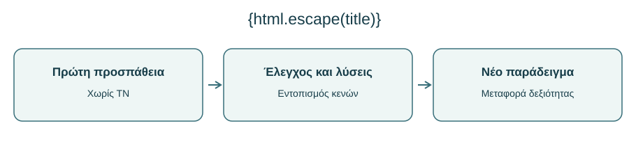
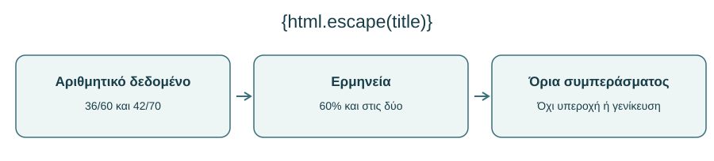
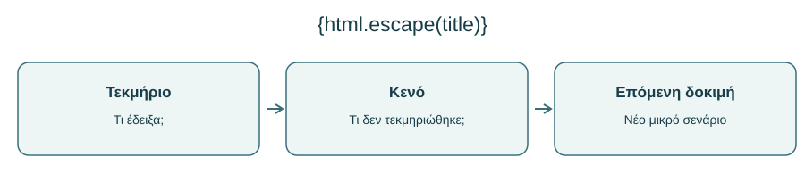

# AL00-R — Προαιρετικός επανέλεγχος βασικών δεξιοτήτων ΤΝ

> **Αυτοτελής πρακτική δοκιμή, όχι νέο μάθημα θεωρίας.** Η AL00-R απευθύνεται σε φοιτητές όλων των ειδικοτήτων. Μπορείς να την πραγματοποιήσεις μετά την AL00.10 ή αργότερα, όταν θέλεις να ελέγξεις αν διατηρείς τις δεξιότητές σου. Τα δεδομένα, τα ονόματα και τα τεκμήρια των δραστηριοτήτων είναι **συνθετικά εκπαιδευτικά σενάρια** και δεν αποτελούν αποτελέσματα πραγματικών μελετών.

**Σκοπός:** να δείξεις τι μπορείς να κάνεις σε νέα, μικρά προβλήματα, να ελέγξεις την αιτιολόγησή σου και να αποφασίσεις ποια δεξιότητα χρειάζεται περαιτέρω άσκηση. **Ενδεικτικός χρόνος:** 60–90 λεπτά, σε μία ή δύο συνεδρίες. **Προαπαιτούμενο:** βασική εξοικείωση με το AL00. Δεν απαιτείται λογαριασμός σε εμπορικό εργαλείο για τη βασική διαδρομή.

**Τι θα παραδώσεις:** ένα σύντομο φύλλο επανελέγχου με τις προσωπικές απαντήσεις στις τέσσερις αποστολές, αιτιολόγηση αποφάσεων, αυτοβαθμολόγηση ανά κριτήριο και σχέδιο μίας επόμενης άσκησης. Μην καταχωρίζεις προσωπικά δεδομένα ή μη δημοσιευμένα στοιχεία τρίτων σε υπηρεσίες ΤΝ.

---

## R.1 — Πώς λειτουργεί ο προαιρετικός επανέλεγχος

### R.1.1 — Γιατί επανέλεγχος και όχι ακόμη ένα quiz γνώσεων

Στην AL00 έμαθες να διατυπώνεις σαφή αιτήματα, να ελέγχεις ισχυρισμούς, να αξιολογείς πηγές και να αξιοποιείς την ΤΝ χωρίς να υποκαθιστάς την προσωπική σου σκέψη. Η ανάμνηση μιας σωστής απάντησης δεν δείχνει από μόνη της ότι μπορείς να εφαρμόσεις αυτές τις αρχές όταν το παράδειγμα αλλάξει. Γι' αυτό εδώ θα αντιμετωπίσεις **νέα δεδομένα και νέα μικρά διλήμματα**. Δεν χρειάζεται να θυμάσαι τίτλους προηγούμενων ενοτήτων· χρειάζεται να εξηγήσεις τις επιλογές σου.

Η διαδικασία είναι **προαιρετική και μη τιμωρητική**: δεν αποτελεί εξέταση πιστοποίησης ούτε υπόσχεται ότι μια υψηλή επίδοση αποδεικνύει επάρκεια για κάθε μελλοντική περίπτωση. Είναι ένα εργαλείο αυτοδιάγνωσης με εμφανή όρια. Αν δυσκολευτείς, η δυσκολία δείχνει πού θα ωφεληθείς από νέα εξάσκηση.

### R.1.2 — Δύο περάσματα: ανεξάρτητη προσπάθεια και αναθεώρηση

**Πρακτικός κανόνας για το πότε θα ανοίξεις τις λύσεις.** Πριν ξεκινήσεις, δημιούργησε ένα αντίγραφο του φύλλου απαντήσεων και γράψε «Πρώτο πέρασμα». Συμπλήρωσε διαδοχικά τις τέσσερις αποστολές και σημείωσε την ώρα ολοκλήρωσης. Μόνο τότε άνοιξε τα αναπτυσσόμενα πλαίσια με τις ενδεικτικές λύσεις. Στο «Δεύτερο πέρασμα» γράψε ξεχωριστά τι διόρθωσες και *γιατί*. Έτσι η δυνατότητα εμφάνισης μιας λύσης στην ίδια σελίδα δεν μετατρέπει άθελά σου τη δοκιμή σε άσκηση αντιγραφής. Αν τη δεις νωρίτερα, κατέγραψέ το και αντιμετώπισε το σχετικό αποτέλεσμα ως **εξάσκηση με υποστήριξη**, όχι ως ανεξάρτητη επίδοση.

Στο **πρώτο πέρασμα** διάβασε τις τέσσερις αποστολές, απάντησε χωρίς chatbot και χωρίς να ανοίξεις τις ενδεικτικές λύσεις. Επιτρέπεται χαρτί, αριθμομηχανή για απλές πράξεις και οι πληροφορίες που δίνονται μέσα στο φύλλο. Σημείωσε τα σημεία αβεβαιότητας· δεν χρειάζεται να μαντεύεις. Στο **δεύτερο πέρασμα**, άνοιξε τις ενδεικτικές απαντήσεις, σύγκρινε τη λογική σου, κατέγραψε μία βελτίωση και προαιρετικά χρησιμοποίησε ΤΝ για ανατροφοδότηση. Μην αντικαταστήσεις την αρχική σου απάντηση: κράτησε και τις δύο εκδοχές, ώστε να φαίνεται τι άλλαξε.

Η διάκριση αυτή είναι ουσιαστική. Μια τελική άψογη απάντηση ύστερα από εκτενή βοήθεια δεν αποτελεί το ίδιο τεκμήριο με την αρχική ανεξάρτητη προσπάθεια. Και οι δύο έχουν αξία, αλλά απαντούν σε διαφορετικά ερωτήματα.

### R.1.3 — Τέσσερις αποστολές, τέσσερις συνδεδεμένες δεξιότητες

| Αποστολή | Τι ελέγχεις | Τι παράγεις |
|---|---|---|
| Α — Καθαρό αίτημα | Ορίζεις πλαίσιο, περιορισμούς και κριτήρια ελέγχου | Διορθωμένο αίτημα και αιτιολόγηση |
| Β — Ισχυρισμός και πηγές | Ξεχωρίζεις τι υποστηρίζουν πραγματικά τα διαθέσιμα τεκμήρια | Συμπέρασμα με όρια |
| Γ — Βοήθεια στη μάθηση | Ζητάς υποστήριξη χωρίς έτοιμη απάντηση και λύνεις νέο πρόβλημα | Σχέδιο βοήθειας και ανεξάρτητη λύση |
| Δ — Υπεύθυνη απόφαση | Αξιολογείς ιδιωτικότητα, διαφάνεια και ανθρώπινη ευθύνη | Απόφαση και ασφαλής εναλλακτική |

Οι αποστολές δεν εξαρτώνται από συγκεκριμένο επάγγελμα ή επιστημονικό πεδίο. Αν χρειαστεί, μπορείς να μεταφέρεις το ίδιο σχήμα σε θέμα της ειδικότητάς σου *αφού ολοκληρώσεις* το αρχικό κοινό παράδειγμα.

### R.1.4 — Πριν αρχίσεις: δήλωση αρχικής βεβαιότητας

Χωρίς ΤΝ, βαθμολόγησε την αρχική σου βεβαιότητα για κάθε αποστολή με 1 (χαμηλή), 2 (μέτρια) ή 3 (υψηλή). Αυτή η ένδειξη **δεν είναι βαθμός ικανότητας**. Στο τέλος θα συγκρίνεις την αίσθησή σου με τα τεκμήρια που παρήγαγες. Έτσι μπορείς να εντοπίσεις τόσο υπερεκτίμηση όσο και αδικαιολόγητη υποτίμηση των δυνατοτήτων σου.

---

## R.2 — Αποστολή Α: από το ασαφές στο ελέγξιμο αίτημα

### R.2.1 — Το νέο σενάριο

Μια φοιτητική ομάδα ετοιμάζει σύντομη ενημέρωση για τη μείωση της σπατάλης τροφίμων σε φοιτητικές κατοικίες. Ένα μέλος προτείνει να γράψει σε εργαλείο ΤΝ: «Πες μου πώς να λύσουμε το πρόβλημα της σπατάλης τροφίμων. Γράψε κάτι εντυπωσιακό και βάλε στοιχεία». Το αίτημα δεν ορίζει κοινό, μορφή, γεωγραφικό πλαίσιο, περιορισμούς ή τρόπο επαλήθευσης των αριθμών.

**Η αποστολή σου:** γράψε ένα νέο αίτημα 70–120 λέξεων, το οποίο θα χρησιμοποιούσες για να ζητήσεις **σχέδιο ενημερωτικού κειμένου** και όχι τελική, αυτομάτως αξιόπιστη επιστημονική απάντηση. Να περιλαμβάνει σκοπό, κοινό, διάρκεια ή έκταση, ζητούμενη δομή, τρόπο χειρισμού αβέβαιων αριθμών και σαφή υποχρέωση για ανθρώπινο έλεγχο. Πρόσθεσε δύο προτάσεις που εξηγούν γιατί το αίτημά σου είναι καλύτερο.

### R.2.2 — Πού μπορεί να κρύβεται το πρόβλημα

**Έλεγχος πριν από την απάντηση.** Το αίτημά σου πρέπει να επιτρέπει την παραγωγή χρήσιμου σχεδίου *ακόμη και αν δεν υπάρχει διαθέσιμη καμία επαληθευμένη στατιστική*. Δοκίμασε να υπογραμμίσεις μέσα στο κείμενό σου έξι στοιχεία: σε ποιον απευθύνεται, ποιον σκοπό υπηρετεί, τι μορφή ζητά, ποιο είναι το μέγεθος, τι γίνεται με τους αναπόδεικτους ισχυρισμούς και ποιος κάνει την τελική επαλήθευση. Η απλή εμφάνιση λέξεων όπως «πηγές» ή «έλεγξε» δεν αρκεί· πρέπει να είναι σαφές **τι ακριβώς** θα ελεγχθεί.

Η φράση «βάλε στοιχεία» μπορεί να οδηγήσει ένα γλωσσικό μοντέλο να παραγάγει αριθμούς που ακούγονται πειστικοί αλλά δεν συνοδεύονται από επαληθεύσιμη τεκμηρίωση. Το αίτημα «λύσε το πρόβλημα» είναι επίσης υπερβολικά ευρύ: μια φοιτητική ομάδα δεν ελέγχει από μόνη της την εφοδιαστική αλυσίδα, τις πολιτικές τροφίμων ή τις συνήθειες όλων των κατοίκων. Το ζητούμενο είναι να περιορίσεις τη δραστηριότητα σε μια ρεαλιστική επικοινωνιακή παρέμβαση.

Πριν δεις λύση, έλεγξε αν ένας άλλος φοιτητής, διαβάζοντας μόνο το αίτημά σου, θα γνώριζε τι ακριβώς πρέπει να παραχθεί και τι **δεν επιτρέπεται να παρουσιαστεί ως τεκμηριωμένο** χωρίς πηγή.

### R.2.3 — Ενδεικτική απάντηση και κριτήρια

::: {dropdown} Άνοιξε την ενδεικτική απάντηση μετά την ανεξάρτητη προσπάθεια
«Ετοίμασε σχέδιο ενημερωτικού κειμένου 250–300 λέξεων για πρωτοετείς φοιτητές που διαμένουν σε κοινόχρηστα σπίτια. Στόχος είναι να παρουσιαστούν τρεις πρακτικές ενέργειες για περιορισμό της οικιακής σπατάλης τροφίμων. Χρησιμοποίησε απλή, μη επικριτική γλώσσα, με σύντομη εισαγωγή, τρεις προτάσεις εφαρμογής και καταληκτική υπενθύμιση. Μην επινοήσεις ποσοστά, μελέτες ή παραπομπές. Αν χρειάζονται αριθμητικά στοιχεία, σημείωσε ακριβώς ποια πρέπει να αναζητήσουμε από αξιόπιστες πηγές και τι θα χρειαστεί έλεγχο πριν από τη δημοσίευση. Πρότεινε στο τέλος δύο ερωτήσεις με τις οποίες θα ελέγξουμε το περιεχόμενο». Το αίτημα δεν εξασφαλίζει ορθότητα· δημιουργεί όμως ελέγξιμη διαδικασία και περιορίζει τον κίνδυνο επινοημένων αριθμών.
:::

**Αυτοέλεγχος:** Μήπως περιέγραψες μόνο το ύφος, αλλά όχι την επαλήθευση; Μήπως ζήτησες έτοιμη στατιστική χωρίς διαθέσιμη πηγή; Μήπως το αίτημα είναι τόσο περιοριστικό ώστε να μην επιτρέπει χρήσιμη απάντηση; Δεν υπάρχει μία μοναδική σωστή φραστική μορφή. Βαθμολογείται η λειτουργία των συστατικών του αιτήματος και η αιτιολόγησή σου.

---

## R.3 — Αποστολή Β: τι επιτρέπουν να συμπεράνουμε οι πηγές;

### R.3.1 — Τα δεδομένα που πραγματικά διαθέτεις

Σε μια **υποθετική** εσωτερική δράση πανεπιστημιακής βιβλιοθήκης, μια ομάδα δοκίμασε δύο διαφορετικά μηνύματα υπενθύμισης για την έγκαιρη επιστροφή βιβλίων. Σου δίνονται μόνο τα παρακάτω δεδομένα· δεν πρόκειται για πραγματική μελέτη.

| Δοκιμαστικό μήνυμα | Έγκαιρες επιστροφές | Σύνολο δανείων |
|---|---:|---:|
| Μήνυμα Α | 36 | 60 |
| Μήνυμα Β | 42 | 70 |

Μια αυτόματη περίληψη δηλώνει: «Το μήνυμα Β είναι πιο αποτελεσματικό: οδήγησε σε έξι επιπλέον έγκαιρες επιστροφές. Άρα πρέπει να χρησιμοποιηθεί σε όλα τα πανεπιστήμια». Προς το παρόν δεν γνωρίζεις τίποτε για το πώς επιλέχθηκαν οι ομάδες, για πιθανές διαφορές ανάμεσα στους δανειζόμενους ή για άλλους παράγοντες.

### R.3.2 — Η δική σου δοκιμή

**Πριν υπολογίσεις, γράψε μία πρόβλεψη:** «Μεγαλύτερος απόλυτος αριθμός σημαίνει απαραίτητα μεγαλύτερο ποσοστό;». Έπειτα χρησιμοποίησε για κάθε ομάδα το ίδιο σχήμα: έγκαιρες επιστροφές ÷ σύνολο δανείων × 100. Στο τελικό συμπέρασμα ξεχώρισε σε τρεις διαφορετικές προτάσεις (1) τι παρατηρείται, (2) τι δεν μπορεί να αποδοθεί αιτιωδώς στα μηνύματα και (3) τι δεν μπορεί να γενικευθεί. Μια σωστή διαίρεση χωρίς αυτές τις διακρίσεις είναι μόνο μέρος της αποστολής.

Χωρίς chatbot, υπολόγισε το ποσοστό έγκαιρων επιστροφών για κάθε μήνυμα. Έπειτα γράψε: (α) ποιο μέρος του αρχικού ισχυρισμού είναι αριθμητικά ακριβές, (β) ποιο συμπέρασμα **δεν υποστηρίζεται** από τα δεδομένα, (γ) δύο πρόσθετες πληροφορίες που θα ζητούσες πριν εισηγηθείς γενικευμένη εφαρμογή. Τέλος, διατύπωσε ένα σύντομο, προσεκτικό συμπέρασμα δύο προτάσεων.

**Προσοχή:** Η άσκηση εξετάζει τον έλεγχο ισχυρισμών, όχι τη στατιστική σημαντικότητα. Δεν χρειάζεται να υπολογίσεις έλεγχο υποθέσεων. Χρειάζεται όμως να αποφύγεις την εξίσωση των απόλυτων αριθμών με τα ποσοστά όταν διαφέρουν τα μεγέθη ομάδων.

### R.3.3 — Ενδεικτική λύση με αιτιολόγηση

::: {dropdown} Άνοιξε την αναλυμένη λύση μετά την προσπάθεια
Για το μήνυμα Α: 36/60 = **60%**. Για το μήνυμα Β: 42/70 = **60%**. Είναι αλήθεια ότι καταγράφονται έξι περισσότερες έγκαιρες επιστροφές στην ομάδα Β. Δεν τεκμηριώνεται όμως υψηλότερο *ποσοστό* αποτελεσματικότητας, επειδή οι ομάδες δεν έχουν ίσο μέγεθος. Δεν τεκμηριώνεται ούτε ότι η διαφορά των απόλυτων αριθμών *προκλήθηκε* από το μήνυμα ούτε ότι το αποτέλεσμα γενικεύεται σε όλα τα πανεπιστήμια. Πριν από πρόταση εφαρμογής θα ζητούσα πληροφορίες για την κατανομή των ομάδων και τη συγκρισιμότητά τους, καθώς και για το χρονικό διάστημα ή τυχόν διαφορές στις συνθήκες δανεισμού. Προσεκτικό συμπέρασμα: «Στα δεδομένα της συγκεκριμένης υποθετικής δοκιμής και οι δύο ομάδες έχουν ποσοστό έγκαιρων επιστροφών 60%. Δεν υπάρχουν επαρκή στοιχεία για να υποστηρίξουμε υπεροχή του ενός μηνύματος ή γενίκευση πέρα από αυτές τις ομάδες».
:::

### R.3.4 — Πηγή, τεκμήριο και ισχυρισμός: μία ακόμη παγίδα

**Μικρός έλεγχος επαλήθευσης πηγής.** Αν συναντήσεις τίτλο έκθεσης που δεν μπορείς να ανοίξεις, μην τον δηλώσεις «ψευδή» μόνο επειδή δεν τον εντόπισες, αλλά ούτε και «επιβεβαιωμένο». Η τεκμηριωμένη καταγραφή είναι: «Η ύπαρξη, το περιεχόμενο και η συνάφεια της συγκεκριμένης πηγής δεν επαληθεύτηκαν». Για να την χρησιμοποιήσεις θα χρειαζόσουν επαρκή στοιχεία εντοπισμού και πρόσβαση στο σχετικό απόσπασμα. Αυτό διακρίνει την **αδυναμία ελέγχου** από την **απόδειξη ανακρίβειας**.

Ας υποθέσουμε ότι κάποιος προσθέτει στη σύνοψη μια «πηγή» με τον τίτλο «Ετήσια έκθεση βιβλιοθηκών 2025», χωρίς σύνδεσμο, συντάκτη ή προσβάσιμο κείμενο. Αυτή η βιβλιογραφική *αναφορά* δεν καθιστά αληθή τον ισχυρισμό. Πρέπει πρώτα να επιβεβαιωθεί ότι το τεκμήριο υπάρχει και ότι περιλαμβάνει τα συγκεκριμένα δεδομένα. Ακόμη και μια πραγματική έκθεση μπορεί να είναι άσχετη με το ερώτημα που εξετάζουμε.

**Άσκηση 30 δευτερολέπτων:** Πώς θα χαρακτήριζες μια τέτοια αναφορά στο σημείωμά σου; Μια επαρκής απάντηση είναι: «Μη επαληθευμένη αναφορά· δεν χρησιμοποιείται ως τεκμήριο μέχρι να εντοπιστεί και να εξεταστεί το περιεχόμενό της». Μην την παρουσιάσεις ως επινοημένη με βεβαιότητα, επειδή από τα διαθέσιμα στοιχεία γνωρίζουμε μόνο ότι **δεν έχει επαληθευτεί**.

---

## R.4 — Αποστολή Γ: μαθησιακή βοήθεια χωρίς εξάρτηση

### R.4.1 — Το πρόβλημα και η αρχική παρανόηση

Σε μια φοιτητική ομάδα, οι 24 από τους 80 συμμετέχοντες επέλεξαν μια συγκεκριμένη υπηρεσία. Ένας φοιτητής λέει: «Είναι περίπου 24%, γιατί η επιλογή έγινε από 24 άτομα». Η απάντηση αυτή συγχέει τον απόλυτο αριθμό με το ποσοστό του συνόλου.

**Πρώτη δοκιμή:** Γράψε το σωστό ποσοστό χωρίς ΤΝ και εξήγησε σε μία πρόταση ποιος αριθμός είναι ο παρονομαστής και γιατί. Η πράξη είναι απλή· ο σκοπός είναι να δείξεις ότι γνωρίζεις *τι συγκρίνεις*.

### R.4.2 — Πώς ζητώ βοήθεια χωρίς να παραδώσω τη σκέψη

Φαντάσου ότι δεν ήξερες να λύσεις το πρόβλημα. Γράψε ένα αίτημα προς εργαλείο ΤΝ που να ζητά **μία υπόδειξη κάθε φορά**, να μην αποκαλύπτει αμέσως το τελικό ποσοστό και να σου ζητά να ελέγξεις τον παρονομαστή. Έπειτα πρόσθεσε τι θα έκανες αν το εργαλείο έδινε αμέσως ολόκληρη τη λύση παρά το αίτημά σου.

Ένα εργαλείο μπορεί να αγνοήσει την οδηγία «μη δώσεις λύση». Αυτό δεν σημαίνει ότι η μάθησή σου ακυρώθηκε· σημαίνει ότι χρειάζεσαι πρακτική αυτορρύθμισης: μπορείς να αγνοήσεις το μη επιθυμητό αποτέλεσμα, να ξαναδοκιμάσεις μόνος σου με νέο πρόβλημα ή να ζητήσεις από συμφοιτητή να σου θέσει ερώτηση ελέγχου.

### R.4.3 — Νέα εφαρμογή χωρίς ΤΝ

**Πώς ελέγχεις ότι η βοήθεια δεν έγινε υποκατάστατο.** Στο πρώτο πρόβλημα γράψε ποιο σημείο σε δυσκόλεψε, έπειτα διατύπωσε την ερώτηση-υπόδειξη που θα έκανες σε έναν διδάσκοντα ή σε εργαλείο ΤΝ. Για τη νέα εφαρμογή κλείσε το προηγούμενο παράδειγμα και καταχώρισε μόνος σου τρία στοιχεία: ποιο είναι το μέρος, ποιο είναι το σύνολο και τι σημαίνει το ποσοστό στην καθημερινή γλώσσα. Εάν το αριθμητικό αποτέλεσμα είναι σωστό αλλά δεν μπορείς να εξηγήσεις αυτά τα στοιχεία, σημείωσε ότι χρειάζεσαι ακόμη εξάσκηση.

Τώρα λύσε διαφορετικό πρόβλημα: Σε ένα εργαστήριο, 18 από τους 45 συμμετέχοντες ολοκλήρωσαν σωστά μια συγκεκριμένη άσκηση. Τι ποσοστό είναι αυτό; Εξήγησε τη διαδικασία σε δύο σύντομες προτάσεις και γράψε ένα συνηθισμένο λάθος που θα ήθελες να αποφύγει κάποιος άλλος. **Μην επιστρέψεις στο προηγούμενο παράδειγμα για να αντιγράψεις μόνο τον αριθμό**. Αυτό που μεταφέρεται είναι ο τρόπος υπολογισμού.

### R.4.4 — Ενδεικτικές λύσεις και τα όριά τους

::: {dropdown} Άνοιξε τις λύσεις αφού ολοκληρώσεις και τη νέα εφαρμογή
Αρχικό πρόβλημα: 24/80 = **30%**. Ο παρονομαστής είναι οι 80 συμμετέχοντες, επειδή θέλουμε το μερίδιο της συγκεκριμένης επιλογής επί του συνόλου. Ένα κατάλληλο μαθησιακό αίτημα: «Μη μου πεις ακόμη το αποτέλεσμα. Κάνε μου μία ερώτηση που θα με βοηθήσει να καταλάβω ποιον αριθμό πρέπει να βάλω στον παρονομαστή· περίμενε να απαντήσω πριν συνεχίσεις». Νέα εφαρμογή: 18/45 = 0,4 = **40%**. Πιθανό λάθος είναι η χρήση του 18 ως ποσοστό χωρίς σύγκριση με τους 45. Οι συγκεκριμένες αριθμητικές απαντήσεις δεν αποδεικνύουν γενική στατιστική επάρκεια· δείχνουν ότι μπορείς να εφαρμόσεις έναν βασικό λόγο σε δύο παραδείγματα.
:::

---

## R.5 — Αποστολή Δ: υπεύθυνη απόφαση σε πραγματικό πλαίσιο

### R.5.1 — Το νέο δίλημμα

Μια ομάδα φοιτητών ετοιμάζει σύντομη παρουσίαση για την εμπειρία πρωτοετών στη σχολή. Διαθέτει αδημοσίευτα αποσπάσματα από συνεντεύξεις συμφοιτητών της, στα οποία εμφανίζονται ονόματα, προσωπικά παράπονα και περιγραφές ευαίσθητων περιστατικών. Κάποιος προτείνει: «Ας τα ανεβάσουμε όλα σε ένα δημόσια διαθέσιμο chatbot, να φτιάξει αυτόματα την παρουσίαση και να χρησιμοποιήσουμε αυτούσιες τις προτάσεις που θα μας δώσει».

Πριν αποφασίσεις, ξεχώρισε τρεις ανάγκες: **προστασία δεδομένων**, **ακρίβεια εκπροσώπησης όσων ειπώθηκαν** και **ακαδημαϊκή διαφάνεια**. Ακόμη και όταν μια υπηρεσία διαθέτει ρυθμίσεις απορρήτου, δεν πρέπει να υποθέτεις ότι η εισαγωγή προσωπικών ή ευαίσθητων πληροφοριών επιτρέπεται αυτομάτως.

### R.5.2 — Η δική σου τεκμηριωμένη απόφαση

**Δοκίμασε δύο διαφορετικές εναλλακτικές, πριν επιλέξεις.** Η πρώτη είναι να μην χρησιμοποιήσεις καθόλου εξωτερικό εργαλείο ΤΝ για τα πρωτογενή δεδομένα και να οργανώσεις το υλικό με τοπική, ανθρώπινη εργασία. Η δεύτερη είναι να ζητήσεις από την ΤΝ μόνο μια γενική δομή παρουσίασης με επινοημένο, μη αναγνωρίσιμο παράδειγμα. Εξήγησε γιατί η δεύτερη δυνατότητα **δεν** συνεπάγεται άδεια ανεβάσματος των πραγματικών συνεντεύξεων. Η σύγκριση βοηθά να καταλάβεις ότι η υπεύθυνη απόφαση δεν είναι μόνο «ναι ή όχι» αλλά και επιλογή ασφαλούς πεδίου χρήσης.

Γράψε απάντηση τεσσάρων έως έξι προτάσεων. Απάντησε στα εξής τέσσερα ερωτήματα: (α) θα δεχόσουν ή όχι την πρόταση όπως διατυπώθηκε, (β) τι ακριβώς σε ανησυχεί, (γ) ποια ασφαλέστερη διαδρομή θα επέλεγες και (δ) πώς θα δήλωνες τη συνεισφορά της ΤΝ στο τελικό παραδοτέο. Αναγνώρισε ότι οι κανόνες του μαθήματος και η συγκατάθεση για μια συγκεκριμένη χρήση δεδομένων είναι ουσιώδεις, αλλά δεν εξαντλούν κάθε ερώτημα προστασίας προσωπικών πληροφοριών.

### R.5.3 — Ενδεικτική απόφαση και εναλλακτικές

::: {dropdown} Άνοιξε την ενδεικτική απόφαση μετά τη δική σου απάντηση
«Δεν θα ανέβαζα τα πρωτογενή αποσπάσματα όπως είναι, επειδή περιλαμβάνουν αναγνωρίσιμες και πιθανώς ευαίσθητες πληροφορίες τρίτων. Θα συζητούσα με τον διδάσκοντα τι επιτρέπεται από τις οδηγίες της εργασίας και θα χρησιμοποιούσα συγκεντρωτικές, ελεγμένες διαπιστώσεις χωρίς στοιχεία ταυτοποίησης, εφόσον η συγκεκριμένη χρήση είναι επιτρεπτή. Θα μπορούσα να ζητήσω από ΤΝ βοήθεια για μια γενική δομή διαφανειών με **συνθετικό δείγμα κειμένου**, όχι με τις πραγματικές συνεντεύξεις. Θα ελέγχαμε ανθρώπινα κάθε τελική διατύπωση, ώστε να μην αποδίδει στους συμμετέχοντες λόγια που δεν είπαν. Στην παρουσίαση θα αναφέραμε ότι χρησιμοποιήθηκε ΤΝ για προτάσεις δομής, όχι για την παραγωγή ή επαλήθευση των πραγματικών ευρημάτων». Η πλήρης ανωνυμοποίηση δεν εξασφαλίζεται απλώς με αφαίρεση ονομάτων όταν οι περιστάσεις μπορούν να αποκαλύψουν την ταυτότητα.
:::

### R.5.4 — Η ανθρώπινη ευθύνη παραμένει

Η χρήση ΤΝ για τίτλους, δομή ή επεξεργασία ύφους δεν μεταβιβάζει σε αυτήν την ευθύνη για την ακρίβεια και τη νομιμότητα του αποτελέσματος. Ο φοιτητής και η ομάδα οφείλουν να γνωρίζουν πού προέρχεται κάθε πραγματικό στοιχείο, τι μπορεί να δημοσιοποιηθεί και ποιες εκφράσεις δεν αντιστοιχούν σε τεκμηριωμένα ευρήματα. Η πιο υπεύθυνη επιλογή δεν είναι πάντα «να χρησιμοποιήσουμε περισσότερο την ΤΝ». Μπορεί να είναι «εδώ δεν τη χρησιμοποιούμε».

---

## R.6 — Πώς ερμηνεύω την επίδοσή μου

### R.6.1 — Ρουμπρίκα με παρατηρήσιμα κριτήρια

Για κάθε αποστολή χρησιμοποίησε την ίδια κλίμακα: **0 = δεν παρουσιάστηκε επαρκές τεκμήριο**, **1 = μερικό τεκμήριο ή ουσιώδης παράλειψη**, **2 = επαρκές τεκμήριο με σαφή αιτιολόγηση**. Η κλίμακα δεν βαθμολογεί τον χαρακτήρα, την προσπάθεια ή το πόσο άνετα αισθάνεσαι με την ΤΝ. Αξιολογεί μόνο όσα φαίνονται στη συγκεκριμένη δοκιμή.

| Αποστολή | 0 — Δεν τεκμηριώνεται | 1 — Μερικώς | 2 — Επαρκώς |
|---|---|---|---|
| Α | Ασαφές αίτημα χωρίς ελέγχους | Ορισμένα σαφή στοιχεία αλλά σημαντικές παραλείψεις | Σκοπός, κοινό, μορφή, περιορισμοί και έλεγχος τεκμηρίωσης |
| Β | Λανθασμένη σύγκριση και ατεκμηρίωτη γενίκευση | Σωστοί αριθμοί αλλά ανεπαρκής ερμηνεία ή όρια | Σωστά ποσοστά, σαφής διάκριση συμπερασμάτων και δύο έλεγχοι |
| Γ | Δεν λύνεται ανεξάρτητα το νέο παράδειγμα | Σωστό αποτέλεσμα χωρίς εξήγηση ή ακατάλληλο αίτημα βοήθειας | Σωστή ανεξάρτητη λύση, εξήγηση και στοχευμένο αίτημα υπόδειξης |
| Δ | Αποδοχή μη ελεγμένης εισαγωγής δεδομένων | Αναγνώριση κινδύνου χωρίς λειτουργική εναλλακτική | Αιτιολογημένη απόφαση, ασφαλέστερη διαδικασία και διαφάνεια |

**Σύνολο:** 0–8 βαθμοί, αποκλειστικά για την αυτοαποτίμηση αυτής της δοκιμής. Μην το μετατρέπεις αυτομάτως σε βαθμό μαθήματος. Η ακριβής ερμηνεία ανά αποστολή είναι σημαντικότερη από το άθροισμα.

### R.6.2 — Παράδειγμα αυτοβαθμολόγησης με πραγματικό περιορισμό

**Πώς αιτιολογείται μια οριακή βαθμολογία.** Έστω ότι στην αποστολή Β ένας φοιτητής έγραψε «και τα δύο είναι 60%, άρα το Β δεν υπερέχει», αλλά δεν ανέφερε κανέναν περιορισμό για τις ομάδες ή τη γενίκευση. Η απάντηση δείχνει σωστό υπολογισμό, όχι όμως ολόκληρη την απαιτούμενη αξιολόγηση· το **1/2** είναι εύλογο με βάση τη ρουμπρίκα. Αντίθετα, μια διαφορετικά διατυπωμένη απάντηση μπορεί να πάρει **2/2**, εφόσον υπολογίζει σωστά, αναγνωρίζει τα όρια και προτείνει τους δύο απαιτούμενους ελέγχους. Δεν βαθμολογούμε την ομοιότητα με το λεκτικό του υποδείγματος.

Ένας **συνθετικός φοιτητής** έγραψε πολύ σαφές αίτημα στην Α (2/2), υπολόγισε και τα δύο ποσοστά στη Β αλλά δεν αμφισβήτησε τη γενίκευση (1/2), έλυσε σωστά το νέο πρόβλημα στη Γ και εξήγησε το λάθος (2/2), ενώ στη Δ ανέφερε ιδιωτικότητα αλλά δεν πρότεινε εναλλακτική (1/2). Το σύνολο είναι **6/8**. Το συμπέρασμα δεν είναι «γνωρίζει κατά 75% την υπεύθυνη χρήση της ΤΝ». Είναι ότι στη συγκεκριμένη δοκιμή χρειάζεται **εξάσκηση στην ερμηνεία ορίων πηγών και στον σχεδιασμό ασφαλών εναλλακτικών**.

### R.6.3 — Πότε χρειάζομαι νέα προσπάθεια

Αν σημείωσες 0 ή 1 σε κάποια αποστολή, διάλεξε μία μικρή δραστηριότητα εξάσκησης και έπειτα νέο παράδειγμα. Αν σημείωσες 2 παντού, δοκίμασε μια πιο απαιτητική μεταφορά σε διαφορετικό θέμα. Δεν χρειάζεται να επαναλάβεις όλες τις αποστολές με τα ίδια δεδομένα: η απομνημόνευση της λύσης θα μείωνε την αξία του επανελέγχου.

### R.6.4 — Τι μας λέει και τι δεν μας λέει αυτή η δοκιμή

Το φύλλο αποτελεί **μικρό δείγμα συμπεριφοράς**. Δείχνει πώς λειτούργησες σε τέσσερις συγκεκριμένες συνθήκες, χωρίς να πιστοποιεί κάθε πτυχή της ψηφιακής, ακαδημαϊκής ή επαγγελματικής σου επάρκειας. Η ειλικρινής αναγνώριση αβεβαιότητας είναι μέρος μιας ώριμης απάντησης. Ο στόχος δεν είναι να καλύψεις την αβεβαιότητα με βεβαιότητα αλλά να ξέρεις τι επόμενο έλεγχο χρειάζεσαι.

---

## R.7 — Μία μικρή επανάληψη με νέο πλαίσιο

### R.7.1 — Διάλεξε την προτεραιότητά σου

Διάλεξε **μία** από τις τέσσερις δεξιότητες στις οποίες είχες τη μεγαλύτερη δυσκολία. Αν δεν δυσκολεύτηκες, επίλεξε εκείνη που θεωρείς πιο σημαντική για τις επόμενες σπουδές σου. Γράψε «Θα δοκιμάσω…», «Θα θεωρήσω επιτυχημένη την προσπάθεια αν…» και «Θα ελέγξω το αποτέλεσμα με…». Πρόκειται για μικρό σχέδιο, όχι για νέο εκτενές ακαδημαϊκό έργο.

### R.7.2 — Τέσσερις ιδέες επανεξάσκησης

**Επιπλέον ισοδύναμα σενάρια για πραγματική μεταφορά.** Για την Α, σχεδίασε ενημερωτικό κείμενο για τη χρήση μιας πανεπιστημιακής βιβλιοθήκης, με ρητή απαγόρευση επινοημένων ωραρίων. Για τη Β, σύγκρινε τις υποθετικές επιτυχίες 12/40 και 18/60 και εξήγησε γιατί οι διαφορετικοί απόλυτοι αριθμοί δεν αποδεικνύουν διαφορά ποσοστού. Για τη Γ, ζήτησε υπόδειξη για την ερμηνεία ενός απλού πίνακα χωρίς έτοιμο συμπέρασμα. Για τη Δ, αντιμετώπισε φωτογραφίες μιας εκπαιδευτικής εκδήλωσης στις οποίες εμφανίζονται αναγνωρίσιμοι συμμετέχοντες: διάλεξε τι μπορείς να επεξεργαστείς ή να δημοσιοποιήσεις με βάση τις πραγματικές άδειες και τους ισχύοντες κανόνες, χωρίς να υποθέσεις συγκατάθεση. **Επίλεξε μόνο ένα νέο σενάριο** και κράτησε χωριστή την ανεξάρτητη απάντηση από την ανατροφοδότηση.

**Δεύτερο σύνολο δοκιμασιών — επίλεξε μία εναλλακτική.** Αν θέλεις να ασκηθείς ξανά στην ίδια δεξιότητα, μπορείς αντί για τα παραπάνω σενάρια να επιλέξεις μία από τις παρακάτω παραλλαγές. Μην ανοίξεις τις ενδεικτικές απαντήσεις πριν ολοκληρώσεις την προσπάθειά σου.

- **Α — Νέο αίτημα:** Γράψε σαφές αίτημα για ενημερωτικό φυλλάδιο διαφορετικού θέματος και εξήγησε ποια στοιχεία θα χρειάζονται έλεγχο.
- **Β — Νέα δεδομένα:** Σύγκρινε τις υποθετικές περιπτώσεις 15/30 και 24/60. Υπολόγισε τα ποσοστά και εξήγησε αν η ομάδα με περισσότερα συμβάντα παρουσιάζει και υψηλότερη αναλογία.
- **Γ — Νέα μαθησιακή βοήθεια:** Σχεδίασε ερώτημα που ζητά μία υπόδειξη για καινούργια άσκηση, χωρίς πλήρη λύση, και έλεγξε αν μπορείς να την ολοκληρώσεις μόνος σου.
- **Δ — Νέο δίλημμα:** Εξέτασε αν μπορείς να χρησιμοποιήσεις ΤΝ για τη διατύπωση πρόσκλησης εκδήλωσης χωρίς να εισαγάγεις προσωπικά στοιχεία συμμετεχόντων. Αιτιολόγησε την επιλογή σου.

::: {dropdown} Ενδεικτική υποστήριξη για τη δεύτερη δοκιμή — άνοιξε μετά την προσπάθεια
**Α:** Ένα επαρκές αίτημα ορίζει το κοινό, τον στόχο, τη μορφή, την έκταση και το ποιος θα ελέγξει πραγματικά στοιχεία πριν από τη διάδοση. Αν δεν υπάρχουν επιβεβαιωμένες πληροφορίες, ζητά σημάνσεις προς επαλήθευση αντί για επινοημένες πηγές. **Β:** 15/30 = **50%**, ενώ 24/60 = **40%**. Η δεύτερη ομάδα έχει περισσότερα συμβάντα, αλλά μικρότερη αναλογία· επομένως, οι απόλυτοι αριθμοί δεν αρκούν για τη σύγκριση. Χωρίς πρόσθετες πληροφορίες δεν αποδίδουμε τη διαφορά σε συγκεκριμένη αιτία. **Γ:** Ένα κατάλληλο αίτημα μπορεί να ζητά μία ερώτηση ή υπόδειξη ανά βήμα, με αναμονή της προσωπικής απάντησης· τεκμήριο μάθησης είναι η επόμενη λύση χωρίς ΤΝ. **Δ:** Μπορείς να ζητήσεις γενικό σχέδιο πρόσκλησης με ουδέτερα, υποθετικά στοιχεία και να συμπληρώσεις τα πραγματικά δεδομένα αργότερα με κατάλληλο έλεγχο. Δεν χρειάζεται να μεταφέρεις ταυτοποιήσιμα στοιχεία τρίτων σε εξωτερική υπηρεσία.
:::

**Μετά την ανατροφοδότηση:** σημείωσε αν έλυσες σωστά το νέο σενάριο στο πρώτο πέρασμα, τι διόρθωσες και ποιο τεκμήριο δείχνει βελτίωση. Μη μετράς μια λύση που είδες προηγουμένως ως ανεξάρτητη επίδοση.

### R.7.3 — Η τελική μου δήλωση

Ολοκλήρωσε με τρεις προτάσεις: «Στη νέα δοκιμή μπόρεσα να…», «Ακόμη χρειάζεται να ελέγχω…» και «Στην επόμενη εργασία θα εφαρμόσω…». Η δήλωση πρέπει να βασίζεται στο φύλλο απαντήσεων, όχι σε γενική εντύπωση. Μπορείς να κρατήσεις το φύλλο για προσωπική χρήση· δεν χρειάζεται να δημοσιεύσεις συνομιλίες, λογαριασμούς ή προσωπικά στοιχεία.

---

## R.8 — Αυτοέλεγχος, ανατροφοδότηση και κλείσιμο

### R.8.1 — Δύο σύντομα quiz αναγνώρισης επιλογών

**Πώς να ερμηνεύσεις τη βαθμολογία quiz.** Ένα πολύ καλό αποτέλεσμα στις ερωτήσεις επιλογής δείχνει ότι αναγνώρισες ορθές αποφάσεις μεταξύ συγκεκριμένων εναλλακτικών. Δεν αντικαθιστά τον ανεξάρτητο συλλογισμό ή τη διατύπωση μιας απόφασης στο φύλλο εργασίας. Ειδικά αν στην πρώτη προσπάθεια μιας αποστολής δυσκολεύτηκες, μην «αντισταθμίσεις» τη δυσκολία με βαθμούς από quiz· χρησιμοποίησε την ανατροφοδότηση για να σχεδιάσεις νέα πρακτική δοκιμή.

Οι διαδραστικές δραστηριότητες είναι **συμπληρωματικές**. Ελέγχουν αν αναγνωρίζεις κατάλληλες αποφάσεις, όχι αν μπορείς να εκτελέσεις ολόκληρη την αποστολή χωρίς βοήθεια. Δεν αντικαθιστούν το φύλλο τεσσάρων αποστολών.

- [Quiz R1 — Έλεγχος αιτημάτων και ισχυρισμών](quiz/al00_r_q1.html)
- [Quiz R2 — Μάθηση, υπευθυνότητα και μεταφορά](quiz/al00_r_q2.html)

**Πρακτική σημείωση:** Τα quiz μπορεί να ανοίξουν σε νέα καρτέλα. Όταν ολοκληρώσεις τον έλεγχο, χρησιμοποίησε τον σύνδεσμο επιστροφής στο μάθημα. Αν έχεις ήδη συμπληρώσει το φύλλο επανελέγχου, κράτησέ το χωριστά, ώστε να μη χαθούν οι αρχικές σου απαντήσεις.

### R.8.2 — Τελική λίστα προσωπικού ελέγχου

- [ ] Κατέγραψα την πρώτη ανεξάρτητη απόπειρα, πριν ανοίξω λύσεις.
- [ ] Υπολόγισα και ερμήνευσα τα ποσοστά χωρίς έτοιμη απάντηση.
- [ ] Διέκρινα αριθμητικό γεγονός, αιτιώδες συμπέρασμα και γενίκευση.
- [ ] Περιέγραψα ασφαλέστερη εναλλακτική χρήσης της ΤΝ.
- [ ] Βαθμολόγησα κάθε αποστολή με εμφανές τεκμήριο.
- [ ] Όρισα μία νέα άσκηση για την πιο αδύναμη δεξιότητά μου.

### R.8.3 — Πότε θεωρώ ότι ολοκλήρωσα την AL00-R

Η προαιρετική δραστηριότητα ολοκληρώνεται όταν έχεις επιχειρήσει τις τέσσερις αποστολές, έχεις συγκρίνει τις απαντήσεις σου με τα κριτήρια και έχεις επιλέξει μία συγκεκριμένη επόμενη ενέργεια. **Δεν απαιτείται τέλεια βαθμολογία**. Αν θέλεις να ξαναδοκιμάσεις, επίλεξε νέο σενάριο και διατήρησε τον αρχικό σου έλεγχο για σύγκριση. Η ωφέλεια βρίσκεται στην ελεγχόμενη πρόοδο, όχι στη συσσώρευση σωστών απαντήσεων.

---

## Παράρτημα Α — Φύλλο επανελέγχου φοιτητή

**Ημερομηνία:** ………………………  **Θέμα/μάθημα σύνδεσης (προαιρετικό):** ………………………

**Αρχική βεβαιότητα:** Α __/3 · Β __/3 · Γ __/3 · Δ __/3

**Αποστολή Α — Βελτιωμένο αίτημα (70–120 λέξεις):**

…………………………………………………………………………………………………………

**Γιατί το άλλαξα (δύο προτάσεις):**

…………………………………………………………………………………………………………

**Αποστολή Β — Υπολογισμοί:** Α: ………% · Β: ………%

**Τι στηρίζεται / τι δεν στηρίζεται / δύο επιπλέον έλεγχοι:**

…………………………………………………………………………………………………………

**Αποστολή Γ — Αρχικό ποσοστό και εξήγηση:** ………………………

**Αίτημα για μία υπόδειξη και νέα ανεξάρτητη εφαρμογή:** ………………………

**Αποστολή Δ — Απόφαση, αιτιολόγηση, εναλλακτική, δήλωση χρήσης ΤΝ:**

…………………………………………………………………………………………………………

| Αποστολή | Δική μου βαθμολογία 0–2 | Τεκμήριο | Τι θα βελτιώσω |
|---|---:|---|---|
| Α | | | |
| Β | | | |
| Γ | | | |
| Δ | | | |

**Σύνολο (μόνο για προσωπική αποτίμηση):** …… / 8

**Μία επόμενη δοκιμή με νέο παράδειγμα:** ………………………

**Τι άλλαξα μετά την ανατροφοδότηση (κρατώ την αρχική απάντηση):** ………………………

## Παράρτημα Β — Σημειώσεις για τον διδάσκοντα

Η AL00-R δεν προορίζεται για αυτοματοποιημένη πιστοποίηση. Η ρουμπρίκα προσφέρει κοινή γλώσσα ανατροφοδότησης, όχι ψευδή ακρίβεια αξιολόγησης. Η ανεξάρτητη πρώτη προσπάθεια και η δεύτερη αναθεώρηση πρέπει να διακρίνονται στα παραδοτέα. Μπορούν να δοθούν ισοδύναμα νέα σενάρια στους φοιτητές, με διατήρηση του ίδιου τύπου απόφασης και της ίδιας ρουμπρίκας. Οι ενδεικτικές λύσεις γίνονται διαθέσιμες *μετά* την πρώτη προσπάθεια, ιδανικά με διακριτό στάδιο στην εκπαιδευτική διαδικασία. Τα quiz είναι συμπληρωματικά και δεν αποδεικνύουν ανεξάρτητη ικανότητα.

Για πιο ουσιαστική ανατροφοδότηση, ο διδάσκων μπορεί να επιλέξει μία αποστολή και να ζητήσει στον φοιτητή να αιτιολογήσει προφορικά την απόφασή του ή να αντιμετωπίσει παραλλαγή με νέα δεδομένα. Στην αποστολή Δ, δεν είναι σκόπιμο να ζητηθεί από φοιτητές να ανεβάσουν πραγματικές συνεντεύξεις ή ευαίσθητα παραδείγματα στην ΤΝ. Επιτρέπεται να χρησιμοποιηθούν εξ ολοκλήρου συνθετικά δεδομένα. Η AL00-R πρέπει να παραμείνει **προαιρετικός επανέλεγχος** και όχι εμπόδιο πρόσβασης στα επόμενα μαθήματα AL01–AL05.
