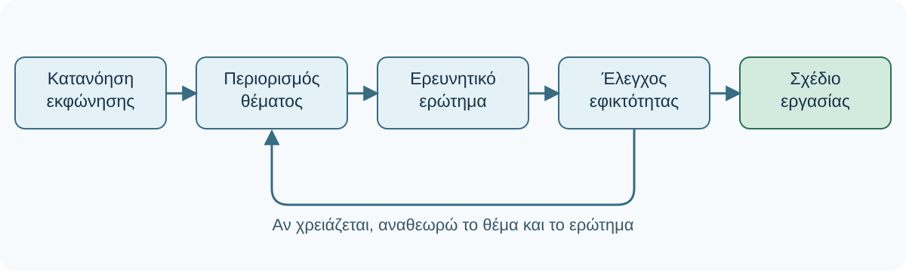

# AL01.1 — Από την εκφώνηση στο σχέδιο ακαδημαϊκής εργασίας

> **Κεντρική ιδέα:** Μια καλή ακαδημαϊκή εργασία δεν αρχίζει με τη συγγραφή της πρώτης παραγράφου. Αρχίζει με την κατανόηση του ζητούμενου, τη διαμόρφωση σαφούς ερωτήματος και την οργάνωση των επόμενων βημάτων.

Στην ενότητα αυτή χρησιμοποιούμε την Τεχνητή Νοημοσύνη (ΤΝ) ως βοηθό σχεδιασμού, χωρίς να της αναθέτουμε τις ουσιαστικές ακαδημαϊκές αποφάσεις. Το πρώτο σχέδιο που θα παραχθεί θα αποτελέσει την αφετηρία της ενιαίας εργασίας του AL01.

## Μαθησιακά αποτελέσματα

Μετά την ολοκλήρωση της ενότητας θα μπορείς:

- Να αναγνωρίζεις τι ακριβώς ζητά μια ακαδημαϊκή εκφώνηση.
- Να διακρίνεις ένα γενικό θέμα από ένα συγκεκριμένο ερώτημα εργασίας.
- Να χρησιμοποιείς την ΤΝ για να εξετάζεις εναλλακτικές και να οργανώνεις βήματα.
- Να περιορίζεις ένα υπερβολικά ευρύ θέμα σε κάτι εφικτό.
- Να δημιουργείς το πρώτο σχέδιο της προσωπικής σου ακαδημαϊκής εργασίας.
- Να αιτιολογείς τις επιλογές σου ανεξάρτητα από τις προτάσεις της ΤΝ.

## 1.1 — Γιατί δεν ξεκινάμε αμέσως να γράφουμε;

Ας υποθέσουμε ότι ένας διδάσκων αναθέτει την εξής εργασία:

> Να εξετάσετε τις επιπτώσεις της Τεχνητής Νοημοσύνης στην εκπαίδευση, αξιοποιώντας επιστημονική βιβλιογραφία.

Ένας φοιτητής μπορεί να ανοίξει αμέσως ένα εργαλείο ΤΝ και να γράψει: «Γράψε μου μια εργασία για την Τεχνητή Νοημοσύνη στην εκπαίδευση».

Πιθανότατα θα λάβει ένα αρκετά καλογραμμένο κείμενο. Ωστόσο, το κείμενο δεν θα απαντά απαραίτητα στις πραγματικές απαιτήσεις της εργασίας.

Τι εννοούμε με τον όρο «επιπτώσεις»; Αναφερόμαστε στη σχολική ή στην πανεπιστημιακή εκπαίδευση; Εξετάζουμε την επίδραση στη μάθηση, στην αξιολόγηση, στην παραγωγικότητα ή στην ακαδημαϊκή ακεραιότητα; Ποιες πηγές θα χρησιμοποιήσουμε; Πόσο εκτεταμένη πρέπει να είναι η εργασία;

Πριν απαντήσουμε σε αυτά τα ερωτήματα, δεν γνωρίζουμε ακριβώς τι προσπαθούμε να ολοκληρώσουμε.

**Η ΤΝ μπορεί να μας βοηθήσει να οργανώσουμε τη σκέψη μας, αλλά δεν μπορεί να αποφασίσει μόνη της τι ακριβώς ζητά ο διδάσκων.**

## 1.2 — Διαβάζουμε σωστά την εκφώνηση

Μια εκφώνηση περιλαμβάνει συνήθως τέσσερα είδη πληροφοριών:

| Στοιχείο | Ερώτημα που απαντά |
|---|---|
| Αντικείμενο | Με ποιο θέμα θα ασχοληθώ; |
| Ενέργεια | Τι πρέπει να κάνω με αυτό το θέμα; |
| Περιορισμοί | Πόσο εκτεταμένη και με ποιες προδιαγραφές; |
| Παραδοτέο | Τι ακριβώς πρέπει να υποβάλω; |

**Παράδειγμα εκφώνησης**

> Συντάξτε μια εργασία 1.500 λέξεων στην οποία θα συγκρίνετε δύο εφαρμογές της Τεχνητής Νοημοσύνης στην πανεπιστημιακή εκπαίδευση, αναδεικνύοντας τα πλεονεκτήματα και τους περιορισμούς τους. Χρησιμοποιήστε τουλάχιστον πέντε επιστημονικές πηγές και συμπεριλάβετε βιβλιογραφικές παραπομπές.

Αν τη διαβάσουμε προσεκτικά, διαπιστώνουμε ότι δεν μας ζητείται απλώς να παρουσιάσουμε εφαρμογές. Μας ζητείται να τις **συγκρίνουμε**, να εξετάσουμε πλεονεκτήματα και περιορισμούς και να τεκμηριώσουμε την ανάλυσή μας.

| Στοιχείο | Αναγνώριση στην εκφώνηση |
|---|---|
| Αντικείμενο | Εφαρμογές ΤΝ στην πανεπιστημιακή εκπαίδευση |
| Ενέργεια | Σύγκριση και κριτική αξιολόγηση |
| Περιορισμοί | 1.500 λέξεις, δύο εφαρμογές, τουλάχιστον πέντε πηγές |
| Παραδοτέο | Τεκμηριωμένη γραπτή εργασία |

### Δραστηριότητα 1 — Αναλύω μια εκφώνηση

Εξέτασε την ακόλουθη *συνθετική εκπαιδευτική εκφώνηση*:

> Να παρουσιάσετε και να αξιολογήσετε τη συμβολή των ψηφιακών τεχνολογιών στην πρωτοβάθμια φροντίδα υγείας, σε κείμενο 1.200–1.500 λέξεων, με τουλάχιστον τέσσερις επιστημονικές πηγές.

Πριν ανοίξεις τη λύση, σημείωσε σε τέσσερις γραμμές το **αντικείμενο**, την **ενέργεια**, τους **περιορισμούς** και το **παραδοτέο**. Πρόσεξε τη διαφορά ανάμεσα στην «παρουσίαση» και στην «αξιολόγηση»: η δεύτερη απαιτεί τεκμηριωμένη κρίση.

::::{dropdown} Ενδεικτική λύση — Δραστηριότητα 1
:open: false

1. **Αντικείμενο:** Η συμβολή των ψηφιακών τεχνολογιών στην πρωτοβάθμια φροντίδα υγείας.
2. **Ενέργεια:** Παρουσίαση και αξιολόγηση, όχι απλή απαρίθμηση.
3. **Περιορισμοί:** 1.200–1.500 λέξεις και τουλάχιστον τέσσερις επιστημονικές πηγές.
4. **Παραδοτέο:** Γραπτό ακαδημαϊκό κείμενο με επιστημονική τεκμηρίωση.

Η εκφώνηση δεν ορίζει συγκεκριμένη ψηφιακή τεχνολογία ή πρότυπο παραπομπών. Δεν τα επινοούμε ως υποχρεώσεις· ζητούμε διευκρίνιση όπου χρειάζεται.
::::

## 1.3 — Από το γενικό θέμα στο συγκεκριμένο ερώτημα

Ένα θέμα μπορεί να είναι ενδιαφέρον και ταυτόχρονα ακατάλληλο για μια μικρή ακαδημαϊκή εργασία.

Παραδείγματα ιδιαίτερα ευρέων θεμάτων είναι «Η κλιματική αλλαγή», «Η ΤΝ στην ιατρική», «Τα κοινωνικά δίκτυα» και «Οι ανανεώσιμες πηγές ενέργειας».

Για να μετατρέψουμε ένα γενικό θέμα σε διαχειρίσιμο ερώτημα, περιορίζουμε σταδιακά το αντικείμενό μας:

1. **Γενικό θέμα:** Τεχνητή Νοημοσύνη στην εκπαίδευση.
2. **Περιορισμός πεδίου:** ΤΝ στην τριτοβάθμια εκπαίδευση.
3. **Εστίαση:** ΤΝ ως βοηθός ακαδημαϊκής συγγραφής.
4. **Ερώτημα εργασίας:** Ποια οφέλη και ποιοι περιορισμοί αναφέρονται στη βιβλιογραφία για τη χρήση παραγωγικής ΤΝ κατά την ακαδημαϊκή συγγραφή προπτυχιακών φοιτητών;

Το τελευταίο ερώτημα είναι περισσότερο συγκεκριμένο, επειδή προσδιορίζει το εκπαιδευτικό πλαίσιο, την τεχνολογία, τη δραστηριότητα και τις διαστάσεις που θα εξεταστούν.

Δεν σημαίνει όμως ότι είναι αυτομάτως κατάλληλο. Χρειάζεται να ελέγξουμε αν υπάρχουν επαρκείς πηγές και αν μπορούμε να το απαντήσουμε μέσα στον χρόνο και την έκταση της εργασίας.

## 1.4 — Πώς μπορεί να βοηθήσει η ΤΝ στον σχεδιασμό;

Η ΤΝ είναι χρήσιμη όταν τη χρησιμοποιούμε για να εξετάσουμε επιλογές, να εντοπίσουμε ασάφειες και να οργανώσουμε εναλλακτικές προσεγγίσεις.

Για παράδειγμα, μπορούμε να της δώσουμε την εκφώνηση και να ζητήσουμε να μας βοηθήσει να τη μετατρέψουμε σε σχέδιο.

**Ενδεικτική προτροπή**

```text
Ετοιμάζω μια προπτυχιακή ακαδημαϊκή εργασία.

Η εκφώνηση είναι:
[Επικόλλησε την εκφώνηση]

Μη γράψεις την εργασία για μένα.

Βοήθησέ με να:
1. Αναγνωρίσω τι ακριβώς ζητείται.
2. Εντοπίσω ασάφειες που πρέπει να διευκρινίσω.
3. Διαμορφώσω τρία εναλλακτικά ερωτήματα.
4. Συγκρίνω την εφικτότητά τους για την έκταση της εργασίας.
5. Σχεδιάσω τα επόμενα βήματα.

Μη δημιουργήσεις βιβλιογραφικές αναφορές.
Αν λείπουν σημαντικές πληροφορίες,
ρώτησέ με πριν προτείνεις οριστικό σχέδιο.
```

Δεν χρειάζεται να αποδεχτούμε οποιαδήποτε από τις τρεις προτάσεις. Μπορεί να είναι υπερβολικά γενικές, να απαιτούν δεδομένα που δεν διαθέτουμε ή να μην ανταποκρίνονται στην εκφώνηση.

Η κατάλληλη χρήση της ΤΝ δεν τελειώνει όταν λάβουμε μια απάντηση. Συνεχίζεται όταν αξιολογούμε την απάντηση και επιλέγουμε συνειδητά τα επόμενα βήματα.

## 1.5 — Πέντε ερωτήματα για να ελέγξω την εφικτότητα

Πριν επιλέξουμε οριστικά το αντικείμενο, πρέπει να εξετάσουμε:

1. **Συνάφεια:** Απαντά πράγματι στην εκφώνηση;
2. **Σαφήνεια:** Μπορούμε να εξηγήσουμε με μία ή δύο προτάσεις τι εξετάζουμε;
3. **Έκταση:** Είναι αρκετά περιορισμένο για τον διαθέσιμο αριθμό λέξεων;
4. **Τεκμηρίωση:** Είναι πιθανό να εντοπίσουμε κατάλληλες επιστημονικές πηγές; Αυτό θα επαληθευτεί στη βιβλιογραφική αναζήτηση.
5. **Χρόνος και πόροι:** Μπορούμε να ολοκληρώσουμε την εργασία με τις διαθέσιμες δυνατότητές μας;

| Υποψήφιο θέμα | Εκτίμηση |
|---|---|
| Πώς επηρεάζει η ΤΝ ολόκληρη την κοινωνία; | Υπερβολικά ευρύ |
| Πώς επηρεάζει η ΤΝ την πανεπιστημιακή εκπαίδευση; | Χρειάζεται περαιτέρω περιορισμό |
| Ποια οφέλη και περιορισμοί της ΤΝ στη συγγραφή προπτυχιακών εργασιών καταγράφονται στη βιβλιογραφία; | Καταλληλότερο για μικρή βιβλιογραφική εργασία, εφόσον επαρκούν οι πηγές |

## 1.6 — Παραδείγματα από διαφορετικά επιστημονικά πεδία

Το AL01 απευθύνεται σε φοιτητές όλων των ειδικοτήτων. Για τον λόγο αυτό, χρησιμοποιούμε παραδείγματα που δείχνουν ότι η διαδικασία σχεδιασμού παραμένει κοινή, ακόμη και όταν αλλάζει το επιστημονικό αντικείμενο.

| Πεδίο | Γενικό θέμα | Πιο συγκεκριμένο ερώτημα |
|---|---|---|
| Γεωπληροφορική | Δορυφορικές εικόνες | Πώς χρησιμοποιούνται δείκτες βλάστησης από Sentinel-2 για την παρακολούθηση της κατάστασης καλλιεργειών; |
| Νοσηλευτική | Ψηφιακή υγεία | Ποια πλεονεκτήματα και δυσκολίες της τηλεπαρακολούθησης ασθενών αναφέρονται στη βιβλιογραφία; |
| Παιδαγωγικά | Ψηφιακή μάθηση | Πώς αξιοποιούνται τα ψηφιακά παιχνίδια για την υποστήριξη της μάθησης μαθηματικών στην πρωτοβάθμια εκπαίδευση; |
| Διοίκηση επιχειρήσεων | Ηλεκτρονικό εμπόριο | Ποιοι παράγοντες επηρεάζουν την εμπιστοσύνη των καταναλωτών σε μικρά ηλεκτρονικά καταστήματα; |
| Μηχανική | Ανανεώσιμες πηγές | Ποια πλεονεκτήματα και περιορισμοί των φωτοβολταϊκών σε αστικά κτίρια περιγράφονται στη βιβλιογραφία; |

Τα ερωτήματα είναι **συνθετικά εκπαιδευτικά παραδείγματα**, όχι αποτελέσματα επιβεβαιωμένης βιβλιογραφικής αναζήτησης.

## 1.7 — Από το ερώτημα στο σχέδιο εργασίας


Το ακόλουθο διάγραμμα συνοψίζει τη διαδικασία. Το βέλος αναθεώρησης υπενθυμίζει ότι, αν ένα ερώτημα αποδειχθεί ανέφικτο, επιστρέφουμε στις επιλογές μας αντί να προχωρούμε μηχανικά.



Μόλις διαμορφώσουμε ένα εφικτό ερώτημα, οργανώνουμε τις εργασίες που απαιτούνται για την απάντησή του.

Ένα αρχικό σχέδιο δεν χρειάζεται να είναι σύνθετο. Αρκεί να καθιστά σαφές τι θα κάνουμε, με ποια σειρά και ποιο αποτέλεσμα αναμένουμε.

**Παράδειγμα σχεδίου εργασίας — ΤΝ και ακαδημαϊκή συγγραφή προπτυχιακών φοιτητών**

1. Οριστικοποιώ το ερώτημα και τους περιορισμούς της εκφώνησης.
2. Διαμορφώνω λέξεις-κλειδιά και αναζητώ επιστημονικές πηγές.
3. Αξιολογώ ποιες πηγές είναι κατάλληλες.
4. Καταγράφω τα βασικά ευρήματα και τις διαφορές μεταξύ πηγών.
5. Σχεδιάζω τη δομή του κειμένου.
6. Συντάσσω ένα πρώτο προσχέδιο.
7. Ελέγχω τους ισχυρισμούς και τις παραπομπές.
8. Αναθεωρώ και προετοιμάζω την τελική υποβολή.

Η ακολουθία δεν είναι απόλυτα γραμμική. Κατά την αναζήτηση πηγών μπορεί να διαπιστώσουμε ότι το ερώτημα είναι πολύ ευρύ ή ότι απαιτεί τροποποίηση. Σε αυτή την περίπτωση επιστρέφουμε στον σχεδιασμό και τον βελτιώνουμε.

Το σημαντικό είναι ότι η αλλαγή γίνεται συνειδητά και όχι επειδή η ΤΝ πρότεινε αυθαίρετα νέα κατεύθυνση.

## 1.8 — Πρακτική δραστηριότητα: Φτιάχνω το δικό μου σχέδιο

Αυτή η δραστηριότητα αποτελεί την αρχή της ενιαίας εργασίας που θα αναπτύσσεται σε ολόκληρο το AL01.

Συμπλήρωσε τα πέντε πεδία στο δικό σου αρχείο. Μπορείς να χρησιμοποιήσεις το παρακάτω πρότυπο, σε απλό κείμενο ή σε επεξεργαστή κειμένου.

```text
AL01.1 — ΠΡΩΤΟ ΣΧΕΔΙΟ ΕΡΓΑΣΙΑΣ

1. Επιστημονικό πεδίο:
2. Γενικό θέμα:
3. Προτεινόμενο ερώτημα εργασίας:
4. Περιορισμοί και διαθέσιμοι πόροι:
5. Τα πρώτα βήματά μου:

Αυτοέλεγχος:
[ ] Το ερώτημα αντιστοιχεί στην εκφώνηση.
[ ] Είναι συγκεκριμένο και κατανοητό.
[ ] Είναι εφικτό στην προβλεπόμενη έκταση.
[ ] Έχω προσδιορίσει τι πρέπει να αναζητήσω.
[ ] Έχω καταγράψει τα επόμενα βήματα.
```

Το πρότυπο δεν αξιολογεί αυτόματα αν το ερώτημά σου είναι επιστημονικά κατάλληλο. Συζήτησε τυχόν ασάφειες με τον διδάσκοντα.

## 1.9 — Έλεγχος κατανόησης

Πριν περάσεις στο επόμενο μέρος, απάντησε χωρίς βοήθεια ΤΝ στις παρακάτω ερωτήσεις. Οι απαντήσεις και οι αιτιολογήσεις αξιοποιούνται και στα δύο διαδραστικά quiz της ενότητας.

**Ερώτηση Α.** Τι πρέπει να προηγηθεί της συγγραφής μιας ακαδημαϊκής εργασίας;

α. Η παραγωγή πλήρους κειμένου με ΤΝ.\
β. Η κατανόηση της εκφώνησης και ο σχεδιασμός.\
γ. Η επιλογή του μεγαλύτερου δυνατού θέματος.

**Ερώτηση Β.** Ποια χρήση της ΤΝ υποστηρίζει περισσότερο την ακαδημαϊκή αυτονομία;

α. Να αποφασίζει μόνη της το θέμα.\
β. Να παραδίδει έτοιμο κείμενο χωρίς έλεγχο.\
γ. Να προτείνει επιλογές που αξιολογεί ο φοιτητής.

**Ερώτηση Γ.** Ποιο ερώτημα είναι καταλληλότερο για μικρή βιβλιογραφική εργασία;

α. Πώς επηρεάζει η τεχνολογία τον κόσμο;\
β. Ποια οφέλη και περιορισμοί της τηλεϊατρικής αναφέρονται στη βιβλιογραφία για την παρακολούθηση ασθενών;\
γ. Πώς λειτουργούν όλα τα πληροφοριακά συστήματα;

::::{dropdown} Απαντήσεις και ανατροφοδότηση — Έλεγχος κατανόησης
:open: false

- **Α: β.** Η σαφής κατανόηση του ζητούμενου επιτρέπει να οργανώσουμε την εργασία πριν αρχίσουμε να γράφουμε.
- **Β: γ.** Η ΤΝ παρέχει εναλλακτικές και ανατροφοδότηση, ενώ η επιλογή και η ευθύνη παραμένουν στον φοιτητή.
- **Γ: β.** Το ερώτημα έχει πιο σαφές αντικείμενο και μπορεί να εξεταστεί με συγκεκριμένες επιστημονικές πηγές, εφόσον επιβεβαιωθεί η διαθεσιμότητά τους.
::::

## 1.10 — Ενδιάμεση ανακεφαλαίωση πριν από την εφαρμογή

Η κατανόηση της εκφώνησης, η διατύπωση συγκεκριμένου ερωτήματος και ο σχεδιασμός των βημάτων δεν αποτελούν τυπικές διαδικασίες. Είναι οι πρώτες ουσιαστικές ακαδημαϊκές αποφάσεις που καθορίζουν την ποιότητα της εργασίας.

Η ΤΝ μπορεί να κάνει αυτές τις διαδικασίες ευκολότερες, αλλά δεν αντικαθιστά την ανάγκη να κατανοούμε τι κάνουμε και γιατί.

**Παραδοτέο AL01.1:** το πρώτο προσωπικό σχέδιο εργασίας, το οποίο θα εξελιχθεί κατά τις επόμενες ενότητες.

## 1.11 — Πλήρως λυμένο παράδειγμα: από την εκφώνηση στο σχέδιο

### Βήμα 1 — Κατανοούμε την εκφώνηση

Ας θεωρήσουμε ότι έχουμε την ακόλουθη *συνθετική εκπαιδευτική εργασία*:

> Να συντάξετε βιβλιογραφική εργασία 1.500–2.000 λέξεων για τη συμβολή των ψηφιακών τεχνολογιών στη μάθηση των φοιτητών. Να εστιάσετε σε ένα συγκεκριμένο είδος τεχνολογίας, να παρουσιάσετε τα πιθανά οφέλη και τους περιορισμούς του και να χρησιμοποιήσετε τουλάχιστον πέντε επιστημονικές πηγές.

Η εργασία αυτή μας δίνει συγκεκριμένες απαιτήσεις, αλλά αφήνει και περιθώριο επιλογών.

| Στοιχείο | Τι εντοπίζουμε |
|---|---|
| Αντικείμενο | Ψηφιακές τεχνολογίες και μάθηση φοιτητών |
| Ενέργεια | Βιβλιογραφική παρουσίαση και κριτική εξέταση |
| Πεδίο επιλογής | Ένα συγκεκριμένο είδος τεχνολογίας |
| Έκταση | 1.500–2.000 λέξεις |
| Τεκμηρίωση | Τουλάχιστον πέντε επιστημονικές πηγές |
| Παραδοτέο | Γραπτή βιβλιογραφική εργασία |

**Πρώτη απόφαση του φοιτητή:** δεν θα εξετάσουμε όλες τις ψηφιακές τεχνολογίες. Η εκφώνηση μας ζητά να επιλέξουμε μία συγκεκριμένη κατηγορία.

### Βήμα 2 — Καταγράφουμε εναλλακτικά θέματα

Θα μπορούσαμε να ασχοληθούμε με εκπαιδευτικά βίντεο, εικονικά εργαστήρια, ψηφιακά παιχνίδια ή εργαλεία παραγωγικής ΤΝ.

Ας επιλέξουμε την παραγωγική ΤΝ, επειδή αποτελεί αντικείμενο που συνδέεται με την προηγούμενη εμπειρία μας από το AL00.

Η πρώτη σκέψη μπορεί να είναι: «Η επίδραση της ΤΝ στη μάθηση των φοιτητών».

Όμως αυτό το θέμα είναι ακόμη ευρύ. Θα μπορούσε να περιλαμβάνει την επίλυση ασκήσεων, τον προγραμματισμό, τη συγγραφή εργασιών, τις ξένες γλώσσες, την αυτοαξιολόγηση και πολλές άλλες δραστηριότητες. Χρειάζεται να το περιορίσουμε.

### Βήμα 3 — Ζητάμε υποστήριξη από την ΤΝ

Αντί να ζητήσουμε έτοιμο κείμενο, μπορούμε να χρησιμοποιήσουμε την ακόλουθη προτροπή:

```text
Έχω αναλάβει βιβλιογραφική εργασία 1.500–2.000 λέξεων
για τη συμβολή μιας ψηφιακής τεχνολογίας στη μάθηση φοιτητών.

Εξετάζω την παραγωγική ΤΝ.

Πρότεινε τρία διαφορετικά, περιορισμένα ερωτήματα
κατάλληλα για βιβλιογραφική εργασία.

Για κάθε ερώτημα εξήγησε τι θα εξετάσω
και ποιοι πιθανοί περιορισμοί υπάρχουν.

Μη γράψεις την εργασία και μη δημιουργήσεις βιβλιογραφικές αναφορές.

Αν κάποια πρόταση απαιτεί έλεγχο διαθεσιμότητας πηγών,
επισήμανέ το.
```

### Βήμα 4 — Συγκρίνουμε τις προτάσεις

Ας υποθέσουμε ότι η ΤΝ επιστρέφει τις ακόλουθες τρεις προτάσεις. Πρόκειται για **συνθετική εκπαιδευτική απάντηση**, όχι για αποτέλεσμα πραγματικής εκτέλεσης συγκεκριμένου εργαλείου.

| Πρόταση | Δυνατό σημείο | Πιθανός περιορισμός |
|---|---|---|
| Α. Πώς επηρεάζει η παραγωγική ΤΝ τις ακαδημαϊκές επιδόσεις των φοιτητών; | Ενδιαφέρον ερώτημα | Πολύ γενικό· οι επιδόσεις επηρεάζονται από πολλούς παράγοντες |
| Β. Ποια οφέλη και περιορισμοί αναφέρονται για τη χρήση παραγωγικής ΤΝ κατά την κατανόηση δύσκολων εννοιών; | Συγκεκριμένη μαθησιακή δραστηριότητα | Χρειάζεται διερεύνηση επάρκειας και συνάφειας των πηγών |
| Γ. Μπορεί η παραγωγική ΤΝ να αντικαταστήσει τη διδασκαλία στο πανεπιστήμιο; | Προκαλεί συζήτηση | Υπερβολικά ευρύ και διχοτομικό ερώτημα |

Επιλέγουμε προσωρινά τη **Β**, επειδή εστιάζει σε μια αναγνωρίσιμη μαθησιακή δραστηριότητα και επιτρέπει να εξετάσουμε τόσο τα οφέλη όσο και τους περιορισμούς.

Δεν επιλέγουμε επειδή η ΤΝ μάς είπε ότι είναι καλύτερη. Επιλέγουμε επειδή μπορούμε να αιτιολογήσουμε την απόφασή μας.

### Βήμα 5 — Διαμορφώνουμε το ερώτημα

Το ερώτημα που καταγράφουμε στο πρώτο μας σχέδιο είναι:

> Ποια οφέλη και ποιοι περιορισμοί της χρήσης παραγωγικής ΤΝ για την κατανόηση δύσκολων εννοιών από προπτυχιακούς φοιτητές περιγράφονται στην επιστημονική βιβλιογραφία;

Αυτό το ερώτημα δεν ζητά να αποδείξουμε ότι η ΤΝ βελτιώνει πάντοτε τη μάθηση. Μας επιτρέπει να εξετάσουμε διαφορετικά ευρήματα, ενδεχόμενες διαφωνίες μεταξύ μελετών και περιορισμούς.

Είναι επίσης συμβατό με μια βιβλιογραφική εργασία, διότι μας ζητά να αναλύσουμε τι υποστηρίζουν οι διαθέσιμες πηγές και όχι να πραγματοποιήσουμε υποχρεωτικά δικό μας πείραμα.

### Βήμα 6 — Ελέγχουμε αν είναι εφικτό

Δεν γνωρίζουμε ακόμη αν υπάρχουν τουλάχιστον πέντε κατάλληλες επιστημονικές πηγές. Δεν θα επινοήσουμε τίτλους άρθρων ή συγγραφείς.

Η επόμενη ενότητά μας, AL01.2, θα αναλάβει ακριβώς αυτή τη διαδικασία.

Προς το παρόν μπορούμε να προετοιμάσουμε τις έννοιες που θα χρειαστούμε στην αναζήτηση: παραγωγική ΤΝ, προπτυχιακοί φοιτητές, εννοιολογική κατανόηση, μαθησιακά οφέλη και περιορισμοί.

Αν δεν εντοπίσουμε επαρκείς πηγές, θα προσαρμόσουμε το ερώτημα. Η αρχική επιλογή μας είναι επομένως **προσωρινή και ελέγξιμη**, όχι αμετάβλητη.

### Βήμα 7 — Οργανώνουμε την εργασία

Προτείνουμε ένα πρώτο χρονοδιάγραμμα δύο εβδομάδων, εφόσον είναι συμβατό με την πραγματική προθεσμία.

| Περίοδος | Ενέργεια | Παραδοτέο |
|---|---|---|
| Ημέρες 1–2 | Ανάλυση εκφώνησης και ορισμός ερωτήματος | Πρώτο σχέδιο |
| Ημέρες 3–4 | Αναζήτηση και αρχική επιλογή πηγών | Υποψήφια βιβλιογραφία |
| Ημέρες 5–6 | Ανάγνωση και καταγραφή ευρημάτων | Σημειώσεις πηγών |
| Ημέρες 7–8 | Σύγκριση πηγών και δομή κειμένου | Πίνακας και διάρθρωση |
| Ημέρες 9–11 | Συγγραφή πρώτου προσχεδίου | Πρόχειρο κείμενο |
| Ημέρες 12–13 | Έλεγχος τεκμηρίωσης και αναθεώρηση | Διορθωμένο κείμενο |
| Ημέρα 14 | Τελικός έλεγχος και υποβολή | Τελική εργασία |

Το χρονοδιάγραμμα είναι ενδεικτικό. Δεν αποτελεί κανόνα για κάθε ακαδημαϊκή εργασία.

### Βήμα 8 — Συνθέτουμε το τελικό σχέδιο

**Πλήρως λυμένο παράδειγμα — παραδοτέο AL01.1**

- **Θέμα:** Παραγωγική ΤΝ και κατανόηση δύσκολων εννοιών από προπτυχιακούς φοιτητές.
- **Ερευνητικό ερώτημα:** Ποια οφέλη και ποιοι περιορισμοί της χρήσης παραγωγικής ΤΝ για την κατανόηση δύσκολων εννοιών από προπτυχιακούς φοιτητές περιγράφονται στην επιστημονική βιβλιογραφία;
- **Είδος εργασίας:** Σύντομη βιβλιογραφική εργασία.
- **Έκταση:** 1.500–2.000 λέξεις.
- **Τεκμηρίωση:** Τουλάχιστον πέντε πραγματικές, κατάλληλες επιστημονικές πηγές, που θα εντοπιστούν και θα επαληθευτούν στην AL01.2.
- **Προτεινόμενη διάρθρωση:** (1) Εισαγωγή και ορισμός του προβλήματος, (2) χρήση παραγωγικής ΤΝ για την κατανόηση εννοιών, (3) οφέλη που αναφέρονται στη βιβλιογραφία, (4) περιορισμοί και κίνδυνοι, (5) συζήτηση και συμπεράσματα.
- **Πρώτη ενέργεια:** Διερεύνηση της διαθεσιμότητας και καταλληλότητας επιστημονικών πηγών.
- **Χρήση ΤΝ:** Υποστήριξη στη δημιουργία και σύγκριση πιθανών ερωτημάτων και στην αρχική οργάνωση. Η τελική επιλογή και η ευθύνη του σχεδίου ανήκουν στον φοιτητή.

Αυτό αποτελεί ένα ολοκληρωμένο πρώτο σχέδιο εργασίας, **όχι ολοκληρωμένη βιβλιογραφική έρευνα**. Δεν ισχυριζόμαστε ότι υπάρχουν συγκεκριμένα επιστημονικά συμπεράσματα πριν εξετάσουμε πραγματικές πηγές.

## 1.12 — Συνηθισμένα λάθη κατά τον σχεδιασμό

Η ΤΝ μπορεί να κάνει την έναρξη μιας εργασίας να φαίνεται ευκολότερη. Αυτό όμως δημιουργεί και ορισμένες παγίδες που πρέπει να μάθουμε να αναγνωρίζουμε.

| Συνηθισμένο λάθος | Γιατί δημιουργεί πρόβλημα | Καλύτερη προσέγγιση |
|---|---|---|
| Ζητώ αμέσως από την ΤΝ να γράψει την εργασία | Παρακάμπτω την κατανόηση του ζητούμενου | Αναλύω πρώτα την εκφώνηση |
| Επιλέγω πολύ γενικό θέμα | Δεν μπορώ να το καλύψω στην προβλεπόμενη έκταση | Περιορίζω πεδίο, πληθυσμό ή δραστηριότητα |
| Αποδέχομαι το πρώτο ερώτημα που προτείνει η ΤΝ | Μπορεί να είναι ασαφές ή ανέφικτο | Συγκρίνω εναλλακτικές και αιτιολογώ την επιλογή |
| Θεωρώ ότι υπάρχουν πηγές επειδή η ΤΝ τις αναφέρει | Οι αναφορές μπορεί να είναι λανθασμένες ή ανύπαρκτες | Ελέγχω πραγματικά τη βιβλιογραφία |
| Δημιουργώ χρονοδιάγραμμα χωρίς έλεγχο χρόνου | Το σχέδιο μπορεί να είναι ανεφάρμοστο | Υπολογίζω διαθέσιμο χρόνο και ενδιάμεσα βήματα |
| Αντιμετωπίζω το πρώτο σχέδιο ως οριστικό | Νέα στοιχεία μπορεί να απαιτούν αλλαγές | Αναθεωρώ τεκμηριωμένα όταν χρειάζεται |

### Δραστηριότητα 2 — Διορθώνω ένα προβληματικό σχέδιο

Ένας φοιτητής έχει γράψει:

> Θα εξετάσω πώς η τεχνολογία αλλάζει τη ζωή των ανθρώπων. Θα ζητήσω από την ΤΝ να μου βρει τις πηγές, να γράψει το κείμενο και να δημιουργήσει τη βιβλιογραφία. Θα ολοκληρώσω την εργασία το τελευταίο βράδυ.

Προσπάθησε να εντοπίσεις τουλάχιστον τέσσερα προβλήματα και να προτείνεις διορθώσεις πριν ανοίξεις την ενδεικτική λύση.

::::{dropdown} Πλήρης ενδεικτική λύση — Δραστηριότητα 2
:open: false

1. **Υπερβολικά ευρύ θέμα:** χρειάζεται επιλογή συγκεκριμένης τεχνολογίας και πλαισίου.
2. **Απουσία σαφούς ερωτήματος:** πρέπει να διατυπωθεί τι ακριβώς εξετάζει η εργασία.
3. **Μη ελεγμένη βιβλιογραφία:** η αναζήτηση και επαλήθευση πηγών δεν πρέπει να ανατεθεί ανεξέλεγκτα στην ΤΝ.
4. **Ανεξέλεγκτη παραγωγή κειμένου:** η ανάθεση ολόκληρου του κειμένου στην ΤΝ δεν τεκμηριώνει την προσωπική ακαδημαϊκή εργασία του φοιτητή.
5. **Έλλειψη χρονοδιαγράμματος:** δεν υπάρχουν ενδιάμεσα βήματα ούτε χρόνος για έλεγχο και αναθεώρηση.

**Βελτιωμένη προσέγγιση:** ο φοιτητής αναλύει την εκφώνηση, διαμορφώνει περιορισμένο ερώτημα, αξιοποιεί την ΤΝ για εναλλακτικές και ανατροφοδότηση, επιβεβαιώνει τη βιβλιογραφία, συντάσσει ο ίδιος το κείμενο και προγραμματίζει συγκεκριμένα στάδια εργασίας.
::::

## 1.13 — Η τελική άσκηση μεταφοράς

Το πλήρως λυμένο παράδειγμα αφορούσε τη χρήση ΤΝ στη μάθηση. Τώρα θα εφαρμόσουμε την ίδια διαδικασία σε ένα διαφορετικό επιστημονικό αντικείμενο.

**Εκφώνηση**

> Συντάξτε βιβλιογραφική εργασία 1.500 λέξεων για τις εφαρμογές των ανανεώσιμων πηγών ενέργειας σε αστικά κτίρια, εστιάζοντας σε μία τεχνολογία. Εξετάστε πλεονεκτήματα και περιορισμούς με τουλάχιστον πέντε επιστημονικές πηγές.

Ο φοιτητής καλείται να παραγάγει ένα σχέδιο που περιλαμβάνει ανάλυση απαιτήσεων, περιορισμένο ερώτημα, αιτιολόγηση της επιλογής, βασικά στάδια και ένα σημείο που απαιτεί περαιτέρω διερεύνηση.

::::{dropdown} Ενδεικτική απάντηση προς σύγκριση — Άσκηση μεταφοράς
:open: false

**Ανάλυση εκφώνησης:** Το αντικείμενο είναι οι εφαρμογές ανανεώσιμων πηγών ενέργειας σε αστικά κτίρια. Ζητείται βιβλιογραφική εργασία **1.500 λέξεων**, με εστίαση **σε μία τεχνολογία**, εξέταση **πλεονεκτημάτων και περιορισμών** και χρήση **τουλάχιστον πέντε επιστημονικών πηγών**. Παραδοτέο είναι τεκμηριωμένο γραπτό κείμενο, όχι πειραματική μελέτη ή γενική παρουσίαση όλων των τεχνολογιών.

- **Τεχνολογία:** Φωτοβολταϊκά συστήματα σε αστικά κτίρια.
- **Ερώτημα:** Ποια πλεονεκτήματα και ποιοι περιορισμοί της εγκατάστασης φωτοβολταϊκών σε αστικά κτίρια αναφέρονται στη βιβλιογραφία;
- **Αιτιολόγηση:** Το ερώτημα επικεντρώνεται σε συγκεκριμένη τεχνολογία και επιτρέπει σύγκριση διαφορετικών παραμέτρων.
- **Βήματα:** Αναζήτηση πηγών, αξιολόγηση συνάφειας, σύγκριση ευρημάτων, δομή, συγγραφή, επαλήθευση και αναθεώρηση.
- **Εκκρεμότητα:** Πρέπει να επιβεβαιωθεί η ύπαρξη πέντε κατάλληλων επιστημονικών πηγών και να εξεταστεί αν απαιτείται περαιτέρω περιορισμός.

Η απάντηση είναι ενδεικτική. Διαφορετικό, καλά αιτιολογημένο ερώτημα μπορεί επίσης να είναι κατάλληλο.
::::

## 1.14 — Διαδραστικά quiz της ενότητας

Τα δύο quiz είναι αυτοτελή αρχεία HTML. Το πρώτο εξετάζει την κατανόηση της εκφώνησης και το δεύτερο την κριτική αξιολόγηση σχεδίου εργασίας. Κάθε quiz έχει τέσσερις ερωτήσεις, βαθμολόγηση, αιτιολογημένη ανατροφοδότηση και δυνατότητα νέας προσπάθειας.

- <strong>Quiz 1 — Κατανοώ την εκφώνηση:</strong> <a href="./quiz/al01_1_q1.html" target="_blank" rel="noopener">Άνοιγμα quiz 1</a>
- <strong>Quiz 2 — Αξιολογώ ένα σχέδιο εργασίας:</strong> <a href="./quiz/al01_1_q2.html" target="_blank" rel="noopener">Άνοιγμα quiz 2</a>

**Σημείωση ενσωμάτωσης:** Οι παραπάνω σχετικές διαδρομές είναι προσωρινές για το πακέτο v3· το Codex θα τις προσαρμόσει στον πραγματικό μηχανισμό hashed assets του GeoSkills μετά την έγκριση. Δεν αποτελούν εγκεκριμένα δημόσια URLs.

## 1.15 — Τι παραδίδω και τι θα χρειαστώ στην AL01.2

Με την ολοκλήρωση αυτής της ενότητας δεν περιμένουμε από τον φοιτητή ένα τελειωμένο ακαδημαϊκό κείμενο.

Περιμένουμε ένα **πρώτο σχέδιο εργασίας**, το οποίο να περιέχει σαφή ανάλυση της εκφώνησης, διαχειρίσιμο ερώτημα, αιτιολόγηση των βασικών επιλογών και ρεαλιστικό πρόγραμμα ενεργειών.

Το σχέδιο μπορεί να αναθεωρηθεί. Στην AL01.2 θα γίνει ο πρώτος ουσιαστικός έλεγχός του: θα διαπιστώσουμε αν η πραγματική επιστημονική βιβλιογραφία επαρκεί για να υποστηρίξει το επιλεγμένο ερώτημα.

Στην **AL01.2 — Αναζήτηση επιστημονικής βιβλιογραφίας με υποστήριξη ΤΝ** θα χρησιμοποιήσουμε αυτό το ερώτημα για να οργανώσουμε πραγματική αναζήτηση, να επιλέξουμε κατάλληλες πηγές και να ελέγξουμε τα βιβλιογραφικά τους στοιχεία.

**Κριτήριο επιτυχίας της AL01.1:** ο φοιτητής μπορεί να εξηγήσει με δικά του λόγια τι ζητά η εκφώνηση, γιατί επέλεξε το ερώτημα, ποια στοιχεία μένουν να επαληθευτούν και ποια είναι τα επόμενα βήματα.
