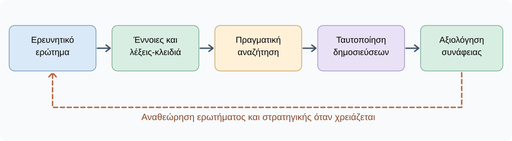

# AL01.2 — Αναζήτηση επιστημονικής βιβλιογραφίας με υποστήριξη Τεχνητής Νοημοσύνης

> **Ενιαία εκπαιδευτική έκδοση v3.1 — προς τελικό ανεξάρτητο έλεγχο.** Η ενότητα συνεχίζει το σχέδιο εργασίας της AL01.1. Η ΤΝ υποστηρίζει τη στρατηγική αναζήτησης· ο φοιτητής ελέγχει τις πηγές και τις αποφάσεις του.

**Μαθησιακά αποτελέσματα.** Μετά την ολοκλήρωση θα μπορείς να μετατρέπεις ερευνητικό ερώτημα σε όρους αναζήτησης, να συνδυάζεις συνώνυμα και λογικούς τελεστές, να επιλέγεις επιστημονικές υπηρεσίες ανακάλυψης, να αξιοποιείς κριτικά την ΤΝ, να ταυτοποιείς πραγματικές δημοσιεύσεις, να ελέγχεις την αρχική τους συνάφεια και να τεκμηριώνεις αναπαραγώγιμα τη διαδικασία.

**Παραδοτέο.** Πρώτη συλλογή πέντε υποψήφιων, επαληθευμένων πηγών, μαζί με πραγματικό ημερολόγιο αναζητήσεων και αιτιολόγηση συνάφειας. Δεν απαιτείται ακόμη πλήρης κριτική ανάγνωση των άρθρων — αυτή ακολουθεί στην AL01.3.

## AL01.2.1 — Από το ερευνητικό ερώτημα στη βιβλιογραφική αναζήτηση

Στην AL01.1 διατυπώσαμε το ερώτημα: **«Ποια οφέλη και ποιοι περιορισμοί της χρήσης παραγωγικής ΤΝ για την κατανόηση δύσκολων εννοιών από προπτυχιακούς φοιτητές περιγράφονται στην επιστημονική βιβλιογραφία;»** Δεν αρκεί να εισαγάγουμε όλη αυτή την πρόταση σε μια υπηρεσία και να επιλέξουμε τα πέντε πρώτα αποτελέσματα. Αναλύουμε το νόημα, διακρίνουμε έννοιες και διαλέγουμε όρους που χρησιμοποιούνται στη βιβλιογραφία.

| Στοιχείο ερωτήματος | Βασική έννοια στην αναζήτηση |
|---|---|
| Χρήση παραγωγικής ΤΝ | Generative artificial intelligence |
| Προπτυχιακοί φοιτητές | Undergraduate students |
| Κατανόηση δύσκολων εννοιών | Conceptual understanding |
| Οφέλη | Learning benefits |
| Περιορισμοί | Limitations, challenges |

Δεν μεταφράζουμε μηχανικά κάθε λέξη. Εξετάζουμε τις επιστημονικές έννοιες που ενδέχεται να χρησιμοποιούν οι συγγραφείς. Αυτή είναι η **διαμόρφωση στρατηγικής αναζήτησης**.

**Από το σχέδιο της AL01.1 στη νέα απόφαση.** Στην προηγούμενη ενότητα αποφασίσαμε τι θα εξετάσουμε, όχι ποια ευρήματα υπάρχουν. Αν η εκφώνηση ορίζει συγκεκριμένο πληθυσμό ή μαθησιακό αποτέλεσμα, οφείλουμε να το κρατήσουμε ως κριτήριο και στην αναζήτηση. Έτσι, το να βρούμε ένα άρθρο για τη διοίκηση πανεπιστημίων δεν απαντά από μόνο του στο ερώτημα για την κατανόηση εννοιών από φοιτητές. Η βιβλιογραφική αναζήτηση είναι ο πρώτος έλεγχος εφικτότητας του αρχικού σχεδίου.

## AL01.2.2 — Γιατί δεν αρκεί μία λέξη-κλειδί;

Η αναζήτηση `artificial intelligence` περιλαμβάνει τεράστιο εύρος θεμάτων, από τη ρομποτική έως τη διαγνωστική ιατρική. Το `generative AI higher education` εστιάζει περισσότερο στην τριτοβάθμια εκπαίδευση. Η αναζήτηση `generative AI conceptual understanding university students` προσεγγίζει καλύτερα το ερώτημά μας, αλλά ενδέχεται να αποκλείσει μελέτες με άλλη ορολογία.

**Σταδιακή εξειδίκευση:**

1. Γενική: `artificial intelligence` — μεγάλο θεματικό εύρος.
2. Περιορισμένη: `generative AI higher education` — πανεπιστημιακή εκπαίδευση.
3. Εστιασμένη: `generative AI conceptual understanding university students` — συγκεκριμένη μαθησιακή διάσταση.

Δεν προσθέτουμε απλώς περισσότερες λέξεις. Συγκρίνουμε τα αποτελέσματα και αναζητούμε εναλλακτικές διατυπώσεις.

Για να καταλάβουμε τη διαφορά, ας υποθέσουμε ότι τα αποτελέσματα της πρώτης αναζήτησης αφορούν κυρίως επιχειρήσεις και τεχνικές εφαρμογές. Δεν απορρίπτουμε τη μηχανή αναζήτησης· εξετάζουμε αν οι όροι μας περιγράφουν επαρκώς το πανεπιστημιακό πλαίσιο. Στη δεύτερη αναζήτηση ελέγχουμε αν αυξήθηκαν οι δημοσιεύσεις με σχετικό πληθυσμό. Στην τρίτη εξετάζουμε αν οι αναφορές μιλούν για **κατανόηση** ή απλώς για γενική χρήση ΤΝ. Η σειρά εμφάνισης δεν ισοδυναμεί με προτεραιότητα για τη δική μας εργασία.

## AL01.2.3 — Συνώνυμα και εναλλακτική ορολογία

Δύο μελέτες μπορεί να ερευνούν συγγενικά αντικείμενα χρησιμοποιώντας διαφορετικούς όρους. Οι όροι *generative AI*, *large language models* και *AI chatbots* συχνά οδηγούν σε επικαλυπτόμενες αλλά όχι ταυτόσημες δημοσιεύσεις.

| Βασική έννοια | Εναλλακτικοί όροι προς δοκιμή |
|---|---|
| Generative AI | Generative artificial intelligence, large language models |
| University students | Undergraduate students, higher education students |
| Conceptual understanding | Concept comprehension, understanding concepts |
| Learning benefits | Learning outcomes, educational benefits |
| Limitations | Challenges, risks, constraints |

**Δραστηριότητα 1 — Χάρτης λέξεων-κλειδιών.** Διάλεξε ένα θέμα: (α) τηλεϊατρική, (β) φωτοβολταϊκά σε αστικά κτίρια, (γ) ψηφιακά παιχνίδια στη μάθηση. Για τρεις έννοιες γράψε ελληνικό όρο, αγγλική απόδοση και έναν εναλλακτικό επιστημονικό όρο. Στη συνέχεια εξήγησε ποιοι όροι έχουν διαφορετικό νόημα και γιατί απαιτούν έλεγχο στις πηγές.

```{dropdown} Ενδεικτική λύση δραστηριότητας 1
:open: false
- **Φωτοβολταϊκά:** φωτοβολταϊκά — *photovoltaic systems / solar PV*· αστικά κτίρια — *urban buildings / residential buildings*· περιορισμοί — *limitations / barriers*.
- **Τηλεϊατρική:** τηλεϊατρική — *telemedicine / telehealth*· παρακολούθηση ασθενών — *remote patient monitoring / home monitoring*· οφέλη — *benefits / patient outcomes*.
- **Ψηφιακά παιχνίδια:** ψηφιακά παιχνίδια — *digital games / educational games*· μαθηματικά — *mathematics learning / mathematics education*· πρωτοβάθμια — *primary education / elementary school*.

Οι εναλλακτικές δεν είναι αυτομάτως συνώνυμες. Δοκιμάζουμε και ελέγχουμε τη συνάφειά τους στο πραγματικό αποτέλεσμα.
```

Οι εναλλακτικοί όροι δεν είναι ένα παιχνίδι περισσότερων λέξεων. Ο όρος *higher education students* δηλώνει πληθυσμό, ενώ ο όρος *learning outcomes* μπορεί να καλύπτει επίδοση σε εξετάσεις, επίλυση ασκήσεων ή αντιλαμβανόμενη μάθηση. Η *conceptual understanding* είναι στενότερη. Επομένως, όταν επιλέγουμε ευρύτερο όρο, κερδίζουμε πιθανές πηγές αλλά αναλαμβάνουμε επιπλέον έλεγχο συνάφειας.

**Πώς εκτελώ τη Δραστηριότητα 1:** πρώτα συμπληρώνω τις τρεις έννοιες μόνος μου. Μετά διαβάζω τη λύση, συγκρίνω αν οι όροι που πρότεινα είναι ισοδύναμοι ή απλώς συγγενείς και διορθώνω τουλάχιστον μία διατύπωση. Η ενδεικτική λύση δείχνει εναλλακτικές αφετηρίες, όχι υποχρεωτική λίστα όρων.

## AL01.2.4 — Συνδυάζουμε λέξεις-κλειδιά

Οι λογικοί τελεστές είναι χρήσιμοι όπου τους υποστηρίζει η υπηρεσία. Το `AND` συνδυάζει έννοιες, το `OR` αναζητά εναλλακτικούς όρους και το `NOT` αποκλείει όρους, με κίνδυνο να χάσουμε χρήσιμα αποτελέσματα.

| Τελεστής | Σκοπός | Παράδειγμα |
|---|---|---|
| `AND` | Συνύπαρξη εννοιών | `generative AI AND higher education` |
| `OR` | Εναλλακτικοί όροι | `"generative AI" OR "large language models"` |
| `NOT` | Αποκλεισμός όρου | `education NOT primary` |

```text
("generative AI" OR "large language models")
AND ("higher education" OR "undergraduate students")
AND ("conceptual understanding" OR "learning")
```

Αυτό είναι **ενδεικτικό υποψήφιο ερώτημα**, όχι εντολή καθολικά συμβατή με κάθε μηχανή. Προσαρμόζουμε τη σύνταξη στις οδηγίες της υπηρεσίας και εξετάζουμε αν υπερβολικοί περιορισμοί οδηγούν σε χαμηλή ανάκληση αποτελεσμάτων.

Ο τελεστής `NOT` χρειάζεται ιδιαίτερη προσοχή. Μια εργασία που περιέχει τη λέξη *primary* μπορεί να συγκρίνει την πρωτοβάθμια με την πανεπιστημιακή εκπαίδευση, οπότε ο αποκλεισμός θα αφαιρούσε και ένα δυνητικά χρήσιμο αποτέλεσμα. Για τον λόγο αυτόν αρχίζουμε συνήθως χωρίς αυστηρούς αποκλεισμούς και τους προσθέτουμε μόνο αφού εξετάσουμε δείγμα αποτελεσμάτων.

Ομοίως, τα εισαγωγικά συνήθως δηλώνουν ακριβή φράση σε υπηρεσίες που το υποστηρίζουν, αλλά η λειτουργία τους πρέπει να επιβεβαιώνεται ανά πλατφόρμα. Δεν αντιγράφουμε αυτούσια ένα Boolean ερώτημα σε κάθε διεπαφή χωρίς να ελέγξουμε τις οδηγίες της.

## AL01.2.5 — Πού αναζητούμε επιστημονική βιβλιογραφία;

**Google Scholar** ([scholar.google.com](https://scholar.google.com/)): ευρεία αφετηρία ανακάλυψης επιστημονικών δημοσιεύσεων. Ελέγχουμε τίτλο, δημιουργούς, έτος και πρωτογενή εγγραφή· η εμφάνιση στα αποτελέσματα δεν πιστοποιεί καταλληλότητα.

**OpenAlex** ([openalex.org](https://openalex.org/)): ανακάλυψη έργων, συγγραφέων, πηγών, μεταδεδομένων και θεματικών συνδέσεων. Χρειάζεται κατανόηση των διαθέσιμων φίλτρων και της συγκεκριμένης σύνταξης αναζήτησης.

**Crossref Metadata Search** ([search.crossref.org](https://search.crossref.org/)): χρήσιμο για επαλήθευση μεταδεδομένων και DOI, όχι αυτόματη αξιολόγηση επιστημονικής ποιότητας.

**Elicit** ([elicit.com](https://elicit.com/)): υποστηρίζει ανακάλυψη σχετικής βιβλιογραφίας με ερωτήματα φυσικής γλώσσας. Δεν υποκαθιστά ανεξάρτητη αναζήτηση και επαλήθευση.

Σε ορισμένα γνωστικά πεδία επιλέγουμε εξειδικευμένες βάσεις, όπως PubMed, ή υπηρεσίες της πανεπιστημιακής βιβλιοθήκης. Η στόχευση του AL01.2 δεν είναι η εκμάθηση κάθε εφαρμογής, αλλά η τεκμηριωμένη επιλογή κατάλληλων εργαλείων και η επαλήθευση των αποτελεσμάτων.

**Πώς επιλέγω υπηρεσία στην πράξη;** Αν θέλω αρχική διερεύνηση ενός πολυεπιστημονικού θέματος, μπορώ να ξεκινήσω από Google Scholar ή OpenAlex. Αν βρω έναν τίτλο αλλά αμφιβάλλω για το DOI ή τα στοιχεία του, μεταβαίνω στην πρωτογενή εγγραφή και ελέγχω τα μεταδεδομένα, για παράδειγμα μέσω του εκδότη ή του Crossref. Αν ένα εργαλείο ΤΝ προτείνει άρθρο, η πρόταση είναι σημείο εκκίνησης και όχι επαληθευμένη βιβλιογραφική εγγραφή.

Σε γνωστικά αντικείμενα με ειδικά κριτήρια τεκμηρίωσης, χρησιμοποιώ και την κατάλληλη επιστημονική βάση. Δεν αντιμετωπίζω τις υπηρεσίες ως ανταγωνιστικές εκδόσεις της ίδιας λειτουργίας: άλλες βοηθούν στην **ανακάλυψη**, άλλες στην **ταυτοποίηση** και άλλες προσφέρουν ειδικές δυνατότητες φιλτραρίσματος.

## AL01.2.6 — Πρακτική αναζήτηση βήμα προς βήμα

Στην άσκηση αυτή θα χρησιμοποιήσουμε το Google Scholar ως αφετηρία και το ερώτημα της AL01.1. Δεν επιδιώκουμε να συλλέξουμε γρήγορα πέντε τίτλους, αλλά να αναγνωρίσουμε πώς μια αλλαγή αναζήτησης επηρεάζει το είδος των δημοσιεύσεων που συναντάμε.

**Βήμα 1 — Ανοίγουμε την υπηρεσία.** Μεταβαίνουμε στο [Google Scholar](https://scholar.google.com/). Σημειώνουμε την ημερομηνία της πραγματικής επίσκεψης. Αν η υπηρεσία δεν είναι διαθέσιμη, χρησιμοποιούμε άλλη κατάλληλη επιστημονική υπηρεσία και καταγράφουμε την αλλαγή.

**Βήμα 2 — Εκτελούμε την πρώτη αναζήτηση.** Δοκιμάζουμε `generative AI university students learning`. Την καταγράφουμε όπως ακριβώς πληκτρολογήθηκε, χωρίς να προσθέσουμε εκ των υστέρων όρους που δεν χρησιμοποιήσαμε.

**Βήμα 3 — Παρατηρούμε τη γλώσσα των τίτλων.** Για ένα μικρό σύνολο αποτελεσμάτων σημειώνουμε αν αναφέρονται σε πανεπιστημιακούς φοιτητές, σε διδάσκοντες, σε γενική εκπαίδευση ή σε διαφορετικό πληθυσμό. Αναγνωρίζουμε επαναλαμβανόμενους όρους που θα μπορούσαν να χρησιμοποιηθούν σε νέα αναζήτηση.

**Βήμα 4 — Εκτελούμε δεύτερη αναζήτηση.** Δοκιμάζουμε `generative AI conceptual understanding higher education`. Η δεύτερη διατύπωση είναι περισσότερο εστιασμένη στην κατανόηση εννοιών. Δεν περιμένουμε υποχρεωτικά περισσότερα αποτελέσματα· μπορεί να είναι λιγότερα και ενδεχομένως σχετικά.

**Βήμα 5 — Συγκρίνουμε πραγματικά αποτελέσματα.** Εξετάζουμε τίτλους και διαθέσιμες περιλήψεις από τις δύο αναζητήσεις. Μας ενδιαφέρει αν οι μελέτες συνδέονται με το ερώτημα, όχι μόνο αν περιλαμβάνουν μία κοινή λέξη ή εμφανίζονται πρώτες στην κατάταξη. Εντοπίζουμε επίσης αν κάποια εμφανίζονται και στις δύο αναζητήσεις.

**Βήμα 6 — Πηγαίνουμε στην πρωτογενή εγγραφή.** Ανοίγουμε τη σελίδα του περιοδικού, του εκδότη ή άλλη αξιόπιστη πρωτογενή εγγραφή, όπου διατίθεται. Ελέγχουμε τα βιβλιογραφικά στοιχεία και δεν υποθέτουμε ότι η περιγραφή της μηχανής αναζήτησης είναι πάντοτε πλήρης.

**Βήμα 7 — Καταγράφουμε και αποφασίζουμε.** Για κάθε υποψήφια δημοσίευση γράφουμε τίτλο, συγγραφείς, έτος, DOI/URL όπου υπάρχει, τεκμήριο ταυτότητας και συγκεκριμένο λόγο αρχικής συνάφειας. Αν η σχέση με το θέμα είναι αδύναμη, το δηλώνουμε αντί να την παρουσιάσουμε ως κατάλληλη.

**Έλεγχος μετά τα επτά βήματα:** μπορώ να εξηγήσω ποια ερώτηση πληκτρολόγησα, πώς αξιολόγησα τα αποτελέσματα και γιατί κράτησα μια συγκεκριμένη δημοσίευση; Αν όχι, χρειάζεται να συμπληρώσω το ημερολόγιο πριν προχωρήσω.

Το γεγονός ότι μια πηγή εμφανίζεται δεν σημαίνει ότι έχει ελεγχθεί. Ξεχωρίζουμε **εντοπισμό → ταυτοποίηση → αρχική συνάφεια**.

## AL01.2.7 — Πώς μας βοηθά η ΤΝ χωρίς να επινοεί βιβλιογραφία;

Η ΤΝ μπορεί να βοηθήσει στη διαμόρφωση όρων και στον σχεδιασμό αναζήτησης. Αντί να ζητήσουμε «βρες μου πέντε άρθρα», ζητάμε μια ελέγξιμη διαδικασία.

> **Προτροπή προς εργαλείο ΤΝ:** «Ετοιμάζω βιβλιογραφική εργασία για τα οφέλη και τους περιορισμούς της παραγωγικής ΤΝ στην κατανόηση δύσκολων εννοιών από προπτυχιακούς φοιτητές. Μη μου δώσεις βιβλιογραφικές αναφορές. (1) Αναγνώρισε τις κύριες έννοιες. (2) Πρότεινε αγγλικούς όρους και συνώνυμα. (3) Δημιούργησε ευρεία, εστιασμένη και εναλλακτική στρατηγική αναζήτησης. (4) Εξήγησε τι μπορεί να παραλείπει κάθε στρατηγική. (5) Πρότεινε πώς θα συγκρίνω τα πραγματικά αποτελέσματα. Υπενθύμισε ότι η σύνταξη τελεστών και φίλτρων διαφέρει ανά υπηρεσία.»

Η καλή χρήση της ΤΝ συνδέεται με ανθρώπινο έλεγχο: ο φοιτητής αποφασίζει ποιες προτάσεις εφαρμόζει, εκτελεί τις αναζητήσεις και εξετάζει αν οι πηγές είναι κατάλληλες.

**Γιατί αυτή η προτροπή είναι προτιμότερη;** Ζητά από το εργαλείο να μας βοηθήσει να *σχεδιάσουμε* τρεις διαφορετικές προσεγγίσεις, να αναφέρει τι μπορεί να παραλείπει καθεμία και να μη συμπληρώσει τον κατάλογο με ανυπόστατες πηγές. Ακόμη και έτσι, η ΤΝ μπορεί να προτείνει αδόκιμο όρο ή σύνταξη ασύμβατη με την υπηρεσία μας. Ο φοιτητής εξετάζει πρώτα τις προτάσεις και στη συνέχεια εκτελεί ο ίδιος τις αναζητήσεις.

**Μικρός έλεγχος:** σημείωσε έναν όρο που πρότεινε η ΤΝ και δεν είχες σκεφτεί. Γράψε γιατί θα τον δοκιμάσεις ή γιατί θα τον απορρίψεις. Έτσι το νέο εργαλείο υποστηρίζει μια τεκμηριωμένη απόφαση αντί να την αντικαθιστά.

## AL01.2.8 — Πώς επαληθεύουμε ότι μια πηγή υπάρχει;

Για μια αναφορά που προτάθηκε από ΤΝ ή εντοπίστηκε σε μηχανή αναζήτησης, ελέγχουμε: (1) ακριβή τίτλο, (2) συγγραφείς, (3) έτος, (4) περιοδικό/συνέδριο, (5) DOI και αντιστοιχία με την ίδια δημοσίευση. Το DOI μέσω `https://doi.org/` βοηθά στην ταυτοποίηση, αλλά **δεν εγγυάται επιστημονική ποιότητα**.

**Παράδειγμα προς έλεγχο:** Αν ένα chatbot μας προτείνει την υποθετική αναφορά «The Impact of Generative AI on Every University Student» (2024), δεν τη χρησιμοποιούμε χωρίς πρωτογενή επαλήθευση. Ο τίτλος είναι *συνθετικό διδακτικό παράδειγμα*, όχι πραγματική πηγή. Αν δεν επαληθεύεται, η αναφορά απορρίπτεται.

Η επαλήθευση έχει δύο διακριτά στάδια. Πρώτα αναζητούμε ακριβή ταυτοποίηση: ο τίτλος που μας δόθηκε αντιστοιχεί στους ίδιους συγγραφείς, στο ίδιο έτος και στην ίδια δημοσίευση; Έπειτα ελέγχουμε αν έχουμε πρόσβαση τουλάχιστον στην περίληψη και αν περιγράφει αντικείμενο σχετικό με το ερώτημα.

Αν ο προτεινόμενος τίτλος δεν εντοπίζεται, δεν σημαίνει ότι αποδείξαμε οριστικά πως δεν υπάρχει· μπορεί να έχει καταγραφεί λανθασμένα. Ωστόσο **δεν τον παραθέτουμε ως επαληθευμένο** μέχρι να εξασφαλίσουμε αξιόπιστη αντιστοίχιση. Δεν εφευρίσκουμε ελλείποντα DOI, συγγραφείς ή ημερομηνίες.

## AL01.2.9 — Η πραγματική ύπαρξη δεν αρκεί

Χρειάζεται να απαντήσουμε σε τρεις χωριστές ερωτήσεις:

1. **Υπάρχει;** Ταυτοποιούμε την πραγματική δημοσίευση.
2. **Είναι συναφής;** Ελέγχουμε αν αφορά το ερώτημά μας.
3. **Είναι κατάλληλη ως τεκμήριο;** Εξετάζουμε είδος και περιορισμούς της μελέτης.

Ένα πραγματικό άρθρο για διοίκηση πανεπιστημίων μπορεί να είναι άσχετο με την εννοιολογική κατανόηση των φοιτητών. Ένα άρθρο γνώμης μπορεί να τεκμηριώνει μια θέση, όχι κατ' ανάγκη μια εμπειρική επίδραση στη μάθηση. Η λεπτομερής κριτική ανάγνωση ακολουθεί στην AL01.3.

Αυτές οι τρεις ερωτήσεις οδηγούν σε διαφορετικές αποφάσεις. Μια πραγματική δημοσίευση μπορεί να είναι χρήσιμη για το γενικό πλαίσιο, χωρίς να τεκμηριώνει το ειδικό αποτέλεσμα που αναζητούμε. Μια εμπειρική μελέτη μπορεί να εξετάζει φοιτητές αλλά να μετρά μόνο ικανοποίηση και όχι πραγματική κατανόηση. Γι' αυτό γράφουμε σύντομο λόγο συνάφειας για κάθε υποψήφια πηγή, αντί να σημειώνουμε απλώς «σχετικό».

## AL01.2.10 — Πώς καταγράφουμε τις αναζητήσεις μας;

Η αναζήτηση πρέπει να μπορεί να εξηγηθεί και, στον βαθμό που το επιτρέπει η υπηρεσία, να αναπαραχθεί. Καταγράφουμε υπηρεσία, πραγματική ημερομηνία, ακριβείς όρους, φίλτρα, αποτελέσματα (όπου είναι αξιόπιστα διαθέσιμα) και σύντομο σχόλιο.

| Πεδίο | Ενδεικτική καταχώριση, όχι πραγματοποιημένη αναζήτηση |
|---|---|
| Υπηρεσία | Google Scholar |
| Αναζήτηση | `generative AI conceptual understanding higher education` |
| Ημερομηνία | Συμπληρώνεται όταν εκτελεστεί |
| Φίλτρα | Όσα πράγματι εφαρμόστηκαν |
| Πλήθος | Καταγράφεται μόνο εφόσον εμφανίζεται |
| Παρατήρηση | «Απαιτείται έλεγχος συνάφειας» |

Αν αλλάξει έστω ένας σημαντικός όρος ή φίλτρο, δημιουργούμε νέα καταχώριση.

**Γιατί ημερολόγιο;** Ακόμη και αν οι δύο αναζητήσεις δώσουν παρόμοιους τίτλους, η δεύτερη μπορεί να χρησιμοποιεί καλύτερους όρους ή διαφορετικά φίλτρα. Χωρίς ημερολόγιο δεν μπορούμε να εξηγήσουμε γιατί κρατήσαμε ορισμένες πηγές ούτε να επανέλθουμε αργότερα σε μια πετυχημένη διατύπωση.

Δεν επινοούμε πλήθη αποτελεσμάτων, ημερομηνίες ή φίλτρα για να φαίνεται το αρχείο πληρέστερο. Αν μια υπηρεσία δεν παρουσιάζει αξιόπιστο πλήθος ή κάποιο στοιχείο δεν είναι διαθέσιμο, το σημειώνουμε ως μη διαθέσιμο.

## AL01.2.11 — Πλήρης πρακτική δραστηριότητα

Εργάσου με το δικό σου ερώτημα από την AL01.1:

1. Χωρίς ΤΝ, διαμόρφωσε αρχικούς όρους και δύο αναζητήσεις.
2. Χρησιμοποίησε την ΤΝ για να ελέγξεις πιθανά συνώνυμα — χωρίς να ζητήσεις έτοιμες αναφορές.
3. Εκτέλεσε τουλάχιστον δύο διαφορετικές αναζητήσεις σε πραγματική επιστημονική υπηρεσία.
4. Εντόπισε πέντε υποψήφιες επιστημονικές δημοσιεύσεις.
5. Για καθεμία κατέγραψε τίτλο, συγγραφείς, έτος, DOI/URL όπου υπάρχει, τεκμήριο ύπαρξης και έναν συγκεκριμένο λόγο συνάφειας.
6. Σημείωσε τι άλλαξες στη στρατηγική μετά τα πραγματικά αποτελέσματα και αν χρειάζεται αναθεώρηση του ερωτήματός σου.

**Φύλλο εργασίας:**

| Ενότητα καταγραφής | Τι συμπληρώνω |
|---|---|
| Ερευνητικό ερώτημα | Ακριβής διατύπωση από την AL01.1 |
| Λέξεις-κλειδιά | Κύριες έννοιες, αγγλικές αποδόσεις, εναλλακτικοί όροι |
| Αναζήτηση 1 | Υπηρεσία, ημερομηνία, όροι, φίλτρα, παρατηρήσεις |
| Αναζήτηση 2 | Τι άλλαξε και γιατί |
| Πηγές 1–5 | Πραγματικά στοιχεία, επαλήθευση, συνάφεια |
| Αναστοχασμός | Τι απέδωσε και τι χρειάζεται επανεξέταση |

```{dropdown} Ενδεικτικό πλαίσιο επιτυχούς απάντησης
:open: false
Μια επαρκής απάντηση δεν περιλαμβάνει απλώς πέντε τίτλους. Περιέχει πραγματικό ερευνητικό ερώτημα, δύο **εκτελεσμένες** αναζητήσεις με καταγραφή, πέντε **ταυτοποιημένες** δημοσιεύσεις, αιτιολόγηση συνάφειας για καθεμία και συγκεκριμένο αναστοχασμό. Αν πηγή δεν επαληθεύεται, δεν παρουσιάζεται ως επιβεβαιωμένη. Αν οι πηγές δεν επαρκούν, ο φοιτητής τεκμηριώνει την έλλειψη και συνεχίζει την αναζήτηση ή προτείνει αιτιολογημένη αναθεώρηση.
```

### Πλήρες φύλλο εργασίας για συμπλήρωση και αντιγραφή

Το παρακάτω πρότυπο είναι απλό Markdown, ώστε να μπορείς να το αντιγράψεις σε δικό σου έγγραφο ή σημειώσεις. **Δεν αποτελεί διαδραστική φόρμα ούτε αποθηκεύει αυτόματα δεδομένα.** Συμπλήρωσε τα πεδία με πραγματικές αναζητήσεις· αν δεν ολοκλήρωσες κάποιο βήμα, άφησέ το ως εκκρεμότητα.

```text
AL01.2 — ΦΥΛΛΟ ΒΙΒΛΙΟΓΡΑΦΙΚΗΣ ΑΝΑΖΗΤΗΣΗΣ

Ονοματεπώνυμο / κωδικός εργασίας: __________
Ακριβές ερευνητικό ερώτημα από AL01.1:
________________________________________________

Βασικές έννοιες (ελληνικά / αγγλικά):
1. ______________________________________________
2. ______________________________________________
3. ______________________________________________

Εναλλακτικοί όροι και αιτιολόγηση:
________________________________________________

ΑΝΑΖΗΤΗΣΗ 1
Υπηρεσία: __________  Πραγματική ημερομηνία: __________
Ακριβές query: __________________________________
Φίλτρα που εφαρμόστηκαν: ________________________
Πλήθος, μόνο αν είναι διαθέσιμο: _________________
Τι παρατήρησα στα αποτελέσματα: _________________

ΑΝΑΖΗΤΗΣΗ 2
Υπηρεσία: __________  Πραγματική ημερομηνία: __________
Ακριβές query: __________________________________
Φίλτρα: _________________________________________
Τι άλλαξα και γιατί: ____________________________
Τι παρατήρησα: __________________________________

ΠΗΓΗ 1
Ακριβής τίτλος: __________________________________
Συγγραφείς / έτος: _______________________________
Περιοδικό / συνέδριο: ___________________________
DOI ή αξιόπιστο URL, αν υπάρχει: ________________
Πού επαλήθευσα την εγγραφή: _____________________
Γιατί σχετίζεται με το ερώτημά μου: ______________

ΠΗΓΕΣ 2–5
Επανάλαβε τα ίδια έξι πεδία για κάθε πηγή.

ΑΝΑΣΤΟΧΑΣΜΟΣ
Ποιοι όροι αποδείχθηκαν χρησιμότεροι και γιατί;
________________________________________________
Ποια αλλαγή θα κάνω στο επόμενο πέρασμα;
________________________________________________
Χρειάζεται αναθεώρηση του ερωτήματος AL01.1;
________________________________________________
Ποιες πληροφορίες παραμένουν μη επαληθευμένες;
________________________________________________
```

**Πώς το χρησιμοποιώ:** συμπληρώνω την πρώτη και τη δεύτερη αναζήτηση αμέσως μόλις τις πραγματοποιήσω. Δεν αντιγράφω ως πηγή έναν τίτλο που δεν έχω ταυτοποιήσει. Επιστρέφω στο αρχικό ερώτημα αν οι επιλεγμένες πηγές αφορούν τελικά διαφορετικό πρόβλημα. Οι πέντε εγγραφές αποτελούν στόχο της άσκησης και όχι άδεια να επινοήσω στοιχεία όταν η αναζήτηση δεν έχει ακόμη αποδώσει.

## AL01.2.12 — Συνηθισμένα λάθη και πώς τα αντιμετωπίζουμε

| Λάθος | Γιατί είναι πρόβλημα | Ορθή ενέργεια |
|---|---|---|
| Μία μόνο αναζήτηση | Μπορεί να παραλείψει σχετικές πηγές | Εναλλακτικοί όροι και αναζητήσεις |
| Πρώτα πέντε αποτελέσματα | Κατάταξη ≠ καταλληλότητα | Έλεγχος συνάφειας |
| Αντιγραφή αναφορών chatbot | Κίνδυνος ανύπαρκτων ή λανθασμένων εγγραφών | Ανεξάρτητη επαλήθευση |
| Επιλογή μόνο με πλήθος παραπομπών | Δεν ισοδυναμεί με επιστημονική ποιότητα | Έλεγχος είδους, μεθόδου, συνάφειας |
| Μόνο ελληνικοί όροι | Πιθανή απώλεια διεθνούς βιβλιογραφίας | Κατάλληλοι αγγλικοί όροι |
| Χωρίς ημερολόγιο | Η διαδικασία δεν αναπαράγεται | Όροι, υπηρεσία, φίλτρα, ημερομηνία |
| DOI = απόδειξη ποιότητας | Το αναγνωριστικό δεν πιστοποιεί εγκυρότητα | Ξεχωριστή αξιολόγηση |

## AL01.2.13 — Έλεγχος κατανόησης

Πριν χρησιμοποιήσεις τα δύο τελικά quiz, προσπάθησε να απαντήσεις μόνος σου:

1. Τι πρέπει να προηγείται μιας βιβλιογραφικής αναζήτησης; **Η ανάλυση εννοιών και όρων**, όχι η ανάθεση παραγωγής βιβλιογραφίας σε chatbot.
2. Γιατί δοκιμάζουμε εναλλακτικούς όρους; **Επειδή οι δημοσιεύσεις μπορεί να χρησιμοποιούν διαφορετική ορολογία.**
3. Τι αποδεικνύει η ύπαρξη DOI; **Βοηθά στην ταυτοποίηση**, όχι στην τεκμηρίωση ποιότητας.
4. Πώς αξιοποιούμε αναφορά που πρότεινε chatbot; **Επαληθεύουμε τα στοιχεία και τη συνάφειά της** πριν τη χρησιμοποιήσουμε.

Το κριτήριο δεν είναι η απομνημόνευση επιλογών, αλλά η εξήγηση της απόφασης.

## AL01.2.14 — Ενδιάμεση ανακεφαλαίωση: από τη στρατηγική στην εφαρμογή

Η βιβλιογραφική αναζήτηση είναι διαδικασία με ερώτημα, όρους, πραγματικές αναζητήσεις, επαλήθευση και αιτιολογημένες αποφάσεις — όχι συλλογή πέντε τίτλων. Η ΤΝ μας βοηθά να σχεδιάσουμε καλύτερα, αλλά δεν αφαιρεί την ευθύνη επαλήθευσης. Το παραδοτέο είναι πέντε υποψήφιες πραγματικές πηγές και το αρχείο αναζήτησης.

Μέχρι εδώ έχουμε δει **πώς** οργανώνεται η διαδικασία και τι πρέπει να καταγραφεί. Στη συνέχεια θα παρακολουθήσουμε ένα ολοκληρωμένο διδακτικό παράδειγμα με πραγματικές δημοσιεύσεις, θα συγκρίνουμε δύο τρόπους αναζήτησης και θα εφαρμόσουμε τη ρουμπρίκα αξιολόγησης. Έτσι θα ελέγξουμε στην πράξη αν οι αποφάσεις μας είναι επαρκώς τεκμηριωμένες.

## AL01.2.15 — Πλήρως λυμένο παράδειγμα βιβλιογραφικής αναζήτησης

### Βήμα 1 — Ερευνητικό ερώτημα

Επανερχόμαστε στο ερώτημα της AL01.1: **«Ποια οφέλη και ποιοι περιορισμοί της χρήσης παραγωγικής ΤΝ για την κατανόηση δύσκολων εννοιών από προπτυχιακούς φοιτητές περιγράφονται στην επιστημονική βιβλιογραφία;»** Εδώ θα μελετήσουμε πραγματικές, επαληθευμένες δημοσιεύσεις.

**Διαφάνεια τεκμηρίωσης:** οι πέντε δημοσιεύσεις είναι επιλεγμένο, επαληθευμένο *διδακτικό σύνολο*· δεν παρουσιάζονται ως οι πέντε πρώτες εγγραφές μιας εκτελεσμένης συστηματικής αναζήτησης. Δεν διαθέτουμε για το συγκεκριμένο παράδειγμα πλήρη ημερολόγια αναζήτησης, φίλτρα ή αριθμούς αποτελεσμάτων.

Η εργασία μάς ζητά να εξετάσουμε τόσο τα οφέλη όσο και τους περιορισμούς. Αν βρούμε μόνο κείμενα που παρουσιάζουν θετικές εφαρμογές, δεν θα έχουμε ακόμη καλύψει το ερώτημα. Ομοίως, εάν μια μελέτη αφορά αποκλειστικά αντιλήψεις φοιτητών, οφείλουμε να τη διακρίνουμε από έρευνα που μετρά πραγματική επίδοση ή εννοιολογική κατανόηση. Αυτή η διάκριση θα καθοδηγήσει την αρχική επιλογή πηγών.

### Βήμα 2 — Έννοιες

| Έννοια | Όροι αναζήτησης |
|---|---|
| Παραγωγική ΤΝ | generative AI, ChatGPT, large language models |
| Φοιτητές | higher education, university students, undergraduate students |
| Κατανόηση | learning, comprehension, conceptual understanding |
| Οφέλη/περιορισμοί | learning outcomes, benefits, challenges, limitations |

Ο όρος *learning outcomes* είναι ευρύτερος από την *conceptual understanding*. Η επιλογή του διευρύνει την αναζήτηση, αλλά δεν εξασφαλίζει ότι κάθε αποτέλεσμα απαντά στο αρχικό ερώτημα.

Αρχίζουμε από ευρύτερη διατύπωση επειδή δεν γνωρίζουμε ακόμη ποια ακριβώς ορολογία επικρατεί στο πεδίο. Συνεχίζουμε με εστίαση στην πανεπιστημιακή μάθηση και δοκιμάζουμε μια εναλλακτική οικογένεια όρων. Η επιλογή του *learning outcomes* έχει ένα τίμημα: επιστρέφει πιθανώς περισσότερες μελέτες, αλλά λιγότερο στενά προσανατολισμένες στην κατανόηση εννοιών.

### Βήμα 3 — Τρεις υποψήφιες αναζητήσεις

- Ευρεία: `"generative AI" "higher education" learning`.
- Εστιασμένη: `ChatGPT "university students" comprehension`.
- Εναλλακτική: `"large language models" education opportunities challenges`.

Οι εντολές θα προσαρμοστούν στην πραγματική υπηρεσία. Δεν ισχυριζόμαστε ότι εκτελέστηκαν ή ότι επέστρεψαν συγκεκριμένο πλήθος εγγραφών.

Στην ευρεία αναζήτηση προσδοκούμε να συναντήσουμε περισσότερες κατηγορίες εργασιών. Στην εστιασμένη ελέγχουμε αν ο συνδυασμός πληθυσμού και μαθησιακής δραστηριότητας είναι πιο χρήσιμος. Στην εναλλακτική ελέγχουμε αν οι συγγενείς όροι αποκαλύπτουν δημοσιεύσεις που δεν αναγνωρίσαμε νωρίτερα. **Δεν έχουμε εκτελέσει εδώ τις τρεις εντολές με πλήρες, χρονοσημασμένο ημερολόγιο**· τις παρουσιάζουμε ως σχέδιο προς πραγματική εκτέλεση από τον φοιτητή.

### Βήμα 4 — Πέντε πραγματικές δημοσιεύσεις

**1. Kasneci et al. (2023).** *ChatGPT for good? On opportunities and challenges of large language models for education.* **Learning and Individual Differences**, 103, 102274. DOI: https://doi.org/10.1016/j.lindif.2023.102274 . Πρόκειται για άρθρο συζήτησης σχετικά με τις δυνατότητες και προκλήσεις των LLM στην εκπαίδευση. Δεν συνιστά πειραματική απόδειξη βελτίωσης της εννοιολογικής κατανόησης.

**2. Baig & Yadegaridehkordi (2024).** *ChatGPT in the higher education: A systematic literature review and research challenges.* **International Journal of Educational Research**, 127, 102411. DOI: https://doi.org/10.1016/j.ijer.2024.102411 . Συστηματική ανασκόπηση εφαρμογών του ChatGPT στην τριτοβάθμια εκπαίδευση. Χρήσιμη για το πλαίσιο, ευρύτερη από το ειδικό ερώτημα.

**3. Deng et al. (2025).** *Does ChatGPT enhance student learning? A systematic review and meta-analysis of experimental studies.* **Computers & Education**, 227, 105224. DOI: https://doi.org/10.1016/j.compedu.2024.105224 . Ανασκόπηση και μετα-ανάλυση 69 άρθρων πειραματικών ερευνών, με επισημάνσεις σχετικά με μεθοδολογικούς περιορισμούς. Η βελτίωση γενικών μαθησιακών επιδόσεων δεν ταυτίζεται αναγκαστικά με κατανόηση εννοιών.

**4. Chen & Cheung (2025).** *Effect of generative artificial intelligence on university students learning outcomes: A systematic review and meta-analysis.* **Educational Research Review**, άρθρο 100737. DOI: https://doi.org/10.1016/j.edurev.2025.100737 . Μετα-ανάλυση 57 μελετών που διακρίνει κατηγορίες μαθησιακών αποτελεσμάτων και υπογραμμίζει τη διαφοροποίηση των συνθηκών εφαρμογής.

**5. An, Koh & Liu (2026).** *Generative Artificial Intelligence in higher education: A systematic review of student use and learning outcomes.* **Australasian Journal of Educational Technology**. DOI: https://doi.org/10.14742/ajet.10561 . Ανασκόπηση 39 εμπειρικών άρθρων και διαχωρισμός πραγματικών από αντιλαμβανόμενα μαθησιακά αποτελέσματα.

**Επαλήθευση:** τα βιβλιογραφικά στοιχεία ελέγχθηκαν από πρωτογενείς σελίδες εκδοτών/περιοδικών στις 30/10/2026. Οι σύνδεσμοι DOI παρέχουν στον φοιτητή τη δυνατότητα ανεξάρτητου ελέγχου. Δεν έχει πραγματοποιηθεί πλήρης κριτική ανάγνωση των πέντε άρθρων για αυτό το διδακτικό παράδειγμα.

**Πώς διαβάζω το σύνολο των πέντε πηγών;** Οι πρώτες δύο βοηθούν να αποκτήσουμε το ευρύτερο εκπαιδευτικό πλαίσιο. Οι επόμενες τρεις προσεγγίζουν περισσότερο τα μαθησιακά αποτελέσματα και τη χρήση από φοιτητές. Ωστόσο, δεν είναι ορθό να αντιγράψουμε πέντε παραπομπές και να ισχυριστούμε ότι όλες αποδεικνύουν βελτίωση της εννοιολογικής κατανόησης. Το ερώτημά μας είναι στενότερο και χρειάζεται έλεγχο των πραγματικών μετρήσεων και του πληθυσμού κάθε μελέτης.

Όταν εντοπίζουμε περισσότερες πηγές, δεν τις προτιμούμε αυτομάτως επειδή είναι νεότερες ή έχουν περισσότερες παραπομπές. Εξετάζουμε αν μπορούν να υποστηρίξουν συγκεκριμένο τμήμα της εργασίας.

### Βήμα 5 — Αρχική συνάφεια

| Πηγή | Προκαταρκτική συνάφεια | Αιτιολόγηση |
|---|---|---|
| Kasneci et al. | Μέτρια | Ευρύτερη συζήτηση δυνατοτήτων/κινδύνων |
| Baig & Yadegaridehkordi | Μέτρια | Τριτοβάθμια εκπαίδευση, γενική επισκόπηση |
| Deng et al. | Υψηλή για μαθησιακά αποτελέσματα | Πειραματικές μελέτες, αλλά όχι αποκλειστικά εννοιολογική κατανόηση |
| Chen & Cheung | Υψηλή για πανεπιστημιακό πλαίσιο | Μαθησιακά αποτελέσματα φοιτητών |
| An, Koh & Liu | Υψηλή για χρήση από φοιτητές | Πραγματικά/αντιλαμβανόμενα αποτελέσματα |

Αυτές είναι **προκαταρκτικές εκτιμήσεις**, όχι τελικό screening μετά από πλήρη ανάγνωση. Καμία πηγή δεν πρέπει να χρησιμοποιηθεί ως άμεση απόδειξη ειδικά για την κατανόηση δύσκολων εννοιών χωρίς έλεγχο των συγκεκριμένων αποτελεσμάτων της.

Η αρχική αυτή σύγκριση δείχνει γιατί η **συνάφεια είναι βαθμιαία κρίση και όχι κουμπί ναι/όχι**. Μια πηγή μπορεί να είναι πολύ χρήσιμη για τους περιορισμούς της ΤΝ αλλά να μη μετρά τη μάθηση. Μια άλλη μπορεί να μελετά μαθησιακά αποτελέσματα, όχι όμως ειδικά προπτυχιακούς φοιτητές. Στο φύλλο αναζήτησης σημειώνουμε αυτή τη διάκριση, αντί να κρύβουμε την αβεβαιότητα πίσω από γενικούς χαρακτηρισμούς.

### Βήμα 6 — Αναθεωρούμε, αν χρειάζεται, το ερώτημα

Αν η εστιασμένη βιβλιογραφική αναζήτηση δεν βρει επαρκείς μελέτες εννοιολογικής κατανόησης, μπορούμε είτε να συνεχίσουμε με διαφορετικούς όρους είτε να εξετάσουμε ένα ευρύτερο ερώτημα: **«Ποια οφέλη και ποιοι περιορισμοί της παραγωγικής ΤΝ στα μαθησιακά αποτελέσματα των πανεπιστημιακών φοιτητών αναφέρονται στην επιστημονική βιβλιογραφία;»** Αυτό **δεν είναι ισοδύναμο** με το αρχικό και απαιτεί ρητή απόφαση, συμβατή με την εκφώνηση.

Ας αιτιολογήσουμε τις δύο δυνατότητες. **Επιλογή Α: διατηρώ το ερώτημα.** Εκτελώ νέα αναζήτηση για *conceptual understanding*, *concept comprehension* και συγκεκριμένα πανεπιστημιακά μαθήματα, ώστε να δω αν υπάρχουν πιο άμεσες μελέτες. **Επιλογή Β: προτείνω διεύρυνση.** Εξηγώ ποια βιβλιογραφική δυσκολία αντιμετώπισα και ζητώ, όπου απαιτείται, έγκριση της αλλαγής από τον διδάσκοντα. Το νέο ερώτημα δεν παρουσιάζεται ως ισοδύναμο. Η μεταβολή πρέπει να είναι αποτέλεσμα ελέγχου των πραγματικών πηγών και όχι ευκολίας του εργαλείου.

Αν τελικά διατηρήσουμε το αρχικό ερώτημα, ορισμένες από τις πέντε δημοσιεύσεις θα αποτελέσουν πιθανό γενικό υπόβαθρο και όχι τον πυρήνα των τεκμηρίων μας. Αυτό δεν τις κάνει άχρηστες· αλλάζει τον ρόλο τους.

### Βήμα 7 — Τεκμηριώνουμε τί πραγματικά έγινε

| Πεδίο | Πραγματική κατάσταση παραδείγματος |
|---|---|
| Στρατηγικές | Τρεις διατυπωμένες υποψήφιες αναζητήσεις |
| Επαληθευμένες δημοσιεύσεις | Πέντε επιλεγμένα πραγματικά άρθρα |
| Έλεγχος | Πρωτογενείς εκδοτικές σελίδες/DOI |
| Εκτέλεση πλήρους Google Scholar/OpenAlex αναζήτησης | Δεν τεκμηριώνεται |
| Φίλτρα/ημερομηνίες/πλήθη αποτελεσμάτων | Δεν τεκμηριώνονται |
| Επόμενο βήμα | Πραγματική αναζήτηση, ημερολόγιο, εξέταση επιπλέον πηγών |

```{dropdown} Πλήρης ενδεικτική αποτίμηση του λυμένου παραδείγματος
:open: false
Το παράδειγμα είναι επαρκές για να διδαχθεί ο διαχωρισμός **πραγματική πηγή — συνάφεια — αναπαραγώγιμη αναζήτηση**. Έχουμε πέντε επαληθευμένες εγγραφές, αλλά δεν έχουμε τεκμηριωμένο αποτέλεσμα συστηματικής αναζήτησης. Δεν επιτρέπεται να δηλώσουμε «βρήκα τις πρώτες πέντε πηγές του Scholar» ούτε να αναφέρουμε επινοημένα φίλτρα ή πλήθη. Οι πηγές 3–5 αφορούν περισσότερο τα γενικά μαθησιακά αποτελέσματα παρά αποκλειστικά την εννοιολογική κατανόηση. Κατά συνέπεια, απαιτείται επιπλέον αναζήτηση ή αιτιολογημένη αναδιατύπωση του ερωτήματος. Αυτή είναι και η ορθή επιστημονική απόφαση.
```

Το τελικό συμπέρασμα του λυμένου παραδείγματος δεν είναι ότι «βρήκαμε πέντε πηγές, άρα ολοκληρώθηκε η αναζήτηση». Είναι ότι συγκεντρώσαμε πέντε ταυτοποιημένες εγγραφές, εξετάσαμε την αρχική τους σχέση με το ερώτημα και αναγνωρίσαμε τι **δεν** έχουμε ακόμη αποδείξει. Αυτό είναι ακαδημαϊκά πιο έντιμο και πιο χρήσιμο από μια ατεκμηρίωτη λίστα άρθρων.

## AL01.2.16 — Παραδοσιακή αναζήτηση και αναζήτηση με υποστήριξη ΤΝ

Η σύγκριση δεν εξετάζει ποιος τρόπος δίνει τον πιο εντυπωσιακό κατάλογο, αλλά ποιος βοηθά να ανακαλύψουμε **πραγματικές, συναφείς και επαληθευμένες** μελέτες.

**Πρώτο πέρασμα, χωρίς ΤΝ.** Σχεδιάζουμε δύο στρατηγικές μόνοι μας, τις εκτελούμε σε μία επιστημονική υπηρεσία, καταγράφουμε αναζητήσεις και επιλέγουμε έως πέντε υποψήφιες δημοσιεύσεις.

**Δεύτερο πέρασμα, με υποστήριξη ΤΝ.** Ζητάμε συνώνυμα και εντοπισμό πιθανών αδυναμιών στη στρατηγική. Εκτελούμε οι ίδιοι τις νέες αναζητήσεις στην ίδια ή κατάλληλη υπηρεσία. Αναφορές που απλώς προτείνει το chatbot δεν προσμετρώνται ως ευρήματα.

**Τρίτο πέρασμα, σύγκριση.** Συμπληρώνουμε:

| Κριτήριο | Χωρίς ΤΝ | Με υποστήριξη ΤΝ |
|---|---|---|
| Πλήθος πραγματικά εξετασμένων αποτελεσμάτων | Συμπληρώνεται | Συμπληρώνεται |
| Πλήθος αρχικά συναφών | Συμπληρώνεται | Συμπληρώνεται |
| Νέες μοναδικές πηγές | Συμπληρώνεται | Συμπληρώνεται |
| Επαληθευμένες εγγραφές | Συμπληρώνεται | Συμπληρώνεται |
| Χρόνος και δυσκολίες | Συμπληρώνεται | Συμπληρώνεται |
| Χρήσιμοι νέοι όροι | Συμπληρώνεται | Συμπληρώνεται |

Το περιγραφικό ποσοστό αρχικής συνάφειας είναι **(συναφείς υποψήφιες πηγές / εξετασμένες πηγές) × 100%**. Αν, για παράδειγμα, 8 από 12 εξετασμένες πηγές κρίθηκαν συναφείς, το ποσοστό είναι περίπου 66,7%. Αυτό είναι **υποθετικό αριθμητικό παράδειγμα**· δεν αποδεικνύει πλήρη κάλυψη της βιβλιογραφίας.

```{dropdown} Ενδεικτική λύση δραστηριότητας σύγκρισης
:open: false
«Η υποστήριξη ΤΝ με βοήθησε να διατυπώσω εναλλακτικούς όρους, αλλά χρειάστηκε ανεξάρτητη επαλήθευση όλων των ευρημάτων. Η δεύτερη αναζήτηση δεν αξιολογείται ως καλύτερη μόνο επειδή επέστρεψε περισσότερες εγγραφές. Συγκρίνω την αναλογία σχετικών πηγών, τις νέες μοναδικές δημοσιεύσεις, τον χρόνο και τη δυνατότητα αναπαραγωγής.» Η απάντηση αυτή είναι παράδειγμα μορφής αιτιολόγησης και **δεν υποκαθιστά** τα πραγματικά δεδομένα του φοιτητή.
```

**Ορθή σύγκριση στην πράξη:** χρησιμοποιώ το ίδιο ερευνητικό ερώτημα και καταγράφω σε κάθε πέρασμα την υπηρεσία, τον πραγματικό χρόνο και τα αποτελέσματα που εξέτασα. Αν η ΤΝ προτείνει έναν νέο όρο, δεν καταμετρώ την πρότασή της ως επιστημονικό εύρημα· εκτελώ αναζήτηση με αυτόν τον όρο. Στη σύγκριση εξετάζω και τις επικαλύψεις των αποτελεσμάτων, ώστε να μη μετρήσω την ίδια δημοσίευση πολλές φορές ως «νέα».

Ο αριθμός των ευρημάτων δεν είναι επαρκές κριτήριο. Μία αναζήτηση με πολλά άσχετα αποτελέσματα μπορεί να είναι λιγότερο χρήσιμη από μια στενότερη αναζήτηση με λίγες αλλά συναφείς μελέτες. Το ποσοστό αρχικής συνάφειας περιγράφει **αυτές που εξετάσαμε**, όχι το σύνολο των σχετικών δημοσιεύσεων που υπάρχουν.

## AL01.2.17 — Αξιολόγηση του φύλλου βιβλιογραφικής αναζήτησης

Η ρουμπρίκα βαθμολογεί τη **διαδικασία αρχικής αναζήτησης**, όχι την πλήρη κριτική ανάγνωση της AL01.3. Κάθε κριτήριο βαθμολογείται 0–2.

| Κριτήριο | 0 | 1 | 2 |
|---|---|---|---|
| Ανάλυση ερωτήματος | Απουσία εννοιών | Μερική ανάλυση | Σαφείς έννοιες και όροι |
| Στρατηγική αναζήτησης | Απουσία | Περιορισμένη | Εναλλακτικές αιτιολογημένες αναζητήσεις |
| Επαλήθευση πηγών | Απουσία | Μερική | Τεκμηριωμένη ταυτοποίηση |
| Αρχική συνάφεια | Χωρίς αιτιολόγηση | Γενική | Συγκεκριμένη σύνδεση με ερώτημα |
| Ημερολόγιο και αναστοχασμός | Απουσία | Ελλιπής | Αναπαραγώγιμη καταγραφή και βελτιώσεις |

**Σύνολο: 0–10.** Μια υψηλή αυτοβαθμολογία δεν αποδεικνύει ότι έγιναν αναζητήσεις. Απαιτούνται πραγματικά τεκμήρια, όπως ακριβείς εντολές, ημερομηνίες και επαληθευμένα στοιχεία πηγών.

**Εφαρμογή ρουμπρίκας:** ο φοιτητής δεν γράφει απλώς «2» στο κριτήριο επαλήθευσης. Πρέπει να παρουσιάσει πού ελέγχθηκε ο τίτλος, ποια στοιχεία συμφωνούν και ποια παραμένουν εκκρεμή. Στο κριτήριο στρατηγικής αναζήτησης, δύο σχεδόν όμοιες εντολές χωρίς αιτιολόγηση μπορεί να μην τεκμηριώνουν την ανώτερη βαθμίδα. Στο ημερολόγιο, μια αναδρομική περιγραφή χωρίς πραγματικές ημερομηνίες και φίλτρα δεν ισοδυναμεί με αναπαραγώγιμη καταγραφή.

**Μικρή άσκηση αυτοελέγχου:** διάλεξε ένα κριτήριο στο οποίο έδωσες στον εαυτό σου 2 βαθμούς και δείξε ακριβώς το στοιχείο του φύλλου εργασίας που δικαιολογεί αυτή τη βαθμολογία. Αν δεν μπορείς να εντοπίσεις τέτοιο τεκμήριο, επανεξέτασε τη βαθμολογία.

## AL01.2.18 — Δύο ανεξάρτητα quiz και ολοκλήρωση

**Quiz 1 — Σχεδιάζω την αναζήτηση:** τέσσερις ερωτήσεις για ανάλυση εννοιών, εναλλακτικούς όρους, χρήση `OR` και αντιμετώπιση λίγων αποτελεσμάτων.

**Quiz 2 — Ελέγχω και αξιολογώ:** τέσσερις ερωτήσεις για DOI, αρχική συνάφεια, σύγκριση με/χωρίς ΤΝ και αναπαραγώγιμη καταγραφή. Και τα δύο παρέχουν βαθμολόγηση, επεξηγηματικό feedback και νέα προσπάθεια.

<a href="./quiz/al01_2_q1.html" target="_blank" rel="noopener">Άνοιγμα Quiz 1</a>

<a href="./quiz/al01_2_q2.html" target="_blank" rel="noopener">Άνοιγμα Quiz 2</a>



**Τελικό παραδοτέο AL01.2:** πραγματικό ερώτημα, δύο ή περισσότερες τεκμηριωμένες αναζητήσεις, πέντε υποψήφιες επαληθευμένες πηγές, αιτιολόγηση αρχικής συνάφειας και σύντομος αναστοχασμός. Στην **AL01.3** προχωρούμε από την ανακάλυψη στην κριτική ανάγνωση της επιστημονικής δημοσίευσης.
