# DM00.2 — Τύποι drones και επιλογή κατάλληλου εξοπλισμού

*Πλήρες ενοποιημένο εκπαιδευτικό προσχέδιο αυτοδιδασκαλίας · v0.1 · Προς αξιολόγηση.*

## 2.1 Γιατί δεν είναι όλα τα drones κατάλληλα για την ίδια εργασία;

### Δύο αποστολές, διαφορετικές ανάγκες

Φαντάσου δύο αιτήματα που φτάνουν στο ίδιο γραφείο. Στο πρώτο, πρέπει να καταγραφεί η κατάσταση ενός μικρού εργοταξίου, με κτίρια, στενές προσβάσεις και σημεία που χρειάζονται φωτογραφίες από διαφορετικές γωνίες. Στο δεύτερο, ζητείται πρόσφατη φωτογραφική κάλυψη μιας μεγάλης, σχετικά ενιαίας καλλιεργούμενης περιοχής. Και στις δύο περιπτώσεις μπορεί να χρησιμοποιηθεί drone, αλλά αυτό **δεν σημαίνει ότι το ίδιο αεροσκάφος είναι εξίσου κατάλληλο**.

Στο εργοτάξιο προέχουν ο έλεγχος της θέσης, η ευελιξία και η δυνατότητα αιώρησης, εφόσον η αποστολή είναι επιτρεπτή και ασφαλής. Στη μεγάλη αγροτική περιοχή αποκτούν ιδιαίτερη σημασία η αποδοτική κάλυψη, ο χρόνος πτήσης και η οργάνωση πολλών συνεχόμενων λήψεων. Ένα πολυκόπτερο μπορεί να προσφέρει μεγάλη ευελιξία στο πρώτο έργο· ένα αεροσκάφος σταθερής πτέρυγας μπορεί, σε κατάλληλες συνθήκες, να είναι αποδοτικότερο στο δεύτερο. Καμία από αυτές τις επιλογές δεν είναι αυτόματα σωστή: χρειάζονται περισσότερα στοιχεία.

Το βασικό ερώτημα αυτής της ενότητας δεν είναι «ποιο drone είναι καλύτερο;», αλλά **«ποιο σύστημα ανταποκρίνεται στις πραγματικές απαιτήσεις της συγκεκριμένης εργασίας;»**.

### 2.1.1 Πρώτα περιγράφουμε την εργασία, όχι το προϊόν

Πριν ανοίξουμε έναν κατάλογο κατασκευαστή, προσδιορίζουμε τι ακριβώς πρέπει να συλλέξουμε και να παραδώσουμε. Διαφορετικές εργασίες μπορεί να απαιτούν μεμονωμένες λήψεις, σειρές επικαλυπτόμενων φωτογραφιών, βίντεο επιθεώρησης ή δεδομένα ειδικού αισθητήρα. Το απαιτούμενο αποτέλεσμα επηρεάζει την κάμερα, τον τρόπο κίνησης, τις θέσεις λήψης, την απαιτούμενη σταθερότητα και τη διαχείριση των αρχείων.

Για παράδειγμα, μια φωτογραφία της πρόσοψης ενός κτιρίου μπορεί να απαιτεί προσεκτική επιλογή γωνίας λήψης και δυνατότητα παραμονής κοντά στο κατάλληλο σημείο. Αντίθετα, για έναν ορθοφωτοχάρτη από εκατοντάδες εικόνες χρειάζονται επαρκής και οργανωμένη κάλυψη, κατάλληλη γεωσήμανση, φωτογραφίες κατάλληλες για επεξεργασία και δυνατότητα ελέγχου ποιότητας. Η μεγάλη ανάλυση της κάμερας από μόνη της δεν απαντά σε όλα αυτά.

**Παράδειγμα:** Αν ο ενδιαφερόμενος ζητά «να δω το αγροτεμάχιό μου από ψηλά», δεν γνωρίζουμε ακόμη αν χρειάζεται μία εποπτική φωτογραφία, μια ενημερωμένη αποτύπωση σε GIS ή ένα προϊόν με τεκμηριωμένη ακρίβεια. Πριν αποφασίσουμε πλατφόρμα, πρέπει να διευκρινιστεί το παραδοτέο.

### 2.1.2 Τι πρέπει να γνωρίζουμε για την περιοχή;

Η **έκταση** είναι βασικό στοιχείο, αλλά δεν είναι το μοναδικό. Ένας μικρός, σύνθετος χώρος με ψηλά αντικείμενα μπορεί να απαιτεί περισσότερη προσοχή από μια μεγαλύτερη ανοιχτή περιοχή. Το **ανάγλυφο** επηρεάζει την απόσταση από το έδαφος, την ορατότητα και την κάλυψη. Οι **προσβάσεις** καθορίζουν από πού μπορεί να μεταφερθεί ο εξοπλισμός και πού μπορεί να οργανωθεί μια επιτρεπτή απογείωση και προσγείωση.

Πρέπει επίσης να ελέγξουμε αν υπάρχουν άνθρωποι, οχήματα, καλώδια, κτίρια, δέντρα ή άλλες πηγές κινδύνου. Δεν θεωρούμε ότι μια περιοχή είναι διαθέσιμη για πτήση μόνο επειδή φαίνεται ανοιχτή στον χάρτη. Οι νόμιμες προϋποθέσεις και η εκτίμηση κινδύνου θα αναπτυχθούν ειδικά στην DM01· εδώ αρκεί να κατανοήσουμε ότι μπορούν να αποκλείσουν ή να μεταβάλουν μια τεχνική επιλογή.

Δύο ερωτήσεις είναι ιδιαίτερα σημαντικές: **Χρειαζόμαστε αιώρηση σε συγκεκριμένο σημείο;** και **ποιος χώρος είναι διαθέσιμος για απογείωση και ανάκτηση;** Ένα συνηθισμένο πολυκόπτερο μπορεί να αιωρείται. Ένα συμβατικό drone σταθερής πτέρυγας χρειάζεται διαρκή προωθητική πτήση για να παράγεται άντωση και συνήθως διαφορετική οργάνωση απογείωσης και προσγείωσης. Υπάρχουν επίσης υβριδικές λύσεις VTOL που συνδυάζουν στοιχεία των δύο κατηγοριών· θα τις γνωρίσουμε αργότερα.

### 2.1.3 Συγκρίνουμε χαρακτηριστικά με πραγματικές απαιτήσεις

Αφού περιγράψουμε την αποστολή, εξετάζουμε τα τεχνικά χαρακτηριστικά ως **μέσα επίτευξης του σκοπού** και όχι ως κατάταξη εντυπωσιακών αριθμών.

| Απαίτηση εργασίας | Τι εξετάζουμε στον εξοπλισμό | Γιατί έχει σημασία |
|---|---|---|
| Λήψεις από συγκεκριμένα σημεία και γωνίες | Δυνατότητα αιώρησης, ευελιξία, έλεγχος κάμερας | Επιτρέπει ελεγχόμενη φωτογράφιση τοπικών αντικειμένων |
| Κάλυψη εκτεταμένης περιοχής | Αποδοτικότητα προωθητικής πτήσης, διάρκεια, οργάνωση διαδρομών | Μπορεί να μειώσει τις απαιτούμενες διακοπές και επαναλήψεις |
| Περιορισμένος χώρος απογείωσης | Πραγματικός τρόπος απογείωσης και ανάκτησης | Η κατάλληλη πλατφόρμα πρέπει να μπορεί να επιχειρήσει στον διαθέσιμο χώρο |
| Συγκεκριμένο χαρτογραφικό παραδοτέο | Κάμερα, γεωσήμανση, συμβατότητα λογισμικού, ροή επεξεργασίας | Η πλατφόρμα πρέπει να παράγει αξιοποιήσιμα δεδομένα |
| Λειτουργία σε συγκεκριμένες συνθήκες | Όρια κατασκευαστή, πραγματικές συνθήκες και περιθώρια ασφαλείας | Οι ονομαστικές επιδόσεις δεν εξασφαλίζουν καταλληλότητα σε κάθε αποστολή |

Ένα drone που αναγράφει μεγάλο μέγιστο χρόνο πτήσης δεν είναι υποχρεωτικά η σωστή επιλογή. Ο πραγματικός χρόνος επηρεάζεται από τις συνθήκες, την αποστολή και το φορτίο. Αντίστοιχα, η εμπορικά δηλωμένη «εμβέλεια» δεν πρέπει να συγχέεται με την ασφαλή ή επιτρεπόμενη απόσταση λειτουργίας. Στην DM00.2.5–2.6 θα εξετάσουμε αυτά τα χαρακτηριστικά αναλυτικότερα.

### 2.1.4 Η κατάλληλη επιλογή είναι συχνά συμβιβασμός

Στην πράξη δεν υπάρχει αεροσκάφος που να συνδυάζει χωρίς κανέναν συμβιβασμό μεγάλη διάρκεια πτήσης, αιώρηση, μικρό βάρος, υψηλή ικανότητα μεταφοράς αισθητήρων, χαμηλό κόστος και εύκολη χρήση σε κάθε χώρο. Η επιλογή εξαρτάται από την προτεραιότητα που έχουν τα χαρακτηριστικά **στην εργασία μας**.

Ένα πολυκόπτερο που απογειώνεται κατακόρυφα μπορεί να είναι κατάλληλο για λεπτομερή τοπική τεκμηρίωση, αλλά μια αποστολή πολύ μεγάλης έκτασης ίσως απαιτεί περισσότερες πτήσεις και αλλαγές μπαταρίας. Μια πλατφόρμα σταθερής πτέρυγας μπορεί να είναι αποδοτικότερη για εκτεταμένη κάλυψη, αλλά πρέπει να εξεταστούν οι απαιτήσεις απογείωσης, ανάκτησης, διαδρομής και λήψεων. Ένα υβριδικό VTOL συνδυάζει ορισμένα πλεονεκτήματα, με πρόσθετη πολυπλοκότητα. Εδώ παρουσιάζουμε μόνο τη βασική λογική· οι αναλυτικές συγκρίσεις ακολουθούν στις 2.2–2.4.

**Η επιλογή μπορεί να παραμείνει προσωρινή.** Αν αγνοούμε το διαθέσιμο σημείο απογείωσης, τον αισθητήρα ή τις απαιτήσεις ακρίβειας, δεν δικαιολογείται να καταλήξουμε με βεβαιότητα σε συγκεκριμένο μοντέλο. Η σωστή επαγγελματική απόφαση μπορεί να είναι «χρειάζομαι πρώτα αυτά τα δεδομένα».

### Σχήμα 2.1 — Από το αίτημα στην επιλογή πλατφόρμας

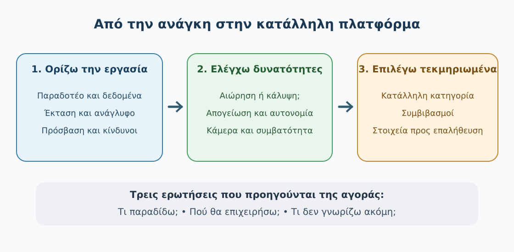

*Σχήμα 2.1. Η επιλογή ξεκινά από τον στόχο, τις απαιτήσεις και τις συνθήκες της εργασίας. Στη συνέχεια συγκρίνουμε τα τεχνικά χαρακτηριστικά και καταλήγουμε σε τεκμηριωμένη, ενδεχομένως προσωρινή, επιλογή. Το σχήμα είναι εννοιολογικό και δεν αποτελεί αυτόματο σύστημα βαθμολόγησης drones.*

### Πραγματικές φωτογραφίες — Τι παρατηρούμε

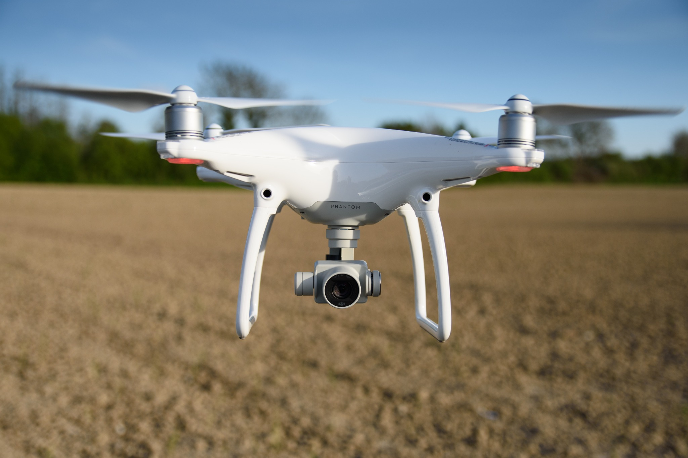

*Φωτογραφία 2.1. Πραγματικό τετρακόπτερο με αναρτημένη κάμερα. Ενδεικτική φωτογραφία πολυκόπτερου, όχι τεκμήριο ότι κάθε παρόμοιο μοντέλο διαθέτει ίδιες δυνατότητες χαρτογράφησης. Thomas Berwing, Wikimedia Commons, CC BY-SA 3.0.*

*Φωτογραφία 2.2. Πραγματικό αεροσκάφος σταθερής πτέρυγας Pteryx. Η φωτογραφία δείχνει τη διαφορετική κατασκευή του σε σύγκριση με το πολυκόπτερο της Φωτογραφίας 2.1. Δημιουργός: Kbosak, [Wikimedia Commons](https://commons.wikimedia.org/wiki/File:Pteryx_UAV_-_wiki.jpg), CC BY-SA 3.0.*

Από τις φωτογραφίες μπορείς να αναγνωρίσεις **διαφορετική αρχιτεκτονική αεροσκάφους**. Δεν μπορείς όμως να συμπεράνεις με βεβαιότητα πραγματική αυτονομία, ακριβή επιφάνεια κάλυψης, αντοχή σε άνεμο ή ακρίβεια μόνο από την εμφάνιση.

### Δοκίμασε να απαντήσεις

Πριν επιλέξεις drone για την παραγωγή ορθοφωτοχάρτη μιας περιοχής, ποιο από τα παρακάτω είναι το σημαντικότερο πρώτο βήμα;

**Α.** Να διαλέξεις το drone με τη μεγαλύτερη διαφημιζόμενη διάρκεια πτήσης.
**Β.** Να προσδιορίσεις τις απαιτήσεις του παραδοτέου, τις συνθήκες της περιοχής και τους περιορισμούς αποστολής.
**Γ.** Να επιλέξεις το αεροσκάφος με τους περισσότερους κινητήρες.
**Δ.** Να επιλέξεις την ακριβότερη διαθέσιμη κάμερα.

Αποκάλυψε την απάντηση και την αιτιολόγηση

**Σωστή απάντηση: Β.** Ο στόχος, η περιοχή, η απαιτούμενη ποιότητα δεδομένων και οι συνθήκες λειτουργίας καθορίζουν ποια χαρακτηριστικά έχουν πραγματική σημασία. Οι επιλογές Α, Γ και Δ απομονώνουν ένα τεχνικό ή οικονομικό χαρακτηριστικό και το μετατρέπουν αυθαίρετα σε μοναδικό κριτήριο.

### Δραστηριότητα 2.1 — Δύο υποθέσεις, δύο διαφορετικές προτεραιότητες

**Σενάριο Α:** Μικρό εργοτάξιο 2 εκταρίων, με στενούς χώρους, κτίσματα και ανάγκη για φωτογραφίες από πολλές γωνίες. Δεν έχει ακόμη ολοκληρωθεί ο έλεγχος ασφαλείας και επιτρεπτών επιχειρήσεων.

**Σενάριο Β:** Ανοιχτή αγροτική περιοχή 250 εκταρίων, με στόχο οργανωμένη φωτογραφική κάλυψη. Δεν γνωρίζουμε ακόμη τις θέσεις απογείωσης και ανάκτησης, ούτε τις τελικές απαιτήσεις χαρτογραφικής ακρίβειας.

Συμπλήρωσε τον πίνακα. Στην τρίτη στήλη γράψε ένα **στοιχείο που λείπει** και πρέπει να εξακριβωθεί πριν επιλέξουμε συγκεκριμένο drone.

| Σενάριο | Δύο σημαντικές απαιτήσεις | Τι πρέπει ακόμη να μάθουμε; |
|---|---|---|
| Α — Εργοτάξιο | … | … |
| Β — Αγροτική περιοχή | … | … |

Πρόσθεσε μία σύντομη πρόταση για το ποια **κατηγορία** drone φαίνεται αρχικά καταλληλότερη στο κάθε σενάριο. Δεν ζητείται εμπορικό μοντέλο ή σχέδιο πτήσης.

Δες την ενδεικτική λύση αφού ολοκληρώσεις τη δραστηριότητα

| Σενάριο | Δύο πιθανές προτεραιότητες | Ένα κρίσιμο άγνωστο |
|---|---|---|
| Α | Αιώρηση και ελεγχόμενη φωτογράφιση από διαφορετικές θέσεις· ευελιξία σε περιορισμένο χώρο | Αν επιτρέπεται η πτήση με επαρκή ασφάλεια λόγω ανθρώπων, κατασκευών και εμποδίων |
| Β | Αποδοτική κάλυψη μεγάλης έκτασης· δυνατότητα κατάλληλων επικαλυπτόμενων λήψεων | Διαθέσιμος χώρος εκτόξευσης/ανάκτησης και πραγματικές απαιτήσεις δεδομένων/ακρίβειας |

**Ενδεικτική επιλογή:** Για το Α μπορεί να εξεταστεί πρώτα πολυκόπτερο, χωρίς αυτό να αναιρεί την ανάγκη ελέγχου κινδύνου και νομιμότητας. Για το Β αξίζει να συγκριθούν συμβατική σταθερή πτέρυγα, υβριδικό VTOL και πολυκόπτερο ανάλογα με τον χώρο, το κόστος και τις απαιτήσεις. Δεν είναι τεχνικά ορθό να οριστικοποιηθεί συγκεκριμένη πλατφόρμα μόνο με αυτά τα στοιχεία.

**Για να αξιολογήσεις τη δική σου απάντηση:** Αν πρότεινες διαφορετική κατηγορία αλλά τη στήριξες σε πραγματικούς περιορισμούς και δήλωσες τα άγνωστα στοιχεία, η συλλογιστική σου μπορεί να είναι αποδεκτή. Αν η αιτιολόγηση ήταν μόνο «πετάει πιο πολύ» ή «έχει καλύτερη κάμερα», επέστρεψε στον πίνακα της 2.1.3.

### Τι κρατάμε από την 2.1

Η επιλογή drone είναι διαδικασία **αντιστοίχισης απαιτήσεων με δυνατότητες και περιορισμούς**. Ξεκινάμε από το ζητούμενο παραδοτέο, την περιοχή και τις συνθήκες, όχι από τη μάρκα ή τις διαφημιζόμενες επιδόσεις. Η κατάλληλη πλατφόρμα για μια εργασία μπορεί να μην είναι κατάλληλη για κάποια άλλη. Όταν λείπουν κρίσιμα δεδομένα, τα αναγνωρίζουμε πριν πάρουμε οριστική απόφαση.

**Στην 2.2** θα γνωρίσουμε αναλυτικά τα πολυκόπτερα, ώστε να καταλάβουμε ποιες εργασίες ευνοούν την κατακόρυφη απογείωση, την αιώρηση και τον λεπτομερή έλεγχο θέσης.

---

## 2.2 Πολυκόπτερα: τετρακόπτερα, εξακόπτερα και οκτακόπτερα

### Ένα drone που μπορεί να σταθεί σε ένα σημείο

Σκέψου ότι χρειάζεται να φωτογραφίσουμε τις όψεις μιας μικρής γέφυρας, τα σημεία στήριξης μιας στέγης ή ένα εργοτάξιο με περιορισμένο χώρο. Η κάμερα πρέπει να βρεθεί σε διαφορετικές θέσεις και, σε ορισμένες λήψεις, να παραμείνει για λίγο σχεδόν ακίνητη στον αέρα. Για τέτοιες απαιτήσεις ένα **πολυκόπτερο** μπορεί να είναι ιδιαίτερα χρήσιμο, εφόσον η πτήση επιτρέπεται και οι συνθήκες είναι ασφαλείς.

Το πολυκόπτερο (*multirotor*) είναι μη επανδρωμένο αεροσκάφος που χρησιμοποιεί περισσότερους από έναν περιστρεφόμενους έλικες για να παράγει την απαραίτητη ώση και να ελέγχει την κίνησή του. Σε αντίθεση με ένα συνηθισμένο αεροσκάφος σταθερής πτέρυγας, μπορεί να **αιωρείται**, δηλαδή να διατηρεί τη θέση του στον αέρα χωρίς να κινείται συνεχώς προς τα εμπρός. Αυτή η ιδιότητα δεν σημαίνει ότι παραμένει απολύτως ακίνητο: ο άνεμος, οι αναταράξεις και η λειτουργία του συστήματος σταθεροποίησης μπορούν να προκαλούν μικρές μετατοπίσεις.

Στην DM00.1 γνωρίσαμε πώς η αλλαγή της ώσης των κινητήρων επιτρέπει την κίνηση και τη σταθεροποίηση. Εδώ δεν θα επαναλάβουμε τη μηχανική της πτήσης. Θα εξετάσουμε **ποια είδη πολυκόπτερων υπάρχουν και πώς επηρεάζει η κατασκευή τους μια πραγματική εργασία**.

### 2.2.1 Τι κοινό έχουν τα πολυκόπτερα;

Τα περισσότερα πολυκόπτερα αυτής της κατηγορίας μπορούν να απογειώνονται και να προσγειώνονται κατακόρυφα, να μετακινούνται προς διάφορες κατευθύνσεις με ελεγχόμενη ταχύτητα και να αιωρούνται για τη λήψη φωτογραφιών ή βίντεο. Δεν χρειάζονται διάδρομο απογείωσης, χρειάζονται όμως **κατάλληλο και ασφαλή χώρο** γύρω από την απογείωση, την προσγείωση και την πορεία τους. «Κατακόρυφη απογείωση» δεν σημαίνει ότι μπορούμε να επιχειρούμε σε οποιοδήποτε στενό ή γεμάτο εμπόδια σημείο.

Σε εργασίες χαρτογράφησης, ένα πολυκόπτερο μπορεί επίσης να ακολουθεί προκαθορισμένες διαδρομές και να συλλέγει φωτογραφίες με οργανωμένη επικάλυψη. Η ποιότητα του τελικού προϊόντος εξαρτάται από την κάμερα, τη γεωσήμανση, τη σωστή συλλογή και τον έλεγχο των αποτελεσμάτων, όχι από την κατηγορία του αεροσκάφους και μόνο.

### 2.2.2 Τετρακόπτερο — τέσσερις κινητήρες

Το **τετρακόπτερο** (*quadcopter*) διαθέτει συνήθως τέσσερις κινητήρες με αντίστοιχες έλικες, τοποθετημένους γύρω από το κεντρικό σώμα. Είναι η πιο οικεία μορφή drone για πολλούς χρήστες και συναντάται σε μικρά συστήματα φωτογράφισης, εκπαίδευσης και επαγγελματικών εφαρμογών.

Η διάταξη των τεσσάρων κινητήρων επιτρέπει σχετικά συμπαγή κατασκευή, ενώ οι διαστάσεις, το βάρος, η κάμερα και η διάρκεια πτήσης διαφέρουν σημαντικά ανά μοντέλο. Σε ένα μικρό έργο μπορεί να είναι χρήσιμο επειδή μεταφέρεται και αναπτύσσεται εύκολα, χωρίς αυτό να συνεπάγεται ότι είναι κατάλληλο για κάθε αισθητήρα ή κάθε καιρική συνθήκη.

**Πραγματικό παράδειγμα:** Στη φωτογραφία 2.3 βλέπεις ένα DJI Phantom 4 με κάμερα σε σύστημα σταθεροποίησης. Μπορείς να αναγνωρίσεις την τετρακινητήρια διάταξη, αλλά δεν μπορείς να συμπεράνεις από τη φωτογραφία την ακρίβεια γεωαναφοράς, την αυτονομία ή την καταλληλότητα για συγκεκριμένο χαρτογραφικό έργο.

*Φωτογραφία 2.3. Παράδειγμα τετρακόπτερου με αναρτημένη κάμερα. Thomas Berwing, Wikimedia Commons, CC BY-SA 3.0. Επαναχρησιμοποίηση τεκμηριωμένου αρχείου από την DM00.2.1.*

### 2.2.3 Εξακόπτερο — έξι κινητήρες

Το **εξακόπτερο** (*hexacopter*) έχει έξι κινητήρες, συνήθως σε έξι βραχίονες, αν και υπάρχουν και διαφορετικές διατάξεις. Σε ορισμένες σχεδιάσεις μπορεί να υποστηρίξει μεγαλύτερο ωφέλιμο φορτίο ή να προσφέρει διαφορετικές δυνατότητες ελέγχου της πτήσης σε σχέση με ένα τετρακόπτερο.

Αυτό **δεν σημαίνει ότι κάθε εξακόπτερο σηκώνει μεγαλύτερο φορτίο από κάθε τετρακόπτερο**. Η πραγματική δυνατότητα εξαρτάται από τους κινητήρες, τις έλικες, την μπαταρία, το βάρος του σκάφους, τη συνολική κατασκευή και τα όρια του κατασκευαστή.

Σε ορισμένα εξακόπτερα, η σχεδίαση και ο ελεγκτής πτήσης επιτρέπουν περιορισμένη συνέχιση ελεγχόμενης πτήσης μετά από συγκεκριμένη βλάβη κινητήρα. Δεν πρόκειται για εγγύηση ασφαλούς πτήσης: η απώλεια ώσης μπορεί να είναι κρίσιμη, ιδιαίτερα με μεγάλο φορτίο ή δυσμενείς συνθήκες. Για αυτό δεν επιλέγουμε εξακόπτερο μόνο με την υπόθεση ότι «με έξι έλικες δεν κινδυνεύει».

**Παράδειγμα εφαρμογής:** Αν απαιτείται ειδική κάμερα μεγαλύτερης μάζας σε μια επιθεώρηση, μπορεί να εξεταστεί κατάλληλη εξακινητήρια πλατφόρμα. Πρώτα όμως ελέγχουμε τη συμβατότητα, το επιτρεπόμενο φορτίο και τα πραγματικά όρια λειτουργίας.

### 2.2.4 Οκτακόπτερο — οκτώ κινητήρες

Το **οκτακόπτερο** (*octocopter*) χρησιμοποιεί οκτώ κινητήρες. Συναντάται σε ορισμένα συστήματα ειδικών λήψεων και μεταφοράς πιο απαιτητικών αισθητήρων. Μπορεί να έχει οκτώ διακριτούς βραχίονες ή διατάξεις με κινητήρες σε ζεύγη, επάνω και κάτω από βραχίονες. Επομένως, η εμφάνισή του δεν είναι πάντοτε όμοια με την απλή σχηματική κάτοψη του διαγράμματός μας.

Η ύπαρξη περισσότερων κινητήρων μπορεί να προσφέρει διαφορετικές δυνατότητες σχεδίασης και ελέγχου, αλλά συνήθως συνοδεύεται από μεγαλύτερη πολυπλοκότητα, περισσότερα εξαρτήματα και απαιτήσεις συντήρησης. Το κόστος, το βάρος, η κατανάλωση ενέργειας και η λειτουργία σε περίπτωση αστοχίας πρέπει να εξετάζονται **ανά συγκεκριμένο σύστημα**.

**Συμπέρασμα:** Περισσότεροι κινητήρες δεν σημαίνουν αυτομάτως καλύτερο drone, μεγαλύτερη ασφάλεια, καλύτερη φωτογραφία ή μεγαλύτερη διάρκεια πτήσης.

### Ενδεικτική συνθετική εικόνα οκτακόπτερου

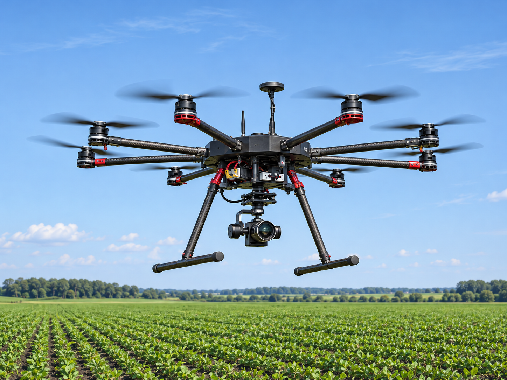

*Εικόνα 2.2β. Συνθετική φωτορεαλιστική απεικόνιση δημιουργημένη με ΤΝ για εκπαιδευτική χρήση. Δεν παρουσιάζει πραγματικό κατασκευαστή ή πιστοποιημένο μοντέλο και δεν χρησιμοποιείται ως τεχνική απόδειξη των διατάξεων κινητήρων. Για την ακριβή αναγνώριση των 4, 6 και 8 κινητήρων χρησιμοποίησε το Σχήμα 2.2.*

### Σχήμα 2.2 — Σύγκριση τριών διατάξεων

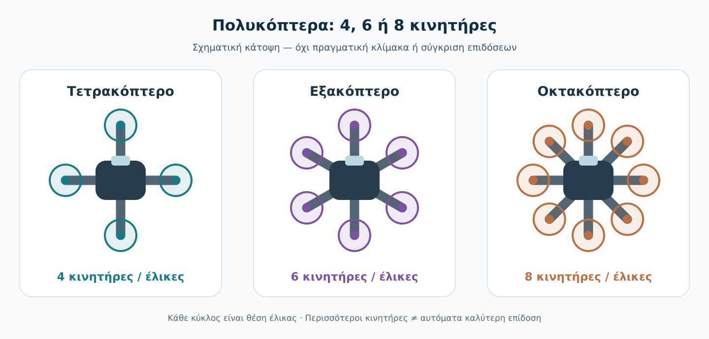

*Σχήμα 2.2. Ενδεικτική κάτοψη τριών πολυκόπτερων με 4, 6 και 8 θέσεις κινητήρων/ελικών. Δεν απεικονίζεται συγκεκριμένο εμπορικό μοντέλο ούτε πραγματική κλίμακα. Κάθε κύκλος αντιπροσωπεύει θέση έλικας.*

Παρατήρησε στο διάγραμμα ότι όσο αυξάνει ο αριθμός των κινητήρων, τόσο αλλάζει η κατανομή τους γύρω από το σώμα. Αυτό είναι **χαρακτηριστικό διάταξης**, όχι απόδειξη καλύτερης επίδοσης. Στην πραγματική αγορά μπορείς να συναντήσεις πολύ διαφορετικά μεγέθη, διατάξεις και τεχνικά χαρακτηριστικά ακόμη και μέσα στην ίδια κατηγορία.

### 2.2.5 Πότε είναι χρήσιμο ένα πολυκόπτερο στη γεωχωρική εργασία;

Τα πολυκόπτερα είναι συχνά χρήσιμα όταν η εργασία χρειάζεται **ευελιξία, ελεγχόμενες θέσεις λήψης ή κατακόρυφη απογείωση και προσγείωση**. Για παράδειγμα, σε ένα εργοτάξιο μπορούμε να χρειαστούμε επαναλαμβανόμενες φωτογραφίες από παρόμοιες θέσεις· σε μια μικρή γεωχωρική αποτύπωση, οργανωμένες διαδρομές με επικαλύψεις· σε μια επιθεώρηση, λήψεις από διαφορετικές γωνίες.

Η δυνατότητα αιώρησης είναι σημαντικό πλεονέκτημα για παρατήρηση συγκεκριμένου αντικειμένου. Δεν σημαίνει όμως ότι επιτρέπεται ή είναι ασφαλές να πετάμε κοντά σε ανθρώπους, καλώδια, γέφυρες ή άλλες κατασκευές χωρίς τον απαιτούμενο σχεδιασμό. Οι περιορισμοί και η σχετική διαδικασία θα εξεταστούν στην DM01 και στην DM03.

Για τη χαρτογράφηση μεγαλύτερων εκτάσεων, το πολυκόπτερο μπορεί να χρειαστεί περισσότερες διαδρομές, μπαταρίες και διακοπές σε σχέση με μια κατάλληλη πλατφόρμα σταθερής πτέρυγας. Δεν υπάρχει όμως καθολικό όριο έκτασης που να διαχωρίζει τις δύο επιλογές. Το αποτέλεσμα εξαρτάται από τη ζητούμενη ανάλυση, την κάμερα, τις συνθήκες, τον χώρο και το διαθέσιμο σύστημα.

### 2.2.6 Πώς συγκρίνουμε χωρίς αυθαίρετες γενικεύσεις;

| Κριτήριο | Τετρακόπτερο | Εξακόπτερο | Οκτακόπτερο |
|---|---|---|---|
| Κινητήρες στη συνήθη διάταξη | 4 | 6 | 8 |
| Αιώρηση | Ναι | Ναι | Ναι |
| Κατακόρυφη απογείωση/προσγείωση | Ναι | Ναι | Ναι |
| Ωφέλιμο φορτίο | Εξαρτάται από το συγκεκριμένο σύστημα | Εξαρτάται από το συγκεκριμένο σύστημα | Εξαρτάται από το συγκεκριμένο σύστημα |
| Χρόνος πτήσης | Εξαρτάται από το μοντέλο, το φορτίο και τις συνθήκες | Εξαρτάται από το μοντέλο, το φορτίο και τις συνθήκες | Εξαρτάται από το μοντέλο, το φορτίο και τις συνθήκες |
| Αντιμετώπιση βλάβης κινητήρα | Δεν τεκμαίρεται ασφαλής συνέχιση | Ενδέχεται να προβλέπεται ειδική δυνατότητα | Ενδέχεται να προβλέπεται ειδική δυνατότητα |
| Καταλληλότητα για αποστολή | Κρίνεται από τις απαιτήσεις του έργου | Κρίνεται από τις απαιτήσεις του έργου | Κρίνεται από τις απαιτήσεις του έργου |

Ο πίνακας δεν είναι κατάταξη. Δεν θα επέλεγες, για παράδειγμα, οκτακόπτερο για μια απλή φωτογραφία μόνο επειδή «οκτώ είναι περισσότερα από τέσσερα». Θα ξεκινούσες από το ζητούμενο παραδοτέο και τις τεχνικές προϋποθέσεις.

### 2.2.7 Μικρό παράδειγμα από την κοινή αποστολή

Στην κοινή εκπαιδευτική αποστολή του GeoSkills εξετάζουμε μια **υποθετική αγροτική έκταση περίπου 25 ha**. Ας υποθέσουμε ότι υπάρχει κατάλληλος, επιτρεπτός χώρος για κατακόρυφη απογείωση και ότι ο στόχος είναι ένα πρόσφατο ορθοφωτογραφικό υπόβαθρο.

Ένα κατάλληλο τετρακόπτερο με συμβατή κάμερα και δυνατότητα οργανωμένων λήψεων θα μπορούσε να αποτελέσει **υποψήφια λύση**. Δεν μπορούμε όμως να αποφασίσουμε ακόμη ότι είναι επαρκές: χρειαζόμαστε τις απαιτήσεις ανάλυσης και ακρίβειας, πληροφορίες για το ανάγλυφο, τις συνθήκες, τους περιορισμούς πτήσης και τα τεχνικά στοιχεία του εξοπλισμού. Δεν δικαιολογείται επίσης να προτιμήσουμε εξακόπτερο ή οκτακόπτερο μόνο λόγω περισσότερων κινητήρων.

### Έλεγξε τι κατάλαβες

**Ερώτηση.** Ένα οκτακόπτερο είναι απαραίτητα ασφαλέστερο και καταλληλότερο για χαρτογράφηση από ένα τετρακόπτερο;

Εμφάνιση απάντησης και αιτιολόγησης

**Όχι.** Ο αριθμός κινητήρων περιγράφει μία πλευρά της κατασκευής, όχι το σύνολο των δυνατοτήτων. Η ασφάλεια και η καταλληλότητα εξαρτώνται από τη συνολική σχεδίαση, τα πραγματικά τεχνικά όρια, το φορτίο, τις συνθήκες και την αποστολή. Περισσότεροι κινητήρες δεν εγγυώνται ούτε μεγαλύτερη αυτονομία ούτε καλύτερο χαρτογραφικό αποτέλεσμα.

### Δραστηριότητα 2.2-A1 — Επιλέγω χαρακτηριστικά για μια εργασία

**Σενάριο:** Μια ομάδα χρειάζεται φωτογραφική τεκμηρίωση της εξωτερικής όψης μικρής τεχνικής κατασκευής από αρκετές γωνίες. Ο χώρος είναι περιορισμένος και δεν προβλέπεται εκτεταμένη κάλυψη. Δεν έχουν ακόμη ελεγχθεί οι κανονιστικοί περιορισμοί και οι κίνδυνοι του σημείου.

**Εργασία:**

1. Εξήγησε γιατί η αιώρηση μπορεί να είναι χρήσιμη.
2. Πρότεινε μια **κατηγορία** πολυκόπτερου ως αρχική υποψήφια λύση, χωρίς εμπορικό μοντέλο.
3. Γράψε δύο στοιχεία που πρέπει οπωσδήποτε να επαληθευτούν πριν αποφασιστεί η εκτέλεση της εργασίας.
4. Εξήγησε γιατί η επιλογή μεγαλύτερου αριθμού κινητήρων δεν είναι από μόνη της επαρκής αιτιολόγηση.

**Παραδοτέο:** Μικρό τεχνικό σημείωμα 100–150 λέξεων. Πριν εμφανίσεις τη λύση, σύγκρινε την απάντησή σου με αυτά τα κριτήρια: αιώρηση, απαιτήσεις κάμερας, καταλληλότητα χώρου, κανονισμοί/ασφάλεια και αποφυγή απόλυτων ισχυρισμών.

Εμφάνιση ενδεικτικής λύσης

Η αιώρηση επιτρέπει να παραμείνει η κάμερα κοντά στην επιλεγμένη θέση λήψης, ώστε να ελεγχθεί η γωνία και η κάλυψη της κατασκευής. Ένα κατάλληλο **τετρακόπτερο** θα μπορούσε να είναι η πρώτη υποψήφια κατηγορία, επειδή προσφέρει κατακόρυφη απογείωση, ευελιξία και δυνατότητα αιώρησης. Αυτή είναι προσωρινή επιλογή, όχι απόφαση πτήσης. Πρέπει πρώτα να ελεγχθούν, μεταξύ άλλων, ο διαθέσιμος ασφαλής χώρος, τα εμπόδια και οι απαιτήσεις νομιμότητας, καθώς και η πραγματική δυνατότητα της κάμερας να παραγάγει τις ζητούμενες εικόνες. Ένα εξακόπτερο ή οκτακόπτερο μπορεί να είναι κατάλληλο αν υπάρχουν ειδικές απαιτήσεις φορτίου ή σχεδίασης, όχι όμως επειδή έχει απλώς περισσότερους κινητήρες.

**Συνηθισμένο λάθος:** «Επιλέγω οκτακόπτερο επειδή έχει οκτώ έλικες και άρα είναι πάντα ασφαλέστερο». Η πρόταση δεν τεκμηριώνει πραγματικές δυνατότητες ή συνθήκες της αποστολής.

### Τι κρατάμε και πού συνεχίζουμε

Το πολυκόπτερο μάς δίνει **αιώρηση, ευελιξία και κατακόρυφη απογείωση**, χρήσιμες ιδιότητες σε πολλές τοπικές εργασίες. Η διάκριση τετρακόπτερου–εξακόπτερου–οκτακόπτερου είναι πρωτίστως διάκριση κατασκευής· η πραγματική επιλογή χρειάζεται απαιτήσεις έργου και τεχνικές προδιαγραφές.

Στην **DM00.2.3** θα δούμε πώς λειτουργεί η διαφορετική λογική των αεροσκαφών σταθερής πτέρυγας και γιατί μπορούν να είναι αποδοτικά για ορισμένες εκτεταμένες αποστολές.

---

## 2.3 Drones σταθερής πτέρυγας (fixed-wing)

### Όταν η εργασία απαιτεί κάλυψη μεγάλης περιοχής

Φαντάσου ότι αναλαμβάνεις την καταγραφή μιας εκτεταμένης αγροτικής περιοχής, με συνεχόμενα αγροτεμάχια και αρκετό χώρο γύρω από την περιοχή εργασίας. Χρειάζεσαι φωτογραφίες που θα καλύπτουν συστηματικά την έκταση, ώστε αργότερα να παραχθεί ένα ενιαίο χαρτογραφικό υπόβαθρο. Μία από τις πλατφόρμες που αξίζει να εξετάσεις είναι το **drone σταθερής πτέρυγας** (*fixed-wing UAV*).

Δεν πρόκειται για πολυκόπτερο με περισσότερους κινητήρες. Η βασική διαφορά είναι ο τρόπος με τον οποίο το αεροσκάφος διατηρείται στον αέρα: η πτέρυγα παράγει άντωση όσο το αεροσκάφος κινείται σε κατάλληλη ροή αέρα. Έτσι μπορεί, σε συγκεκριμένες σχεδιάσεις και συνθήκες, να καλύπτει μεγαλύτερες αποστάσεις με ενεργειακά αποδοτικό τρόπο. Όμως αυτή η δυνατότητα συνοδεύεται από απαιτήσεις για απογείωση, πτήση και ανάκτηση που δεν μπορούμε να αγνοήσουμε.

### 2.3.1 Πώς διατηρείται στον αέρα ένα drone σταθερής πτέρυγας;

Ένα συμβατικό αεροσκάφος σταθερής πτέρυγας διαθέτει **πτέρυγες** που παραμένουν σταθερά συνδεδεμένες με το κύριο σώμα του. Καθώς το αεροσκάφος κινείται μέσα στον αέρα, αναπτύσσεται αεροδυναμική **άντωση**. Η προώθηση παρέχεται συνήθως από έναν έλικα με κινητήρα, αν και υπάρχουν διαφορετικές σχεδιάσεις.

Για να κατανοήσεις τη βασική αρχή, ξεχώρισε τέσσερις έννοιες:

- **Άντωση:** η αεροδυναμική δύναμη που επιτρέπει στις πτέρυγες να υποστηρίζουν το αεροσκάφος.
- **Βάρος:** η δύναμη της βαρύτητας που δρα προς τα κάτω.
- **Προώθηση:** η δύναμη που ωθεί το αεροσκάφος προς την κατεύθυνση πτήσης.
- **Αεροδυναμική αντίσταση:** η δύναμη που αντιτίθεται στην κίνησή του μέσα στον αέρα.

Σε σταθερή και ευθύγραμμη οριζόντια πτήση, όταν η ταχύτητα και το ύψος παραμένουν σταθερά, οι δυνάμεις βρίσκονται περίπου σε ισορροπία. Στην πράξη, οι συνθήκες μεταβάλλονται διαρκώς και το σύστημα ελέγχου πραγματοποιεί διορθώσεις.

**Κρίσιμη διαφορά από το πολυκόπτερο:** ένα συμβατικό fixed-wing δεν μπορεί να αιωρείται πάνω από ένα σημείο όπως ένα τετρακόπτερο. Χρειάζεται κατάλληλη ταχύτητα και ροή αέρα σε σχέση με την πτέρυγά του. Οι υβριδικές πλατφόρμες VTOL, που συνδυάζουν διαφορετικούς τρόπους πτήσης, θα εξεταστούν χωριστά στην 2.4.

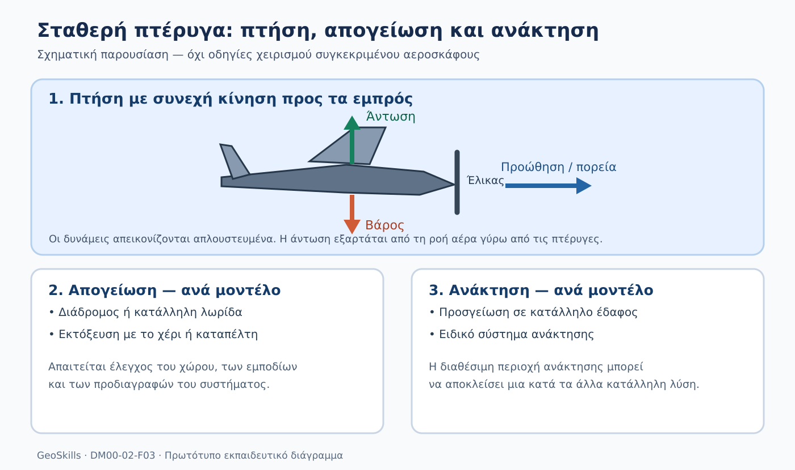

*Σχήμα 2.3. Απλουστευμένη απεικόνιση άντωσης, βάρους και προώθησης, μαζί με παραδείγματα απογείωσης και ανάκτησης. Δεν αποτελεί οδηγία χειρισμού ή απεικόνιση συγκεκριμένου μοντέλου.*

### 2.3.2 Γιατί μπορεί να είναι αποδοτικό σε μεγάλες εκτάσεις;

Στην αεροφωτογράφιση μιας εκτεταμένης περιοχής συνήθως δεν χρειάζεται να μένουμε ακίνητοι επάνω από κάθε σημείο. Θέλουμε μια **οργανωμένη διαδρομή πτήσης** που επιτρέπει τη λήψη πολλών διαδοχικών, επικαλυπτόμενων φωτογραφιών. Η συνεχής προωθητική πτήση ενός κατάλληλου fixed-wing μπορεί να ταιριάζει σε αυτό το είδος αποστολής.

Το πλεονέκτημα δεν βρίσκεται σε έναν καθολικό αριθμό λεπτών ή εκταρίων. Εξαρτάται από τη σχεδίαση της πλατφόρμας, την κάμερα, το βάρος, τον άνεμο, το ανάγλυφο, τη ζητούμενη ανάλυση, τις επικαλύψεις και τους περιορισμούς της επιχειρησιακής περιοχής. Γι’ αυτό **δεν συμπεραίνουμε ότι κάθε fixed-wing έχει μεγαλύτερη αυτονομία από κάθε πολυκόπτερο** ή ότι θα ολοκληρώσει πάντοτε γρηγορότερα μια μεγάλη εργασία.

Σκέψου δύο διαφορετικές αποστολές: στην πρώτη πρέπει να ακολουθήσεις παράλληλες γραμμές πάνω από εκτεταμένη αγροτική έκταση· στη δεύτερη πρέπει να φωτογραφίσεις προσεκτικά την κάτω πλευρά μιας γέφυρας από διάφορες θέσεις. Η πρώτη μπορεί να ευνοεί κατάλληλο fixed-wing. Η δεύτερη απαιτεί ελεγχόμενες στάσεις και διαφορετικές γωνίες παρατήρησης, οπότε ένα πολυκόπτερο είναι συχνά καταλληλότερο.

### 2.3.3 Πώς απογειώνεται ένα fixed-wing;

Επειδή το συμβατικό fixed-wing δεν αιωρείται, **δεν απογειώνεται κατακόρυφα με τον τρόπο ενός πολυκόπτερου**. Η κατάλληλη διαδικασία εξαρτάται από την πλατφόρμα: μερικά αεροσκάφη απογειώνονται από διάδρομο ή κατάλληλη εδαφική λωρίδα, άλλα μπορούν να εκτοξευθούν με το χέρι και άλλα χρησιμοποιούν ειδική διάταξη εκτόξευσης.

Αυτές οι μέθοδοι δεν είναι εναλλάξιμες. Μια πλατφόρμα σχεδιασμένη για εκτόξευση με ειδικό μηχανισμό δεν πρέπει να θεωρείται κατάλληλη για άλλη μέθοδο χωρίς τεκμηρίωση από τον κατασκευαστή.

Για τον αρχικό σχεδιασμό της εργασίας χρειάζεται να γνωρίζεις:

- αν υπάρχει **επαρκής και επιτρεπτός χώρος** για την προβλεπόμενη μέθοδο απογείωσης,
- αν υπάρχουν δέντρα, καλώδια, κτίρια ή άλλα εμπόδια κοντά στην πορεία,
- αν το έδαφος και οι καιρικές συνθήκες είναι συμβατά με τις προδιαγραφές,
- αν μπορεί να εκτελεστεί η αποστολή σύμφωνα με τις απαιτήσεις ασφάλειας και το ισχύον κανονιστικό πλαίσιο.

Η δυνατότητα του αεροσκάφους να καλύψει την περιοχή **δεν αρκεί**, αν δεν μπορούμε να εξασφαλίσουμε κατάλληλη απογείωση.

### 2.3.4 Πώς προσγειώνεται ή ανακτάται;

Η **ανάκτηση** είναι εξίσου σημαντική με την απογείωση. Ανάλογα με τη σχεδίαση, ένα fixed-wing μπορεί να χρειάζεται λωρίδα προσγείωσης ή να διαθέτει ειδικό σύστημα ανάκτησης. Ορισμένα μικρά συστήματα χρησιμοποιούν μεθόδους ανάκτησης διαφορετικές από την κλασική προσγείωση με τροχούς.

Επομένως, όταν αξιολογείς μια περιοχή, δεν αρκεί να εντοπίσεις ένα ελεύθερο σημείο όπου θα ξεκινήσει η πτήση. Πρέπει να γνωρίζεις **πού και πώς θα ολοκληρωθεί με ασφάλεια η αποστολή**, αλλά και ποιες επιλογές προβλέπονται για απρόβλεπτες συνθήκες, σύμφωνα με τη σχεδίαση και τις διαδικασίες του συστήματος.

**Παράδειγμα:** μια μεγάλη αγροτική περιοχή μπορεί να είναι κατάλληλη για οργανωμένη φωτογράφιση, αλλά ο διαθέσιμος χώρος στο έδαφος να είναι στενός ή να περιβάλλεται από εμπόδια. Σε αυτή την περίπτωση, ένα συμβατικό fixed-wing μπορεί να μην είναι πρακτική επιλογή, ακόμη και αν η θεωρητική του εμβέλεια ή αυτονομία φαίνεται ελκυστική.

### 2.3.5 Πώς αναγνωρίζουμε ένα πραγματικό fixed-wing;

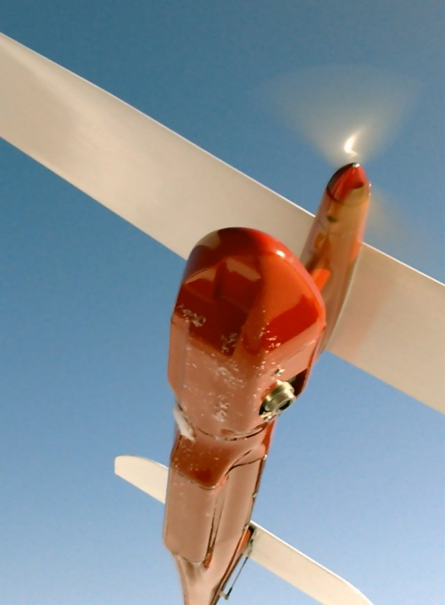

*Φωτογραφία 2.4. Drone σταθερής πτέρυγας Pteryx, σε λήψη από κάτω. Διακρίνονται η πτέρυγα, η άτρακτος και τα ουραία τμήματα. Δημιουργός: Kbosak, Wikimedia Commons, CC BY-SA 3.0. Δεν τεκμαίρονται επιχειρησιακές επιδόσεις από τη φωτογραφία.*

Παρατήρησε την εκτεταμένη πτέρυγα σε σχέση με το κεντρικό σώμα. Η ύπαρξη πτέρυγας δεν μας επιτρέπει όμως να συμπεράνουμε τη μέθοδο απογείωσης, την αυτονομία, τον εξοπλισμό λήψεων ή την αντοχή στον άνεμο. Αυτά απαιτούν στοιχεία συγκεκριμένου συστήματος.

Σύγκρινέ την με τη φωτογραφία τετρακόπτερου της 2.2: το πολυκόπτερο χρησιμοποιεί ώση από τις έλικες για αιώρηση, ενώ το συμβατικό fixed-wing βασίζεται στην αεροδυναμική λειτουργία των πτερύγων του κατά την προωθητική πτήση. Πρόκειται για δύο διαφορετικές λύσεις και όχι απλώς για διαφορετικά σχήματα αεροσκαφών.

### 2.3.6 Ποιοι είναι οι κυριότεροι περιορισμοί;

Για έναν αρχικό τεχνικό έλεγχο εξετάζουμε τα παρακάτω:

| Παράμετρος | Τι εξετάζουμε | Γιατί έχει σημασία |
|---|---|---|
| Διαρκής προωθητική πτήση | Μπορεί η διαδρομή να εκτελεστεί χωρίς αιώρηση; | Δεν είναι κατάλληλο για όλες τις γωνίες επιθεώρησης. |
| Απογείωση | Τι χώρο ή εξοπλισμό απαιτεί το συγκεκριμένο μοντέλο; | Μπορεί να αποκλείσει μια κατά τα άλλα καλή τοποθεσία. |
| Ανάκτηση | Πού και πώς ολοκληρώνεται η πτήση; | Απαιτεί κατάλληλη διαδικασία και διαθέσιμο χώρο. |
| Άνεμος και ανάγλυφο | Υπάρχουν περιορισμοί και ιδιαίτερες συνθήκες πεδίου; | Επηρεάζουν τον σχεδιασμό και την ασφάλεια. |
| Φορτίο και κάμερα | Μπορεί να μεταφέρει τον απαιτούμενο αισθητήρα; | Καθορίζει ποια δεδομένα μπορούν να συλλεχθούν. |
| Ποιότητα παραδοτέου | Μπορεί η ροή λήψεων να υποστηρίξει το ζητούμενο αποτέλεσμα; | Η μεγάλη κάλυψη από μόνη της δεν εγγυάται ακρίβεια. |

Η **ποιότητα χαρτογράφησης** δεν προκύπτει από το σχήμα της πλατφόρμας. Θα εξαρτηθεί και από τα χαρακτηριστικά της κάμερας, τον σχεδιασμό πτήσης, τις διαδικασίες γεωαναφοράς και τον έλεγχο του αποτελέσματος, όπως θα δούμε στις επόμενες ενότητες.

### 2.3.7 Παράδειγμα στην κοινή εκπαιδευτική αποστολή

Στην υποθετική αποστολή χαρτογράφησης περίπου **25 εκταρίων**, το fixed-wing μπορεί να εξεταστεί ως μία επιλογή, χωρίς να θεωρείται εκ των προτέρων απαραίτητο. Πριν το προτιμήσουμε χρειάζονται οι απαιτήσεις ανάλυσης και ακρίβειας, η μορφολογία του εδάφους, τα διαθέσιμα σημεία απογείωσης και ανάκτησης, οι επιτρεπόμενες επιχειρήσεις και οι τεχνικές προδιαγραφές.

Αν η περιοχή είναι εύκολα προσβάσιμη αλλά δεν διαθέτει κατάλληλο χώρο ανάκτησης, μπορεί να προτιμηθεί πολυκόπτερο. Αντίστοιχα, η ύπαρξη μεγάλης ανοιχτής περιοχής δεν αποτελεί από μόνη της λόγο επιλογής fixed-wing· πρέπει να εκτιμήσουμε συνολικά τις απαιτήσεις.

### Έλεγξε τι κατάλαβες

**Ερώτηση:** Γιατί το γεγονός ότι ένα fixed-wing μπορεί να καλύπτει μεγάλες αποστάσεις δεν αρκεί για να το επιλέξουμε σε μια χαρτογραφική εργασία;

Δες την απάντηση και την αιτιολόγηση

Η επιλογή εξαρτάται και από το κατά πόσον η πλατφόρμα μπορεί να απογειωθεί, να πραγματοποιήσει τις αναγκαίες λήψεις και να ανακτηθεί με ασφάλεια στην περιοχή εργασίας. Ελέγχουμε επίσης την καταλληλότητα της κάμερας, τις απαιτήσεις των παραδοτέων, τις πραγματικές επιχειρησιακές συνθήκες και τους κανονισμούς. Η αυτονομία ή η επιφάνεια κάλυψης είναι μόνο ένα μέρος της απόφασης.

### Δραστηριότητα 2.3 — Δύο περιοχές, δύο διαφορετικές προκλήσεις

**Σενάριο Α:** Χρειάζεται πρόσφατη εναέρια αποτύπωση εκτεταμένης και σχετικά ομοιογενούς αγροτικής έκτασης. Υπάρχει διαθέσιμος ανοιχτός χώρος, αλλά δεν έχουν ελεγχθεί οι περιορισμοί πτήσης και ο τρόπος ανάκτησης.

**Σενάριο Β:** Χρειάζονται λεπτομερείς λήψεις διαφορετικών πλευρών μικρής τεχνικής εγκατάστασης. Η εργασία απαιτεί αλλαγές γωνίας παρατήρησης και δυνατότητα αιώρησης, ενώ ο διαθέσιμος χώρος είναι περιορισμένος.

**Εργασία:**

1. Για κάθε σενάριο πρότεινε ποια κατηγορία drone θα εξέταζες πρώτη: πολυκόπτερο ή συμβατικό fixed-wing.
2. Γράψε **δύο αιτιολογήσεις** για κάθε επιλογή.
3. Κατάγραψε **τρία στοιχεία** που χρειάζεσαι πριν ληφθεί οριστική απόφαση.
4. Για το Σενάριο Α εξήγησε γιατί πρέπει να προβλεφθεί και η **ανάκτηση** του αεροσκάφους, όχι μόνο η απογείωση.

**Παραδοτέο:** ένας μικρός πίνακας με τέσσερις στήλες: «Σενάριο», «Υποψήφια πλατφόρμα», «Αιτιολόγηση» και «Τι χρειάζεται έλεγχο». Μπορείς να τον συμπληρώσεις σε αρχείο ή στο τετράδιό σου.

Δες την ενδεικτική λύση

**Σενάριο Α:** Είναι λογικό να εξεταστεί πρώτα ένα κατάλληλο fixed-wing για οργανωμένη κάλυψη μεγάλης έκτασης, επειδή υποστηρίζει συνεχή προωθητική πτήση και μπορεί να είναι αποδοτικό σε τέτοια αποστολή. Πρέπει όμως να ελεγχθούν: η επιτρεπτή πτήση στην περιοχή, η καταλληλότητα του χώρου απογείωσης και ανάκτησης, οι απαιτήσεις κάμερας/παραδοτέων, ο άνεμος και το ανάγλυφο. Χωρίς ασφαλή και συμβατή με το μοντέλο διαδικασία ανάκτησης δεν υπάρχει ολοκληρωμένο σχέδιο αποστολής.

**Σενάριο Β:** Είναι λογικό να εξεταστεί πρώτα ένα πολυκόπτερο, επειδή μπορεί να αιωρείται και να μεταβάλλει ελεγχόμενα τη θέση και τη γωνία λήψης. Πρέπει όμως να ελεγχθούν: η νομιμότητα και η ασφάλεια κοντά στην εγκατάσταση, οι αποστάσεις από εμπόδια και ανθρώπους, η καταλληλότητα του εξοπλισμού λήψεων και ο διαθέσιμος χώρος. Δεν σημαίνει ότι κάθε πολυκόπτερο μπορεί να εκτελέσει τη συγκεκριμένη εργασία.

**Για τον αυτοέλεγχό σου:** Μια τεκμηριωμένη απάντηση ξεχωρίζει την *κατάλληλη υποψήφια κατηγορία* από την *οριστική επιλογή μοντέλου*. Δεν απαιτεί να μαντέψεις διάρκεια πτήσης ή μέγεθος επιφάνειας κάλυψης.

### Τι κρατάμε πριν συνεχίσουμε

Το συμβατικό drone σταθερής πτέρυγας μπορεί να είναι κατάλληλο για οργανωμένη φωτογράφιση εκτεταμένων εκτάσεων. Το βασικό του πλεονέκτημα προκύπτει από την αεροδυναμική λειτουργία των πτερύγων κατά τη συνεχή πτήση. Η απουσία αιώρησης και οι απαιτήσεις απογείωσης και ανάκτησης αποτελούν ουσιώδη κριτήρια επιλογής, όχι λεπτομέρειες που εξετάζουμε αργότερα.

Στην επόμενη υποενότητα θα γνωρίσουμε τα **υβριδικά VTOL**, που συνδυάζουν κατακόρυφη απογείωση και προσγείωση με πτήση σταθερής πτέρυγας, αλλά εισάγουν νέους τεχνικούς συμβιβασμούς.

---

## 2.4 Υβριδικά drones κάθετης απογείωσης και προσγείωσης (VTOL)

### Όταν υπάρχει μεγάλη περιοχή, αλλά περιορισμένος χώρος απογείωσης

Φαντάσου ότι έχεις αναλάβει να προτείνεις μέσο εναέριας αποτύπωσης για μια εκτεταμένη αγροτική περιοχή. Η περιοχή είναι αρκετά μεγάλη ώστε να σε ενδιαφέρει η αποδοτικότητα μιας πτήσης σταθερής πτέρυγας. Ωστόσο, οι διαθέσιμοι χώροι γύρω από τα χωράφια είναι μικροί, υπάρχουν καλλιέργειες, φράχτες και αρδευτικές εγκαταστάσεις και δεν μπορείς να θεωρήσεις δεδομένη την ύπαρξη ασφαλούς χώρου εκτόξευσης ή ανάκτησης ενός συμβατικού fixed-wing.

Μια πιθανή λύση προς αξιολόγηση είναι το **υβριδικό drone VTOL** (*Vertical Take-Off and Landing*): ένα μη επανδρωμένο αεροσκάφος που μπορεί να απογειωθεί και να προσγειωθεί κατακόρυφα, ενώ κατά τη μετακίνηση σε μια περιοχή μπορεί να εκμεταλλεύεται τις πτέρυγες για προωθητική πτήση. Δεν αποτελεί αυτομάτως την καλύτερη επιλογή. Πρόκειται για διαφορετικό τεχνικό συμβιβασμό, τον οποίο θα μάθεις να αξιολογείς.

### 2.4.1 Τι σημαίνει VTOL και τι εννοούμε «υβριδικό»;

Το VTOL περιγράφει την **ικανότητα κατακόρυφης απογείωσης και προσγείωσης**. Δεν σημαίνει από μόνο του ότι ένα αεροσκάφος διαθέτει πτέρυγες: και ένα συμβατικό πολυκόπτερο απογειώνεται κατακόρυφα. Στο συγκεκριμένο κεφάλαιο, με τον όρο **υβριδικό VTOL** εννοούμε μια πλατφόρμα που συνδυάζει δύο διαφορετικά καθεστώτα πτήσης:

- **Κατακόρυφη πτήση ή αιώρηση**, κατά την οποία το βάρος υποστηρίζεται κυρίως από την ώση των ελίκων, όπως σε πολυκόπτερο.
- **Προωθητική πτήση σταθερής πτέρυγας**, κατά την οποία η κίνηση μέσα στον αέρα επιτρέπει στις πτέρυγες να δημιουργούν την απαραίτητη αεροδυναμική άντωση.

Αυτός ο συνδυασμός δεν σημαίνει ότι το αεροσκάφος «πετά ταυτόχρονα σαν ελικόπτερο και σαν αεροπλάνο» σε όλη την αποστολή. Το κρίσιμο μέρος είναι η **μετάβαση** (*transition*) από τον έναν τρόπο πτήσης στον άλλον. Οι διατάξεις και οι διαδικασίες μετάβασης διαφέρουν ανά πλατφόρμα.

Έτσι, για την αρχική σύγκριση κράτησε την εξής διάκριση: το συμβατικό πολυκόπτερο υποστηρίζεται από τους έλικες σε όλη τη διάρκεια της πτήσης· το συμβατικό fixed-wing χρειάζεται κατάλληλη ροή αέρα πάνω στις πτέρυγές του και δεν αιωρείται· το υβριδικό VTOL μπορεί να εναλλάσσει τις δύο λειτουργίες, εφόσον έχει σχεδιαστεί για αυτό.

### 2.4.2 Τα στάδια μιας ενδεικτικής αποστολής

Παρατήρησε το **Σχήμα 2.4**. Παρουσιάζει μια ενδεικτική διάταξη με ξεχωριστούς έλικες ανύψωσης και προώθησης. Είναι ένα παράδειγμα αρχιτεκτονικής, όχι καθολικό σχέδιο όλων των VTOL.

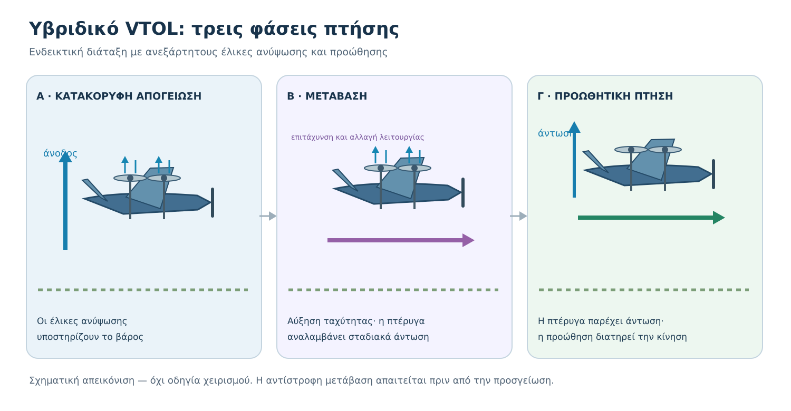

*Σχήμα 2.4. Σχηματικές φάσεις μιας ενδεικτικής πλατφόρμας VTOL με χωριστό σύστημα κατακόρυφης ανύψωσης και προώθησης: (α) κατακόρυφη απογείωση, (β) μετάβαση, (γ) προωθητική πτήση με άντωση από την πτέρυγα. Τα βέλη δηλώνουν κυρίαρχες λειτουργίες, όχι μετρημένα διανύσματα δυνάμεων. Στη φάση μετάβασης μπορούν να συνεισφέρουν ταυτόχρονα περισσότεροι μηχανισμοί.*

**Φάση Α — Κατακόρυφη απογείωση.** Η πλατφόρμα αναπτύσσει ώση που υποστηρίζει το βάρος της και ανέρχεται χωρίς τη διαδρομή απογείωσης που μπορεί να απαιτεί ένα συμβατικό fixed-wing. Αυτό, ωστόσο, δεν σημαίνει ότι μπορεί να απογειωθεί από οποιοδήποτε σημείο: παραμένουν απαραίτητοι ο κατάλληλος ελεύθερος χώρος, ο έλεγχος εμποδίων, του ανέμου, των ανθρώπων και των περιορισμών της αποστολής.

**Φάση Β — Μετάβαση σε προωθητική πτήση.** Το αεροσκάφος επιταχύνεται και προσαρμόζει τον έλεγχο της στάσης και της πρόωσης. Η πτέρυγα αναλαμβάνει σταδιακά μεγαλύτερο μέρος της στήριξης του βάρους. Η μετάβαση είναι κρίσιμη: χρειάζονται επαρκείς συνθήκες πτήσης και σωστός συντονισμός των συστημάτων. Δεν υποθέτουμε ότι γίνεται στιγμιαία ή ότι όλα τα VTOL χρησιμοποιούν την ίδια ακολουθία.

**Φάση Γ — Προωθητική πτήση.** Σε κατάλληλες συνθήκες, οι πτέρυγες παράγουν το μεγαλύτερο μέρος της άντωσης. Η πλατφόρμα ακολουθεί τις προγραμματισμένες διαδρομές συλλογής εικόνων. Η συγκεκριμένη σχεδίαση ενδέχεται να απαιτεί λιγότερη ενέργεια ανά μονάδα απόστασης από μια πτήση που στηρίζεται αποκλειστικά σε πολλούς έλικες ανύψωσης.

Πριν από την προσγείωση απαιτείται και **αντίστροφη μετάβαση**, από προωθητική σε κατακόρυφη πτήση. Αυτή αποτελεί ξεχωριστή λειτουργική απαίτηση και δεν πρέπει να παραλείπεται στον σχεδιασμό της αποστολής.

### 2.4.3 Δεν είναι όλα τα υβριδικά VTOL ίδια

Η λέξη «υβριδικό» περιγράφει τη συνδυασμένη λειτουργία, όχι μια ενιαία κατασκευή. Τρεις ενδεικτικές αρχιτεκτονικές είναι οι ακόλουθες.

**Διαμόρφωση με χωριστούς κινητήρες ανύψωσης και προώθησης (standard VTOL / QuadPlane).** Κάποιοι έλικες έχουν κύριο ρόλο στην κατακόρυφη λειτουργία, ενώ άλλος μηχανισμός παρέχει προώθηση κατά την πτήση σταθερής πτέρυγας. Η διάταξη επιτρέπει διαφορετική βελτιστοποίηση των δύο λειτουργιών, αλλά προσθέτει εξαρτήματα και μάζα. Το F04 απεικονίζει αυτή την οικογένεια σχηματικά.

**Tiltrotor — περιστρεφόμενοι κινητήρες ή έλικες.** Ένας ή περισσότεροι κινητήρες αλλάζουν προσανατολισμό, ώστε η ώση τους να αξιοποιείται διαφορετικά στην αιώρηση και στην προωθητική πτήση. Αυτό μειώνει σε ορισμένες σχεδιάσεις την ανάγκη για εντελώς χωριστά συστήματα πρόωσης, αλλά εισάγει μηχανισμούς περιστροφής, απαιτήσεις συντονισμού και πιθανά σημεία αστοχίας.

**Tailsitter — απογείωση με το αεροσκάφος σχεδόν κατακόρυφο.** Ολόκληρο το αεροσκάφος αλλάζει προσανατολισμό μεταξύ κατακόρυφης και οριζόντιας πτήσης. Δεν πρέπει να το συγχέουμε με το tiltrotor: εκεί περιστρέφονται κυρίως οι κινητήρες, ενώ εδώ αλλάζει προσανατολισμό το κύριο σώμα. Η σχεδίαση μπορεί να περιορίζει ορισμένα μηχανικά μέρη, αλλά δημιουργεί διαφορετικές προκλήσεις ελέγχου και συνθηκών περιβάλλοντος.

| Αρχιτεκτονική | Πώς επιτυγχάνεται η μετάβαση; | Τι χρειάζεται να εξετάσουμε; |
|---|---|---|
| Χωριστά συστήματα ανύψωσης/προώθησης | Διαφορετικές προωστήριες μονάδες αναλαμβάνουν διαφορετικούς ρόλους | Πρόσθετη μάζα, εξαρτήματα, ενεργειακή κατανάλωση |
| Tiltrotor | Ένας ή περισσότεροι κινητήρες στρέφονται | Μηχανισμοί περιστροφής, έλεγχος μετάβασης, συντήρηση |
| Tailsitter | Το σώμα του αεροσκάφους αλλάζει στάση | Έλεγχος σε αλλαγή στάσης, άνεμος, καταλληλότητα εξοπλισμού και αισθητήρα |

Δεν κατατάσσουμε τις τρεις διατάξεις καθολικά ως «καλύτερες» ή «χειρότερες». Μια πραγματική σύγκριση χρειάζεται τεχνικά στοιχεία για συγκεκριμένα μοντέλα, φορτία, συνθήκες και απαιτήσεις.

**Πραγματικό παράδειγμα: WingtraOne (tailsitter)**

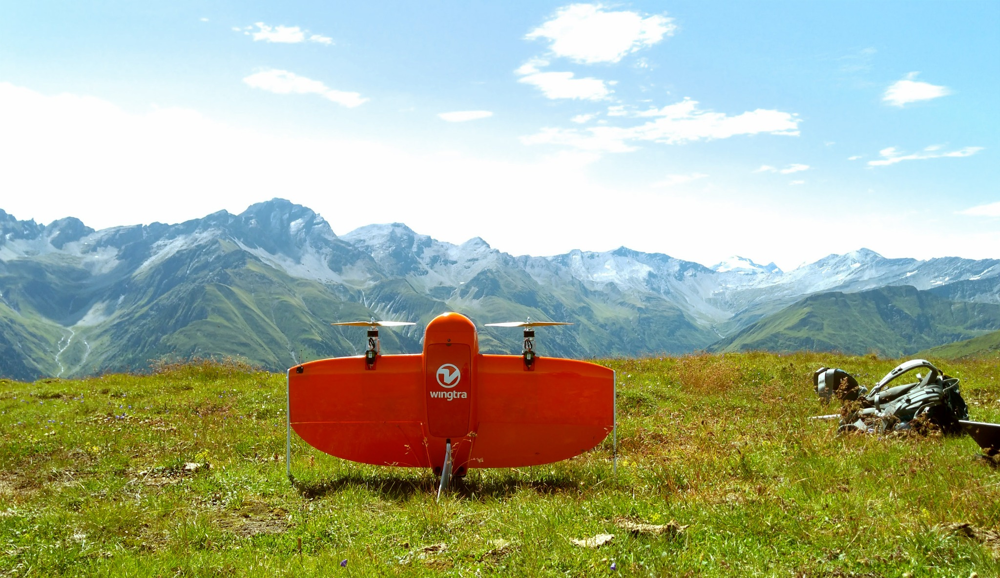

*Φωτογραφία 2.5. Πραγματικό υβριδικό drone WingtraOne τύπου tailsitter σε θέση στο έδαφος. Σε αυτή τη διάταξη το αεροσκάφος αλλάζει συνολικά προσανατολισμό μεταξύ της κατακόρυφης και της προωθητικής πτήσης. Η εικόνα δεν παρουσιάζει τη μετάβαση σε εξέλιξη. Δημιουργός: Adyasha Dash · Wikimedia Commons · [CC BY-SA 4.0](https://creativecommons.org/licenses/by-sa/4.0/) · [πηγή](https://commons.wikimedia.org/wiki/File:WingtraOne_in_use.jpg).*

### 2.4.4 Τι μπορεί να κερδίσουμε — και τι μας κοστίζει;

Το εμφανές πλεονέκτημα είναι η δυνατότητα **κατακόρυφης απογείωσης και προσγείωσης χωρίς την ίδια απαίτηση διαδρόμου** που μπορεί να έχει ένα συμβατικό fixed-wing. Επιπλέον, η προωθητική πτήση με άντωση από την πτέρυγα μπορεί να εξυπηρετήσει αποτελεσματικά μια εκτεταμένη διαδρομή χαρτογράφησης.

Υπάρχουν όμως σημαντικοί συμβιβασμοί:

- **Πολυπλοκότητα.** Περισσότερες λειτουργίες, αισθητήρες, μηχανισμοί ή μεταβατικές καταστάσεις απαιτούν αντίστοιχους ελέγχους και συντήρηση.
- **Μάζα και διαθέσιμη ενέργεια.** Ο εξοπλισμός που χρειάζεται για την κατακόρυφη λειτουργία μπορεί να επηρεάζει το συνολικό βάρος και την ενεργειακή απόδοση στην προωθητική πτήση.
- **Κίνδυνοι κατά τη μετάβαση.** Ο έλεγχος και η διατήρηση επαρκούς πτητικής κατάστασης είναι κρίσιμα. Λανθασμένες συνθήκες μπορούν να οδηγήσουν σε απώλεια ελέγχου.
- **Χώρος και ασφάλεια.** Δεν χρειάζεται κατ’ ανάγκη μακρύς διάδρομος, αλλά απαιτείται κατάλληλος χώρος απογείωσης/προσγείωσης και ασφαλής περιοχή για τις μεταβάσεις και τις συνθήκες ανάγκης.
- **Κόστος και υποστήριξη.** Η επιλογή πρέπει να συνεκτιμά αγορά, εκπαίδευση, τεχνική υποστήριξη, ανταλλακτικά και δυνατότητες συντήρησης.

Θυμήσου επίσης ότι η κατακόρυφη απογείωση δεν εγγυάται από μόνη της νόμιμη ή ασφαλή λειτουργία σε μια περιοχή. Οι επιχειρησιακοί και κανονιστικοί έλεγχοι θα εξεταστούν στην DM01.

### 2.4.5 Παράδειγμα: μεγάλη έκταση με περιορισμένο χώρο

Ας επιστρέψουμε στην εκπαιδευτική εργασία. Ο ενδιαφερόμενος ζητά πρόσφατο ορθοφωτογραφικό υπόβαθρο για μεγάλη, σχετικά ενιαία αγροτική έκταση. Υπάρχει κατάλληλο σημείο για την παρουσία της ομάδας, αλλά όχι προφανής ανοικτή λωρίδα για εκτόξευση και ανάκτηση συμβατικού fixed-wing.

Μια προκαταρκτική σύγκριση θα μπορούσε να γίνει ως εξής:

| Ερώτημα | Πολυκόπτερο | Συμβατικό fixed-wing | Υβριδικό VTOL |
|---|---|---|---|
| Κατακόρυφη απογείωση | Συνήθως ναι | Όχι, στην τυπική διάταξη | Ναι, εφόσον είναι σχεδιασμένο για αυτήν |
| Προωθητική πτήση με άντωση πτέρυγας | Όχι, στο συμβατικό πολυκόπτερο | Ναι | Ναι, στη λειτουργία σταθερής πτέρυγας |
| Αιώρηση | Ναι | Όχι | Συνήθως ναι στη λειτουργία κατακόρυφης πτήσης, ανάλογα με το σύστημα |
| Επιπλέον ζητήματα | Αριθμός εξόδων, μπαταρίες, κάλυψη | Χώρος απογείωσης/ανάκτησης | Μετάβαση, σύνθετη λειτουργία, τεχνική υποστήριξη |

**Προκαταρκτικό συμπέρασμα:** το VTOL αξίζει να μπει στη λίστα υποψηφίων επειδή συνδυάζει δύο λειτουργίες που εδώ φαίνονται χρήσιμες. Δεν μπορούμε, όμως, να προτείνουμε αγορά ή αποστολή πριν ελέγξουμε πραγματική ωφέλιμη διάρκεια, συμβατότητα κάμερας, απαιτήσεις μετάβασης, άνεμο, δυνατότητες λογισμικού, ασφάλεια και κόστος. Αυτά θα μας απασχολήσουν περισσότερο στις επόμενες ενότητες.

### 2.4.6 Μια κρίσιμη διάκριση: «βολική απογείωση» δεν σημαίνει «κατάλληλη χαρτογράφηση»

Ένα drone μπορεί να απογειώνεται κατακόρυφα και παρ’ όλα αυτά να μην πληροί τις απαιτήσεις χαρτογράφησης. Για παράδειγμα, μπορεί να μην διαθέτει κατάλληλη κάμερα ή λειτουργία συστηματικής λήψης επικαλυπτόμενων φωτογραφιών. Ή οι δυνατότητες γεωσήμανσης και εξαγωγής αρχείων να μην καλύπτουν το ζητούμενο παραδοτέο.

Άρα ελέγχουμε **δύο διαφορετικά σύνολα απαιτήσεων**: (α) εάν μπορεί να πραγματοποιηθεί η αποστολή πτήσης με κατάλληλο τρόπο και (β) εάν το σύστημα μπορεί να συλλέξει τα δεδομένα που απαιτεί το τελικό προϊόν. Η πρώτη θετική απάντηση δεν εξασφαλίζει τη δεύτερη.

### 2.4.7 Αυτοέλεγχος

**Ερώτηση:** Μια εταιρεία προτείνει ένα υβριδικό VTOL για τη χαρτογράφηση μεγάλης έκτασης και ισχυρίζεται ότι «εφόσον απογειώνεται κατακόρυφα και έχει πτέρυγες, είναι πάντοτε καλύτερο από πολυκόπτερο και fixed-wing». Ποια είναι η βασική αδυναμία αυτού του ισχυρισμού;

Δες την απάντηση και την αιτιολόγηση

Ο ισχυρισμός είναι υπερβολικός. Η κατακόρυφη απογείωση μειώνει ορισμένες απαιτήσεις χώρου, ενώ η πτέρυγα μπορεί να προσφέρει ενεργειακά αποδοτική προωθητική πτήση. Όμως η επιτυχία εξαρτάται από συγκεκριμένα χαρακτηριστικά, αισθητήρα, συνθήκες, μετάβαση, ασφάλεια, κόστος και τελικά παραδοτέα. Για μια μικρή λεπτομερή επιθεώρηση μπορεί να είναι καταλληλότερο πολυκόπτερο· για μεγάλη περιοχή με άφθονο ασφαλή χώρο απογείωσης ένα συμβατικό fixed-wing μπορεί να είναι επαρκές ή προτιμότερο.

### 2.4.8 Δραστηριότητα αυτοδιδασκαλίας — Επιλέγω υποψήφιες πλατφόρμες

**Σενάριο:** Θέλεις να χαρτογραφήσεις μια εκτεταμένη αγροτική περιοχή. Στο διαθέσιμο σημείο εργασίας υπάρχει μια μικρή καθαρή επιφάνεια, ενώ γύρω της υπάρχουν δέντρα και καλλιέργειες. Δεν έχει γίνει ακόμη αυτοψία για τον άνεμο και την ασφαλή ζώνη πτήσης. Ο φορέας ζητά ορθοφωτοχάρτη, αλλά δεν έχει ορίσει απαιτούμενη ανάλυση ή χωρική ακρίβεια.

**Εργασία:** Γράψε μια σύντομη τεχνική κρίση 150–200 λέξεων που να απαντά:

1. Γιατί αξίζει να εξεταστεί υβριδικό VTOL;
2. Γιατί δεν μπορείς να αποκλείσεις εξαρχής το πολυκόπτερο ή το συμβατικό fixed-wing;
3. Ποια πέντε στοιχεία λείπουν πριν προτείνεις συγκεκριμένο σύστημα;
4. Ποια τεχνική λειτουργία του VTOL απαιτεί ιδιαίτερη προσοχή πέρα από την απογείωση;

**Κριτήρια αυτοαξιολόγησης:** Έχεις διακρίνει το πλεονέκτημα απογείωσης από την αποδοτικότητα προωθητικής πτήσης; Έχεις αναγνωρίσει τη μετάβαση ως ειδική λειτουργία; Έχεις ζητήσει στοιχεία και για την ασφάλεια και για το παραδοτέο; Αποφεύγεις απόλυτες διατυπώσεις;

Αποκάλυψε ενδεικτική απάντηση

«Το υβριδικό VTOL αποτελεί υποψήφια λύση, επειδή η κατακόρυφη απογείωση μπορεί να περιορίσει την ανάγκη διαδρόμου και η προωθητική πτήση με πτέρυγα μπορεί να εξυπηρετήσει την κάλυψη μεγάλης περιοχής. Δεν είναι όμως αυτονόητα η καλύτερη επιλογή. Ένα πολυκόπτερο ίσως επαρκεί αν η πραγματική έκταση και ο διαθέσιμος χρόνος το επιτρέπουν, ενώ ένα συμβατικό fixed-wing ίσως αποδειχθεί κατάλληλο αν βρεθεί ασφαλής εναλλακτικός χώρος εκτόξευσης και ανάκτησης. Πριν επιλέξω, χρειάζομαι: (1) ακριβή όρια και έκταση, (2) απαιτήσεις ανάλυσης και ακρίβειας, (3) αυτοψία χώρου και εμποδίων, (4) ανέμους και λοιπές επιχειρησιακές συνθήκες, (5) τεχνικά χαρακτηριστικά κάμερας, αυτονομίας και ροής επεξεργασίας. Επιπλέον, πρέπει να επαληθευθεί ότι η πλατφόρμα μπορεί να πραγματοποιεί με ασφάλεια τη μετάβαση από κατακόρυφη σε προωθητική πτήση και αντίστροφα.»

Η συγκεκριμένη απάντηση είναι ενδεικτική. Διαφορετική τεκμηριωμένη επιλογή μπορεί να είναι σωστή αν βασίζεται σε ρητές και ρεαλιστικές προϋποθέσεις.

### 2.4.9 Τι κρατάς από αυτή την υποενότητα

- **VTOL** σημαίνει κατακόρυφη απογείωση και προσγείωση, όχι κατ’ ανάγκη υβριδικό fixed-wing.
- Το **υβριδικό VTOL** αξιοποιεί δύο καθεστώτα πτήσης: κατακόρυφη λειτουργία και προωθητική πτήση με άντωση από πτέρυγα.
- Η **μετάβαση** είναι κρίσιμη λειτουργία, όχι απλή αλλαγή εικονιδίου στο λογισμικό.
- Υπάρχουν διαφορετικές αρχιτεκτονικές, όπως **standard VTOL/QuadPlane**, **tiltrotor** και **tailsitter**.
- Η επιλογή εξαρτάται τόσο από τις συνθήκες πτήσης όσο και από την καταλληλότητα των συλλεγόμενων δεδομένων.

Στην επόμενη υποενότητα, **2.5 — Τεχνικά χαρακτηριστικά και κριτήρια επιλογής**, θα μάθεις να ερμηνεύεις αυτά που δηλώνει μια τεχνική καρτέλα χωρίς να αντιμετωπίζεις τις διαφημιζόμενες επιδόσεις ως εγγυήσεις πραγματικής αποστολής.

---

### Τεχνική τεκμηρίωση και πηγές

- PX4 User Guide, *VTOLs — Types and Configurations*: https://docs.px4.io/v1.18/en/frames_vtol/index
- ArduPilot Plane Documentation, *QuadPlane Overview*: https://en.ardupilot.org/plane/docs/quadplane-overview.html
- ArduPilot Plane Documentation, *Transitions*: https://en.ardupilot.org/plane/docs/quadplane-transitions.html
- ArduPilot Plane Documentation, *Tilt Rotor Planes*: https://ardupilot.org/plane/docs/guide-tilt-rotor.html

Οι τεχνικές πηγές τεκμηριώνουν την ορολογία και τη γενική λειτουργία· το κείμενο παραμένει εισαγωγικό μάθημα, όχι οδηγός παραμετροποίησης ή χειρισμού πραγματικής πλατφόρμας.

---

## 2.5 — Πώς διαβάζουμε τα τεχνικά χαρακτηριστικά ενός drone;

### Τι θα μάθεις

Όταν ολοκληρώσεις την υποενότητα, θα μπορείς να διαβάζεις μια τεχνική καρτέλα drone, να ξεχωρίζεις τις μέγιστες τιμές από τις ρεαλιστικές συνθήκες χρήσης και να αναγνωρίζεις ποιες προδιαγραφές χρειάζονται επιβεβαίωση πριν από μια χαρτογραφική εργασία.

### 1. Το «μεγαλύτερο» δεν σημαίνει πάντα «καταλληλότερο»

Αφού γνωρίσαμε τις βασικές κατηγορίες drones, μπορούμε να διαβάσουμε μια τεχνική καρτέλα με κριτικό τρόπο. **Δεν συγκρίνουμε απλώς τους μεγαλύτερους αριθμούς:** εξετάζουμε υπό ποιες συνθήκες ισχύει κάθε επίδοση και αν εξυπηρετεί το ζητούμενο παραδοτέο.

### 2. Έξι χαρακτηριστικά που πρέπει να ελέγχεις

| Χαρακτηριστικό | Τι μας λέει | Τι πρέπει ακόμη να ρωτήσουμε |
|---|---|---|
| **Χρόνος πτήσης** | Την αναφερόμενη διάρκεια υπό ορισμένες συνθήκες | Με ποιο φορτίο, άνεμο και περιθώριο επιστροφής; |
| **Ωφέλιμο φορτίο** | Τι εξοπλισμό μπορεί να μεταφέρει η πλατφόρμα | Είναι συμβατός ο συγκεκριμένος αισθητήρας και το στήριγμά του; |
| **Ταχύτητα / κάλυψη** | Πόσο γρήγορα μπορεί να κινηθεί ή να καλύψει χώρο | Μπορεί να διατηρήσει κατάλληλη ποιότητα εικόνων; |
| **Κάμερα και σταθεροποίηση** | Τι είδους εικόνες μπορεί να συλλέξει | Υποστηρίζει τις λήψεις που απαιτεί η αποστολή; |
| **Θέση και γεωσήμανση** | Τι πληροφορίες θέσης συνοδεύουν τις λήψεις | Υπάρχει GNSS ή RTK/PPK και πώς θα ελεγχθεί η ακρίβεια; |
| **Λειτουργικά όρια** | Όρια ανέμου, θερμοκρασίας, μάζας και λειτουργιών | Ισχύουν για τον εξοπλισμό και τις συνθήκες της δικής μας εργασίας; |

Η **εμβέλεια επικοινωνίας** χρειάζεται ιδιαίτερη προσοχή: μια μεγάλη διαφημιζόμενη απόσταση δεν αποτελεί άδεια πτήσης σε αυτή την απόσταση. Η πραγματική λειτουργία εξαρτάται επίσης από την ορατότητα, το περιβάλλον, τους ισχύοντες κανόνες και τους κινδύνους.

Αντίστοιχα, η ύπαρξη **RTK** δεν εγγυάται αυτομάτως την επιθυμητή ακρίβεια του τελικού ορθοφωτοχάρτη. Η μέτρηση και η επαλήθευση της ακρίβειας είναι ξεχωριστή εργασία, την οποία θα δούμε αργότερα.

### 3. Ένα απλό παράδειγμα ανάγνωσης προδιαγραφών

Ο παρακάτω πίνακας είναι **απολύτως υποθετικός**. Οι τιμές χρησιμοποιούνται μόνο για να μάθεις να κάνεις τις σωστές ερωτήσεις· δεν περιγράφουν εμπορικά προϊόντα ούτε αποτελούν πρόταση αγοράς.

| Ενδεικτική προδιαγραφή | Drone Α | Drone Β |
|---|---|---|
| Κατηγορία | Πολυκόπτερο | Σταθερής πτέρυγας |
| Αναφερόμενος μέγιστος χρόνος πτήσης | 35 λεπτά | 70 λεπτά |
| Αιώρηση σε σταθερό σημείο | Ναι | Όχι |
| Απογείωση | Κατακόρυφη | Απαιτεί κατάλληλη μέθοδο εκτόξευσης |
| Κάμερα χαρτογράφησης | Πρέπει να ελεγχθεί | Πρέπει να ελεγχθεί |

Αν χρειάζεσαι φωτογραφίες από μικρό εργοτάξιο με περιορισμένο χώρο, το Α έχει ένα σαφές λειτουργικό πλεονέκτημα. Αν χρειάζεσαι κάλυψη εκτεταμένης ανοικτής έκτασης, το Β αξίζει διερεύνηση. **Δεν μπορείς όμως ακόμη να επιλέξεις οριστικά κανένα**, επειδή λείπουν πληροφορίες για την κάμερα, το επιτρεπόμενο περιβάλλον λειτουργίας, τη διαδικασία ανάκτησης, το κόστος και τις απαιτήσεις ποιότητας.

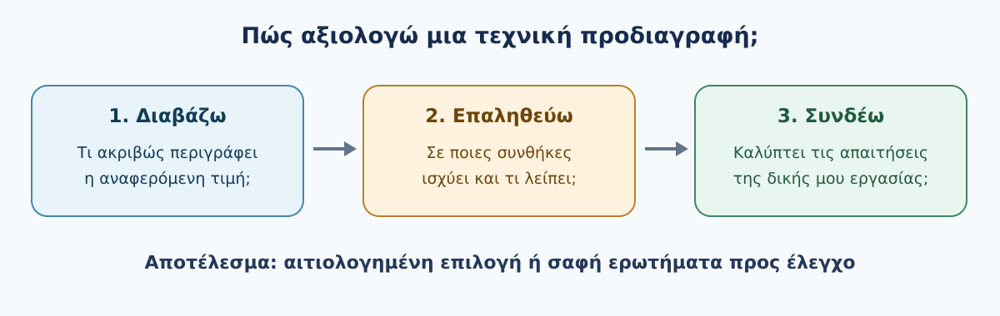

*Σχήμα 2.5 — Διαβάζουμε την τιμή, εξετάζουμε τις συνθήκες στις οποίες ισχύει και ελέγχουμε τη συνάφειά της με την εργασία. Πρωτότυπο εκπαιδευτικό διάγραμμα GeoSkills.*

### 4. Ένας πρακτικός κανόνας τριών ερωτήσεων

Για κάθε σημαντική προδιαγραφή, ρώτησε:

1. **Τι ακριβώς μετρά ή περιγράφει;** Για παράδειγμα, «μέγιστος χρόνος πτήσης» δεν σημαίνει «χρόνος λήψεων πάνω από την περιοχή».
2. **Υπό ποιες συνθήκες ισχύει;** Το βάρος του αισθητήρα, ο άνεμος και οι ρυθμίσεις μπορούν να αλλάξουν την πραγματική απόδοση.
3. **Γιατί έχει σημασία στην εργασία μου;** Μια εντυπωσιακή τιμή μπορεί να είναι άσχετη με το ζητούμενο παραδοτέο.

### 5. Δραστηριότητα — Ελέγχω τέσσερις ισχυρισμούς

Σε μια παρουσίαση εξοπλισμού διαβάζεις τις εξής φράσεις:

- «Πετά έως 60 λεπτά».
- «Έχει εμβέλεια 15 km».
- «Διαθέτει κάμερα υψηλής ανάλυσης».
- «Προσφέρει ακρίβεια εκατοστών χάρη στο RTK».

**Εργασία:** Γράψε μία ερώτηση επαλήθευσης για κάθε φράση και εξήγησε με μία πρόταση γιατί είναι σημαντική. Μην αναζητήσεις ακόμη συγκεκριμένο εμπορικό μοντέλο.

Ενδεικτική λύση — άνοιξέ τη αφού προσπαθήσεις

- **60 λεπτά:** Με ποιο ωφέλιμο φορτίο και σε ποιες συνθήκες μετρήθηκαν; Για τον σχεδιασμό πρέπει να υπολογίσουμε και την επιστροφή με κατάλληλο περιθώριο.
- **15 km:** Πρόκειται για θεωρητική/δοκιμαστική απόσταση επικοινωνίας ή κατάλληλη επιχειρησιακή απόσταση; Η τεχνική εμβέλεια δεν υποκαθιστά τους κανόνες και την εκτίμηση κινδύνου.
- **Υψηλή ανάλυση:** Ποια κάμερα και ποιος φακός χρησιμοποιούνται; Η ανάλυση από μόνη της δεν αρκεί για κατάλληλα φωτογραμμετρικά δεδομένα.
- **RTK:** Ποια ακρίβεια αφορά ο ισχυρισμός, με ποιες συνθήκες και ποια μέθοδο ελέγχου; Η ακρίβεια θέσης του drone δεν ταυτίζεται με ανεξάρτητα επαληθευμένη ακρίβεια του τελικού προϊόντος.

### 6. Γρήγορος αυτοέλεγχος

**Ερώτηση:** Ένα drone αναφέρει μέγιστο χρόνο πτήσης 45 λεπτών. Μπορείς να θεωρήσεις ότι διαθέτεις 45 λεπτά φωτογράφισης πάνω από την περιοχή;

Δες την απάντηση και την αιτιολόγηση

**Όχι.** Ο αναφερόμενος χρόνος εξαρτάται από τις συνθήκες και δεν ισούται με τον διαθέσιμο χρόνο λήψεων. Υπολογίζονται επίσης η μετάβαση, η επιστροφή και το κατάλληλο περιθώριο ασφαλείας. Η οργανωμένη εκτίμηση χρόνου αναπτύσσεται στην DM00.2.6.

### Τι κρατάμε

Δεν επιλέγουμε drone μόνο από τη μεγαλύτερη τιμή σε ένα τεχνικό φυλλάδιο. Συνδέουμε τις **απαιτήσεις της εργασίας** με τις **πραγματικά τεκμηριωμένες δυνατότητες** του εξοπλισμού και σημειώνουμε όσα χρειάζονται επαλήθευση. Στην επόμενη υποενότητα θα δούμε πώς ο χρόνος πτήσης συνδέεται με τη συνολική διάρκεια μιας αποστολής.

---

## 2.6 — Μπαταρίες και πραγματικός χρόνος αποστολής

### Τι θα μάθεις

Στο τέλος θα μπορείς να διακρίνεις τον αναφερόμενο χρόνο πτήσης από τον χρόνο που απομένει για φωτογράφιση, να υπολογίζεις απλά τον αριθμό πτήσεων και να οργανώνεις τη χρήση μπαταριών χωρίς να εξαντλείς τα περιθώρια ασφαλείας.

### 1. Η αυτονομία δεν είναι όλη διαθέσιμη για φωτογράφιση

Ένα drone μπορεί να αναφέρεται ότι πετά **έως 35 λεπτά**. Αυτό δεν σημαίνει ότι μπορείς να φωτογραφίζεις την περιοχή για 35 λεπτά. Μέρος του χρόνου απαιτείται για τη μετάβαση από το ασφαλές σημείο απογείωσης στην περιοχή ενδιαφέροντος, την επιστροφή και την προσγείωση. Επίσης χρειάζεται **κατάλληλο περιθώριο μπαταρίας**, ώστε η αποστολή να μη σχεδιάζεται μέχρι την πλήρη εξάντληση.

Στον πραγματικό σχεδιασμό, ο διαθέσιμος χρόνος μεταβάλλεται με τον άνεμο, τη θερμοκρασία, την ηλικία της μπαταρίας, το φορτίο, την ταχύτητα και τη διαδρομή. Το εγχειρίδιο του συγκεκριμένου συστήματος και οι ενδείξεις κατά την πτήση έχουν προτεραιότητα από έναν γενικό υπολογισμό.

### 2. Ένα λυμένο παράδειγμα

Για να εξασκηθούμε, υποθέτουμε **ενδεικτικά** ότι ένα drone έχει μέγιστη αναφερόμενη διάρκεια 35 λεπτών και ότι, για τις συνθήκες της συγκεκριμένης άσκησης, επιλέγεται προγραμματισμένο περιθώριο **5 λεπτών**. Δεν πρόκειται για καθολικό ή προτεινόμενο όριο ασφαλείας.

| Τμήμα πτήσης | Χρόνος |
|---|---:|
| Μετάβαση στην περιοχή | 6 λεπτά |
| Φωτογράφιση της περιοχής | 18 λεπτά |
| Επιστροφή και προσγείωση | 6 λεπτά |
| **Προβλεπόμενη διάρκεια πτήσης** | **30 λεπτά** |
| **Περιθώριο που δεν προγραμματίζουμε να χρησιμοποιήσουμε** | **5 λεπτά** |

Στο συγκεκριμένο παράδειγμα, ο χρόνος φωτογράφισης είναι **18 λεπτά**, όχι 35. Το περιθώριο των 5 λεπτών είναι εκπαιδευτική υπόθεση: στην πράξη δεν ορίζεται αυθαίρετα από έναν γενικό κανόνα και δεν θεωρείται εγγύηση ασφαλούς επιστροφής.

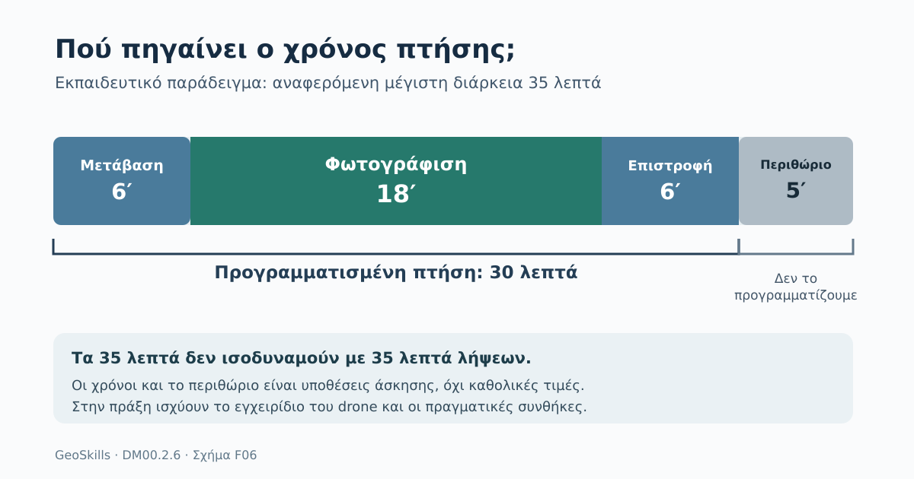

*Σχήμα 2.6 — Ενδεικτικός σχεδιασμός διάρκειας. Τα 30 λεπτά αφορούν προγραμματισμένες φάσεις πτήσης· τα 5 λεπτά αποτελούν μη προγραμματισμένο περιθώριο, όχι πρόσθετη εργασία.*

### 3. Πότε χρειάζονται περισσότερες μπαταρίες;

Ας υποθέσουμε ότι οι απαιτούμενες λήψεις μιας περιοχής θα διαρκέσουν συνολικά **26 λεπτά**, ενώ κάθε πτήση μπορεί, με τις παραπάνω εκπαιδευτικές παραδοχές, να διαθέσει **έως 18 λεπτά για φωτογράφιση**.

Μία πτήση δεν επαρκεί. Μπορούμε να σχεδιάσουμε δύο:

- **Πρώτη πτήση:** 18 λεπτά φωτογράφισης, 6 μετάβαση και 6 επιστροφή = 30 λεπτά πτήσης.
- **Δεύτερη πτήση:** 8 λεπτά φωτογράφισης, 6 μετάβαση και 6 επιστροφή = 20 λεπτά πτήσης.

Έτσι απαιτούνται **δύο διαθέσιμες, κατάλληλα φορτισμένες μπαταρίες**, εφόσον το drone χρησιμοποιεί μία μπαταρία ανά πτήση και τα υπόλοιπα δεδομένα της άσκησης ισχύουν. Αν η αλλαγή μπαταρίας απαιτεί **8 λεπτά**, ο συνολικός χρόνος από την πρώτη απογείωση έως τη δεύτερη προσγείωση είναι κατ' ελάχιστον **30 + 8 + 20 = 58 λεπτά**, χωρίς την αρχική προετοιμασία ή απρόβλεπτες καθυστερήσεις.

Στην πράξη ενδέχεται να χρειάζονται επιπλέον μπαταρίες, εφεδρείες, στάσεις και επανασχεδιασμός. Τα συστήματα που χρησιμοποιούν περισσότερες από μία μπαταρίες ανά πτήση απαιτούν διαφορετικό υπολογισμό.

### 4. Πριν πας στο πεδίο

Έλεγξε ότι έχεις καταγράψει: τις απαιτήσεις του παραδοτέου, τον ρεαλιστικό χρόνο μετάβασης και επιστροφής, τις μπαταρίες που χρειάζεται το συγκεκριμένο μοντέλο, τον χρόνο αλλαγής και φόρτισης, τα διαθέσιμα ασφαλή σημεία προσγείωσης και τις συνθήκες που μπορεί να επιβάλουν πρόωρη διακοπή. **Δεν επιδιώκουμε να πετάξουμε μέχρι να αδειάσει η μπαταρία.**

### 5. Δραστηριότητα — Σχεδίασε δύο πτήσεις

Για μία μικρή φωτογραμμετρική αποστολή έχεις τα ακόλουθα **υποθετικά δεδομένα**: μέγιστη αναφερόμενη διάρκεια 32 λεπτά, ενδεικτικό μη προγραμματισμένο περιθώριο 4 λεπτά, μετάβαση 5 λεπτά, επιστροφή 5 λεπτά και απαιτούμενος συνολικός χρόνος λήψεων 24 λεπτά. Η αλλαγή μπαταρίας διαρκεί 7 λεπτά. Το drone χρησιμοποιεί μία μπαταρία ανά πτήση.

**Υπολόγισε:** (α) τα μέγιστα λεπτά λήψεων ανά πτήση σύμφωνα με τις παραδοχές, (β) τον απαιτούμενο αριθμό πτήσεων/μπαταριών, (γ) τον ελάχιστο συνολικό χρόνο από την πρώτη απογείωση έως την τελευταία προσγείωση, με μία αλλαγή μπαταρίας. Πρόκειται για άσκηση αριθμητικού σχεδιασμού, όχι σχέδιο ασφαλούς πραγματικής πτήσης.

Ενδεικτική λύση — άνοιξέ τη αφού προσπαθήσεις

- **(α)** Προγραμματισμένος χρόνος: 32 − 4 = 28 λεπτά. Για λήψεις απομένουν **28 − 5 − 5 = 18 λεπτά ανά πλήρη πτήση**.
- **(β)** Απαιτούνται **δύο πτήσεις**: στην πρώτη 18 λεπτά λήψεων και στη δεύτερη 6. Χρειαζόμαστε δύο διαθέσιμες μπαταρίες για το συγκεκριμένο υποθετικό σύστημα.
- **(γ)** Πρώτη πτήση: 5 + 18 + 5 = 28 λεπτά. Δεύτερη: 5 + 6 + 5 = 16 λεπτά. Με μία αλλαγή 7 λεπτών, ο ελάχιστος συνολικός χρόνος είναι **28 + 7 + 16 = 51 λεπτά**.

Σημαντικό: Δεν προσθέτουμε το μη προγραμματισμένο περιθώριο ως χρόνο εργασίας. Ο πραγματικός επιχειρησιακός σχεδιασμός απαιτεί επανέλεγχο των παραδοχών και των οδηγιών του κατασκευαστή.

### 6. Γρήγορος αυτοέλεγχος

**Ερώτηση:** Μια αποστολή χρειάζεται 25 λεπτά λήψεων και το drone διαφημίζει 30 λεπτά μέγιστης πτήσης. Μπορούμε να θεωρήσουμε ότι μία μπαταρία αρκεί;

Δες την απάντηση και την αιτιολόγηση

**Όχι χωρίς πρόσθετα στοιχεία.** Πρέπει να υπολογίσουμε μετάβαση, επιστροφή, κατάλληλο περιθώριο, πραγματικές συνθήκες και τις δυνατότητες του συγκεκριμένου συστήματος. Η τιμή «30 λεπτά» από μόνη της δεν επιβεβαιώνει επάρκεια.

### Τι κρατάμε

Για να προγραμματίσουμε μια αποστολή, υπολογίζουμε **ολόκληρο τον κύκλο πτήσης**, όχι μόνο τα λεπτά λήψεων. Προβλέπουμε διαθέσιμες μπαταρίες και χρόνο αλλαγής, αλλά επανεξετάζουμε το σχέδιο βάσει των πραγματικών συνθηκών και των οδηγιών ασφαλούς λειτουργίας. Στην επόμενη υποενότητα θα δούμε τι άλλο πρέπει να διαθέτει ένα drone για να είναι κατάλληλο για χαρτογράφηση.

---

## 2.7 — Τι κάνει ένα drone κατάλληλο για χαρτογράφηση;

### Τι θα μάθεις

Μετά τη μελέτη θα μπορείς να εξηγείς γιατί ένα drone που βγάζει καλές φωτογραφίες δεν είναι απαραίτητα κατάλληλο για χαρτογράφηση, να αναγνωρίζεις πέντε κρίσιμες απαιτήσεις και να αξιολογείς μια απλή περιγραφή εξοπλισμού.

### 1. Η καλή φωτογραφία δεν αρκεί

Φαντάσου ότι πρέπει να παραδώσεις έναν ορθοφωτοχάρτη αγροτικής περιοχής. Ένα drone με κάμερα υψηλής ανάλυσης μπορεί να τραβήξει εντυπωσιακές φωτογραφίες. Αν όμως δεν εξασφαλίζει **συστηματική κάλυψη**, **αρκετή επικάλυψη**, **σταθερή ποιότητα λήψεων** και τις αναγκαίες πληροφορίες για την επεξεργασία, το αποτέλεσμα μπορεί να είναι ακατάλληλο.

Στη χαρτογράφηση αξιολογούμε **ολόκληρο το σύστημα και τη διαδικασία**, όχι μόνο τον αριθμό των megapixel.

### 2. Πέντε ερωτήσεις πριν επιλέξουμε εξοπλισμό

#### 2.7.1 Μπορεί η κάμερα να συλλέξει τις σωστές εικόνες;

Εξετάζουμε την πραγματική ποιότητα εικόνας, τον φακό, την εστίαση, την έκθεση και τον τρόπο ενεργοποίησης της λήψης. Για τη φωτογραμμετρία μάς ενδιαφέρουν εικόνες καθαρές και επαρκώς συνεπείς μεταξύ τους. Ελέγχουμε επίσης αν η κάμερα είναι συμβατή με την πλατφόρμα και το λογισμικό επεξεργασίας.

Η ύπαρξη μηχανικού κλείστρου μπορεί να είναι πλεονέκτημα σε συγκεκριμένες αποστολές, αλλά **δεν είναι από μόνη της εγγύηση ποιότητας**. Μετρά ο συνδυασμός κάμερας, συνθηκών και τρόπου λήψης.

#### 2.7.2 Μπορεί το drone να ακολουθήσει κατάλληλο σχέδιο λήψεων;

Χρειαζόμαστε προβλέψιμη κάλυψη της περιοχής με διαδοχικές, επικαλυπτόμενες εικόνες. Είναι χρήσιμη η δυνατότητα σχεδιασμού διαδρομών, ρύθμισης συχνότητας λήψεων και παρακολούθησης της αποστολής. Αυτό δεν σημαίνει ότι **κάθε** χαρτογραφική αποστολή απαιτεί πλήρως αυτόματη πτήση· σημαίνει ότι πρέπει να μπορούμε να εξασφαλίσουμε και να ελέγξουμε το σχέδιο συλλογής.

#### 2.7.3 Ξέρουμε πού και πώς λήφθηκαν οι εικόνες;

Οι πληροφορίες θέσης και χρόνου λήψης, μαζί με τα απαραίτητα μεταδεδομένα κάμερας, βοηθούν την οργάνωση και την επεξεργασία. Το GNSS μπορεί να παρέχει αρχικές θέσεις εικόνων· τα RTK/PPK μπορούν, όταν υποστηρίζονται και εφαρμόζονται σωστά, να βελτιώσουν τη γεωχωρική τεκμηρίωση.

**Προσοχή:** GNSS ή RTK δεν συνεπάγεται αυτομάτως ορθοφωτοχάρτη ακρίβειας εκατοστών. Η πραγματική ακρίβεια απαιτεί κατάλληλη διαδικασία και, όπου χρειάζεται, ανεξάρτητο έλεγχο.

#### 2.7.4 Μπορεί να ολοκληρώσει την αποστολή στις πραγματικές συνθήκες;

Ελέγχουμε την αυτονομία, τον αριθμό διαθέσιμων μπαταριών, την επιτρεπόμενη λειτουργία στον άνεμο, τον χώρο απογείωσης και επιστροφής, τα εμπόδια και τους επιχειρησιακούς περιορισμούς. Μια άριστη κάμερα δεν βοηθά εάν η πτήση δεν μπορεί να γίνει νόμιμα και με ασφάλεια.

#### 2.7.5 Μπορούμε να επεξεργαστούμε και να ελέγξουμε τα δεδομένα;

Πριν από τη λήψη πρέπει να γνωρίζουμε αν τα αρχεία ανοίγουν στο επιλεγμένο λογισμικό, αν διατηρούν τα αναγκαία μεταδεδομένα και αν μπορούμε να εκτελέσουμε βασικούς ελέγχους πληρότητας και ποιότητας. Στόχος είναι **το χρήσιμο παραδοτέο**, όχι η απλή συγκέντρωση φωτογραφιών.

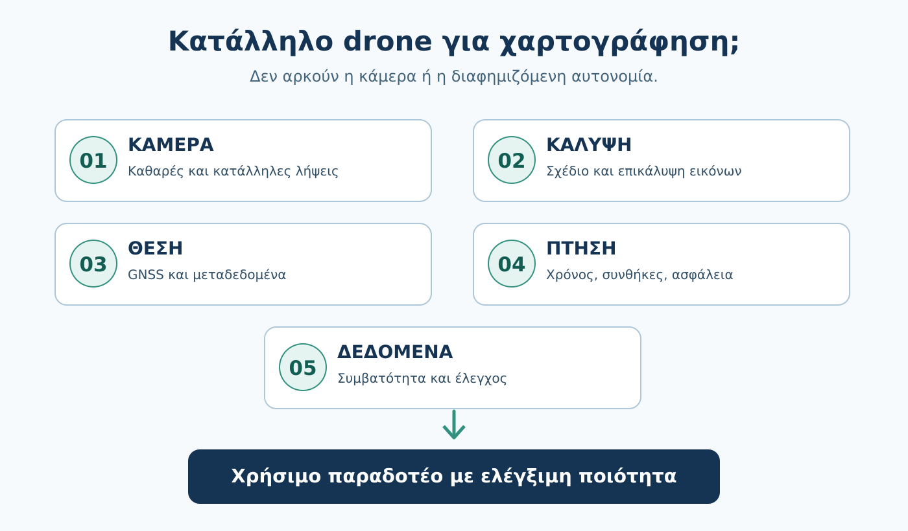

*Σχήμα 2.7 — Πέντε συμπληρωματικοί έλεγχοι που συνδέουν την πλατφόρμα και τις λήψεις με το τελικό χαρτογραφικό προϊόν. Η σειρά είναι εκπαιδευτική, όχι αυστηρή επιχειρησιακή διαδικασία.*

### 3. Παράδειγμα: δύο υποθετικά drones

Θέλουμε πρόσφατο ορθοφωτοχάρτη μιας μικρής αγροτικής περιοχής. Έχουμε δύο **υποθετικές** επιλογές:

| Χαρακτηριστικό | Drone Α | Drone Β |
|---|---|---|
| Κάμερα | 48 MP, χωρίς άλλα στοιχεία | 20 MP, με τεκμηριωμένα χαρακτηριστικά λήψης |
| Σχέδιο επικαλυπτόμενων λήψεων | Δεν επιβεβαιώνεται | Υποστηρίζεται |
| Θέσεις/μεταδεδομένα εικόνων | Άγνωστα | Διατίθενται |
| Συμβατότητα με λογισμικό | Άγνωστη | Έχει ελεγχθεί |
| Επιχειρησιακή καταλληλότητα | Δεν έχει αξιολογηθεί | Πρέπει ακόμη να αξιολογηθεί στο πεδίο |

**Ποιο διαλέγουμε;** Δεν μπορούμε να εγκρίνουμε οριστικά κανένα χωρίς έλεγχο συνθηκών και απαιτήσεων. Το Β είναι όμως *καλύτερα τεκμηριωμένος υποψήφιος* για τη συγκεκριμένη εργασία. Τα 48 MP του Α, από μόνα τους, δεν αρκούν.

### 4. Δραστηριότητα — Έλεγχος καταλληλότητας

Ένας προμηθευτής περιγράφει ένα drone ως εξής:

> «Κάμερα 40 MP, μέγιστη αυτονομία 40 λεπτά, GPS και σταθεροποιημένο gimbal. Κατάλληλο για επαγγελματική φωτογράφιση.»

**Αποστολή:** Πρόκειται να φωτογραφίσεις μια αγροτική περιοχή για παραγωγή ορθοφωτοχάρτη.

1. Γράψε **τέσσερα στοιχεία που λείπουν** από την περιγραφή και θα ζητούσες πριν αποφασίσεις.
2. Εξήγησε γιατί τα «40 MP» και το «GPS» δεν αρκούν ως απόδειξη χαρτογραφικής καταλληλότητας.
3. Διατύπωσε την προσωρινή σου απόφαση: *κατάλληλο*, *ακατάλληλο* ή *χρειάζονται περισσότερα στοιχεία*.

Ενδεικτική λύση — άνοιξέ τη αφού προσπαθήσεις

Ενδεικτικά ζητάμε: (α) δυνατότητα προγραμματισμού ή αξιόπιστης εκτέλεσης επικαλυπτόμενων λήψεων, (β) χαρακτηριστικά κάμερας και ποιότητα εικόνων στις προβλεπόμενες συνθήκες, (γ) μεταδεδομένα/γεωσήμανση και απαιτήσεις γεωαναφοράς, (δ) συμβατότητα μορφών αρχείων με τη φωτογραμμετρική επεξεργασία. Επιπλέον θα ελέγχαμε αυτονομία στην πράξη, συνθήκες πτήσης και ασφάλεια.

Τα **40 MP** περιγράφουν μόνο ένα μέρος της κάμερας. Το **GPS** δεν αποδεικνύει την ακρίβεια του τελικού ορθοφωτοχάρτη. Επομένως η τεκμηριωμένη προσωρινή απάντηση είναι **«χρειάζονται περισσότερα στοιχεία»**.

### 5. Γρήγορος αυτοέλεγχος

**Ερώτηση 1:** Ένα drone έχει RTK. Μπορούμε να δηλώσουμε χωρίς άλλον έλεγχο ότι ο ορθοφωτοχάρτης του έχει ακρίβεια 2 cm;

Απάντηση και αιτιολόγηση

**Όχι.** Πρέπει να γνωρίζουμε πώς έγινε η γεωαναφορά, ποια είναι η ποιότητα των λήψεων, πώς πραγματοποιήθηκε η επεξεργασία και πώς ελέγχθηκε ανεξάρτητα η ακρίβεια.

**Ερώτηση 2:** Γιατί μας ενδιαφέρει η επικάλυψη φωτογραφιών;

Απάντηση και αιτιολόγηση

Επειδή οι κοινές περιοχές στις εικόνες επιτρέπουν στη φωτογραμμετρική επεξεργασία να εντοπίσει αντιστοιχίες και να ανακατασκευάσει τη γεωμετρία της περιοχής. Η απαιτούμενη επικάλυψη εξαρτάται από το αντικείμενο και τις συνθήκες της αποστολής.

### Τι κρατάμε

Ένα drone είναι κατάλληλο για χαρτογράφηση όταν **κάμερα, σχέδιο λήψεων, πληροφορίες θέσης, επιχειρησιακές δυνατότητες και επεξεργασία δεδομένων** συνεργάζονται ώστε να παραχθεί το απαιτούμενο προϊόν με ελέγξιμη ποιότητα. Στην επόμενη υποενότητα θα εφαρμόσουμε αυτά τα κριτήρια στην επιλογή εξοπλισμού για τη δική μας εκπαιδευτική αποστολή των 25 ha.

---

## 2.8 — Επιλέγω drone για μια πραγματική εργασία

> **GeoSkills · Drones & Drone Mapping Core**
> Οδηγός αυτοδιδασκαλίας · Πρώτο εκπαιδευτικό προσχέδιο v0.1

### Τι θα μπορείς να κάνεις

Στο τέλος αυτής της υποενότητας θα μπορείς να προτείνεις μια **κατηγορία drone** για συγκεκριμένη εργασία, να εξηγείς γιατί δεν προτείνεις τις άλλες και να καταγράφεις ποια στοιχεία χρειάζεσαι πριν οριστικοποιήσεις την επιλογή. Δεν χρειάζεται να γνωρίζεις εμπορικά μοντέλα ή να έχεις πετάξει drone.

### 1. Η επιλογή ξεκινά από την εργασία

Ένα πολυκόπτερο μπορεί να αιωρείται κοντά σε μια κατασκευή. Ένα συμβατικό αεροσκάφος σταθερής πτέρυγας μπορεί να καλύψει αποτελεσματικά μεγάλη περιοχή, όταν υπάρχουν κατάλληλες συνθήκες απογείωσης και ανάκτησης. Ένα υβριδικό VTOL συνδυάζει κατακόρυφη απογείωση με προωθητική πτήση, αλλά έχει και δικούς του τεχνικούς συμβιβασμούς.

Άρα δεν επιλέγεις «το καλύτερο drone». Επιλέγεις **αυτό που μπορεί να ανταποκριθεί στο δικό σου αίτημα**. Ακόμη και η απόφαση να *μη χρησιμοποιηθεί drone* μπορεί να είναι σωστή, εάν υπάρχουν επαρκή πρόσφατα δεδομένα ή δεν μπορούν να ικανοποιηθούν οι προϋποθέσεις της αποστολής.

### 2. Τρία σύντομα βήματα για μια τεκμηριωμένη επιλογή

**Βήμα 1 — Κατέγραψε τις απαραίτητες απαιτήσεις.** Τι θέλουμε να παραδώσουμε; Πόση έκταση πρέπει να καλυφθεί; Χρειαζόμαστε αιώρηση; Υπάρχει χώρος για απογείωση/ανάκτηση; Τι ποιότητα εικόνων και ποια στοιχεία θέσης χρειάζονται;

**Βήμα 2 — Έλεγξε πρώτα τους όρους που αποκλείουν μια λύση.** Μπορεί να πραγματοποιηθεί νόμιμα και με ασφάλεια η αποστολή; Υπάρχει κατάλληλος χώρος; Υποστηρίζονται οι απαιτούμενες λήψεις και η επεξεργασία; Αν ένα κρίσιμο στοιχείο είναι άγνωστο, σημείωσε **«δεν έχει επιβεβαιωθεί»** αντί να υποθέσεις ότι πληρούται.

**Βήμα 3 — Σύγκρινε τις εφικτές επιλογές.** Μόνο αφού ελέγξεις τα απαραίτητα, εξέτασε επιθυμητά χαρακτηριστικά: λιγότερες αλλαγές μπαταρίας, ευκολότερη μεταφορά, κόστος, ευελιξία και διαθεσιμότητα υποστήριξης. Η καλύτερη θεωρητική αυτονομία δεν αντισταθμίζει έναν ανεπαρκή χώρο ανάκτησης ή μια ακατάλληλη κάμερα.

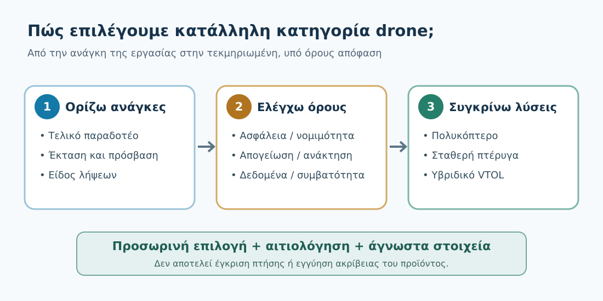

*Σχήμα F08. Διαδρομή από το αίτημα στην υπό όρους επιλογή εξοπλισμού. Δεν είναι διάγραμμα κανονιστικής έγκρισης πτήσης.*

### 3. Τρία παραδείγματα — διαφορετικές ανάγκες

| Εργασία | Πιθανή αρχική επιλογή | Τι πρέπει να ελεγχθεί |
|---|---|---|
| Φωτογράφιση μικρού εργοταξίου, με ανάγκη αιώρησης | Πολυκόπτερο | Ασφαλείς αποστάσεις, χώρος λειτουργίας, κατάλληλη κάμερα και νόμιμη δυνατότητα πτήσης |
| Χαρτογράφηση πολύ εκτεταμένης ενιαίας καλλιεργούμενης έκτασης | Fixed-wing ή VTOL ως υποψήφια | Κάλυψη, ανάγλυφο, χώροι απογείωσης/ανάκτησης, κόστος και απαιτήσεις δεδομένων |
| Εκτεταμένη περιοχή χωρίς κατάλληλο χώρο συμβατικής απογείωσης | VTOL ως υποψήφιο | Πραγματική δυνατότητα κατακόρυφης λειτουργίας στον χώρο, μεταβάσεις πτήσης, αυτονομία και ασφαλής προσγείωση |

**Προσοχή:** Ο πίνακας δείχνει αρχικές υποθέσεις, όχι αυτόματες αποφάσεις. Για παράδειγμα, ούτε κάθε VTOL είναι κατάλληλο για περιορισμένο χώρο ούτε κάθε fixed-wing είναι καλύτερο για οποιαδήποτε μεγάλη περιοχή.

### 4. Η δική σου εκπαιδευτική αποστολή: αγροτική περιοχή 25 ha

Στην DM00.1.8 ο φορέας ζήτησε πρόσφατο χαρτογραφικό υπόβαθρο μιας **υποθετικής** αγροτικής περιοχής περίπου **25 ha**, για να αναγνωρίζει προσβάσεις, κτίσματα και άλλα ορατά χαρακτηριστικά και να χρησιμοποιεί το αποτέλεσμα σε GIS.

**Τι γνωρίζουμε:** τη γενική έκταση, την αγροτική χρήση και τον επιθυμητό τύπο αποτελέσματος. **Τι δεν γνωρίζουμε:** το ακριβές περίγραμμα, το ανάγλυφο και τα εμπόδια, τις απαιτήσεις ακρίβειας, την πρόσβαση, τους περιορισμούς πτήσης και τις υπάρχουσες πηγές δεδομένων.

Για μια τέτοια **σχετικά μικρή** περιοχή, ένα **πολυκόπτερο με κατάλληλη φωτογραφική και χαρτογραφική υποστήριξη** αποτελεί λογική *πρώτη υποψήφια επιλογή*. Δεν είναι όμως οριστική: πρέπει να επιβεβαιωθεί ότι μπορεί να επιτευχθεί η απαιτούμενη κάλυψη με τις διαθέσιμες μπαταρίες και ότι οι συνθήκες επιτρέπουν τη χρήση του. Αντίστοιχα, ένα VTOL ή fixed-wing δεν αποκλείεται εκ των προτέρων, αλλά πρέπει να δικαιολογεί τις δικές του επιχειρησιακές απαιτήσεις.

Η **γεωαναφορά και η ακρίβεια του τελικού ορθοφωτοχάρτη** δεν τεκμηριώνονται απλώς από την κατηγορία drone. Θα εξεταστούν στα επόμενα κεφάλαια.

### 5. Δραστηριότητα — Καρτέλα 02: αιτιολογημένη επιλογή

Άνοιξε την **Καρτέλα 02** στον φάκελο εργασίας σου. Χρησιμοποίησε τις πληροφορίες της Καρτέλας 01 και συμπλήρωσε:

1. Τη βασική ανάγκη και το πιθανό παραδοτέο.
2. **Τρία απαραίτητα κριτήρια** επιλογής εξοπλισμού.
3. Μια προτεινόμενη κατηγορία drone και **δύο λόγους** για την επιλογή.
4. Μια άλλη κατηγορία και έναν λόγο για τον οποίο μπορεί να είναι λιγότερο πρακτική σε αυτό το σενάριο.
5. **Τέσσερις άγνωστες πληροφορίες** που πρέπει να εξακριβωθούν πριν αποφασιστεί η πραγματική αποστολή.

Μην επινοήσεις αριθμητικές επιδόσεις drone. Χαρακτήρισε την απόφαση **«προσωρινή»**, εκτός εάν διαθέτεις επαρκή στοιχεία.

Δες την ενδεικτική λύση αφού συμπληρώσεις την καρτέλα

**Παραδοτέο:** πρόσφατο ορθοφωτογραφικό υπόβαθρο για οπτική εποπτεία και χρήση σε GIS. **Απαραίτητα:** δυνατότητα συστηματικών επικαλυπτόμενων λήψεων, κατάλληλα αρχεία/μεταδεδομένα και δυνατότητα ασφαλούς ολοκλήρωσης της εργασίας. **Πρώτη υποψήφια κατηγορία:** πολυκόπτερο, επειδή η περιοχή είναι σχετικά μικρή και η κατακόρυφη απογείωση διευκολύνει ενδεχομένως την επιχειρησιακή οργάνωση. **Εναλλακτική:** σταθερή πτέρυγα, η οποία ενδέχεται να έχει πλεονεκτήματα κάλυψης, αλλά χρειάζεται κατάλληλο τρόπο απογείωσης και ανάκτησης. **Άγνωστα:** ακριβής θέση και όρια, εμπόδια/ανάγλυφο, απαιτούμενη ακρίβεια και επιτρεπτότητα πτήσης (ενδεικτικά). **Συμπέρασμα:** προσωρινή επιλογή, όχι έγκριση πτήσης ή εγγύηση αποτελέσματος.

**Αυτοέλεγχος:** Αναφέρεις απαιτήσεις και όχι μόνο τεχνικά χαρακτηριστικά; Έχεις δικαιολογήσει την επιλογή και αναγνωρίσει τι δεν γνωρίζεις; Αν ναι, έχεις ολοκληρώσει τον σκοπό της δραστηριότητας.

### 6. Δύο ερωτήσεις αυτοελέγχου

**Ερώτηση Α.** Για μια μεγάλη περιοχή, ένα fixed-wing δηλώνει μεγαλύτερη αυτονομία από ένα πολυκόπτερο. Είναι αυτομάτως η σωστή επιλογή;

Απάντηση και αιτιολόγηση

**Όχι.** Πρέπει να ελέγξουμε τον χώρο απογείωσης/ανάκτησης, τις απαιτήσεις λήψης και τον αισθητήρα, τις συνθήκες και τους περιορισμούς της αποστολής. Η αυτονομία είναι μόνο ένα κριτήριο.

**Ερώτηση Β.** Για τα 25 ha, γιατί δεν γράφουμε ακόμη συγκεκριμένο μοντέλο, ύψος πτήσης και αριθμό μπαταριών;

Απάντηση και αιτιολόγηση

**Επειδή δεν έχουμε επαρκή στοιχεία.** Χρειαζόμαστε συγκεκριμένη περιοχή, εξοπλισμό, απαιτήσεις εικόνων/ποιότητας, συνθήκες και επιχειρησιακούς περιορισμούς. Οι υπολογισμοί και ο πλήρης σχεδιασμός γίνονται σε επόμενες ενότητες.

### Τι κρατάμε από την DM00.2

Η επιλογή drone είναι **τεκμηριωμένη απόφαση για συγκεκριμένη εργασία**, όχι κατάταξη δημοφιλών μοντέλων. Πρώτα ελέγχουμε αν μια λύση μπορεί να καλύψει τις απαραίτητες απαιτήσεις, μετά συγκρίνουμε τις επιθυμητές δυνατότητες και, τέλος, δηλώνουμε τις αβεβαιότητες. Με την Καρτέλα 02 έχεις προσθέσει το δεύτερο μέρος στον προσωπικό σου φάκελο εργασίας.

---

## Τελική αυτοαξιολόγηση DM00.2

Απάντησε στις δέκα ερωτήσεις πριν ανοίξεις τις λύσεις. Κάθε σωστή απάντηση δίνει **1 βαθμό**, χωρίς αρνητική βαθμολογία. Η αυτοαξιολόγηση ελέγχει την κατανόηση των βασικών κριτηρίων επιλογής, όχι την πιστοποίηση ικανότητας χειρισμού drone.

**Ερώτηση 1.** Ποιο είναι το πρώτο βήμα πριν επιλέξουμε κατηγορία drone για ένα έργο;

Α. Να συγκρίνουμε εμπορικές μάρκες.
Β. Να προσδιορίσουμε τις απαιτήσεις και τα παραδοτέα της εργασίας.
Γ. Να επιλέξουμε το μοντέλο με τους περισσότερους κινητήρες.

**Ερώτηση 2.** Ποια δυνατότητα αποτελεί χαρακτηριστικό πλεονέκτημα ενός πολυκόπτερου σε επιθεώρηση συγκεκριμένου σημείου;

Α. Η δυνατότητα αιώρησης.
Β. Η ανάγκη συνεχούς προωθητικής πτήσης.
Γ. Η ανεξαρτησία από καιρικές συνθήκες.

**Ερώτηση 3.** Τι συμπεραίνουμε με ασφάλεια από το ότι ένα drone είναι οκτακόπτερο;

Α. Έχει απαραίτητα μεγαλύτερη αυτονομία από κάθε τετρακόπτερο.
Β. Είναι κατάλληλο για κάθε αισθητήρα.
Γ. Έχει οκτώ κινητήρες, όχι όμως αυτομάτως καλύτερες επιδόσεις.

**Ερώτηση 4.** Ποιο στοιχείο πρέπει να εξετάσουμε ιδιαίτερα πριν επιλέξουμε ένα συμβατικό fixed-wing;

Α. Αν διαθέτει επαρκή χώρο και κατάλληλο τρόπο απογείωσης και ανάκτησης.
Β. Αν μπορεί να αιωρείται χωρίς προωθητική κίνηση.
Γ. Αν διαθέτει οπωσδήποτε οκτώ έλικες.

**Ερώτηση 5.** Σε ποια πρόταση αποδίδεται σωστά η βασική ιδέα ενός υβριδικού VTOL;

Α. Η κατακόρυφη απογείωση και η δυνατότητα προωθητικής πτήσης συνδυάζονται σε μία πλατφόρμα.
Β. Δεν απαιτείται αξιολόγηση του χώρου προσγείωσης.
Γ. Όλα τα VTOL χρησιμοποιούν ακριβώς την ίδια αρχιτεκτονική μετάβασης.

**Ερώτηση 6.** Γιατί δεν αρκεί η αναφερόμενη μέγιστη διάρκεια πτήσης στο φυλλάδιο ενός drone;

Α. Επειδή η διάρκεια είναι πάντα ίδια σε κάθε αποστολή.
Β. Επειδή το φορτίο, οι συνθήκες, η επιστροφή και τα περιθώρια ασφαλείας επηρεάζουν τον διαθέσιμο χρόνο.
Γ. Επειδή ο χρόνος λήψεων είναι πάντα ίσος με τον μέγιστο χρόνο πτήσης.

**Ερώτηση 7.** Σε μια αποστολή με 26 λεπτά απαιτούμενων λήψεων και 18 λεπτά διαθέσιμα για λήψεις ανά πτήση, πόσες πτήσεις χρειάζονται τουλάχιστον, υπό τις δοσμένες παραδοχές;

Α. Μία.
Β. Δύο.
Γ. Τρεις.

**Ερώτηση 8.** Ποια δήλωση για την κάμερα και τη γεωαναφορά είναι ορθή;

Α. Τα πολλά megapixel αποδεικνύουν ακρίβεια εκατοστών.
Β. Η παρουσία RTK εγγυάται αυτόματα την ακρίβεια του τελικού ορθοφωτοχάρτη.
Γ. Η ποιότητα λήψεων, η γεωσήμανση, η επεξεργασία και ο έλεγχος πρέπει να εξετάζονται μαζί.

**Ερώτηση 9.** Γιατί οργανώνουμε λήψεις με επικάλυψη όταν επιδιώκουμε φωτογραμμετρικό προϊόν;

Α. Για να υπάρχουν κοινά χαρακτηριστικά μεταξύ των φωτογραφιών και να υποστηριχθεί η ανακατασκευή.
Β. Για να καταργηθεί κάθε ανάγκη ελέγχου ποιότητας.
Γ. Μόνο για να αυξηθεί ο αριθμός των αρχείων.

**Ερώτηση 10.** Στην κοινή εργασία των 25 ha λείπουν στοιχεία για τις απαιτήσεις ακρίβειας και τους περιορισμούς πτήσης. Ποιο είναι το τεκμηριωμένο συμπέρασμα;

Α. Επιλέγουμε οριστικά ένα συγκεκριμένο μοντέλο βάσει της έκτασης.
Β. Καταγράφουμε υποψήφια κατηγορία και τα στοιχεία που πρέπει να επαληθευτούν πριν από την τελική απόφαση.
Γ. Θεωρούμε δεδομένο ότι η πτήση επιτρέπεται.

Εμφάνιση απαντήσεων, εξηγήσεων και βαθμολόγησης

| Ερώτηση | Σωστή απάντηση | Γιατί |
|---|---|---|
| 1 | Β | Οι απαιτήσεις της εργασίας καθορίζουν την επιλογή πλατφόρμας. |
| 2 | Α | Η αιώρηση διευκολύνει ελεγχόμενες λήψεις σε συγκεκριμένο σημείο. |
| 3 | Γ | Ο αριθμός κινητήρων δεν αποδεικνύει καθολική υπεροχή. |
| 4 | Α | Η απογείωση και η ανάκτηση αποτελούν κρίσιμους περιορισμούς ενός συμβατικού fixed-wing. |
| 5 | Α | Το VTOL συνδυάζει κατακόρυφες φάσεις με προωθητική πτήση, με διαφορετικές πιθανές αρχιτεκτονικές. |
| 6 | Β | Η δηλωμένη μέγιστη διάρκεια δεν αποτελεί εγγυημένο χρόνο φωτογράφισης. |
| 7 | Β | 26 λεπτά λήψεων δεν χωρούν σε μία πτήση των 18 λεπτών· απαιτούνται τουλάχιστον δύο, υπό τις παραδοχές. |
| 8 | Γ | Η καταλληλότητα χαρτογράφησης κρίνεται από ολόκληρη τη ροή εργασίας και τον έλεγχο ποιότητας. |
| 9 | Α | Η επικάλυψη δημιουργεί κοινή πληροφορία ανάμεσα στις εικόνες. |
| 10 | Β | Χωρίς κρίσιμα δεδομένα, η τελική επιλογή παραμένει υπό όρους. |

**Βαθμολογία:** Μέτρησε τις σωστές απαντήσεις σου (0–10). Για κάθε λάθος, επέστρεψε στην αντίστοιχη υποενότητα και επανέλαβε τη σχετική δραστηριότητα. Η βαθμολογία είναι εργαλείο αυτοελέγχου, όχι άδεια εκτέλεσης πτήσεων.

## Συνέχεια της εκπαιδευτικής αποστολής

Συμπλήρωσε την [Καρτέλα 02 — Αιτιολογημένη επιλογή πλατφόρμας](fakelos_ergasias/DM00_Kartela_02_Epilogi_Platformas.md) και φύλαξέ την μαζί με την Καρτέλα 01.
