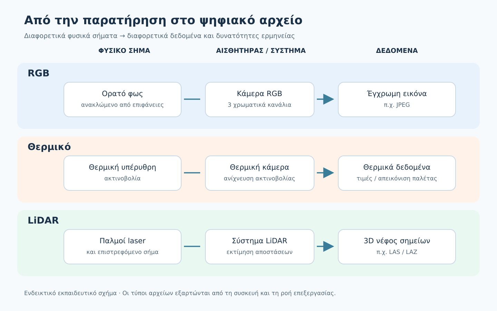
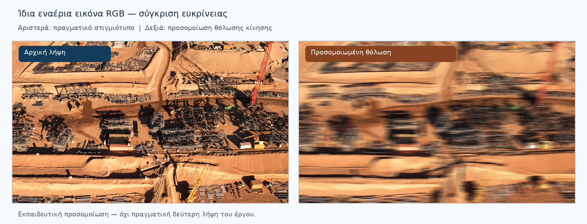
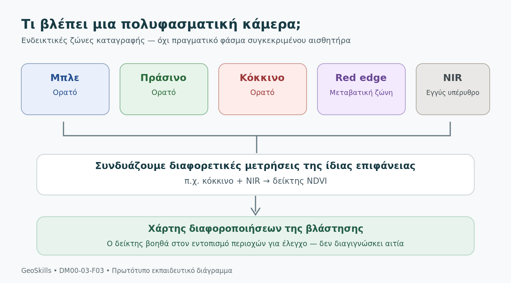
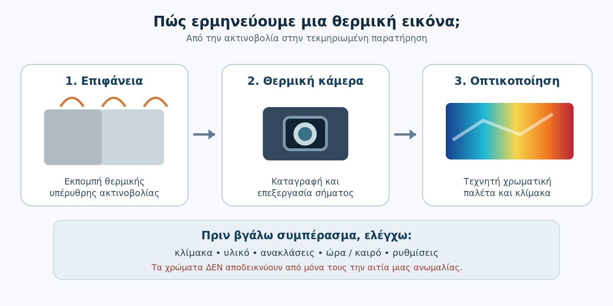
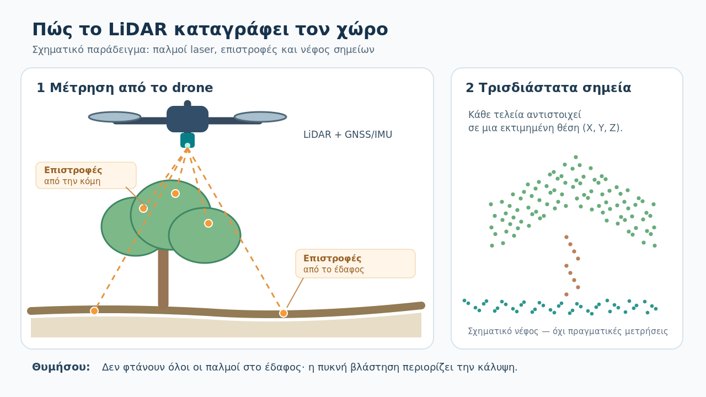
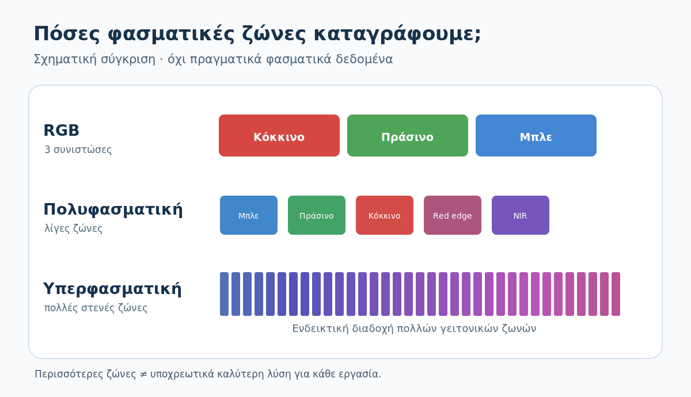
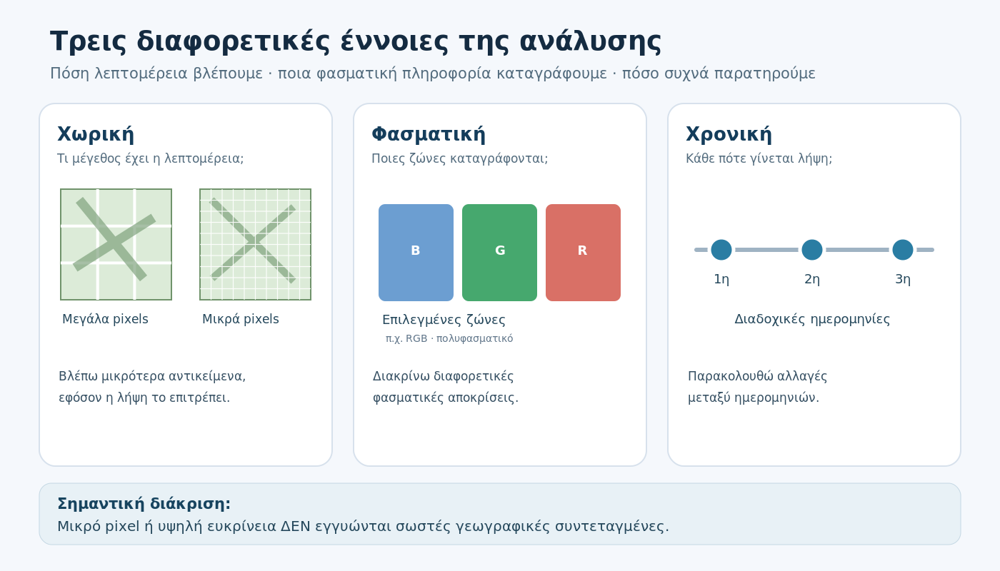
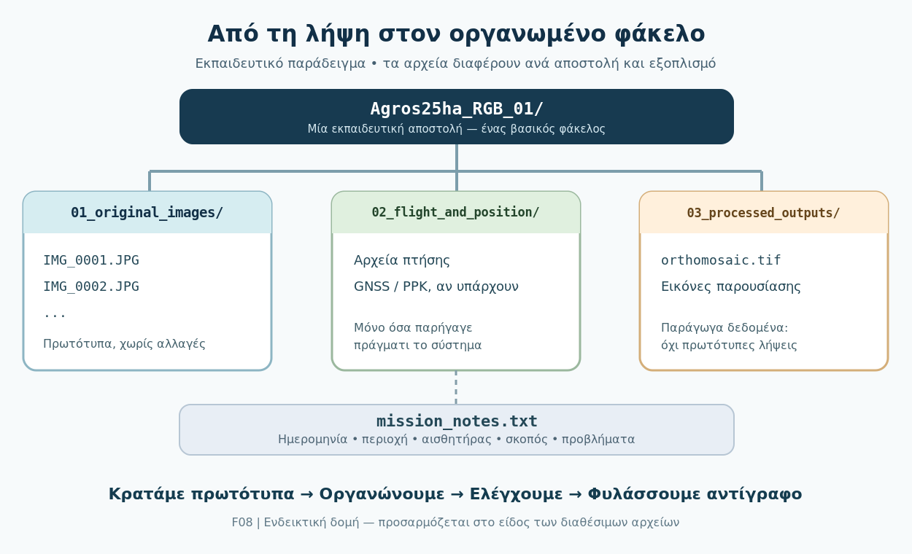
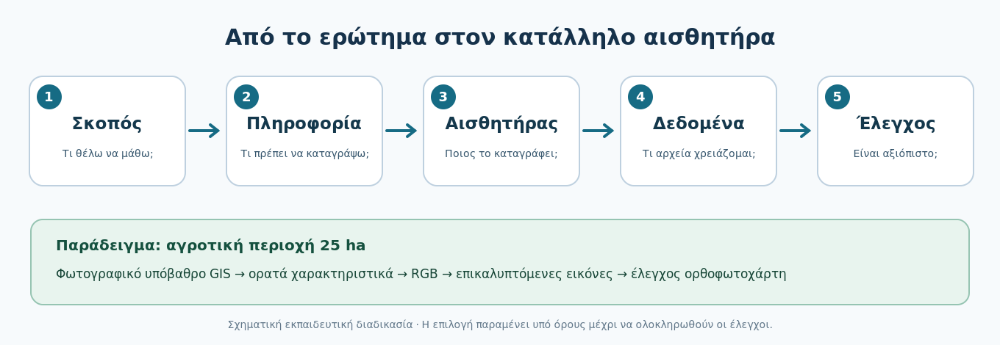

# DM00.3 — Κάμερες, αισθητήρες και δεδομένα

## Τι θα μάθεις σε αυτό το κεφάλαιο

Μετά το κεφάλαιο θα μπορείς να ξεχωρίζεις τι καταγράφουν διαφορετικοί αισθητήρες drone, να ερμηνεύεις βασικά παραδείγματα εικόνων και τρισδιάστατων δεδομένων, να οργανώνεις τα αρχεία μιας αποστολής και να αιτιολογείς μια επιλογή αισθητήρα. Δεν χρειάζονται προηγούμενες γνώσεις τηλεπισκόπησης.

**Η κοινή αποστολή:** Σε όλο το μάθημα χρησιμοποιούμε ένα υποθετικό αγροτικό πεδίο περίπου **25 εκταρίων (25 ha)**. Οι προτεινόμενες επιλογές είναι εκπαιδευτικές και παραμένουν προσωρινές ώσπου να ελεγχθούν οι πραγματικές απαιτήσεις και οι συνθήκες πτήσης.

## DM00.3.1 — Τι είναι ένας αισθητήρας και πώς δημιουργείται ένα ψηφιακό δεδομένο;

### Πριν ξεκινήσεις

Σε μια αποστολή με drone δεν αρκεί να αποφασίσουμε *πού* θα πετάξουμε. Πρέπει πρώτα να γνωρίζουμε *τι θέλουμε να παρατηρήσουμε ή να μετρήσουμε*. Για να αποτυπώσουμε την όψη ενός αγρού, να εντοπίσουμε θερμικές διαφορές σε μια στέγη ή να καταγράψουμε την τρισδιάστατη μορφή ενός εδάφους, χρειαζόμαστε διαφορετικά είδη αισθητήρων.

Στο τέλος αυτής της σύντομης υποενότητας θα μπορείς να εξηγείς τι κάνει ένας αισθητήρας, να αναγνωρίζεις τη διαδρομή από τη φυσική παρατήρηση στο ψηφιακό αρχείο και να αποφεύγεις να εξάγεις συμπεράσματα για μεγέθη που δεν έχουν μετρηθεί.

### Τι ονομάζουμε αισθητήρα;

**Αισθητήρας** είναι μια συσκευή που ανιχνεύει ένα φυσικό μέγεθος ή ένα σήμα από το περιβάλλον και το μετατρέπει σε πληροφορία που μπορεί να καταγράψει ένα σύστημα. Στα drones συναντάμε, μεταξύ άλλων, αισθητήρες που καταγράφουν την ακτινοβολία από τις επιφάνειες ή χρησιμοποιούν παλμούς φωτός για να εκτιμήσουν αποστάσεις.

Η **κάμερα** είναι ένα σύστημα λήψης που περιλαμβάνει αισθητήρα εικόνας, οπτικά και ηλεκτρονικά μέρη. Επομένως, οι λέξεις «αισθητήρας» και «κάμερα» σχετίζονται, αλλά δεν είναι πάντα συνώνυμες.

Για παράδειγμα, μια κάμερα **RGB** καταγράφει πληροφορία από το ορατό φως σε τρία χρωματικά κανάλια: κόκκινο, πράσινο και μπλε. Ένας **θερμικός αισθητήρας** ανιχνεύει θερμική υπέρυθρη ακτινοβολία. Ένα σύστημα **LiDAR** εκπέμπει παλμούς laser και αξιοποιεί τις επιστροφές τους για να υπολογίσει αποστάσεις. Αυτοί οι αισθητήρες δεν παράγουν ισοδύναμα δεδομένα.

### Από την παρατήρηση στο αρχείο

Η βασική διαδρομή είναι απλή:

**Φυσικό σήμα → καταγραφή από τον αισθητήρα → ψηφιακά δεδομένα → αρχείο.**

Το είδος του αρχείου και η ερμηνεία του εξαρτώνται από τον αισθητήρα και τη διαδικασία επεξεργασίας. Μια RGB κάμερα μπορεί να αποθηκεύσει φωτογραφία JPEG, μια θερμική κάμερα εικόνα θερμικών τιμών ή απεικόνιση με χρωματική παλέτα, ενώ ένα LiDAR μπορεί να δώσει τρισδιάστατες θέσεις σημείων. Η χρωματιστή θερμική απεικόνιση **δεν** αποτελεί φωτογραφία των πραγματικών χρωμάτων της σκηνής.

*Σχήμα DM00-03-F01. Τρία ενδεικτικά μονοπάτια από το φυσικό σήμα στα δεδομένα. Το διάγραμμα απλοποιεί την πραγματική διαδικασία και δεν παρουσιάζει τους αισθητήρες ως ισοδύναμους.*

### Παράδειγμα: Μπορούμε να βρούμε μια «ζεστή» στέγη από φωτογραφία RGB;

Φαντάσου ότι φωτογραφίζουμε τη στέγη ενός κτιρίου με συμβατική κάμερα drone. Στην εικόνα φαίνεται μια σκούρα περιοχή. Μπορούμε να περιγράψουμε το χρώμα της, το σχήμα της ή μια ορατή φθορά, **όχι όμως να προσδιορίσουμε τη θερμοκρασία της μόνο από την RGB φωτογραφία**. Το σκούρο χρώμα δεν αποτελεί απόδειξη ότι η επιφάνεια είναι θερμότερη.

Για διερεύνηση θερμικών διαφορών θα εξετάζαμε κατάλληλη θερμική καταγραφή και τις συνθήκες της. Ακόμη και τότε, η ερμηνεία χρειάζεται προσοχή: η καταγραφόμενη ακτινοβολία επηρεάζεται, μεταξύ άλλων, από την επιφάνεια και το περιβάλλον.

Αντίστοιχα, μια φωτογραφία μπορεί να δείχνει το σχήμα ενός δέντρου, αλλά **δεν είναι αυτομάτως ένα τρισδιάστατο νέφος σημείων**. Για τρισδιάστατη γεωμετρία χρειαζόμαστε κατάλληλη μέθοδο μέτρησης ή επεξεργασίας, όπως LiDAR ή φωτογραμμετρία από πολλές εικόνες.

### Κράτησε αυτό

Δεν επιλέγουμε αισθητήρα επειδή παράγει εντυπωσιακές εικόνες. Τον επιλέγουμε επειδή **καταγράφει την πληροφορία που απαιτεί η εργασία**. Και δεν ταυτίζουμε αυτό που βλέπουμε σε μια απεικόνιση με κάθε πιθανό φυσικό μέγεθος που θα θέλαμε να γνωρίζουμε.

### Μικρή δραστηριότητα — Τι γνωρίζω και τι όχι;

Για καθεμία από τις παρακάτω περιπτώσεις, γράψε (α) ποια πληροφορία διαθέτεις, (β) ποια πληροφορία δεν μπορείς να τεκμηριώσεις μόνο από αυτά τα δεδομένα και (γ) ποιος πρόσθετος αισθητήρας ή ποια μέθοδος θα μπορούσε να βοηθήσει.

1. Μια RGB εικόνα δείχνει μια σκούρα κηλίδα σε στέγη. Θέλεις να ελέγξεις αν πρόκειται για θερμική ανωμαλία.
2. Μια RGB εικόνα δείχνει ένα δέντρο. Θέλεις να εκτιμήσεις την τρισδιάστατη μορφή του.
3. Ένας χρωματιστός θερμικός χάρτης δείχνει μία κόκκινη περιοχή. Θέλεις να γνωρίζεις την ακριβή θερμοκρασία της.

Δες την ενδεικτική λύση αφού προσπαθήσεις

**1. Στέγη:** Διαθέτουμε ορατή πληροφορία για χρώμα και μορφή. Δεν αποδεικνύεται θερμική ανωμαλία. Μια κατάλληλη θερμική λήψη θα βοηθούσε στη διερεύνηση, με προσεκτική ερμηνεία.

**2. Δέντρο:** Διαθέτουμε δισδιάστατη οπτική απεικόνιση. Η τρισδιάστατη μορφή δεν προσδιορίζεται αξιόπιστα μόνο από μία φωτογραφία. Θα μπορούσαμε να χρησιμοποιήσουμε LiDAR ή φωτογραμμετρική ανακατασκευή από κατάλληλες επικαλυπτόμενες εικόνες.

**3. Θερμική εικόνα:** Η κόκκινη περιοχή υποδηλώνει κάποια τιμή ή εύρος τιμών *σύμφωνα με τη χρησιμοποιούμενη παλέτα*. Χωρίς κλίμακα, κατάλληλες μετρήσεις και στοιχεία λήψης δεν γνωρίζουμε την ακριβή θερμοκρασία. Χρειάζονται οι αριθμητικές/ραδιομετρικές τιμές, εφόσον υποστηρίζονται, και σωστές παραδοχές ερμηνείας.

### Αυτοέλεγχος

**Ερώτηση:** Μια RGB φωτογραφία αποτυπώνει μια κόκκινη επιφάνεια. Ποιο συμπέρασμα είναι ασφαλές;

Α. Η επιφάνεια έχει οπωσδήποτε υψηλή θερμοκρασία.

Β. Η επιφάνεια παρουσιάζεται κόκκινη στα δεδομένα ορατού φωτός της εικόνας.

Γ. Η επιφάνεια έχει συγκεκριμένη χημική σύσταση.

Αποκάλυψε την απάντηση και την εξήγηση

**Σωστή απάντηση: Β.** Η RGB καταγραφή αποτυπώνει πληροφορία ορατού φωτός. Η θερμοκρασία και η χημική σύσταση δεν προσδιορίζονται με βεβαιότητα από το χρώμα μιας τέτοιας εικόνας.

**Στη συνέχεια:** Στην DM00.3.2 θα εξετάσουμε αναλυτικότερα τις RGB κάμερες και τι επηρεάζει την ποιότητα των εικόνων τους.

---

## DM00.3.2 — Κάμερες RGB: εικόνα και ποιότητα λήψης

### Τι θα μάθεις

Οι κάμερες RGB είναι από τους συνηθέστερους αισθητήρες των drones. Σε αυτή την υποενότητα θα μάθεις τι πληροφορία περιέχει μια φωτογραφία RGB, ποιοι παράγοντες επηρεάζουν την ευκρίνειά της και τι πρέπει να ελέγχεις πριν χρησιμοποιήσεις τις εικόνες σε μια εργασία χαρτογράφησης.

### Τι καταγράφει μια κάμερα RGB;

Η κάμερα RGB καταγράφει το **ορατό φως** και αποθηκεύει την εικόνα χρησιμοποιώντας τρία χρωματικά κανάλια: **κόκκινο (Red), πράσινο (Green) και μπλε (Blue)**. Ο συνδυασμός τους δημιουργεί τη χρωματική εικόνα που βλέπουμε στην οθόνη. Κάθε εικόνα αποτελείται από μικρά στοιχεία, τα **εικονοστοιχεία (pixels)**.

Μια φωτογραφία 4.000 × 3.000 pixels περιέχει 12 εκατομμύρια εικονοστοιχεία, δηλαδή περίπου 12 megapixels. Αυτό μας πληροφορεί για τις διαστάσεις της εικόνας, **όχι από μόνο του** για το πόσο ευκρινής είναι, ούτε για την ακρίβεια με την οποία θα μετρήσουμε αποστάσεις πάνω σε έναν χάρτη.

*Φωτογραφία DM00-03-P01. Πραγματική εναέρια λήψη του εργοταξίου του Extremely Large Telescope στη Χιλή. Πηγή: ESO, λήψη drone Guido Vecchia, CC BY 4.0. Η εικόνα χρησιμοποιείται ως παράδειγμα φωτογραφικής τεκμηρίωσης, όχι ως πιστοποιημένο μετρητικό υπόβαθρο.*

### Τι επηρεάζει την ποιότητα της φωτογραφίας;

**Εστίαση:** Όταν η εικόνα δεν είναι σωστά εστιασμένη, οι λεπτομέρειες φαίνονται θολές. Η αύξηση της ανάλυσης του αρχείου δεν επαναφέρει λεπτομέρεια που δεν καταγράφηκε.

**Κίνηση:** Αν το drone ή το αντικείμενο κινηθεί σημαντικά όσο ο αισθητήρας καταγράφει το φως, μπορεί να εμφανιστεί **θόλωση κίνησης (motion blur)**. Ο κατάλληλος χρόνος έκθεσης και η ταχύτητα πτήσης βοηθούν στον περιορισμό της.

**Φωτισμός και έκθεση:** Υπερβολικά φωτεινές περιοχές ενδέχεται να εμφανιστούν «καμένες» και πολύ σκοτεινές περιοχές να χάσουν λεπτομέρεια. Οι έντονες σκιές, οι αντανακλάσεις και οι μεταβολές φωτισμού δυσκολεύουν τη σύγκριση φωτογραφιών.

**Φακός και οπτικό πεδίο:** Ο φακός καθορίζει το μέρος της σκηνής που χωράει στην εικόνα. Η μεγάλη περιοχή κάλυψης δεν σημαίνει αυτόματα ότι διακρίνονται καλύτερα τα μικρά αντικείμενα.

**Τρόπος λειτουργίας του αισθητήρα:** Σε ορισμένες κάμερες το *rolling shutter* μπορεί, σε συνδυασμό με κίνηση, να προκαλέσει γεωμετρικές παραμορφώσεις. Ένα *mechanical/global shutter*, όταν υπάρχει και χρησιμοποιείται κατάλληλα, μπορεί να μειώσει συγκεκριμένα προβλήματα καταγραφής, αλλά δεν εγγυάται από μόνο του καλή φωτογραφία.

### Δες τη διαφορά: καθαρή και θολωμένη εικόνα

*Σχήμα DM00-03-F02. Στα αριστερά εμφανίζεται απόσπασμα πραγματικής εναέριας εικόνας. Στα δεξιά, **η ίδια ακριβώς περιοχή με τεχνητά εφαρμοσμένη οριζόντια θόλωση κίνησης**. Η δεξιά εικόνα είναι εκπαιδευτική προσομοίωση, όχι δεύτερη πραγματική φωτογραφία. Πηγή αρχικής εικόνας: ESO / Guido Vecchia (CC BY 4.0), επεξεργασία για το GeoSkills.*

Σύγκρινε τις ακμές των κατασκευών και τις μικρές λεπτομέρειες. Και στις δύο περιπτώσεις το αρχείο μπορεί να έχει **ακριβώς τις ίδιες διαστάσεις σε pixels**. Όμως στη θολωμένη εικόνα οι λεπτομέρειες δεν διακρίνονται το ίδιο καλά. Αυτός είναι ο λόγος που ο έλεγχος ποιότητας δεν περιορίζεται στη μέτρηση των megapixels.

### Φωτογράφιση δεν σημαίνει αυτομάτως χαρτογράφηση

Μία καθαρή εναέρια φωτογραφία μπορεί να είναι πολύ χρήσιμη για να τεκμηριώσουμε την κατάσταση ενός εργοταξίου. Για να δημιουργήσουμε όμως **ορθοφωτοχάρτη**, χρειαζόμαστε κατάλληλα οργανωμένο σύνολο λήψεων, επαρκή επικάλυψη, πληροφορίες θέσης και προσανατολισμού όπου απαιτούνται, φωτογραμμετρική επεξεργασία και έλεγχο του αποτελέσματος.

Μια φωτογραφία μπορεί επίσης να περιέχει **γεωσήμανση**: πληροφορίες όπως εκτιμώμενη θέση λήψης, ώρα και ενδεχομένως στοιχεία προσανατολισμού. Αυτά είναι χρήσιμα μεταδεδομένα, **όχι απόδειξη** ότι κάθε εικονοστοιχείο έχει ακριβή γνωστή θέση στο έδαφος. Τα πρωτότυπα αρχεία πρέπει να διατηρούνται χωρίς αυθαίρετη επεξεργασία ή απώλεια μεταδεδομένων.

### Δραστηριότητα — Κράτησε ή επανάλαβε τη λήψη;

Έχεις τρεις φωτογραφίες από αποστολή επιθεώρησης εργοταξίου:

1. Η πρώτη έχει υψηλή ανάλυση, αλλά οι λεπτές ακμές των μεταλλικών στοιχείων είναι θολές.
2. Η δεύτερη είναι καθαρή, αλλά μια σημαντική περιοχή βρίσκεται σε πολύ βαθιά σκιά.
3. Η τρίτη είναι καθαρή και σωστά φωτισμένη, αλλά δεν καλύπτει ολόκληρο το αντικείμενο της εργασίας.

Για καθεμία γράψε: **(α)** ποιο είναι το πρόβλημα, **(β)** αν αρκεί για τον συγκεκριμένο σκοπό, **(γ)** τι θα έλεγχνες ή θα άλλαζες στην επόμενη λήψη. Θυμήσου ότι δεν έχουμε ακόμη καθορίσει τις μετρητικές προδιαγραφές της αποστολής.

Δες την ενδεικτική λύση αφού προσπαθήσεις

**1. Θολή εικόνα:** Η ανάλυση δεν αναπληρώνει την απώλεια ευκρίνειας. Αν απαιτείται αναγνώριση μικρών λεπτομερειών, εξετάζουμε νέα λήψη με κατάλληλη εστίαση, ταχύτητα πτήσης και χρόνο έκθεσης.

**2. Βαθιά σκιά:** Ελέγχουμε αν η αναγκαία λεπτομέρεια διακρίνεται. Αν όχι, χρειάζεται διαφορετικός φωτισμός, γωνία λήψης ή κατάλληλη ρύθμιση έκθεσης· δεν θεωρούμε δεδομένο ότι η πληροφορία θα ανακτηθεί από την επεξεργασία.

**3. Ελλιπής κάλυψη:** Η ποιότητα μίας εικόνας δεν αρκεί αν δεν αποτυπώνεται το ζητούμενο αντικείμενο. Χρειαζόμαστε συμπληρωματική λήψη ή αναθεώρηση του σχεδίου φωτογράφισης.

Η τελική απόφαση εξαρτάται από **τι ακριβώς πρέπει να παραδώσουμε**.

### Αυτοέλεγχος

**Γιατί μια εικόνα 20 megapixels μπορεί να είναι λιγότερο χρήσιμη από μια καθαρή εικόνα 12 megapixels;**

Αποκάλυψε την απάντηση

Επειδή η ανάλυση σε pixels δεν περιγράφει από μόνη της την εστίαση, την κίνηση, τον φωτισμό και την πραγματική διακριτότητα των λεπτομερειών. Η καταλληλότητα εξαρτάται από τις απαιτήσεις της εργασίας.

**Στη συνέχεια:** Στην DM00.3.3 θα γνωρίσεις τις πολυφασματικές κάμερες και την πληροφορία που προσφέρουν πέρα από τα τρία χρωματικά κανάλια RGB.

---

## DM00.3.3 — Πολυφασματικές κάμερες: τι βλέπουν πέρα από το RGB;

### Τι θα μάθεις

Μετά την υποενότητα θα μπορείς να ξεχωρίζεις μια συμβατική κάμερα RGB από μια πολυφασματική, να εξηγείς σε τι χρησιμεύει ο δείκτης NDVI και να αναγνωρίζεις γιατί ένας χάρτης δεν αποκαλύπτει αυτόματα την αιτία ενός προβλήματος.

### 3.3.1 Μια εικόνα δεν δείχνει τα πάντα

Στην προηγούμενη υποενότητα είδαμε ότι η κάμερα RGB αποτυπώνει μια σκηνή με τρία χρωματικά κανάλια: κόκκινο (Red), πράσινο (Green) και μπλε (Blue). Είναι ιδιαίτερα χρήσιμη για φωτογράφιση, τεκμηρίωση και παραγωγή ορθοφωτοχαρτών. Δεν καταγράφει όμως κάθε πληροφορία που θα θέλαμε να γνωρίζουμε για μια καλλιέργεια.

Για παράδειγμα, δύο τμήματα ενός αγρού μπορεί να φαίνονται σχεδόν ίδια σε μια συμβατική φωτογραφία, αλλά να διαφέρουν στον τρόπο με τον οποίο ανακλούν την ακτινοβολία σε περιοχές του φάσματος που δεν βλέπει το ανθρώπινο μάτι. Εκεί μπορεί να βοηθήσει μια **πολυφασματική κάμερα**.

Μια τέτοια κάμερα καταγράφει την ίδια περιοχή σε **περισσότερες από μία, επιλεγμένες φασματικές ζώνες**. Οι ζώνες εξαρτώνται από το μοντέλο του αισθητήρα: μπορεί να περιλαμβάνουν ορατό φως, την περιοχή *red edge* και το **εγγύς υπέρυθρο (NIR)**. Δεν διαθέτουν όλες οι πολυφασματικές κάμερες ακριβώς τις ίδιες ζώνες.

### 3.3.2 Γιατί ενδιαφέρουν οι διαφορετικές ζώνες;

Τα φύλλα των φυτών απορροφούν μέρος της ορατής ακτινοβολίας για τη φωτοσύνθεση, ιδιαίτερα στην κόκκινη περιοχή. Συχνά ανακλούν σχετικά περισσότερο στο εγγύς υπέρυθρο. Η διαφορά αυτή μας βοηθά να παρατηρήσουμε τη βλάστηση με τρόπο που δεν προσφέρει μόνο μια εικόνα RGB.

*Σχήμα F03. Ενδεικτικές φασματικές ζώνες μιας πολυφασματικής κάμερας. Ο συνδυασμός επιλεγμένων ζωνών, όπως κόκκινου και NIR, μπορεί να παράγει χάρτες δεικτών βλάστησης. Το σχήμα είναι απλουστευμένο και δεν περιγράφει τις ακριβείς ζώνες κάποιου συγκεκριμένου αισθητήρα.*

Για να αξιοποιήσουμε σωστά τις μετρήσεις, δεν αρκεί πάντα η απλή σύγκριση χρωμάτων. Η λήψη χρειάζεται κατάλληλη **βαθμονόμηση και διόρθωση**, ιδίως όταν επιδιώκουμε να συγκρίνουμε δεδομένα από διαφορετικές ημέρες ή διαφορετικές συνθήκες φωτισμού.

### 3.3.3 Ένα παράδειγμα: ο δείκτης NDVI

Ο **NDVI** (Normalized Difference Vegetation Index, κανονικοποιημένος δείκτης διαφοράς βλάστησης) χρησιμοποιεί μετρήσεις από το κόκκινο και το εγγύς υπέρυθρο. Με απλά λόγια, συγκρίνει πόσο διαφορετικά ανταποκρίνεται μια επιφάνεια στις δύο αυτές ζώνες.

Ο δείκτης υπολογίζεται ως:

\[
NDVI = \frac{NIR-Red}{NIR+Red}
\]

Δεν χρειάζεται εδώ να κάνεις υπολογισμούς. Αρκεί να γνωρίζεις **ποια δεδομένα απαιτούνται**: μία μέτρηση NIR και μία κόκκινου για κάθε αντίστοιχη θέση. Μια κοινή φωτογραφία RGB δεν διαθέτει από μόνη της ανεξάρτητο κανάλι NIR και επομένως δεν επαρκεί για τον υπολογισμό πραγματικού NDVI.

Ας δούμε ένα πραγματικό παράδειγμα:

*Εικόνα P02. Ψευδοχρωματική απεικόνιση NDVI από εναέρια πολυφασματική λήψη αγρού σιταριού. Οι περιοχές έχουν διαφορετική εμφάνιση, αλλά **δεν διαθέτουμε αριθμητικό υπόμνημα**, οπότε δεν αποδίδουμε συγκεκριμένες τιμές στα χρώματα. Πηγή: Antarsih, [Wikimedia Commons](https://commons.wikimedia.org/wiki/File:Agricultural_art.jpg), CC BY 4.0. Επαναχρησιμοποιείται χωρίς αλλαγές από την DM00.1.*

Ο χάρτης αυτός είναι χρήσιμος γιατί αναδεικνύει **χωρικές διαφοροποιήσεις του δείκτη βλάστησης**. Δεν λέει όμως αν μια διαφοροποίηση οφείλεται σε ασθένεια, έλλειψη νερού, ανομοιόμορφη σπορά, διαφορετικό στάδιο ανάπτυξης ή κάποια άλλη αιτία. Αυτό απαιτεί επιπλέον στοιχεία και, συχνά, επιτόπιο έλεγχο.

### 3.3.4 Πότε επιλέγουμε πολυφασματική κάμερα;

Σκέψου δύο διαφορετικές αποστολές:

- **Αποτύπωση δρόμου ή κτιρίου:** Συνήθως μας ενδιαφέρει η γεωμετρία, η εμφάνιση και η θέση αντικειμένων. Μια κατάλληλη κάμερα RGB μπορεί να καλύψει τις βασικές ανάγκες.
- **Παρακολούθηση διαφοροποιήσεων σε καλλιέργεια:** Μια πολυφασματική κάμερα μπορεί να προσφέρει επιπλέον πληροφορίες για τη βλάστηση, εφόσον οι λήψεις σχεδιαστούν και επεξεργαστούν σωστά.

Η πολυφασματική κάμερα δεν είναι «καλύτερη σε όλα». Είναι χρήσιμη **όταν η εργασία απαιτεί την πρόσθετη φασματική πληροφορία**. Μπορεί να έχει μεγαλύτερο κόστος, αυξημένες απαιτήσεις επεξεργασίας και ανάγκη για κατάλληλη βαθμονόμηση.

#### Σύνδεση με την κοινή εκπαιδευτική αποστολή

Στην υποθετική περιοχή των **25 εκταρίων** θέλουμε αρχικά έναν χάρτη της καλλιέργειας. Εάν ζητείται μόνο φωτογραφική αποτύπωση, το RGB ενδέχεται να αρκεί. Εάν ζητείται και **σύγκριση της χωρικής μεταβλητότητας της βλάστησης**, εξετάζουμε την προσθήκη πολυφασματικού αισθητήρα. Η τελική επιλογή θα τεκμηριωθεί στην Καρτέλα 03, στην υποενότητα 3.9.

### Δραστηριότητα — Ποια πληροφορία χρειάζομαι;

Για κάθε περίπτωση αποφάσισε εάν αρκεί μια κατάλληλη κάμερα RGB ή εάν έχει νόημα να εξετάσουμε πολυφασματική λήψη. Αιτιολόγησε με μία πρόταση.

1. Θέλουμε φωτογραφική τεκμηρίωση της κατάστασης μιας στέγης.
2. Θέλουμε χάρτη διαφοροποιήσεων της βλάστησης σε αγρό.
3. Θέλουμε να καταλάβουμε αν μια συγκεκριμένη κίτρινη ζώνη του αγρού πάσχει **οπωσδήποτε** από μυκητολογική ασθένεια.

Δες την ενδεικτική λύση

1. **RGB**: είναι κατάλληλη για οπτική φωτογραφική τεκμηρίωση, εφόσον οι λήψεις έχουν την απαιτούμενη ποιότητα.
2. **Πολυφασματική**: μπορεί να προσφέρει τις πρόσθετες ζώνες για δείκτες βλάστησης, όπως ο NDVI.
3. **Ούτε ο χάρτης RGB ούτε ο NDVI αποδεικνύουν μόνοι τους την ασθένεια**. Χρειάζονται επιπλέον παρατηρήσεις, πιθανώς επιτόπιες μετρήσεις και ειδική αξιολόγηση.

### Μικρός αυτοέλεγχος

**Ερώτηση 1.** Ποιο από τα παρακάτω χρειάζεται για τον υπολογισμό πραγματικού NDVI;

Α. Μόνο τα τρία κανάλια RGB.
Β. Κόκκινη και NIR ζώνη.
Γ. Μόνο μια θερμική εικόνα.

Απάντηση και εξήγηση

**Β.** Ο NDVI χρησιμοποιεί κόκκινο και εγγύς υπέρυθρο. Η συμβατική RGB φωτογραφία δεν περιλαμβάνει τη ζώνη NIR.

**Ερώτηση 2.** Ένας χάρτης NDVI εμφανίζει μια περιοχή διαφορετική από τις γειτονικές. Τι συμπεραίνουμε με ασφάλεια;

Α. Ότι η περιοχή παρουσιάζει διαφοροποίηση που χρειάζεται ερμηνεία.
Β. Ότι υπάρχει σίγουρα συγκεκριμένη ασθένεια.
Γ. Ότι η εφαρμογή έδωσε λάθος αποτέλεσμα.

Απάντηση και εξήγηση

**Α.** Ο χάρτης υποδεικνύει διαφοροποίηση, αλλά δεν προσδιορίζει από μόνος του την αιτία.

---

**Κράτησε αυτό:** *RGB για φωτογραφική πληροφορία· πολυφασματική λήψη όταν χρειάζονται επιπλέον φασματικές ζώνες· NDVI για ενδείξεις διαφοροποίησης, όχι για αυτόματη διάγνωση.*

---

## DM00.3.4 — Θερμικές κάμερες: καταγράφουμε θερμικές διαφοροποιήσεις

### Τι θα μπορείς να κάνεις

Μετά την υποενότητα θα μπορείς να εξηγείς τι καταγράφει μια θερμική κάμερα, να αναγνωρίζεις πότε είναι χρήσιμη και να αποφεύγεις την αυθαίρετη ερμηνεία των χρωμάτων μιας θερμογραφίας.

### 3.4.1 Μια εικόνα που δείχνει κάτι διαφορετικό

Σκέψου ότι πρέπει να ελέγξεις τη στέγη ενός κτιρίου. Με μια συνηθισμένη κάμερα RGB βλέπεις τα κεραμίδια, τις υδρορροές και πιθανές ορατές φθορές. Με μια **θερμική κάμερα** μπορείς να εντοπίσεις περιοχές που παρουσιάζουν διαφορετική θερμική συμπεριφορά, ακόμη κι αν στην RGB φωτογραφία μοιάζουν ίδιες.

Η θερμική κάμερα ανιχνεύει τη **θερμική υπέρυθρη ακτινοβολία** που φτάνει στον αισθητήρα από τη σκηνή. Από αυτήν το σύστημα μπορεί, υπό κατάλληλες συνθήκες και ρυθμίσεις, να εκτιμήσει τη **φαινόμενη θερμοκρασία της επιφάνειας**. Δεν φωτογραφίζει «θερμότητα» με τον ίδιο τρόπο που η RGB κάμερα φωτογραφίζει ορατό φως, ούτε μετρά απευθείας τη θερμοκρασία στο εσωτερικό ενός αντικειμένου.

### 3.4.2 Γιατί βλέπουμε κόκκινο, κίτρινο και μπλε;

Το ανθρώπινο μάτι δεν βλέπει τη θερμική υπέρυθρη ακτινοβολία. Γι' αυτό η κάμερα εμφανίζει τις μετρήσεις σε μια **τεχνητή χρωματική παλέτα**. Για παράδειγμα, μπορεί να αποδίδει τις σχετικά θερμότερες περιοχές με κίτρινο και κόκκινο και τις ψυχρότερες με μπλε. Άλλη παλέτα μπορεί να εμφανίζει την ίδια σκηνή σε αποχρώσεις του γκρι.

**Προσοχή:** Το κόκκινο δεν σημαίνει υποχρεωτικά «βλάβη» ούτε αντιστοιχεί πάντα στην ίδια θερμοκρασία. Πρέπει να ελέγχουμε την κλίμακα της συγκεκριμένης εικόνας και τις συνθήκες λήψης. Δύο θερμογραφίες με διαφορετικές κλίμακες μπορεί να φαίνονται πολύ διαφορετικές ακόμη κι αν απεικονίζουν παρόμοιες θερμοκρασίες.

*Σχήμα F04. Απλοποιημένη διαδικασία θερμικής απεικόνισης και ελέγχου ερμηνείας. Τα χρώματα είναι ενδεικτικά και δεν αποτελούν πραγματική θερμοκρασιακή κλίμακα.*

### 3.4.3 Τρεις χρήσιμες εφαρμογές

**Επιθεώρηση κτιρίων.** Αναζητούμε ασυνήθιστες θερμικές διαφοροποιήσεις σε δώματα, προσόψεις ή εγκαταστάσεις. Μια διαφοροποίηση είναι ένδειξη που χρειάζεται περαιτέρω έλεγχο, όχι απόδειξη ότι υπάρχει συγκεκριμένη αστοχία.

**Φωτοβολταϊκά.** Μπορεί να εντοπιστούν θερμότερες περιοχές σε πλαίσια ή συνδέσεις, οι οποίες αξιολογούνται στη συνέχεια από κατάλληλο τεχνικό. Οι συνθήκες λειτουργίας, ο φωτισμός και η γωνία θέασης επηρεάζουν το αποτέλεσμα.

**Καλλιέργειες.** Οι θερμικές διαφορές στην κόμη μπορούν να προσφέρουν ενδείξεις για την υδατική κατάσταση της βλάστησης. Δεν αποδεικνύουν από μόνες τους ότι ένα φυτό πάσχει από συγκεκριμένη ασθένεια ή ότι χρειάζεται οπωσδήποτε άρδευση.

#### Πραγματικό δείγμα θερμογραφίας

Παρατήρησε την ακόλουθη **πραγματική εικόνα στέγης**. Συνδυάζει ορατή φωτογραφία με ένα ένθετο θερμογράφημα της σκηνής. Η θερμογραφία προέρχεται από **επίγεια θερμική κάμερα** (όχι από drone). Οι διαφορές των χρωμάτων αποτυπώνουν την απεικόνιση της θερμικής καταγραφής σύμφωνα με την παλέτα και την κλίμακά της· δεν αρκούν από μόνες τους για διάγνωση βλάβης.

*Εικόνα P03. Πραγματικό παράδειγμα θερμικής απεικόνισης στέγης (φωτογραφία με ένθετο θερμογράφημα). Δημιουργός: Alexander Cua, Wikimedia Commons, [CC BY-SA 3.0](https://creativecommons.org/licenses/by-sa/3.0/). [Πρωτότυπη πηγή](https://commons.wikimedia.org/wiki/File:Infrared_Thermography_of_Modified_Bitumen_Roof.jpg). Το αρχείο προστέθηκε στο εκπαιδευτικό πακέτο από φωτογραφία που παρασχέθηκε στη συνομιλία.*

### 3.4.4 Τι μπορεί να παραπλανήσει την ερμηνεία;

Οι θερμογραφίες δεν είναι πάντα τόσο απλές όσο φαίνονται. Η **εκπεμπτικότητα** του υλικού, οι **ανακλάσεις** από γειτονικές θερμές ή ψυχρές επιφάνειες, η ώρα της ημέρας, ο άνεμος, η ηλιακή θέρμανση, η απόσταση και οι ρυθμίσεις της κάμερας μπορεί να αλλάξουν την εκτίμηση. Γυαλιστερά μέταλλα, για παράδειγμα, μπορούν να αντανακλούν θερμική ακτινοβολία του περιβάλλοντος.

Για συγκρίσεις στο ίδιο έργο προσπαθούμε να κρατούμε όσο γίνεται **συγκρίσιμες συνθήκες και ρυθμίσεις**. Δεν συγκρίνουμε άκριτα τις αποχρώσεις δύο εικόνων με διαφορετική παλέτα ή κλίμακα. Για αξιόπιστες αριθμητικές θερμοκρασίες απαιτούνται κατάλληλος αισθητήρας, βαθμονόμηση και ρυθμίσεις· ένα απλό έγχρωμο JPEG δεν εγγυάται ότι διατηρεί αυτές τις μετρήσεις.

### 3.4.5 Τι σημαίνει αυτό για την εκπαιδευτική αποστολή μας;

Στην υποθετική χαρτογράφηση αγροτικής έκτασης **25 ha**, μια RGB κάμερα είναι κατάλληλη για την παραγωγή φωτογραφικού υποβάθρου. Μια θερμική κάμερα θα είχε νόημα **μόνο αν το ερώτημά μας περιλάμβανε θερμικές διαφοροποιήσεις**, όπως διερευνητική καταγραφή της θερμικής συμπεριφοράς της κόμης. Ακόμη και τότε, θα χρειαζόταν σχέδιο λήψεων και πρόσθετη επιβεβαίωση στο πεδίο για να ερμηνεύσουμε το αποτέλεσμα.

Δεν επιλέγουμε θερμικό αισθητήρα απλώς επειδή παράγει εντυπωσιακές χρωματιστές εικόνες.

### Δραστηριότητα — Τι δικαιολογεί η εικόνα;

Σε μια θερμογραφία στέγης ένα τμήμα εμφανίζεται κόκκινο, ενώ τα γύρω τμήματα είναι μπλε. Ένας συμφοιτητής σου λέει: «Το κόκκινο τμήμα έχει σίγουρα διαρροή θερμότητας, άρα χρειάζεται επισκευή».

1. Ποιο είναι το **ασφαλές αρχικό συμπέρασμα**;
2. Ποιες **δύο πληροφορίες** θα ζητούσες πριν προχωρήσεις σε διάγνωση;
3. Θα μπορούσε μια RGB φωτογραφία να αντικαταστήσει πλήρως τη θερμογραφία; Γιατί;

Εμφάνιση ενδεικτικής λύσης

1. Η εικόνα δείχνει **θερμική διαφοροποίηση** με βάση τη συγκεκριμένη παλέτα/κλίμακα, όχι αποδεδειγμένη αιτία.
2. Ενδεικτικά: θερμοκρασιακή κλίμακα, ώρα και καιρικές συνθήκες, είδος υλικού και εκπεμπτικότητα, γωνία λήψης ή επιβεβαίωση με επιτόπιο έλεγχο.
3. Όχι. Η RGB δείχνει το ορατό φως και τα οπτικά χαρακτηριστικά, όχι την ίδια θερμική υπέρυθρη πληροφορία.

### Μικρός αυτοέλεγχος

**Ερώτηση 1.** Το κόκκινο σε μια θερμογραφία σημαίνει πάντα την ίδια θερμοκρασία;

**Ερώτηση 2.** Μπορεί μια θερμική εικόνα αγρού από μόνη της να αποδείξει ποια ασθένεια έχει μια καλλιέργεια;

Έλεγξε τις απαντήσεις σου

**1. Όχι.** Η παλέτα και η κλίμακα απεικόνισης μπορούν να διαφέρουν.

**2. Όχι.** Η θερμική διαφοροποίηση χρειάζεται συνδυασμό με πρόσθετες παρατηρήσεις και μετρήσεις.

---

**Σύνδεση με την επόμενη ενότητα:** Στην DM00.3.5 θα δούμε πώς το LiDAR, αντί να καταγράφει θερμική πληροφορία, μας βοηθά να περιγράψουμε τη γεωμετρία του χώρου με τρισδιάστατα σημεία.

---

## DM00.3.5 — LiDAR: μετράμε αποστάσεις, δημιουργούμε τρισδιάστατα σημεία

### Τι θα μπορείς να κάνεις

Μετά την υποενότητα θα μπορείς να περιγράφεις με απλά λόγια πώς λειτουργεί το LiDAR, τι είναι ένα **νέφος σημείων** και πότε το LiDAR είναι χρήσιμο σε σχέση με μια φωτογραφική αποτύπωση.

### 3.5.1 Γιατί να μη χρησιμοποιήσουμε απλώς μια φωτογραφία;

Σκέψου ότι θέλεις να αποτυπώσεις μια έκταση με δέντρα, δρόμους και μικρά κτίρια. Η κάμερα RGB καταγράφει την **όψη** τους: χρώματα, υφές και σχήματα όπως φαίνονται από τη θέση λήψης. Αν όμως θέλεις να μελετήσεις το **ύψος των δέντρων**, τη μορφή των στεγών ή τις υψομετρικές διαφορές, χρειάζεσαι αξιόπιστη τρισδιάστατη πληροφορία.

Μία επιλογή είναι το **LiDAR** (*Light Detection and Ranging*). Το LiDAR χρησιμοποιεί εκπομπή φωτός laser και καταγραφή της επιστροφής του για να εκτιμήσει αποστάσεις. Συνδυάζοντας αυτές τις αποστάσεις με τη θέση και τον προσανατολισμό του αισθητήρα, το σύστημα μπορεί να προσδιορίσει σημεία στον τρισδιάστατο χώρο.

Δεν είναι το ίδιο με μια κοινή φωτογραφία. Η φωτογραφία αποτελείται από εικονοστοιχεία (*pixels*), ενώ το βασικό γεωμετρικό προϊόν του LiDAR αποτελείται από **σημεία με συντεταγμένες**.

### 3.5.2 Από έναν παλμό σε πολλά σημεία

Ένα LiDAR που μεταφέρεται από drone σαρώνει την περιοχή με πολλούς παλμούς laser. Άλλοι συναντούν στέγες ή το πάνω μέρος των δέντρων, άλλοι φτάνουν σε χαμηλότερη βλάστηση και, όπου υπάρχουν κενά, κάποιοι φτάνουν μέχρι το έδαφος.

Ορισμένα συστήματα καταγράφουν **περισσότερες από μία επιστροφές** από έναν παλμό. Για παράδειγμα, μπορεί να καταγραφεί μία επιστροφή από την κόμη ενός δέντρου και μια επόμενη από χαμηλότερο σημείο. Αυτό εξαρτάται από τον εξοπλισμό και τις συνθήκες· δεν συμβαίνει υποχρεωτικά για κάθε παλμό.

*Σχήμα F05. Σχηματική παρουσίαση, όχι πραγματική καταγραφή. Η θέση κάθε τρισδιάστατου σημείου προκύπτει από τη μέτρηση απόστασης σε συνδυασμό με πληροφορία θέσης και προσανατολισμού του αισθητήρα.*

### 3.5.3 Τι είναι το νέφος σημείων;

Το **νέφος σημείων** (*point cloud*) είναι ένα σύνολο από πολλές τρισδιάστατες θέσεις. Κάθε σημείο περιγράφεται τουλάχιστον από συντεταγμένες **Χ, Υ, Ζ**. Ανάλογα με το σύστημα και την επεξεργασία, μπορεί να διαθέτει επιπλέον πληροφορίες, όπως ένταση επιστροφής ή κατηγορία αντικειμένου.

Όταν δούμε τα σημεία μαζί στην οθόνη, αρχίζουμε να αναγνωρίζουμε επιφάνειες: έδαφος, κτίρια, δέντρα. Η εικόνα μπορεί να μοιάζει με τρισδιάστατο μοντέλο, αλλά **δεν είναι εξαρχής μία συνεχής επιφάνεια**. Είναι πολλά διακριτά σημεία, τα οποία μπορούν στη συνέχεια να ταξινομηθούν και να χρησιμοποιηθούν για τη δημιουργία άλλων προϊόντων.

#### Πραγματικό παράδειγμα νέφους σημείων

Στην παρακάτω **πραγματική απεικόνιση δεδομένων LiDAR HD** από τον χώρο της Εθνικής Βιβλιοθήκης της Γαλλίας, μπορείς να διακρίνεις ψηλά κτίρια, χαμηλότερες κατασκευές και βλάστηση ως τρισδιάστατη αναπαράσταση. Παρατήρησε ιδιαίτερα τα περιγράμματα των κτιρίων και τις διαφορετικές στάθμες των επιφανειών. Τα χρώματα χρησιμοποιούνται για την οπτικοποίηση· **δεν σημαίνει ότι πρόκειται για συνηθισμένη έγχρωμη φωτογραφία**.

*Εικόνα P04. «BNF Lidar HD», δημιουργός: FuzzyGeo, [Wikimedia Commons](https://commons.wikimedia.org/wiki/File:BNF_Lidar_HD.png), [CC BY 4.0](https://creativecommons.org/licenses/by/4.0/). Το αρχικό αρχείο περιλαμβάνεται χωρίς τροποποίηση. Δεν τεκμηριώνεται ότι τα δεδομένα αποκτήθηκαν από drone.*

### 3.5.4 Τι μπορεί να αποτυπώσει και τι όχι;

Το LiDAR είναι ιδιαίτερα χρήσιμο για τη **γεωμετρία του χώρου**: μορφή του εδάφους, ύψη και σχήματα κατασκευών, καθώς και κατανομή της βλάστησης. Σε μια δασική περιοχή, ορισμένες επιστροφές μπορεί να δώσουν πληροφορίες για σημεία κάτω από την κόμη, όπου μια αεροφωτογραφία βλέπει κυρίως τις κορυφές των δέντρων.

Αυτό **δεν σημαίνει ότι το LiDAR «βλέπει μέσα από κάθε δέντρο»**. Αν η κόμη είναι πολύ πυκνή, μπορεί να υπάρχουν λίγες ή καθόλου επιστροφές από το έδαφος. Επομένως, η ποιότητα ενός μοντέλου εδάφους χρειάζεται έλεγχο και δεν εγγυάται μόνο από την ύπαρξη LiDAR.

Μπορούμε επίσης να παράγουμε τρισδιάστατα νέφη από πολλές επικαλυπτόμενες φωτογραφίες με **φωτογραμμετρία**. Η βασική διαφορά είναι ο τρόπος μέτρησης: το LiDAR μετρά αποστάσεις με laser, ενώ η φωτογραμμετρία υπολογίζει τη γεωμετρία από αντιστοιχίσεις μεταξύ εικόνων. Καμία μέθοδος δεν είναι καλύτερη για όλες τις εργασίες.

### 3.5.5 Χρειάζεται LiDAR στην αποστολή των 25 ha;

Για τον βασικό στόχο μας —ένα πρόσφατο **ορθοφωτογραφικό υπόβαθρο** αγροτικής έκτασης 25 εκταρίων— η RGB φωτογράφιση αποτελεί λογική αρχική επιλογή. Το LiDAR θα το εξετάζαμε εάν η εργασία ζητούσε, για παράδειγμα, **ανάγλυφο εδάφους κάτω από βλάστηση** ή λεπτομερέστερη τρισδιάστατη αποτύπωση. Θα λαμβάναμε υπόψη κόστος, εξοπλισμό, απαιτήσεις ακρίβειας και συνθήκες πεδίου.

**Κανόνας επιλογής:** Ξεκινάμε από την πληροφορία που ζητά η εργασία, όχι από το πόσο εξελιγμένος φαίνεται ο αισθητήρας.

### Δραστηριότητα — Τι θα επέλεγες;

Μια ομάδα πρέπει να παραδώσει: **(α)** ορθοφωτογραφία ενός αγρού, **(β)** εκτίμηση ύψους δέντρων και μορφολογίας του εδάφους σε αραιό δάσος, **(γ)** ορατές φθορές στη βαφή μιας στέγης.

1. Σε ποια εργασία θα ήταν πιθανότερο να προσφέρει ουσιαστικό πλεονέκτημα το LiDAR;
2. Ποια εργασία καλύπτεται συνήθως πιο απλά με RGB φωτογράφιση;
3. Αν σε μια πυκνή δασική περιοχή δεν καταγραφούν επιστροφές από το έδαφος, μπορούμε να θεωρήσουμε πλήρες το μοντέλο εδάφους;

Εμφάνιση ενδεικτικής λύσης

1. Κυρίως στη **(β)**, επειδή ζητείται τρισδιάστατη πληροφορία για δέντρα και έδαφος. Η τελική επιλογή εξαρτάται από την πυκνότητα της βλάστησης και τις προδιαγραφές.
2. Η **(α)** συνήθως σχεδιάζεται με RGB φωτογράφιση και φωτογραμμετρική επεξεργασία. Και η **(γ)** απαιτεί κυρίως καθαρή οπτική εικόνα, εφόσον οι φθορές είναι ορατές.
3. **Όχι.** Η απουσία σημείων εδάφους δημιουργεί κενά στην παρατήρηση· ένα μοντέλο ενδέχεται να χρειάζεται παρεμβολή ή πρόσθετες μετρήσεις και έλεγχο.

### Μικρός αυτοέλεγχος

**Ερώτηση 1.** Ποια είναι η βασική διαφορά ενός νέφους σημείων LiDAR από μια RGB φωτογραφία;

**Ερώτηση 2.** Κάθε παλμός LiDAR φτάνει υποχρεωτικά στο έδαφος;

Έλεγξε τις απαντήσεις σου

**1.** Το νέφος περιλαμβάνει τρισδιάστατες θέσεις, ενώ η RGB φωτογραφία αποτελείται από εικονοστοιχεία χρώματος. Μπορεί να παραχθεί 3D και από φωτογραφίες, αλλά με διαφορετική διαδικασία.

**2. Όχι.** Ένας παλμός μπορεί να επιστρέψει από κόμη, κτίριο ή άλλη επιφάνεια χωρίς να φτάσει στο έδαφος.

---

**Σύνδεση με την επόμενη υποενότητα:** Στην DM00.3.6 θα γνωρίσουμε σύντομα άλλους εξειδικευμένους αισθητήρες και θα δούμε γιατί περισσότερα δεδομένα δεν σημαίνουν πάντοτε καλύτερη επιλογή.

---

## DM00.3.6 — Άλλοι εξειδικευμένοι αισθητήρες: πότε τους χρειαζόμαστε;

### Τι θα μπορείς να κάνεις

Μετά την υποενότητα θα μπορείς να εξηγείς με απλά λόγια τι προσφέρει ένας **υπερφασματικός αισθητήρας**, να αναγνωρίζεις ορισμένες πιο εξειδικευμένες μετρήσεις και να κρίνεις πότε η πρόσθετη πολυπλοκότητα αξίζει τον κόπο.

### 3.6.1 Γιατί δεν αρκούν πάντοτε οι συνηθισμένες κάμερες;

Μέχρι τώρα γνωρίσαμε τις **RGB κάμερες**, που φωτογραφίζουν τον χώρο όπως τον βλέπουμε περίπου με τα μάτια μας, τις **πολυφασματικές**, που μετρούν επιλεγμένες ζώνες του φάσματος, τις **θερμικές**, που καταγράφουν θερμική υπέρυθρη ακτινοβολία, και το **LiDAR**, που εκτιμά αποστάσεις.

Σε ορισμένες εργασίες το ερώτημα είναι πιο συγκεκριμένο: «Μπορώ να ξεχωρίσω υλικά που φαίνονται παρόμοια σε μια συνηθισμένη εικόνα;». Εδώ μπορεί να βοηθήσει η υπερφασματική απεικόνιση.

### 3.6.2 Πολυφασματικό και υπερφασματικό: ποια είναι η διαφορά;

Μια **πολυφασματική κάμερα** καταγράφει έναν περιορισμένο αριθμό επιλεγμένων φασματικών ζωνών. Μια **υπερφασματική κάμερα** καταγράφει συνήθως πολύ περισσότερες, διαδοχικές και σχετικά στενές ζώνες, ώστε να περιγράφει με μεγαλύτερη λεπτομέρεια τον τρόπο με τον οποίο μια επιφάνεια ανταποκρίνεται στο φως.

Φαντάσου ότι εξετάζεις δύο υλικά που φαίνονται σχεδόν ίδια σε μια RGB φωτογραφία. Οι αποκρίσεις τους σε περισσότερες φασματικές ζώνες ενδέχεται να διαφέρουν. Έτσι, με κατάλληλη βαθμονόμηση και ανάλυση, μπορούμε να διερευνήσουμε καλύτερα τη διάκρισή τους. **Δεν σημαίνει ότι κάθε υλικό αναγνωρίζεται με βεβαιότητα** ή ότι η υπερφασματική λήψη είναι πάντοτε πιο χρήσιμη.

*Σχήμα F06. Σχηματική σύγκριση RGB, πολυφασματικής και υπερφασματικής καταγραφής. Οι λωρίδες είναι ενδεικτικές: δεν αναπαριστούν προδιαγραφές συγκεκριμένου αισθητήρα ούτε μετρημένες φασματικές αποκρίσεις.*

| Αισθητήρας | Τι καταγράφει | Συνήθης χρησιμότητα |
|---|---|---|
| **RGB** | Τρεις ευρείες χρωματικές συνιστώσες | Φωτογραφική τεκμηρίωση και ορθοφωτογραφίες |
| **Πολυφασματικός** | Λίγες επιλεγμένες φασματικές ζώνες | Δείκτες βλάστησης και σύγκριση επιφανειών |
| **Υπερφασματικός** | Πολλές στενές, συχνά γειτονικές ζώνες | Εξειδικευμένη ανάλυση φασματικών χαρακτηριστικών |

### 3.6.3 Υπάρχουν και άλλοι ειδικοί αισθητήρες;

Ναι. Ανάλογα με την εφαρμογή, ένα drone μπορεί να μεταφέρει **ανιχνευτές αερίων** για εντοπισμό ή εκτίμηση συγκεντρώσεων συγκεκριμένων ουσιών ή **επιστημονικά όργανα ατμοσφαιρικών μετρήσεων** για παραμέτρους όπως θερμοκρασία και υγρασία αέρα. Τέτοιες εφαρμογές απαιτούν κατάλληλο εξοπλισμό, σωστή τοποθέτηση, βαθμονόμηση και προσεκτική ερμηνεία.

Αυτοί οι αισθητήρες δεν αντικαθιστούν την κάμερα χαρτογράφησης: **απαντούν σε άλλο ερώτημα**. Μια μέτρηση συγκέντρωσης αερίου, για παράδειγμα, δεν δημιουργεί από μόνη της ορθοφωτοχάρτη.

### 3.6.4 Περισσότερες ζώνες σημαίνουν καλύτερη επιλογή;

Όχι απαραίτητα. Ο πιο εξειδικευμένος αισθητήρας μπορεί να αυξήσει το **κόστος**, το **βάρος**, τις ανάγκες **βαθμονόμησης**, τον όγκο των **αρχείων** και την πολυπλοκότητα της **επεξεργασίας**. Μπορεί επίσης να απαιτεί εξειδικευμένο λογισμικό ή πιο αυστηρές συνθήκες λήψης.

Για την κοινή αποστολή των **25 εκταρίων**, εάν ο στόχος είναι ένα πρόσφατο ορθοφωτογραφικό υπόβαθρο, μια κατάλληλη RGB κάμερα αποτελεί λογική αρχική επιλογή. Εάν ζητούμε διαφοροποιήσεις της βλάστησης, εξετάζουμε τη χρησιμότητα μιας πολυφασματικής κάμερας. Υπερφασματική λήψη θα δικαιολογούνταν μόνο αν υπάρχει **συγκεκριμένο ερευνητικό ερώτημα** που απαιτεί τη λεπτομερέστερη φασματική πληροφορία και διαθέτουμε πόρους για την αξιοποίησή της.

**Κράτησε αυτό:** Δεν επιλέγουμε τον αισθητήρα με τις περισσότερες δυνατότητες, αλλά εκείνον που συλλέγει την πληροφορία που πραγματικά χρειαζόμαστε.

### Δραστηριότητα — Είναι αναγκαίος ο εξειδικευμένος αισθητήρας;

Εξέτασε τις τρεις περιπτώσεις και πρότεινε **μια αρχική επιλογή**, με σύντομη αιτιολόγηση.

1. Μια υπηρεσία θέλει πρόσφατη ορθοφωτογραφία ενός πάρκου.
2. Μια ερευνητική ομάδα θέλει να μελετήσει διαφορές μεταξύ υλικών που φαίνονται παρόμοια σε RGB και έχει δυνατότητα εξειδικευμένης φασματικής ανάλυσης.
3. Μια ομάδα θέλει να διερευνήσει πιθανή παρουσία συγκεκριμένου αερίου κοντά σε βιομηχανική εγκατάσταση.

Εμφάνιση ενδεικτικής λύσης

1. **RGB**, εφόσον καλύπτονται οι απαιτήσεις αποτύπωσης και ακρίβειας. Δεν χρειάζεται υπερφασματικός αισθητήρας μόνο για την ορθοφωτογραφία.
2. **Πιθανή υπερφασματική καταγραφή**, εφόσον το ερευνητικό ερώτημα απαιτεί πρόσθετες ζώνες και υπάρχει σχέδιο βαθμονόμησης, συλλογής δεδομένων και επεξεργασίας. Πρώτα ελέγχουμε αν αρκούν λιγότερες επιλεγμένες ζώνες.
3. **Εξειδικευμένος αισθητήρας αερίου**, κατάλληλος για την ουσία και το εύρος μέτρησης. Η επιλογή και η επιχειρησιακή ασφάλεια χρειάζονται ειδική τεκμηρίωση· μια RGB κάμερα δεν μετρά τη συγκέντρωση αερίων.

### Μικρός αυτοέλεγχος

**Ερώτηση 1.** Ποια είναι η βασική διαφορά πολυφασματικής και υπερφασματικής καταγραφής;

**Ερώτηση 2.** Γιατί μια υπερφασματική κάμερα δεν είναι αυτομάτως η καλύτερη επιλογή για κάθε αποστολή;

Έλεγξε τις απαντήσεις σου

**1.** Η πολυφασματική καταγράφει λίγες επιλεγμένες ζώνες, ενώ η υπερφασματική συνήθως πολλές στενές και γειτονικές ζώνες, παρέχοντας λεπτομερέστερη φασματική πληροφορία.

**2.** Επειδή μπορεί να επιβαρύνει το κόστος, το βάρος και την επεξεργασία χωρίς να προσφέρει χρήσιμη πρόσθετη πληροφορία για τον συγκεκριμένο στόχο.

---

**Συνέχεια:** Στην DM00.3.7 θα ξεχωρίσουμε τρεις έννοιες που συχνά συγχέονται: χωρική, φασματική και χρονική ανάλυση.

---

## DM00.3.7 — Χωρική, φασματική και χρονική ανάλυση

### Τι θα μπορείς να κάνεις

Μετά την υποενότητα θα μπορείς να ξεχωρίζεις τη **χωρική**, τη **φασματική** και τη **χρονική ανάλυση**, να επιλέγεις ποια σε ενδιαφέρει περισσότερο σε μια εργασία και να εξηγείς γιατί η υψηλή ανάλυση **δεν εξασφαλίζει από μόνη της γεωμετρική ακρίβεια**.

### 3.7.1 Γιατί λέμε ότι μια εικόνα έχει «καλή ανάλυση»;

Στην καθημερινή γλώσσα, «καλή ανάλυση» σημαίνει συνήθως ότι βλέπουμε καθαρές λεπτομέρειες. Στις λήψεις drone, όμως, η λέξη **ανάλυση** περιγράφει περισσότερες από μία ιδιότητες των δεδομένων. Μια φωτογραφία μπορεί να αποτυπώνει μικρά αντικείμενα, αλλά να περιέχει μόνο τρία χρωματικά κανάλια. Ή μπορούμε να έχουμε εικόνες της ίδιας περιοχής ανά εβδομάδα, χωρίς κάθε εικόνα να είναι ιδιαίτερα λεπτομερής.

*Σχήμα F07. Τρεις διαφορετικές έννοιες της ανάλυσης. Όλα τα στοιχεία είναι σχηματικά, όχι μετρήσεις πραγματικού αισθητήρα.*

### 3.7.2 Χωρική ανάλυση: πόση λεπτομέρεια φαίνεται;

Η **χωρική ανάλυση** περιγράφει πόσο μικρή λεπτομέρεια μπορεί να αποτυπωθεί στον χώρο. Στη χαρτογράφηση με drone χρησιμοποιούμε συχνά το **GSD (Ground Sampling Distance)**: την απόσταση στο έδαφος που αντιστοιχεί περίπου σε ένα εικονοστοιχείο (*pixel*) της εικόνας, για τις δεδομένες συνθήκες λήψης.

Για παράδειγμα, **GSD 3 cm/pixel** σημαίνει ότι ένα pixel αντιστοιχεί περίπου σε 3 εκατοστά στο έδαφος. Με **GSD 10 cm/pixel**, το ίδιο αντικείμενο θα καταλαμβάνει συνήθως λιγότερα pixels. Οι τιμές είναι ενδεικτικές και όχι προδιαγραφές κάποιου drone.

**Προσοχή:** ένα pixel 3 cm δεν σημαίνει ότι μπορούμε να διακρίνουμε με αξιοπιστία κάθε αντικείμενο 3 cm. Η ευκρίνεια επηρεάζεται και από την εστίαση, την κίνηση, τον φακό και τις συνθήκες λήψης. Επιπλέον, το GSD μπορεί να διαφέρει μέσα στην ίδια εικόνα, ιδίως όταν το ανάγλυφο ή η γεωμετρία λήψης μεταβάλλονται.

### 3.7.3 Φασματική ανάλυση: ποια πληροφορία μετράμε;

Η **φασματική ανάλυση** σχετίζεται με το πλήθος, το εύρος και τη θέση των φασματικών ζωνών που καταγράφονται. Μια RGB κάμερα δίνει πληροφορία για το ορατό φως μέσα από τρία χρωματικά κανάλια. Μια κατάλληλη πολυφασματική κάμερα μπορεί να καταγράφει επιπλέον ζώνες, όπως το εγγύς υπέρυθρο (NIR), ώστε να υπολογίζουμε δείκτες βλάστησης.

Άρα, μια φωτογραφία με πάρα πολλά megapixels **δεν** υποκαθιστά αυτομάτως μια πολυφασματική λήψη. Μπορεί να έχει εξαιρετική χωρική λεπτομέρεια, αλλά να μη διαθέτει τις φασματικές μετρήσεις που χρειάζεται η εργασία μας.

### 3.7.4 Χρονική ανάλυση: πόσο συχνά παρατηρούμε;

Η **χρονική ανάλυση** αφορά τη συχνότητα με την οποία διαθέτουμε παρατηρήσεις της ίδιας περιοχής. Στα drones η συχνότητα εξαρτάται κυρίως από το πότε οργανώνουμε νέες αποστολές, τις καιρικές και επιχειρησιακές συνθήκες και τους διαθέσιμους πόρους.

Αν φωτογραφίσουμε έναν αγρό μόνο μία φορά, έχουμε ένα στιγμιότυπο. Αν τον καταγράψουμε σε πολλές ημερομηνίες με **συγκρίσιμο τρόπο**, μπορούμε να εξετάσουμε αλλαγές στην ανάπτυξη της καλλιέργειας. Για να έχει νόημα η σύγκριση, δεν αρκεί να επαναλάβουμε τη λήψη: χρειάζεται προσοχή σε φωτισμό, εποχή, ύψος πτήσης και τρόπο επεξεργασίας.

### 3.7.5 Ανάλυση δεν σημαίνει γεωμετρική ακρίβεια

Φαντάσου μια πολύ καθαρή αεροφωτογραφία, με μικρό GSD. Αν η θέση της έχει υπολογιστεί λανθασμένα, τα αντικείμενα μπορεί να εμφανίζονται **μετατοπισμένα στον χάρτη**, παρότι φαίνονται πεντακάθαρα.

Επομένως, ξεχωρίζουμε δύο ερωτήσεις:

- **Πόσο μικρές λεπτομέρειες μπορώ να διακρίνω;** — σχετίζεται με τη χωρική ανάλυση και την ποιότητα εικόνας.
- **Πόσο σωστά τοποθετούνται οι λεπτομέρειες στον πραγματικό χώρο;** — σχετίζεται με τη γεωμετρική ακρίβεια του παραδοτέου.

Η αξιολόγηση της γεωμετρικής ακρίβειας θα γίνει αναλυτικότερα στη μεταγενέστερη ενότητα ελέγχου ποιότητας (DM00.9).

### 3.7.6 Παράδειγμα: η κοινή αποστολή των 25 εκταρίων

Για το υποθετικό αγροτεμάχιο των **25 ha**, η κατάλληλη ανάλυση εξαρτάται από το ζητούμενο:

| Ζητούμενο | Τι εξετάζουμε κυρίως; |
|---|---|
| Δημιουργία λεπτομερούς ορθοφωτοχάρτη | Χωρική ανάλυση, ποιότητα φωτογραφιών και γεωμετρική ακρίβεια |
| Σύγκριση της βλάστησης με φασματικό δείκτη | Φασματικές ζώνες που απαιτεί ο δείκτης, μαζί με σωστή λήψη |
| Παρακολούθηση αλλαγών επί έναν μήνα | Επαναλαμβανόμενες λήψεις σε κατάλληλες ημερομηνίες και συγκρίσιμες συνθήκες |

Δεν χρειάζεται να επιδιώκουμε τη μέγιστη τιμή σε όλα. Επιλέγουμε ό,τι εξυπηρετεί **τον συγκεκριμένο στόχο**.

### Δραστηριότητα — Ποια ανάλυση έχει σημασία;

Διάβασε τις παρακάτω απαιτήσεις και γράψε ποια διάσταση της ανάλυσης είναι η πιο σχετική. Πρόσθεσε μία πρόταση αιτιολόγησης.

1. Θέλουμε να παρατηρούμε τις μεταβολές της βλάστησης κάθε εβδομάδα για έξι εβδομάδες.
2. Θέλουμε να υπολογίσουμε NDVI από τις λήψεις μας.
3. Θέλουμε να αναγνωρίζουμε μικρές λεπτομέρειες μιας κατασκευής.
4. Μια εικόνα έχει GSD 2 cm/pixel, αλλά τα κτίρια εμφανίζονται μετατοπισμένα κατά αρκετά μέτρα στον χάρτη. Ποιο πρόβλημα υποψιαζόμαστε;

Εμφάνιση ενδεικτικής λύσης

1. **Χρονική ανάλυση**, επειδή ενδιαφέρει η συχνότητα επαναλαμβανόμενων παρατηρήσεων. Χρειάζεται επίσης συγκρισιμότητα των λήψεων.
2. **Φασματική πληροφορία**: ο NDVI απαιτεί κατάλληλες μετρήσεις στο κόκκινο και στο εγγύς υπέρυθρο (NIR). Τα megapixels μόνα τους δεν αρκούν.
3. **Χωρική ανάλυση και ευκρίνεια**, επειδή θέλουμε επαρκή λεπτομέρεια για τα μικρά αντικείμενα.
4. **Πρόβλημα γεωαναφοράς ή γενικότερα γεωμετρικής ακρίβειας**, όχι αναγκαστικά χαμηλή χωρική ανάλυση. Το μικρό GSD δεν αποκλείει μετατοπίσεις.

### Μικρός αυτοέλεγχος

**Ερώτηση 1.** Μια RGB κάμερα 48 MP μπορεί, μόνο λόγω των megapixels, να υπολογίσει αξιόπιστα NDVI;

**Ερώτηση 2.** Αν βελτιώσουμε το GSD από 10 σε 3 cm/pixel, εξασφαλίζουμε αυτόματα καλύτερη απόλυτη γεωγραφική ακρίβεια;

Έλεγξε τις απαντήσεις σου

**1. Όχι.** Για NDVI χρειάζονται κατάλληλες μετρήσεις στο κόκκινο και στο NIR, που μια συνηθισμένη RGB κάμερα δεν παρέχει.

**2. Όχι.** Η χωρική λεπτομέρεια και η γεωμετρική ακρίβεια είναι διαφορετικές ιδιότητες. Η δεύτερη απαιτεί κατάλληλη διαδικασία γεωαναφοράς και ελέγχου.

**Κράτησε αυτό:** Χωρική = *πόση λεπτομέρεια*, φασματική = *ποια μήκη κύματος*, χρονική = *πόσο συχνά*. Η γεωμετρική ακρίβεια είναι ξεχωριστό ζήτημα.

---

## DM00.3.8 — Αρχεία και μεταδεδομένα μιας αποστολής drone

### Τι θα μπορείς να κάνεις

Μετά την υποενότητα θα μπορείς να **αναγνωρίζεις τα βασικά αρχεία μιας αποστολής**, να εντοπίζεις χρήσιμα μεταδεδομένα και να οργανώνεις τις λήψεις έτσι ώστε να μπορείς να τις ελέγξεις και να τις επεξεργαστείς αργότερα.

### 3.8.1 Από την πτήση στον φάκελο δεδομένων

Μόλις προσγειωθεί το drone, η εργασία δεν τελειώνει. Έχουμε συλλέξει φωτογραφίες, ίσως και αρχεία πτήσης ή στοιχεία θέσης. Αν τα αποθηκεύσουμε πρόχειρα, μπορεί να ξεχάσουμε πότε έγιναν οι λήψεις, ποια περιοχή καλύπτουν ή ποια αρχεία ανήκουν στην ίδια αποστολή.

Γι’ αυτό οργανώνουμε **μία αποστολή ανά φάκελο**, με σαφή ονομασία, και διατηρούμε ανέπαφα τα αρχικά αρχεία. Για παράδειγμα, ο φάκελος `2026-11-03_Agros25ha_RGB` μάς πληροφορεί για την ημερομηνία, την περιοχή και τον βασικό τύπο δεδομένων. Η ημερομηνία είναι ενδεικτική· το παράδειγμα της περιοχής είναι υποθετικό.

*Σχήμα F08. Εκπαιδευτικό παράδειγμα δομής φακέλων. Δεν παράγουν όλα τα drones τα ίδια αρχεία. Οι ονομασίες φακέλων είναι προτεινόμενη οργάνωση, όχι υποχρεωτικό πρότυπο.*

### 3.8.2 Ποια αρχεία μπορεί να βρούμε;

| Τύπος | Τι περιέχει | Τι προσέχουμε |
|---|---|---|
| **Εικόνες JPG/JPEG** | Φωτογραφίες RGB και συχνά πληροφορίες λήψης | Να διατηρούνται τα πρωτότυπα χωρίς επαναποθήκευση ή περικοπή |
| **Εικόνες TIFF/DNG** | Ανάλογα με τον αισθητήρα, δεδομένα εικόνας με δυνατότητες περαιτέρω επεξεργασίας | Να γνωρίζουμε αν είναι ακατέργαστα δεδομένα ή ήδη επεξεργασμένο προϊόν |
| **Αρχεία καταγραφής πτήσης** | Χρόνο, διαδρομή και συμβάντα, όπου παρέχονται | Η μορφή και η διαθεσιμότητα διαφέρουν ανά σύστημα |
| **Αρχεία θέσης/διορθώσεων** | Πρόσθετες παρατηρήσεις GNSS για ορισμένες διαδικασίες RTK/PPK | Δεν υπάρχουν σε κάθε αποστολή ούτε αντικαθιστούν τον έλεγχο ακρίβειας |
| **Αποτελέσματα επεξεργασίας** | Π.χ. ορθοφωτοχάρτη GeoTIFF ή νέφος σημείων LAS/LAZ | Δεν τα συγχέουμε με τα πρωτότυπα δεδομένα λήψης |

Στη συνέχεια θα μάθουμε πώς προκύπτουν ορθοφωτοχάρτες και τρισδιάστατα προϊόντα. Προς το παρόν αρκεί να ξεχωρίζουμε τα **δεδομένα εισόδου** από τα **τελικά παραδοτέα**.

### 3.8.3 Τι είναι τα μεταδεδομένα;

**Μεταδεδομένα** είναι πληροφορίες *για τα δεδομένα*. Μια φωτογραφία μπορεί, για παράδειγμα, να συνοδεύεται από ώρα λήψης, διαστάσεις εικόνας, στοιχεία κάμερας, εστιακή απόσταση ή εκτιμώμενες συντεταγμένες. Πολλά από αυτά καταγράφονται ως πεδία EXIF, αλλά **δεν υπάρχουν όλα σε κάθε αρχείο**.

Οι συντεταγμένες μιας φωτογραφίας συχνά αναφέρονται στη **θέση της κάμερας τη στιγμή της λήψης**, όχι στη θέση κάθε αντικειμένου που φαίνεται στην εικόνα. Επιπλέον, η παρουσία πεδίου GPS δεν πιστοποιεί από μόνη της την ακρίβειά του. Για σωστή χαρτογράφηση χρειάζονται κατάλληλη διαδικασία επεξεργασίας και έλεγχοι.

| Παράδειγμα πεδίου | Σε τι μας βοηθά; |
|---|---|
| `DateTimeOriginal` | Να δούμε πότε καταγράφηκε η φωτογραφία, εφόσον το ρολόι είναι σωστά ρυθμισμένο |
| Διαστάσεις εικόνας | Να ελέγξουμε το πλήθος pixels |
| `GPSLatitude` / `GPSLongitude` | Να εντοπίσουμε την καταγεγραμμένη θέση, εφόσον υπάρχει |
| Μοντέλο κάμερας / φακός | Να αναγνωρίσουμε τον εξοπλισμό λήψης |

Τα μεταδεδομένα διαβάζονται με εργαλεία προβολής πληροφοριών αρχείων ή EXIF· δεν χρειάζεται να γνωρίζεις προγραμματισμό.

### 3.8.4 Τρεις κανόνες καλής οργάνωσης

**Πρώτον, κρατάμε αντίγραφο των πρωτοτύπων.** Αν θέλουμε να διορθώσουμε φωτεινότητα ή να περικόψουμε φωτογραφίες για παρουσίαση, εργαζόμαστε σε αντίγραφα. Τα πρωτότυπα αποτελούν το σημείο αναφοράς μας.

**Δεύτερον, χωρίζουμε τις κατηγορίες αρχείων.** Στον φάκελο `01_original_images` μπαίνουν τα αρχικά δεδομένα εικόνων, στον `02_flight_and_position` τα διαθέσιμα συνοδευτικά αρχεία, και στον `03_processed_outputs` τα παράγωγα προϊόντα. Ένα σύντομο αρχείο `mission_notes.txt` καταγράφει περιοχή, ημερομηνία, αισθητήρα, σκοπό και τυχόν προβλήματα.

**Τρίτον, ελέγχουμε ότι η αντιγραφή πέτυχε.** Δεν διαγράφουμε την κάρτα μνήμης πριν βεβαιωθούμε ότι όλα τα αναμενόμενα αρχεία μεταφέρθηκαν και ανοίγουν σωστά. Για σημαντικές εργασίες διατηρούμε επιπλέον ανεξάρτητο αντίγραφο ασφαλείας. Η δημόσια κοινοποίηση εικόνων χρειάζεται προσοχή, γιατί ενδέχεται να περιέχουν ευαίσθητη πληροφορία ή συντεταγμένες.

### 3.8.5 Παράδειγμα: η αποστολή των 25 ha

Μετά τη λήψη RGB φωτογραφιών στην υποθετική αγροτική περιοχή των 25 εκταρίων, δημιουργούμε τον φάκελο `Agros25ha_RGB_01`. Αντιγράφουμε τις αρχικές εικόνες χωρίς αλλαγή των ονομάτων τους, σημειώνουμε την ημερομηνία και τον σκοπό («χαρτογράφηση αγρού») και ελέγχουμε ενδεικτικά μερικά αρχεία: ανοίγουν; έχουν λογική ώρα λήψης; υπάρχουν πληροφορίες θέσης όπου τις περιμέναμε;

Αργότερα, όταν παραχθεί ο ορθοφωτοχάρτης, θα αποθηκευτεί στον **φάκελο παραδοτέων**, όχι ανάμεσα στις αρχικές φωτογραφίες.

### Δραστηριότητα — Οργάνωσε την αποστολή

Έχεις έναν φάκελο με 120 αρχικές φωτογραφίες JPG, ένα διαθέσιμο αρχείο καταγραφής πτήσης, έναν έτοιμο ορθοφωτοχάρτη `map.tif` και μία φωτογραφία `photo_001_edited.jpg` στην οποία άλλαξες φωτεινότητα.

1. Σε ποιον από τους τρεις προτεινόμενους υποφακέλους θα τοποθετούσες καθεμία από τις τέσσερις ομάδες αρχείων;
2. Ποια δύο μεταδεδομένα θα ήλεγες σε μία από τις αρχικές φωτογραφίες;
3. Γιατί δεν πρέπει να αντικαταστήσεις την αρχική `photo_001.jpg` με την επεξεργασμένη;

Εμφάνιση ενδεικτικής λύσης

1. Οι 120 αρχικές JPG μπαίνουν στο `01_original_images`· το αρχείο καταγραφής στο `02_flight_and_position`· το `map.tif` στο `03_processed_outputs`. Την επεξεργασμένη εικόνα την κρατάμε ξεχωριστά, π.χ. στο `03_processed_outputs` ή σε ειδικό φάκελο `04_previews`, χωρίς να πειράξουμε το αρχικό αρχείο.
2. Ενδεικτικά, την ώρα λήψης και τις καταγεγραμμένες συντεταγμένες GPS — εφόσον υπάρχουν. Θα μπορούσαμε επίσης να ελέγξουμε διαστάσεις εικόνας ή στοιχεία κάμερας.
3. Επειδή μπορεί να χρειαστεί επανέλεγχος ή νέα επεξεργασία με τα αρχικά, αμετάβλητα δεδομένα. Οι αλλαγές φωτεινότητας μπορούν να τροποποιήσουν τις τιμές των pixels.

### Μικρός αυτοέλεγχος

**Ερώτηση 1.** Αν μια εικόνα περιέχει GPS συντεταγμένες στο EXIF, σημαίνει ότι κάθε αντικείμενο που φαίνεται στην εικόνα έχει ήδη ακριβείς γεωγραφικές συντεταγμένες;

**Ερώτηση 2.** Είναι προτιμότερο να φυλάσσουμε τον τελικό ορθοφωτοχάρτη στον ίδιο φάκελο με τις πρωτότυπες φωτογραφίες;

Έλεγξε τις απαντήσεις σου

**1. Όχι.** Οι πληροφορίες GPS συνήθως περιγράφουν την εκτιμώμενη θέση της κάμερας. Η γεωαναφορά των αντικειμένων και η αξιολόγηση της ακρίβειάς τους απαιτούν επιπλέον διαδικασίες.

**2. Όχι.** Τα πρωτότυπα πρέπει να διατηρούνται χωριστά από τα παράγωγα αρχεία, για ευκολότερο έλεγχο, επανεπεξεργασία και τεκμηρίωση.

**Κράτησε αυτό:** Τα αρχεία λήψεων είναι το πρωτογενές υλικό της εργασίας. Τα μεταδεδομένα μάς βοηθούν να τα κατανοήσουμε, αλλά δεν αποδεικνύουν από μόνα τους την ποιότητα ή την ακρίβεια. **Κρατάμε πρωτότυπα, οργανώνουμε, καταγράφουμε και ελέγχουμε.**

---

**Από τις μετρήσεις στην επιλογή:** Γνωρίσαμε τι μπορούν να καταγράψουν οι αισθητήρες και πώς επηρεάζονται τα δεδομένα. Στην τελευταία υποενότητα θα χρησιμοποιήσουμε αυτές τις γνώσεις για να τεκμηριώσουμε μια επιλογή αισθητήρα.

## DM00.3.9 — Επιλογή αισθητήρα για μια πραγματική εργασία

### Τι θα μπορείς να κάνεις

Μετά την υποενότητα θα μπορείς να **συνδέεις το ζητούμενο μιας εργασίας με τον κατάλληλο αισθητήρα**, να αναγνωρίζεις τα αναγκαία δεδομένα και να τεκμηριώνεις μια προσωρινή επιλογή χωρίς να υπόσχεσαι αποτελέσματα που δεν έχουν ελεγχθεί.

### 3.9.1 Ξεκινάμε από το ερώτημα, όχι από τον εξοπλισμό

Φαντάσου ότι πρέπει να επιλέξεις αισθητήρα για μια αποστολή drone. Είναι εύκολο να εντυπωσιαστείς από μια κάμερα με πολλά megapixels ή από έναν ακριβό εξειδικευμένο αισθητήρα. Όμως η σωστή ερώτηση δεν είναι «ποια κάμερα είναι καλύτερη;». Είναι **«τι χρειάζεται να παρατηρήσω ή να μετρήσω;»**.

Αν χρειαζόμαστε μια πρόσφατη εικόνα της περιοχής για να αναγνωρίσουμε δρόμους, όρια που είναι *ορατά* και άλλα χαρακτηριστικά του τοπίου, μια κατάλληλη **RGB κάμερα** μπορεί να είναι αρκετή. Αν θέλουμε να διερευνήσουμε διαφοροποιήσεις της βλάστησης που δεν φαίνονται εύκολα στο ορατό φως, εξετάζουμε **πολυφασματική** κάμερα. Για θερμικές διαφοροποιήσεις χρησιμοποιούμε **θερμική** κάμερα. Για τρισδιάστατη καταγραφή της βλάστησης και άλλων επιφανειών, μπορεί να εξετάσουμε **LiDAR** ή φωτογραμμετρία, ανάλογα με τις συνθήκες και το επιδιωκόμενο προϊόν.

Η επιλογή δεν γίνεται μόνο από το είδος αισθητήρα. Χρειάζεται να ελέγξουμε αν είναι συμβατός με το drone, αν μπορούμε να οργανώσουμε τις λήψεις, ποια αρχεία παράγει και πώς θα αξιολογήσουμε το αποτέλεσμα.

*Σχήμα F09. Πρακτική διαδρομή επιλογής αισθητήρα. Οι έλεγχοι περιλαμβάνουν δυνατότητα πραγματοποίησης της πτήσης, συμβατότητα εξοπλισμού, επεξεργασία και ποιότητα δεδομένων.*

### 3.9.2 Τέσσερις χαρακτηριστικές ανάγκες

| Ζητούμενο | Πιθανή πρώτη επιλογή | Τι πρέπει να προσέξουμε |
|---|---|---|
| Πρόσφατο φωτογραφικό υπόβαθρο για GIS | RGB | Επαρκής επικάλυψη εικόνων, γεωαναφορά, έλεγχος ακρίβειας |
| Χαρτογράφηση διαφοροποιήσεων βλάστησης | Πολυφασματικός | Κατάλληλες ζώνες, συνθήκες λήψης, βαθμονόμηση όπου απαιτείται, προσεκτική ερμηνεία |
| Εντοπισμός θερμικών διαφορών σε επιφάνειες | Θερμικός | Εκπεμπτικότητα, περιβαλλοντικές συνθήκες, σωστή κλίμακα και όρια ερμηνείας |
| Τρισδιάστατη αποτύπωση σύνθετης βλάστησης | LiDAR ή κατάλληλη φωτογραμμετρία | Κόστος, γεωαναφορά, κάλυψη, πυκνότητα σημείων, δυνατότητα καταγραφής εδάφους |

Ο πίνακας δεν αποτελεί κατάλογο «καλύτερων» αισθητήρων. Οι επιλογές είναι **αφετηρίες διερεύνησης**. Για παράδειγμα, μια πολύ καλή RGB αποτύπωση μπορεί να δώσει τρισδιάστατα δεδομένα με φωτογραμμετρία, ενώ το LiDAR δεν είναι αναγκαίο σε κάθε έργο 3D αποτύπωσης.

### 3.9.3 Το κοινό παράδειγμα των 25 εκταρίων

Στην εκπαιδευτική μας αποστολή έχουμε μια **υποθετική αγροτική περιοχή περίπου 25 ha**. Ο βασικός σκοπός είναι να δημιουργήσουμε **πρόσφατο φωτογραφικό υπόβαθρο για χρήση σε GIS**, ώστε να παρατηρούμε τα εμφανή χαρακτηριστικά του χώρου.

Με αυτά τα δεδομένα, η **RGB κάμερα είναι η πιθανή πρώτη επιλογή**: αποτυπώνει την ορατή κατάσταση της περιοχής και οι επικαλυπτόμενες φωτογραφίες μπορούν, με κατάλληλη επεξεργασία, να χρησιμοποιηθούν για παραγωγή ορθοφωτοχάρτη. Δεν χρειάζεται να προσθέσουμε πολυφασματικό αισθητήρα μόνο και μόνο επειδή η περιοχή είναι αγροτική.

Αν όμως ο σκοπός διευρυνθεί σε **διερεύνηση χωρικών διαφοροποιήσεων της βλάστησης**, τότε εξετάζουμε πρόσθετη πολυφασματική λήψη. Ακόμη και τότε, ένας δείκτης όπως ο NDVI δεν αποδεικνύει μόνος του την αιτία μιας διαφοροποίησης. Για την απόφαση χρειάζονται και πληροφορίες πεδίου ή άλλες παρατηρήσεις.

Πριν οριστικοποιήσουμε οποιαδήποτε επιλογή, μένουν ανοιχτά σημαντικά ερωτήματα: έχουμε επιβεβαιωμένο περίγραμμα περιοχής; ποια χωρική λεπτομέρεια και γεωμετρική ακρίβεια ζητούνται; είναι εφικτή και επιτρεπτή η πτήση; διαθέτουμε κατάλληλο λογισμικό επεξεργασίας; Αυτά θα εξεταστούν στις επόμενες ενότητες σχεδιασμού και ελέγχου ποιότητας.

### 3.9.4 Η Καρτέλα 03: καταγράφουμε μια αιτιολογημένη επιλογή

Η **[Καρτέλα 03 — Επιλογή αισθητήρα και απαιτούμενων δεδομένων](fakelos_ergasias/DM00_Kartela_03_Epilogi_Aisthitira_kai_Dedomenon.md)** είναι μέρος του φακέλου της εκπαιδευτικής αποστολής. Περιλαμβάνει μία συμπληρωμένη ενδεικτική εγγραφή και χώρο για τη δική σου πρόταση. Σκοπός δεν είναι να μαντέψεις συγκεκριμένο μοντέλο κάμερας, αλλά να εξηγήσεις *γιατί* επιλέγεις ένα είδος καταγραφής.

### Δραστηριότητα — Διάλεξε με βάση την ανάγκη

Για καθεμία από τις παρακάτω περιπτώσεις, πρότεινε αισθητήρα και γράψε **έναν περιορισμό** που θα έλεγες πριν από την αποστολή.

1. Χρειαζόμαστε πρόσφατο ορθοφωτογραφικό υπόβαθρο μιας μικρής αγροτικής περιοχής.
2. Θέλουμε να ερευνήσουμε αν υπάρχουν διαφορετικές ζώνες κατάστασης της βλάστησης μέσα στον ίδιο αγρό.
3. Θέλουμε να εντοπίσουμε θερμικές διαφοροποιήσεις στην επιφάνεια μιας στέγης.

Έπειτα συμπλήρωσε τα κενά πεδία της Καρτέλας 03 για το πρώτο σενάριο.

Εμφάνιση ενδεικτικής λύσης

1. **RGB**: πιθανή επιλογή για φωτογραμμετρική παραγωγή ορθοφωτοχάρτη. Χρειάζεται έλεγχος επικάλυψης εικόνων, γεωαναφοράς και απαιτούμενης ακρίβειας.
2. **Πολυφασματικός**: εφόσον οι επιπλέον φασματικές ζώνες εξυπηρετούν τον σκοπό και υπάρχουν δυνατότητες κατάλληλης επεξεργασίας. Οι διαφοροποιήσεις δεν συνιστούν αυτόματη διάγνωση ασθένειας.
3. **Θερμικός**: εφόσον είναι κατάλληλος για τις απαιτούμενες μετρήσεις. Η ερμηνεία επηρεάζεται, μεταξύ άλλων, από εκπεμπτικότητα και συνθήκες περιβάλλοντος· η θερμική διαφοροποίηση δεν τεκμηριώνει μόνη της βλάβη.

Στην Καρτέλα 03 μπορούμε να επιλέξουμε προσωρινά RGB, να δηλώσουμε ως προσδοκώμενα δεδομένα αρχικές επικαλυπτόμενες εικόνες με διαθέσιμα μεταδεδομένα και ως πιθανό παραδοτέο έναν ελεγμένο ορθοφωτοχάρτη. **Δεν** δηλώνουμε συγκεκριμένη ακρίβεια πριν επιβεβαιωθούν οι απαιτήσεις και η διαδικασία ελέγχου.

### Μικρός αυτοέλεγχος

**Ερώτηση 1.** Αρκεί το γεγονός ότι η περιοχή είναι αγροτική για να επιλέξουμε πολυφασματική κάμερα;

**Ερώτηση 2.** Αν προκύψει ένας χάρτης NDVI, γνωρίζουμε αυτομάτως ποια ασθένεια έχει μια καλλιέργεια;

Έλεγξε τις απαντήσεις σου

**1. Όχι.** Ο αισθητήρας επιλέγεται από το ερώτημα της εργασίας. Για ορατό φωτογραφικό υπόβαθρο μπορεί να αρκεί RGB.

**2. Όχι.** Ο NDVI μπορεί να αναδείξει χωρικές διαφοροποιήσεις, όχι να προσδιορίσει χωρίς άλλα στοιχεία συγκεκριμένη αιτία ή ασθένεια.

**Κράτησε αυτό:** **Σκοπός → απαιτούμενη πληροφορία → κατάλληλος αισθητήρας → δεδομένα → έλεγχος αποτελέσματος.** Η σωστή επιλογή είναι αιτιολογημένη και παραμένει υπό όρους μέχρι να επαληθευθούν τα κρίσιμα στοιχεία της αποστολής.

---

## Τελική αυτοαξιολόγηση DM00.3

Με τις δέκα ερωτήσεις που ακολουθούν μπορείς να ελέγξεις εάν συνδέεις σωστά τα είδη αισθητήρων με την πληροφορία που παράγουν. Προσπάθησε να απαντήσεις πριν ανοίξεις την ενδεικτική λύση.

### Ερωτήσεις

**1.** Ποια φυσική πληροφορία καταγράφει κυρίως μια κάμερα RGB;
Α. Ορατό φως · Β. Παλμούς laser · Γ. Θερμική υπέρυθρη ακτινοβολία

**2.** Δύο φωτογραφίες έχουν ίδιες διαστάσεις σε pixels, αλλά η δεύτερη είναι θολωμένη. Τι ισχύει;
Α. Έχουν υποχρεωτικά ίδια ποιότητα · Β. Η ευκρίνεια μπορεί να διαφέρει · Γ. Η θολωμένη έχει μεγαλύτερη γεωμετρική ακρίβεια

**3.** Για τον υπολογισμό του NDVI απαιτούνται κυρίως:
Α. Κόκκινο και εγγύς υπέρυθρο (NIR) · Β. RGB και LiDAR · Γ. Θερμική εικόνα και GNSS

**4.** Σε μια θερμογραφία εμφανίζεται μια κόκκινη περιοχή. Τι δικαιολογείται να πούμε;
Α. Έχει σίγουρα βλάβη · Β. Αποτελεί ένδειξη θερμικής διαφοροποίησης με βάση τη συγκεκριμένη κλίμακα · Γ. Έχει πάντα θερμοκρασία 50 °C

**5.** Τι είναι ένα νέφος σημείων LiDAR;
Α. Χάρτης NDVI · Β. Σύνολο τρισδιάστατων σημείων που περιγράφουν επιφάνειες · Γ. Σύνολο φωτογραφιών RGB

**6.** Ποια είναι η βασική διαφορά πολυφασματικού και υπερφασματικού αισθητήρα;
Α. Ο υπερφασματικός καταγράφει συνήθως πολλές πιο στενές φασματικές ζώνες · Β. Ο πολυφασματικός μετρά μόνο θερμοκρασία · Γ. Ο υπερφασματικός δεν παράγει αρχεία

**7.** Τι περιγράφει το GSD;
Α. Το μέγεθος περιοχής εδάφους που αντιστοιχεί περίπου σε ένα pixel · Β. Τη βεβαιωμένη οριζόντια ακρίβεια του παραδοτέου · Γ. Το πλήθος διαθέσιμων μπαταριών

**8.** Ποια πρακτική είναι σωστότερη μετά τη λήψη;
Α. Διαγράφουμε τις αρχικές εικόνες μόλις πάρουμε ένα JPEG · Β. Κρατάμε οργανωμένα τα πρωτότυπα δεδομένα, τα συνοδευτικά αρχεία και τα παράγωγα · Γ. Αλλάζουμε αυθαίρετα τα ονόματα στα αρχεία χωρίς καταγραφή

**9.** Οι συντεταγμένες GNSS στα μεταδεδομένα μιας φωτογραφίας σημαίνουν ότι ο ορθοφωτοχάρτης είναι αυτομάτως γεωμετρικά ακριβής;
Α. Ναι · Β. Όχι · Γ. Μόνο αν η εικόνα είναι έγχρωμη

**10.** Για την κοινή εκπαιδευτική αποστολή 25 ha, με μοναδικό στόχο ένα πρόσφατο φωτογραφικό υπόβαθρο GIS, ποια είναι η πιθανότερη αρχική επιλογή;
Α. RGB με κατάλληλο σχεδιασμό λήψεων · Β. Υποχρεωτικά υπερφασματικός αισθητήρας · Γ. Υποχρεωτικά θερμική κάμερα

Εμφάνιση απαντήσεων και επεξηγήσεων

1. **Α.** Η RGB καταγράφει το ορατό φως.
2. **Β.** Η θόλωση μειώνει την ευκρίνεια παρότι το πλήθος pixels μπορεί να παραμένει ίδιο.
3. **Α.** Ο NDVI βασίζεται στην απόκριση στο κόκκινο και στο NIR.
4. **Β.** Τα ψευδοχρώματα εξαρτώνται από τη χρωματική παλέτα και κλίμακα· δεν αποδεικνύουν βλάβη.
5. **Β.** Το νέφος σημείων περιγράφει γεωμετρία στον τρισδιάστατο χώρο.
6. **Α.** Ο υπερφασματικός καταγράφει συνήθως πολλές στενές και συχνά γειτονικές ζώνες.
7. **Α.** Το GSD εκφράζει την ονομαστική λεπτομέρεια στο έδαφος, όχι την εγγυημένη ακρίβεια.
8. **Β.** Η διατήρηση πρωτοτύπων επιτρέπει έλεγχο και επανεπεξεργασία.
9. **Β.** Η ακρίβεια απαιτεί ανεξάρτητη αξιολόγηση.
10. **Α.** Η RGB είναι λογική αρχική επιλογή με βάση τον συγκεκριμένο σκοπό, υπό τις απαιτούμενες προϋποθέσεις.

**Αξιολόγησε την πρόοδό σου:** Αν δυσκολεύτηκες σε κάποια ερώτηση, γύρισε στη σχετική υποενότητα, δες το αντίστοιχο σχήμα και ξαναπροσπάθησε. Σημασία έχει η αιτιολόγηση της επιλογής, όχι η απομνημόνευση ονομάτων αισθητήρων.
