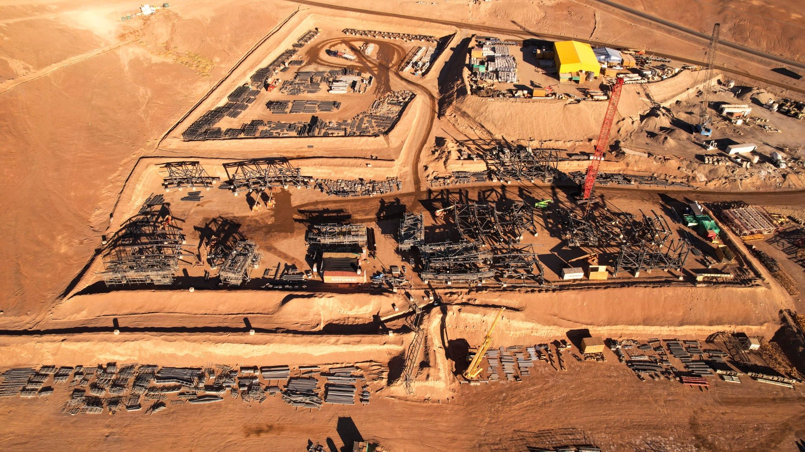
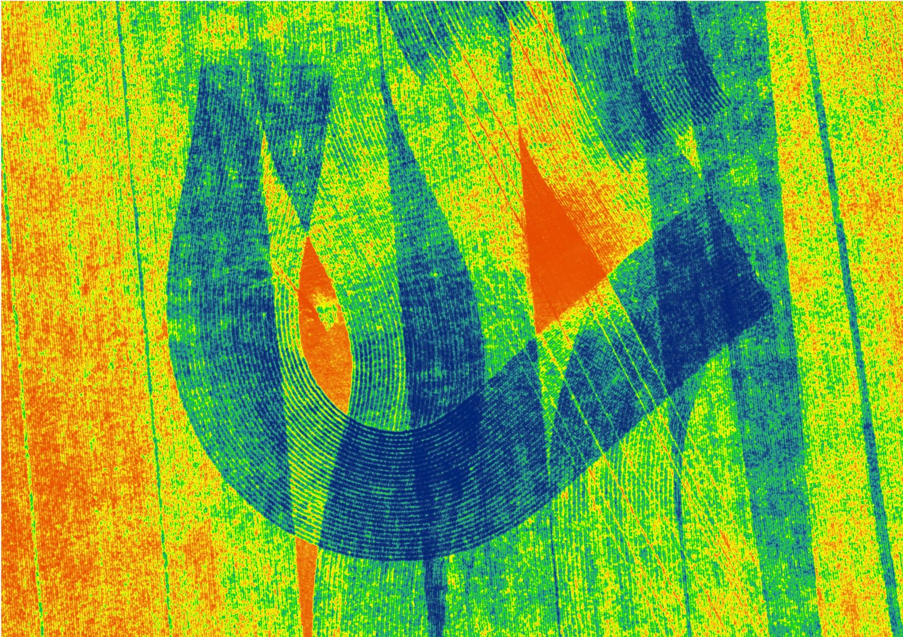
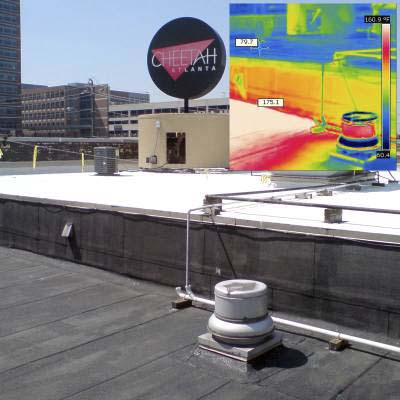
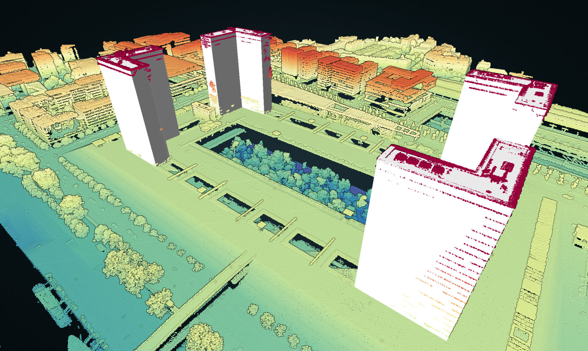

# DM00.3 — Κάμερες, αισθητήρες και δεδομένα

**Διαδρομή:** Drone Mapping Core · **Έκδοση:** Unified Core v0.2
**Κατάσταση:** τοπικό προσχέδιο προς παιδαγωγικό και τεχνικό έλεγχο.

## Η μαθησιακή αποστολή

Στο DM00 χρησιμοποιούμε ένα **υποθετικό αγροτικό πεδίο περίπου 25 ha**. Στο τέλος αυτού του κεφαλαίου θα μπορείς να συνδέεις το ερώτημα μιας εργασίας με την πληροφορία που χρειάζεσαι, τον κατάλληλο αισθητήρα, τα αρχεία που θα παραχθούν και έναν βασικό έλεγχο αποτελέσματος. Δεν χρειάζονται προηγούμενες γνώσεις τηλεπισκόπησης, QGIS ή προγραμματισμού.

Οι επιλογές που ακολουθούν είναι εκπαιδευτικές και προσωρινές. Δεν αποτελούν προδιαγραφές πτήσης, κανονιστική οδηγία ή εγγύηση ακρίβειας. Το αναλυτικό τεχνικό υλικό βρίσκεται στο [συμπληρωματικό Technical Deep Dive](supplementary/DM00.3_Technical_Deep_Dive.md).

## DM00.3.1 — Τι είναι ένας αισθητήρας και τι δεδομένα δημιουργεί;

### Τι θα μάθεις

Θα ξεχωρίζεις την πλατφόρμα (το drone) από τον αισθητήρα και θα ακολουθείς τη διαδρομή **φυσικό σήμα → αισθητήρας → ψηφιακά δεδομένα → αρχείο**.

### Από το drone στην πληροφορία

Το drone μεταφέρει και κινεί τον εξοπλισμό· δεν είναι από μόνο του η πληροφορία που μελετάμε. **Αισθητήρας** είναι συσκευή που ανιχνεύει φυσικό μέγεθος ή σήμα και το μετατρέπει σε καταγράψιμη πληροφορία. Κάμερα και αισθητήρας δεν είναι πάντα συνώνυμα: μια κάμερα σχηματίζει εικόνα, ενώ ένας αισθητήρας μπορεί να καταγράφει επιλεγμένες φασματικές ζώνες, θερμική ακτινοβολία ή επιστροφές laser.

| Παράδειγμα | Τι καταγράφει κυρίως |
|---|---|
| RGB | ορατό φως σε κόκκινο, πράσινο και μπλε κανάλι |
| Πολυφασματικός | επιλεγμένες φασματικές ζώνες, ανάλογα με το όργανο |
| Θερμικός | υπέρυθρη ακτινοβολία που σχετίζεται με θερμικές διαφοροποιήσεις |
| LiDAR | επιστροφές παλμών laser για εκτίμηση αποστάσεων και 3D σημείων |

:::{figure} assets/DM00-03-F01_From_Signal_to_Data.svg
:alt: Διάγραμμα από το φυσικό σήμα στον αισθητήρα, στα ψηφιακά δεδομένα και στο αρχείο
:width: 100%

**Σχήμα F01.** Ενδεικτική ροή από το φυσικό σήμα στο αρχείο. Τα μονοπάτια είναι διαφορετικά και δεν κάνουν τους αισθητήρες ισοδύναμους.
:::

Ένα σκούρο τμήμα στέγης σε RGB εικόνα δείχνει διαφορά στην ορατή εικόνα· δεν τεκμηριώνει υψηλή θερμοκρασία. Για θερμικό συμπέρασμα χρειάζεται θερμική καταγραφή και κατάλληλη ερμηνεία.

### Αυτοέλεγχος

Μια κόκκινη περιοχή σε συνηθισμένη RGB εικόνα αποδεικνύει θερμοκρασία ή χημική σύσταση;

Ενδεικτική απάντηση

Όχι. Η RGB εικόνα καταγράφει ορατό φως. Η εμφάνιση ενός χρώματος δεν αρκεί για συμπέρασμα σχετικά με θερμοκρασία ή χημική σύσταση.

### Δραστηριότητα

Για καθεμία από τις περιπτώσεις γράψε ποια πληροφορία έχεις και ποια λείπει: (α) σκούρο τμήμα στέγης σε RGB, (β) διαφορά θερμικής απόκρισης σε θερμική εικόνα, (γ) κόκκινη περιοχή σε θερμική παλέτα χωρίς αριθμητική κλίμακα.

Ενδεικτική λύση

(α) Έχεις διαφορά στο ορατό φως, όχι θερμοκρασία. (β) Έχεις ένδειξη θερμικής διαφοροποίησης, αλλά χρειάζονται συνθήκες και έλεγχοι για ερμηνεία. (γ) Έχεις χρώμα που εξαρτάται από την παλέτα· χωρίς κλίμακα δεν έχεις αριθμητική θερμοκρασία ούτε διάγνωση.

**Τι κρατάμε:** αρχίζουμε από το μέγεθος που θέλουμε να παρατηρήσουμε, όχι από το όνομα του drone.

## DM00.3.2 — Κάμερες RGB: εικόνα και ποιότητα λήψης

### Τι θα μάθεις

Θα συνδέεις pixel, megapixel, ευκρίνεια, φωτισμό και κάλυψη με την καταλληλότητα μιας RGB λήψης.

Μια RGB κάμερα καταγράφει τρία κανάλια ορατού φωτός. Μια εικόνα **4000 × 3000 pixel** έχει 12.000.000 pixel, δηλαδή **12 MP**. Τα MP περιγράφουν το πλήθος των pixel, όχι από μόνα τους την καθαρότητα ή τη γεωμετρική ακρίβεια.

Η ευκρίνεια επηρεάζεται από εστίαση, θόλωση κίνησης, χρόνο έκθεσης, φωτισμό, έκθεση και φακό. Για χαρτογράφηση δεν αρκεί μία όμορφη φωτογραφία: απαιτούνται κατάλληλες λήψεις με επικάλυψη, επεξεργασία και έλεγχος του παραδοτέου.

**Φωτογραφία P01.** Πραγματική εναέρια λήψη του εργοταξίου του Extremely Large Telescope στη Χιλή, ως παράδειγμα φωτογραφικής τεκμηρίωσης. Πηγή: ESO / Guido Vecchia, [CC BY 4.0](https://creativecommons.org/licenses/by/4.0/). Δεν παρουσιάζεται ως πιστοποιημένο μετρητικό υπόβαθρο.

:::{figure} assets/DM00-03-F02_RGB_Sharp_vs_Simulated_Blur.png
:alt: Σύγκριση καθαρού αποσπάσματος RGB με το ίδιο κάδρο και τεχνητά προσομοιωμένη θόλωση κίνησης
:width: 100%

**Σχήμα F02.** Η δεξιά εκδοχή είναι τεχνητά προσομοιωμένη θόλωση της αρχικής εικόνας, όχι δεύτερη πραγματική λήψη. Πηγή αρχικής εικόνας: ESO / Guido Vecchia, CC BY 4.0· επεξεργασία για το GeoSkills.
:::

### Αυτοέλεγχος

Ποια είναι προτιμότερη για μια εργασία: 20 MP θολή εικόνα ή 12 MP καθαρή εικόνα, αν όλα τα άλλα είναι συγκρίσιμα;

Ενδεικτική απάντηση

Η καθαρή εικόνα μπορεί να είναι χρησιμότερη. Τα περισσότερα MP δεν αναιρούν τη θόλωση ούτε εγγυώνται ακρίβεια.

### Δραστηριότητα

Έχεις τρεις λήψεις: μία θολή, μία με βαθιά σκιά και μία που δεν καλύπτει όλη την περιοχή. Για κάθε μία αποφάσισε «κρατώ με επιφύλαξη» ή «χρειάζεται συμπληρωματική λήψη» και αιτιολόγησε.

Ενδεικτική λύση

Η θολή λήψη χρειάζεται επανάληψη ή σαφή αποκλεισμό από την παραγωγή. Η βαθιά σκιά κρατιέται μόνο αν δεν εμποδίζει το ζητούμενο και ελέγχεται με άλλες λήψεις. Η ελλιπής κάλυψη απαιτεί συμπληρωματική λήψη, επειδή δεν τεκμηριώνει ολόκληρη την περιοχή.

**Τι κρατάμε:** pixel και MP είναι ιδιότητες της εικόνας, όχι αυτόματη απόδειξη ποιότητας.

## DM00.3.3 — Πολυφασματικές κάμερες: πέρα από το RGB

### Τι θα μάθεις

Θα αναγνωρίζεις πότε επιπλέον φασματικές ζώνες μπορούν να αναδείξουν διαφοροποιήσεις βλάστησης και γιατί ένας δείκτης δεν είναι διάγνωση.

Ένας πολυφασματικός αισθητήρας καταγράφει επιλεγμένες ζώνες, για παράδειγμα Blue, Green, Red, Red Edge ή NIR. Δεν έχουν όλα τα όργανα το ίδιο σύνολο ζωνών. Η βλάστηση μπορεί να αποκρίνεται διαφορετικά στο κόκκινο και στο εγγύς υπέρυθρο (NIR), γι’ αυτό κατάλληλες αντιστοιχισμένες μετρήσεις μπορούν να χρησιμοποιηθούν στον δείκτη:

\[
NDVI = \frac{NIR - Red}{NIR + Red}
\]

Μια συνηθισμένη RGB κάμερα δεν διαθέτει ανεξάρτητη NIR ζώνη. Ο NDVI μπορεί να δείξει χωρική διαφοροποίηση, όχι από μόνος του συγκεκριμένη ασθένεια, στρες ή ανάγκη άρδευσης.

:::{figure} assets/DM00-03-F03_Multispectral_Bands_and_NDVI.png
:alt: Ενδεικτικό διάγραμμα επιλεγμένων φασματικών ζωνών και παραγωγής δείκτη NDVI
:width: 100%

**Σχήμα F03.** Ενδεικτική σχηματική σύγκριση ζωνών και υπολογισμού δείκτη. Δεν αποτελεί βαθμονόμηση συγκεκριμένου αισθητήρα.
:::

**Εικόνα P02.** Πραγματική ψευδοχρωματική απεικόνιση αγρού σιταριού. Δεν υπάρχει επαληθευμένο αριθμητικό υπόμνημα, άρα δεν αποδίδουμε αυθαίρετες τιμές στα χρώματα. Πηγή: Antarsih, [Wikimedia Commons](https://commons.wikimedia.org/wiki/File:Agricultural_art.jpg), [CC BY 4.0](https://creativecommons.org/licenses/by/4.0/). Χρησιμοποιείται χωρίς αλλαγές.

### Αυτοέλεγχος

Τι υποδεικνύει μια χωρική διαφοροποίηση NDVI και τι δεν αποδεικνύει;

Ενδεικτική απάντηση

Υποδεικνύει διαφοροποίηση της απόκρισης που καταγράφεται από τις συγκεκριμένες ζώνες. Δεν αποδεικνύει μόνη της αιτία, ασθένεια ή ανάγκη άρδευσης.

### Δραστηριότητα

Ταίριαξε το ερώτημα με την αρχική επιλογή: φωτογράφιση ορατής στέγης, χωρικές διαφοροποιήσεις βλάστησης, οριστική διάγνωση μυκητολογικής ασθένειας.

Ενδεικτική λύση

RGB για την ορατή στέγη· πολυφασματικός αισθητήρας για διερεύνηση διαφοροποιήσεων βλάστησης· κανένας απλός δείκτης ή εικόνα δεν αρκεί για οριστική διάγνωση χωρίς πρόσθετα στοιχεία και έλεγχο.

**Τι κρατάμε:** περισσότερες ζώνες σημαίνουν άλλη πληροφορία, όχι αυτόματα καλύτερο συμπέρασμα.

## DM00.3.4 — Θερμικές κάμερες και θερμογραφίες

### Τι θα μάθεις

Θα ξεχωρίζεις τη θερμική υπέρυθρη καταγραφή από την RGB εικόνα και θα ερμηνεύεις με προσοχή τις ψευδοχρωματικές παλέτες.

Η θερμική κάμερα καταγράφει υπέρυθρη ακτινοβολία. Η οθόνη μπορεί να την αποδώσει με κόκκινο, κίτρινο ή μπλε, αλλά αυτά είναι χρώματα παλέτας και όχι καθολικές θερμοκρασίες. Υλικό επιφάνειας, εκπεμπτικότητα, ανακλάσεις, ήλιος, άνεμος και κλίμακα επηρεάζουν την ερμηνεία. Ένα απλό έγχρωμο JPEG δεν εγγυάται ότι διατηρεί αριθμητικές ραδιομετρικές θερμοκρασίες.

Πιθανές χρήσεις είναι η διερεύνηση διαφοροποιήσεων σε κτίρια, φωτοβολταϊκά ή καλλιέργειες. Η εικόνα δεν αποτελεί αυτόματη διάγνωση βλάβης.

:::{figure} assets/DM00-03-F04_Thermal_Image_Interpretation.png
:alt: Ενδεικτική απεικόνιση από θερμική ακτινοβολία σε εικόνα με χρωματική παλέτα
:width: 100%

**Σχήμα F04.** Ενδεικτική παλέτα θερμικής εικόνας· τα χρώματα δεν είναι από μόνα τους πιστοποιημένες θερμοκρασίες.
:::

**Εικόνα P03.** Πραγματικό **επίγειο**, όχι drone, παράδειγμα θερμογραφίας στέγης. Alexander Cua, Wikimedia Commons, [CC BY-SA 3.0](https://creativecommons.org/licenses/by-sa/3.0/), [πηγή](https://commons.wikimedia.org/wiki/File:Infrared_Thermography_of_Modified_Bitumen_Roof.jpg).

### Αυτοέλεγχος

Τι δικαιολογεί μια κόκκινη περιοχή σε θερμική εικόνα;

Ενδεικτική απάντηση

Δείχνει διαφοροποίηση σύμφωνα με τη συγκεκριμένη παλέτα και κλίμακα. Δεν αποδεικνύει συγκεκριμένους βαθμούς ή βλάβη χωρίς κατάλληλα δεδομένα και έλεγχο.

### Δραστηριότητα

Κάποιος γράφει: «Η κόκκινη περιοχή στη στέγη αποδεικνύει διαρροή θερμότητας». Ποια πρόσθετα στοιχεία θα ζητήσεις πριν από τέτοιο συμπέρασμα;

Ενδεικτική λύση

Θα ζητούσα πληροφορίες για την κλίμακα και τη ραδιομετρική μορφή του αρχείου, εκπεμπτικότητα και υλικό επιφάνειας, συνθήκες ήλιου/ανέμου και ανεξάρτητο έλεγχο της στέγης. Η εικόνα μόνη της τεκμηριώνει το πολύ μια διαφοροποίηση στην καταγραφή.

**Τι κρατάμε:** θερμική εικόνα σημαίνει διαφορετικό σήμα και διαφορετικές προϋποθέσεις ερμηνείας.

## DM00.3.5 — LiDAR και τρισδιάστατα νέφη σημείων

### Τι θα μάθεις

Θα εξηγείς πώς οι παλμοί laser οδηγούν σε τρισδιάστατα σημεία και θα ξεχωρίζεις το νέφος σημείων από φωτογραφία ή έτοιμη επιφάνεια.

Το LiDAR στέλνει παλμούς laser και καταγράφει επιστροφές για να εκτιμήσει αποστάσεις. Με τη θέση και τον προσανατολισμό του συστήματος μπορούν να παραχθούν σημεία με X, Y και Z. Ένα **νέφος σημείων** είναι σύνολο διακριτών σημείων στον χώρο· δεν είναι από μόνο του συνεχής επιφάνεια ούτε συμβατική RGB φωτογραφία.

Οι επιστροφές μπορεί να προέρχονται από κόμες, κλαδιά ή και έδαφος όταν υπάρχουν κενά, αλλά δεν ισχύει ότι το laser «διαπερνά όλα τα δέντρα». Και η φωτογραμμετρία μπορεί να δημιουργήσει νέφη σημείων από επικαλυπτόμενες εικόνες.

:::{figure} assets/DM00-03-F05_LiDAR_Returns_and_Point_Cloud.png
:alt: Σχηματική απεικόνιση παλμών LiDAR, επιστροφών από βλάστηση και εδάφους και παραγωγής νέφους σημείων
:width: 100%

**Σχήμα F05.** Σχηματική εξήγηση επιστροφών και τρισδιάστατων σημείων. Η πραγματική κάλυψη εξαρτάται από τις συνθήκες και το σύστημα.
:::

**Εικόνα P04.** «BNF Lidar HD», FuzzyGeo, [Wikimedia Commons](https://commons.wikimedia.org/wiki/File:BNF_Lidar_HD.png), [CC BY 4.0](https://creativecommons.org/licenses/by/4.0/). Δεν τεκμηριώνεται ότι τα δεδομένα αποκτήθηκαν από drone.

### Αυτοέλεγχος

Το LiDAR εγγυάται πάντα επιστροφές εδάφους κάτω από πυκνή κόμη;

Ενδεικτική απάντηση

Όχι. Οι επιστροφές και η δυνατότητα αποτύπωσης εδάφους εξαρτώνται από κενά στη βλάστηση, το σύστημα και τις συνθήκες.

### Δραστηριότητα

Για τρία ζητούμενα — ορθοφωτοχάρτης αγρού, ύψη δέντρων σε αραιό δάσος, ορατές φθορές στέγης — πρότεινε αρχικό τύπο δεδομένων και έναν περιορισμό.

Ενδεικτική λύση

Ορθοφωτοχάρτης: επικαλυπτόμενες RGB εικόνες και φωτογραμμετρία, με έλεγχο γεωαναφοράς. Ύψη δέντρων: LiDAR ή φωτογραμμετρία, με επιφύλαξη για την κάλυψη του εδάφους. Φθορές στέγης: RGB εικόνες, με έλεγχο ανάλυσης/σκιάς και όχι αυθαίρετη χρήση LiDAR.

**Τι κρατάμε:** το 3D προϊόν εξαρτάται από τον τρόπο καταγραφής και την επεξεργασία, όχι μόνο από την ετικέτα «LiDAR».

## DM00.3.6 — Πολυφασματικοί, υπερφασματικοί και άλλοι εξειδικευμένοι αισθητήρες

### Τι θα μάθεις

Θα συγκρίνεις πολυφασματικούς και υπερφασματικούς αισθητήρες και θα εξηγείς γιατί η επιλογή πρόσθετων ζωνών πρέπει να υπηρετεί συγκεκριμένο ερώτημα.

Ο πολυφασματικός αισθητήρας μετρά λίγες επιλεγμένες ζώνες. Ο υπερφασματικός συνήθως μετρά πολλές στενότερες, συχνά γειτονικές ζώνες. Η δεύτερη επιλογή μπορεί να είναι χρήσιμη σε ειδική φασματική έρευνα, αλλά απαιτεί κατάλληλη βαθμονόμηση, ερμηνεία και διαδικασία ελέγχου. Περισσότερες ζώνες δεν σημαίνουν αυτόματα χρησιμότερο αποτέλεσμα.

Σε άλλες ειδικές εργασίες μπορεί να χρησιμοποιούνται αισθητήρες βάθους, ραντάρ ή άλλες εξειδικευμένες καταγραφές. Δεν τους θεωρούμε απαραίτητους χωρίς συγκεκριμένο ερώτημα και τεκμηριωμένο τρόπο ελέγχου.

:::{figure} assets/DM00-03-F06_Spectral_Sensors_Comparison.png
:alt: Ενδεικτική σύγκριση αριθμού και διάταξης φασματικών ζωνών σε RGB, πολυφασματικό και υπερφασματικό αισθητήρα
:width: 100%

**Σχήμα F06.** Εννοιολογική σύγκριση ζωνών, όχι προδιαγραφή συγκεκριμένου οργάνου.
:::

### Αυτοέλεγχος

Ποια πρόταση είναι σωστή: «ο υπερφασματικός είναι πάντα καλύτερος» ή «η καταλληλότητα εξαρτάται από το ερώτημα και τον έλεγχο»;

Ενδεικτική απάντηση

Η δεύτερη. Ο αισθητήρας επιλέγεται από την απαιτούμενη πληροφορία, τη διαδικασία μέτρησης και την ικανότητα ερμηνείας.

### Δραστηριότητα

Για έρευνα εμφανών ορίων αγρού, διερεύνηση χωρικών διαφοροποιήσεων βλάστησης και ειδική φασματική μελέτη, πρότεινε αρχική επιλογή και τι πρέπει να ελεγχθεί.

Ενδεικτική λύση

RGB για τα εμφανή όρια· πολυφασματικός εφόσον χρειάζονται οι επιλεγμένες ζώνες και υπάρχει κατάλληλη επεξεργασία· πιθανός υπερφασματικός για ειδική μελέτη, μόνο με τεκμηριωμένο πρωτόκολλο και βαθμονόμηση. Καμία επιλογή δεν τεκμηριώνει μόνη της διάγνωση.

**Τι κρατάμε:** ο ειδικός αισθητήρας είναι λύση σε συγκεκριμένη ανάγκη, όχι απόδειξη ποιότητας από μόνος του.

## DM00.3.7 — Χωρική, φασματική και χρονική ανάλυση

### Τι θα μάθεις

Θα ξεχωρίζεις τρεις διαστάσεις της ανάλυσης και θα τις διακρίνεις από τη γεωμετρική ακρίβεια.

**Χωρική ανάλυση** αφορά τη λεπτομέρεια στον χώρο· το GSD περιγράφει περίπου το μέγεθος εδάφους που αντιστοιχεί σε ένα pixel. **Φασματική ανάλυση** αφορά τις ζώνες και τη λεπτομέρεια του σήματος. **Χρονική ανάλυση** αφορά πόσο συχνά παρατηρούμε την περιοχή. Το μικρό GSD ή τα πολλά pixel δεν εγγυώνται γεωμετρική ακρίβεια. Η ακρίβεια απαιτεί ανεξάρτητο έλεγχο και εξαρτάται από τη λήψη, τη γεωαναφορά και την επεξεργασία.

:::{figure} assets/DM00-03-F07_Three_Dimensions_of_Resolution.png
:alt: Διάγραμμα που συγκρίνει χωρική, φασματική και χρονική ανάλυση και τις διακρίνει από την ακρίβεια
:width: 100%

**Σχήμα F07.** Οι τρεις διαστάσεις της ανάλυσης δεν είναι συνώνυμες με την ακρίβεια του τελικού προϊόντος.
:::

Στην αποστολή των 25 ha, το ζητούμενο «πρόσφατο ορατό υπόβαθρο GIS» δεν μετατρέπεται αυτόματα σε συγκεκριμένο GSD ή ακρίβεια. Αυτά πρέπει να συμφωνηθούν και να ελεγχθούν.

**Εκπαιδευτικό παράδειγμα:** Αν δύο υποθετικά προϊόντα έχουν GSD **3 cm** και **10 cm**, το πρώτο περιγράφει μικρότερο μέγεθος εδάφους ανά pixel και άρα περισσότερη ονομαστική χωρική λεπτομέρεια. Αυτό δεν μας λέει ποιο έχει μεγαλύτερη γεωμετρική ακρίβεια. Η φασματική ανάλυση θα κρινόταν από τις ζώνες που μετρήθηκαν, ενώ η χρονική ανάλυση από το πόσο συχνά επαναλήφθηκε η παρατήρηση. Οι τιμές 3 cm και 10 cm είναι μόνο εκπαιδευτικές.

### Αυτοέλεγχος

Το GSD είναι το ίδιο πράγμα με την επιβεβαιωμένη οριζόντια ακρίβεια;

Ενδεικτική απάντηση

Όχι. Το GSD περιγράφει ονομαστική χωρική λεπτομέρεια, ενώ η ακρίβεια είναι αποτέλεσμα ελέγχου του παραδοτέου.

### Δραστηριότητα

Ένα προϊόν έχει μικρότερο GSD αλλά δεν έχει ελεγχθεί με ανεξάρτητα σημεία. Μπορείς να το χαρακτηρίσεις ακριβέστερο;

Ενδεικτική λύση

Όχι. Μπορείς να πεις ότι έχει διαφορετική ονομαστική χωρική λεπτομέρεια. Για σύγκριση ακρίβειας χρειάζεται κατάλληλος ανεξάρτητος έλεγχος και τεκμηρίωση των συνθηκών παραγωγής.

**Τι κρατάμε:** «βλέπω μικρότερα» δεν σημαίνει «μετρώ ακριβέστερα».

## DM00.3.8 — Αρχεία και μεταδεδομένα αποστολής

### Τι θα μάθεις

Θα οργανώνεις πρωτότυπα και παράγωγα αρχεία και θα χρησιμοποιείς τα μεταδεδομένα ως τεκμήρια προς έλεγχο, όχι ως εγγύηση ποιότητας.

Μια αποστολή μπορεί να περιλαμβάνει πρωτότυπες εικόνες ή καταγραφές αισθητήρα, αρχεία πτήσης, μεταδεδομένα, αρχεία βαθμονόμησης, ενδιάμεσα προϊόντα και τελικά παραδοτέα. Κράτησε τα πρωτότυπα αμετάβλητα, κατέγραψε αντίγραφα/επεξεργασίες και χώρισε τα παράγωγα από τις αρχικές λήψεις.

:::{figure} assets/DM00-03-F08_Mission_Files_and_Metadata.png
:alt: Ενδεικτική οργάνωση πρωτοτύπων, μεταδεδομένων, επεξεργασίας και τελικών παραδοτέων αποστολής
:width: 100%

**Σχήμα F08.** Ενδεικτική δομή αρχείων. Η ακριβής δομή προσαρμόζεται στο εργαλείο και στην αποστολή.
:::

Τα EXIF/GNSS μπορούν να περιγράφουν την εκτιμώμενη θέση της κάμερας, όχι ακριβείς συντεταγμένες κάθε pixel ή αντικειμένου. Η γεωμετρική ακρίβεια του τελικού προϊόντος χρειάζεται δικό της έλεγχο.

**Συγκεκριμένο παράδειγμα οργάνωσης:** η αρχική λήψη `IMG_0042.JPG` παραμένει στον φάκελο `01_originals/2026-11-06/`, τα στοιχεία θέσης και χρόνου της στο `02_metadata_flight/2026-11-06/IMG_0042_EXIF.txt`, και ο παραγόμενος ορθοφωτοχάρτης στο `04_deliverables/orthomosaic_v01.tif`. Η σχέση μεταξύ τους καταγράφεται στο ημερολόγιο επεξεργασίας. Η θέση της κάμερας στο EXIF δεν ισοδυναμεί με πιστοποιημένες συντεταγμένες των αντικειμένων που φαίνονται στην εικόνα.

### Αυτοέλεγχος

Είναι σωστό να διαγράψουμε τις πρωτότυπες εικόνες μόλις παραχθεί ένα JPEG;

Ενδεικτική απάντηση

Όχι. Τα πρωτότυπα είναι απαραίτητα για έλεγχο και πιθανή επανεπεξεργασία. Τα παράγωγα φυλάσσονται χωριστά και τεκμηριωμένα.

### Δραστηριότητα

Οργάνωσε σε φακέλους τα: πρωτότυπα, μεταδεδομένα/αρχεία πτήσης, ενδιάμεση επεξεργασία και τελικά προϊόντα. Πρόσθεσε έναν κανόνα ονομασίας ή καταγραφής.

Ενδεικτική λύση

Μια σαφής λύση είναι `01_originals`, `02_metadata_flight`, `03_processing` και `04_deliverables`, με αρχείο καταγραφής έκδοσης/ημερομηνίας. Άλλη δομή είναι αποδεκτή αν κρατά τα πρωτότυπα χωριστά και επιτρέπει επαναληψιμότητα.

**Τι κρατάμε:** διατηρούμε, οργανώνουμε, καταγράφουμε και ελέγχουμε· τα μεταδεδομένα δεν αντικαθιστούν τον έλεγχο.

## DM00.3.9 — Επιλογή αισθητήρα για πραγματική εργασία

### Τι θα μάθεις

Θα αιτιολογείς προσωρινή επιλογή με την αλυσίδα **σκοπός → πληροφορία → αισθητήρας → δεδομένα → έλεγχος αποτελέσματος**.

| Ζητούμενο | Πιθανή αρχική επιλογή | Κύρια επιφύλαξη |
|---|---|---|
| Ορατό ορθοφωτογραφικό υπόβαθρο | RGB | επικάλυψη, γεωαναφορά και έλεγχος |
| Χωρικές διαφοροποιήσεις βλάστησης | πολυφασματικός | ζώνες, συνθήκες, βαθμονόμηση και ερμηνεία |
| Θερμικές διαφοροποιήσεις επιφάνειας | θερμικός | εκπεμπτικότητα, περιβάλλον και κλίμακα |
| Σύνθετη 3D βλάστηση | LiDAR ή φωτογραμμετρία | κάλυψη, γεωαναφορά και δυνατότητα αποτύπωσης εδάφους |
| Ειδική φασματική έρευνα | πιθανός υπερφασματικός | πρωτόκολλο, βαθμονόμηση και ανάλυση |

:::{figure} assets/DM00-03-F09_Sensor_Selection_Workflow.png
:alt: Ροή από το ερώτημα και την απαιτούμενη πληροφορία στην επιλογή αισθητήρα, στα δεδομένα και στον έλεγχο
:width: 100%

**Σχήμα F09.** Πρακτική ροή επιλογής. Η επιλογή παραμένει προσωρινή μέχρι να ελεγχθούν απαιτήσεις, συμβατότητα, εφικτή και νόμιμη λειτουργία, επεξεργασία και ποιότητα.
:::

Για την υποθετική αποστολή 25 ha, το αρχικό αίτημα είναι πρόσφατο ορατό φωτογραφικό υπόβαθρο GIS για δρόμους και κτίσματα. Η **RGB** είναι λογική προσωρινή επιλογή· δεν προσθέτουμε πολυφασματικό αισθητήρα μόνο επειδή η περιοχή είναι αγροτική. Πριν από οριστική επιλογή μένουν ανοικτά το περίγραμμα, το ζητούμενο GSD και η ακρίβεια, η συμβατότητα, η εφικτή/νόμιμη λειτουργία και η διαδικασία ελέγχου.

Η [Καρτέλα 03 — Επιλογή αισθητήρα και απαιτούμενων δεδομένων](fakelos_ergasias/DM00_Kartela_03_Epilogi_Aisthitira_kai_Dedomenon.md) συνεχίζει τις Καρτέλες 01 και 02. Περιέχει πεδία, ενδεικτική συμπλήρωση και χώρο για τη δική σου προσωρινή, επαληθεύσιμη πρόταση.

### Αυτοέλεγχος

Γιατί η RGB είναι λογική αρχική επιλογή για το βασικό αίτημα των 25 ha;

Ενδεικτική απάντηση

Επειδή το αίτημα αφορά ορατά χαρακτηριστικά και πρόσφατο φωτογραφικό υπόβαθρο. Η επιλογή είναι προσωρινή και προϋποθέτει κατάλληλες λήψεις, επεξεργασία και έλεγχο.

### Δραστηριότητα

Πρότεινε αισθητήρα και έναν περιορισμό για: (1) ορθοφωτογραφικό υπόβαθρο, (2) διαφοροποιήσεις βλάστησης, (3) θερμικές διαφοροποιήσεις στέγης. Έπειτα συμπλήρωσε την Καρτέλα 03 για το πρώτο σενάριο.

Ενδεικτική λύση

(1) RGB· έλεγχος επικάλυψης και γεωαναφοράς. (2) πολυφασματικός, αν οι ζώνες και η επεξεργασία είναι κατάλληλες· ο δείκτης δεν είναι διάγνωση. (3) θερμικός· απαιτούνται στοιχεία για εκπεμπτικότητα, περιβάλλον και κλίμακα. Στην Καρτέλα 03 η επιλογή παραμένει «Προσωρινή — απαιτείται επαλήθευση» και δεν προστίθενται επινοημένα μοντέλα, ύψη ή ακρίβειες.

**Τι κρατάμε:** η καλή επιλογή είναι αιτιολογημένη και ελέγξιμη, όχι εντυπωσιακή από μόνη της.

## Τελική αυτοαξιολόγηση DM00.3

Απάντησε πριν ανοίξεις τις ενδεικτικές απαντήσεις.

1. Ποια φυσική πληροφορία καταγράφει κυρίως RGB; **Α. ορατό φως · Β. παλμούς laser · Γ. θερμική υπέρυθρη ακτινοβολία**
2. Ίδιες διαστάσεις pixel αλλά θόλωση στη δεύτερη εικόνα: **Α. ίδια ποιότητα · Β. μπορεί να διαφέρει η ευκρίνεια · Γ. η θολή έχει μεγαλύτερη ακρίβεια**
3. Για NDVI απαιτούνται κυρίως: **Α. Red και NIR · Β. RGB και LiDAR · Γ. θερμική εικόνα και GNSS**
4. Κόκκινη περιοχή σε θερμογραφία σημαίνει: **Α. σίγουρη βλάβη · Β. διαφοροποίηση σύμφωνα με την κλίμακα · Γ. πάντα 50 °C**
5. Νέφος σημείων LiDAR είναι: **Α. χάρτης NDVI · Β. σύνολο τρισδιάστατων σημείων · Γ. σύνολο RGB φωτογραφιών**
6. Βασική διαφορά πολυφασματικού/υπερφασματικού: **Α. ο υπερφασματικός συνήθως πολλές στενότερες ζώνες · Β. ο πολυφασματικός μόνο θερμοκρασία · Γ. ο υπερφασματικός δεν παράγει αρχεία**
7. Το GSD περιγράφει: **Α. περίπου το μέγεθος εδάφους ανά pixel · Β. εγγυημένη ακρίβεια · Γ. πλήθος μπαταριών**
8. Μετά τη λήψη: **Α. διαγράφουμε τα πρωτότυπα · Β. κρατάμε οργανωμένα πρωτότυπα και παράγωγα · Γ. αλλάζουμε ονόματα χωρίς καταγραφή**
9. GNSS/EXIF σημαίνει ότι ο ορθοφωτοχάρτης είναι αυτομάτως ακριβής; **Α. ναι · Β. όχι · Γ. μόνο αν είναι έγχρωμος**
10. Για ορατό φωτογραφικό υπόβαθρο 25 ha πιθανότερη αρχική επιλογή: **Α. RGB με κατάλληλο σχεδιασμό · Β. υποχρεωτικά υπερφασματικός · Γ. υποχρεωτικά θερμικός**

Ενδεικτικές απαντήσεις και σύντομη αιτιολόγηση

1. **Α** — ορατό φως. 2. **Β** — η θόλωση μειώνει την ευκρίνεια. 3. **Α** — Red και NIR. 4. **Β** — εξαρτάται από παλέτα/κλίμακα. 5. **Β** — 3D σημεία. 6. **Α** — περισσότερες στενότερες ζώνες. 7. **Α** — ονομαστική χωρική λεπτομέρεια, όχι ακρίβεια. 8. **Β** — τα πρωτότυπα επιτρέπουν έλεγχο και επανεπεξεργασία. 9. **Β** — η ακρίβεια χρειάζεται ανεξάρτητο έλεγχο. 10. **Α** — ταιριάζει στο συγκεκριμένο ορατό ζητούμενο, υπό προϋποθέσεις.

**Τελικός έλεγχος:** Μπορώ να εξηγήσω τι μετρά κάθε αισθητήρας, να διακρίνω ανάλυση από ακρίβεια, να κρατήσω τα πρωτότυπα και να αιτιολογήσω προσωρινή επιλογή χωρίς να παρουσιάσω υπόθεση ως μέτρηση ή διάγνωση.
