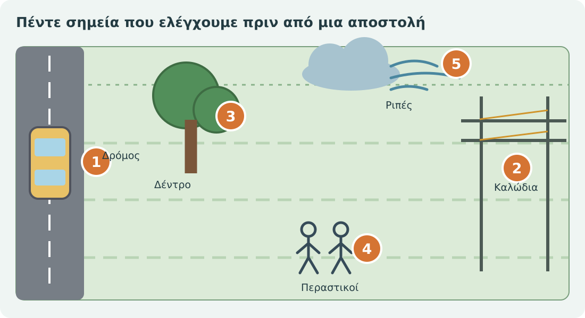
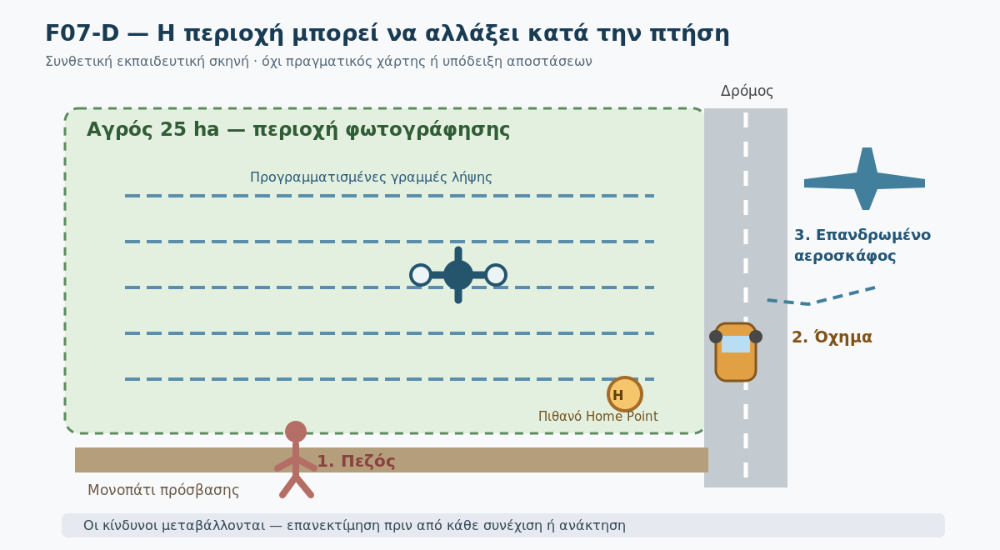
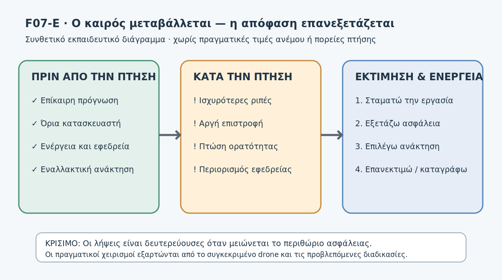
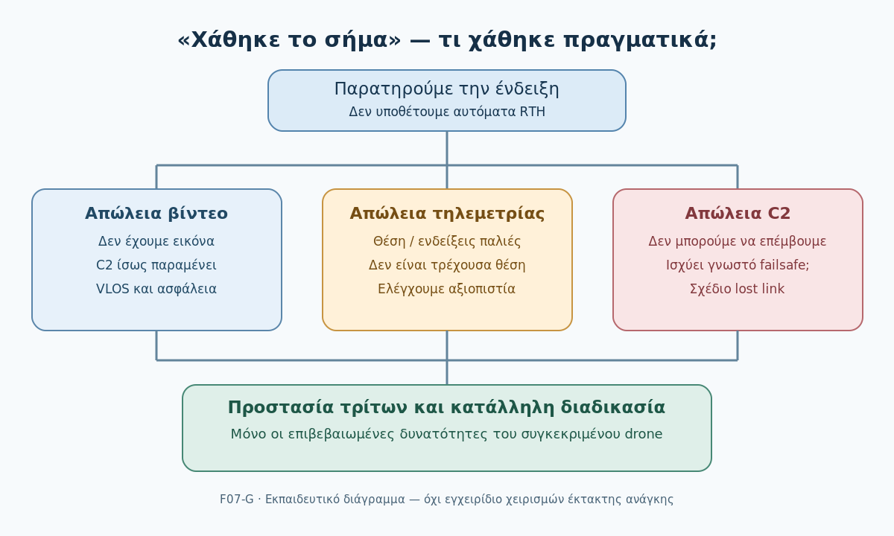
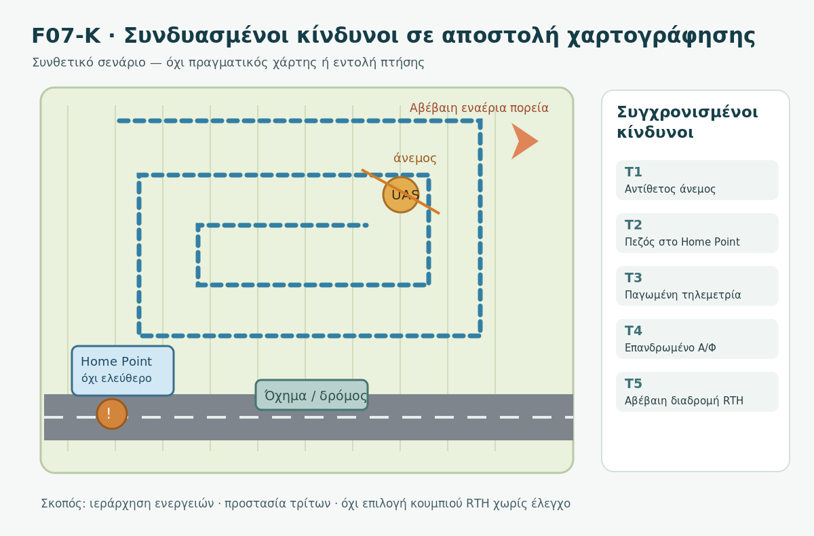
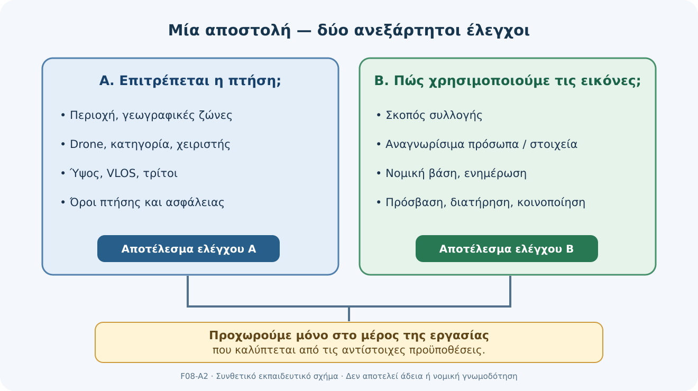
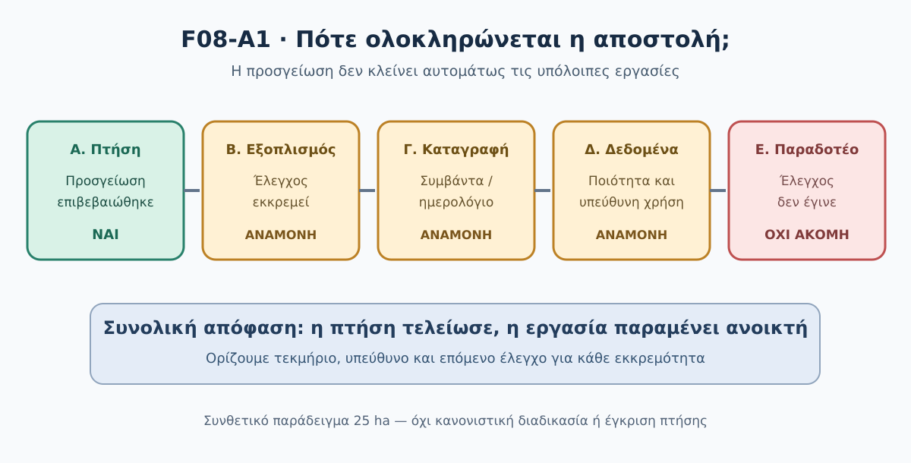

# DM01 — Ασφαλής και υπεύθυνη εκτέλεση χαρτογραφικής αποστολής

> **Δοκιμαστική εκπαιδευτική έκδοση — Preview v0.1.** Το DM01 βρίσκεται σε αξιολόγηση και δεν αποτελεί οριστικά εγκεκριμένο μάθημα.

> **Κρίσιμη κανονιστική προειδοποίηση:** Οι παραπομπές και τα παραδείγματα του κεφαλαίου είναι εκπαιδευτικά και χρονικά ευαίσθητα. Δεν παρέχουν άδεια πτήσης ούτε υποκαθιστούν τον έλεγχο των ισχυουσών απαιτήσεων EASA, ΑΠΑ/HCAA, DAGR, AIP/NOTAM, προστασίας δεδομένων και των οδηγιών του κατασκευαστή πριν από κάθε πραγματική επιχείρηση. Όπου μια συγκεκριμένη προϋπόθεση δεν έχει επιβεβαιωθεί για το πραγματικό σενάριο, παραμένει εκκρεμής και δεν πρέπει να θεωρείται έγκριση.

**GeoSkills · Drone Mapping Core · Βασικό εκπαιδευτικό μάθημα · Παιδαγωγικά αναθεωρημένο προσχέδιο v0.2 · 03/11/2026**

> **Μαθησιακό πεδίο:** Η ενότητα αφορά τον πρακτικό σχεδιασμό, την ασφαλή παρακολούθηση και το κλείσιμο μιας υποθετικής χαρτογραφικής αποστολής αγρού 25 ha. Δεν αντικαθιστά τις τρέχουσες νομικές απαιτήσεις, το εγχειρίδιο συγκεκριμένου UAS, την απαιτούμενη επάρκεια χειριστή ή την αδειοδότηση. Τα παραδείγματα δεν αποτελούν άδεια απογείωσης.

## Πώς χρησιμοποιείς αυτό το κεφάλαιο

Διάβασε τις οκτώ υποενότητες με τη σειρά. Συμπλήρωσε σταδιακά τους ελέγχους στην [ενιαία Καρτέλα 04](cards/Kartela_04_Teliki_Apostoli.md). Οι ειδικότερες αναλύσεις περιστατικών και προστασίας δεδομένων βρίσκονται στα πλήρη συμπληρωματικά κείμενα· η βασική διαδρομή είναι αυτοτελής για τις εκπαιδευτικές δραστηριότητες.

| Στάδιο | Μαθησιακή εργασία | Τι πρέπει να τεκμηριωθεί |
|---|---|---|
| DM01.1–4.3 | Ασφάλεια, κατηγορία, ρόλοι | Τι επιτρέπεται και τι ακόμη δεν έχει εξακριβωθεί |
| DM01.4–4.6 | DAGR, συνθήκες, checklist | GO / NO-GO / ΑΝΑΜΟΝΗ ΕΛΕΓΧΩΝ |
| DM01.7 | Κίνδυνοι κατά την πτήση | Γεγονός, αβεβαιότητα, προστατευτική απόφαση |
| DM01.8 | Δεδομένα και κλείσιμο | Κατάσταση εξοπλισμού, αρχείων και εκκρεμοτήτων |

> **Δύο ανεξάρτητες εκπαιδευτικές φάσεις:** Όταν οι απαιτούμενοι προπτητικοί έλεγχοι δεν έχουν γίνει, **δεν απογειωνόμαστε**. Για να εξασκηθούμε στις DM01.7–4.8, μεταβαίνουμε σε **ξεχωριστό υποθετικό σενάριο** όπου η πτήση θεωρείται ότι ξεκίνησε με όλες τις απαιτούμενες προϋποθέσεις. Δεν είναι συνέχεια μιας μη εγκεκριμένης απογείωσης.

## Μαθησιακοί στόχοι και αποστολή 25 ha

Μετά τη βασική διαδρομή θα μπορείς να (α) περιγράφεις γιατί η ασφάλεια προηγείται των λήψεων, (β) συγκεντρώνεις τα στοιχεία για επιλογή υποκατηγορίας Open, (γ) ελέγχεις ρόλους, εγγραφή και επάρκεια, (δ) τεκμηριώνεις έλεγχο ζώνης DAGR, (ε) αναγνωρίζεις κινδύνους από καιρό, ανθρώπους και εμπόδια, (στ) χρησιμοποιείς προπτητικό checklist με **GO / NO-GO / ΑΝΑΜΟΝΗ ΕΛΕΓΧΩΝ**, (ζ) επανεκτιμάς την ασφάλεια όταν αλλάζουν οι συνθήκες πτήσης και (η) ελέγχεις τον εξοπλισμό, την ποιότητα των λήψεων και τις εκκρεμότητες πριν από επεξεργασία ή παράδοση.

**Τι θα παραδώσεις:** Μία συμπληρωμένη [Καρτέλα 04](cards/Kartela_04_Teliki_Apostoli.md) με τεκμηριωμένη προπτητική απόφαση, αιτιολόγηση τεσσάρων περιστατικών και κατάσταση κλεισίματος της υποθετικής αποστολής. Οι λύσεις ανοίγουν μόνο μετά τη δική σου προσπάθεια.

**Συνεχές παράδειγμα:** Επιθυμούμε να φωτογραφίσουμε υποθετικό αγρό **25 ha** για παραγωγή ορθοφωτοχάρτη. Στη δυτική πλευρά υπάρχει αγροτικός δρόμος, στη βόρεια γραμμή ηλεκτρικού ρεύματος, δίπλα στην προτεινόμενη απογείωση δέντρο και κατά διαστήματα πεζοί. Δεν γνωρίζουμε ακόμη ακριβή θέση, ημερομηνία, drone, κλάση, προβλεπόμενο ύψος, χειριστή, πραγματικό καιρό ή άδειες. Επομένως η αρχική απόφαση είναι **ΑΝΑΜΟΝΗ ΕΛΕΓΧΩΝ**.

---

## DM01.1 — Ασφάλεια: μπορώ δεν σημαίνει πρέπει

### Η ουσία

Η χαρτογράφηση είναι επιτυχημένη μόνο αν το προϊόν είναι χρήσιμο **και** η επιχείρηση παραμένει νόμιμη και ασφαλής. Μια καθαρή φωτογραφία δεν δικαιολογεί υπέρπτηση μη εμπλεκόμενων προσώπων ή επικίνδυνους ελιγμούς. Ο κίνδυνος αλλάζει ανάλογα με το περιβάλλον: ένας αγρός μπορεί να είναι άδειος στην προετοιμασία και να εμφανιστούν άνθρωποι ή οχήματα αργότερα.

**Πηγή κινδύνου** είναι κάτι που μπορεί να προκαλέσει βλάβη (π.χ. καλώδιο). **Επικινδυνότητα** περιγράφει την πιθανότητα και τη σοβαρότητα των συνεπειών στη συγκεκριμένη αποστολή. Δεν χρειάζεται στο εισαγωγικό μάθημα περίπλοκος αριθμητικός δείκτης για να εντοπίσουμε ότι καλώδιο στην προβλεπόμενη πορεία χρειάζεται αποφυγή.

| Παρατήρηση στον αγρό | Γιατί μας απασχολεί | Τι πρέπει να ελεγχθεί |
|---|---|---|
| Οχήματα στον δρόμο | Κίνδυνος για οδηγούς/επιβάτες | Διαδρομή, απόσταση, εναλλακτική ανάκτηση |
| Γραμμές ρεύματος | Εμπόδιο κατά την πτήση ή επιστροφή | Ακριβής θέση σε σχέση με πορεία και RTH |
| Πεζοί | Άνθρωποι που δεν συμμετέχουν στην αποστολή | Κλάση, υποκατηγορία και όροι προστασίας |
| Δέντρο | Περιορίζει ορατότητα και χώρο απογείωσης | Άλλη θέση και έλεγχος VLOS |
| Ριπές ανέμου | Αβεβαιότητα επιστροφής και ενέργειας | Πρόγνωση, επιτόπιος έλεγχος, εγχειρίδιο |

**Λυμένο παράδειγμα.** Η ομάδα θεωρεί ότι «το χωράφι είναι δικό μας, άρα μπορούμε να πετάξουμε». Η κατοχή ή άδεια χρήσης του αγρού δεν επαρκεί για αεροπορικούς περιορισμούς, παρουσία τρίτων και ασφάλεια. Σωστή αρχική ενέργεια: χαρτογράφηση κινδύνων, έλεγχος ζώνης και συγκεκριμένου συστήματος, χωρίς απογείωση.

### Δραστηριότητα 4.1

Σημείωσε τέσσερις κινδύνους του παραδείγματος και πρότεινε μία αλλαγή σχεδιασμού για καθέναν. Γράψε επίσης ένα στοιχείο που **δεν γνωρίζουμε**.

Λυμένη απάντηση 4.1

Δρόμος → διαδρομή εκτός έκθεσης διερχομένων και έλεγχος εναλλακτικής ανάκτησης. Καλώδια → αλλαγή πορείας μετά από επιτόπια χαρτογράφηση. Πεζοί → αξιολόγηση περιορισμών υπέρπτησης και αποκλεισμός μη ασφαλούς περιοχής απογείωσης. Δέντρο → επιλογή θέσης με καλύτερη ορατότητα. Άγνωστο κρίσιμο στοιχείο: πραγματική γεωγραφική θέση για DAGR. Καμία από τις προτάσεις δεν αποτελεί ακόμη έγκριση απογείωσης.

## DM01.2 — Βασικοί κανόνες: το drone και η αποστολή καθορίζουν τις απαιτήσεις

### Η ουσία

Στην ευρωπαϊκή **Open** υπάρχουν οι υποκατηγορίες **A1, A2, A3**, με διαφορετικούς περιορισμούς για ανθρώπους, κλάσεις drones και απαιτήσεις επάρκειας. Δεν επιλέγουμε υποκατηγορία μόνο με βάση το ότι ο αγρός είναι «εκτός πόλης». Καταγράφουμε **μάζα και κλάση C0/C1/C2/C3/C4 ή κατάσταση legacy**, ημερομηνία διάθεσης στην αγορά όπου έχει σημασία, προβλεπόμενη θέση, παρουσία τρίτων και προσόντα χειριστή.

| Περίπτωση | Κρίσιμη εκπαιδευτική διάκριση |
|---|---|
| **A1** | Ειδικοί όροι κατά κλάση· **όχι** υπέρπτηση συγκεντρώσεων ανθρώπων. Το C0 δεν αντιμετωπίζεται όπως το C1 για μεμονωμένους μη εμπλεκόμενους. |
| **A2** | Συνήθως C2 και συγκεκριμένη επάρκεια A2· οριζόντια απόσταση 30 m από μη εμπλεκόμενους· δυνατότητα 5 m **μόνο** με προβλεπόμενη λειτουργία χαμηλής ταχύτητας και τις πρόσθετες προϋποθέσεις. |
| **A3** | Η περιοχή πρέπει να είναι τέτοια ώστε ευλόγως να μην κινδυνεύει μη εμπλεκόμενος, και απαιτείται απόσταση **τουλάχιστον 150 m από οικιστικές, εμπορικές, βιομηχανικές ή ψυχαγωγικές περιοχές**. Τα 150 m δεν είναι καθολική απόσταση από οποιοδήποτε άτομο. |

**Γενικά στην Open:** τηρείται το εφαρμοστέο όριο ύψους, κατά κανόνα έως **120 m από το πλησιέστερο σημείο της επιφάνειας**, με ειδικές ρυθμίσεις όπου προβλέπονται, και εφαρμόζονται οι απαιτήσεις οπτικής επαφής VLOS με τις συγκεκριμένες εξαιρέσεις. Το ότι ένα drone μπορεί τεχνικά να ανέβει ψηλότερα δεν σημαίνει ότι επιτρέπεται. Ο πραγματικός κανόνας ελέγχεται στην ισχύουσα νομοθεσία και στις τοπικές ζώνες. Η **Specific** δεν καλύπτεται από μια απλή αυτοδήλωση «έχω δίπλωμα Open»· μπορεί να χρειάζεται χωριστή διαδικασία/έγκριση.

**Λυμένο παράδειγμα.** Έχουμε μόνο την πληροφορία «drone με κάμερα 800 g». Δεν αποδίδουμε αυτομάτως υποκατηγορία ή δικαίωμα υπέρπτησης. Λείπουν τουλάχιστον η κλάση/κατάσταση του drone, τα προσόντα χειριστή, η πραγματική περιοχή και τα πρόσωπα που ενδέχεται να επηρεαστούν.

### Δραστηριότητα 4.2

Ποια πέντε στοιχεία θα ζητούσες πριν συμπληρώσεις «Open A1/A2/A3» στην Καρτέλα 04;

Λυμένη απάντηση 4.2

(1) Ακριβές μοντέλο/κλάση και μάζα, (2) κατάσταση πιστοποίησης/legacy όπου εφαρμόζεται, (3) επάρκεια του χειριστή, (4) περιβάλλον με ανθρώπους και οικιστικές/λοιπές ζώνες, (5) διαδρομή/ύψος/γεωγραφικούς περιορισμούς. Αν λείπουν: **ΑΝΑΜΟΝΗ ΕΛΕΓΧΩΝ**, όχι εικασία υποκατηγορίας.

## DM01.3 — Εκμεταλλευόμενος, χειριστής και απαιτούμενη επάρκεια

### Η ουσία

Ο **εκμεταλλευόμενος UAS (operator)** είναι το πρόσωπο ή ο φορέας που οργανώνει τη λειτουργία και φέρει τις σχετικές ευθύνες. Ο **χειριστής εξ αποστάσεως (remote pilot)** είναι εκείνος που εκτελεί τις λειτουργίες χειρισμού. Μπορεί να είναι το ίδιο πρόσωπο, αλλά οι ρόλοι δεν ταυτίζονται πάντοτε. Ένα πιστοποιητικό γνώσεων χειριστή δεν υποκαθιστά την εγγραφή εκμεταλλευομένου όπου απαιτείται.

Η εγγραφή εξαρτάται από τις εφαρμοστέες προϋποθέσεις, συμπεριλαμβανομένων μάζας και του αν το drone φέρει αισθητήρα ικανό να συλλέξει προσωπικά δεδομένα, με την εξαίρεση που προβλέπεται για ορισμένα παιχνίδια βάσει της σχετικής οδηγίας. Η **εγγραφή operator** διαφέρει από την κατάλληλη **επάρκεια πιλότου**. Για ορισμένα μικρά C0 δεν απαιτείται τυπικό πιστοποιητικό χειριστή στην Open, αλλά εξακολουθούν να ισχύουν οι κανόνες χρήσης και οι οδηγίες κατασκευαστή· άλλα drones/υποκατηγορίες απαιτούν εκπαίδευση/εξετάσεις A1/A3 ή επιπρόσθετη επάρκεια A2.

**Λυμένο παράδειγμα Α.** Φοιτητής διαθέτει μικρό C0 drone με κάμερα και έχει διαβάσει το εγχειρίδιο. Το ότι δεν απαιτείται τυπική εξέταση πιλότου για συγκεκριμένη λειτουργία C0 **δεν** σημαίνει ότι απαλλάσσεται αυτομάτως από υποχρέωση εγγραφής operator ή από κανόνες γεωγραφικών ζωνών.

**Λυμένο παράδειγμα Β.** Φορέας οργανώνει πτήση με C2 σε A2. Χρειάζεται έλεγχος τόσο της εγγραφής/ευθυνών του φορέα όσο και της ειδικής επάρκειας του ορισμένου χειριστή. Δεν αρκεί να φέρει ο φορέας κάποια βεβαίωση «επιχείρησης».

### Δραστηριότητα 4.3

Για το υποθετικό 25 ha γράψε τα τέσσερα πεδία που πρέπει να επιβεβαιωθούν πριν θεωρήσουμε έτοιμη την ομάδα.

Λυμένη απάντηση 4.3

Ταυτοποίηση εκμεταλλευομένου, κατάσταση απαιτούμενης εγγραφής, ταυτοποίηση χειριστή, επάρκεια χειριστή **για το συγκεκριμένο drone και σχέδιο πτήσης**. Σε πραγματική εργασία προστίθενται τα σχετικά τεκμήρια και οι ευθύνες της ομάδας.

## DM01.4 — Έλεγχος περιοχής στο DAGR

### Η ουσία

Πριν από τη χαρτογράφηση στην Ελλάδα ελέγχουμε το επίσημο **Drone Aware Greece (DAGR)** για τη συγκεκριμένη γεωγραφική περιοχή, την ημερομηνία και τον χρόνο. Οι γεωγραφικές ζώνες μπορεί να έχουν απαγορεύσεις, περιορισμούς ή προϋποθέσεις έγκρισης. Το ότι ο αγρός βρίσκεται μακριά από πόλη **δεν** αποτελεί επαρκή έλεγχο, όπως και το ότι «δεν φαίνεται χρωματισμένος» σε ένα τυχαίο screenshot.

**Πρακτική διαδικασία:**

1. Καταγράφουμε το πραγματικό περίγραμμα/συντεταγμένες της περιοχής και τον σχεδιαζόμενο χρόνο.
2. Ανοίγουμε την επίσημη εφαρμογή **https://dagr.hasp.gov.gr/** και εξετάζουμε ολόκληρη τη διαδρομή, όχι μόνο το κέντρο του αγρού.
3. Διαβάζουμε τις επισημάνσεις της περιοχής και ελέγχουμε αν απαιτείται χωριστή άδεια ή υπάρχουν προσωρινοί περιορισμοί.
4. Διασταυρώνουμε τις κατάλληλες επίσημες αεροναυτικές πληροφορίες/NOTAM όπου χρειάζεται. Η εμφάνιση του χάρτη δεν αντικαθιστά τον έλεγχο των ισχυόντων όρων, προσωρινών περιορισμών και απαιτούμενων εγκρίσεων.
5. Καταγράφουμε τον έλεγχο, την πηγή και την απόφαση. **Αίτημα έγκρισης δεν σημαίνει χορηγημένη έγκριση.**

**Λυμένο παράδειγμα.** Ο συμφοιτητής σου δείχνει screenshot DAGR άλλης ημερομηνίας και ισχυρίζεται ότι «επιτρέπεται». Η σωστή αντίδραση είναι να ζητήσεις νέα επαλήθευση περιοχής/χρόνου, ελέγχοντας τυχόν ισχύοντες όρους. Δεν υιοθετείς αυτόματα GO.

### Δραστηριότητα 4.4

Για τον αγρό 25 ha δεν έχουν δοθεί συντεταγμένες. Τι γράφεις στο πεδίο DAGR της Καρτέλας 04;

Λυμένη απάντηση 4.4

**«Δεν ελέγχθηκε: άγνωστη ακριβής θέση και χρόνος. ΑΝΑΜΟΝΗ ΕΛΕΓΧΩΝ».** Δεν εφευρίσκουμε αποτέλεσμα DAGR, χρώμα ζώνης ή άδεια. Όταν δοθούν τα στοιχεία, καταγράφουμε τον πραγματικό έλεγχο με ημερομηνία και σχετικούς όρους.

## DM01.5 — Καιρός, άνθρωποι και εμπόδια πεδίου

### Η ουσία

Η επιτρεπτότητα της γεωγραφικής ζώνης δεν αποδεικνύει ότι η πραγματική πτήση είναι ασφαλής. Ο χειριστής εξετάζει **άνεμο και ριπές, βροχή, ορατότητα, θερμοκρασία, εμπόδια, μη εμπλεκόμενα πρόσωπα και δυνατότητα ασφαλούς ανάκτησης**. Οι κρίσιμες τιμές πρέπει να συγκρίνονται με το **συγκεκριμένο εγχειρίδιο, την κατάσταση του εξοπλισμού και όλη την προβλεπόμενη διάρκεια**, όχι με αυθαίρετο κοινό όριο για όλα τα drones.

*Σχήμα F05. Συνθετική εκπαιδευτική σκηνή. Οι θέσεις δεν αντιστοιχούν σε πραγματική περιοχή.*

**Λυμένο παράδειγμα.** Στην πρόγνωση αναγράφονται μέσος άνεμος 6 m/s και ριπές 11 m/s, χωρίς να γνωρίζουμε τα όρια του drone. Οι τιμές είναι αποκλειστικά *υποθετικές*. Η σωστή κρίση δεν είναι «ναι, πετάμε» ή «όχι λόγω 11 m/s»· είναι **ΑΝΑΜΟΝΗ ΕΛΕΓΧΩΝ**, έως τη σύγκριση με τις δυνατότητες του συστήματος, τον επιτόπιο έλεγχο και τη συνολική αξιολόγηση.

**Ασφαλής αλλαγή σχεδίου:** αν διαπιστωθεί κίνδυνος από καλώδια, μπορούμε να εξετάσουμε νέα διαδρομή ή άλλο σημείο απογείωσης, αλλά κάθε τροποποίηση απαιτεί νέο έλεγχο της πραγματικής γεωμετρίας, των ανθρώπων και του εναέριου χώρου. Δεν προτείνουμε ελιγμούς κοντά σε ενεργά καλώδια ως μαθησιακή άσκηση.

### Δραστηριότητα 4.5

Η ομάδα μετακινεί τη διαδρομή μακριά από τα καλώδια, αλλά πλησιέστερα στον δρόμο. Έχει λυθεί το πρόβλημα;

Λυμένη απάντηση 4.5

**Όχι κατ’ ανάγκη.** Μειώθηκε ένας κίνδυνος, ενδέχεται όμως να αυξήθηκε άλλος: έκθεση οδηγών/επιβατών και ακατάλληλη εναλλακτική προσγείωση. Απαιτείται νέος έλεγχος διαδρομής, υποκατηγορίας, τρίτων, καιρού, VLOS και ανάκτησης.

## DM01.6 — Η προπτητική απόφαση βασίζεται σε checklist

### Η ουσία

Ο προπτητικός έλεγχος δεν είναι «πάτησα Start». Συνδυάζει τρία επίπεδα: **έγγραφα και σχέδιο → εξοπλισμός και ρυθμίσεις → χώρο και άμεσες συνθήκες**. Κάθε στοιχείο μπορεί να αλλάξει την απόφαση. Χρησιμοποιούμε checklist του πραγματικού κατασκευαστή/εκμεταλλευομένου, το οποίο δεν αντικαθίσταται από τον εκπαιδευτικό πίνακα.

| Πριν από την απογείωση | Έλεγχος / τεκμήριο | Στο παράδειγμά μας |
|---|---|---|
| **Σχέδιο** | Drone/υποκατηγορία, επάρκεια, DAGR/ζώνες, εγκρίσεις | Ανεπιβεβαίωτα |
| **Σύστημα** | Έλικες, μπαταρίες, αισθητήρες, αποθήκευση, σωστή συμπεριφορά failsafe/RTH | Άγνωστα, απαιτείται εγχειρίδιο |
| **Πεδίο** | Άνθρωποι, καιρός, καλώδια, δρόμος, VLOS, ασφαλής ανάκτηση | Γνωστοί κίνδυνοι, ανεπαρκής επαλήθευση |

**Τρεις ενδεχόμενες αποφάσεις:**

- **GO:** μόνο αν *όλοι* οι απαιτούμενοι έλεγχοι έχουν ολοκληρωθεί και η πραγματική λειτουργία είναι νόμιμη και ασφαλής. Στην εκπαιδευτική προσομοίωση το «GO» δεν αποτελεί νομική άδεια.
- **NO-GO:** διαπιστωμένη ασυμβατότητα ή κίνδυνος που δεν μπορεί να αντιμετωπιστεί.
- **ΑΝΑΜΟΝΗ ΕΛΕΓΧΩΝ:** ανεπαρκή στοιχεία. Δεν απογειωνόμαστε ώσπου να ολοκληρωθεί ο έλεγχος.

**Λυμένο παράδειγμα.** Όλα τα τεχνικά συστήματα δείχνουν «Ready», αλλά το DAGR και η πρόσφατη επιθεώρηση ελίκων δεν έχουν ολοκληρωθεί. Η σωστή απόφαση είναι **ΑΝΑΜΟΝΗ ΕΛΕΓΧΩΝ**. Μια πράσινη ένδειξη λογισμικού δεν πιστοποιεί όλα τα εξαρτήματα ούτε αντικαθιστά τους νομικούς ελέγχους.

### Δραστηριότητα 4.6

Συμπλήρωσε το σύντομο checklist τριών επιπέδων για το σενάριο 25 ha και αιτιολόγησε την τελική απόφαση.

Λυμένη απάντηση 4.6

Σχέδιο: άγνωστη κλάση/χειριστής/ζώνη. Σύστημα: δεν τεκμηριώθηκε φυσικός έλεγχος/ρυθμίσεις. Πεδίο: δρόμος, καλώδια, πεζοί και άγνωστες ριπές. **ΑΝΑΜΟΝΗ ΕΛΕΓΧΩΝ**· η απογείωση δεν δικαιολογείται. Ο χειριστής επιβεβαιώνει με επίσημες πηγές και πραγματικά δεδομένα κάθε εκκρεμότητα.

---

## Ενδιάμεσος έλεγχος — Απόφαση πριν από την απογείωση

**Σημείο μετάβασης:** Στις 4.1–4.6 συγκεντρώσαμε τις πληροφορίες που χρειάζεται ο χειριστής πριν πετάξει. Η ολοκλήρωση της λίστας ελέγχου δεν συνεπάγεται αυτομάτως άδεια πτήσης: απαιτούνται πραγματικά και επίκαιρα δεδομένα. Στις 4.7–4.8, αντίθετα, θα ασκηθούμε σε ξεχωριστό υποθετικό περιστατικό κατά το οποίο οι προϋποθέσεις θεωρούνται ήδη ικανοποιημένες.

| Κρίσιμο πεδίο | Κατάσταση στο υποθετικό 25 ha | Επόμενη ενέργεια |
|---|---|---|
| Ακριβής θέση/χρόνος | Άγνωστα | Σχεδιάγραμμα/συντεταγμένες, ημερομηνία και ώρα |
| Drone/κλάση/μάζα | Άγνωστα | Τεκμηρίωση συγκεκριμένου μοντέλου |
| Εκμεταλλευόμενος/χειριστής | Άγνωστα | Έλεγχος εγγραφής και επάρκειας |
| A1/A2/A3 | Δεν επιλέχθηκε | Αντιστοίχιση στην πραγματική λειτουργία |
| DAGR/εγκρίσεις | Δεν ελέγχθηκαν | Επίσημος έλεγχος ζώνης |
| Καιρός/άνθρωποι/εμπόδια | Μερικώς γνωστά, χωρίς επιτόπια επαλήθευση | Επικαιροποιημένη αξιολόγηση |
| Εξοπλισμός/RTH/ανάκτηση | Άγνωστα | Προπτητικός έλεγχος και σχέδιο ανάκτησης |
| **Απόφαση** | **ΑΝΑΜΟΝΗ ΕΛΕΓΧΩΝ** | **Δεν απογειωνόμαστε** |

### Τρία ερωτήματα αυτοαξιολόγησης

**1.** Εάν το DAGR δεν δείχνει περιορισμό, αλλά το σύστημα παρουσιάζει μηχανικό πρόβλημα, πετάμε;

Απάντηση 1
Όχι. Η επιτρεπτότητα περιοχής δεν υποκαθιστά τη λειτουργική ασφάλεια.

**2.** Ένας πεζός εισέρχεται απρόβλεπτα κοντά στην προτεινόμενη θέση απογείωσης. Γιατί η αρχική εκτίμηση θέλει επανέλεγχο;

Απάντηση 2
Επειδή έχει μεταβληθεί η έκθεση μη εμπλεκόμενων προσώπων, ενδέχεται να μην υπάρχει ασφαλής θέση ανάκτησης και η επιχείρηση πρέπει να αξιολογηθεί εκ νέου.

**3.** Έχουμε πιστοποιητικό A1/A3. Αρκεί για οποιοδήποτε drone και οποιαδήποτε περιοχή;

Απάντηση 3
Όχι. Η επάρκεια του χειριστή είναι ένα μόνο μέρος των απαιτήσεων· εξαρτώνται επίσης από την κλάση/λειτουργία, υποκατηγορία, γεωγραφική ζώνη και συνθήκες.

## Πηγές και όρια

- [EASA — Easy Access Rules for UAS, έκδοση Ιουνίου 2026](https://www.easa.europa.eu/en/document-library/easy-access-rules/online-publications/easy-access-rules-unmanned-aircraft-systems), ιδίως UAS.OPEN.010/.020/.030/.040/.050/.060 και άρθρα εγγραφής εκμεταλλευομένου.
- [EASA — Εγγραφή εκμεταλλευομένου και επάρκεια χειριστή](https://www.easa.europa.eu/en/node/143656).
- [ΑΠΑ — Where you are allowed to fly a UAS in Greece](https://hcaa.gov.gr/el/where-you-are-allowed-fly-uas-greece).
- [DAGR — επίσημη εφαρμογή και προειδοποίηση για ακρίβεια δεδομένων](https://dagr.hasp.gov.gr/).

Αυτή η βασική ύλη είναι **εισαγωγική εκπαιδευτική σύνθεση**. Πριν από πραγματική πτήση χρειάζεται επιβεβαίωση των απαιτήσεων και των οδηγιών του συγκεκριμένου συστήματος, της πραγματικής θέσης και των ισχυουσών συνθηκών. Οι ειδικές περιπτώσεις και η πλήρης τεχνική/νομική ανάλυση διατηρούνται στα αυθεντικά αρχεία εμβάθυνσης.
---

## DM01.7 — Αναγνωρίζω προβλήματα και αποφασίζω με ασφάλεια

Η αποστολή περνά σε **νέο και ανεξάρτητο υποθετικό σενάριο πτήσης**, όπου οι απαραίτητοι προπτητικοί έλεγχοι θεωρούνται επιτυχώς ολοκληρωμένοι. Η προηγούμενη απόφαση «ΑΝΑΜΟΝΗ ΕΛΕΓΧΩΝ» δεν ακυρώνεται ούτε ερμηνεύεται ως πραγματικό GO. Η προτεραιότητα τώρα είναι η προστασία τρίτων και η έγκαιρη αντίδραση στις μεταβολές.

### Στόχοι της DM01.7

Στο τέλος θα μπορείς: (α) να ξεχωρίζεις μια παρατήρηση από μια υπόθεση, (β) να αναγνωρίζεις πότε η συλλογή φωτογραφιών πρέπει να σταματήσει, (γ) να προστατεύεις ανθρώπους στο έδαφος και άλλα αεροσκάφη, (δ) να μην εμπιστεύεσαι άκριτα την τηλεμετρία ή την αυτόματη επιστροφή, και (ε) να καταγράφεις συνοπτικά τη λήψη απόφασης. **Δεν πρόκειται για εκπαίδευση χειρισμών έκτακτης ανάγκης συγκεκριμένου drone ούτε για πιστοποίηση.**

### 1. Η πτήση είναι ασφαλής όσο παραμένουν ασφαλείς οι συνθήκες

Υποθέτουμε ότι η ομάδα έχει ολοκληρώσει τους προπτητικούς ελέγχους των DM01.1–4.6, έχει επιβεβαιώσει τη νομιμότητα της πτήσης και εκτελεί χαρτογράφηση αγρού 25 ha. Η περιοχή συνορεύει με αγροτικό δρόμο και έχει ένα σημείο απογείωσης/ανάκτησης. Σχεδιάστηκαν οι λήψεις, αλλά **η παραγωγή εικόνων δεν έχει προτεραιότητα έναντι της ασφάλειας**. Ένας πεζός, η αλλαγή του ανέμου ή ένα άλλο αεροσκάφος μπορεί να μεταβάλουν την απόφαση που ήταν σωστή κατά την απογείωση.

Η διάταξη **UAS.OPEN.060(2)(b)** απαιτεί, για τη συνήθη πτήση Open με άμεση οπτική επαφή (VLOS), παρακολούθηση του εναέριου χώρου για αποφυγή σύγκρουσης με επανδρωμένα αεροσκάφη και διακοπή της πτήσης όταν αυτή δημιουργεί κίνδυνο για αεροσκάφη, ανθρώπους, ζώα, περιβάλλον ή περιουσία. Ισχύουν επίσης οι κανόνες της συγκεκριμένης υποκατηγορίας, οι γεωγραφικοί περιορισμοί και οι οδηγίες του κατασκευαστή. [Πηγή: EASA — UAS.OPEN.060](https://www.easa.europa.eu/en/document-library/easy-access-rules/online-publications/easy-access-rules-unmanned-aircraft-systems?erules-id=ERULES-1963177438-19528).

#### Ένα απλό πλαίσιο απόφασης

| Ερώτηση | Τι κάνω στην εκπαιδευτική προσομοίωση |
|---|---|
| **Τι βλέπω;** | Περιγράφω το πραγματικό γεγονός: «εμφανίστηκε πεζός», όχι «ο πεζός είναι σε ασφαλή απόσταση». |
| **Τι δεν ξέρω;** | Αναγνωρίζω αβεβαιότητα: θέση, τροχιά, ενέργεια, κατάσταση σύνδεσης. |
| **Ποιος κινδυνεύει;** | Ελέγχω πρώτα ανθρώπους και άλλα αεροσκάφη, έπειτα περιουσία, εξοπλισμό και δεδομένα. |
| **Τι πρέπει να αλλάξει;** | Δεν συνεχίζω τις λήψεις από συνήθεια. Εφαρμόζω το ασφαλές σχέδιο και τις πραγματικές διαδικασίες του συστήματος. |
| **Τι επανεξετάζω;** | Αν οι συνθήκες επιτρέπουν ασφαλή ολοκλήρωση· δεν υποθέτω ότι η εξαφάνιση μιας ένδειξης σημαίνει αποκατάσταση. |

**Προσοχή:** «παύση λήψεων», «διακοπή της αποστολής φωτογράφησης» και «ασφαλής τερματισμός της πτήσης» δεν είναι ταυτόσημες ενέργειες. Σε επείγον περιστατικό οι κατάλληλες ενέργειες εξαρτώνται από το συγκεκριμένο drone, το περιβάλλον και τις προβλεπόμενες διαδικασίες — δεν υπάρχει ένα καθολικό πλήκτρο «ασφάλεια».

### 2. Περιστατικό Α — Ένας πεζός πλησιάζει το σημείο ανάκτησης

Καθώς το drone φωτογραφίζει τον αγρό, πεζός εμφανίζεται σε μονοπάτι κοντά στο σημείο στο οποίο είχε σχεδιαστεί η προσγείωση. Δεν γνωρίζουμε αν θα πλησιάσει περισσότερο. Η αυτοματοποιημένη αποστολή συνεχίζεται χωρίς προειδοποίηση.

*Σχήμα F07-D — Συνθετικός χάρτης κινδύνου τρίτων. Οι αποστάσεις και οι θέσεις είναι ενδεικτικές, όχι κανονιστικές.*

**Σκέφτομαι:** Ο πεζός είναι πιθανώς μη εμπλεκόμενο πρόσωπο. Δεν αποφασίζω με βάση μια αυθαίρετη γενική απόσταση: οι περιορισμοί εξαρτώνται από την κλάση drone και την υποκατηγορία A1/A2/A3, που έχουν εξεταστεί στην DM01.2. Ελέγχω πού βρίσκεται ο πεζός σε σχέση με την πορεία και τις θέσεις ανάκτησης. Αν η συνέχιση δημιουργεί κίνδυνο, δεν δίνω προτεραιότητα στην τελευταία φωτογραφική διαδρομή. Απαιτείται εφικτό ασφαλές σχέδιο ανάκτησης.

**Λυμένο παράδειγμα.** Η ομάδα είχε επιλέξει ως μοναδική θέση προσγείωσης την άκρη του δρόμου. Εμφανίζονται πεζός και όχημα. Η απάντηση «πατάω RTH, άρα λύθηκε» είναι ανεπαρκής, επειδή το Home Point δεν είναι απαραίτητα ασφαλές εκείνη τη στιγμή. Η ορθή εκπαιδευτική αιτιολόγηση εντοπίζει τους ανθρώπους, ελέγχει το πραγματικό σχέδιο ανάκτησης και αποφεύγει να υποθέσει ότι ο αυτοματισμός έχει επίγνωση αυτών των κινδύνων.

Άσκηση Α — Ποιο είναι το βασικό σφάλμα; (κρυφή λύση)

«Συνεχίζω τη φωτογράφιση αφού ο πεζός βρίσκεται έξω από τον αγρό». Το σφάλμα είναι ότι θεωρείται επαρκές μόνο το όριο του αγρού. Η ασφάλεια εξαρτάται από την πραγματική έκθεση ανθρώπων, την προβλεπόμενη πορεία και την ανάκτηση, όχι μόνο από το αν ο τρίτος βρίσκεται εντός της ιδιοκτησίας. Πρέπει επίσης να εφαρμοστούν οι πραγματικοί κανόνες Open της αποστολής.

### 3. Περιστατικό Β — Ισχυρότερος άνεμος, μικρότερο περιθώριο επιστροφής

Η αποστολή έχει ολοκληρώσει τις περισσότερες λήψεις. Ο άνεμος ενισχύεται από την κατεύθυνση του σημείου ανάκτησης προς το drone. Η επιστροφή μπορεί να χρειαστεί περισσότερο χρόνο ή ενέργεια. Παρότι η εφαρμογή εμφανίζει ακόμη μπαταρία, **το ποσοστό από μόνο του δεν εγγυάται την επιστροφή**.

*Σχήμα F07-E — Εκπαιδευτική πορεία από παρατήρηση καιρού σε αξιολόγηση ανάκτησης.*

**Σκέφτομαι:** Ποιες είναι οι πραγματικές ενδείξεις προόδου, ανέμου, κατάστασης μπαταρίας και διαθέσιμων σημείων ανάκτησης; Ποιες οδηγίες ισχύουν για το συγκεκριμένο drone; Αν η ενεργειακή εφεδρεία γίνεται αβέβαιη, η συνέχιση της χαρτογράφησης δεν αποτελεί σωστή προτεραιότητα. Δεν χρησιμοποιώ αυθαίρετα ένα γενικό όριο 20%, 25% ή 30% ως «κανόνα ασφαλούς επιστροφής».

**Λυμένο παράδειγμα.** Στο ίδιο υποθετικό σενάριο, ένας φοιτητής θέλει να ολοκληρώσει δύο ακόμη λωρίδες φωτογράφησης. Η ομάδα παρατηρεί ισχυρότερες ριπές και αργότερη πρόοδο προς το σημείο ανάκτησης. Η ασφαλέστερη εκπαιδευτική απόφαση είναι να μη συνεχιστεί η λήψη για χάρη της κάλυψης. Ακολουθείται η κατάλληλη διαδικασία ασφαλούς ολοκλήρωσης με βάση τις πραγματικές πληροφορίες και το εγχειρίδιο του συστήματος.

Άσκηση Β — Γιατί δεν αρκεί η ένδειξη «28%»; (κρυφή λύση)

Επειδή το ποσοστό φόρτισης είναι μόνο μία ένδειξη. Δεν περιγράφει από μόνο του τον απαιτούμενο χρόνο επιστροφής, τον άνεμο, τη διαθέσιμη ισχύ υπό φορτίο ή την ασφάλεια του σημείου προσγείωσης. Κρίσιμα συμπτώματα, όπως σοβαρή προειδοποίηση τάσης, δεν αγνοούνται επειδή το ποσοστό φαίνεται «αρκετό».

### 4. Περιστατικό Γ — Παγωμένη εικόνα ή τηλεμετρία: τι έχει πραγματικά χαθεί;

Η εφαρμογή δείχνει την ίδια θέση του drone για αρκετό χρόνο και η ζωντανή εικόνα παγώνει. Ο χειριστής βλέπει ακόμη το drone στον ουρανό. Είναι επικίνδυνο να συμπεράνει είτε ότι «όλα είναι καλά» είτε ότι «χάθηκε σίγουρα ο έλεγχος».

*Σχήμα F07-G — Διαφορετικά είδη απώλειας πληροφοριών και ελέγχου.*

| Ένδειξη | Τι επιτρέπεται να συμπεράνω |
|---|---|
| Παγωμένο βίντεο | Η ζωντανή εικόνα δεν ενημερώνεται αξιόπιστα. **Όχι** απαραίτητα απώλεια ελέγχου. |
| Παγωμένη θέση/μπαταρία | Οι τιμές μπορεί να είναι παλαιές. **Όχι** απαραίτητα πραγματική θέση ή τρέχουσα φόρτιση. |
| Επιβεβαιωμένη απώλεια ζεύξης C2 | Ο χειριστής δεν μπορεί να παρέμβει κανονικά στον έλεγχο. Η προβλεπόμενη απόκριση εξαρτάται από το σύστημα και τις ρυθμίσεις. |

**Λυμένο παράδειγμα.** Το τελευταίο σημείο στον χάρτη βρίσκεται 120 m από το Home Point (υποθετικό δεδομένο). Αν το σήμα τηλεμετρίας έχει παγώσει, η απόσταση αυτή δεν μπορεί να παρουσιαστεί ως τρέχουσα. Αντίστοιχα δεν δικαιολογείται αυτόματο συμπέρασμα ότι ενεργοποιήθηκε RTH. Η ομάδα προσπαθεί να διατηρήσει αξιόπιστη επίγνωση της πραγματικής κατάστασης, με βάση τις εφικτές διαδικασίες και το συγκεκριμένο σύστημα.

Άσκηση Γ — Διάκρινε γεγονός και υπόθεση (κρυφή λύση)

Γεγονός: «η εικόνα δεν αλλάζει και ο χάρτης δείχνει παλαιά θέση». Υπόθεση: «το drone έχει χάσει οπωσδήποτε C2». Δεν είναι ισοδύναμα. Χρειάζεται αξιολόγηση της κατάστασης χωρίς πειραματική πρόκληση βλάβης ή αυθαίρετους χειρισμούς.

### 5. Περιστατικό Δ — Εμφανίζεται επανδρωμένο αεροσκάφος

Κατά την πτήση ακούγεται ελικόπτερο. Η κατεύθυνση και η απόστασή του δεν έχουν ακόμη επιβεβαιωθεί. **Δεν περιμένουμε να ολοκληρωθεί η φωτογράφιση για να εξετάσουμε πιθανό κίνδυνο σύγκρουσης.** Η προστασία των ανθρώπων στον αέρα και στο έδαφος έχει προτεραιότητα έναντι του χαρτογραφικού αποτελέσματος.

Η EASA επιβάλλει την αποφυγή κινδύνου σύγκρουσης με επανδρωμένα αεροσκάφη και τη διακοπή πτήσης όταν η συνέχισή της δημιουργεί κίνδυνο. Επομένως, όταν η σχετική απειλή υπάρχει, εφαρμόζεται κατάλληλη άμεση ασφαλής απόκριση βάσει της πραγματικής θέσης των αεροσκαφών, των δυνατοτήτων του drone και του σχεδίου της επιχείρησης. **Δεν διδάσκουμε καθολικό «πάτα RTH» ή «προσγειώσου αμέσως οπουδήποτε»**, επειδή και η διαδρομή και η θέση προσγείωσης μπορεί να έχουν κινδύνους.

Άσκηση Δ — Τι προηγείται; (κρυφή λύση)

Η αποφυγή ενδεχόμενης σύγκρουσης με το επανδρωμένο αεροσκάφος. Η ομάδα δεν συνεχίζει τις λήψεις. Ταυτόχρονα δεν θεωρεί ασφαλή μια ανεξέλεγκτη προσγείωση πάνω σε πεζούς ή οχήματα. Απαιτείται η κατάλληλη εφικτή απόκριση του πραγματικού συστήματος. Αν τέτοιο σχέδιο δεν έχει προβλεφθεί, αυτό αποτελεί κρίσιμη αστοχία προετοιμασίας.

### 6. Όταν συνυπάρχουν κίνδυνοι

*Σχήμα F07-K — Συνθετική αποστολή, πολλαπλά προβλήματα. Δεν είναι εγκεκριμένη διαδρομή πτήσης.*

Συνδυάζουμε τα τέσσερα περιστατικά: ο άνεμος ενισχύεται, ο πεζός πλησιάζει το Home Point, οι ενδείξεις παγώνουν και εμφανίζεται ελικόπτερο. Ο φοιτητής δεν μπορεί να απαντήσει με μία μόνο απομνημονευμένη εντολή. Χρειάζεται να ξεχωρίσει ποιο γεγονός γνωρίζει, τι παραμένει αβέβαιο, ποιος κινδυνεύει και ποιες ενέργειες είναι εφικτές. **Καμία επιτυχής φωτογραφία δεν αντισταθμίζει μη αποδεκτό κίνδυνο ασφάλειας.**

#### Τι αποφεύγουμε να συμπεράνουμε

- **RTH:** Η αυτόματη επιστροφή δεν αποτελεί εγγύηση ασφαλούς διαδρομής ή προσγείωσης.
- **GNSS / προσανατολισμός:** Μια πλάγια μετατόπιση (*drift*) δεν αποδεικνύει μόνη της ποια συνιστώσα παρουσιάζει πρόβλημα.
- **Μηχανικές αστοχίες:** Η ένδειξη «Ready to Fly» δεν βεβαιώνει ότι δεν υπάρχει ρωγμή σε έλικα.
- **Μετά από πρόσκρουση:** Η πτήση μπορεί να σταμάτησε, αλλά υπάρχουν πιθανοί δευτερογενείς κίνδυνοι, όπως τραυματισμός ή κατεστραμμένη μπαταρία. Πρώτα προστατεύουμε τους ανθρώπους και ακολουθούμε τις κατάλληλες επείγουσες διαδικασίες.

Οι ειδικοί χειρισμοί, η συμπεριφορά κάθε κατασκευαστή και οι αναφορές ατυχημάτων παρουσιάζονται **στο συμπληρωματικό εγχειρίδιο DM01.7.1–13**. Η βασική ενότητα δεν τους αντικαθιστά.

### 7. Τελική πρακτική δραστηριότητα — Καρτέλα 04.7

Συμπλήρωσε την [Καρτέλα 04.7](cards/Kartela_04_7_Asfalis_Apokrisi.md) για μια υποθετική αποστολή 25 ha με τέσσερις χρονικές στιγμές. Για κάθε στιγμή σημείωσε: **γεγονός — αβεβαιότητα — πρόσωπα ή αντικείμενα που κινδυνεύουν — προτεραιότητα — απόφαση — τι πρέπει να καταγραφεί**. Μία γραμμή είναι προσυμπληρωμένη ώστε να φαίνεται ο τρόπος εργασίας.

#### Γρήγορη αυτοαξιολόγηση

1. Η λήψη εικόνων συνεχίζεται κανονικά αλλά εμφανίστηκε πεζός στο σημείο ανάκτησης. Ποια υπόθεση είναι επικίνδυνη;
2. Γιατί η αύξηση του χρόνου επιστροφής λόγω ανέμου έχει σημασία ακόμη κι όταν υπάρχει ένδειξη μπαταρίας;
3. Αποδεικνύει ένα παγωμένο βίντεο ότι χάθηκε η ζεύξη C2;
4. Επιτρέπεται να συνεχίσω λήψεις όταν υπάρχει κίνδυνος από επανδρωμένο αεροσκάφος;

Απαντήσεις αυτοαξιολόγησης με αιτιολόγηση

1. Ότι το προγραμματισμένο Home Point παραμένει ασφαλές επειδή η πτήση είναι αυτοματοποιημένη. Η πραγματική έκθεση του πεζού πρέπει να αξιολογηθεί.
2. Επειδή ενδέχεται να αυξηθεί η απαιτούμενη ενέργεια και να μειωθεί η εφεδρεία. Το ποσοστό μπαταρίας δεν αρκεί για ασφαλή εκτίμηση.
3. Όχι. Η μετάδοση εικόνας, τηλεμετρίας και εντολών ελέγχου είναι διαφορετικές λειτουργίες.
4. Όχι. Η αποφυγή κινδύνου σύγκρουσης και η ασφαλής διακοπή έχουν προτεραιότητα σύμφωνα με το UAS.OPEN.060.

### 8. Χρήσιμο για επόμενη πτήση

Κρατώ σύντομη καταγραφή: ποιο περιστατικό εμφανίστηκε, πότε, τι παρατήρησε η ομάδα, ποια απόφαση ελήφθη, αν υπήρξε έκθεση τρίτων και ποιες συνθήκες πρέπει να ελεγχθούν ξανά. Αν δεν έχει επιβεβαιωθεί η καταλληλότητα της αποστολής, **δεν αποφασίζω αυτόματα επανέναρξη επειδή έφυγε ο πεζός ή εξαφανίστηκε μια προειδοποίηση**.

#### Βασική πηγή και όριο εφαρμογής

- [EASA, Easy Access Rules for UAS, αναθεώρηση Ιουνίου 2026, UAS.OPEN.060](https://www.easa.europa.eu/en/document-library/easy-access-rules/online-publications/easy-access-rules-unmanned-aircraft-systems?erules-id=ERULES-1963177438-19528).
- Για τα ειδικότερα θέματα τρίτων, ενέργειας, C2, RTH, GNSS, μηχανικών αστοχιών και αναφοράς περιστατικών: [αναλυτικό εγχειρίδιο DM01.7](reference/phase2/DM00_4_7_full/DM00_4_7_Eniaio_Keimeno.md). Πρόκειται για εκπαιδευτικό υλικό με καταγεγραμμένες εκκρεμότητες τελικού ανεξάρτητου ελέγχου, όχι επιχειρησιακό εγχειρίδιο.

**Κατάσταση εκπαιδευτικού σεναρίου:** προσομοίωση χωρίς συγκεκριμένο μοντέλο, πραγματικό DAGR ή επαληθευμένη επιχειρησιακή άδεια. Δεν παρέχει έγκριση πτήσης.
---

## DM01.8 — Υπεύθυνη συλλογή εικόνων και κλείσιμο αποστολής

Στη συνέχεια **του δεύτερου, υποθετικά εγκεκριμένου σεναρίου** το drone έχει προσγειωθεί. Η πτήση ολοκληρώθηκε, αλλά η ομάδα πρέπει ακόμη να αξιολογήσει τις 270 φωτογραφίες, τον εξοπλισμό και τις εκκρεμότητες πριν από επεξεργασία ή παράδοση.

### Στόχοι της DM01.8

Μετά τη μελέτη θα μπορείς να (α) περιορίζεις τις λήψεις σε ό,τι χρειάζεται για τη χαρτογράφηση, (β) ξεχωρίζεις τη νόμιμη πτήση από τη νόμιμη χρήση εικόνων, (γ) ελέγχεις τον εξοπλισμό και τα αρχεία μετά την πτήση και (δ) συμπληρώνεις μια σαφή καρτέλα κλεισίματος, με εκκρεμότητες και απόφαση.

### Το κοινό παράδειγμα

Η ομάδα χαρτογραφεί υποθετικό αγρό **25 ha** δίπλα σε αγροτικό δρόμο και γειτονική αυλή. Το drone έχει προσγειωθεί· στην κάρτα μνήμης εμφανίζονται **270 φωτογραφίες**. Ο αριθμός είναι **δεδομένο της άσκησης**, όχι προδιαγραφή φωτογραμμετρικής κάλυψης. Ο φοιτητής πρέπει να αποφασίσει αν η αποστολή πεδίου έχει πράγματι κλείσει και αν τα δεδομένα μπορούν να χρησιμοποιηθούν ή να δημοσιευτούν.

### 1. Υπεύθυνη λήψη: φωτογραφίζω αυτό που χρειάζομαι

Στη χαρτογράφηση μας ενδιαφέρει η απαιτούμενη περιοχή και η επαρκής φωτογραφική κάλυψη. Πριν από την πτήση σχεδιάζουμε τη διαδρομή και το αποτύπωμα λήψης ώστε, **όπου είναι εφικτό**, να περιορίζονται άσχετες λήψεις γειτονικών χώρων. Δεν κυνηγάμε ανθρώπους με την κάμερα, δεν χρησιμοποιούμε ζουμ για παρακολούθηση και δεν προσθέτουμε άσχετο βίντεο «για καλό και για κακό».

Εάν εμφανιστεί άτομο στην περιοχή, **η προστασία κατά την πτήση προηγείται της λήψης φωτογραφιών** (βλ. DM01.7). Μετά την πτήση ξεχωρίζουμε τα καρέ που ίσως περιέχουν προσωπικά δεδομένα από τα τεχνικά αρχεία της χαρτογράφησης. Το ότι φαίνεται μια στέγη δεν αποδεικνύει αυτομάτως ότι έχουμε προσωπικό δεδομένο· πρόσωπα, πινακίδες και στοιχεία που συνδέονται με αναγνωρίσιμο άτομο απαιτούν προσεκτικότερο έλεγχο.

### Λυμένο παράδειγμα 1 — Η ξένη αυλή

Στις φωτογραφίες 101–103 φαίνεται μέρος της γειτονικής αυλής. Η 101 δείχνει μόνο στέγη, η 102 περιέχει πιθανώς αναγνωρίσιμο πρόσωπο και η 103 ευανάγνωστη πινακίδα οχήματος. **Δεν αποφασίζουμε ότι και τα τρία αρχεία έχουν το ίδιο καθεστώς.** Σημειώνουμε τα 102–103 για έλεγχο πιθανών προσωπικών δεδομένων, περιορίζουμε την πρόσβαση μέχρι την αξιολόγηση και εξετάζουμε αν μπορούν να αποκλειστούν από το παραδοτέο ή να υποστούν κατάλληλη απόκρυψη, εφόσον δεν αλλοιώνεται ο απαιτούμενος χαρτογραφικός έλεγχος. Δεν καταστρέφουμε βιαστικά τα μοναδικά πρωτογενή αρχεία χωρίς εγκεκριμένη διαδικασία διαχείρισης δεδομένων.

### 2. Πτήση, επεξεργασία και δημοσίευση: διαφορετικές αποφάσεις

Το δικαίωμα ή η δυνατότητα πραγματοποίησης πτήσης αξιολογείται βάσει του αεροπορικού πλαισίου και των ισχυόντων περιορισμών περιοχής. **Η συλλογή, αποθήκευση, επεξεργασία, παράδοση και δημόσια ανάρτηση εικόνων είναι χωριστές πράξεις**. Εφόσον πρόκειται για προσωπικά δεδομένα, πρέπει να πληρούνται οι εφαρμοστέες απαιτήσεις προστασίας δεδομένων, μεταξύ των οποίων η κατάλληλη νομική βάση, ο καθορισμένος σκοπός, η ελαχιστοποίηση, η ασφάλεια και η διατήρηση μόνο για όσο δικαιολογείται. Η συγκατάθεση δεν είναι η μοναδική δυνατή νομική βάση και η άδεια πρόσβασης στον αγρό δεν υποκαθιστά τον έλεγχο προσωπικών δεδομένων τρίτων.

| Ερώτημα πεδίου | Τι ελέγχουμε πρακτικά |
|---|---|
| Επιτρέπεται η πτήση; | Τους κανόνες UAS και τους περιορισμούς περιοχής πριν από την απογείωση |
| Ποια δεδομένα χρειάζονται; | Μόνο όσα εξυπηρετούν τη χαρτογράφηση |
| Ποιος θα λάβει τα αρχεία; | Προκαθορισμένους αποδέκτες και δικαιώματα πρόσβασης |
| Μπορούμε να τα δημοσιεύσουμε; | Ξεχωριστή αξιολόγηση σκοπού, δικαιωμάτων και περιεχομένου |

### Λυμένο παράδειγμα 2 — «Στείλτε όλες τις φωτογραφίες δημόσια»

Ο πελάτης ζητά σύνδεσμο ελεύθερης πρόσβασης και στις 270 πρωτογενείς φωτογραφίες. Δεν δημοσιεύουμε αυτομάτως. Ελέγχουμε το συμφωνημένο παραδοτέο, αν οι φωτογραφίες περιέχουν στοιχεία τρίτων, τη σχετική νομική βάση και τις δυνατότητες ελαχιστοποίησης. Μπορεί ο ορθοφωτοχάρτης να παραδοθεί με κατάλληλες προφυλάξεις, ενώ η δημόσια ανάρτηση όλων των αρχείων να χρειάζεται πρόσθετη αξιολόγηση. Δεν παρουσιάζουμε την απάντηση ως καθολική απαγόρευση ή καθολική άδεια.

*Σχήμα F08-A2. Η νομιμότητα πτήσης δεν προδικάζει κάθε μεταγενέστερη χρήση εικόνων.*

### 3. Έλεγχος αμέσως μετά την προσγείωση

Ακολουθούμε τις οδηγίες του συγκεκριμένου drone και τη διαδικασία της ομάδας. Μόνο αφού εξασφαλιστεί ότι το σύστημα βρίσκεται σε ασφαλή κατάσταση, κάνουμε τους ελέγχους κλεισίματος. Δεν αγγίζουμε δυνητικά κατεστραμμένη, υπερθερμασμένη ή καπνίζουσα μπαταρία· σε τέτοιο περιστατικό εφαρμόζεται το ειδικό σχέδιο ασφάλειας και καλούνται οι αρμόδιες υπηρεσίες όταν απαιτείται.

**Έλεγχος εξοπλισμού.** Σημειώνουμε φθορά ελίκων, κινητήρων, βραχιόνων, μπαταρίας, κάμερας, αποθηκευτικών μέσων και τυχόν προειδοποιήσεις. Δεν ξαναπετάμε με μη αξιολογημένη σοβαρή ένδειξη.

**Έλεγχος αρχείων.** Επιβεβαιώνουμε ότι ο αριθμός αρχείων είναι συμβατός με την αναφορά της αποστολής, ότι ανοίγουν δείγματα από την αρχή, τη μέση και το τέλος και ότι υπάρχουν οι πληροφορίες που απαιτούνται για τη συνέχεια (π.χ. χρόνος, θέση λήψης όπου προβλέπεται). Δεν αρκεί να βλέπουμε «270 αρχεία» σε έναν φάκελο: πρέπει να αξιολογηθούν η γεωγραφική κάλυψη, η επικάλυψη, η ευκρίνεια, η έκθεση και οι πιθανές ελλείψεις. Ο ουσιαστικός φωτογραμμετρικός έλεγχος θα γίνει στην αντίστοιχη επόμενη ενότητα επεξεργασίας.

**Ασφαλές αντίγραφο.** Η αντιγραφή σε δεύτερο μέσο είναι πρακτική διασφάλισης. Επαληθεύουμε ότι η μεταφορά ολοκληρώθηκε και δεν σβήνουμε την κάρτα πριν επιβεβαιωθεί η πολιτική αντιγράφων και παραδόσεων της εργασίας. Περιορίζουμε την πρόσβαση σε αρχεία με πιθανώς προσωπικά δεδομένα.

### Λυμένο παράδειγμα 3 — Τα 270 αρχεία δεν αρκούν

Η καταχώριση αναφέρει 270 φωτογραφίες. Σε δειγματοληπτικό έλεγχο διαπιστώνεται ότι μερικές έχουν κίνηση ή υπερέκθεση και λείπει τμήμα της τελευταίας λωρίδας. **Απόφαση:** η πτήση έχει τελειώσει, αλλά η καταλληλότητα των δεδομένων δεν έχει επιβεβαιωθεί. Καταγράφουμε το κενό κάλυψης και σχεδιάζουμε συμπληρωματική λήψη μόνο αν πληρούνται εκ νέου οι προϋποθέσεις ασφάλειας και νομιμότητας. Δεν χαρακτηρίζουμε το παραδοτέο «έτοιμο» λόγω του πλήθους φωτογραφιών.

### 4. Κλείνω την αποστολή με σαφή τεκμηρίωση

*Σχήμα F08-A1. Το τέλος πτήσης δεν είναι το ίδιο με το κλείσιμο πεδίου ή την ολοκλήρωση του έργου.*

Η καρτέλα πρέπει να απαντά: **τι έγινε, ποια αρχεία υπάρχουν, τι ελέγχθηκε, ποιες εκκρεμότητες παραμένουν, ποιος αναλαμβάνει την επαλήθευση και ποιο είναι το επόμενο βήμα**. Διακρίνουμε τρία **διαδοχικά επίπεδα ολοκλήρωσης** (δεν είναι εναλλακτικές που αποκλείουν το ένα το άλλο):

- **Πτήση ολοκληρώθηκε:** το UAS προσγειώθηκε· καταγράφουμε την κατάσταση του εξοπλισμού.
- **Εργασία πεδίου έκλεισε με εκκρεμότητες:** έχουν καταγραφεί τα δεδομένα, τα προβλήματα και οι υπεύθυνοι ελέγχου.
- **Δεδομένα έτοιμα για επεξεργασία:** επιβεβαιώθηκαν οι ελάχιστοι έλεγχοι εισόδου. Αυτό **δεν** σημαίνει ότι ο τελικός ορθοφωτοχάρτης έχει παραχθεί ή εγκριθεί.

### Πλήρως συμπληρωμένο παράδειγμα καρτέλας

| Πεδίο | Παράδειγμα απάντησης |
|---|---|
| Έργο | Συνθετική χαρτογράφηση αγρού 25 ha |
| Πτήση | Ολοκληρώθηκε και το drone προσγειώθηκε |
| Εικόνες | 270 αρχεία εμφανίζονται στην κάρτα· δειγματοληπτικός έλεγχος ολοκληρώθηκε |
| Εκκρεμότητες | Πιθανό κενό κάλυψης, τρεις εικόνες γειτονικής αυλής, μη αξιολογημένη προειδοποίηση |
| Δεδομένα προς δημοσίευση | **Όχι ακόμη** — απαιτείται χωριστή αξιολόγηση |
| Επόμενη ενέργεια | Έλεγχος κάλυψης, τεχνική αξιολόγηση προειδοποίησης, έλεγχος χρήσης εικόνων |
| Κατάσταση | **Κλείσιμο πεδίου με τεκμηριωμένες εκκρεμότητες** |

## Δραστηριότητα — Η δική σου απόφαση

Συμπλήρωσε την [Καρτέλα 04.8](cards/Kartela_04_8_Kleisimo_Apostolis.md). Χρησιμοποίησε τα δεδομένα του αγρού των 25 ha και αξιολόγησε την κατάσταση πριν από οποιαδήποτε παράδοση. Στόχος δεν είναι να γράψεις απλώς «όλα εντάξει», αλλά να τεκμηριώσεις τι επιβεβαιώθηκε και τι απομένει.

Κρυφή ενδεικτική λύση — Απόφαση κλεισίματος

Η πτήση έχει ολοκληρωθεί, όχι όμως ο έλεγχος ποιότητας ούτε η αξιολόγηση δημοσίευσης. Ασφαλής ενδεικτική απόφαση: «Εργασία πεδίου κλειστή με εκκρεμότητες· τα πρωτογενή αρχεία διατηρούνται με ελεγχόμενη πρόσβαση· απαιτείται έλεγχος κάλυψης, τεχνική αξιολόγηση του drone και εξέταση των εικόνων με στοιχεία τρίτων». Δεν δικαιολογείται η δημόσια ανάρτηση μόνο επειδή ο πελάτης τη ζήτησε.

## Έλεγξε αν κατάλαβες

**1. Έχουμε 270 αρχεία. Σημαίνει ότι ολοκληρώθηκε η χαρτογράφηση;**

Απάντηση 1
Όχι. Χρειάζεται έλεγχος κάλυψης και ποιότητας και, αργότερα, έλεγχος του τελικού προϊόντος.

**2. Εφόσον η πτήση έγινε νόμιμα, μπορούμε να δημοσιεύσουμε κάθε φωτογραφία;**

Απάντηση 2
Όχι αυτομάτως. Η χρήση ή δημοσίευση απαιτεί χωριστή αξιολόγηση, ιδίως αν υπάρχουν προσωπικά δεδομένα.

**3. Μια φωτογραφία περιέχει μόνο μια στέγη. Είναι οπωσδήποτε προσωπικό δεδομένο;**

Απάντηση 3
Όχι οπωσδήποτε. Αξιολογούμε αν τα στοιχεία της εικόνας, μόνα ή σε συνδυασμό με άλλα, μπορούν να συνδεθούν με αναγνωρίσιμο φυσικό πρόσωπο.

**4. Εμφανίστηκε σοβαρή μη αξιολογημένη ένδειξη του drone. Ποια είναι η σωστή καταγραφή;**

Απάντηση 4
Η ένδειξη καταγράφεται ως εκκρεμότητα. Δεν θεωρούμε τον εξοπλισμό έτοιμο για νέα πτήση χωρίς την προβλεπόμενη τεχνική αξιολόγηση.

**5. Πότε μπορούμε να πούμε ότι «έκλεισε η εργασία πεδίου»;**

Απάντηση 5
Όταν έχει εξασφαλιστεί ο εξοπλισμός, έχουν ελεγχθεί/καταγραφεί τα αρχεία και έχουν αποτυπωθεί με σαφήνεια οι εκκρεμότητες και οι επόμενες ενέργειες. Δεν σημαίνει ότι έχει ολοκληρωθεί όλο το χαρτογραφικό έργο.

## Για περαιτέρω μελέτη

- EASA, [Privacy](https://www.easa.europa.eu/en/domains/civil-drones/privacy): βασικές αρχές προστασίας δεδομένων κατά τη χρήση drones.
- EASA, [Privacy Handbook](https://www.easa.europa.eu/en/domains/civil-drones/privacy/privacy-handbook): πρακτικές επαγγελματικής χρήσης.
- EDPB, [Guidelines 3/2019](https://www.edpb.europa.eu/documents/guideline/guidelines-32019-on-processing-of-personal-data-through-video-devices_en): ειδικότερη καθοδήγηση για επεξεργασία εικόνων.

> **Όριο ενότητας:** Δεν επιλέγουμε εδώ τη νομική βάση μιας συγκεκριμένης πραγματικής αποστολής ούτε αποφασίζουμε χωρίς στοιχεία την καταλληλότητα πραγματικού παραδοτέου. Αυτά απαιτούν εξέταση συγκεκριμένων συνθηκών και προδιαγραφών.
---

## Τελική σύνθεση — Καρτέλα 04

**Πριν ανοίξεις τη λύση:** Συμπλήρωσε για κάθε στάδιο του αγρού 25 ha (1) το τεκμήριο, (2) τι παραμένει άγνωστο, (3) την αιτιολογημένη απόφαση. Η ορθή απάντηση μπορεί να είναι «ΑΝΑΜΟΝΗ ΕΛΕΓΧΩΝ» — η σωστή τεκμηρίωση είναι σημαντικότερη από ένα αυθαίρετο «GO».

Η [Καρτέλα 04: ενιαία αποστολή 25 ha](cards/Kartela_04_Teliki_Apostoli.md) συγκεντρώνει τις αποφάσεις πριν, κατά και μετά την πτήση και περιλαμβάνει συγκεκριμένη ρουμπρίκα 40 μονάδων. Απαιτεί σύντομη αιτιολόγηση με τεκμήρια, όχι απομνημόνευση νομικών άρθρων ή αυθαίρετες εντολές κουμπιών. Στην πραγματική ζωή απαιτούνται πραγματικά δεδομένα περιοχής και εξοπλισμού.

### Βασική έναντι προαιρετικής μελέτης

Το βασικό μάθημα τελειώνει εδώ. Για αναλυτική εκπαίδευση σε αστοχίες πτήσης, προαιρετικά ανατρέχουμε στο [συμπληρωματικό εγχειρίδιο DM01.7](reference/phase2/DM00_4_7_full/DM00_4_7_Eniaio_Keimeno.md) και για ιδιαίτερα θέματα προστασίας εικόνων στα πλήρη κείμενα των DM01.8.1–4.8.2. Τα τελευταία διατηρούν τις εκκρεμότητες που καταγράφονται στους αρχικούς ελέγχους QA.
