# DM00.4.7 — Πρόληψη και αντιμετώπιση κρίσιμων περιστατικών πτήσης

**GeoSkills · Drone Mapping Core | Στοχευμένες διευκρινίσεις Πύλης Β v0.4 (χωρίς διαγραφή αρχικού υλικού) | 03/11/2026**

> **Κατάσταση:** Συνένωση των 13 υποενοτήτων, όχι τελικά εγκεκριμένο ή δημοσιευμένο μάθημα. Και οι 13 υποενότητες χρησιμοποιούν αναθεωρημένες v0.2, αλλά η συνολική γλωσσική και τεχνική αποδοχή παραμένει ανοιχτή. Τα αρχικά πλήρη κείμενα περιλαμβάνονται στο πακέτο και ελέγχονται με SHA-256.

## Σκοπός και όρια

Το κεφάλαιο εκπαιδεύει στη **συστηματική πρόληψη**, στην αναγνώριση αποκλίσεων, στην προστασία τρίτων, στην έγκαιρη διακοπή εργασιών και στην ασφαλή λήψη αποφάσεων όταν εμφανίζονται πολλαπλοί κίνδυνοι. Περιλαμβάνει λυμένα παραδείγματα, ασκήσεις, ερωτήσεις αυτοαξιολόγησης και κρυφές εξηγήσεις από τις αρχικές υποενότητες. Όπου απαιτείται συγκεκριμένη ενέργεια χειρισμού, υπερισχύουν οι διαδικασίες του πραγματικού drone, οι εγκεκριμένοι επιχειρησιακοί όροι και το εφαρμοστέο πλαίσιο. Τα σενάρια είναι **συνθετικά**· δεν επιτρέπεται να προκληθούν αστοχίες σε πραγματική πτήση για εκπαιδευτικούς σκοπούς.

Η **εκπαιδευτική ετοιμότητα** της τελικής δοκιμασίας δεν ισοδυναμεί με επίσημη πιστοποίηση A1/A3 ή A2, άδεια πτήσης, επιχειρησιακή εξουσιοδότηση ή πιστοποίηση συγκεκριμένου συστήματος.

## Περιεχόμενα

- **DM00.4.7.1** — Πώς ένα μικρό πρόβλημα εξελίσσεται σε ατύχημα;
- **DM00.4.7.2** — Παρακολούθηση της πτήσης και επίγνωση κατάστασης
- **DM00.4.7.3** — Αναγνώριση ασυνήθιστης κατάστασης και λήψη ασφαλούς απόφασης
- **DM00.4.7.4** — Άνθρωποι, ζώα, οχήματα και επανδρωμένα αεροσκάφη
- **DM00.4.7.5** — Άνεμος, ριπές, κακοκαιρία και μεταβολή ορατότητας κατά την πτήση
- **DM00.4.7.6** — Μπαταρία, εναπομένουσα ενέργεια και αδυναμία ασφαλούς επιστροφής
- **DM00.4.7.7** — Απώλεια τηλεχειρισμού, εικόνας και τηλεμετρίας
- **DM00.4.7.8** — Προβλήματα GNSS, πυξίδας, προσανατολισμού και αλλαγής τρόπου πτήσης
- **DM00.4.7.9** — Return-to-Home (RTH), Home Point και αστοχίες αυτόματης επιστροφής
- **DM00.4.7.10** — Βλάβες κινητήρων, ελίκων, αισθητήρων και απώλεια ελέγχου
- **DM00.4.7.11** — Συνδυασμένα περιστατικά και ιεράρχηση ενεργειών υπό πίεση
- **DM00.4.7.12** — Διαχείριση ατυχήματος, προστασία χώρου και τεκμηρίωση μετά το περιστατικό
- **DM00.4.7.13** — Τελική σύνθεση, πρακτική αξιολόγηση και ετοιμότητα ασφαλούς πτήσης

## Πώς χρησιμοποιείται το υλικό

Κάθε υποενότητα μπορεί να διαβαστεί αυτοτελώς, αλλά τα περιστατικά κλιμακώνονται παιδαγωγικά. Οι συμπληρώσιμες καρτέλες βρίσκονται στον φάκελο `worksheets/`, ενώ οι αυθεντικές εκδοχές των κειμένων στον `sources_original/`. Οι κρυφές αναπτυσσόμενες λύσεις παραμένουν στο ενιαίο κεφάλαιο. Τα τεχνικά σχέδια περιλαμβάνονται σε SVG και PNG στον φάκελο `assets/`.

**Προσοχή στους κανόνες:** Υποχρεώσεις του ευρωπαϊκού/ελληνικού πλαισίου, οδηγίες κατασκευαστών και διδακτικές συστάσεις είναι διαφορετικές κατηγορίες. Για περιπτώσεις με ειδικούς περιορισμούς, προθεσμίες ή διαδικασίες αναφοράς, απαιτείται επανέλεγχος των επίσημων πρωτογενών πηγών πριν από την τελική δημοσίευση.


## Εκδοτικός οδηγός — κοινή γλώσσα και παιδαγωγικές συνδέσεις

Ο οδηγός αυτός ισχύει για την ανάγνωση όλου του κεφαλαίου. Δεν αντικαθιστά τις ειδικές επεξηγήσεις και ασκήσεις των υποενοτήτων.

| Όρος | Προτεινόμενη χρήση | Προσοχή |
|---|---|---|
| Μη επανδρωμένο αεροσκάφος (UA), σύστημα UAS | Όταν αφορά ακριβή τεχνική/νομική περιγραφή | Το καθημερινό «drone» επιτρέπεται σε παραδείγματα |
| Χειριστής εξ αποστάσεως | Σε αναφορές νομικών αρμοδιοτήτων | Δεν ταυτίζεται αυτομάτως με τον φορέα εκμετάλλευσης |
| Κίνδυνος ως πηγή βλάβης (*hazard*) | Για την αιτία ή πηγή δυνητικής βλάβης | Όχι αυτόματα η εκτίμηση επικινδυνότητας |
| Επικινδυνότητα (*risk*) | Συνδυασμός πιθανότητας και σοβαρότητας συνεπειών | Όχι ταυτόσημο με μεμονωμένη προειδοποίηση |
| Οπτική επαφή (VLOS) | Για την απευθείας οπτική παρακολούθηση όπου απαιτείται | Δεν υποκαθίσταται απλώς από ζωντανή εικόνα κάμερας |
| Ζεύξη εντολών και ελέγχου (C2) | Για πραγματική δυνατότητα ελέγχου | Η απώλεια βίντεο ή τηλεμετρίας δεν αποδεικνύει απώλεια C2 |
| Αυτόματη επιστροφή (RTH) / RTL | Με ακριβή διάκριση κατασκευαστή/αυτόματου πιλότου | Δεν εγγυάται ασφαλή επιστροφή |
| Σημείο επιστροφής (*Home Point*) | Για το προβλεπόμενο σημείο αναφοράς συστήματος | Δεν τεκμηριώνει αυτόματα ασφαλή θέση προσγείωσης |
| Δορυφορικός εντοπισμός (GNSS) | Για θέση/πλοήγηση | Δεν ταυτίζεται με την πυξίδα ή τη ζεύξη ελέγχου |
| Παραλίγο ατύχημα (*near miss*) | Σε παιδαγωγική καταγραφή και ανάλυση | Δεν καθορίζει από μόνο του νομική υποχρέωση αναφοράς |

### Παιδαγωγική διαδρομή

**DM00.4.7.1–3:** από την ένδειξη στην τεκμηριωμένη απόφαση. **4–5:** άνθρωποι, ζώα, εναέρια κυκλοφορία και καιρός. **6–10:** ενεργειακά, επικοινωνιακά, πλοηγητικά και μηχανικά συστήματα. **11–12:** σύνθετα περιστατικά και μεταγενέστερη προστασία. **13:** ολοκληρωμένη εκπαιδευτική αξιολόγηση.

Οι επανεμφανίσεις της προειδοποίησης «το RTH δεν εγγυάται ασφαλή επιστροφή» είναι σκόπιμες **μόνον** όταν κάθε παράδειγμα εξετάζει διαφορετικό κίνδυνο: σύνδεση, διαδρομή, εμπόδια, ενέργεια ή τρίτους. Δεν αφαιρέθηκαν παραδείγματα λόγω κοινής βασικής αρχής.

**Όριο αναθεώρησης:** Δεν έχει γίνει λεπτομερής γραμμή-προς-γραμμή γλωσσική διόρθωση των 43.000+ λέξεων. Έγινε επεξεργασία DM00.4.7.1 και οριζόντια ορολογική/παιδαγωγική οργάνωση. Η υπόλοιπη εκδοτική εξέταση παραμένει ανοιχτή.


---


## DM00.4.7.1 — Πώς ένα μικρό πρόβλημα εξελίσσεται σε ατύχημα;

### Ερμηνευτική επισήμανση — A2 και εκπαιδευτικά μοντέλα

Η πρακτική αυτοεκπαίδευση για την υποκατηγορία **A2** περιγράφεται στο **AMC1 UAS.OPEN.030(2)(b)**. Η σχετική καθοδήγηση αναφέρεται σε κρίση, επιδεξιότητα και σε κατάλληλες διαδικασίες αντιμετώπισης ανωμαλιών, σύμφωνα με το εγχειρίδιο του drone. **Δεν συνιστά καθολική απαίτηση πρακτικής άσκησης για κάθε υποκατηγορία Open**. Οι εκπαιδευτικές «αλυσίδες συμβάντος» και τα μοντέλα περιθωρίων του GeoSkills αποτελούν διδακτική σύνθεση και όχι ορισμούς της EASA. [EASA — AMC A2](https://www.easa.europa.eu/en/document-library/easy-access-rules/online-publications/easy-access-rules-unmanned-aircraft-systems?page=5).


**Αναθεωρημένο εκπαιδευτικό προσχέδιο v0.2 — 03/11/2026.**
**Κατάσταση:** Παιδαγωγική και γλωσσική αναθεώρηση ολοκληρώθηκε· εκκρεμεί ανεξάρτητος τεχνικός/κανονιστικός έλεγχος. Καμία πραγματική πτήση δεν απαιτείται.

> **Βασική ιδέα:** Ασφαλής χειρισμός δεν είναι μόνο η αντίδραση όταν το drone βρίσκεται ήδη σε κίνδυνο. Είναι η έγκαιρη αναγνώριση των μικρών ενδείξεων, η προστασία των τρίτων και η διακοπή της κλιμάκωσης πριν χαθεί η δυνατότητα ασφαλούς επιλογής.

#### Τι θα μπορείς να κάνεις

Μετά τη μελέτη θα μπορείς: (α) ξεχωρίζεις **ένδειξη**, **κίνδυνο**, **συνέπεια** και **κρίσιμο άγνωστο στοιχείο**, (β) αναγνωρίζεις πώς συνδυάζονται επιμέρους προβλήματα, (γ) εντοπίζεις τα σημεία όπου έπρεπε να διακοπεί ή να τροποποιηθεί η αποστολή, (δ) αιτιολογείς γιατί η ολοκλήρωση των φωτογραφικών λήψεων δεν υπερισχύει της ανθρώπινης ασφάλειας και (ε) συμπληρώνεις σύντομη αναφορά παραλίγο ατυχήματος (*near miss*).

#### Αφετηρία: η ίδια αποστολή των 25 εκταρίων

Μια εκπαιδευτική ομάδα χαρτογραφεί **υποθετικό αγρό 25 ha**. Το drone ακολουθεί αυτοματοποιημένες γραμμές φωτογράφισης, αλλά ο χειριστής παραμένει υπεύθυνος για την παρακολούθηση της πτήσης. Στα δύο τρίτα της εργασίας παρατηρεί ότι η επιστροφή προς την κατεύθυνση απογείωσης είναι πιο αργή από όσο είχε προβλεφθεί. Λίγο αργότερα η κατανάλωση ενέργειας φαίνεται μεγαλύτερη της αναμενόμενης. Στο άκρο του αγρού υπάρχει δρόμος και, κοντά στην προτεινόμενη διαδρομή επιστροφής, γραμμές ηλεκτρικού ρεύματος.

Ο χειριστής σκέφτεται: «Μένουν μόνο τέσσερις γραμμές λήψης· ας τις τελειώσω». Αυτή η σκέψη δεν είναι ασήμαντη: αποτελεί **πίεση ολοκλήρωσης της αποστολής**, η οποία μπορεί να μετατρέψει προειδοποιητικές ενδείξεις σε πραγματικό συμβάν.

Τα δεδομένα και η εξέλιξη είναι **υποθετικά**. Δεν έχει γίνει πραγματική πτήση, μέτρηση ανέμου ή δοκιμή του συγκεκριμένου drone.

### 1. Τέσσερις έννοιες που δεν πρέπει να συγχέουμε

| Έννοια | Ερώτηση που απαντά | Παράδειγμα |
|---|---|---|
| **Ένδειξη** | Τι παρατήρησα; | Μειώνεται η ταχύτητα προόδου προς το σημείο επιστροφής |
| **Κίνδυνος (hazard)** | Τι μπορεί να προκαλέσει βλάβη; | Ενισχυμένος αντίθετος άνεμος και ανεπαρκές περιθώριο ενέργειας |
| **Πιθανή συνέπεια** | Τι θα μπορούσε να συμβεί; | Αναγκαστική προσγείωση σε μη ελεγμένη θέση, ενδεχόμενη έκθεση τρίτων |
| **Άγνωστο κρίσιμο στοιχείο** | Τι δεν γνωρίζω ακόμη; | Πραγματική κατανάλωση για ασφαλή επιστροφή στις τρέχουσες συνθήκες |

**Διευκρίνιση ορολογίας:** Ο *κίνδυνος* ως πηγή ενδεχόμενης βλάβης (hazard) διακρίνεται από τον *κίνδυνο ως εκτίμηση πιθανότητας και σοβαρότητας* (risk). Στον πίνακα χρησιμοποιούμε την πρώτη έννοια. Η διάκριση αυτή παραμένει σημαντική όταν στις επόμενες υποενότητες εξετάζουμε την αξιολόγηση της επικινδυνότητας.

**Προσοχή:** Μια ένδειξη δεν αποδεικνύει από μόνη της συγκεκριμένη αιτία. Η μικρή ταχύτητα προς μία κατεύθυνση μπορεί να σχετίζεται με άνεμο, ρύθμιση ταχύτητας, περιορισμό λειτουργίας ή άλλο παράγοντα. Δεν κάνουμε αυθαίρετη διάγνωση· επαληθεύουμε την κατάσταση βάσει τηλεμετρίας, περιβάλλοντος και εγχειριδίου.

### 2. Η αλυσίδα κλιμάκωσης

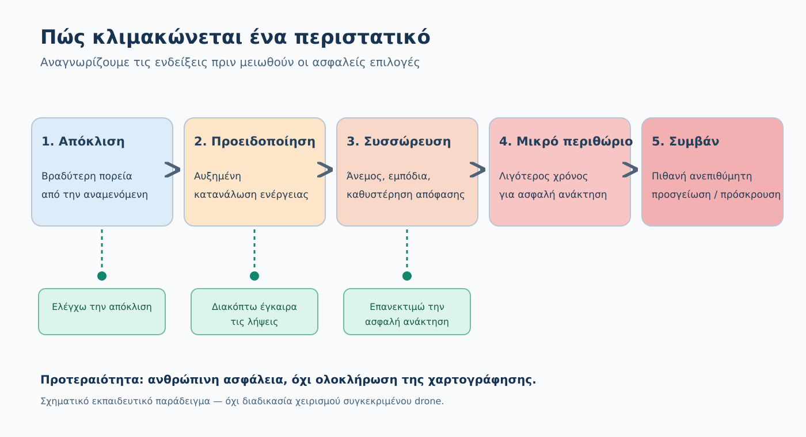

*Σχήμα F07-A. Συνθετικό εκπαιδευτικό διάγραμμα. Οι πράσινες διαδρομές δείχνουν ευκαιρίες να ανακοπεί η κλιμάκωση. Το σχήμα δεν αποτελεί τυποποιημένη διαδικασία έκτακτης ανάγκης.*

Μπορούμε να περιγράψουμε μια τυπική αλληλουχία σε πέντε φάσεις:

1. **Αρχική απόκλιση.** Το drone λειτουργεί, αλλά κάτι δεν συμφωνεί με το αναμενόμενο.
2. **Προειδοποίηση.** Εμφανίζεται ένδειξη που χρειάζεται άμεση αξιολόγηση. Το πρόβλημα ενδέχεται ακόμη να μπορεί να αντιμετωπιστεί χωρίς να χαθεί ο έλεγχος.
3. **Συσσώρευση παραγόντων.** Άνεμος, άνθρωποι, εμπόδια, καθυστέρηση αντίδρασης ή εσφαλμένες υποθέσεις αυξάνουν τον κίνδυνο.
4. **Απώλεια περιθωρίου.** Οι ασφαλείς επιλογές λιγοστεύουν: δεν υπάρχει πλέον επαρκής χρόνος, ενέργεια ή χώρος για το αρχικό σχέδιο.
5. **Συμβάν ή ατύχημα.** Ενδέχεται να υπάρξει ανεπιθύμητη προσγείωση, πρόσκρουση ή κίνδυνος για τρίτους.

Δεν είναι αναπόφευκτο να φτάσουμε στο πέμπτο στάδιο. Η αποτελεσματική διαχείριση είναι να **σταματήσει η αλυσίδα νωρίς**. Επίσης, μια ξαφνική σοβαρή βλάβη μπορεί να παρακάμψει ενδιάμεσα στάδια: δεν περιμένουμε να δούμε όλες τις φάσεις όταν απαιτείται άμεση εφαρμογή διαδικασίας ανάγκης.

### 3. Πού μπορούμε να διακόψουμε την αλυσίδα;

**Πριν από την πτήση:** ελέγχουμε καιρό, εμπόδια, μπαταρία, κατάλληλο σχέδιο επιστροφής και γνωστή συμπεριφορά failsafe. Αυτά συνδέονται με την DM00.4.6 και δεν τα επαναλαμβάνουμε ως πλήρες checklist.

**Στην πρώτη απόκλιση:** εξετάζουμε αν μια παρατήρηση επηρεάζει την ασφάλεια. Η απόφαση μπορεί να είναι η ασφαλής διακοπή της χαρτογράφησης και η αναθεώρηση της διαδρομής επιστροφής, αντί να επιμένουμε στον αρχικό προγραμματισμό.

**Σε επιβεβαιωμένο κίνδυνο:** η ανθρώπινη ασφάλεια και η αποφυγή σύγκρουσης με άλλα αεροσκάφη προηγούνται του εξοπλισμού και των δεδομένων. Αν η συνέχιση θέτει σε κίνδυνο τρίτους, δεν συνεχίζουμε την αποστολή.

**Σε άμεση κατάσταση ανάγκης:** προέχουν οι εφαρμοστέες διαδικασίες του συγκεκριμένου συστήματος, του κατασκευαστή και —όπου υπάρχουν— του επιχειρησιακού εγχειριδίου. Το διδακτικό μοντέλο «παρατηρώ → αναγνωρίζω → προστατεύω → ενεργώ → επανεκτιμώ → καταγράφω» **δεν αντικαθιστά τις άμεσες ενέργειες ανάγκης**.

### 4. Τι σημαίνει «διατηρώ περιθώριο ασφάλειας»;

Το περιθώριο δεν είναι ένα καθολικό ποσοστό μπαταρίας ούτε ένας μοναδικός αριθμός μέτρων. Είναι η διαθέσιμη ικανότητα να αντιμετωπίσουμε δυσμενή εξέλιξη χωρίς να εκτεθούν σε μη αποδεκτό κίνδυνο άνθρωποι ή άλλα αεροσκάφη.

Σκέψου τέσσερα είδη περιθωρίου:

- **Χρονικό:** έχουμε χρόνο να αναγνωρίσουμε την απόκλιση και να εφαρμόσουμε τη σωστή διαδικασία;
- **Ενεργειακό:** επαρκεί η ενέργεια για την ασφαλέστερη διαθέσιμη ανάκτηση υπό τις πραγματικές συνθήκες;
- **Χωρικό:** υπάρχει ασφαλής χώρος ελιγμών ή προσγείωσης χωρίς έκθεση τρίτων;
- **Πληροφοριακό:** γνωρίζουμε την κατάσταση του συστήματος, ή βασιζόμαστε σε ατεκμηρίωτη υπόθεση;

Όσο εξαντλούνται αυτά τα περιθώρια, τόσο δυσκολότερο γίνεται να διορθώσουμε το πρόβλημα. Ειδικά σε μια αυτόνομη χαρτογραφική αποστολή είναι εύκολο να συγχέουμε την ομαλή συνέχιση των waypoints με απόδειξη ασφάλειας: **δεν είναι το ίδιο**.

#### Έλεγχος κατανόησης — η ίδια ένδειξη, δύο ερμηνείες

Ο φοιτητής βλέπει μειωμένη ταχύτητα προόδου προς το Home Point. Ένας συνεργάτης θεωρεί βέβαιο ότι αυξήθηκε ο αντίθετος άνεμος. Ένας άλλος υποστηρίζει ότι ο ενεργός τρόπος πτήσης μπορεί να περιορίζει την ταχύτητα. **Ποια είναι η τεκμηριωμένη θέση;**

<details>
<summary>Κρυφή αναλυτική λύση — διάκριση παρατήρησης και διάγνωσης</summary>

Η μειωμένη πρόοδος αποτελεί **παρατήρηση**. Οι δύο εξηγήσεις είναι **υποθέσεις**, όχι επιβεβαιωμένα γεγονότα. Πρώτα εξετάζουμε τις αξιόπιστες διαθέσιμες ενδείξεις, τον πραγματικό τρόπο πτήσης και τις καιρικές συνθήκες. Αν δεν υπάρχει επιβεβαιωμένο ασφαλές περιθώριο ανάκτησης, δεν παρατείνουμε την εργασία συλλογής εικόνων μόνο και μόνο για να ολοκληρωθεί το σχέδιο. Δεν απαιτείται να αποδειχθεί με βεβαιότητα η αιτία πριν εφαρμοστεί ένα αναγκαίο προστατευτικό μέτρο.

</details>

### 5. Λυμένο παράδειγμα: τέσσερις γραμμές φωτογράφισης απομένουν

**Δεδομένα:** Η ομάδα διαπιστώνει μειωμένη πρόοδο προς τη βάση, αυξημένη κατανάλωση ενέργειας και αβεβαιότητα για την επάρκεια επιστροφής. Παραμένουν τέσσερις γραμμές λήψης και η αρχική διαδρομή επιστροφής γειτνιάζει με εμπόδια.

**Ερώτηση:** Πρέπει να ολοκληρωθούν οι τελευταίες τέσσερις γραμμές;

**Αναλυτική προσέγγιση:**

1. Η χαμηλότερη ταχύτητα και η κατανάλωση είναι **ενδείξεις**. Δεν γνωρίζουμε με βεβαιότητα την αιτία.
2. Ο πιθανός κίνδυνος είναι ότι η αποστολή θα καταναλώσει το απαραίτητο περιθώριο ανάκτησης. Τα εμπόδια επιβαρύνουν τις επιλογές επιστροφής.
3. Η ολοκλήρωση των φωτογραφιών δεν αποτελεί λόγο αποδοχής αυξημένου κινδύνου.
4. Η ασφαλής αρχική απόφαση είναι **να μη συνεχιστεί η παραγωγική εργασία ως έχει**. Ο χειριστής αξιολογεί χωρίς καθυστέρηση την ασφαλή ανάκτηση με βάση τις πραγματικές ενδείξεις, τις διαθέσιμες επιλογές και τις οδηγίες του συγκεκριμένου drone.
5. Η αυτόματη επιστροφή (*Return-to-Home*) δεν είναι πάντοτε η καταλληλότερη λύση. Η ασφαλής επιλογή εξαρτάται από το μοντέλο, το σημείο επιστροφής, τα εμπόδια, τις ρυθμίσεις, τον διαθέσιμο έλεγχο και την ενέργεια.
6. Μετά την ασφαλή ολοκλήρωση, καταγράφουμε ενδείξεις και αποφάσεις, ελέγχουμε αν το αρχικό σχέδιο ήταν υπεραισιόδοξο και αλλάζουμε τις μελλοντικές πρακτικές.

**Συμπέρασμα:** Δεν δίνουμε γενική εντολή «πάντα πάτησε RTH». Η τεκμηριωμένη επιλογή είναι να εγκαταλείψουμε έγκαιρα τον στόχο λήψης εικόνων όταν δεν έχει επιβεβαιωθεί επαρκές περιθώριο ασφαλούς συνέχισης.

### 6. Η ανθρώπινη παγίδα: «Αφού φτάσαμε ως εδώ...»

Συχνά η λανθασμένη απόφαση δεν οφείλεται σε άγνοια του drone αλλά στη δυσκολία εγκατάλειψης μιας αποστολής που έχει σχεδόν ολοκληρωθεί.

Παραδείγματα σκέψεων που πρέπει να αναγνωρίζει ο χειριστής:

- «Είναι μόνο μία μικρή προειδοποίηση.»
- «Την προηγούμενη φορά τα κατάφερε.»
- «Το drone έχει αυτόματη επιστροφή, άρα δεν χρειάζεται να ανησυχώ.»
- «Θα χάσουμε όλη τη δουλειά αν σταματήσουμε.»

Αυτές είναι **εσφαλμένες βεβαιότητες**, όχι τεχνικές μετρήσεις. Ο εκπαιδευόμενος πρέπει να μάθει να απαντά: «Ποια στοιχεία τεκμηριώνουν ότι η συνέχιση είναι ακόμη ασφαλής;» Αν τα κρίσιμα στοιχεία απουσιάζουν ή η κατάσταση επιδεινώνεται, δεν αντιμετωπίζουμε την απουσία τεκμηρίωσης ως άδεια συνέχισης.

### 7. Πότε μιλάμε για παραλίγο ατύχημα (near miss);

Η απουσία ζημιάς δεν αποδεικνύει ότι η πτήση ήταν ασφαλής. Ένα **παραλίγο ατύχημα** είναι μια κατάσταση στην οποία θα μπορούσε να είχε προκύψει βλαπτικό αποτέλεσμα, αλλά τελικά δεν προέκυψε. Η καταγραφή του έχει εκπαιδευτική αξία, επειδή μας επιτρέπει να βελτιώσουμε τις διαδικασίες πριν συμβεί πραγματικό ατύχημα.

Το «near miss» χρησιμοποιείται εδώ ως **εκπαιδευτική περιγραφή** και όχι ως αυτόματη νομική ταξινόμηση για τις υποχρεώσεις επίσημης αναφοράς. Οι απαιτήσεις αναφοράς περιστατικών αξιολογούνται χωριστά στην DM00.4.7.12.

Χρήσιμη καταγραφή: ημερομηνία και συνθήκες, μοντέλο και λειτουργία, πρώτη ένδειξη, τι ήταν γνωστό ή άγνωστο, ενέργειες που έγιναν, αποτέλεσμα, πιθανές αιτίες και μία συγκεκριμένη βελτίωση. Αποφεύγουμε να αποδίδουμε βεβαιωμένη αιτία όταν δεν διαθέτουμε τεκμήρια.

#### Μικρή άσκηση ομαδικής επικοινωνίας (μόνο επί χάρτου)

Η ομάδα αποτελείται από χειριστή και παρατηρητή. Ο παρατηρητής αναφέρει: «Αργή επιστροφή· δεν ξέρουμε ακόμη γιατί». Ο χειριστής πρέπει να απαντήσει με μία πρόταση που περιλαμβάνει **τι είναι βέβαιο, τι παραμένει αβέβαιο και ποιο στοιχείο της ασφαλούς ανάκτησης πρέπει να επαληθευθεί**. Η άσκηση δεν απαιτεί πραγματική πτήση.

<details>
<summary>Κρυφή ενδεικτική απάντηση — επικοινωνία ομάδας</summary>

«Επιβεβαιώνω ότι η πρόοδος επιστροφής είναι χαμηλότερη από την αναμενόμενη, δεν έχουμε διαγνώσει την αιτία και πρέπει τώρα να ελέγξουμε αν υπάρχει επαρκές περιθώριο ασφαλούς ανάκτησης· δεν συνεχίζουμε τις λήψεις με ανεπιβεβαίωτο κρίσιμο περιθώριο». Η ορθή απάντηση δεν εξαρτάται από κάποια υποχρεωτική τυποποιημένη φράση.

</details>

### 8. Πρακτική δραστηριότητα — εντοπίζω τρία σημεία πρόληψης

Στο παραπάνω σενάριο προστίθενται τρία στοιχεία: (α) η ομάδα είχε δει πριν από την απογείωση πρόγνωση για αυξανόμενες ριπές αλλά δεν είχε αποφασίσει σαφές κριτήριο διακοπής, (β) η πρώτη ένδειξη βραδύτερης επιστροφής αγνοήθηκε, (γ) η προειδοποίηση κατανάλωσης εμφανίστηκε όταν απέμεναν λίγες λήψεις.

**Παραδοτέο:** Συμπλήρωσε την Καρτέλα 04Δ-1. Για καθένα από τα τρία σημεία γράψε τι ήταν γνωστό, τι δεν είχε ελεγχθεί και ποια απόφαση θα μείωνε τον κίνδυνο. Στο τέλος κατέγραψε μια φράση που θα έλεγες σε συνεργάτη που επιμένει «να τελειώσουμε πρώτα».

**Κριτήρια (10 μονάδες):** εντοπισμός 3 σημείων παρέμβασης (3), διάκριση ένδειξης/αιτίας (2), αιτιολόγηση ασφαλούς διακοπής (3), πρόταση διορθωτικού μέτρου για επόμενη αποστολή (2). Η δραστηριότητα δεν θεωρείται επιτυχής εάν προτείνεται να συνεχιστεί η φωτογράφιση με ανεπιβεβαίωτο κρίσιμο περιθώριο επιστροφής.

<details>
<summary>Άνοιξε την ενδεικτική αναλυτική λύση της δραστηριότητας</summary>

**Πριν από την πτήση:** Η πρόγνωση αύξησης ριπών δεν αποδεικνύει από μόνη της ότι η πτήση απαγορεύεται, αλλά απαιτεί έλεγχο ορίων κατασκευαστή, επάρκειας ενέργειας και καθορισμό ορίου διακοπής. Αν αυτό δεν μπορεί να τεκμηριωθεί, αναβάλλουμε.

**Στην πρώτη απόκλιση:** Η βραδύτερη πρόοδος είναι προειδοποιητικό σημάδι και απαιτεί επανεκτίμηση. Δεν δηλώνουμε χωρίς στοιχεία ότι ο άνεμος είναι οπωσδήποτε η αιτία.

**Στην προειδοποίηση ενέργειας:** Διακόπτουμε την παραγωγική αποστολή ως έχει και εξετάζουμε αμέσως την ασφαλέστερη διαθέσιμη ανάκτηση σύμφωνα με το εγχειρίδιο και την πραγματική κατάσταση, χωρίς να εξαντλήσουμε την εφεδρεία για λήψεις.

**Φράση προς συνεργάτη:** «Οι λήψεις μπορούν να επαναληφθούν. Δεν θα καταναλώσουμε το άγνωστο περιθώριο επιστροφής για να κλείσουμε τέσσερις γραμμές». Το debrief πρέπει να προσθέσει σαφή κριτήρια διακοπής και αναθεώρηση του ενεργειακού σχεδιασμού.

</details>

### 9. Αυτοαξιολόγηση

**Ερώτηση 1.** Η χαμηλή ταχύτητα επιστροφής αποδεικνύει ότι υπάρχει ισχυρός αντίθετος άνεμος;
Α. Ναι, είναι η μοναδική εξήγηση.
Β. Όχι, είναι ένδειξη που απαιτεί έλεγχο, όχι βεβαιωμένη διάγνωση.
Γ. Όχι, αλλά μπορεί να αγνοηθεί εφόσον λειτουργεί η κάμερα.

<details>
<summary>Απάντηση 1 — αιτιολόγηση</summary>

**Β.** Πρέπει να εξεταστούν οι ενδείξεις πτήσης και το περιβάλλον. Η ύπαρξη φωτογραφιών δεν αποδεικνύει την ασφάλεια.

</details>

**Ερώτηση 2.** Ποια σκέψη είναι περισσότερο επικίνδυνη όταν η ενέργεια επιστροφής είναι αβέβαιη;
Α. «Ας επανεκτιμήσουμε την κατάσταση τώρα».
Β. «Ας προστατεύσουμε πρώτα τρίτους».
Γ. «Ας τελειώσουμε τις λίγες λήψεις, αφού φτάσαμε ως εδώ».

<details>
<summary>Απάντηση 2 — αιτιολόγηση</summary>

**Γ.** Η πίεση ολοκλήρωσης μπορεί να παρακάμψει το κριτήριο της ασφαλούς ανάκτησης. Προέχει ο έγκαιρος ασφαλής τερματισμός της παραγωγικής εργασίας.

</details>

**Ερώτηση 3.** Το drone προσγειώθηκε χωρίς ζημιά, αλλά κατά την επιστροφή πέρασε κοντά σε μη προβλεπόμενο εμπόδιο. Πρέπει να καταγραφεί το περιστατικό;
Α. Όχι, αφού δεν υπήρξε ζημιά.
Β. Ναι, για ανασκόπηση και βελτίωση της πρόληψης.
Γ. Μόνο αν χάθηκαν εικόνες.

<details>
<summary>Απάντηση 3 — αιτιολόγηση</summary>

**Β.** Το παραλίγο ατύχημα παρέχει χρήσιμα δεδομένα για την ασφάλεια. Το αν υφίσταται πρόσθετη τυπική υποχρέωση αναφοράς είναι ξεχωριστό ζήτημα.

</details>

**Ερώτηση 4.** Το drone συνεχίζει τα waypoints χωρίς προειδοποίηση στην οθόνη, αλλά η ομάδα παρατηρεί ότι η ασφαλής επιστροφή γίνεται αβέβαιη. Μπορούμε να συμπεράνουμε ότι η συνέχιση είναι ασφαλής;

<details>
<summary>Απάντηση 4 — αιτιολόγηση</summary>

**Όχι.** Η εκτέλεση της αυτοματοποιημένης διαδρομής δεν αποτελεί απόδειξη ασφαλούς περιθωρίου. Η ομάδα οφείλει να αξιολογεί την πραγματική κατάσταση και, εφόσον απαιτείται, να εγκαταλείψει τον στόχο συλλογής εικόνων προς χάριν της ασφαλούς ανάκτησης.

</details>

### 10. Συχνά λάθη και έλεγχος ολοκλήρωσης

| Λανθασμένη αντίληψη | Ορθή προσέγγιση |
|---|---|
| «Το αυτοματοποιημένο σχέδιο συνεχίζεται, άρα όλα είναι ασφαλή» | Οι αυτοματισμοί δεν αντικαθιστούν την επίγνωση κατάστασης |
| «Η ένδειξη είναι η αιτία» | Η ένδειξη χρειάζεται ερμηνεία και επαλήθευση |
| «Αν δεν υπήρξε πτώση, δεν χρειάζεται καταγραφή» | Οι παραλίγο αστοχίες είναι πηγή μάθησης |
| «Το RTH λύνει κάθε πρόβλημα» | Απαιτεί αξιολόγηση ειδικών δυνατοτήτων και εμποδίων |
| «Μία ακόμη λήψη δεν αλλάζει τίποτε» | Μπορεί να καταναλώσει το εναπομείναν περιθώριο |

Πριν συνεχίσεις στην **DM00.4.7.2**, βεβαιώσου ότι μπορείς να εξηγήσεις με δικά σου λόγια τη διαφορά ένδειξης–κινδύνου–συνέπειας, να επισημάνεις τρία σημεία πρόληψης στο παράδειγμα και να αιτιολογήσεις γιατί η ανθρώπινη ασφάλεια προηγείται της ολοκλήρωσης της εργασίας.

### 11. Πηγές και κανονιστική ακρίβεια

- **[Π1]** EASA, *Easy Access Rules for Unmanned Aircraft Systems*, αναθεώρηση 30 Ιουνίου 2026: https://www.easa.europa.eu/en/document-library/easy-access-rules/easy-access-rules-unmanned-aircraft-systems
- **[Π2]** Κανονισμός (ΕΕ) 2019/947, παράρτημα UAS.OPEN.060, ευθύνες χειριστή και υποχρέωση διακοπής πτήσης όταν αυτή θέτει σε κίνδυνο άλλους: https://www.easa.europa.eu/en/document-library/easy-access-rules/online-publications/easy-access-rules-unmanned-aircraft-systems?erules-id=ERULES-1963177438-17399
- **[Π3]** EASA, AMC2 UAS.OPEN.030(2)(b), πρακτικές δεξιότητες αυτοεκπαίδευσης A2 και ασυνήθιστες καταστάσεις: https://www.easa.europa.eu/en/document-library/easy-access-rules/online-publications/easy-access-rules-unmanned-aircraft-systems?erules-id=ERULES-1963177438-19528
- **[Π4]** EASA, AMC2 UAS.SPEC.050(1)(d)/(e), πιο αναλυτικές δεξιότητες στη Specific (εκπαιδευτική αναφορά, όχι γενική νομική υποχρέωση Open): https://www.easa.europa.eu/en/document-library/easy-access-rules/online-publications/easy-access-rules-unmanned-aircraft-systems?erules-id=ERULES-1963177438-15593

**Όρια:** Η συγκεκριμένη αλυσίδα κλιμάκωσης, το σχήμα και η Καρτέλα 04Δ-1 αποτελούν **εκπαιδευτικά εργαλεία του GeoSkills**, όχι αυτούσιες υποχρεωτικές νομικές φόρμες. Για πραγματικές αποφάσεις απαιτείται το ακριβές μοντέλο UAS, οι οδηγίες κατασκευαστή, η σχετική κατηγορία λειτουργίας, οι ισχύοντες περιορισμοί και οι πραγματικές συνθήκες.


---


### Συμπληρωματικός έλεγχος τεκμηρίωσης — Πύλη Β v0.4

> **Σημείωση έκδοσης:** Οι ακόλουθες διευκρινίσεις αφορούν αποκλειστικά την τεκμηρίωση των παρατιθέμενων ισχυρισμών. Δεν αποτελούν νέες γενικές εντολές χειρισμού.

- **B-01-003 — SUPPORTED_SCOPED_SPECIFIC:** Τα προγράμματα πρακτικής εκπαίδευσης STS/SPECIFIC περιλαμβάνουν επιμέρους τεχνικές και ενέργειες για ανώμαλες συνθήκες. Δεν γενικεύονται στην Open. Πηγή: [επίσημη τεκμηρίωση](https://www.easa.europa.eu/en/document-library/easy-access-rules/online-publications/easy-access-rules-unmanned-aircraft-systems?erules-id=ERULES-1963177438-17416).
## DM00.4.7.2 — Παρακολούθηση της πτήσης και επίγνωση κατάστασης

### Ερμηνευτική επισήμανση — παρατηρητής και εξαιρέσεις VLOS

Στην Open η γενική απαίτηση είναι VLOS και αποτελεσματική παρακολούθηση της εναέριας κυκλοφορίας. Για πτήση **FPV με γυαλιά** η επίσημη διευκρίνιση της EASA απαιτεί παρατηρητή UA **δίπλα στον χειριστή**, που βλέπει απευθείας το drone και μπορεί να ενημερώσει αμέσως. Το FPV δεν αποτελεί γενική άδεια BVLOS ούτε ο παρατηρητής δημιουργεί αυθαίρετη επέκταση της επιτρεπόμενης εμβέλειας. Υπάρχει επίσης οριοθετημένη εξαίρεση *follow-me* υπό τις σχετικές προϋποθέσεις. [EASA — UAS.OPEN.060](https://www.easa.europa.eu/en/document-library/easy-access-rules/online-publications/easy-access-rules-unmanned-aircraft-systems?erules-id=ERULES-1963177438-19528) · [EASA — FPV FAQ](https://www.easa.europa.eu/en/the-agency/faqs/i-am-drone-racing-andor-flying-drones-goggles-fpv-open-category).


**Αναθεωρημένο εκπαιδευτικό προσχέδιο v0.2 — 03/11/2026.**
**Κατάσταση:** Προς επιστημονική, παιδαγωγική και γλωσσική αξιολόγηση. Τα σενάρια είναι υποθετικά και δεν απαιτούν πραγματική πτήση.

> **Βασική ιδέα:** Δεν αρκεί να βλέπει ο χειριστής αριθμούς στην οθόνη. Πρέπει να γνωρίζει πού βρίσκεται το drone, τι υπάρχει γύρω του, ποιες κρίσιμες ενδείξεις αλλάζουν και τι μπορεί να συμβεί αμέσως μετά.

#### Τι θα μπορείς να κάνεις

Μετά τη μελέτη θα μπορείς να (α) εξηγείς την οπτική επαφή (VLOS), (β) διακρίνεις την εικόνα της κάμερας από την εξωτερική παρατήρηση, (γ) οργανώνεις έναν κύκλο παρακολούθησης τεσσάρων πεδίων, (δ) αναγνωρίζεις μεταβολές που απαιτούν ασφαλή διακοπή ή επανεκτίμηση, (ε) περιγράφεις τον ρόλο και τα όρια ενός παρατηρητή drone και (στ) συμπληρώνεις την Καρτέλα 04Δ-2.

#### Σύνδεση με την προηγούμενη υποενότητα

Στην DM00.4.7.1 εξετάσαμε την αλυσίδα «απόκλιση → προειδοποίηση → συσσώρευση κινδύνων → απώλεια περιθωρίου → περιστατικό». Τώρα μαθαίνουμε **πώς εντοπίζουμε την απόκλιση** όταν το drone εκτελεί ήδη μια αποστολή. Η επόμενη DM00.4.7.3 θα διδάξει αναλυτικότερα την αξιολόγηση normal / abnormal / emergency και τις αποφάσεις αντίδρασης. Εδώ η έμφαση είναι στο **παρατηρώ και αντιλαμβάνομαι εγκαίρως**.

### 1. Επίγνωση κατάστασης: βλέπω, κατανοώ, προβλέπω

Φαντάσου ένα drone που χαρτογραφεί αγρό 25 εκταρίων. Στην οθόνη εμφανίζεται υπόλοιπο μπαταρίας 35%. Η πληροφορία αυτή **δεν απαντά** από μόνη της στο ερώτημα «αρκεί για να επιστρέψει;». Χρειάζεται να εξετάσουμε απόσταση επιστροφής, πιθανή μεταβολή ανέμου, ενδείξεις του συστήματος, διαθέσιμες επιλογές προσγείωσης και τα δεδομένα του συγκεκριμένου drone.

- **Αντιλαμβάνομαι:** πού βρίσκεται και πώς κινείται το drone, τι αλλάζει γύρω του.
- **Κατανοώ:** τι σημαίνει η μεταβολή για την ασφάλεια.
- **Προβλέπω:** πώς θα μπορούσε να εξελιχθεί η κατάσταση αν συνεχιστεί η αποστολή.

Αυτή είναι μια **εκπαιδευτική απόδοση** της έννοιας situational awareness και όχι αυτοτελής κανονιστική διαδικασία.

### 2. Τα τέσσερα πεδία παρακολούθησης

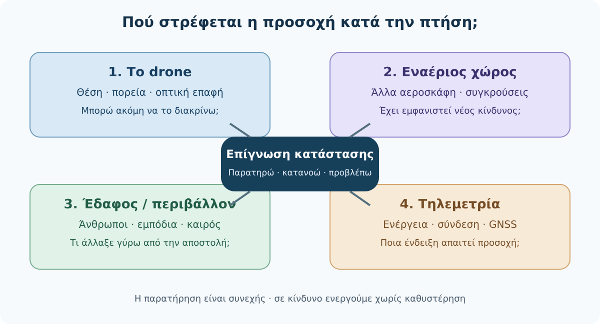

*Σχήμα F07-B. Πρωτότυπο, συνθετικό εκπαιδευτικό διάγραμμα. Η διαδοχή των πεδίων δεν καθορίζει χρόνο ή σειρά υποχρεωτικών χειρισμών σε έκτακτη ανάγκη.*

| Πεδίο | Ερωτήσεις που πρέπει να μπορώ να απαντήσω | Πιθανό προειδοποιητικό σημάδι |
|---|---|---|
| **Drone** | Το διακρίνω άμεσα; Κατανοώ τη θέση, την κατεύθυνση και την κίνησή του; | Δυσκολεύομαι να το εντοπίσω ή δεν μπορώ να εκτιμήσω την πορεία του |
| **Εναέριος χώρος** | Εμφανίστηκε επανδρωμένο αεροσκάφος ή άλλο εμπόδιο; | Ήχος/θέαμα αεροσκάφους, νέα δραστηριότητα στον αέρα |
| **Έδαφος / περιβάλλον** | Υπάρχουν άνθρωποι, οχήματα, ζώα, καλώδια ή αλλαγές ανέμου; | Κάποιος εισέρχεται στον χώρο όπου επηρεάζει την ασφάλεια |
| **Κατάσταση συστήματος** | Τι δείχνουν μπαταρία, τηλεμετρία, σύνδεση, GNSS, ενεργή λειτουργία και προειδοποιήσεις; | Νέο alarm, μη αναμενόμενη μεταβολή ταχύτητας ή λειτουργίας |

Τα πεδία αποτελούν **παιδαγωγικό εργαλείο** οργάνωσης της προσοχής. Δεν παρουσιάζονται ως αυτούσιο κείμενο του κανονισμού.

### 3. Οπτική επαφή (VLOS) δεν σημαίνει εικόνα κάμερας

Στην **Open**, η γενική αρχή είναι η διατήρηση του drone εντός οπτικής επαφής (VLOS), με τις συγκεκριμένες εξαιρέσεις που προβλέπει το ευρωπαϊκό πλαίσιο, όπως ορισμένες λειτουργίες follow-me και η χρήση FPV με κατάλληλο παρατηρητή. Η διαρκής παρακολούθηση του εναέριου χώρου παραμένει ουσιαστική για την αποφυγή συγκρούσεων. Το να εμφανίζεται η θέση του drone σε χάρτη ή ζωντανή εικόνα κάμερας **δεν αντικαθιστά** την αναγκαία εξωτερική παρατήρηση. Ο χειριστής πρέπει να μπορεί να αντιλαμβάνεται την κατάσταση ώστε να αποφεύγονται συγκρούσεις. (Πηγή: UAS.OPEN.060(2)(b) και EASA FAQ — βλέπε Μητρώο πηγών.)

**Τρεις διαφορετικές πληροφορίες:**

1. **Βλέπω το drone:** διατηρώ την πραγματική οπτική επαφή που απαιτεί η συγκεκριμένη λειτουργία.
2. **Βλέπω εικόνα κάμερας:** βλέπω μόνο την οπτική γωνία του αισθητήρα, όχι υποχρεωτικά όλο τον γύρω εναέριο χώρο.
3. **Βλέπω χάρτη/τηλεμετρία:** το λογισμικό αναφέρει δεδομένα θέσης και κατάστασης· η αξιοπιστία τους μπορεί να μεταβληθεί.

**Παράδειγμα:** Αν η εφαρμογή συνεχίζει να δείχνει την πορεία στο χάρτη, αλλά ο χειριστής δεν μπορεί πλέον να διατηρήσει την απαιτούμενη οπτική επαφή, δεν είναι σωστό να πει «αφού το GPS λειτουργεί, είμαι καλυμμένος». Πρέπει να αντιμετωπίσει αμέσως την απώλεια της δυνατότητας ασφαλούς παρακολούθησης σύμφωνα με τις διαδικασίες του συστήματος και του εκμεταλλευομένου. Δεν επιχειρεί αυτοσχέδιους ελιγμούς από ελλιπή δεδομένα.

### 4. Πώς αποφεύγουμε την προσκόλληση στην οθόνη;

Στη χαρτογράφηση η οθόνη είναι ιδιαίτερα ελκυστική: εμφανίζει γραμμές πτήσης, ποσοστό ολοκλήρωσης, εικόνες, στάθμη μπαταρίας και προειδοποιήσεις. Όμως, αν ο χειριστής παρακολουθεί μόνο την εφαρμογή, μπορεί να χάσει ένα αεροσκάφος που πλησιάζει ή μια αλλαγή κοντά στη διαδρομή.

Προτείνουμε έναν **ευέλικτο κύκλο επίγνωσης**: εξωτερική οπτική παρατήρηση → επιβεβαίωση θέσης/κατεύθυνσης → σύντομη εξέταση κρίσιμης τηλεμετρίας → επανέλεγχος περιβάλλοντος. Η πρακτική συχνότητα δεν καθορίζεται εδώ σε δευτερόλεπτα: εξαρτάται από την κατάσταση. Σε κρίσιμο κίνδυνο δεν περιμένουμε να ολοκληρωθεί ο κύκλος.

Ο χειριστής πρέπει να αποφεύγει δεύτερες εργασίες που αποσπούν την προσοχή, όπως τηλεφωνήματα ή επεξεργασία φωτογραφιών, όσο έχει την ευθύνη της πτήσης. Εάν απαιτείται παράλληλη τεχνική παρακολούθηση, μπορεί να προβλεφθεί σαφής κατανομή εργασιών στην ομάδα, χωρίς να εκχωρείται η τελική ευθύνη του χειριστή.

### 5. Παρατηρητής drone: τι κάνει και τι δεν κάνει

Ο κανονισμός UAS.OPEN.060(4) προβλέπει τη συνδρομή **παρατηρητή μη επανδρωμένου αεροσκάφους (UA observer)** με σαφή και αποτελεσματική επικοινωνία με τον χειριστή. Για λειτουργίες FPV στην Open, οι οδηγίες της EASA διευκρινίζουν ότι ο παρατηρητής βρίσκεται δίπλα στον χειριστή και παρακολουθεί απευθείας το drone. Ο ρόλος του δεν αποτελεί τρόπο αυθαίρετης επέκτασης της εμβέλειας πέρα από το VLOS. Οι όροι αυτοί δεν πρέπει να συγχέονται με άλλους ρόλους παρατηρητών στη Specific. **Ο χειριστής διατηρεί την ευθύνη ασφάλειας**.

Συμφωνούμε **πριν την απογείωση** σε απλές, σαφείς διατυπώσεις:

- «Αεροσκάφος στον ορίζοντα, προς [κατεύθυνση]».
- «Πρόσωπο εισέρχεται στη ζώνη που παρακολουθούμε».
- «Δεν έχω πια σαφή οπτική επαφή».
- «Επιβεβαίωσες ότι έλαβες την προειδοποίηση;».

Αυτά είναι **ενδεικτικά εκπαιδευτικά μηνύματα**, όχι τυποποιημένη αεροπορική φρασεολογία ή οδηγίες άμεσων χειρισμών. Το ότι υπάρχει παρατηρητής **δεν καθιστά την Open αυτομάτως BVLOS**.

### 6. Τι παρακολουθούμε στην τηλεμετρία;

| Ένδειξη | Χρήσιμη πληροφορία | Συχνό λάθος |
|---|---|---|
| Μπαταρία και προειδοποιήσεις ενέργειας | Διαθέσιμο απόθεμα, δυναμική κατανάλωσης, ειδοποιήσεις | «Έχω ακόμη 30%, άρα μπορώ να συνεχίσω» |
| Σύνδεση τηλεχειρισμού | Κατάσταση επικοινωνίας ελέγχου | Συγχέω πτώση ποιότητας βίντεο με απώλεια χειρισμού |
| GNSS / θέση | Αναφερόμενη θέση και ποιότητα/διαθεσιμότητα υπηρεσίας | Θεωρώ τη θέση του χάρτη πάντοτε ακριβή |
| Τρόπος πτήσης | Σε ποια λειτουργία βρίσκεται το σύστημα | Υποθέτω ότι ισχύουν πάντα οι ίδιοι αυτοματισμοί |
| Ύψος και απόσταση | Βοηθούν στην κατανόηση της αποστολής | Μπερδεύω σχετικό ύψος απογείωσης με ύψος από την επιφάνεια |
| Στοιχεία αποστολής | Ποιες λήψεις εκτελέστηκαν και ποιες υπολείπονται | Βάζω το ποσοστό ολοκλήρωσης πάνω από την ασφάλεια |

**Όρια γενίκευσης:** Οι ονομασίες και οι προειδοποιήσεις διαφέρουν ανά κατασκευαστή, μοντέλο, firmware και εφαρμογή. Δεν συνάγουμε από γενικό εκπαιδευτικό πίνακα ότι μια ορισμένη ένδειξη αποδεικνύει συγκεκριμένη βλάβη. Η αντιμετώπιση πρέπει να βασίζεται στο εγχειρίδιο και στο πραγματικό σύστημα.

### 6Α. Τι σημαίνει «το βλέπω» στην πράξη;

Η οπτική επαφή δεν ελέγχεται μόνο από το αν διακρίνουμε μια μικρή κουκκίδα στον ουρανό. Κρίσιμο είναι να μπορούμε, χωρίς βοηθητική οπτική συσκευή, να παρακολουθούμε το drone και τον περιβάλλοντα εναέριο χώρο ώστε να αντιλαμβανόμαστε εγκαίρως πιθανή σύγκρουση. Η συγκεκριμένη αξιολόγηση εξαρτάται από το μέγεθος του drone, το φόντο, τον φωτισμό, τον καιρό, τη θέση και την ικανότητα οπτικής παρατήρησης. Δεν υπάρχει ένα καθολικό «ασφαλές μήκος εμβέλειας σε μέτρα» για κάθε χειριστή και drone.

**Συνηθισμένη παρερμηνεία:** Η επιβεβαίωση GNSS, η ζωντανή εικόνα κάμερας ή η ύπαρξη παρατηρητή δεν δημιουργούν αυτομάτως δικαίωμα BVLOS. Η πτήση FPV στην Open έχει συγκεκριμένους όρους, και οι λοιπές εξαιρέσεις πρέπει να ελέγχονται χωριστά.

#### Τρία διαφορετικά προβλήματα, τρεις διαφορετικές πληροφορίες

| Εμφανιζόμενο πρόβλημα | Τι γνωρίζουμε | Τι ΔΕΝ αποδεικνύεται μόνο από αυτό | Εκπαιδευτική προτεραιότητα |
|---|---|---|---|
| Πάγωσε το βίντεο | Η εικόνα δεν ενημερώνεται | Ότι χάθηκε η σύνδεση χειρισμού | Επιβεβαίωση κατάστασης και ασφαλής διαχείριση βάσει διαδικασιών |
| Η εφαρμογή δεν δείχνει ενημερωμένη θέση | Η απεικόνιση θέσης δεν είναι αξιόπιστη | Ότι γνωρίζουμε πού βρίσκεται πράγματι το drone | Εξωτερική παρατήρηση και αποφυγή ελιγμών βάσει αβέβαιων δεδομένων |
| Το drone δεν διακρίνεται πλέον επαρκώς | Η απαιτούμενη οπτική παρακολούθηση έχει διαταραχθεί | Ότι μια εφαρμογή μπορεί να αντικαταστήσει το VLOS | Άμεση αντιμετώπιση σύμφωνα με την ασφαλή διαδικασία του συστήματος |

Το εκπαιδευτικό ζητούμενο δεν είναι να αποστηθίσουμε συγκεκριμένα κουμπιά, αλλά **να μη συγχέουμε την ένδειξη με τη διάγνωση**.

### 7. Αναλυτικά λυμένο παράδειγμα — Η «αόρατη» μεταβολή

**Πλαίσιο.** Υποθετικός αγρός 25 ha. Το drone εκτελεί αυτοματοποιημένη χαρτογράφηση, ο χειριστής το βλέπει και δεν υπάρχει γνωστή απαγόρευση στην περιοχή. Η τηλεμετρία δείχνει συνεχή πρόοδο της αποστολής. Ένας παρατηρητής αναφέρει ότι εμφανίστηκε ελικόπτερο στην ευρύτερη περιοχή. Την ίδια στιγμή ο χειριστής κοιτά την οθόνη για να ελέγξει το ποσοστό λήψεων.

**Βήμα 1 — Τι γνωρίζουμε;** Υπάρχει αναφορά για επανδρωμένο αεροσκάφος. Δεν γνωρίζουμε ακόμη την ακριβή διαδρομή και το κατά πόσο πλησιάζει. Δεν υποθέτουμε ότι η απουσία ειδοποίησης από την εφαρμογή αποδεικνύει απουσία κινδύνου.

**Βήμα 2 — Τι προέχει;** Η αποφυγή κάθε κινδύνου σύγκρουσης με επανδρωμένη αεροπορία. Ο χειριστής σταματά να δίνει προτεραιότητα στις φωτογραφικές λήψεις και εφαρμόζει άμεσα την ασφαλή ενέργεια που υπαγορεύουν η πραγματική κατάσταση και οι προβλεπόμενες διαδικασίες. Εάν υπάρχει αμφιβολία για την ασφαλή συνέχιση, η EASA συμβουλεύει άμεση προσγείωση όπου αυτό μπορεί να γίνει με ασφάλεια· δεν πραγματοποιείται τυφλός ελιγμός προς ανθρώπους ή εμπόδια.

**Βήμα 3 — Τι δεν κάνουμε;** Δεν συνεχίζουμε επειδή «μένουν μόνο 10% λήψεις». Δεν υποθέτουμε ότι ο παρατηρητής έχει αναλάβει την ευθύνη. Δεν πραγματοποιούμε αυθαίρετη κάθοδο χωρίς εκτίμηση εμποδίων.

**Βήμα 4 — Πότε επανεκτιμούμε;** Μόνο αφού αντιμετωπιστεί ο κίνδυνος και εξασφαλιστεί ότι οι συνθήκες για την επόμενη απόφαση είναι γνωστές. Η συνέχιση δεν είναι αυτόματη.

**Συμπέρασμα:** Η επίγνωση κατάστασης επιτρέπει την έγκαιρη διακοπή της φωτογραφικής αποστολής προτού ένα εξωτερικό γεγονός γίνει κίνδυνος σύγκρουσης. Η αναλυτική διαχείριση επανδρωμένου αεροσκάφους εξετάζεται στην DM00.4.7.4.

### 8. Πρακτική δραστηριότητα — Καρτέλα 04Δ-2

Χρησιμοποίησε την **Καρτέλα 04Δ-2 — Παρακολουθώ, αντιλαμβάνομαι, προβλέπω**. Δεν χρειάζεται πραγματικό drone.

**Σενάριο Α — Η οθόνη σε απορροφά.** Ο χειριστής κοιτά συνεχώς τα waypoints, ενώ η οπτική επαφή δυσκολεύει. Αναγνώρισε ποιες πληροφορίες διαθέτει, ποιες χάνει και ποιο ερώτημα πρέπει να απαντήσει πριν από οποιαδήποτε ασφαλή συνέχιση.

**Σενάριο Β — Απώλεια βίντεο.** Η εικόνα της κάμερας παγώνει, αλλά ο χειριστής εξακολουθεί να βλέπει το drone και η σύνδεση ελέγχου εμφανίζεται ενεργή. Εξήγησε γιατί δεν μπορούμε να διαγνώσουμε αυτομάτως απώλεια τηλεχειρισμού, πώς αλλάζει η παρακολούθηση και γιατί δεν πρέπει να συνεχίσουμε ανεξέλεγκτα την αποστολή. Μη δώσεις μοντελοεξαρτώμενες εντολές πλήκτρων.

**Σενάριο Γ — Νέα παρουσία στο έδαφος.** Ένα όχημα σταματά δίπλα στον αγρό και άνθρωποι κινούνται προς την περιοχή της προγραμματισμένης διαδρομής. Κατάταξε το νέο δεδομένο στα τέσσερα πεδία, ξεχώρισε τι είναι βέβαιο και τι άγνωστο και περιέγραψε ασφαλή αρχική επιλογή.

**Παραδοτέο:** τρεις πλήρεις εγγραφές στην Καρτέλα 04Δ-2.

**Κριτήρια (10 μονάδες):** σωστή αναγνώριση πεδίου/ένδειξης (3), διάκριση γνωστού-άγνωστου (2), προτεραιότητα ασφάλειας (3), αιτιολόγηση/επανεκτίμηση (2). Αποδεκτή εργασία: τουλάχιστον 8/10 και καμία οδηγία που προϋποθέτει ανασφαλή συνέχιση.

<details>
<summary>Ενδεικτική αναλυτική λύση — άνοιξε μετά την προσπάθειά σου</summary>

**Α:** Η εικόνα waypoints δεν είναι ισοδύναμη με VLOS. Η απώλεια δυνατότητας αξιόπιστης εξωτερικής παρατήρησης είναι κρίσιμο ζήτημα και η πτήση δεν συνεχίζεται σαν να μην υπάρχει πρόβλημα. Απαιτείται ασφαλής αντιμετώπιση βάσει του πραγματικού συστήματος και του περιβάλλοντος.

**Β:** Η απώλεια βίντεο δεν αποδεικνύει απώλεια C2. Επιβεβαιώνουμε τι γνωρίζουμε (οπτική επαφή, αναφερόμενη κατάσταση ελέγχου) και τι δεν γνωρίζουμε (αιτία παγώματος). Η φωτογραφική αποστολή δεν έχει προτεραιότητα· εφαρμόζονται κατάλληλες διαδικασίες, χωρίς να υποθέτουμε συγκεκριμένη συμπεριφορά failsafe.

**Γ:** Το πεδίο «έδαφος/περιβάλλον» άλλαξε. Γνωρίζουμε ότι εμφανίστηκαν άνθρωποι, όχι την πρόθεσή τους ή τη μελλοντική τους διαδρομή. Η ομάδα αξιολογεί αμέσως την πιθανή έκθεση τρίτων και δεν επιτρέπει συνέχιση που θα τους έθετε σε κίνδυνο. Επανελέγχει το σχέδιο πριν εξεταστεί οποιαδήποτε συνέχεια.

</details>

### 8Α. Σύνθετη δραστηριότητα — Η ίδια πτήση αλλάζει τρεις φορές

**Σκοπός:** Να αξιολογείς εκ νέου μια απόφαση όταν προστίθεται νέα πληροφορία, αντί να μένεις στην αρχική εκτίμηση.

**Υποθετικό σενάριο:** Γίνεται χαρτογράφηση αγρού 25 ha με drone που παραμένει σε οπτική επαφή, χωρίς γνωστό περιορισμό DAGR για την εξεταζόμενη θέση. Δεν παρέχονται τιμές για αποστάσεις, κατεύθυνση ανέμου ή ασφαλείς χώρους προσγείωσης· δεν επινοείς αυτές τις πληροφορίες.

- **Στιγμή Τ1:** Η εικόνα κάμερας παγώνει. Ο χειριστής συνεχίζει να διακρίνει το drone. Η εφαρμογή δείχνει σύνδεση χειρισμού ενεργή.
- **Στιγμή Τ2:** Εμφανίζεται προειδοποίηση ταχύτερης κατανάλωσης ενέργειας. Δεν είναι γνωστό αν η εναπομένουσα ενέργεια επαρκεί για ασφαλή επιστροφή.
- **Στιγμή Τ3:** Παρατηρητής αναφέρει ήχο επανδρωμένου αεροσκάφους χωρίς να έχει εντοπιστεί η ακριβής θέση του.

**Δική σου εργασία:** Συμπλήρωσε την Καρτέλα 04Δ-2Β για Τ1, Τ2 και Τ3. Για κάθε στιγμή σημείωσε τι άλλαξε, τι παραμένει αβέβαιο, ποια προτεραιότητα μεταβάλλεται και τι θα χρειαζόταν πριν από οποιαδήποτε νέα απόφαση. Δεν ζητείται πραγματική πτήση ή άσκηση με σκόπιμη απώλεια σύνδεσης.

<details>
<summary>Αναλυτική ενδεικτική λύση της σύνθετης δραστηριότητας</summary>

**Τ1:** Η διακοπή εικόνας δεν αποτελεί αυτόματη απόδειξη απώλειας C2. Εφόσον υπάρχει VLOS και αναφερόμενη σύνδεση ελέγχου, η αιτία παραμένει άγνωστη. Η φωτογραφική αποστολή δεν έχει προτεραιότητα έναντι της ασφαλούς παρακολούθησης· αξιολογούνται οι ασφαλείς επιλογές σύμφωνα με το συγκεκριμένο σύστημα.

**Τ2:** Προστίθεται ανεξάρτητος ενεργειακός κίνδυνος. Δεν αρκεί η προηγούμενη εκτίμηση για την εικόνα ούτε το ποσοστό μπαταρίας. Η ασφαλής ανάκτηση ή προσγείωση γίνεται άμεση προτεραιότητα, με γνώμονα πραγματική διαθεσιμότητα ενέργειας, καιρικές συνθήκες, περιβάλλον και προβλεπόμενες διαδικασίες.

**Τ3:** Η πιθανή παρουσία επανδρωμένου αεροσκάφους απαιτεί άμεση προσοχή στην αποφυγή σύγκρουσης και παραχώρηση προτεραιότητας. Η αβεβαιότητα θέσης δεν αποτελεί λόγο να αγνοηθεί η προειδοποίηση. Ο χειριστής επιλέγει την ασφαλέστερη διαθέσιμη αντιμετώπιση βάσει της πραγματικής κατάστασης, χωρίς τυφλούς ελιγμούς. Οι ήδη υφιστάμενοι ενεργειακοί κίνδυνοι δεν εξαφανίζονται.

**Κοινό συμπέρασμα:** Οι αποφάσεις δεν λαμβάνονται μία φορά για ολόκληρη την αποστολή. Επικαιροποιούνται κάθε φορά που μεταβάλλονται τα δεδομένα και οι κίνδυνοι. Το σενάριο δεν αρκεί για να προσδιοριστεί συγκεκριμένος χειρισμός ή πορεία προσγείωσης.

</details>

### 9. Αυτοαξιολόγηση

**Ερώτηση 1.** Σε πτήση Open, αρκεί η συνεχής εικόνα από την κάμερα για να εξασφαλίζεται VLOS; **Α:** Ναι. **Β:** Όχι. **Γ:** Ναι, εφόσον υπάρχει καλό GNSS.

<details><summary>Απάντηση 1</summary>

**Β.** Η εικόνα κάμερας δεν υποκαθιστά από μόνη της την απαιτούμενη οπτική παρατήρηση. Υπάρχουν ειδικές προϋποθέσεις/εξαιρέσεις που περιγράφει ο κανονισμός, όχι γενική απαλλαγή λόγω κάμερας.

</details>

**Ερώτηση 2.** Η βιντεοσύνδεση παγώνει ενώ το drone παραμένει ορατό και ο έλεγχος αναφέρεται ενεργός. Ποια ερμηνεία είναι ορθή; **Α:** Σίγουρη απώλεια ελέγχου. **Β:** Σίγουρη βλάβη GNSS. **Γ:** Δεν τεκμηριώνεται ακόμη συγκεκριμένη αιτία ή απώλεια C2.

<details><summary>Απάντηση 2</summary>

**Γ.** Πρέπει να διαχωρίσουμε τα επιμέρους κανάλια και την αξιοπιστία των ενδείξεων. Οι ενέργειες εξαρτώνται από την κατάσταση και το εγχειρίδιο του συγκεκριμένου drone.

</details>

**Ερώτηση 3.** Ο παρατηρητής αναφέρει επανδρωμένο αεροσκάφος. Τι προηγείται; **Α:** Να ολοκληρωθεί η τελευταία λήψη. **Β:** Να αντιμετωπιστεί άμεσα ο πιθανός κίνδυνος σύγκρουσης. **Γ:** Να παρακολουθήσουμε μόνο το ποσοστό μπαταρίας.

<details><summary>Απάντηση 3</summary>

**Β.** Η ασφάλεια της επανδρωμένης αεροπορίας υπερισχύει των φωτογραφικών λήψεων. Ο χειριστής οφείλει να εξασφαλίσει αποφυγή κινδύνου και να διακόψει όταν η λειτουργία δεν είναι ασφαλής.

</details>

**Ερώτηση 4.** Ποιο από τα ακόλουθα είναι ορθό για τον παρατηρητή; **Α:** Αναλαμβάνει πλήρως την ευθύνη. **Β:** Επιτρέπει πάντοτε πτήση BVLOS. **Γ:** Συνδράμει με σαφή επικοινωνία, χωρίς να καταργεί την ευθύνη του χειριστή.

<details><summary>Απάντηση 4</summary>

**Γ.** Ο UA observer υποστηρίζει την εξωτερική παρατήρηση σύμφωνα με τους προβλεπόμενους όρους. Δεν μετατρέπεται σε άδεια για αυθαίρετη επέκταση εμβέλειας.

</details>

**Ερώτηση 5 (ανοικτή).** Εξήγησε με δύο προτάσεις γιατί το «35% μπαταρία» δεν αποδεικνύει ότι μπορεί να ολοκληρωθεί η χαρτογράφηση.

<details><summary>Ενδεικτική απάντηση 5</summary>

Η απαιτούμενη ενέργεια εξαρτάται από την απόσταση, τον άνεμο, την κατάσταση του συστήματος και το σχέδιο ασφαλούς ανάκτησης. Το ποσοστό χωρίς αυτά τα στοιχεία δεν δίνει αξιόπιστη απόφαση συνέχισης.

</details>

**Ερώτηση 6 (σύνθετη).** Σε μια αποστολή παγώνει το βίντεο, ακολουθεί προειδοποίηση ενέργειας και μετά αναφέρεται πιθανό επανδρωμένο αεροσκάφος. Γιατί δεν επαρκεί να απαντήσει ο χειριστής μόνο στο πρώτο πρόβλημα;

<details>
<summary>Ενδεικτική απάντηση 6</summary>

Επειδή κάθε νέα ένδειξη μεταβάλλει το συνολικό επίπεδο κινδύνου. Η επάρκεια ενέργειας και η αποφυγή σύγκρουσης έχουν προτεραιότητα έναντι της ολοκλήρωσης της αποστολής και πρέπει να επανεκτιμώνται με τα διαθέσιμα πραγματικά δεδομένα.

</details>

### 10. Συχνά λάθη

- **«Το βλέπω στον χάρτη, άρα το βλέπω και στον ουρανό».** Λανθασμένη εξίσωση τηλεμετρίας και VLOS.
- **«Το βίντεο χάθηκε, άρα χάθηκε ο έλεγχος».** Απαιτείται διάκριση των καναλιών, όχι αυθαίρετη διάγνωση.
- **«Έχω παρατηρητή, άρα δεν χρειάζεται να παρακολουθώ».** Η ευθύνη του χειριστή παραμένει.
- **«Το drone εκτελεί αυτόματα waypoints, άρα δεν χρειάζεται προσοχή».** Η αυτοματοποίηση δεν καταργεί τη συνεχή ευθύνη και επίβλεψη.
- **«Δεν έχω δει αεροσκάφος στην οθόνη».** Η απουσία ένδειξης σε εφαρμογή δεν αποκλείει πραγματική κυκλοφορία.

### 11. Έλεγχος ολοκλήρωσης

Πριν προχωρήσεις στην DM00.4.7.3, βεβαιώσου ότι μπορείς να περιγράψεις τα τέσσερα πεδία παρακολούθησης, να εξηγήσεις την έννοια VLOS, να διακρίνεις εικόνα/τηλεμετρία/οπτική επαφή, να περιγράψεις τον ρόλο του UA observer και να αξιολογήσεις την Καρτέλα 04Δ-2 χωρίς να προτείνεις συνέχιση σε μη ελεγχόμενο κίνδυνο και να ολοκληρώσεις τη σύνθετη άσκηση 04Δ-2Β με διαδοχικές μεταβολές της κατάστασης.

### 12. Πηγές και τεκμηρίωση

1. EASA, *Easy Access Rules for Unmanned Aircraft Systems*, αναθεώρηση Ιουνίου 2026: https://www.easa.europa.eu/en/document-library/easy-access-rules/easy-access-rules-unmanned-aircraft-systems
2. EASA, UAS.OPEN.060(2)(b), (d) και (4), καθώς και AMC/GM (online): https://www.easa.europa.eu/en/document-library/easy-access-rules/online-publications/easy-access-rules-unmanned-aircraft-systems?erules-id=ERULES-1963177438-19528
3. EASA, FAQ: *Responsibilities for drone operators and remote pilots in the open category*: https://www.easa.europa.eu/en/the-agency/faqs/responsibilities-drone-operators-and-remote-pilots-open-category
4. EUR-Lex, Κανονισμός (ΕΕ) 2019/947: https://eur-lex.europa.eu/legal-content/EL/TXT/?uri=celex:32019R0947

**Έλεγχος πηγών:** 03/11/2026, με συμπληρωματική αντιπαραβολή της επίσημης ενημέρωσης EASA για VLOS/FPV και παρατηρητή. Οι τεχνικές οθόνες και οι χειρισμοί ποικίλλουν ανά drone· το κείμενο δεν αποτελεί επιχειρησιακό εγχειρίδιο ή εξουσιοδότηση πραγματικής πτήσης.


---


### Συμπληρωματικός έλεγχος τεκμηρίωσης — Πύλη Β v0.4

> **Σημείωση έκδοσης:** Οι ακόλουθες διευκρινίσεις αφορούν αποκλειστικά την τεκμηρίωση των παρατιθέμενων ισχυρισμών. Δεν αποτελούν νέες γενικές εντολές χειρισμού.

- **B-02-003 — SUPPORTED_SPLIT:** Παρατηρητής FPV: δίπλα στον χειριστή· ο χειριστής συνεχίζει να έχει ευθύνη πτήσης. Για επανδρωμένα αεροσκάφη εφαρμόζεται χωριστά UAS.OPEN.060. Πηγή: [επίσημη τεκμηρίωση](https://www.easa.europa.eu/en/document-library/easy-access-rules/online-publications/easy-access-rules-unmanned-aircraft-systems?erules-id=ERULES-1963177438-19528).
- **B-02-004 — SUPPORTED_GM:** Στην Open, ο παρατηρητής UA δεν επιμηκύνει την απόσταση VLOS του χειριστή· προβλέπεται ειδική GM αναφορά σε χρήση βοηθημάτων για επείγουσα ασφαλή προσγείωση. Πηγή: [επίσημη τεκμηρίωση](https://www.easa.europa.eu/en/document-library/easy-access-rules/online-publications/easy-access-rules-unmanned-aircraft-systems?erules-id=ERULES-1963177438-19528).
## DM00.4.7.3 — Αναγνώριση ασυνήθιστης κατάστασης και λήψη ασφαλούς απόφασης

### Ερμηνευτική επισήμανση — Open και Specific

Η υποχρέωση διακοπής όταν η πτήση θέτει σε κίνδυνο τρίτους και η συμμόρφωση με το εγχειρίδιο προκύπτουν από το **UAS.OPEN.060** για την Open. Οι ειδικά διαμορφωμένες διαδικασίες contingency/emergency ενός φορέα εκμετάλλευσης στο πλαίσιο **Specific**, καθώς και οι όροι εγκεκριμένης επιχείρησης, δεν αποτελούν ταυτόσημες υποχρεώσεις για κάθε πτήση Open. Οι πίνακες «normal–abnormal–emergency» που ακολουθούν χρησιμεύουν στην εκπαίδευση, όχι ως νομικός ορισμός τριών επίσημων κατηγοριών. [EASA — UAS.OPEN.060 και UAS.SPEC.060](https://www.easa.europa.eu/en/document-library/easy-access-rules/online-publications/easy-access-rules-unmanned-aircraft-systems?erules-id=ERULES-1963177438-19528).


**Αναθεωρημένο εκπαιδευτικό προσχέδιο v0.2 — 03/11/2026.**
**Κατάσταση:** Προς επιστημονική, παιδαγωγική, γλωσσική και τεχνική αξιολόγηση. Δεν αποτελεί επιχειρησιακό εγχειρίδιο πτήσης.

> **Κεντρική ιδέα:** Μια προειδοποίηση δεν είναι αυτομάτως έκτακτη ανάγκη· όμως καμία αποστολή χαρτογράφησης δεν αξίζει να συνεχιστεί όταν η ασφάλεια τίθεται σε κίνδυνο.

#### Τι θα μπορείς να κάνεις

Μετά τη μελέτη θα μπορείς να: (α) διακρίνεις τις κανονικές, ασυνήθιστες και καταστάσεις έκτακτης ανάγκης, (β) ξεχωρίζεις επιβεβαιωμένα γεγονότα από υποθέσεις, (γ) αναγνωρίζεις πότε εγκαταλείπεται ο στόχος της αποστολής, (δ) επιλέγεις τεκμηριωμένη αρχική κατεύθυνση αντίδρασης και (ε) επανεκτιμάς την ασφάλεια όταν τα δεδομένα αλλάζουν.

#### Σύνδεση με τις DM00.4.7.1 και DM00.4.7.2

Στην 4.7.1 αναλύσαμε **πώς κλιμακώνεται** ένα συμβάν. Στην 4.7.2 μάθαμε **τι παρακολουθούμε**: drone, εναέριο χώρο, έδαφος και σύστημα. Στην παρούσα 4.7.3 ενώνουμε τις δύο δεξιότητες: **πώς αποφασίζουμε** όταν η πτήση αποκλίνει από το αναμενόμενο. Τα ειδικά περιστατικά ανθρώπων, καιρού, ενέργειας, επικοινωνιών, GNSS, RTH και βλάβης αναλύονται στις επόμενες 4.7.4–4.7.10.

### 1. Μια προειδοποίηση: τρεις πιθανές ερμηνείες

Ένα drone χαρτογραφεί αγρό 25 εκταρίων. Στην οθόνη εμφανίζεται σύντομη προειδοποίηση ποιότητας σήματος. Το drone παραμένει ορατό και ο χειριστής δεν διαπιστώνει άμεση μεταβολή της πορείας του. Μπορεί να συνεχίσει τις λήψεις;

**Δεν έχουμε ακόμη αρκετά δεδομένα ώστε να αιτιολογήσουμε την ασφαλή συνέχιση της εργασίας.** Χρειάζεται να εξακριβώσουμε τι είδους σήμα επηρεάζεται, τι λέει το εγχειρίδιο του συγκεκριμένου μοντέλου και εάν η αβεβαιότητα επηρεάζει την ασφαλή λειτουργία. Δεν υποθέτουμε ότι μια προειδοποίηση σημαίνει «έχασα τον έλεγχο», αλλά ούτε την αγνοούμε επειδή εξαφανίστηκε.

Το ίδιο σύμπτωμα μπορεί να έχει διαφορετική σημασία ανά μοντέλο, λειτουργία πτήσης και συνθήκες. Οι όροι *normal/abnormal/emergency* χρησιμοποιούνται εδώ ως **εκπαιδευτικό πλαίσιο ταξινόμησης**, όχι ως ομοιόμορφες ετικέτες που θα εμφανιστούν στις οθόνες όλων των drones.

### 2. Οι τρεις καταστάσεις λειτουργίας

| Επίπεδο | Περιγραφή | Στάση του χειριστή | Παράδειγμα |
|---|---|---|---|
| **Κανονική λειτουργία** | Όσα είναι κρίσιμα για την ασφαλή πτήση παραμένουν εντός των επιβεβαιωμένων ορίων | Συνεχής επιτήρηση, ετοιμότητα ανάληψης ελέγχου | Η προγραμματισμένη πτήση προχωρά χωρίς νέα προβλήματα |
| **Ασυνήθιστη κατάσταση** | Υπάρχει απόκλιση ή αβεβαιότητα που απαιτεί αντίδραση, αλλά ενδέχεται να διατηρείται η δυνατότητα ελεγχόμενης αντιμετώπισης | Προτεραιότητα στην ασφάλεια, παύση/εγκατάλειψη έργου όταν απαιτείται, εφαρμογή διαδικασιών κατασκευαστή/εκμεταλλευομένου | Μη αναμενόμενη κατανάλωση μπαταρίας με διαθέσιμο έλεγχο |
| **Κατάσταση έκτακτης ανάγκης** | Άμεση σοβαρή απειλή ή αδυναμία διατήρησης ασφαλούς λειτουργίας | Εφαρμογή προβλεπόμενων επείγουσων ενεργειών χωρίς να περιμένουμε την ολοκλήρωση ενός αργού κύκλου ελέγχου | Ανεξέλεγκτη πορεία προς περιοχή ανθρώπων |

**Σημαντική επιφύλαξη:** Στο ειδικό κανονιστικό περιβάλλον της *Specific*, οι έννοιες contingency και emergency συνδέονται με ρητά όρια περιοχής λειτουργίας και επιχειρησιακές διαδικασίες. Η γενική παρουσίαση εδώ δεν τις υποκαθιστά ούτε τις καθιστά αυτόματα υποχρεώσεις όλων των πτήσεων Open. Οι ορισμοί της SORA χρησιμοποιούνται ως συγκριτικό παράδειγμα, όχι ως γενικοί ορισμοί της Open. [EASA-03, EASA-04]

### 2Α. Η κρίσιμη διάκριση: εργασία, πτήση και άμεση απειλή

Οι φράσεις «σταματώ τη χαρτογράφηση», «διακόπτω την πτήση» και «ενεργοποιώ διαδικασία έκτακτης ανάγκης» **δεν περιγράφουν την ίδια ενέργεια**.

| Απόφαση | Τι σημαίνει στην πράξη | Παράδειγμα ορθής αιτιολόγησης |
|---|---|---|
| **Σταματώ την εργασία λήψεων** | Δεν δίνω προτεραιότητα στις φωτογραφικές γραμμές· εξετάζω ασφαλή διαχείριση του αεροσκάφους | Η κατανάλωση ενέργειας αποκλίνει και δεν έχει επιβεβαιωθεί η επάρκεια επιστροφής |
| **Ολοκληρώνω με ασφάλεια την πτήση** | Εφαρμόζω κατάλληλη, ελεγχόμενη διαδικασία επιστροφής ή προσγείωσης σύμφωνα με το σύστημα και την κατάσταση | Δεν υπάρχουν οι προϋποθέσεις συνέχισης και υπάρχει ασφαλής διαδρομή ανάκτησης |
| **Αντιμετωπίζω άμεση απειλή** | Εφαρμόζω χωρίς καθυστέρηση τις προβλεπόμενες ενέργειες προστασίας τρίτων και έκτακτης ανάγκης | Υπάρχει ενδεχόμενη σύγκρουση ή ανεξέλεγκτη κατεύθυνση προς ανθρώπους |

Δεν υπάρχει ένας καθολικός χειρισμός για όλα τα drones. **Η ασφαλής ανάκτηση δεν ταυτίζεται υποχρεωτικά με την αυτόματη λειτουργία RTH**· σε συγκεκριμένη κατάσταση αυτή μπορεί να είναι ακατάλληλη ή και μη διαθέσιμη. Ο χειριστής πρέπει να έχει γνωρίσει εκ των προτέρων τις διαδικασίες του πραγματικού μοντέλου.

#### Πότε δεν περιμένουμε να ολοκληρώσουμε μια ανάλυση;

Σε μια άμεση απειλή δεν αρχίζουμε να συμπληρώνουμε πίνακες ούτε χάνουμε χρόνο προσπαθώντας να ονομάσουμε την ακριβή κατηγορία περιστατικού. **Προστασία ανθρώπων και άλλων αεροσκαφών → άμεση εφαρμογή της κατάλληλης διαδικασίας → επανεκτίμηση όταν είναι ασφαλές.** Το υπόλοιπο εκπαιδευτικό μοντέλο εφαρμόζεται στην εκπαίδευση και σε περιστάσεις όπου υπάρχει χρόνος αξιολόγησης.

### 3. Πέντε ερωτήσεις που οργανώνουν τη σκέψη

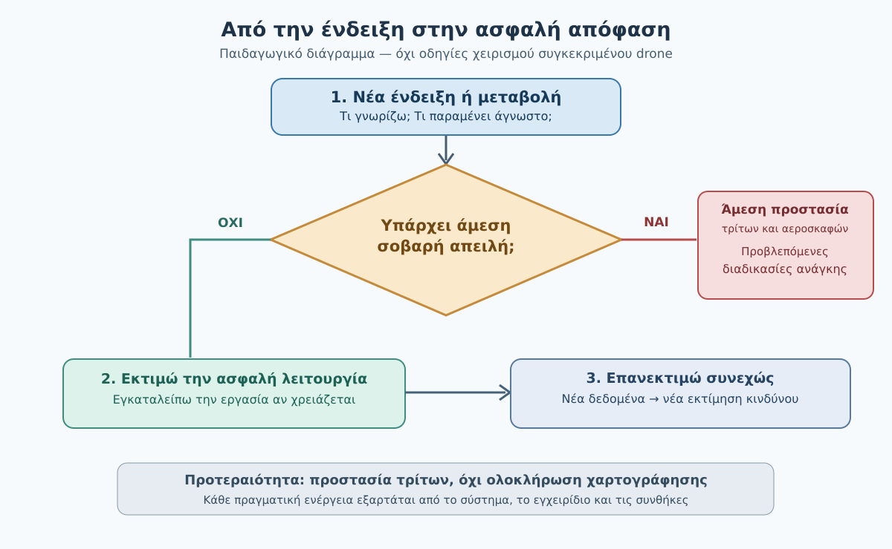

*Σχήμα F07-C. Πρωτότυπο εκπαιδευτικό διάγραμμα απόφασης. Δεν αποτελεί ακολουθία κουμπιών ή πιστοποιημένη διαδικασία έκτακτης ανάγκης.*

1. **Τι ακριβώς παρατηρώ;** Διαβάζω την πραγματική ένδειξη, όχι μια πρόχειρη ερμηνεία της.
2. **Ποιον μπορεί να επηρεάσει;** Άλλα αεροσκάφη, ανθρώπους, ζώα, περιβάλλον, περιουσία.
3. **Υπάρχει άμεσος κίνδυνος;** Αν ναι, εφαρμόζω χωρίς καθυστέρηση τις κατάλληλες άμεσες διαδικασίες.
4. **Είναι ασφαλές να συνεχιστεί η εργασία;** Αν όχι, εγκαταλείπω την πρόοδο της χαρτογράφησης και αντιμετωπίζω το συμβάν.
5. **Τι αλλάζει μετά την αντίδραση;** Επανεκτιμώ τα δεδομένα, χωρίς να θεωρώ ότι η πρώτη κίνηση έλυσε αυτομάτως το πρόβλημα.

Αυτό είναι παιδαγωγικό μοντέλο και όχι διαδικασία ελέγχου για όλες τις συσκευές. Σε **πραγματική έκτακτη ανάγκη**, οι προβλεπόμενες άμεσες ενέργειες και η προστασία τρίτων προηγούνται οποιασδήποτε αναλυτικής συμπλήρωσης καρτέλας.

### 4. Τρεις αποφάσεις που συχνά συγχέονται

| Εκπαιδευτική απόφαση | Τι σημαίνει | Τι **δεν** σημαίνει |
|---|---|---|
| **Ελεγχόμενη συνέχεια με διαρκή παρακολούθηση** | Δεν έχει αναδειχθεί ανεπίλυτος κρίσιμος κίνδυνος και πληρούνται οι σχετικές προϋποθέσεις | Ότι εξασφαλίστηκε η ασφάλεια για όλη την αποστολή |
| **Εγκατάλειψη χαρτογραφικής εργασίας / ασφαλής ανάκτηση** | Εγκαταλείπουμε τις λήψεις και ακολουθούμε κατάλληλη διαδικασία επιστροφής/προσγείωσης | Ότι το RTH είναι πάντοτε ο κατάλληλος ή διαθέσιμος τρόπος |
| **Επείγουσα αντιμετώπιση** | Προβλεπόμενες άμεσες ενέργειες σε σοβαρό κίνδυνο | Ότι επιτρέπεται κάθε αυτοσχέδιος χειρισμός ή κάθε τρόπος τερματισμού πτήσης |

**Πολύ σημαντικό:** Το «διακόπτω την πτήση» του κανονισμού δεν σημαίνει ότι απενεργοποιώ αμέσως τους κινητήρες στον αέρα. Η ασφαλής υλοποίηση εξαρτάται από το περιστατικό, το μοντέλο και τις προβλεπόμενες διαδικασίες. Η ενεργοποίηση *flight termination* μπορεί να έχει σοβαρές συνέπειες και δεν αποτελεί γενική σύσταση για πτήσεις Open.

### 5. Αναλυτικά λυμένο παράδειγμα — Η τελευταία γραμμή χαρτογράφησης

**Στοιχεία υποθετικής αποστολής:** Drone με ενεργό σύστημα πτήσης και δυνατότητα αυτοματοποιημένων διαδρομών, αγρός 25 ha, γνωστό και ελεγμένο σημείο απογείωσης. Η αποστολή έχει ολοκληρώσει περίπου το 80% των φωτογραφικών γραμμών. Το συγκεκριμένο μοντέλο και οι ρυθμίσεις του δεν προσδιορίζονται: δεν μπορούμε επομένως να δώσουμε γενικές εντολές χειρισμού.

**Τ1 — Μια νέα ένδειξη.** Η εφαρμογή προειδοποιεί για ταχύτερη από την αναμενόμενη κατανάλωση ενέργειας. Το drone παραμένει ορατό και η διαδρομή συνεχίζεται. **Γνωρίζουμε** ότι η κατανάλωση αποκλίνει. **Δεν γνωρίζουμε** πόσο επαρκεί το απόθεμα για ασφαλή επιστροφή με τον υφιστάμενο άνεμο.

**Αξιολόγηση:** Η συνέχιση της φωτογράφισης δεν δικαιολογείται από το «μένει λίγο». Η αποστολή χαρτογράφησης εγκαταλείπεται ως προτεραιότητα. Ο χειριστής αξιολογεί άμεσα την ασφαλή ανάκτηση με βάση την πραγματική κατάσταση, τις ενδείξεις και το εγχειρίδιο. Δεν περιμένει να εμφανιστεί η χαμηλότερη δυνατή στάθμη μπαταρίας.

**Τ2 — Επιπρόσθετη πληροφορία.** Ο παρατηρητής αναφέρει ενίσχυση ανέμου και μεταβολή κίνησης του drone σε σχέση με την αναμενόμενη. **Νέα πληροφορία:** η απαιτούμενη ενέργεια επιστροφής μπορεί να αλλάζει. **Απόφαση:** επανεκτιμούμε τις ασφαλείς επιλογές ανάκτησης και δεν συνεχίζουμε τις λήψεις μόνο και μόνο επειδή έχουν σχεδόν ολοκληρωθεί.

**Τ3 — Εμφάνιση επανδρωμένου αεροσκάφους.** Παρατηρείται αεροσκάφος με πιθανή σύγκλιση προς την περιοχή. **Προτεραιότητα:** αποφυγή σύγκρουσης και άμεση εφαρμογή των κατάλληλων διαδικασιών, σύμφωνα με τις πραγματικές συνθήκες. Η συζήτηση για τις φωτογραφίες ή το ποσοστό μπαταρίας δεν μπορεί να καθυστερήσει την προστασία από κίνδυνο σύγκρουσης.

**Γιατί αυτή είναι μια καλή εκπαιδευτική άσκηση;** Επειδή ο φοιτητής δεν καλείται να απομνημονεύσει μία απάντηση. Πρέπει να καταλάβει ότι κάθε νέα πληροφορία μπορεί να μεταβάλλει την προτεραιότητα, ενώ ένα παλαιότερο πρόβλημα εξακολουθεί να υπάρχει.

### 6. Πότε εγκαταλείπουμε μια αποστολή;

Η λήψη φωτογραφιών διακόπτεται ως προτεραιότητα όταν η συνέχισή της ανταγωνίζεται την αντιμετώπιση ενός ουσιαστικού κινδύνου. Ενδεικτικά:

- Εμφανίζεται πιθανός κίνδυνος σύγκρουσης με επανδρωμένη αεροπορία.
- Άνθρωποι εισέρχονται σε περιοχή που επηρεάζει την ασφάλεια της πτήσης.
- Η ενέργεια, ο άνεμος ή η απόσταση καθιστούν αβέβαιη την ασφαλή ανάκτηση.
- Η συμπεριφορά του drone αποκλίνει και δεν είναι σαφές αν ο έλεγχος μπορεί να διατηρηθεί.
- Χάνεται κρίσιμη πληροφορία ή δυνατότητα παρατήρησης που απαιτείται για τη συγκεκριμένη λειτουργία.

Η παραπάνω λίστα είναι **εκπαιδευτικό εργαλείο αναγνώρισης κινδύνων**, όχι πλήρης επιχειρησιακός κατάλογος για κάθε τύπο drone.

### 6Α. Μια απόφαση μπορεί να αλλάξει μέσα σε δευτερόλεπτα

Σκέψου ένα δεύτερο, υποθετικό παράδειγμα. Στο **Τ1** εμφανίζεται προειδοποίηση αστάθειας GNSS, αλλά το drone παραμένει ορατό. Δεν υποθέτουμε βέβαιη αιτία. Στο **Τ2** αποκλίνει από την πορεία και ο χειριστής δεν μπορεί να εξηγήσει τη μεταβολή. Το περιθώριο ασφαλούς συνέχισης μειώνεται. Στο **Τ3** η πορεία οδηγεί προς χώρο με ανθρώπους: η προστασία τους υπερισχύει κάθε άλλης ενέργειας και ακολουθούνται αμέσως οι προβλεπόμενες διαδικασίες.

Αυτό που αλλάζει είναι **η αξιολόγηση κινδύνου**, όχι μόνο ο τίτλος της κατάστασης. Δεν θα αποδώσουμε συγκεκριμένους χειρισμούς πλήκτρων ή αυτοματισμών χωρίς ορισμένο μοντέλο drone και εγχειρίδιο.

> **Ερώτηση προβληματισμού:** Σε ποιο χρονικό σημείο η ολοκλήρωση των φωτογραφικών γραμμών παύει να αποτελεί αποδεκτό στόχο; Αιτιολόγησε με συγκεκριμένες ενδείξεις και όχι μόνο με τις λέξεις «ασυνήθιστο» ή «επείγον».

<details>
<summary>Ενδεικτική αιτιολόγηση</summary>

Ήδη από το Τ1 απαιτείται σοβαρή αξιολόγηση της κατάστασης και της λειτουργίας του GNSS. Η απόκλιση στο Τ2 ενισχύει την ανάγκη εγκατάλειψης της χαρτογραφικής εργασίας και κατάλληλης ασφαλούς αντιμετώπισης. Στο Τ3 η απειλή προς τρίτους απαιτεί άμεση προστατευτική απόκριση. Δεν αναμένουμε το Τ3 για να παραδεχθούμε ότι έχει χαθεί το περιθώριο συνέχισης των λήψεων.

</details>

### 7. Τρεις συχνές παγίδες απόφασης

**Παγίδα 1 — «Μένουν μόνο δύο φωτογραφίες».** Το ήδη επενδυμένο έργο δεν δικαιολογεί πρόσθετη έκθεση σε κίνδυνο. Η ασφάλεια προηγείται της ολοκλήρωσης.

**Παγίδα 2 — «Αφού έχω RTH, το πρόβλημα λύθηκε».** Το RTH εξαρτάται από τη συμπεριφορά, τις ρυθμίσεις και τους αισθητήρες του συστήματος και μπορεί να συναντήσει εμπόδια. Ορισμένα drones δεν διαθέτουν την ίδια λειτουργία.

**Παγίδα 3 — «Το μήνυμα έσβησε, άρα η βλάβη εξαφανίστηκε».** Μια παροδική ένδειξη μπορεί να απαιτεί έλεγχο. Η εξαφάνιση της ένδειξης δεν αποδεικνύει ότι εξαφανίστηκε ο υποκείμενος κίνδυνος.

### 8. Πρακτική δραστηριότητα — Καρτέλα 04Δ-3

Θα χρησιμοποιήσεις την **Καρτέλα 04Δ-3: Από την ένδειξη στην απόφαση**. Δεν απαιτείται πραγματική πτήση. Η άσκηση έχει τρία σενάρια με διαδοχικές πληροφορίες:

- **Α:** Παγωμένη εικόνα κάμερας — νέο μήνυμα απώλειας τηλεμετρίας — αβεβαιότητα για την πραγματική θέση.
- **Β:** Ήπια αύξηση ανέμου — ταχύτερη κατανάλωση ενέργειας — άτομο εισέρχεται κοντά σε πιθανή εναλλακτική προσγείωση.
- **Γ:** Ασυνήθιστη απόκλιση πορείας — νέα προειδοποίηση GNSS — το drone κινείται προς περιοχή με τρίτους.

**Παραδοτέο:** συμπλήρωσε τρεις ξεχωριστές καρτέλες, καθεμία με τρεις διαδοχικές εγγραφές Τ1–Τ3. Για κάθε χρονικό σημείο διαχώρισε *παρατήρηση*, *γνωστά*, *άγνωστα*, *πιθανή συνέπεια*, *προτεραιότητα προστασίας*, *κατεύθυνση αντίδρασης* και *απαραίτητη επανεκτίμηση*.

**Κριτήρια (10 βαθμοί ανά σενάριο):** σωστή διάκριση γνωστών/αγνώστων (2), αναγνώριση κινδύνων (2), προτεραιότητα προστασίας τρίτων (2), συμβατή και επιφυλακτική ενέργεια (2), επανεκτίμηση με νέες πληροφορίες (2). Για επιτυχή ολοκλήρωση ζητούνται τουλάχιστον 8/10 ανά σενάριο **και καμία σύσταση συνέχισης της χαρτογράφησης ενώ υφίσταται άμεσος μη αντιμετωπισμένος κίνδυνος**.

<details>
<summary>Εμφάνιση ενδεικτικής αναλυτικής λύσης της Καρτέλας 04Δ-3</summary>

**Σενάριο Α:** Στην πρώτη ένδειξη γνωρίζουμε μόνο ότι χάθηκε η εικόνα, όχι ότι χάθηκε ο χειρισμός. Στη δεύτερη χάνεται επιπλέον η αξιοπιστία της τηλεμετρίας. Δεν επιτρέπεται να εφεύρουμε θέση από έναν παλιό χάρτη. Προτεραιότητα έχουν η πραγματική εξωτερική παρατήρηση, η εκτίμηση της ασφαλούς λειτουργίας και οι κατάλληλες διαδικασίες του συγκεκριμένου συστήματος. Δεν συνεχίζουμε την αποστολή απλώς επειδή οι γραμμές waypoint παραμένουν στην οθόνη.

**Σενάριο Β:** Η αύξηση ανέμου και κατανάλωσης μπορεί να περιορίσει το απόθεμα ενέργειας. Όταν εισέρχεται άτομο κοντά στην εναλλακτική θέση, αυτή δεν μπορεί να θεωρείται διαθέσιμη χωρίς νέο έλεγχο. Πρέπει να επανεκτιμηθεί η ανάκτηση σύμφωνα με τις δυνατότητες του drone· η αποστολή λήψεων δεν είναι προτεραιότητα.

**Σενάριο Γ:** Η απόκλιση πορείας και η αναξιόπιστη πληροφορία GNSS μπορεί να μειώσουν τη δυνατότητα ελεγχόμενης πτήσης. Η εξέλιξη προς ανθρώπους καθιστά άμεση την προτεραιότητα προστασίας τους. Ακολουθούνται οι προβλεπόμενες κατά περίπτωση διαδικασίες για σοβαρό κίνδυνο ή απώλεια ελέγχου· δεν δίνουμε τυφλά εντολές RTH ή απενεργοποίησης κινητήρων.

**Κοινό συμπέρασμα:** Δεν αρκεί να χαρακτηρίσεις ένα περιστατικό ως «abnormal» ή «emergency». Πρέπει να μπορείς να δείξεις ποια συγκεκριμένη πληροφορία άλλαξε την απόφαση.

</details>

### 9. Αυτοαξιολόγηση

**Ερώτηση 1.** Η εφαρμογή δείχνει «video signal weak» ενώ η εξωτερική παρατήρηση και ο έλεγχος δεν έχουν επιβεβαιωθεί. Ποια δήλωση είναι τεκμηριωμένη; (α) Χάθηκε σίγουρα ο έλεγχος, (β) γνωρίζουμε ένδειξη υποβάθμισης βίντεο αλλά όχι την πλήρη κατάσταση χειρισμού, (γ) δεν υπάρχει κίνδυνος.

<details><summary>Απάντηση 1 και αιτιολόγηση</summary>

**β.** Η πληροφορία αφορά την ποιότητα βίντεο· δεν αποδεικνύει από μόνη της απώλεια σύνδεσης χειρισμού ή απουσία κινδύνου. Απαιτούνται πρόσθετοι έλεγχοι.

</details>

**Ερώτηση 2.** Εμφανίζεται επανδρωμένο αεροσκάφος σε πιθανή συγκλίνουσα πορεία και ο χειριστής έχει σχεδόν ολοκληρώσει τις λήψεις. Τι προηγείται; (α) Η τελευταία λήψη, (β) η προστασία από κίνδυνο σύγκρουσης, (γ) η αποθήκευση φωτογραφιών.

<details><summary>Απάντηση 2 και αιτιολόγηση</summary>

**β.** Η ασφάλεια άλλων αεροσκαφών υπερισχύει κάθε χαρτογραφικού παραδοτέου. Εφαρμόζονται οι κατάλληλες ενέργειες αποφυγής κινδύνου χωρίς καθυστέρηση.

</details>

**Ερώτηση 3.** Ένα drone ειδοποιεί για άγνωστη αστοχία και ο χειριστής θεωρεί ότι «η αυτόματη επιστροφή είναι πάντα ασφαλής». Ποιο είναι το σφάλμα; (α) Καμία λειτουργία δεν χρειάζεται έλεγχο, (β) το RTH δεν εγγυάται ασφαλή ανάκτηση σε κάθε περίσταση, (γ) οι αυτοματισμοί δεν επιτρέπονται ποτέ.

<details><summary>Απάντηση 3 και αιτιολόγηση</summary>

**β.** Η ασφαλής λειτουργία εξαρτάται από το πραγματικό σύστημα, τα όρια και τις συνθήκες. Δεν υπάρχει καθολική εγγύηση RTH.

</details>

**Ερώτηση 4.** Μια προειδοποίηση εξαφανίστηκε και η πτήση φαίνεται φυσιολογική. Ποιο συμπέρασμα ισχύει; (α) Το πρόβλημα λύθηκε οπωσδήποτε, (β) η επανεκτίμηση μπορεί να παραμένει αναγκαία, (γ) οι προειδοποιήσεις είναι άνευ σημασίας.

<details><summary>Απάντηση 4 και αιτιολόγηση</summary>

**β.** Η εξαφάνιση ένδειξης δεν είναι απόδειξη οριστικής αποκατάστασης.

</details>

**Ερώτηση 5.** Είναι το εκπαιδευτικό διάγραμμα πέντε ερωτήσεων πιστοποιημένη διαδικασία emergency όλων των drones; (α) Ναι, (β) όχι, χρειάζεται το εγχειρίδιο και οι προβλεπόμενες διαδικασίες του μοντέλου, (γ) μόνο σε πτήσεις ημέρας.

<details><summary>Απάντηση 5 και αιτιολόγηση</summary>

**β.** Το διάγραμμα οργανώνει τη σκέψη, όχι τις άμεσες εντολές χειρισμού για κάθε τύπο.

</details>

**Ερώτηση 6 (συνθετική).** Η οθόνη δείχνει δύο διαφορετικά προβλήματα, αλλά ένας παρατηρητής αναφέρει κίνδυνο για άνθρωπο δίπλα στο σημείο προσγείωσης. Τι αλλάζει; (α) Τίποτε, (β) η προστασία του ανθρώπου και η επανεκτίμηση της προσγείωσης αποτελούν κρίσιμη προτεραιότητα, (γ) συνεχίζουμε επειδή ο παρατηρητής δεν είναι χειριστής.

<details><summary>Απάντηση 6 και αιτιολόγηση</summary>

**β.** Η νέα πληροφορία μεταβάλλει τη διαθεσιμότητα ασφαλούς προσγείωσης και την προτεραιότητα ενεργειών. Ο χειριστής διατηρεί την ευθύνη της πτήσης.

</details>

**Ερώτηση 7 (ανοιχτή, συνθετική).** Στην αρχή μιας αποστολής εμφανίζεται παροδική προειδοποίηση που εξαφανίζεται. Στη συνέχεια το drone αποκλίνει από τη σχεδιασμένη πορεία, ενώ ο χειριστής γνωρίζει ότι παραμένει κοντά σε δρόμο με οχήματα. Ποιες πληροφορίες ξεχωρίζεις ως παρατηρήσεις και ποιες ως υποθέσεις; Πώς διαφοροποιείται η απόφασή σου μεταξύ των δύο χρονικών σημείων;

<details>
<summary>Ενδεικτική λύση και κριτήρια</summary>

Αρχικά, βέβαιη είναι η εμφάνιση της προειδοποίησης, όχι η αιτία της ούτε η αυτόματη αποκατάσταση επειδή εξαφανίστηκε. Στη δεύτερη φάση βέβαιη είναι η ασυνήθιστη απόκλιση πορείας, ενώ η αιτία παραμένει αδιευκρίνιστη. Η εγγύτητα σε δρόμο αυξάνει τη βαρύτητα των συνεπειών. Δεν συνεχίζουμε φωτογραφικές λήψεις ως προτεραιότητα· απαιτείται άμεση ασφαλής διαχείριση με βάση τη συμπεριφορά και τις διαδικασίες του συγκεκριμένου συστήματος. **Κριτήρια (4 μονάδες):** γνωστά/άγνωστα (1), κίνδυνος τρίτων (1), μεταβολή προτεραιότητας (1), αποφυγή αυθαίρετης εντολής (1).

</details>

### 10. Συνήθη λάθη — τελικός αυτοέλεγχος

- Δεν ταυτίζω **συμπτώματα** με **βεβαιωμένες αιτίες**.
- Δεν συνεχίζω χαρτογράφηση επειδή «μένει λίγο» όταν υπάρχει σοβαρός κίνδυνος.
- Δεν υποθέτω ότι ένα κουμπί ή αυτοματισμός διορθώνει κάθε βλάβη.
- Δεν αναβάλλω ενέργειες προστασίας τρίτων για να συμπληρώσω εκπαιδευτικό πίνακα.
- Δεν παρουσιάζω τις υποχρεώσεις της Specific ως γενικούς κανόνες της Open.

**Μετάβαση στην DM00.4.7.4:** Θα εφαρμόσουμε αυτή τη λογική σε περιστατικά με ανθρώπους, οχήματα, ζώα και επανδρωμένα αεροσκάφη, με ειδική έμφαση στη διαχείριση του εναέριου χώρου και του κινδύνου για τρίτους.

### Επίσημη τεκμηρίωση και όρια

- **[EASA-01]** Regulation (EU) 2019/947, UAS.OPEN.060(2)(b)–(e): οπτική παρατήρηση, διακοπή πτήσης όταν υπάρχει κίνδυνος, οδηγίες κατασκευαστή και διαδικασίες εκμεταλλευομένου. https://www.easa.europa.eu/en/document-library/easy-access-rules/online-publications/easy-access-rules-unmanned-aircraft-systems?erules-id=ERULES-1963177438-19528
- **[EASA-02]** EASA AMC/GM UAS.OPEN.060: περαιτέρω ερμηνεία της ευθύνης αποφυγής σύγκρουσης και ασφαλούς λειτουργίας. https://www.easa.europa.eu/en/document-library/easy-access-rules/online-publications/easy-access-rules-unmanned-aircraft-systems
- **[EASA-03]** EASA SORA guidance, contingency versus loss of control: ειδικό πλαίσιο της Specific. https://www.easa.europa.eu/en/document-library/easy-access-rules/online-publications/easy-access-rules-unmanned-aircraft-systems?erules-id=ERULES-1963177438-24086
- **[EASA-04]** UAS.SPEC.060, διαχείριση abnormal/emergency με διαδικασίες εκμεταλλευομένου· **δεν** εφαρμόζεται αυτούσιο ως γενικό Open checklist. https://www.easa.europa.eu/en/document-library/easy-access-rules/online-publications/easy-access-rules-unmanned-aircraft-systems?erules-id=ERULES-1963177438-17399
- **[FAA-01]** FAA, 3P (Perceive–Process–Perform), συγκριτικό παιδαγωγικό υπόβαθρο, **όχι ελληνική νομοθεσία**. https://www.faa.gov/sites/faa.gov/files/2022-01/Aeronautical%20Decision%20Making.pdf

**Ημερομηνία ελέγχου πηγών:** 03/11/2026. Για πραγματική λειτουργία απαιτείται πάντοτε έλεγχος των ισχυουσών πηγών και των οδηγιών του συγκεκριμένου drone.


---


### Συμπληρωματικός έλεγχος τεκμηρίωσης — Πύλη Β v0.4

> **Σημείωση έκδοσης:** Οι ακόλουθες διευκρινίσεις αφορούν αποκλειστικά την τεκμηρίωση των παρατιθέμενων ισχυρισμών. Δεν αποτελούν νέες γενικές εντολές χειρισμού.

- **B-03-003 — SUPPORTED_SCOPED_SPECIFIC:** Στο STS διακρίνονται contingency και emergency σε σχέση με όρια flight geography/operational volume. Δεν είναι καθολική δυαδική κατάταξη για κάθε περιστατικό Open. Πηγή: [επίσημη τεκμηρίωση](https://www.easa.europa.eu/en/document-library/easy-access-rules/online-publications/easy-access-rules-unmanned-aircraft-systems?erules-id=ERULES-1963177438-17416).
- **B-03-006 — SUPPORTED_EDUCATIONAL_SOURCE:** Το Perceive–Process–Perform (3P) είναι αμερικανικό διδακτικό μοντέλο aeronautical risk management, όχι υποχρέωση EASA. Πηγή: [επίσημη τεκμηρίωση](https://www.faa.gov/sites/faa.gov/files/2022-06/risk_management_handbook_2A.pdf).
- **B-03-007 — PARTIAL_REQUIRES_EXACT_AMC:** Πρακτική αυτοεκπαίδευση A2 και abnormal procedures είναι υποκατηγορία συγκεκριμένης προϋπόθεσης· δεν επαληθεύτηκε εδώ αυτούσια η απαγόρευση σκόπιμης απενεργοποίησης συστημάτων ασφαλείας ως νομική υποχρέωση. Πηγή: [επίσημη τεκμηρίωση](https://www.easa.europa.eu/en/document-library/easy-access-rules/online-publications/easy-access-rules-unmanned-aircraft-systems?erules-id=ERULES-1963177438-19528).
## DM00.4.7.4 — Άνθρωποι, ζώα, οχήματα και επανδρωμένα αεροσκάφη

### Ερμηνευτική επισήμανση — άνθρωποι και οχήματα

Ως **μη εμπλεκόμενος** μπορεί να θεωρείται και ο οδηγός ή ο επιβάτης ενός οχήματος. Η απλή πληροφόρηση για την πτήση δεν αρκεί για να θεωρηθεί ένα πρόσωπο εμπλεκόμενο. Οι περιορισμοί A1/A2/A3 διαφέρουν ανά κλάση UA και λειτουργικές συνθήκες· δεν υπάρχει ένα ενιαίο όριο απόστασης που να ισχύει για κάθε drone. Οι «συγκεντρώσεις ανθρώπων» αντιμετωπίζονται ειδικά και δεν εξισώνονται αυτόματα με οποιαδήποτε ομάδα δύο ή τριών ατόμων. [EASA — ορισμός μη εμπλεκόμενων](https://www.easa.europa.eu/en/faq/116453) · [EASA — Open](https://www.easa.europa.eu/en/document-library/easy-access-rules/online-publications/easy-access-rules-unmanned-aircraft-systems?erules-id=ERULES-1963177438-19528).


**Αναθεωρημένο εκπαιδευτικό προσχέδιο v0.2 — 03/11/2026.**
**Κατάσταση:** Προς ανεξάρτητη παιδαγωγική, τεχνική και κανονιστική αξιολόγηση. Δεν αποτελεί εγχειρίδιο πτήσης ή γενική διαδικασία έκτακτης ανάγκης.

> **Κεντρική ιδέα:** Η χαρτογραφική αποστολή μπορεί να διακοπεί και να επαναληφθεί. Η προστασία ανθρώπων και άλλων αεροσκαφών προηγείται πάντοτε της συλλογής δεδομένων.

#### Τι θα μπορείς να κάνεις

Μετά τη μελέτη θα μπορείς να: (α) διακρίνεις εμπλεκόμενους και μη εμπλεκόμενους ανθρώπους, (β) αναγνωρίζεις ότι οχήματα και ζώα μπορούν να επηρεάσουν την ασφάλεια, (γ) κατανοείς γιατί τα επανδρωμένα αεροσκάφη απαιτούν άμεση προτεραιότητα αποφυγής σύγκρουσης, (δ) προτείνεις μέτρα πρόληψης πριν από την πτήση, (ε) αιτιολογείς πότε πρέπει να σταματήσει η εργασία λήψεων, να ολοκληρωθεί με ασφάλεια η πτήση ή να εφαρμοστεί διαδικασία έκτακτης ανάγκης.

#### Σύνδεση με τις προηγούμενες υποενότητες

Στην **4.7.1** μάθαμε πώς μια μικρή απόκλιση μπορεί να κλιμακωθεί. Στην **4.7.2** οργανώσαμε την προσοχή μας στο drone, στον εναέριο χώρο, στο έδαφος και στην τηλεμετρία. Στην **4.7.3** ξεχωρίσαμε την παύση των λήψεων από την ασφαλή ολοκλήρωση της πτήσης και από τις άμεσες ενέργειες σε έκτακτη ανάγκη. Τώρα εφαρμόζουμε αυτές τις δεξιότητες όταν υπάρχουν **τρίτοι στον χώρο**. Δεν επαναλαμβάνουμε εδώ τις τεχνικές διαδικασίες απώλειας σύνδεσης, GNSS ή RTH, οι οποίες θα αναπτυχθούν στις 4.7.7–4.7.9.

### 1. Το πρόβλημα δεν περιορίζεται στο drone

Φαντάσου ότι αποτυπώνεις ένα αγροτεμάχιο **25 ha**. Έχεις ελέγξει τον καιρό, το DAGR, το σημείο απογείωσης και τις πιθανές διαδρομές. Στη μέση της αποστολής εμφανίζονται ταυτόχρονα τρεις μεταβολές: ένας πεζός κινείται προς την άκρη του αγρού, ένα αγροτικό όχημα περνά στον γειτονικό δρόμο και από μακριά ακούγεται επανδρωμένο αεροσκάφος. Το drone εξακολουθεί να πετά κανονικά. Συνεχίζεις τις λήψεις;

**Όχι χωρίς άμεση επανεκτίμηση.** Το ότι το drone λειτουργεί κανονικά δεν αποδεικνύει πως η πτήση παραμένει ασφαλής. Δεν χρειάζεται να περιμένουμε μια τεχνική βλάβη. Ο κίνδυνος μπορεί να προέρχεται από την κίνηση τρίτων, την προσέγγιση άλλου αεροσκάφους ή την αλλαγή του περιβάλλοντος.

**Σημείωση:** Όλα τα περιστατικά του παρόντος κεφαλαίου είναι **συνθετικά εκπαιδευτικά σενάρια**. Δεν περιγράφουν πραγματικά συμβάντα ούτε επιτρέπεται να αναπαραχθούν με πρόκληση κινδύνου κατά την εκπαίδευση.

### 2. Ποιος θεωρείται «μη εμπλεκόμενο πρόσωπο»;

Ένα πρόσωπο δεν γίνεται «εμπλεκόμενο» μόνο επειδή γνωρίζει ότι υπάρχει drone. Σύμφωνα με τις διευκρινίσεις της EASA, για να θεωρηθεί εμπλεκόμενο χρειάζεται, μεταξύ άλλων, **ρητή συναίνεση**, ενημέρωση για τους κινδύνους και τα μέτρα ασφάλειας και δυνατότητα να παρακολουθεί το drone και να αντιδράσει σε έκτακτη κατάσταση. Κάποιος που οδηγεί, εργάζεται απορροφημένος ή συμμετέχει σε άλλη δραστηριότητα δεν μπορεί να θεωρείται αυτόματα εμπλεκόμενος. [EASA-02]

| Πρόσωπο | Εκπαιδευτική ερμηνεία | Γιατί; |
|---|---|---|
| Περαστικός στον αγροτικό δρόμο | Μη εμπλεκόμενος | Δεν συμμετέχει στην αποστολή |
| Οδηγός αυτοκινήτου | Μη εμπλεκόμενος | Το drone μπορεί να προκαλέσει πρόσκρουση ή απόσπαση προσοχής |
| Εργάτης που γνωρίζει ότι υπάρχει drone αλλά συνεχίζει την εργασία του | Δεν θεωρείται αυτομάτως εμπλεκόμενος | Η απλή ενημέρωση δεν αρκεί |
| Μέλος της ομάδας, εκπαιδευμένο, με ρητή συναίνεση και δυνατότητα επιτήρησης | Μπορεί να θεωρείται εμπλεκόμενο, εφόσον πληρούνται οι όροι | Έχει αποδεχθεί συγκεκριμένα την επιχείρηση και τις οδηγίες |

**Συγκέντρωση ανθρώπων** δεν καθορίζεται από έναν μαγικό αριθμό, αλλά από το εάν η πυκνότητα ή οι συνθήκες δυσχεραίνουν τη δυνατότητα απομάκρυνσης όταν ένα drone τεθεί εκτός ελέγχου. Η υπέρπτηση συγκεντρώσεων ανθρώπων απαγορεύεται στην Open. [EASA-01, EASA-02]

#### Οι υποκατηγορίες Open δεν έχουν έναν ενιαίο κανόνα

- **A1 / C0:** η υπέρπτηση μεμονωμένων μη εμπλεκομένων μπορεί να επιτρέπεται υπό τις προϋποθέσεις της κλάσης, αλλά αποφεύγεται όπου είναι δυνατόν. **Όχι** πάνω από συγκεντρώσεις ανθρώπων.
- **A1 / C1:** πρέπει ο χειριστής να αναμένει εύλογα ότι δεν θα υπερίπταται μη εμπλεκομένων· αν προκύψει απροσδόκητη υπέρπτηση, ελαχιστοποιεί τη διάρκειά της. **Όχι** πάνω από συγκεντρώσεις ανθρώπων.
- **A2 / C2:** ισχύουν απαιτήσεις οριζόντιας απόστασης από μη εμπλεκομένους (κατά κανόνα 30 m, με ιδιαίτερους όρους λειτουργίας χαμηλής ταχύτητας και κανόνα 1:1). Δεν μετατρέπουμε την ύπαρξη πιστοποιητικού A2 σε δικαίωμα υπέρπτησης.
- **A3:** απαιτείται η απουσία μη εμπλεκομένων στο εύρος της επιχείρησης και η τήρηση των υπόλοιπων περιορισμών A3.

Για κάθε πραγματική πτήση απαιτείται έλεγχος της **ακριβούς κλάσης, της υποκατηγορίας, του εγχειριδίου και της γεωγραφικής ζώνης**. [EASA-01, HCAA-01]

#### Πριν από τις αποφάσεις: τρεις διαφορετικοί έλεγχοι

Η παρουσία ενός τρίτου κοντά στην περιοχή **δεν σημαίνει αυτομάτως** ότι παραβιάζεται ένας συγκεκριμένος κανόνας απόστασης. Πρώτα εξετάζουμε την κατηγορία πτήσης, την πραγματική θέση και την προβλεπόμενη εξέλιξή της. Αν όμως ο κίνδυνος είναι άμεσος, **δεν καθυστερούμε** για να συμπληρώσουμε πίνακα.

| Ερώτημα | Τι εξετάζουμε |
|---|---|
| **Είναι νόμιμη η σχεδιαζόμενη διαδρομή;** | Κλάση drone, υποκατηγορία, περιορισμοί υπέρπτησης και αποστάσεων |
| **Παραμένει ασφαλής;** | Προβλεπόμενη θέση τρίτων, κίνηση οχημάτων, εναλλακτικές ανάκτησης και συνέπειες αστοχίας |
| **Τι κάνουμε τώρα;** | Αν υπάρχει κίνδυνος, τερματίζουμε την εργασία ή την πτήση όπως απαιτείται, ακολουθώντας τις διαδικασίες του συγκεκριμένου drone |

Το **σταματώ τη συλλογή εικόνων** δεν σημαίνει ότι το drone έχει σταματήσει να πετά. Η **ασφαλής ανάκτηση** διαφέρει από μια **επείγουσα ενέργεια αποφυγής σύγκρουσης**. Καμία από αυτές τις αποφάσεις δεν υποκαθίσταται από το ότι η αυτόματη αποστολή εμφανίζεται «ενεργή».

### 3. Πρόληψη πριν απογειωθεί το drone

Η προστασία τρίτων αρχίζει στον σχεδιασμό και όχι τη στιγμή που θα εμφανιστούν. Η ομάδα πρέπει να εξετάζει:

1. **Ποιος μπορεί να εισέλθει στην περιοχή;** Πεζοί, πελάτες, αγρότες, κυνηγοί, ποδηλάτες, οδηγοί ή κτηνοτρόφοι.
2. **Ποιες διαδρομές μετακίνησης υπάρχουν;** Δρόμοι, μονοπάτια, είσοδοι αγρών, θέσεις στάθμευσης και χώροι συνάθροισης.
3. **Πού θα βρισκόταν το drone αν χανόταν η πρόωση ή ο έλεγχος;** Δεν εξετάζουμε μόνο την ιδανική διαδρομή, αλλά και τις πιθανές συνέπειες μιας αστοχίας.
4. **Υπάρχει κατάλληλο σημείο ασφαλούς ανάκτησης;** Δεν επιλέγουμε μια θέση μόνο επειδή είναι κενή τώρα· εξετάζουμε αν μπορεί να εμφανιστούν τρίτοι.
5. **Ποιος παρακολουθεί τον εναέριο χώρο;** Προβλέπουμε παρατήρηση για επανδρωμένα αεροσκάφη και σαφή συνεννόηση ομάδας, χωρίς να υποθέτουμε ότι ένας παρατηρητής επιτρέπει αυτομάτως BVLOS.
6. **Τι θα πυροδοτήσει διακοπή των λήψεων;** Καθορίζουμε εκ των προτέρων κριτήρια ακύρωσης/αναστολής της εργασίας, προσαρμοσμένα στο drone και στο πεδίο.

**Καλή πρακτική, όχι πρόσθετο νομικό όριο:** ένα σύντομο ομαδικό briefing και μια καταγραφή των πιθανών προσβάσεων στον χώρο μειώνουν τις παραλείψεις. Το εκπαιδευτικό αυτό υπόδειγμα δεν θεσπίζει καθολικά μέτρα απόστασης.

### 4. Πεζός εισέρχεται στη ζώνη της εργασίας

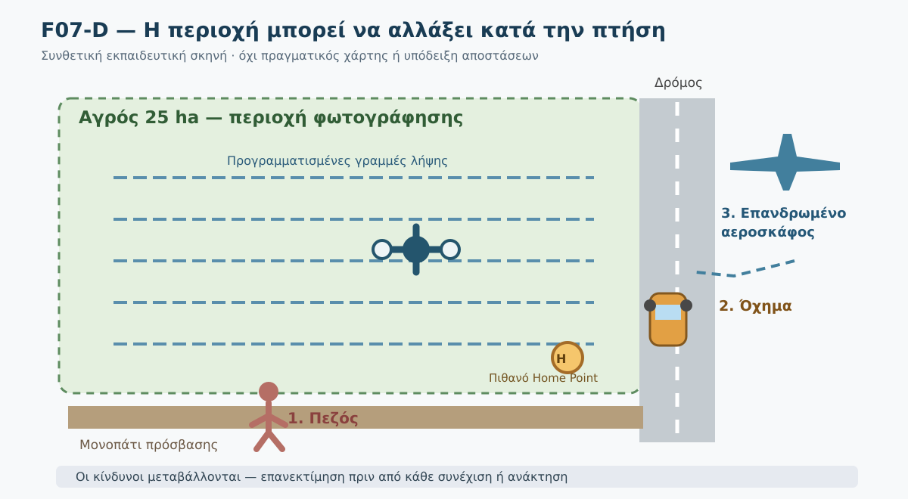

*Σχήμα F07-D. Συνθετική τοπολογική απεικόνιση αγρού, διαδρομής φωτογράφησης, πεζού, δρόμου/οχήματος και κατεύθυνσης προσέγγισης αεροσκάφους. Δεν είναι χάρτης πραγματικής περιοχής και δεν δείχνει ασφαλείς κανονιστικές αποστάσεις.*

#### Λυμένο παράδειγμα Α — Πεζός και αυτόματη πτήση

**Τ1:** Drone εκτελεί μια αυτοματοποιημένη γραμμή φωτογράφησης. Στο όριο του αγρού εμφανίζεται πεζός. **Γνωρίζουμε:** ο πεζός είναι μη εμπλεκόμενος. **Δεν γνωρίζουμε:** πού θα κινηθεί και εάν η επόμενη διαδρομή θα τον φέρει κάτω ή κοντά στην πορεία.

**Εκπαιδευτική απόφαση:** Δεν συνεχίζουμε μηχανικά τις λήψεις επειδή η αποστολή είναι αυτόματη. Η ομάδα ελέγχει αμέσως αν η πτήση εξακολουθεί να ικανοποιεί τις προβλεπόμενες αποστάσεις και τους άλλους όρους της υποκατηγορίας, και, όταν χρειάζεται, δίνει προτεραιότητα στην παύση των λήψεων και στην ασφαλή ανάκτηση ή αναπροσαρμογή της πτήσης βάσει του συστήματος. Καμία απόφαση δεν βασίζεται μόνο στο αν ο άνθρωπος βρίσκεται σήμερα «λίγο έξω» από το σχεδιασμένο πολύγωνο.

**Τ2:** Ο πεζός αλλάζει πορεία προς την πιθανή θέση προσγείωσης. **Νέα πληροφορία:** ένα προηγουμένως κατάλληλο σημείο ανάκτησης ενδέχεται πλέον να μην είναι κατάλληλο. Η ασφαλής αντίδραση δεν είναι απαραίτητα «πάτησε RTH»: η αυτόματη επιστροφή μπορεί να καταλήγει στην περιοχή όπου κινείται ο πεζός. Χρειάζεται αξιολόγηση της πραγματικής κατάστασης και εφαρμογή κατάλληλων εγκεκριμένων διαδικασιών του μοντέλου.

**Τ3:** Ο πεζός απομακρύνεται. Αυτό **δεν αρκεί** από μόνο του για επανέναρξη. Επανελέγχουμε ανθρώπους, διαδρομές, εναλλακτική προσγείωση, ενέργεια, καιρό και τυχόν άλλους κινδύνους που εμφανίστηκαν κατά την αναστολή.

### 5. Οχήματα: ο κίνδυνος δεν είναι μόνο η πρόσκρουση

Ένας οδηγός μπορεί να είναι μη εμπλεκόμενο πρόσωπο ακόμη και αν βρίσκεται μέσα σε αυτοκίνητο. Η EASA σημειώνει ότι η πτήση κοντά σε οχήματα μπορεί να δημιουργήσει κίνδυνο **απόσπασης προσοχής** ακόμη και χωρίς πρόσκρουση. [EASA-02]

**Συνθετικό σενάριο:** Ένα τρακτέρ κινείται στον δρόμο δίπλα στον αγρό ενώ το drone ολοκληρώνει την τελευταία γραμμή. Δεν επιτρέπεται να υποθέσουμε ότι «ο οδηγός είναι προστατευμένος από το όχημα» ή ότι «δεν μετράει ως τρίτος». Η αξιολόγηση περιλαμβάνει τη θέση του drone ως προς την κυκλοφορία, πιθανή εκτροπή, τη συμπεριφορά του οδηγού και την ασφαλή δυνατότητα απομάκρυνσης του drone από το σημείο.

**Δίδαγμα:** Ο δρόμος και η κυκλοφορία εξετάζονται ήδη πριν από την απογείωση· η κίνηση των οχημάτων απαιτεί νέο έλεγχο κατά την πτήση.

### 6. Ζώα: παρατήρηση και αποφυγή όχλησης

Ζώα μπορεί να τρομάξουν από τον θόρυβο ή τη σχετική εγγύτητα του drone, να μετακινηθούν απρόβλεπτα ή να θέσουν σε κίνδυνο ανθρώπους που τα συνοδεύουν. Η υποχρέωση του χειριστή να διακόπτει πτήση όταν αυτή δημιουργεί κίνδυνο ισχύει και για **ζώα και περιβάλλον**. [EASA-03]

**Συνθετικό σενάριο:** Κατά τη χαρτογράφηση εμφανίζεται κοπάδι κοντά στην προβλεπόμενη διαδρομή. Δεν πλησιάζουμε σκοπίμως για να «δοκιμάσουμε» αντίδραση ούτε συνεχίζουμε με την υπόθεση ότι τα ζώα δεν επηρεάζονται. Η ομάδα εξετάζει ασφαλή τροποποίηση/διακοπή και συμμόρφωση με τυχόν ειδικούς τοπικούς περιορισμούς προστασίας πανίδας.

Δεν υπάρχει σε αυτό το μάθημα ένα **καθολικό όριο μέτρων για όλα τα είδη ζώων**. Η ευαισθησία διαφέρει και μπορεί να ισχύουν επιπλέον κανόνες, ιδίως σε προστατευόμενες περιοχές. Αυτοί πρέπει να επαληθεύονται ειδικά.

### 7. Επανδρωμένο αεροσκάφος: η σημαντικότερη προτεραιότητα στον αέρα

Στις συνήθεις πτήσεις Open με VLOS ο χειριστής οφείλει να διατηρεί οπτική επαφή και να παρατηρεί τον εναέριο χώρο για αποφυγή σύγκρουσης. Στις ειδικές επιτρεπόμενες διαμορφώσεις, όπως ορισμένες FPV λειτουργίες με παρατηρητή, εφαρμόζονται οι αντίστοιχες πρόσθετες προϋποθέσεις. Όταν η πτήση δημιουργεί κίνδυνο για άλλο αεροσκάφος, πρέπει να τη διακόπτει. [EASA-03]

#### Λυμένο παράδειγμα Β — Εμφάνιση ελικοπτέρου

**Τ1:** Κατά τη χαρτογράφηση ακούγεται ήχος ελικοπτέρου, αλλά η θέση του δεν είναι ακόμη γνωστή. Η ομάδα δεν έχει επιβεβαιώσει αν η πορεία του σχετίζεται με την περιοχή. Δεν εξάγουμε συμπέρασμα ότι «είναι ψηλά» ή ότι «θα μας αποφύγει». Αμέσως προτεραιοποιούμε την αναγνώριση και αποφυγή του δυνητικού κινδύνου, χωρίς να συνεχίζουμε τις φωτογραφίες ως αυτοσκοπό.

**Τ2:** Ο χειριστής ή ο παρατηρητής εντοπίζει το ελικόπτερο σε χαμηλή πορεία που ενδέχεται να αλληλεπιδράσει με την πτήση. Προτεραιότητα έχει η **άμεση αποφυγή σύγκρουσης και η ασφαλής διακοπή**, με τις κατάλληλες ενέργειες που επιτρέπει η πραγματική κατάσταση και το συγκεκριμένο drone. Δεν δίνουμε καθολική εντολή να επιλεγεί συγκεκριμένο ύψος, κατεύθυνση ή κουμπί· μια τέτοια οδηγία θα μπορούσε να είναι ακατάλληλη σε συγκεκριμένο έδαφος ή κοντά σε εμπόδια.

**Τ3:** Το ελικόπτερο απομακρύνεται. Η αποστολή δεν ξαναρχίζει αυτόματα. Επανελέγχουμε πιθανή εναέρια κυκλοφορία, μπαταρία, εμπόδια, ανθρώπους, συνθήκες και τις πραγματικές προϋποθέσεις επιτρεπτότητας.

**Ειδική περίπτωση:** Αν στην περιοχή βρίσκεται σε εξέλιξη επιχείρηση έκτακτης ανάγκης, δεν πετάμε κοντά ή μέσα σε αυτή χωρίς άδεια από τις αρμόδιες υπηρεσίες αντιμετώπισης της έκτακτης ανάγκης. [EASA-03]

#### Όταν υπάρχουν πολλοί ταυτόχρονοι κίνδυνοι

Αν ένα αεροσκάφος πλησιάζει ενώ ένας πεζός βρίσκεται δίπλα στην εναλλακτική θέση προσγείωσης, δεν αντιμετωπίζουμε την κατάσταση ως απλό quiz «διάλεξε μία απάντηση». Ο χειριστής πρέπει να χρησιμοποιήσει τις άμεσες προβλεπόμενες διαδικασίες αποφυγής σύγκρουσης **και** να μην οδηγήσει αυθαίρετα το drone προς τον πεζό. Γι' αυτό η προετοιμασία εναλλακτικών επιλογών γίνεται **πριν** την απογείωση.

#### Δύο παράλληλες προτεραιότητες, όχι ανταγωνιστικά «κουμπιά»

Η αποφυγή σύγκρουσης με επανδρωμένο αεροσκάφος έχει επείγουσα προτεραιότητα. Αυτό **δεν σημαίνει** ότι επιτρέπεται ανεξέλεγκτη προσγείωση πάνω σε πεζούς ή όχημα. Ο χειριστής πρέπει να επιλέξει, σύμφωνα με τις δυνατότητες του drone και τη διαθέσιμη πραγματική κατάσταση, την ασφαλέστερη εφικτή ενέργεια. Οι επιλογές πρέπει να έχουν σχεδιαστεί πριν από την πτήση, διότι κατά το περιστατικό ενδέχεται να μην υπάρχει χρόνος να αναζητηθούν.

**Γιατί όχι αυτόματο RTH σε κάθε περίπτωση;** Μια προγραμματισμένη επιστροφή μπορεί να διέρχεται από τη διαδρομή του άλλου αεροσκάφους ή να καταλήγει σε σημείο που δεν είναι πλέον ελεύθερο από τρίτους. Το σωστό είναι να γνωρίζουμε εκ των προτέρων τη συμπεριφορά failsafe/RTH, όχι να βασιζόμαστε στην υπόθεση ότι ο αυτοματισμός θα επιλέξει μόνος του την ασφαλέστερη πορεία.

### 8. Πίνακας πρακτικής πρόληψης, αναγνώρισης και αντίδρασης

| Παράγοντας | Πρόληψη | Πρώτη αναγνώριση | Εκπαιδευτική αρχή απόκρισης |
|---|---|---|---|
| Πεζός | Προσβάσεις, εναλλακτικά σημεία, δυνατότητα επιτήρησης | Μη εμπλεκόμενος προσεγγίζει | Δεν συνεχίζουμε τις λήψεις όταν η ασφάλεια τίθεται σε κίνδυνο· ασφαλής προσαρμογή/ανάκτηση |
| Όχημα | Χαρτογράφηση δρόμων, αποφυγή έκθεσης κυκλοφορίας | Κίνηση κάτω ή κοντά στη διαδρομή | Αποφυγή κινδύνου και απόσπασης προσοχής οδηγού |
| Ζώο | Έλεγχος δραστηριότητας/προστασίας πανίδας | Έντονη αντίδραση ή απρόσμενη μετακίνηση | Αποφυγή όχλησης και κλιμάκωσης |
| Επανδρωμένο αεροσκάφος | VLOS, εναέρια επιτήρηση και προετοιμασία αποφυγής | Ακουστικό/οπτικό σήμα προσέγγισης | Άμεση προτεραιότητα αποφυγής σύγκρουσης, με κατάλληλη διαδικασία |
| Επιχείρηση έκτακτης ανάγκης | Ενημέρωση περιοχής και περιορισμών | Παρουσία αεροδιακομιδής/διάσωσης | Δεν πετάμε κοντά/μέσα χωρίς απαιτούμενη άδεια |

### 9. Καρτέλα 04Δ-4 — Εργαστήριο προστασίας τρίτων

**Οδηγία:** Συμπλήρωσε την καρτέλα `DM00_Kartela_04D4_Prostasia_Triton.md` για τέσσερις διαδοχικές χρονικές στιγμές. Χρησιμοποίησε τη δομή **παρατήρηση → κίνδυνος → τι γνωρίζω / τι δεν γνωρίζω → πρόληψη → ασφαλής απόφαση → επανέλεγχος**.

#### Σύνθετη αποστολή με τέσσερα γεγονότα

- **Τ1:** Πεζός εισέρχεται από μονοπάτι στη βόρεια πλευρά του αγρού.
- **Τ2:** Τρακτέρ κινείται στον δρόμο δίπλα στην εναλλακτική θέση προσγείωσης.
- **Τ3:** Ακούγεται ελικόπτερο και η κατεύθυνσή του δεν έχει ακόμη εξακριβωθεί.
- **Τ4:** Το ελικόπτερο εντοπίζεται σε πορεία που ενδέχεται να αλληλεπιδράσει με την πτήση.

Πρέπει να αιτιολογήσεις **πώς αλλάζει η προτεραιότητα**, πώς παραμένουν ενεργοί οι παλαιότεροι κίνδυνοι και τι θα πρέπει να έχει προβλεφθεί προληπτικά. **Δεν απαιτείται να πετάξεις drone ούτε να προκαλέσεις πραγματικό συμβάν.**

<details>
<summary>Κρυφή αναλυτική λύση — Σύνθετη αποστολή</summary>

**Τ1:** Αναγνωρίζουμε μη εμπλεκόμενο πρόσωπο, διακόπτουμε τις λήψεις όπου χρειάζεται για ασφαλή αξιολόγηση και δεν υποθέτουμε ότι το όριο αγρού είναι όριο ασφάλειας. **Τ2:** Ο οδηγός είναι επίσης μη εμπλεκόμενος· η εναλλακτική θέση ανάκτησης μπορεί να μην είναι πλέον κατάλληλη. **Τ3:** Η ακουστική ένδειξη δεν προσδιορίζει πορεία ή απόσταση· δεν δικαιολογεί συνέχιση της χαρτογράφησης. **Τ4:** Η πιθανή αλληλεπίδραση με επανδρωμένο αεροσκάφος επιβάλλει άμεση προτεραιότητα αποφυγής σύγκρουσης και ασφαλούς διακοπής με τις κατάλληλες διαδικασίες. Ο πεζός και το όχημα **δεν εξαφανίζονται** ως κίνδυνοι. Οι ακριβείς χειρισμοί εξαρτώνται από το πραγματικό drone, τη θέση, τα εμπόδια και τις διαδικασίες.

**Σφάλμα που αποφεύγουμε:** «επιστρέφω αυτομάτως στο Home Point» χωρίς έλεγχο αν κοντά του βρίσκονται τρίτοι. Άλλο σφάλμα: «το ελικόπτερο δεν φαίνεται στην εφαρμογή, άρα δεν υπάρχει κίνδυνος».

</details>

#### Λυμένο παράδειγμα Γ — Τι αλλάζει όταν η πληροφορία έρχεται καθυστερημένα;

**Στιγμή 1:** Ο παρατηρητής βλέπει ένα όχημα στον δρόμο, αλλά ο χειριστής συνεχίζει να κοιτάζει την οθόνη. **Κίνδυνος:** η πληροφορία δεν μετατρέπεται έγκαιρα σε απόφαση. **Πρόληψη:** πριν από την απογείωση έχουν συμφωνηθεί σύντομες σαφείς ανακοινώσεις της ομάδας και άμεση επιβεβαίωση ότι ελήφθησαν.

**Στιγμή 2:** Ο παρατηρητής αναφέρει «Ελικόπτερο — πορεία άγνωστη». **Σωστή προσέγγιση:** το μήνυμα δεν αντιμετωπίζεται ως βεβαιότητα ασφαλούς απόστασης. Προτεραιότητα αποκτούν η επίγνωση εναέριας κυκλοφορίας και η εφαρμογή κατάλληλων μέτρων προστασίας, χωρίς αναμονή να ολοκληρωθεί μια τελευταία λήψη.

**Στιγμή 3:** Ο χειριστής διαπιστώνει ότι το Home Point βρίσκεται δίπλα στο όχημα. **Συμπέρασμα:** το RTH δεν αποτελεί αυτόματη λύση. Απαιτείται επιλογή ασφαλούς εφικτής απόκρισης σύμφωνα με τις διαδικασίες του συστήματος, χωρίς να αγνοηθεί η απειλή στον αέρα.

**Τι μαθαίνουμε:** Η έγκαιρη, λιτή επικοινωνία και ο προληπτικός σχεδιασμός εναλλακτικών αποτελούν μέτρα ασφαλείας. Δεν αποτελούν νέα κανονιστική απαίτηση για συγκεκριμένες φράσεις επικοινωνίας.

#### Μικρή άσκηση κρίσης — Επανέναρξη ή όχι;

Μετά την απομάκρυνση ενός ελικοπτέρου, ο πεζός εξακολουθεί να βρίσκεται κοντά στο σημείο ανάκτησης. Η μπαταρία έχει μειωθεί σημαντικά κατά την αναμονή. Η ομάδα πρέπει να αποφασίσει αν θα επανεκκινήσει την αποστολή.

<details>
<summary>Κρυφή αναλυτική λύση — Επανέναρξη</summary>

Δεν επανεκκινούμε με βάση μόνο την απομάκρυνση του ελικοπτέρου. Χρειάζεται νέα συνολική αξιολόγηση της εναέριας κυκλοφορίας, της τρέχουσας θέσης του πεζού, της διαθέσιμης ενέργειας, του καιρού και του ασφαλούς σχεδίου ανάκτησης. Αν δεν υπάρχει επαρκές περιθώριο, προτεραιότητα έχει η ασφαλής ολοκλήρωση της πτήσης αντί της συλλογής επιπλέον φωτογραφιών.

</details>

### 10. Αυτοαξιολόγηση — Έξι ερωτήσεις με αιτιολόγηση

**Ερώτηση 1.** Ο οδηγός διερχόμενου αυτοκινήτου είναι μη εμπλεκόμενο πρόσωπο;

<details><summary>Απάντηση 1</summary>

**Ναι.** Η ύπαρξη οχήματος δεν αναιρεί τον κίνδυνο· ενδέχεται ακόμη και απόσπαση προσοχής.

</details>

**Ερώτηση 2.** Αν ένα άτομο ξέρει ότι πετάμε drone, μπορεί να χαρακτηριστεί αυτόματα «εμπλεκόμενο»;

<details><summary>Απάντηση 2</summary>

**Όχι.** Χρειάζονται επιπλέον συγκεκριμένες προϋποθέσεις, όπως ρητή συναίνεση, ενημέρωση και δυνατότητα παρακολούθησης/αντίδρασης.

</details>

**Ερώτηση 3.** Ένα C0 και ένα C1 αντιμετωπίζουν όμοια την τυχαία υπέρπτηση μεμονωμένων μη εμπλεκομένων;

<details><summary>Απάντηση 3</summary>

**Όχι.** Οι κανονιστικές προϋποθέσεις διαφέρουν. Και τα δύο απαγορεύεται να υπερίπτανται συγκεντρώσεων ανθρώπων στην Open.

</details>

**Ερώτηση 4.** Εμφανίζεται κοπάδι και κάποια ζώα τρομάζουν. Ποια είναι η κατάλληλη εκπαιδευτική στάση;

<details><summary>Απάντηση 4</summary>

**Επανεκτίμηση και αποφυγή όχλησης/κινδύνου.** Δεν δοκιμάζουμε περαιτέρω την αντίδραση και δεν θεωρούμε ότι υπάρχει ενιαία «ασφαλής απόσταση» για κάθε είδος.

</details>

**Ερώτηση 5.** Ακούγεται επανδρωμένο αεροσκάφος, αλλά δεν έχει εντοπιστεί. Μπορούμε να συνεχίσουμε επειδή δεν φαίνεται στην οθόνη;

<details><summary>Απάντηση 5</summary>

**Όχι.** Η οθόνη δεν αποτελεί εγγύηση ανυπαρξίας εναέριας κυκλοφορίας. Απαιτείται προτεραιότητα στην επαλήθευση/αντιμετώπιση του δυνητικού κινδύνου και στην αποφυγή σύγκρουσης.

</details>

**Ερώτηση 6.** Το ελικόπτερο απομακρύνθηκε, αλλά άνθρωποι βρίσκονται πλέον δίπλα στο Home Point. Συνεχίζουμε τις λήψεις;

<details><summary>Απάντηση 6</summary>

**Όχι αυτομάτως.** Η απομάκρυνση ενός κινδύνου δεν σημαίνει ότι έχουν εξαλειφθεί οι υπόλοιποι. Χρειάζεται νέα συνολική αξιολόγηση και κατάλληλο σχέδιο ασφαλούς ανάκτησης.

</details>

**Ερώτηση 7.** Η αυτόματη λειτουργία RTH έχει ρυθμιστεί πριν από την πτήση. Πρέπει να θεωρηθεί αυτόματα η ασφαλέστερη επιλογή όταν εμφανίζεται ελικόπτερο και ένας πεζός βρίσκεται δίπλα στο Home Point;

<details>
<summary>Απάντηση 7</summary>

**Όχι.** Η πραγματική διαδρομή επιστροφής και το σημείο ανάκτησης πρέπει να αξιολογηθούν με βάση τους τρέχοντες κινδύνους. Η σωστή αντίδραση εξαρτάται από τις δυνατότητες και τις προβλεπόμενες διαδικασίες του συγκεκριμένου drone και την ανάγκη άμεσης αποφυγής σύγκρουσης.

</details>

### 11. Συχνά λάθη

- «Όποιος γνωρίζει για το drone είναι εμπλεκόμενος» — όχι χωρίς τις απαιτούμενες προϋποθέσεις.
- «Το αυτοκίνητο προστατεύει πλήρως τον οδηγό» — παραβλέπει κίνδυνο απόσπασης προσοχής.
- «Το C0 επιτρέπεται πάνω από οποιοδήποτε πλήθος» — λάθος για συγκεντρώσεις ανθρώπων.
- «Αφού ο αγρός είναι δικός μας, ο εναέριος χώρος είναι ελεύθερος» — η ιδιοκτησία του εδάφους δεν καταργεί τους κανόνες πτήσης.
- «Πάντα ενεργοποιώ RTH όταν εμφανιστεί πρόβλημα» — ο αυτοματισμός μπορεί να ακολουθεί ακατάλληλη διαδρομή ή σημείο προσγείωσης.
- «Αν το αεροσκάφος δεν εμφανίζεται στην εφαρμογή, δεν υπάρχει» — οι εφαρμογές δεν υποκαθιστούν την οπτική παρατήρηση.

### 12. Έλεγχος ολοκλήρωσης

Ολοκλήρωσες την ενότητα εφόσον μπορείς να εξηγήσεις: (1) γιατί οδηγός και περαστικός είναι μη εμπλεκόμενοι, (2) πώς διαφέρουν A1 και A2/A3, (3) πώς ανασχεδιάζουμε πτήση όταν η θέση ανάκτησης εκτίθεται σε τρίτους, (4) γιατί η απειλή σύγκρουσης με επανδρωμένο αεροσκάφος απαιτεί άμεση προτεραιότητα, (5) γιατί δεν υπάρχει καθολική διαδικασία χειρισμών για κάθε μοντέλο.

**Επόμενο:** DM00.4.7.5 — Άνεμος, ριπές και μεταβολή καιρού κατά την πτήση.

### Κριτήρια αξιολόγησης ασφάλειας

Για τις δραστηριότητες της παρούσας ενότητας, η απάντηση θεωρείται **μη αποδεκτή ανεξαρτήτως βαθμολογίας** αν: (α) υποθέτει ότι ο οδηγός δεν είναι τρίτος, (β) προτείνει συνέχιση των λήψεων ενώ υφίσταται ανεξέλεγκτος κίνδυνος σύγκρουσης, (γ) παρουσιάζει το RTH ως καθολικά ασφαλές, ή (δ) επινοεί ακριβείς χειρισμούς χωρίς δεδομένα κατασκευαστή και περιβάλλοντος.

### Πηγές και όρια ισχύος

- **[EASA-01]** EASA, *Easy Access Rules for Unmanned Aircraft Systems*, αναθεώρηση 30/06/2026, UAS.OPEN.020/030/040 και σχετικό AMC/GM: https://www.easa.europa.eu/en/document-library/easy-access-rules/online-publications/easy-access-rules-unmanned-aircraft-systems?erules-id=ERULES-1963177438-19528
- **[EASA-02]** EASA, *Who is an uninvolved person?* FAQ: https://www.easa.europa.eu/en/faq/116453
- **[EASA-03]** EASA, UAS.OPEN.060, υποχρεώσεις κατά τη διάρκεια πτήσης, έκδοση 2026: https://www.easa.europa.eu/en/document-library/easy-access-rules/easy-access-rules-unmanned-aircraft-systems
- **[HCAA-01]** ΑΠΑ, *Can I fly over people?*: https://hcaa.gov.gr/en/faq/mporo-na-petaxo-drone-moy-pano-apo-anthropoys

**Κανονιστική διάκριση:** Ο κανονισμός δημιουργεί δεσμευτικές απαιτήσεις· τα AMC/GM εξηγούν αποδεκτούς τρόπους συμμόρφωσης και κατευθυντήριες ερμηνείες· τα δικά μας διαγράμματα/καρτέλες αποτελούν *εκπαιδευτικές* καλές πρακτικές. Πριν από πραγματική πτήση γίνεται νέος έλεγχος ισχύουσας νομοθεσίας, περιοχής και εγχειριδίου.


---


### Συμπληρωματικός έλεγχος τεκμηρίωσης — Πύλη Β v0.4

> **Σημείωση έκδοσης:** Οι ακόλουθες διευκρινίσεις αφορούν αποκλειστικά την τεκμηρίωση των παρατιθέμενων ισχυρισμών. Δεν αποτελούν νέες γενικές εντολές χειρισμού.

- **B-04-001 — SUPPORTED_RULE_CLASS_SPECIFIC:** A1: διάκριση C0 έναντι C1 και ποτέ υπέρπτηση συγκεντρώσεων· A2/C2: 30 m, δυνατότητα μείωσης στα 5 m μόνο υπό όρους low-speed/assessment· A3: μη έκθεση τρίτων και ≥150 m από κατοικημένες/εμπορικές/βιομηχανικές/ψυχαγωγικές περιοχές. Πηγή: [επίσημη τεκμηρίωση](https://www.easa.europa.eu/en/document-library/easy-access-rules/online-publications/easy-access-rules-unmanned-aircraft-systems?erules-id=ERULES-1963177438-19528).
## DM00.4.7.5 — Άνεμος, ριπές, κακοκαιρία και μεταβολή ορατότητας κατά την πτήση

### Ερμηνευτική επισήμανση — μετεωρολογία και ενεργειακή εφεδρεία

Η **συμβατότητα των αναμενόμενων καιρικών συνθηκών με το εγχειρίδιο** αναλύεται ειδικά στο **AMC1 UAS.OPEN.060(1)(c)**. Ο έλεγχος διαθέσιμης ενέργειας για την προβλεπόμενη πτήση και απρόβλεπτα περιστατικά περιλαμβάνεται στην καθοδήγηση **AMC1 UAS.OPEN.060(1)(d)**. Πρόκειται για **AMC (αποδεκτά μέσα συμμόρφωσης)**, όχι για γενικά αριθμητικά όρια ανέμου ή ποσοστών μπαταρίας που θεσπίζει η EASA για κάθε drone. [EASA — AMC UAS.OPEN.060](https://www.easa.europa.eu/en/document-library/easy-access-rules/online-publications/easy-access-rules-unmanned-aircraft-systems?erules-id=ERULES-1963177438-19528).


**Αναθεωρημένο εκπαιδευτικό προσχέδιο v0.2 — 03/11/2026.**
**Κατάσταση:** Προς επιστημονική, γλωσσική και παιδαγωγική αξιολόγηση· όχι επιχειρησιακό εγχειρίδιο ή γενική οδηγία για οποιοδήποτε μοντέλο drone.

> **Κεντρική ιδέα:** Το ότι ένα drone απογειώθηκε με αποδεκτό καιρό δεν σημαίνει ότι θα μπορέσει να ολοκληρώσει ή να τερματίσει με ασφάλεια την πτήση. Η ασφαλής απόφαση λαμβάνεται όσο υπάρχουν ακόμη διαθέσιμες επιλογές.

#### Τι θα μπορείς να κάνεις

Μετά τη μελέτη θα μπορείς: (α) να διακρίνεις σταθερό άνεμο, ριπές και τοπικές μεταβολές· (β) να αναγνωρίζεις ενδείξεις ότι οι συνθήκες επηρεάζουν την πτήση· (γ) να αξιολογείς μαζί τις συνθήκες, την επιστροφή, την εναπομένουσα ενέργεια και την ορατότητα· (δ) να επιλέγεις τεκμηριωμένα πότε σταματά η χαρτογράφηση και πότε απαιτείται ασφαλής ανάκτηση· (ε) να εξηγείς γιατί δεν υπάρχει ένα ενιαίο όριο ανέμου ή μια καθολικά ασφαλής εντολή για όλα τα drones.

#### Σύνδεση με τις προηγούμενες υποενότητες

Στην **4.7.1** εντοπίσαμε την αλυσίδα κλιμάκωσης κινδύνου. Στην **4.7.2** εξασκηθήκαμε στην παρακολούθηση του drone, του περιβάλλοντος και της τηλεμετρίας. Στην **4.7.3** διαχωρίσαμε την παύση λήψεων από την ασφαλή ανάκτηση και από την επείγουσα απόκριση. Στην **4.7.4** εξετάσαμε την προστασία τρίτων. Εδώ συνδυάζουμε αυτές τις δεξιότητες σε μια δυσμενή μεταβολή καιρού **ενώ το drone βρίσκεται ήδη στον αέρα**. Ο αναλυτικός ενεργειακός σχεδιασμός θα αναπτυχθεί στην 4.7.6.

### 1. Η αποστολή που άρχισε με καλό καιρό

Σε υποθετική χαρτογράφηση αγρού **25 ha**, το drone εκτελεί διαδοχικές γραμμές φωτογράφισης. Κατά την απογείωση ο άνεμος είχε αξιολογηθεί ως συμβατός με το συγκεκριμένο σύστημα. Στη συνέχεια η ομάδα διαπιστώνει ότι οι λήψεις σε αντίθετη πορεία χρειάζονται περισσότερο χρόνο, εμφανίζονται δυνατότερες ριπές και η επιστροφή γίνεται πιο αργή από την αναμενόμενη.

Η ομάδα έχει ακόμη έλεγχο του drone. Απομένει όμως λιγότερη ενέργεια και το σύννεφο σκόνης από παρακείμενο αγροτικό δρόμο δυσκολεύει προσωρινά την παρατήρηση.

**Το πρόβλημα δεν είναι μόνο «φυσάει».** Είναι ότι *συνυπάρχουν* μεγαλύτερος χρόνος επιστροφής, αβεβαιότητα για την εξέλιξη του ανέμου και πιθανή υποβάθμιση της οπτικής επαφής. Αν ο χειριστής επιμείνει στις τελευταίες γραμμές λήψης, μπορεί να μειώσει και άλλο το περιθώριο ασφαλούς ανάκτησης.

Το σενάριο είναι συνθετικό και δεν αναπαριστά κάποιο πραγματικό ατύχημα.

### 2. Τι πρέπει να ξέρουμε για τον άνεμο

**Μέση ταχύτητα ανέμου:** η μέση τιμή της ταχύτητας σε συγκεκριμένο χρονικό διάστημα· η περίοδος μέτρησης πρέπει να είναι γνωστή. **Ριπή:** σύντομη, ισχυρότερη μεταβολή της ταχύτητας του ανέμου. **Διεύθυνση ανέμου:** η κατεύθυνση *από την οποία* πνέει, στη μετεωρολογική ορολογία. **Τοπικές αναταράξεις:** μεταβολές ροής κοντά σε κτίρια, δέντρα, πρανή ή άλλα εμπόδια. **Διάτμηση ανέμου (wind shear):** μεταβολή της ταχύτητας ή/και της διεύθυνσης του ανέμου σε μικρή απόσταση, οριζόντια ή κατακόρυφα.

Ο αέρας μπορεί να είναι διαφορετικός στο σημείο χειρισμού και στο ύψος πτήσης. Ένα ανεμόμετρο στο έδαφος προσφέρει χρήσιμη **τοπική μέτρηση** αλλά δεν εγγυάται ότι καταγράφει τη ροή σε όλο το ύψος ή σε όλη την περιοχή. Μια γενική εφαρμογή πρόγνωσης επίσης δεν αναπαριστά απαραίτητα τις ριπές πάνω από έναν συγκεκριμένο αγρό.

| Παράγοντας | Τι μπορεί να μεταβληθεί | Τι χρειάζεται να ελέγξουμε |
|---|---|---|
| Αντίθετος άνεμος | Μικρότερη ταχύτητα ως προς το έδαφος, μεγαλύτερος χρόνος/ενέργεια επιστροφής | Πραγματική πρόοδος προς ασφαλή ανάκτηση και διαθέσιμη εφεδρεία |
| Ούριος άνεμος | Μεγαλύτερη ταχύτητα ως προς το έδαφος και πιθανώς δυσκολότερη επιβράδυνση ανάλογα με σύστημα/συνθήκες | Έλεγχο πορείας, θέσης και εμποδίων |
| Ριπές | Μεταβολές σταθερότητας και απόκλιση από τη σχεδιαζόμενη πορεία | Προειδοποιήσεις, πραγματική συμπεριφορά, όρια εγχειριδίου |
| Αναταράξεις κοντά σε εμπόδια | Μη ομοιόμορφη ροή, δυσκολία ακριβούς θέσης | Διατήρηση ασφαλούς διαδρομής και επιλογές ανάκτησης |
| Θερμοκρασία | Διαφορετική συμπεριφορά συσσωρευτών ή περιορισμοί συστήματος | Εγχειρίδιο drone/μπαταρίας και ενδείξεις συστήματος |

**Δεν υπάρχει ενιαίο, νομικά καθολικό «ασφαλές όριο ανέμου» για όλα τα drones Open.** Οι λειτουργικοί περιορισμοί εξαρτώνται από μοντέλο, διαμόρφωση, εγχειρίδιο και ειδική επιχείρηση. Ακόμη και κάτω από δηλωμένο μέγιστο, η συγκεκριμένη πτήση μπορεί να είναι μη ασφαλής λόγω άλλων κινδύνων. [EASA-01, EASA-02]

### 3. Ο άνεμος στην επιστροφή: γιατί η απόσταση δεν αρκεί

Ένας χειριστής μπορεί να δει στην οθόνη ότι το drone απέχει μόλις μερικές εκατοντάδες μέτρα από το Home Point. Αυτό **δεν** αποδεικνύει επάρκεια χρόνου ή μπαταρίας. Στον αντίθετο άνεμο η πρόοδος ως προς το έδαφος μπορεί να μειωθεί, ενώ η κατανάλωση μπορεί να αυξηθεί ανάλογα με τις συνθήκες. Αν η ασφαλής θέση προσγείωσης είναι σε διαφορετική κατεύθυνση, χρειάζεται ξεχωριστή εκτίμηση.

#### Απλοποιημένο αριθμητικό παράδειγμα — όχι πραγματικός υπολογιστής αυτονομίας

Έστω **υποθετικά** ότι η ταχύτητα του drone ως προς τον αέρα είναι **10 m/s** και ο αντίθετος άνεμος στην πορεία επιστροφής έχει συνιστώσα **6 m/s**. Μόνο για τη γεωμετρία ταχυτήτων και με σταθερές συνθήκες, προκύπτει ταχύτητα ως προς το έδαφος **4 m/s** (10 − 6). Για απόσταση **400 m**, ο ιδανικός χρόνος είναι περίπου **100 s**, έναντι **40 s** χωρίς αυτή τη συνιστώσα ανέμου.

Αυτά τα νούμερα **δεν** προβλέπουν κατανάλωση μπαταρίας, δυναμική ελέγχου ή πραγματική δυνατότητα επιστροφής. Προϋποθέτουμε ευθύγραμμη επιστροφή σε σταθερό ύψος, σταθερή ταχύτητα **ως προς τον αέρα**, σταθερό ακριβώς αντίθετο άνεμο, χωρίς επιτάχυνση, ελιγμούς ή εμπόδια. Η πραγματική ταχύτητα του drone μπορεί να ρυθμίζεται από αυτοματισμούς και περιορισμούς ισχύος/ελέγχου. Οι συνθήκες μεταβάλλονται και **ο χρόνος δεν μετατρέπεται γραμμικά σε ποσοστό μπαταρίας**. Επομένως ο υπολογισμός δεν είναι εργαλείο πραγματικής απόφασης επιστροφής.

#### Τι μετρά η εφαρμογή και τι συμπεραίνουμε;

Η ένδειξη **ground speed** περιγράφει την ταχύτητα του drone ως προς το έδαφος. Η ένδειξη **flight mode** αποκαλύπτει ποια λειτουργία ελέγχου είναι ενεργή. Η **εκτίμηση υπολειπόμενου χρόνου** ή η **ένδειξη επιστροφής** είναι υπολογισμοί του συστήματος υπό συγκεκριμένες παραδοχές, όχι εγγύηση ασφαλούς ανάκτησης. Η ίδια ένδειξη μπαταρίας μπορεί να αποκτά διαφορετικό νόημα αν αλλάξουν ο άνεμος, η διαδρομή ή το ασφαλές σημείο προσγείωσης.

| Παρατηρώ | Τι μπορεί να υποδηλώνει | Τι άλλο χρειάζεται |
|---|---|---|
| Η πρόοδος προς το Home Point μειώνεται | Άνεμος, περιορισμένη ταχύτητα, διαδρομή ή αλλαγή mode | Κατεύθυνση, πραγματική θέση, mode και έλεγχος του αεροσκάφους |
| Εμφανίζεται προειδοποίηση ισχύος ή μπαταρίας | Μειωμένο περιθώριο ανάκτησης | Ακριβές μήνυμα, εγχειρίδιο και εναλλακτικές |
| Η εκτίμηση RTH μεταβάλλεται | Νέοι υπολογισμοί ή διαφορετικές συνθήκες | Έλεγχος διαδρομής, εμποδίων, τρίτων και πραγματικής δυνατότητας ανάκτησης |

**Δεν εξάγουμε συμπέρασμα από μία μόνη ένδειξη.** Όταν εμφανίζεται σημαντική απόκλιση ή αβεβαιότητα, προέχει η ασφάλεια, όχι η διάγνωση όλων των τεχνικών αιτίων εν πτήσει.

#### Λυμένο παράδειγμα Α — «Μένουν δύο γραμμές»

**Γνωρίζουμε:** η επιστροφή επιβραδύνεται, αναφέρονται νέες ριπές, η εναπομένουσα ενέργεια μειώνεται και ο χειριστής διατηρεί VLOS. **Δεν γνωρίζουμε:** πόσο θα διαρκέσει η επιδείνωση, την ακριβή κατανομή ανέμου σε όλο το πεδίο, αν επαρκεί η εφεδρεία για όλη την εναλλακτική διαδρομή.

**Απόφαση:** εγκατάλειψη της χαρτογραφικής εργασίας ως προτεραιότητας, άμεση αξιολόγηση της ασφαλούς επιλογής ανάκτησης και εφαρμογή της κατάλληλης διαδικασίας του συγκεκριμένου drone. Η αναμονή για «δύο ακόμη γραμμές» δεν μπορεί να αιτιολογηθεί μόνο επειδή η αποστολή έχει σχεδόν τελειώσει. Αν υπάρχει άμεσος κίνδυνος, εφαρμόζεται η προβλεπόμενη επείγουσα απόκριση χωρίς καθυστέρηση.

**Γιατί όχι αυτόματα RTH;** Η επιλεγμένη διαδρομή/το Home Point μπορεί να μην είναι ασφαλή σε νέα συνθήκη ανέμου, ορατότητας ή παρουσίας τρίτων. Ο χειριστής οφείλει να γνωρίζει τη συμπεριφορά του συστήματος από το εγχειρίδιό του· το RTH δεν αποτελεί καθολική λύση. [EASA-02]

### 4. Αιφνίδιες ριπές και αναταράξεις κοντά σε εμπόδια

Μια ριπή δεν επηρεάζει μόνο τη λήψη μιας φωτογραφίας. Μπορεί να μεταβάλει τη συμπεριφορά του drone, να προκαλέσει μεγαλύτερη απόκλιση από τη σχεδιαζόμενη διαδρομή και να μειώσει την αξιοπιστία της προγραμματισμένης πορείας γύρω από εμπόδια. Η διαδρομή επιστροφής πρέπει να αξιολογείται με βάση τους πραγματικούς κινδύνους, όχι με βάση μια υποθετική ευθεία στο χάρτη.

**Παράδειγμα Β:** το drone βρίσκεται στο υπήνεμο τμήμα μιας δενδροστοιχίας. Παρατηρείται ακανόνιστη μεταβολή θέσης και ενίσχυση του ανέμου. Ο χειριστής δεν πρέπει να συμπεράνει ότι ένα μόνο πάτημα συγκεκριμένου κουμπιού είναι καθολικά σωστό. Προέχει η αποφυγή επικίνδυνης πορείας, η αναγνώριση διαθέσιμης ασφαλούς ανάκτησης και η εφαρμογή των προβλεπόμενων διαδικασιών του μοντέλου. Δεν πραγματοποιούμε εκπαιδευτικές «δοκιμές ριπών» σε πραγματική πτήση.

### 5. Βροχή, ομίχλη, σκόνη και συνθήκες ορατότητας

Η **βροχή** ενδέχεται να είναι ασύμβατη με την προστασία/το εγχειρίδιο του drone· δεν θεωρούμε ότι όλα τα drones έχουν την ίδια αντοχή σε νερό. Η **ομίχλη** μπορεί να περιορίσει την οπτική επαφή ακόμη κι όταν το drone μεταδίδει καθαρή εικόνα από την κάμερα. Η **σκόνη** μπορεί να μειώσει απότομα την ορατότητα και να επηρεάσει αισθητήρες ή εξοπλισμό, ανάλογα με την κατασκευή. Η **αλλαγή φωτισμού** και το χαμηλό νέφος μπορεί να δυσκολέψουν την εκτίμηση προσανατολισμού και θέσης.

Το VLOS αφορά τη δυνατότητα άμεσης οπτικής παρατήρησης του drone, ώστε να εκτιμάται η θέση του σε σχέση με άλλους κινδύνους. **Η ζωντανή εικόνα στην οθόνη δεν είναι από μόνη της υποκατάστατο VLOS.** Ισχύουν οι ειδικές νομικές εξαιρέσεις και οι προϋποθέσεις για επιτρεπόμενες διαμορφώσεις με παρατηρητή. [EASA-01, EASA-03]

#### Λυμένο παράδειγμα Γ — Σκόνη ενώ η κάμερα δείχνει κανονικά

**Τ1:** το drone παραμένει ευδιάκριτο. **Τ2:** περνά όχημα και σηκώνει σύννεφο σκόνης ανάμεσα στον χειριστή και το drone. **Τ3:** η εικόνα στο τηλεχειριστήριο εξακολουθεί να μεταδίδεται, αλλά ο χειριστής δεν μπορεί πλέον να αξιολογήσει αξιόπιστα την οπτική θέση και σχέση του drone με τα εμπόδια.

**Εκπαιδευτικό συμπέρασμα:** δεν συνεχίζουμε τη χαρτογράφηση σαν να μην άλλαξε τίποτε. Η ασφαλής αντιμετώπιση εξαρτάται από τις προβλεπόμενες διαδικασίες, τις πραγματικές συνθήκες και τυχόν νόμιμα διαθέσιμη βοήθεια παρατηρητή· η απώλεια επαρκούς οπτικής παρατήρησης απαιτεί άμεση διαχείριση του κινδύνου. Δεν προτείνουμε μια συγκεκριμένη εντολή πτήσης χωρίς ταυτοποίηση drone και δεδομένα θέσης.

#### Έγκαιρη αντίδραση όταν η οπτική επαφή επιδεινώνεται

Δεν περιμένουμε να χαθεί εντελώς η οπτική επαφή για να θεωρήσουμε τη σκόνη ή την ομίχλη σοβαρό πρόβλημα. Εξετάζουμε **προληπτικά** την εξέλιξη της ορατότητας, τη δυνατότητα ασφαλούς ανάκτησης και το ενδεχόμενο εισόδου σε περιοχή με εμπόδια ή τρίτους. Αν χαθεί η απαιτούμενη δυνατότητα άμεσης παρατήρησης, αντιμετωπίζουμε αμέσως την κατάσταση σύμφωνα με τις προβλεπόμενες διαδικασίες του drone και τους όρους της συγκεκριμένης λειτουργίας. Ειδικές νόμιμες διαμορφώσεις FPV/παρατηρητή δεν αποτελούν γενική εξαίρεση από κάθε απαίτηση οπτικής παρακολούθησης.

#### Πρόσθετη μεταβολή — ψυχρή μπαταρία ή επικείμενη βροχή

Η θερμοκρασία μπορεί να επηρεάσει τη διαθέσιμη ισχύ και οι χαμηλές θερμοκρασίες να απαιτούν ειδικούς χειρισμούς προετοιμασίας *μόνο όταν προβλέπονται από τον κατασκευαστή*. Η εμφάνιση βροχής δεν αντιμετωπίζεται με την υπόθεση ότι «λίγες σταγόνες είναι ακίνδυνες»: ελέγχουμε το πραγματικό επίπεδο προστασίας και τα επιτρεπτά όρια του συγκεκριμένου εξοπλισμού. Καμία γενική αριθμητική τιμή εδώ δεν αντικαθιστά το εγχειρίδιο.

### 6. Το μοντέλο πρόληψης: πριν, κατά, μετά

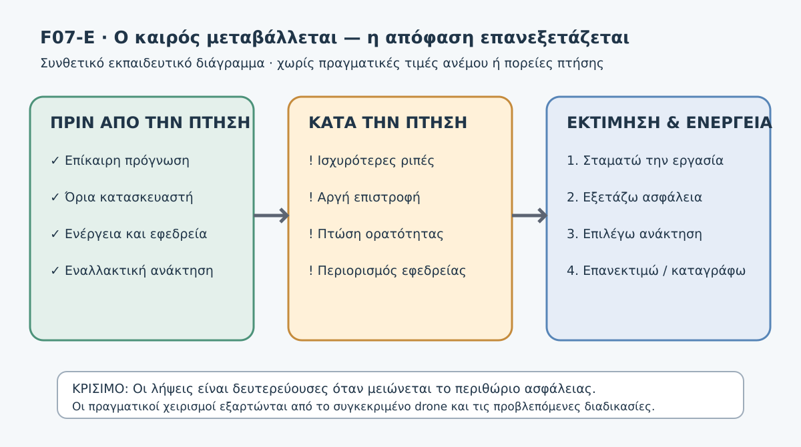

*Σχήμα F07-E. Πρωτότυπο συνθετικό διάγραμμα: πρόγνωση/όρια πριν από την πτήση, τρεις ενδείξεις επιδείνωσης κατά την πτήση, και τεκμηριωμένη απόφαση. Δεν αποτυπώνει πραγματική πρόγνωση, ούτε εγκεκριμένη διαδρομή επιστροφής.*

#### Πριν από την πτήση

Ελέγχουμε επίκαιρη πρόγνωση και τοπική κατάσταση για όλη την προβλεπόμενη διάρκεια, αναγνωρίζουμε πιθανούς τοπικούς κινδύνους, διασταυρώνουμε με το εγχειρίδιο του **συγκεκριμένου** drone, ελέγχουμε την εφεδρεία ενέργειας και τις ασφαλείς εναλλακτικές, και συμφωνούμε εκ των προτέρων τι θα σημάνει παύση της εργασίας. Οι πηγές πρόγνωσης δεν είναι όλες ισοδύναμες και η μέτρηση στο έδαφος δεν υποκαθιστά την παρατήρηση της πτήσης. [EASA-02]

#### Κατά την πτήση

Παρατηρούμε μεταβολές στην κίνηση, στην πρόοδο ως προς το έδαφος, στην κατάσταση ενέργειας, στις προειδοποιήσεις, στην οπτική επαφή, στα εμπόδια και στον εναέριο χώρο. **Δεν περιμένουμε την εξάντληση της μπαταρίας ή την απώλεια ελέγχου** για να επανεξετάσουμε την αποστολή. Αν η συνέχιση δημιουργεί κίνδυνο, ο χειριστής οφείλει να διακόψει την πτήση με κατάλληλο ασφαλή τρόπο. [EASA-01]

#### Μετά την πτήση

Καταγράφουμε πότε εμφανίστηκε η μεταβολή, τι μετρήθηκε ή παρατηρήθηκε, ποιες προειδοποιήσεις παρουσιάστηκαν, ποια απόφαση πάρθηκε και τι πρέπει να τροποποιηθεί στην επόμενη αποστολή. Δεν επανεκκινούμε αυτόματα μόνο επειδή σταμάτησε προσωρινά μια ριπή.

### 7. Λήψη απόφασης: τρεις διαφορετικές καταστάσεις

| Περίπτωση | Τι ξέρουμε | Εκπαιδευτική επιλογή |
|---|---|---|
| Επιδείνωση πρόγνωσης πριν την απογείωση | Οι συνθήκες αναμένεται να υπερβούν τα όρια του μοντέλου ή δεν έχουν επαληθευτεί | Δεν απογειωνόμαστε με ανεπιβεβαίωτη συμβατότητα· αναβολή/τροποποίηση |
| Ριπές κατά την πτήση, ακόμη υπάρχει έλεγχος | Μειώνεται το περιθώριο ασφαλούς επιστροφής | Σταματούμε να επιδιώκουμε λήψεις και αξιολογούμε άμεσα ασφαλή ανάκτηση |
| Άμεση απειλή σύγκρουσης ή απώλεια ελέγχου | Η ασφάλεια δεν διατηρείται με κανονική λειτουργία | Εφαρμόζουμε τις κατάλληλες άμεσες διαδικασίες του συγκεκριμένου drone και της επιχείρησης |

**Προσοχή:** «Σταματώ τη χαρτογράφηση», «τερματίζω με ασφάλεια την πτήση» και «ενεργοποιώ επείγουσα διαδικασία» δεν είναι ταυτόσημες ενέργειες. Δεν υπάρχει καθολικά σωστή σειρά κουμπιών ή χειρισμών για όλα τα μοντέλα.

### 8. Πρακτική δραστηριότητα — Καρτέλα 04Δ-5

Η άσκηση είναι **εξ ολοκλήρου επί χάρτου**. Καμία πραγματική πτήση σε κακοκαιρία, κανένα πείραμα εξάντλησης μπαταρίας ή δοκιμή απώλειας ορατότητας.

**Δεδομένα εκκίνησης:** αγρός 25 ha, έλεγχος DAGR και εγχειριδίου θεωρείται ολοκληρωμένος μόνο για τις *αρχικές* συνθήκες, οι λήψεις είναι αυτοματοποιημένες, και υπάρχουν δύο πιθανές θέσεις ασφαλούς ανάκτησης που δεν έχουν ελεγχθεί εκ νέου. Το drone παραμένει σε οπτική επαφή στην αρχή του σεναρίου.

**Σενάριο Α — Άνεμος/ενέργεια:** Τ1: ο αντίθετος άνεμος ενισχύεται· Τ2: η πρόοδος επιστροφής μειώνεται· Τ3: παρουσιάζεται προειδοποίηση ταχύτερης κατανάλωσης. Γράψε σε κάθε στιγμή τι ξέρεις, τι δεν ξέρεις, τι ενέργεια προέχει και αν η αποστολή μπορεί να συνεχιστεί.

**Σενάριο Β — Ορατότητα:** Τ1: προσεγγίζει σκόνη· Τ2: περιορίζεται η οπτική διάκριση του drone· Τ3: η εικόνα κάμερας λειτουργεί, αλλά η αξιολόγηση της θέσης του drone είναι αβέβαιη. Εξήγησε γιατί η λειτουργία της κάμερας δεν αρκεί και ποια δεδομένα χρειάζονται για ασφαλή διαχείριση.

**Σενάριο Γ — Συνδυασμός κινδύνων:** Τ1: ριπές κοντά σε δέντρα· Τ2: η εναλλακτική θέση προσγείωσης καταλαμβάνεται από αγροτικό όχημα· Τ3: αναφέρεται επιδείνωση ορατότητας. Ιεράρχησε τους κινδύνους και τεκμηρίωσε γιατί η αυτόματη επιστροφή δεν θεωρείται εκ των προτέρων ασφαλής.

**Παραδοτέο:** συμπληρωμένη Καρτέλα 04Δ-5, με εννέα χρονικές καταχωρίσεις και τελική αιτιολογημένη σύνοψη για κάθε σενάριο. **Κριτήρια:** πραγματική αναγνώριση των άγνωστων, προτεραιότητα ασφαλούς ανάκτησης έναντι λήψεων, μη επινόηση μοντελοεξαρτώμενων χειρισμών και σαφής διάκριση διαφορετικών επιπέδων απόκρισης.

<details>
<summary>Κρυφή αναλυτική λύση — Σενάρια Α, Β και Γ</summary>

**Α:** Τ1: Ενισχυόμενος αντίθετος άνεμος → επανεκτίμηση και εγκατάλειψη της επιδίωξης λήψεων αν το περιθώριο ασφαλείας επηρεάζεται. Τ2: Η μειωμένη πρόοδος επιβεβαιώνει ότι ο χρόνος/η ενέργεια ανάκτησης μπορεί να είναι μεγαλύτερα. Τ3: Η ταχύτερη κατανάλωση ενισχύει την ανάγκη άμεσης επιλογής κατάλληλης ασφαλούς ανάκτησης σύμφωνα με το εγχειρίδιο. Δεν περιμένουμε «ελάχιστο ποσοστό» που δεν έχει καθοριστεί από τα πραγματικά στοιχεία.

**Β:** Τ1: Αξιολόγηση πιθανής απώλειας οπτικής επαφής. Τ2: Η οπτική διάκριση υποβαθμίζεται — η συνέχιση της λήψης δεν είναι αυτονόητα ασφαλής. Τ3: Η εικόνα FPV/κάμερας δεν αποκαθιστά μόνη της το VLOS. Η ανταπόκριση εξαρτάται από τις πραγματικές δυνατότητες και νόμιμες προϋποθέσεις της επιχείρησης· δεν επινοούμε χειρισμό.

**Γ:** Τ1: Αναγνωρίζουμε μεταβλητό άνεμο και κίνδυνο κοντά σε εμπόδια. Τ2: Η εναλλακτική προσγείωση παύει να θεωρείται ασφαλής χωρίς νέο έλεγχο τρίτων. Τ3: Προστίθεται αβεβαιότητα ορατότητας, άρα μειώνονται οι ασφαλείς διαθέσιμες επιλογές. Η σωστή προσέγγιση είναι έγκαιρη ασφαλής διαχείριση και όχι συνέχιση των λήψεων ή αυθαίρετη ενεργοποίηση RTH.

</details>

#### Σύνθετη άσκηση Δ — Τρεις αποφάσεις κατά την ίδια πτήση

Η αποστολή είχε αρχικά αποδεκτές καιρικές συνθήκες. Το drone παραμένει υπό έλεγχο.

- **Τ1:** οι ριπές αυξάνονται και η εφαρμογή δείχνει μικρότερη πρόοδο προς την αρχική θέση προσγείωσης. Απομένει ένα μικρό μέρος της χαρτογράφησης.
- **Τ2:** η κοντινή εναλλακτική θέση ανάκτησης φαίνεται ελεύθερη, αλλά δεν έχει επιβεβαιωθεί ότι η πρόσβαση και η διαδρομή προσέγγισης είναι ασφαλείς. Η ενέργεια μειώνεται.
- **Τ3:** ένα όχημα εισέρχεται δίπλα στην εναλλακτική θέση και σύννεφο σκόνης αρχίζει να περιορίζει την οπτική παρακολούθηση.

**Ζητούμενο:** Για κάθε στιγμή σημείωσε (α) τι παρατηρείς, (β) τι δεν γνωρίζεις, (γ) ποιος κίνδυνος προηγείται και (δ) αν η προτεραιότητα είναι οι λήψεις, η ασφαλής ανάκτηση ή η άμεση διαδικασία έκτακτης ανάγκης. Τεκμηρίωσε αν θα εμπιστευόσουν αυτόματα RTH και ποια στοιχεία επανελέγχεις.

<details>
<summary>Κρυφή αναλυτική λύση — Σύνθετη άσκηση Δ</summary>

**Τ1:** Η επιδείνωση και η μειωμένη πρόοδος δείχνουν ότι το περιθώριο ανάκτησης ενδέχεται να μειώνεται. Η ολοκλήρωση των τελευταίων λήψεων δεν αποτελεί πλέον προτεραιότητα. Απαιτείται έγκαιρη επανεκτίμηση και κατάλληλο σχέδιο ασφαλούς ανάκτησης.

**Τ2:** Η φαινομενικά ελεύθερη θέση δεν έχει ακόμη αποδειχθεί ασφαλής. Ελέγχονται κίνδυνοι στην προσέγγιση, τρίτοι, εμπόδια και πραγματική επάρκεια ενέργειας. Δεν εξάγουμε κατηγορηματικό συμπέρασμα από μία μόνο πληροφορία.

**Τ3:** Ο κίνδυνος για τρίτους και η υποβάθμιση οπτικής επαφής μεταβάλλουν άμεσα την αξιολόγηση. Το RTH δεν θεωρείται καθολικά ασφαλές, διότι μπορεί να καταλήγει σε μη κατάλληλη περιοχή ή να ακολουθεί ακατάλληλη διαδρομή. Η επείγουσα απόκριση, αν απαιτηθεί, ακολουθεί τις τεκμηριωμένες διαδικασίες του συγκεκριμένου συστήματος.

**Γιατί:** Η ασφαλής επιλογή επανεκτιμάται σε κάθε χρονική στιγμή και δεν εξαρτάται μόνο από την αρχική πρόγνωση ή το ποσοστό της μπαταρίας.

</details>

### 9. Ερωτήσεις αυτοαξιολόγησης

**1.** Το εγχειρίδιο ενός drone δίνει όριο ανέμου. Αρκεί να βρίσκεται η στιγμιαία ένδειξη κάτω από αυτό για να συνεχιστεί κάθε αποστολή;

<details><summary>Απάντηση 1</summary>
Όχι. Εξετάζονται η προβλεπόμενη εξέλιξη, οι ριπές, το περιβάλλον, η εφεδρεία και η δυνατότητα ασφαλούς ανάκτησης. Το δηλωμένο όριο δεν εξαλείφει άλλους κινδύνους.
</details>

**2.** Γιατί η μικρή απόσταση από το Home Point δεν εξασφαλίζει ασφαλή επιστροφή;

<details><summary>Απάντηση 2</summary>
Επειδή η πραγματική πρόοδος υπό αντίθετο άνεμο, οι εναλλακτικές διαδρομές, τα εμπόδια και η ενέργεια μπορούν να μεταβάλουν τον χρόνο και τη δυνατότητα επιστροφής.
</details>

**3.** Η ζωντανή εικόνα της κάμερας παραμένει καλή αλλά η σκόνη περιορίζει την οπτική επαφή. Έχει καλυφθεί αυτομάτως η απαίτηση VLOS;

<details><summary>Απάντηση 3</summary>
Όχι. Η εικόνα κάμερας δεν υποκαθιστά από μόνη της την απαιτούμενη οπτική παρατήρηση. Ελέγχονται οι ειδικές προϋποθέσεις της συγκεκριμένης επιχείρησης.
</details>

**4.** Γιατί ο άνεμος στο ύψος του χειριστή δεν είναι απαραίτητα ίδιος με τον άνεμο στο ύψος του drone;

<details><summary>Απάντηση 4</summary>
Η ροή επηρεάζεται από ύψος, έδαφος και εμπόδια· ενδέχεται να υπάρχουν κατακόρυφες/οριζόντιες μεταβολές και αναταράξεις.
</details>

**5.** Ένας χειριστής επιμένει στις τελευταίες φωτογραφίες καθώς η επιστροφή επιβραδύνεται. Ποιο είναι το βασικό σφάλμα κρίσης;

<details><summary>Απάντηση 5</summary>
Δίνει προτεραιότητα στην ολοκλήρωση της εργασίας αντί στο περιοριζόμενο περιθώριο ασφαλούς ανάκτησης.
</details>

**6.** Η αρχική θέση ανάκτησης έχει γεμίσει από τρίτους, ενώ εμφανίζονται ριπές. Είναι ασφαλές να θεωρήσουμε ότι το RTH λύνει αυτομάτως το πρόβλημα;

<details><summary>Απάντηση 6</summary>
Όχι. Απαιτείται αξιολόγηση της πραγματικής διαδρομής και του σημείου προσγείωσης, με εφαρμογή των προβλεπόμενων διαδικασιών του συστήματος.
</details>

**7. Σύνθετη ερώτηση.** Πρότεινε δύο προληπτικά μέτρα πριν από τη χαρτογράφηση και δύο ενδείξεις κατά την πτήση που θα σε έκαναν να εγκαταλείψεις την προσπάθεια ολοκλήρωσης των λήψεων.

<details><summary>Ενδεικτική λύση 7</summary>
Πρόληψη: επίκαιρη πρόγνωση και επιτόπια επαλήθευση, σύγκριση με το εγχειρίδιο, έλεγχος εναλλακτικών, εφεδρεία ενέργειας. Ενδείξεις: επίμονη μειωμένη πρόοδος επιστροφής με νέο αντίθετο άνεμο, σοβαρές ριπές/απόκλιση, επιδείνωση VLOS ή μη επαρκής εκτίμηση ενέργειας. Κρίνεται η αιτιολόγηση, όχι η απομνημόνευση ακριβούς λέξης.
</details>

**8.** Στο απλοποιημένο παράδειγμα, ο χρόνος επιστροφής αυξάνεται από 40 σε 100 s. Σημαίνει ότι η πραγματική κατανάλωση μπαταρίας αυξάνεται ακριβώς κατά 150%;

<details>
<summary>Απάντηση 8</summary>

Όχι. Το μοντέλο αφορά μόνο σχέση απόστασης–ταχύτητας–χρόνου, υπό σταθερές και ιδανικές παραδοχές. Η ισχύς, οι ελιγμοί, οι αντιστάσεις, οι αυτοματισμοί, οι θερμοκρασίες και η κατάσταση της μπαταρίας δεν υπολογίστηκαν.

</details>

### 10. Συχνά λάθη που δεν πρέπει να επαναλάβεις

- «Αν έχει GPS, θα επιστρέψει ό,τι και να γίνει». **Λάθος:** το GNSS δεν αναιρεί τους περιορισμούς ενέργειας, ανέμου ή RTH.
- «Ο χειριστής αισθάνεται λίγο αέρα, άρα και ψηλά φυσά λίγο». **Λάθος:** δεν γνωρίζουμε τον άνεμο σε όλο το προφίλ πτήσης.
- «Έχω 30% μπαταρία, επομένως σίγουρα προλαβαίνω». **Λάθος:** δεν υπάρχει καθολικό ασφαλές ποσοστό· θα το εξετάσουμε αναλυτικά στην 4.7.6.
- «Η κάμερα δείχνει καθαρά, άρα υπάρχει VLOS». **Λάθος:** η οπτική παρατήρηση έχει διακριτή λειτουργία ασφάλειας.
- «Θα τελειώσω δυο φωτογραφίες και μετά θα γυρίσω». **Λάθος:** καθυστέρηση σε μεταβαλλόμενο κίνδυνο μπορεί να περιορίσει τις επιλογές ανάκτησης.
- «Μόλις κοπάσει μια ριπή, συνεχίζω αυτομάτως». **Λάθος:** επανεκτιμούμε το συνολικό περιβάλλον και τις εφεδρείες.

### 11. Έλεγχος ολοκλήρωσης

Πριν συνεχίσεις, πρέπει να μπορείς να εξηγήσεις χωρίς βοήθεια τη διαφορά πρόγνωσης και πραγματικής παρατήρησης, τον συνδυασμό ανέμου–χρόνου–ενέργειας, γιατί η καλή εικόνα κάμερας δεν ισοδυναμεί με VLOS και γιατί μπορεί να είναι ορθή η εγκατάλειψη της εργασίας πριν εμφανιστεί βλάβη.

**Κριτήριο ασφαλούς αξιολόγησης:** μια λύση θεωρείται μη αποδεκτή, ανεξάρτητα από τη βαθμολογία της, αν προτείνει να συνεχιστούν λήψεις ενώ υπάρχει γνωστός μη ελεγχόμενος κίνδυνος, αν δίνει καθολικό μοντελοεξαρτώμενο χειρισμό ή αν θεωρεί το RTH αυτόματα ασφαλές.

### 12. Πηγές και όρια ισχύος

- **[EASA-01] Δεσμευτικός κανόνας:** UAS.OPEN.060, ιδίως 2(b), 2(e), 2(f) — υποχρεώσεις χειριστή, αποφυγή κινδύνου, οδηγίες κατασκευαστή.
- **[EASA-02] AMC/GM, όχι αυτοτελές δεσμευτικό άρθρο:** AMC1 UAS.OPEN.060(1)(c) και (1)(d) — πρόγνωση/πραγματικές συνθήκες, εφεδρεία ενέργειας, ασφαλής ανάκτηση.
- **[EASA-03] Δεσμευτικό πλαίσιο/διευκρινίσεις:** Article 4(1)(d), UAS.OPEN.060(2)(b) και AMC VLOS — οπτική επαφή και σχετικές προϋποθέσεις.
- **[EASA-04] Εκπαιδευτικό πρότυπο Specific:** ενότητα Meteorology της εκπαίδευσης Specific — METAR/TAF, ριπές, wind shear, τοπικά φαινόμενα. Δεν είναι καθολικό syllabus/υποχρέωση κάθε Open χειριστή.

**Επίσημη πηγή:** EASA, *Easy Access Rules for Unmanned Aircraft Systems*, έκδοση 30/06/2026, έλεγχος 03/11/2026. https://www.easa.europa.eu/en/document-library/easy-access-rules/easy-access-rules-unmanned-aircraft-systems

**Σημαντικό:** Οι παραπάνω αρχές δεν επιτρέπουν από μόνες τους μια πτήση. Για πραγματική χρήση απαιτούνται τα ισχύοντα νομικά κείμενα, γεωγραφικοί περιορισμοί, πραγματική πρόγνωση/παρατήρηση, οδηγίες του συγκεκριμένου drone και κατάλληλα προσόντα χειριστή.


---


### Συμπληρωματικός έλεγχος τεκμηρίωσης — Πύλη Β v0.4

> **Σημείωση έκδοσης:** Οι ακόλουθες διευκρινίσεις αφορούν αποκλειστικά την τεκμηρίωση των παρατιθέμενων ισχυρισμών. Δεν αποτελούν νέες γενικές εντολές χειρισμού.

- **B-05-004 — PARTIAL_SYLLABUS_SCOPE:** Η μετεωρολογία είναι αντικείμενο εξέτασης STS. Όμως οι συγκεκριμένες αναφορές σε wind shear, METAR/TAF δεν επαληθεύτηκαν αυτούσιες ως υποχρεωτικό κοινό syllabus. Πηγή: [επίσημη τεκμηρίωση](https://www.easa.europa.eu/en/document-library/easy-access-rules/online-publications/easy-access-rules-unmanned-aircraft-systems?erules-id=ERULES-1963177438-17416).
## DM00.4.7.6 — Μπαταρία, εναπομένουσα ενέργεια και αδυναμία ασφαλούς επιστροφής

### Ερμηνευτική επισήμανση — ποσοστά μπαταρίας

Το εκπαιδευτικό παράδειγμα με Wh και τα ενδεικτικά ποσοστά δεν αποδεικνύουν **πραγματικό περιθώριο ασφαλούς ανάκτησης**. Η απόκριση σε *low/critical battery*, η αυτόματη προσγείωση και η συμπεριφορά RTH είναι **χαρακτηριστικά συγκεκριμένου συστήματος/λογισμικού**, όχι ενιαίοι κανόνες Open. Στο πραγματικό σχέδιο πτήσης απαιτείται έλεγχος εγχειριδίου, μπαταρίας, εξοπλισμού, καιρικών συνθηκών και δυνατότητας ασφαλούς ανάκτησης. [EASA — AMC UAS.OPEN.060(1)(d)](https://www.easa.europa.eu/en/document-library/easy-access-rules/online-publications/easy-access-rules-unmanned-aircraft-systems?erules-id=ERULES-1963177438-19528).


**Αναθεωρημένο εκπαιδευτικό προσχέδιο v0.2 — 03/11/2026.**
**Κατάσταση:** Προς ανεξάρτητη παιδαγωγική, γλωσσική και τεχνική αξιολόγηση. Δεν είναι επιχειρησιακό εγχειρίδιο και δεν παρέχει καθολικές εντολές για κάθε drone.

> **Κεντρική ιδέα:** Η διαθέσιμη φόρτιση δεν ταυτίζεται με τη δυνατότητα ασφαλούς επιστροφής. Αποφασίζουμε όσο απομένουν επιλογές και ενέργεια για απρόοπτα — όχι όταν η μπαταρία έχει σχεδόν εξαντληθεί.

#### Τι θα μπορείς να κάνεις

Μετά τη μελέτη θα μπορείς να: (α) διακρίνεις ποσοστό φόρτισης, εκτιμώμενο χρόνο και πραγματικό ενεργειακό περιθώριο· (β) περιγράφεις παράγοντες που μεταβάλλουν τη διαθέσιμη ενέργεια· (γ) ερμηνεύεις προειδοποιήσεις χωρίς να υποθέτεις κοινή συμπεριφορά όλων των μοντέλων· (δ) συγκρίνεις ασφαλείς επιλογές ανάκτησης· (ε) επιλέγεις και αιτιολογείς έγκαιρη διακοπή μιας χαρτογραφικής αποστολής· (στ) αναγνωρίζεις πότε απαιτείται η μοντελοεξαρτώμενη διαδικασία έκτακτης ανάγκης.

#### Σύνδεση με τη μαθησιακή διαδρομή

Στην **4.7.5** εξετάσαμε τον αντίθετο άνεμο, τις ριπές και την επιδείνωση της ορατότητας. Εδώ εστιάζουμε στην ενέργεια: πώς συνδυάζουμε όσα συμβαίνουν κατά την πτήση με το περιθώριο επιστροφής ή ασφαλούς προσγείωσης. Στην **4.7.9** θα μελετήσουμε αναλυτικότερα το Return-to-Home (RTH) και τους περιορισμούς των αυτοματισμών.


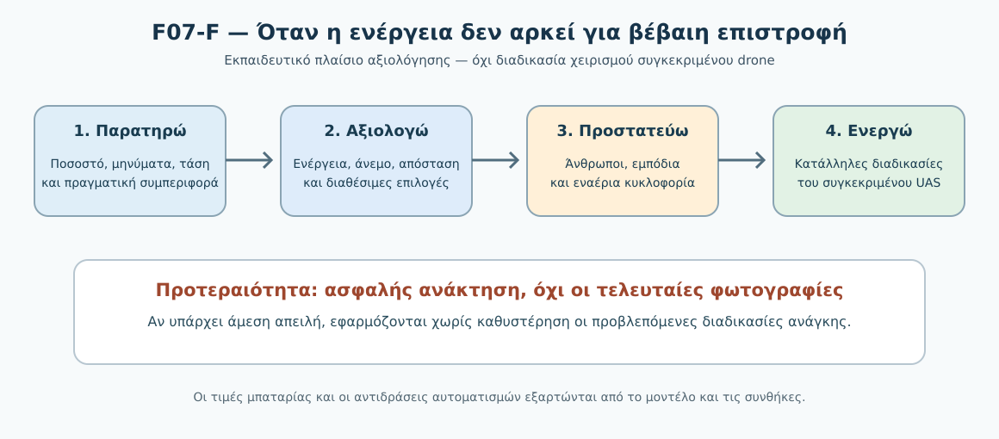

*Σχήμα F07-F. Συνθετικό εκπαιδευτικό διάγραμμα· δεν αποτελεί οδηγία χειρισμού συγκεκριμένου drone.*

### 1. Ένα προειδοποιητικό μήνυμα πριν τελειώσουν οι φωτογραφίες

Ένα drone εκτελεί αυτοματοποιημένη φωτογράφιση στον **υποθετικό αγρό 25 ha**. Έχει ολοκληρώσει το μεγαλύτερο μέρος της αποστολής, αλλά απομένουν δύο παράλληλες γραμμές λήψης. Εμφανίζεται προειδοποίηση ότι η διαθέσιμη ενέργεια μειώνεται ταχύτερα από την αναμενόμενη. Παράλληλα, η επιστροφή προς το σημείο απογείωσης γίνεται απέναντι στον άνεμο. Ο χειριστής βλέπει ποσοστό φόρτισης **29%**. **Το 29% είναι αποκλειστικά δεδομένο της άσκησης, όχι κανόνας απόφασης ή προτεινόμενο όριο.**

Τι γνωρίζουμε; Το ποσοστό και μια προειδοποίηση. Τι δεν γνωρίζουμε; Την επάρκεια ενέργειας για πραγματική επιστροφή με εφεδρεία, την κατάσταση της μπαταρίας, τον τρέχοντα άνεμο σε όλη τη διαδρομή, τις απαιτήσεις του συστήματος και τη διαθεσιμότητα εναλλακτικών σημείων. **Δεν δικαιολογείται να συνεχίσουμε τις λήψεις μόνο επειδή «μένει λίγο».**

### 2. Τέσσερις έννοιες που δεν πρέπει να συγχέουμε

**Ποσοστό φόρτισης (SoC):** εκτίμηση της σχετικής φόρτισης που παρέχει το σύστημα διαχείρισης μπαταρίας. Δεν αποτελεί άμεση μέτρηση της ενέργειας που θα καταναλωθεί μέχρι την προσγείωση.

**Υγεία/κατάσταση μπαταρίας (SoH):** εκτίμηση της κατάστασης του συσσωρευτή σε σχέση με τη συμπεριφορά του όταν ήταν νέος. Οι διαθέσιμες ενδείξεις διαφέρουν ανά κατασκευαστή και μοντέλο.

**Υπολειπόμενος χρόνος πτήσης:** υπολογισμός του συστήματος με βάση δεδομένα και παραδοχές που μπορεί να αλλάξουν κατά την πτήση. Δεν είναι υπόσχεση ασφαλούς προσγείωσης.

**Ενεργειακό περιθώριο ασφαλούς ανάκτησης:** η δυνατότητα να ολοκληρωθεί με ασφάλεια η πτήση λαμβάνοντας υπόψη την απαιτούμενη διαδρομή ή εναλλακτική, τις πραγματικές συνθήκες και πρόσθετη εφεδρεία. Είναι λειτουργική εκτίμηση, όχι μία καθολική αριθμητική τιμή.

| Ένδειξη | Τι μας δίνει | Τι δεν αποδεικνύει |
|---|---|---|
| 29% μπαταρία (υποθετικό) | Εκτίμηση υπολειπόμενης φόρτισης | Ότι μπορούμε να συνεχίσουμε ή να επιστρέψουμε με ασφάλεια |
| 5 min remaining (υποθετικό) | Εκτίμηση χρόνου από το σύστημα | Ότι οι καιρικές συνθήκες και η απαιτούμενη διαδρομή θα μείνουν ίδιες |
| Low battery warning | Προειδοποίηση που πρέπει να ερμηνευθεί από το εγχειρίδιο | Ότι η ίδια αντίδραση ισχύει για όλα τα drones |
| Home Point αποθηκευμένο | Γνωστή θέση αναφοράς συστήματος | Ότι είναι ακόμη ασφαλής η διαδρομή και η προσγείωση εκεί |

### 3. Γιατί η κατανάλωση μπορεί να αλλάξει απότομα;

- **Άνεμος:** μεγαλύτερος χρόνος ή διαφορετικές απαιτήσεις ισχύος στην επιστροφή. Η σχέση εξαρτάται από ταχύτητα, έλεγχο, συνθήκες και σχεδιασμό.
- **Θερμοκρασία:** μπορεί να επηρεάσει την απόδοση και τη διαθέσιμη ισχύ. Οι περιορισμοί θερμοκρασίας προκύπτουν από το εγχειρίδιο του συγκεκριμένου συστήματος/μπαταρίας.
- **Κατάσταση, γήρανση ή ασυμμετρία στοιχείων:** μπορεί να μειώσει τη διαθέσιμη απόδοση ή να οδηγήσει σε προειδοποιήσεις που χρειάζονται αντιμετώπιση.
- **Φορτίο, ελιγμοί, ύψος και πραγματική διαδρομή:** μεταβάλλουν τη ζήτηση ενέργειας σε σχέση με τις ιδανικές συνθήκες εργαστηρίου.
- **Αυτόματες λειτουργίες:** RTH, hover, αποφυγή εμποδίων και τροποποίηση διαδρομής μπορεί να έχουν διαφορετικό ενεργειακό αποτέλεσμα. Καμία λειτουργία δεν εγγυάται από μόνη της ασφαλή ανάκτηση.

**Συνηθισμένη παρανόηση:** «Ο κατασκευαστής δηλώνει 35 λεπτά, άρα μπορώ να σχεδιάσω αποστολή διάρκειας 34 λεπτών». Ο αναγραφόμενος μέγιστος χρόνος εξαρτάται από συγκεκριμένες δοκιμαστικές συνθήκες, που πρέπει να διαβαστούν από τον κατασκευαστή. Δεν αποτελεί καθολικά διαθέσιμο χρόνο ασφαλούς λειτουργίας.

#### Γιατί η ένδειξη μπορεί να παραπλανήσει χωρίς να είναι «χαλασμένη»;

Η ένδειξη φόρτισης είναι **εκτίμηση** που προέρχεται από το σύστημα της μπαταρίας. Η διαθέσιμη ισχύς, η τάση υπό φορτίο και η πραγματική απόδοση μπορεί να μεταβάλλονται με τη θερμοκρασία, τη γήρανση και το απαιτούμενο ρεύμα. Σε ορισμένες τεχνολογίες συσσωρευτών, μια έντονη ζήτηση ισχύος μπορεί να συνοδεύεται από **προσωρινή πτώση τάσης υπό φορτίο (voltage sag)**. Δεν σημαίνει πάντοτε ότι έχει χαθεί αμέσως αντίστοιχο ποσοστό της συνολικής ενέργειας, αλλά ούτε επιτρέπεται να αγνοούμε προειδοποίηση χαμηλής τάσης.

**Εκπαιδευτικό παράδειγμα:** Αν το drone αναφέρει 28% αλλά παρουσιάζει σοβαρή προειδοποίηση τάσης ή ισχύος, δεν αγνοούμε την προειδοποίηση επειδή «το ποσοστό είναι ακόμη υψηλό». Δίνουμε προτεραιότητα στην ασφάλεια και εφαρμόζουμε τη διαδικασία που περιγράφει το συγκεκριμένο σύστημα. Το 28% είναι υποθετικό και **δεν** αποτελεί κανονιστικό κατώφλι.

**Προσοχή στην πηγή:** Η γενική επίδραση του ψύχους στην απόδοση μπαταριών τεκμηριώνεται και σε εκπαιδευτικό υλικό της FAA. Η ακριβής μορφή, η ερμηνεία και η αντιμετώπιση οποιασδήποτε προειδοποίησης καθορίζονται από τον κατασκευαστή. [FAA-01]

### 4. Η πρόληψη ξεκινά πριν από την απογείωση

1. **Επιθεωρούμε την μπαταρία** για προβλήματα που ορίζει το εγχειρίδιο (π.χ. μη φυσιολογική διόγκωση, φθορά, ενδείξεις σφάλματος, μη ασφαλή τοποθέτηση). Δεν επιχειρούμε πτήση με ύποπτη/προειδοποιημένη μπαταρία.
2. **Ελέγχουμε συμβατότητα και συνθήκες:** εγκεκριμένο μοντέλο μπαταρίας, κατάσταση φόρτισης, όρια θερμοκρασίας, καταγραφές σφαλμάτων όπου διατίθενται.
3. **Υπολογίζουμε σχέδιο επιστροφής και εναλλακτικές:** πραγματικό ανάγλυφο, εμπόδια, άνθρωποι, άνεμος, διαθέσιμες θέσεις προσγείωσης.
4. **Διατηρούμε εφεδρεία για απρόοπτα:** δεν προγραμματίζουμε να αναλωθεί όλη η διαθέσιμη ενέργεια στις φωτογραφίες. Η ακριβής εφεδρεία δεν μπορεί να οριστεί καθολικά χωρίς συγκεκριμένο σύστημα/αποστολή.
5. **Γνωρίζουμε τις ρυθμίσεις προειδοποίησης, failsafe και RTH** του συγκεκριμένου μοντέλου — και τι συμβαίνει αν κάποιος αυτοματισμός ενεργοποιηθεί.
6. **Ορίζουμε κριτήρια έγκαιρης εγκατάλειψης της φωτογράφισης**, κατανοητά από όλη την ομάδα, πριν δημιουργηθεί πίεση ολοκλήρωσης.

**Κανονιστική βάση:** το AMC1 UAS.OPEN.060(1)(d) προβλέπει έλεγχο επαρκούς φόρτισης για την προγραμματισμένη πτήση **και πρόσθετη ενέργεια για απρόοπτα**. Είναι *αποδεκτό μέσο συμμόρφωσης* (AMC), όχι γενικός ευρωπαϊκός κανόνας ότι πρέπει να υπάρχει συγκεκριμένο ποσοστό (π.χ. 20% ή 30%). [EASA-01]

### 5. Τι κάνουμε όταν η επιστροφή γίνεται αβέβαιη;

Το ακόλουθο είναι **παιδαγωγικό πλαίσιο απόφασης**, όχι οδηγία πλήκτρων ή υποκατάστατο εγχειριδίου:

**Α. Αναγνωρίζω την αλλαγή.** Προειδοποιήσεις, διαφορετική ταχύτητα επιστροφής, παράδοξη συμπεριφορά ή μεταβολή διαθέσιμου χρόνου αποτελούν λόγους επανεκτίμησης.

**Β. Δίνω προτεραιότητα στην ασφάλεια έναντι των λήψεων.** Η συνέχιση των waypoints δεν πρέπει να καταναλώνει το περιθώριο ασφαλούς ανάκτησης. Αν η κατάσταση το απαιτεί, εγκαταλείπω τη χαρτογραφική εργασία σύμφωνα με τις προβλεπόμενες διαδικασίες του συστήματος.

**Γ. Εξετάζω την πραγματική ασφαλή ανάκτηση.** Ελέγχω ποια θέση προσγείωσης είναι διαθέσιμη, την πορεία προς αυτή, εναέρια κυκλοφορία, ανθρώπους, εμπόδια και δυνατότητες του drone. Δεν θεωρώ το κοντινότερο σημείο αυτομάτως ασφαλές.

**Δ. Αν πρόκειται για έκτακτη ανάγκη, εφαρμόζονται άμεσα οι προβλεπόμενες διαδικασίες.** Όταν απειλείται άμεσα η ασφάλεια, δεν καθυστερώ για τη συμπλήρωση φόρμας ή την επίλυση μαθηματικής άσκησης. Οι συγκεκριμένοι χειρισμοί εξαρτώνται από σύστημα και εγχειρίδιο.

**Ε. Μετά την ασφαλή ολοκλήρωση:** καταγράφω προειδοποιήσεις, στοιχεία πτήσης, περιβάλλον, ενέργειες και τυχόν ανάγκη ελέγχου μπαταρίας/συστήματος πριν από νέα πτήση.

#### Τέσσερις ερωτήσεις πριν επιλέξουμε διαδρομή ανάκτησης

| Ερώτηση | Γιατί είναι κρίσιμη |
|---|---|
| **Τι συμβαίνει στη μπαταρία τώρα;** | Εξετάζουμε προειδοποιήσεις, πραγματική συμπεριφορά και διαθέσιμα δεδομένα, όχι μόνο ποσοστό |
| **Πού μπορεί να φτάσει το drone με επαρκές περιθώριο;** | Η επιλογή εξαρτάται από άνεμο, διαδρομή, εμπόδια και τα στοιχεία του συγκεκριμένου μοντέλου |
| **Ποιοι κινδυνεύουν στο έδαφος ή στον αέρα;** | Ένα κοντινό σημείο προσγείωσης μπορεί να έχει πεζούς, οχήματα ή εμπόδια |
| **Τι προβλέπουν οι διαδικασίες του συστήματος;** | Οι εντολές RTH, αυτοματοποιημένης καθόδου και έκτακτης ανάγκης δεν λειτουργούν ίδια σε όλα τα drones |

Κατά την **πραγματική έκτακτη ανάγκη**, αυτές οι ερωτήσεις πρέπει να έχουν ήδη υποστηριχθεί από τον προπτητικό σχεδιασμό. Δεν καθυστερούμε επείγουσα αντίδραση για να τις συμπληρώσουμε μία προς μία.

#### Γιατί η αυτόματη επιστροφή δεν είναι πάντα η λύση

Είναι πιθανό η διαδρομή προς το Home Point να έχει αντίθετο άνεμο ή εμπόδια, ενώ η περιοχή προσγείωσης να έχει καταληφθεί από τρίτους. Επιπλέον, ορισμένα drones ενεργοποιούν διαφορετική συμπεριφορά σε low/critical battery, βάσει λογισμικού και ρυθμίσεων. **Δεν προτείνουμε γενικά «πάτησε RTH», «ακύρωσε RTH» ή «προσγείωσε αμέσως»: αυτές οι ενέργειες προϋποθέτουν πραγματικά δεδομένα και εγχειρίδιο συγκεκριμένου μοντέλου.**

### 6. Αναλυτικά λυμένο παράδειγμα — Υποθετικός αγρός 25 ha

**Στοιχεία:** Φωτογράφιση 70% ολοκληρωμένη, ένδειξη μπαταρίας 29%, προειδοποίηση αυξημένης κατανάλωσης, δυσμενέστερος αντίθετος άνεμος, μη επαληθευμένη ενεργειακή επάρκεια επιστροφής. Το Home Point βρίσκεται 500 m μακριά (όλα τα νούμερα αποτελούν υποθετικά δεδομένα).

**Βήμα 1 — Τι γνωρίζουμε;** Υπάρχει μετρήσιμη προειδοποίηση και τα περιθώρια φαίνεται ότι χειροτερεύουν. Το 29% δεν ισοδυναμεί με επιβεβαίωση δυνατότητας επιστροφής.

**Βήμα 2 — Τι λείπει;** Δυνατότητα του drone σε τρέχοντα άνεμο, πραγματικός χρόνος/ενέργεια ανάκτησης με εφεδρεία, ασφάλεια εναλλακτικής θέσης, τρέχουσες προειδοποιήσεις μπαταρίας.

**Βήμα 3 — Τι προέχει;** Η ολοκλήρωση των λήψεων παύει να αποτελεί στόχο. Χρειάζεται έγκαιρη ασφαλής ανάκτηση σύμφωνα με τις διαθέσιμες πραγματικές επιλογές και το εγχειρίδιο. Αν δεν είναι ασφαλής μια συνήθης διαδικασία, εφαρμόζεται η κατάλληλη διαδικασία ασυνήθιστης κατάστασης/ανάγκης, όπως έχει προβλεφθεί για το σύστημα.

**Βήμα 4 — Τελική διδακτική απόφαση:** **Δεν συνεχίζουμε τη χαρτογραφική εργασία.** Δεν διατάζουμε συγκεκριμένη προσγείωση ή RTH επειδή δεν έχουμε επαρκή στοιχεία γι' αυτό. Στην πραγματική πτήση απαιτείται άμεση δράση προσαρμοσμένη στο συγκεκριμένο drone και το περιβάλλον, όχι αναμονή συλλογής όλων των άγνωστων στοιχείων.

**Συνηθισμένο λάθος:** «Δεν χάθηκε η σύνδεση, άρα όλα είναι υπό έλεγχο». Η ενεργή σύνδεση C2 δεν εγγυάται επαρκή ενέργεια πρόωσης.

### 7. Απλοποιημένη μαθηματική άσκηση — γιατί χρειάζεται εφεδρεία

Για καθαρά εκπαιδευτικούς σκοπούς θεωρούμε ότι μια υποθετική μπαταρία έχει **200 Wh υποθετικά διαθέσιμης και χρησιμοποιήσιμης ενέργειας τη στιγμή που αρχίζει η απόφαση** (όχι ονομαστική χωρητικότητα και όχι ένδειξη πραγματικής μπαταρίας). Η εκτιμώμενη ενέργεια για την υπόλοιπη εργασία είναι 50 Wh, για τη σχεδιασμένη επιστροφή 70 Wh και μια υποθετική πρόσθετη εφεδρεία 40 Wh.

Συνολική προβλεπόμενη ανάγκη: **50 + 70 + 40 = 160 Wh**, δηλαδή απομένουν 40 Wh στο υποθετικό ενεργειακό ισοζύγιο.

**Τώρα εμφανίζεται απρόοπτο:** η επιστροφή εκτιμάται ότι θα απαιτήσει 110 Wh αντί 70 Wh. Τότε η ανάγκη γίνεται **50 + 110 + 40 = 200 Wh**. Το θεωρητικό υπόλοιπο μηδενίζεται, χωρίς κανένα περιθώριο για επιπλέον αβεβαιότητα. Η συνέχιση των λήψεων δεν μπορεί να δικαιολογηθεί με το αρχικό σχέδιο. Αν εγκαταλειφθούν οι λήψεις, απαιτείται νέα αξιολόγηση: 110 + 40 = 150 Wh, **αλλά αυτό δεν αποτελεί πιστοποίηση ασφαλούς πτήσης** ούτε αποδεικνύει ότι η υποτιθέμενη ενέργεια είναι πραγματικά διαθέσιμη.

Η άσκηση υποθέτει ότι και τα 200 Wh, όπως και όλες οι μελλοντικές ενεργειακές ανάγκες, αποτιμώνται **στην ίδια χρονική στιγμή**. Αν έχει ήδη καταναλωθεί ενέργεια, δεν επιτρέπεται να χρησιμοποιήσουμε ξανά την αρχική τιμή 200 Wh σαν να είναι το τρέχον διαθέσιμο υπόλοιπο. Η άσκηση υποθέτει ακριβείς και σταθερές τιμές Wh που στην πραγματικότητα συνήθως δεν γνωρίζουμε με αυτόν τον τρόπο. Δεν είναι υπολογιστής αυτονομίας, δεν αναφέρεται σε εμπορικό drone και δεν δίνει προτεινόμενο ποσοστό ασφαλείας.

#### Δεύτερη αριθμητική εφαρμογή — γιατί αλλάζει η απόφαση όταν αλλάζει ο χρόνος;

Υποθέτουμε **μόνο για τη μαθηματική άσκηση** ότι ένα drone διαθέτει αυτή τη στιγμή 90 Wh χρησιμοποιήσιμης ενέργειας. Η ασφαλής επιστροφή εκτιμάται ότι χρειάζεται 65 Wh και η υποθετική εφεδρεία είναι 20 Wh. Αρχικά το υπολογιστικό περιθώριο είναι **90 − 65 − 20 = 5 Wh**.

Νέα εκτίμηση, μετά από αύξηση αντίθετου ανέμου: επιστροφή 80 Wh. Τότε **90 − 80 − 20 = −10 Wh**. Το αρνητικό υπολογιστικό περιθώριο δείχνει ότι το αρχικό σχέδιο δεν υποστηρίζεται πλέον από τις **παραδοχές** του μοντέλου. Δεν αποδεικνύει ποιο σημείο προσγείωσης είναι ασφαλές ή ποια εντολή πρέπει να πατηθεί. Οι συνθήκες και η πραγματική μπαταρία μπορεί να δίνουν διαφορετικά αποτελέσματα.

**Διαφορά ενέργειας και ισχύος:** Τα Wh μετρούν ποσότητα ενέργειας, τα W ρυθμό κατανάλωσης. Αν για παράδειγμα ένα σύστημα καταναλώνει κατά μέσο όρο 120 W επί 10 λεπτά, η μαθηματική κατανάλωση είναι 120 × (10/60) = **20 Wh**. Η ισχύς σε πραγματική πτήση δεν παραμένει αναγκαστικά σταθερή.

### 8. Ασυνήθιστη κατάσταση ή επείγουσα ανάγκη;

| Σενάριο | Τι αλλάζει | Εκπαιδευτική προτεραιότητα |
|---|---|---|
| Αναμενόμενη μείωση φόρτισης χωρίς άλλη ένδειξη | Δεν έχει διαπιστωθεί νέος κίνδυνος | Συνέχιση συνεχούς αξιολόγησης, σύμφωνα με το σχέδιο και τα όρια |
| Προειδοποίηση ταχύτερης κατανάλωσης | Αβεβαιότητα ή επιδείνωση περιθωρίου | Έγκαιρη εγκατάλειψη λήψεων και ασφαλής ανάκτηση βάσει διαδικασιών |
| Προειδοποίηση σοβαρής ανωμαλίας ισχύος | Πιθανή αδυναμία κανονικής συνέχισης | Άμεση εφαρμογή κατάλληλης διαδικασίας του συγκεκριμένου συστήματος |
| Αυτόματη αναγκαστική κάθοδος σε μη ασφαλή περιοχή | Άμεση έκθεση τρίτων | Επείγουσα προστασία ανθρώπων και εφαρμογή των προβλεπόμενων διαδικασιών ανάγκης |

Οι βαθμίδες και οι αντιδράσεις των προειδοποιήσεων εξαρτώνται από το μοντέλο. Το παραπάνω είναι εκπαιδευτική ταξινόμηση, όχι αντίγραφο συγκεκριμένου εγχειριδίου ή γενική πιστοποίηση.

### 9. Πρακτική δραστηριότητα — Καρτέλα 04Δ-6

**Στόχος:** να αιτιολογείς αποφάσεις σε εξελισσόμενα περιστατικά χωρίς να χρησιμοποιείς ένα ποσοστό μπαταρίας ως μοναδικό κριτήριο.

**Παραδοτέο:** συμπληρωμένη Καρτέλα 04Δ-6 με τρία σενάρια και ένα σύντομο debrief. Δεν απαιτείται πραγματική πτήση. Απαγορεύεται στο πλαίσιο της άσκησης η εσκεμμένη εξάντληση μπαταρίας ή πρόκληση προειδοποιήσεων σε πραγματικό drone.

#### Σενάριο Α — «Μένουν μόνο δύο γραμμές»

Στιγμή Τ1: ένδειξη 32%, δύο γραμμές λήψης απομένουν, κανένα στοιχείο δεν τεκμηριώνει από μόνο του ασφαλή επιστροφή. Στιγμή Τ2: εμφανίζεται προειδοποίηση υπερβολικής κατανάλωσης. Στιγμή Τ3: η πορεία προς το Home Point παρουσιάζει δυσμενέστερο άνεμο. Εξήγησε πώς αλλάζει η απόφαση σε κάθε βήμα.

#### Σενάριο Β — Εναλλακτική προσγείωση

Στιγμή Τ1: ο χειριστής διαπιστώνει ότι πιθανή θέση προσγείωσης βρίσκεται πιο κοντά. Στιγμή Τ2: πεζοί κινούνται προς την περιοχή. Στιγμή Τ3: η ενέργεια μειώνεται περισσότερο και η αρχική επιστροφή είναι αβέβαιη. Πώς αξιολογείται η εναλλακτική, χωρίς να θεωρείται αυτομάτως κατάλληλη;

#### Σενάριο Γ — Ανωμαλία μπαταρίας

Στιγμή Τ1: το σύστημα δείχνει σοβαρό μήνυμα μη φυσιολογικής κατάστασης μπαταρίας (χωρίς συγκεκριμένο κωδικό κατασκευαστή). Στιγμή Τ2: εμφανίζεται μεταβολή απόκρισης ή ένδειξη ισχύος. Στιγμή Τ3: κοντά στο πιθανό σημείο ανάκτησης βρίσκεται όχημα. Τι πρέπει να προηγείται σε πραγματική κατάσταση και τι *δεν* μπορούμε να καθορίσουμε χωρίς το εγχειρίδιο;

<details>
<summary>Κρυφή αναλυτική λύση — Σενάριο Α</summary>

Στο Τ1 **δεν αρκεί το 32% για GO**: εξετάζεται η αρχική αποστολή, η απόσταση, η διαδρομή και η εφεδρεία. Στο Τ2 η προειδοποίηση μεταβάλλει την αξιολόγηση: οι λήψεις δεν πρέπει να συνεχίζονται αν επιβαρύνουν την ασφαλή ανάκτηση· εφαρμόζονται οι διαδικασίες του συστήματος. Στο Τ3 ο αντίθετος άνεμος μειώνει επιπλέον την αξιοπιστία του αρχικού σχεδίου επιστροφής. Δεν ορίζουμε αυθαίρετη εντολή πτήσης· απαιτείται η πραγματική ασφαλέστερη διαθέσιμη απόκριση βάσει συγκεκριμένου drone και συνθηκών.

</details>

<details>
<summary>Κρυφή αναλυτική λύση — Σενάριο Β</summary>

Το πλησιέστερο σημείο δεν είναι υποχρεωτικά το ασφαλέστερο. Με την εμφάνιση πεζών χρειάζεται εκ νέου εκτίμηση κινδύνου τρίτων και της προσέγγισης/προσγείωσης. Η αύξηση αβεβαιότητας ενέργειας καθιστά την αντίδραση χρονικά κρίσιμη. Δεν καθυστερούμε μια πραγματική κατάσταση ανάγκης για συμπλήρωση του πίνακα και δεν εκθέτουμε τρίτους με ανεξέλεγκτη κάθοδο.

</details>

<details>
<summary>Κρυφή αναλυτική λύση — Σενάριο Γ</summary>

Σοβαρή ανωμαλία μπαταρίας μπορεί να απαιτεί άμεση εφαρμογή προβλεπόμενης διαδικασίας ανάγκης. Χωρίς μοντέλο/μήνυμα/εγχειρίδιο δεν γνωρίζουμε αν το drone θα ενεργοποιήσει περιορισμό ισχύος, αναγκαστική προσγείωση ή άλλη συμπεριφορά. Προτεραιότητα είναι η ασφάλεια ανθρώπων και αεροσκαφών και η ορθή διαδικασία του συγκεκριμένου συστήματος, όχι η διάσωση της αποστολής.

</details>

#### Σενάριο Δ — Ασυμφωνία ενδείξεων και απότομη πτώση τάσης

**Τ1:** Η μπαταρία αναφέρει 28% και δεν υπάρχουν ακόμη νέες προειδοποιήσεις. **Τ2:** Σε αυξημένο φορτίο εμφανίζεται σοβαρή προειδοποίηση τάσης/ισχύος, ενώ το ποσοστό δεν έχει αλλάξει δραματικά. **Τ3:** Το drone βρίσκεται μακριά από την προγραμματισμένη θέση ανάκτησης και υπάρχουν άνθρωποι κοντά σε πιθανό εναλλακτικό σημείο.

**Ζητούμενο:** εξήγησε τι δεν γνωρίζουμε για το συγκεκριμένο σύστημα, γιατί η προειδοποίηση έχει προτεραιότητα έναντι της απλής ένδειξης ποσοστού και πώς πρέπει να τεκμηριωθεί η ασφαλέστερη εφικτή απόκριση χωρίς αυθαίρετη εντολή χειρισμού.

<details>
<summary>Κρυφή αναλυτική λύση — Σενάριο Δ</summary>

Το 28% δεν εγγυάται επαρκή διαθέσιμη ισχύ. Μια σοβαρή προειδοποίηση δεν αναιρείται από το σχετικά σταθερό ποσοστό φόρτισης. Οι λήψεις δεν αποτελούν πλέον προτεραιότητα και εφαρμόζονται άμεσα οι σχετικές διαδικασίες του συγκεκριμένου UAS. Αξιολογούνται οι κίνδυνοι στην πορεία και στο έδαφος. Η παρουσία τρίτων στο εναλλακτικό σημείο αποκλείει να θεωρηθεί αυτομάτως ασφαλής η προσγείωση εκεί. Δεν συνιστούμε γενικό RTH, γενική ακύρωση αυτοματισμού ή συγκεκριμένη εντολή, επειδή λείπουν οι απαραίτητες πληροφορίες για το μοντέλο και το περιβάλλον.

</details>

### 10. Αυτοαξιολόγηση

**Ερώτηση 1.** Ένα drone εμφανίζει 35% φόρτιση. Αρκεί αυτό για να αποφασίσουμε ότι μπορεί να συνεχίσει;
<details><summary>Απάντηση 1</summary>
Όχι. Χρειάζεται σύνθεση της υπολειπόμενης απόστασης/διαδρομής, του ανέμου, της κατάστασης μπαταρίας, των προειδοποιήσεων, της ασφαλούς προσγείωσης και πρόσθετης εφεδρείας.
</details>

**Ερώτηση 2.** Τι διαφέρει μεταξύ SoC και SoH;
<details><summary>Απάντηση 2</summary>
Το SoC περιγράφει εκτιμώμενη τρέχουσα φόρτιση, ενώ το SoH την κατάσταση/υποβάθμιση του συσσωρευτή σε σχέση με σημείο αναφοράς. Ούτε η μία ούτε η άλλη ένδειξη εγγυάται ασφαλή ανάκτηση.
</details>

**Ερώτηση 3.** Γιατί ένα εκτιμώμενο «5 min remaining» μπορεί να αποδειχθεί ανεπαρκές;
<details><summary>Απάντηση 3</summary>
Επειδή πρόκειται για εκτίμηση που εξαρτάται από τρέχουσες παραδοχές, ενώ άνεμος, διαδρομή, κατανάλωση και συμπεριφορά συστήματος μπορεί να αλλάξουν.
</details>

**Ερώτηση 4.** Ένα Home Point είναι καταχωρισμένο. Εγγυάται ότι το RTH αποτελεί την καλύτερη επιλογή;
<details><summary>Απάντηση 4</summary>
Όχι. Διαδρομή, διαθέσιμη ενέργεια, εμπόδια, άνθρωποι και συμπεριφορά του συγκεκριμένου RTH πρέπει να αξιολογηθούν.
</details>

**Ερώτηση 5.** Σε υποθετικό μοντέλο χρειάζονται 60 Wh για εργασία, 80 Wh για επιστροφή και 40 Wh για εφεδρεία. Πόσο είναι το άθροισμα και τι αποδεικνύει;
<details><summary>Απάντηση 5</summary>
180 Wh. Είναι αριθμητικό ισοζύγιο με τις συγκεκριμένες υποθετικές τιμές, όχι πραγματική πιστοποίηση δυνατότητας πτήσης.
</details>

**Ερώτηση 6.** Αν προκύψει σοβαρό πρόβλημα ενέργειας και υπάρχουν άνθρωποι στην αρχικά προβλεπόμενη θέση ανάκτησης, τι προηγείται;
<details><summary>Απάντηση 6</summary>
Η προστασία ανθρώπων και η άμεση κατάλληλη διαδικασία του συγκεκριμένου συστήματος. Δεν επιλέγουμε γενική συνταγή «προσγείωσε όπου είσαι» ή «RTH πάντα».
</details>

**Ερώτηση 7 (σύνθετη).** Η ομάδα έχει ήδη διακόψει τις λήψεις, αλλά η εκτίμηση επιστροφής χειροτερεύει και η κοντινή θέση προσγείωσης δεν έχει επαληθευτεί. Πώς εξηγείς την επόμενη απόφαση;
<details><summary>Απάντηση 7</summary>
Δεν θεωρώ ότι η παύση λήψεων ολοκλήρωσε την αντιμετώπιση. Προέχει η πραγματικά ασφαλής ανάκτηση/επείγουσα απόκριση με τις διαδικασίες του μοντέλου, με συνεχή επανεκτίμηση της ενέργειας και των κινδύνων τρίτων. Δεν επινοώ ακριβείς ελιγμούς ή ασφαλές σημείο.
</details>

**Ερώτηση 8.** Τι πρέπει να καταγράψουμε μετά από ανωμαλία μπαταρίας;
<details><summary>Απάντηση 8</summary>
Τις ενδείξεις και τα μηνύματα, τα διαθέσιμα δεδομένα πτήσης, τον καιρό, την ταυτότητα/κατάσταση μπαταρίας όπου διαθέσιμα, τις ενέργειες και τη διάγνωση/επιθεώρηση που απαιτείται πριν από επόμενη πτήση.
</details>

**Ερώτηση 9 (σύνθετη).** Το drone εμφανίζει 28% μπαταρία και σοβαρή προειδοποίηση χαμηλής τάσης. Γιατί είναι λανθασμένο να συνεχίσουμε επειδή η ένδειξη ποσοστού δεν έχει πέσει πολύ;

<details>
<summary>Απάντηση 9</summary>

Το ποσοστό φόρτισης εκτιμά σχετική υπολειπόμενη φόρτιση και δεν εγγυάται τη στιγμιαία δυνατότητα παροχής ισχύος ούτε την ασφαλή ανάκτηση. Η σοβαρή προειδοποίηση απαιτεί εφαρμογή της σχετικής διαδικασίας κατασκευαστή και προστασία τρίτων, όχι συνέχιση της εργασίας βάσει αυθαίρετου ποσοστού.

</details>

**Ερώτηση 10 (υπολογιστική).** Υποθετική **τωρινή** ενέργεια 90 Wh, επιστροφή 80 Wh και προγραμματισμένη εφεδρεία 20 Wh. Πόσο είναι το ενεργειακό ισοζύγιο και τι συμπεραίνουμε;

<details>
<summary>Απάντηση 10</summary>

**90 − 80 − 20 = −10 Wh.** Η υποθετική ανάγκη υπερβαίνει την υποθετική διαθέσιμη ενέργεια. Η αρχική παραδοχή ασφαλούς επιστροφής δεν υποστηρίζεται πλέον. Δεν επιλέγουμε όμως αυτομάτως μέθοδο ή θέση προσγείωσης χωρίς πραγματικά δεδομένα και τις προβλεπόμενες διαδικασίες.

</details>

### 11. Συνηθισμένα λάθη

- «35% σημαίνει πάντα ότι έχω χρόνο.» **Όχι:** απαιτείται αξιολόγηση συγκεκριμένης αποστολής.
- «Η προειδοποίηση low battery εμφανίζεται με το ίδιο ποσοστό σε όλα τα drones.» **Όχι:** εξαρτάται από μοντέλο, λογισμικό, ρυθμίσεις και συνθήκες.
- «Πρέπει οπωσδήποτε να φτάσω στο Home Point.» **Όχι:** η ασφαλέστερη διαθέσιμη απόκριση μπορεί να διαφέρει· ισχύει το εγχειρίδιο.
- «Αφού σταμάτησα τις λήψεις, είμαι ασφαλής.» **Όχι:** εξακολουθούν να χρειάζονται ενέργεια, έλεγχος και κατάλληλη ανάκτηση.
- «Η εφεδρεία είναι χαμένος χρόνος/ενέργεια.» **Όχι:** αποτελεί μέτρο αντιμετώπισης αβεβαιότητας.

### 12. Έλεγχος ολοκλήρωσης

Μπορείς να εξηγήσεις γιατί ένα ποσοστό δεν αρκεί; Να ξεχωρίσεις προειδοποίηση από επείγουσα ανάγκη χωρίς να εφευρίσκεις εντολές; Να αιτιολογήσεις εγκατάλειψη φωτογράφισης; Να εντοπίσεις κίνδυνο τρίτων σε εναλλακτική προσγείωση; Να αναφέρεις τι πρέπει να γνωρίζεις από το εγχειρίδιο πριν από πραγματική χρήση; Αν όχι, επανέλαβε την Καρτέλα 04Δ-6.

### Ελάχιστα κριτήρια αποδοχής για την πρακτική δραστηριότητα

Μια εργασία **δεν χαρακτηρίζεται επιτυχής**, ανεξάρτητα από το άθροισμα μονάδων, εφόσον ο φοιτητής: (α) προτείνει συνέχιση λήψεων παρά σοβαρή προειδοποίηση χωρίς αξιολόγηση, (β) αντιμετωπίζει ένα ποσοστό SoC ως καθολική απόδειξη ασφαλούς επιστροφής, (γ) θεωρεί ασφαλές το RTH ανεξαρτήτως διαδρομής και τρίτων, ή (δ) επινοεί συγκεκριμένους επικίνδυνους χειρισμούς χωρίς εγχειρίδιο μοντέλου.

### Πηγές, τεκμηρίωση και όρια εφαρμογής

- **[EASA-01]** EASA, *Easy Access Rules for Unmanned Aircraft Systems*, έκδοση 30/06/2026, AMC1 UAS.OPEN.060(1)(d): https://www.easa.europa.eu/en/document-library/easy-access-rules/online-publications/easy-access-rules-unmanned-aircraft-systems?erules-id=ERULES-1963177438-19528
- **[EASA-02]** EASA, Easy Access Rules, UAS.OPEN.060: https://www.easa.europa.eu/en/document-library/easy-access-rules/easy-access-rules-unmanned-aircraft-systems
- **[EASA-03]** EASA, ενδεικτικές πρακτικές δεξιότητες STS για απώλεια ισχύος και παρακολούθηση περιορισμών αντοχής: https://www.easa.europa.eu/en/document-library/easy-access-rules/online-publications/easy-access-rules-unmanned-aircraft-systems?erules-id=ERULES-1963177438-17416

- **[FAA-01]** FAA Safety Briefing, Νοέμβριος–Δεκέμβριος 2023, *How Cold Is Too Cold to Drone On?*: https://www.faa.gov/sites/faa.gov/files/NovDec2023.pdf — συμπληρωματική εκπαιδευτική πηγή, όχι ευρωπαϊκός κανόνας.

**Κανονιστική διευκρίνιση:** Οι ειδικές απαιτήσεις πρακτικής εκπαίδευσης STS δεν παρουσιάζονται ως γενική υποχρέωση όλων των χειριστών Open. Η χρήση ορίων, πλήκτρων, ρυθμίσεων και ακριβών αποκρίσεων εξαρτάται από το επίσημο εγχειρίδιο του συγκεκριμένου UAS. Τα υποθετικά αριθμητικά παραδείγματα δεν αποτελούν επιχειρησιακή αξιολόγηση ενέργειας.


---


### Συμπληρωματικός έλεγχος τεκμηρίωσης — Πύλη Β v0.4

> **Σημείωση έκδοσης:** Οι ακόλουθες διευκρινίσεις αφορούν αποκλειστικά την τεκμηρίωση των παρατιθέμενων ισχυρισμών. Δεν αποτελούν νέες γενικές εντολές χειρισμού.

- **B-06-003 — SUPPORTED_STS_SCOPED:** Η πρακτική δεξιότητα STS περιλαμβάνει διαχείριση μερικής ή πλήρους έλλειψης ισχύος προώθησης με προστασία τρίτων· δεν συνιστά οδηγία τεχνητής πρόκλησης βλάβης. Πηγή: [επίσημη τεκμηρίωση](https://www.easa.europa.eu/en/document-library/easy-access-rules/online-publications/easy-access-rules-unmanned-aircraft-systems?erules-id=ERULES-1963177438-17416).
- **B-06-005 — PARTIAL_MODEL_FIRMWARE_DEPENDENT:** Η DJI περιγράφει για Mini 4 Pro δυναμική αξιολόγηση επάρκειας ενέργειας και low battery RTH. Δεν επιτρέπεται καθολική διατύπωση για υποχρεωτική προσγείωση ή συγκεκριμένα ποσοστά όλων των drones. Πηγή: [επίσημη τεκμηρίωση](https://repair.dji.com/help/content?customId=en-us03400006776&documentType=artical&lang=en&paperDocType=paper&re=US&spaceId=34).
- **B-06-006 — SUPPORTED_MANUFACTURER_SCOPED:** Η DJI αναφέρει ότι σε χαμηλές θερμοκρασίες μπορεί να προκύψει απότομη πτώση τάσης και αναγκαστική προσγείωση σε συγκεκριμένα camera drones. Όχι καθολικό αριθμητικό όριο. Πηγή: [επίσημη τεκμηρίωση](https://repair.dji.com/help/content?customId=01700006823&documentType=&lang=en&paperDocType=ARTICLE&re=US&spaceId=17).
## DM00.4.7.7 — Απώλεια τηλεχειρισμού, εικόνας και τηλεμετρίας

### Ερμηνευτική επισήμανση — ποια ζεύξη πράγματι χάθηκε

Η **απώλεια C2**, η μη ενημέρωση της **τηλεμετρίας** και το πάγωμα της **ζωντανής εικόνας** δεν αποτελούν από μόνες τους την ίδια αστοχία. Ένα ορατό πλήκτρο RTH στην εφαρμογή δεν αποδεικνύει ότι το drone λαμβάνει εντολές εκείνη τη στιγμή. Ο επιτρεπόμενος χειρισμός πρέπει να προκύπτει από τις πραγματικές ενδείξεις, τις διαδικασίες του συστήματος και την προπτητικά επαληθευμένη διαμόρφωση. Στην Open το UAS.OPEN.060(2)(d) προβλέπει την ικανότητα διατήρησης ελέγχου, με τη ρητή εξαίρεση lost link. [EASA — UAS.OPEN.060](https://www.easa.europa.eu/en/document-library/easy-access-rules/online-publications/easy-access-rules-unmanned-aircraft-systems?erules-id=ERULES-1963177438-19528).


**Αναθεωρημένο εκπαιδευτικό προσχέδιο v0.2 — 03/11/2026.**
**Κατάσταση:** Προς ανεξάρτητο παιδαγωγικό, γλωσσικό και τεχνικό έλεγχο. Δεν αποτελεί επιχειρησιακό εγχειρίδιο. Για πραγματική πτήση εφαρμόζονται οι ακριβείς οδηγίες του κατασκευαστή, οι διαδικασίες του εκμεταλλευομένου και οι ισχύοντες κανόνες.

> **Κεντρική ιδέα:** Όταν «χάνεται το σήμα», δεν ξέρουμε αυτομάτως ποιο στοιχείο της επικοινωνίας έχει αποτύχει ούτε ποια ενέργεια πραγματοποιεί το drone. Χωρίζουμε τις παρατηρήσεις από τις υποθέσεις και δίνουμε προτεραιότητα στην αποφυγή κινδύνων.

#### Τι θα μπορείς να κάνεις

Μετά τη μελέτη θα μπορείς να: (α) διακρίνεις απώλεια σύνδεσης εντολών C2, βίντεο και τηλεμετρίας· (β) αναγνωρίζεις μη αξιόπιστες ή παλιές πληροφορίες θέσης· (γ) εξηγείς την έννοια του failsafe χωρίς να προϋποθέτεις καθολικό RTH· (δ) περιγράφεις τι πρέπει να ελεγχθεί πριν από την απογείωση για την ανάκτηση μετά από lost link· (ε) αιτιολογείς ασφαλείς επιλογές σε τρία διαδοχικά περιστατικά· (στ) καταγράφεις συμβάν και προϋποθέσεις επανέναρξης.

#### Σύνδεση με τα προηγούμενα

Στις 4.7.1–4.7.3 μάθαμε να αναγνωρίζουμε την κλιμάκωση και να παίρνουμε αποφάσεις σε συνθήκες αβεβαιότητας. Στις 4.7.4–4.7.6 εξετάσαμε τρίτους, καιρό και ενέργεια. Εδώ συνδυάζουμε αυτές τις δεξιότητες όταν η επικοινωνία με το drone υποβαθμίζεται. Στην 4.7.9 θα εξετάσουμε αναλυτικότερα τα RTH, Home Point και τις διαδρομές επιστροφής, ώστε να μην επαναλάβουμε το ίδιο περιεχόμενο εδώ.


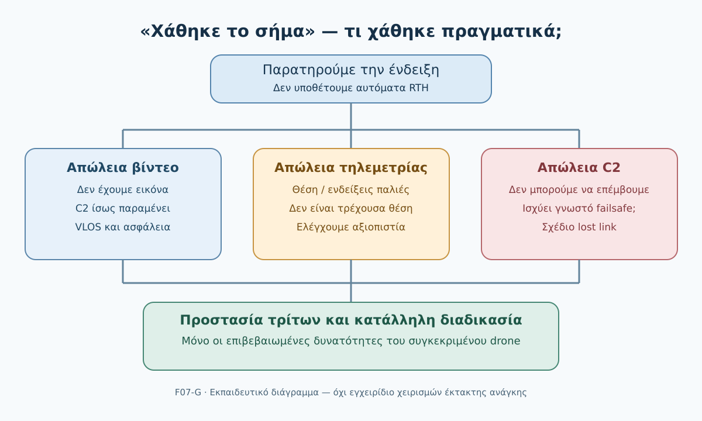

*Σχήμα F07-G. Συνθετικό εκπαιδευτικό διάγραμμα· δεν αποτελεί οδηγία χειρισμού συγκεκριμένου drone.*

### 1. Το περιστατικό: «Χάσαμε το σήμα»

Η ομάδα χαρτογραφεί έναν **υποθετικό αγρό 25 εκταρίων**. Ο χειριστής βλέπει για λίγο παγωμένη εικόνα της κάμερας. Ένας συνεργάτης λέει «χάσαμε το σήμα». Ωστόσο το drone παραμένει ορατό και κινείται κατά μήκος της διαδρομής του. Λίγα δευτερόλεπτα αργότερα εμφανίζονται παλιές ενδείξεις θέσης και μπαταρίας στην οθόνη.

Τι έχει χαθεί; Είναι δυνατόν να εξακολουθεί να λειτουργεί ο τηλεχειρισμός ενώ διακόπηκε μόνο το βίντεο; Είναι δυνατόν το drone να συνεχίζει μια αυτόματη διαδρομή παρότι ο χειριστής δεν μπορεί να το ελέγξει; **Ναι, ανάλογα με την αρχιτεκτονική του συστήματος· αλλά δεν υποθέτουμε ποια κατάσταση ισχύει χωρίς ενδείξεις ή επιβεβαιωμένες προδιαγραφές.**

Αποφεύγουμε να πατάμε τυχαία πολλές εντολές ή να θεωρούμε ότι κάθε διακοπή εικόνας πρέπει να αντιμετωπίζεται με RTH. Επιδιώκουμε σαφή εκτίμηση της κατάστασης και εφαρμογή της κατάλληλης, προδιαγεγραμμένης διαδικασίας του συγκεκριμένου drone.

### 2. Τρεις απώλειες που δεν πρέπει να συγχέουμε

| Όρος | Τι μπορεί να απουσιάζει | Τι μπορεί να παραμένει διαθέσιμο | Σημαντική επιφύλαξη |
|---|---|---|---|
| **C2 (Command and Control) lost link** | Η δυνατότητα αποστολής εντολών/παρέμβασης στον έλεγχο | Ενδεχομένως κάποιες ενδείξεις ή οπτική παρατήρηση | Η αντίδραση του drone εξαρτάται από τον τύπο και τις ρυθμίσεις |
| **Απώλεια βίντεο** | Ζωντανή εικόνα κάμερας (live video feed) | C2, τηλεμετρία, VLOS | Η εικόνα FPV/κάμερας δεν υποκαθιστά αυτομάτως το VLOS |
| **Απώλεια τηλεμετρίας** | Ενημέρωση θέσης, ύψους, μπαταρίας, ταχύτητας ή κατάστασης | Ενδεχομένως C2, βίντεο, VLOS | Το τελευταίο εμφανιζόμενο στοιχείο μπορεί να είναι παλιό |

**Ορισμός EASA:** Lost C2 link σημαίνει απώλεια επικοινωνίας εντολών και ελέγχου με το μη επανδρωμένο αεροσκάφος τέτοια ώστε ο χειριστής να μην μπορεί να παρέμβει στον έλεγχό του. **Προσοχή:** μήνυμα «weak signal», διακοπή βίντεο ή παγωμένη εφαρμογή δεν αποδεικνύει από μόνο του ότι πληρούται αυτός ο ορισμός. [EASA-02]

Η τεχνική αρχιτεκτονική δεν είναι ίδια για όλα τα drones. Κοινό σύστημα ραδιοζεύξης μπορεί να μεταφέρει περισσότερες από μία ροές· η αστοχία μιας ροής δεν αποδεικνύει την αστοχία κάθε άλλης, ούτε το αντίστροφο.

#### Το πρόβλημα της «τελευταίας γνωστής θέσης»

Η εφαρμογή αναφέρει γεωγραφική θέση πριν από 15 δευτερόλεπτα (υποθετικό παράδειγμα). Αυτό σημαίνει ότι η τελευταία διαθέσιμη εγγραφή είναι παλιά. **Δεν σημαίνει ότι το drone βρίσκεται ακόμη στο ίδιο σημείο.** Αν το drone συνεχίζει να κινείται, η απόκλιση μπορεί να αυξάνεται. Ελέγχουμε την ηλικία της ένδειξης, εφόσον διατίθεται, και δεν χρησιμοποιούμε παγωμένο χάρτη ως τρέχουσα πληροφορία πτήσης.

#### Συχνά παραγνωρισμένη περίπτωση: πρόβλημα οθόνης ή εφαρμογής

Το τηλεχειριστήριο μπορεί να φαίνεται «νεκρό» επειδή έχει παγώσει η εφαρμογή ή η οθόνη, ενώ η πραγματική ζεύξη C2 μπορεί να εξακολουθεί να λειτουργεί. Το αντίστροφο επίσης είναι δυνατό: η οθόνη να εμφανίζει παλαιά δεδομένα παρότι η σύνδεση έχει ήδη διακοπεί. Δεν μπορούμε να διαπιστώσουμε ποια ισχύει απλώς από την εμφάνιση της οθόνης.

| Παρατήρηση | Τι πράγματι τεκμηριώνει | Τι μένει να ελεγχθεί |
|---|---|---|
| Η εικόνα της κάμερας πάγωσε | Δεν εμφανίζονται νέα καρέ | Μετάδοση βίντεο, εφαρμογή, C2, ενδείξεις συστήματος |
| Η εφαρμογή δεν ανταποκρίνεται | Το περιβάλλον χρήστη δεν λειτουργεί κανονικά | Αν η ζεύξη ελέγχου συνεχίζει ανεξάρτητα από την εφαρμογή |
| Χάρτης/μπαταρία χωρίς ενημέρωση | Οι συγκεκριμένες ενδείξεις δεν ανανεώνονται | Τρέχουσα θέση, ενέργεια και πραγματική κατάσταση ζεύξης |
| Επίσημη ένδειξη lost C2 link | Το σύστημα αναφέρει απώλεια C2 | Ποια αντίδραση εκτελείται και εάν οι ενδείξεις είναι επίκαιρες |

**Διδακτικό συμπέρασμα:** Πρώτα διακρίνουμε παρατήρηση, τεκμηριωμένο συμπέρασμα και άγνωστη πληροφορία. Η διάγνωση δεν πρέπει να καθυστερεί την εφαρμογή προβλεπόμενης διαδικασίας όταν υπάρχει άμεσος κίνδυνος.

### 3. Τι είναι το failsafe και γιατί δεν ταυτίζεται με το RTH;

Με τον όρο *failsafe* περιγράφουμε λειτουργίες ή διαδικασίες που προβλέπονται για συγκεκριμένες αστοχίες. Αναλόγως συστήματος και προρυθμίσεων, η αντίδραση μετά από απώλεια σύνδεσης μπορεί να περιλαμβάνει επιστροφή, παραμονή σε μια θέση, προσγείωση ή άλλη προδιαγεγραμμένη ενέργεια. **Αυτά είναι ενδεικτικά παραδείγματα δυνατών συμπεριφορών, όχι εγγύηση ότι το εξεταζόμενο drone τις υποστηρίζει.**

Ακόμη και αν έχει οριστεί RTH, δεν συνεπάγεται ότι η επιστροφή είναι ασφαλής: ο διάδρομος επιστροφής, το ύψος, το Home Point, ο άνεμος, τα εμπόδια, η μπαταρία και οι τρίτοι μπορεί να έχουν αλλάξει. Δεν ισχυριζόμαστε ότι το drone «βλέπει» ή αποφεύγει πάντα εμπόδια. Η ακριβής συμπεριφορά απαιτεί εγχειρίδιο συγκεκριμένου μοντέλου.

Η καθοδήγηση **AMC1 UAS.OPEN.060(1)(d)** αναφέρει, για συστήματα με λειτουργία ανάκτησης λόγω απώλειας σύνδεσης, ότι πριν από την πτήση ελέγχουμε αν επιτρέπει ασφαλή ανάκτηση για τη σχεδιαζόμενη εργασία και, όπου είναι προγραμματιζόμενη, προσαρμόζουμε τις παραμέτρους στις συνθήκες. Πρόκειται για αποδεκτό μέσο συμμόρφωσης (AMC), όχι καθολική νομική απαίτηση ύπαρξης RTH. [EASA-01]

#### Πίνακας ελέγχου «Τι κάνει το δικό μας drone;»

| Ερώτηση πριν από την πτήση | Πού επιβεβαιώνεται | Κατάσταση παραδείγματος |
|---|---|---|
| Τι ενεργοποιεί το lost-link failsafe; | Εγχειρίδιο, εγκεκριμένες ρυθμίσεις | Δεν έχει επιβεβαιωθεί |
| Ποια ενέργεια εκτελείται; | Εγχειρίδιο και τρέχουσα ρύθμιση | Δεν έχει επιβεβαιωθεί |
| Τι ισχύει για ύψος και διαδρομή επιστροφής; | Μοντελοεξαρτώμενες οδηγίες, σχέδιο αποστολής | Δεν έχει επιβεβαιωθεί |
| Πότε και πώς ανακτάται ο έλεγχος; | Τεκμηριωμένη διαδικασία κατασκευαστή | Δεν έχει επιβεβαιωθεί |
| Ποιες ενδείξεις δείχνουν ότι η σύνδεση επανήλθε; | Εγχειρίδιο, πραγματική τηλεμετρία | Δεν έχει επιβεβαιωθεί |
| Τι κάνουμε αν το failsafe δεν λειτουργήσει όπως αναμένεται; | Διαδικασία εκμεταλλευομένου/κατασκευαστή | Δεν έχει επιβεβαιωθεί |

### 4. Πρόληψη: πριν από την απογείωση

1. **Επιθεωρούμε τον χειρισμό και την εγκατάσταση:** τηλεχειριστήριο, καλώδια, συνδέσεις, μπαταρίες και προειδοποιήσεις, σύμφωνα με το εγχειρίδιο.
2. **Εξετάζουμε τη γεωγραφία της αποστολής:** ανάγλυφο, κτίρια, δέντρα και άλλα εμπόδια που μπορεί να μειώσουν την ποιότητα της σύνδεσης ή να καταστήσουν επικίνδυνη τη διαδρομή ανάκτησης.
3. **Επιβεβαιώνουμε λειτουργίες και ρυθμίσεις:** ποια συμπεριφορά είναι ενεργή για απώλεια σύνδεσης, εφόσον υποστηρίζεται, και πώς γίνεται η επαναφορά ελέγχου.
4. **Ελέγχουμε ασφαλείς εναλλακτικές:** χώρος επιστροφής/προσγείωσης, τρίτοι, επανδρωμένη κυκλοφορία, καιρός, διαθέσιμη ενέργεια και πιθανότητα αλλαγής της κατάστασης.
5. **Οργανώνουμε επικοινωνία ομάδας:** ο παρατηρητής, όταν χρησιμοποιείται σύμφωνα με τους κανόνες, μεταφέρει με σαφήνεια τι βλέπει και τι δεν βλέπει. Η οπτική επαφή δεν προκύπτει απλώς από την εικόνα της κάμερας.
6. **Συμφωνούμε πότε εγκαταλείπεται η χαρτογράφηση:** δεν συνεχίζουμε λήψεις όταν η διαχείριση της ασφάλειας απαιτεί όλη την προσοχή του χειριστή.
7. **Προγραμματίζουμε μόνο νόμιμες και ασφαλείς δοκιμές:** δεν προκαλούμε πραγματική απώλεια C2 ή σβήσιμο τηλεχειριστηρίου ως άσκηση σε ενεργή πτήση. Χρησιμοποιούμε προσομοιωτή, επιτραπέζια άσκηση ή κατάλληλη εγκεκριμένη εκπαιδευτική διαδικασία υπό εξειδικευμένη επίβλεψη.

Τα παραπάνω συνδυάζουν υποχρεώσεις ασφαλούς λειτουργίας, καθοδήγηση της EASA και εκπαιδευτικές προτάσεις. Δεν είναι όλες οι γραμμές αυτούσιες νομικές διατάξεις. [EASA-01] [EASA-03]

### 5. Κατά τη διάρκεια: ενδείξεις και προτεραιότητες

Ο χειριστής διατηρεί την επίγνωση του drone και της εναέριας κυκλοφορίας. Αν εμφανιστεί ανωμαλία:

- **Αναγνωρίζει την ένδειξη**: διακοπή βίντεο; παλιές ενδείξεις; μήνυμα C2 lost link; αμφίβολη οπτική παρακολούθηση;
- **Δεν εφευρίσκει συμπεράσματα**: η απώλεια εικόνας δεν σημαίνει βέβαιη απώλεια τηλεχειρισμού· η ένδειξη RTH δεν αποδεικνύει ότι η διαδρομή είναι ασφαλής.
- **Δίνει προτεραιότητα στον εναέριο χώρο και τους τρίτους**: όταν υπάρχει κίνδυνος, εγκαταλείπει τη φωτογράφιση και εφαρμόζει τις προβλεπόμενες διαδικασίες ανάλογα με την κατάσταση.
- **Δεν επιχειρεί τυχαίες επαναλαμβανόμενες εντολές**, π.χ. αλλαγές λειτουργίας χωρίς γνώση της πραγματικής κατάστασης. Οι ενέργειες επανασύνδεσης και ανάκτησης ελέγχου πρέπει να είναι εκείνες του συγκεκριμένου συστήματος.
- **Διατηρεί σαφή επικοινωνία με παρατηρητή/ομάδα**, όταν υπάρχει, για τη θέση του drone και τις απειλές.
- **Δεν θεωρεί την επανεμφάνιση βίντεο απόδειξη πλήρους ανάκτησης ελέγχου**. Επιβεβαιώνει την κατάλληλη κατάσταση σύμφωνα με τις ενδείξεις και τη διαδικασία του συστήματος.

Σε άμεση απειλή δεν καθυστερούμε για συμπλήρωση φόρμας ή λεπτομερή διάγνωση. Οι ειδικές ενέργειες έκτακτης ανάγκης εξαρτώνται από το drone και την επιχείρηση. [EASA-03]

#### Επικοινωνιακή αστοχία: πώς προλαμβάνουμε μια δεύτερη λανθασμένη απόφαση

Πριν από την απογείωση η ομάδα πρέπει να γνωρίζει **ποιος αναφέρει τι**: ο χειριστής αναλαμβάνει τις αποφάσεις πτήσης και ο παρατηρητής, όπου χρησιμοποιείται, δίνει άμεσα σαφείς παρατηρήσεις για θέση και κινδύνους. Λέμε «η εικόνα πάγωσε» αντί «χάθηκε το drone», εφόσον μόνο αυτό έχει παρατηρηθεί. Με αυτόν τον τρόπο η ομάδα αποφεύγει να μετατρέψει μια αβέβαιη τεχνική ένδειξη σε βεβαιότητα.

**Έλεγχος πριν από τη χρήση εξοπλισμού:** Δεν αρκεί να γνωρίζουμε ότι υπάρχει λειτουργία RTH· πρέπει να είναι γνωστή η συγκεκριμένη διαμόρφωση για lost C2, η σχετική ένδειξη κατάστασης, η διαδικασία επανασύνδεσης και η συμπεριφορά μετά την επαναφορά, όπως τεκμηριώνονται στο εγχειρίδιο του μοντέλου. Αποφεύγουμε την επί τόπου αναζήτηση «γενικών» συνδυασμών πλήκτρων.

### 6. Λυμένο παράδειγμα Α — Παγωμένο βίντεο, ενεργός έλεγχος

**Δεδομένα:** Στον αγρό 25 ha παγώνει το βίντεο. Το drone παραμένει ορατό, η εφαρμογή αναφέρει ενεργή C2, και δεν υπάρχει γνωστή άμεση απειλή. Η αξιοπιστία της ένδειξης σύνδεσης πρέπει να επιβεβαιωθεί από τις δυνατότητες του συγκεκριμένου συστήματος.

**Τι γνωρίζουμε:** Το κανάλι βίντεο ή η παρουσίασή του έχει πρόβλημα. **Τι δεν γνωρίζουμε:** την ακριβή τεχνική αιτία και αν τα υπόλοιπα στοιχεία παραμένουν πραγματικά αξιόπιστα. **Τι δεν συμπεραίνουμε:** ότι ενεργοποιήθηκε αυτομάτως RTH.

**Εκπαιδευτική απόφαση:** Διακόπτουμε την προτεραιότητα της φωτογράφισης, διατηρούμε VLOS και παρακολούθηση κινδύνων, αξιολογούμε τη δυνατότητα ελέγχου και εφαρμόζουμε τη μοντελοεξαρτώμενη ασφαλή διαδικασία διακοπής/ανάκτησης, αντί να προσπαθούμε να «διορθώσουμε την εικόνα» αγνοώντας την πτήση. **Δεν επινοείται καθολική εντολή χειριστηρίου.**

### 7. Λυμένο παράδειγμα Β — Η ένδειξη στον χάρτη μένει ακίνητη

**Δεδομένα:** Ο χάρτης δείχνει την τελευταία θέση πριν από 20 s (υποθετικό), ενώ ο παρατηρητής βλέπει το drone να μετακινείται. Η ζεύξη χειρισμού δεν έχει επιβεβαιωθεί ως χαμένη.

**Ανάλυση:** Η τελευταία θέση είναι παλιά, άρα δεν αποτελεί τρέχον γεωγραφικό στίγμα. Δεν στηρίζουμε κρίσιμη απόφαση ανάκτησης μόνο στο παγωμένο σύμβολο. Η ομάδα αναγνωρίζει την αβεβαιότητα, εγκαταλείπει τις λήψεις και οργανώνει ασφαλή ανάκτηση σύμφωνα με τις προβλεπόμενες διαδικασίες, έχοντας υπόψη τη διατήρηση οπτικής επαφής και τους τρίτους.

### 8. Λυμένο παράδειγμα Γ — Επιβεβαιωμένη απώλεια C2

**Δεδομένα:** Το σύστημα δίνει επιβεβαιωμένη ένδειξη C2 lost link. Η γνωστή προπτητική ρύθμιση του συγκεκριμένου υποθετικού drone ορίζει αυτόματη επιστροφή σε προκαθορισμένο σημείο. Παράλληλα ένα όχημα εμφανίζεται κοντά στο σημείο επιστροφής.

**Ανάλυση:** Η αυτόματη επιστροφή είναι η **υποθετική, επιβεβαιωμένη ρύθμιση του σεναρίου**, όχι κανόνας για όλα τα drones. Ο χειριστής ενδέχεται να μην μπορεί να παρέμβει έως την επανασύνδεση. Η ομάδα παρατηρεί το αεροσκάφος και τον χώρο, αξιολογεί τους κινδύνους για τρίτους και ακολουθεί το καταγεγραμμένο σχέδιο lost-link. Όταν και εφόσον επιβεβαιωθεί επανάκτηση ελέγχου, χρησιμοποιείται η εγκεκριμένη διαδικασία του συστήματος για την ασφαλέστερη εφικτή διαχείριση. Δεν υποθέτουμε ότι η ρύθμιση επιστροφής θα αποφύγει το όχημα.

**Διδασκαλία:** Το κατάλληλο σχέδιο χτίζεται **πριν** από την πτήση. Μια επανεμφανιζόμενη ένδειξη δεν είναι από μόνη της πλήρης τεκμηρίωση ότι έχει αποκατασταθεί ο χειρισμός.

### 9. Κεντρική πρακτική δραστηριότητα — Καρτέλα 04Δ-7

Ο φοιτητής συμπληρώνει τρεις διαδοχικές στιγμές για την ίδια υποθετική πτήση.

- **Τ1:** Παγώνει το βίντεο. Το drone παραμένει ορατό. Δεν έχει επιβεβαιωθεί απώλεια C2.
- **Τ2:** Χάνονται οι ενημερώσεις τηλεμετρίας. Η θέση στον χάρτη είναι παλιά. Ο παρατηρητής βλέπει ότι το drone συνεχίζει να κινείται.
- **Τ3:** Εμφανίζεται τεκμηριωμένη ένδειξη lost C2 link. Ο προπτητικός σχεδιασμός προβλέπει ανάκτηση με συγκεκριμένο τρόπο, αλλά η θέση προσγείωσης δεν είναι πλέον ελεύθερη από τρίτους.

Για καθεμία συμπληρώνουμε: (1) παρατηρήσεις, (2) βέβαια στοιχεία, (3) άγνωστα στοιχεία, (4) κίνδυνο στον αέρα/στο έδαφος, (5) αρχική ασφαλή απόφαση, (6) τι θα πρέπει να έχει προβλεφθεί πριν από την πτήση. **Παραδοτέο:** πλήρης Καρτέλα 04Δ-7 και αιτιολόγηση της μεταβολής προτεραιοτήτων.

**Κριτήρια (10 μονάδες):** σωστή διάκριση ροών (3), τεκμηριωμένη αναγνώριση αβεβαιότητας (2), προστασία τρίτων και εναέριας κυκλοφορίας (3), αιτιολόγηση προπτητικών ρυθμίσεων (2). **Κριτήριο μη αποδοχής:** απάντηση που παρουσιάζει το RTH ως βέβαιο/καθολικά ασφαλές ή υποθέτει ότι η τελευταία θέση του χάρτη είναι τρέχουσα.

<details>
<summary>Κρυφή αναλυτική λύση — Καρτέλα 04Δ-7</summary>

**Τ1:** Μπορεί να έχει επηρεαστεί μόνο το βίντεο. Δεν τεκμηριώνεται lost C2. Η φωτογράφιση δεν προηγείται της ασφάλειας· απαιτείται παρακολούθηση και ασφαλής αξιολόγηση ελέγχου/ανάκτησης.

**Τ2:** Η τηλεμετρία έχει παύσει να ενημερώνεται, επομένως ο χάρτης δεν επιβεβαιώνει τρέχουσα θέση. Το drone φαίνεται να κινείται, άρα απαιτείται οπτική παρακολούθηση και αποφυγή αυθαίρετων συμπερασμάτων για το C2.

**Τ3:** Έχει επιβεβαιωθεί απώλεια C2 και η αντίδραση είναι μόνο εκείνη που προβλέπεται για το υποθετικό σύστημα. Οι τρίτοι κοντά στο σημείο ανάκτησης δημιουργούν σημαντικό κίνδυνο. Η ομάδα εφαρμόζει τη γνωστή διαδικασία lost-link, ενημερώνεται από οπτική παρατήρηση και δεν υποθέτει ότι η αυτόματη επιστροφή εγγυάται ασφάλεια. Όποια παρέμβαση γίνει μετά την επαναφορά της σύνδεσης πρέπει να ακολουθεί τη συγκεκριμένη τεκμηριωμένη διαδικασία.

**Γενικό συμπέρασμα:** Σε κάθε νέα στιγμή επανεκτιμούμε το πραγματικό επίπεδο βεβαιότητας. Δεν συνεχίζουμε αυτόματα την αρχική αποστολή όταν εμφανιστεί πάλι μία εικόνα ή ένδειξη.

</details>

#### Πρόσθετο σύνθετο περιστατικό Δ — Μερική επαναφορά επικοινωνίας

**Στιγμή 1:** Παγώνει η εφαρμογή του χειριστηρίου, αλλά ο παρατηρητής εξακολουθεί να βλέπει το drone. **Δεν γνωρίζουμε** αν η ζεύξη C2 έχει χαθεί. **Απόφαση:** η ομάδα εγκαταλείπει την προτεραιότητα της χαρτογράφησης και εφαρμόζει την προβλεπόμενη διαδικασία ελέγχου της κατάστασης, διατηρώντας επίγνωση εναέριου χώρου και τρίτων.

**Στιγμή 2:** Η εφαρμογή επανεκκινεί και εμφανίζει νέα εικόνα, αλλά δεν υπάρχει αξιόπιστη επιβεβαίωση κατάστασης ελέγχου και η θέση στο χάρτη εξακολουθεί να μην ανανεώνεται. **Δεν συμπεραίνουμε** ότι όλες οι λειτουργίες επανήλθαν. Η ομάδα συνεχίζει τη διαδικασία ασφαλούς ανάκτησης, σύμφωνα με το μοντέλο και τις τρέχουσες απειλές.

**Στιγμή 3:** Ο χειριστής έχει πλέον επιβεβαιώσει σύμφωνα με τις προβλεπόμενες ενδείξεις τη δυνατότητα παρέμβασης, αλλά η εναλλακτική προσγείωση έχει καταληφθεί από όχημα. **Συμπέρασμα:** η αποκατάσταση ελέγχου δεν σημαίνει αυτόματη επανέναρξη λήψεων ούτε ασφαλή προσγείωση στο αρχικά επιλεγμένο σημείο.

<details>
<summary>Κρυφή αναλυτική λύση — Σύνθετο περιστατικό Δ</summary>

Η επανεμφάνιση εικόνας είναι επιβεβαίωση μόνο για τη ροή εικόνας, όχι για κάθε άλλη ροή ή για όλες τις λειτουργίες χειρισμού. Σε κάθε στάδιο απαιτείται διάκριση πραγματικών παρατηρήσεων και μη επιβεβαιωμένων συμπερασμάτων, παράλληλα με συνεχή προστασία τρίτων. Μόνο οι τεκμηριωμένες διαδικασίες του συστήματος καθορίζουν πώς επιβεβαιώνεται η ανάκτηση ελέγχου. Ακόμη και μετά την ανάκτηση, αλλαγή στον χώρο προσγείωσης απαιτεί νέα αξιολόγηση.

</details>

### 10. Αυτοαξιολόγηση

**Ερώτηση 1.** Αν χαθεί η εικόνα, έχει χαθεί αναγκαστικά και το C2;

<details><summary>Απάντηση 1</summary>

**Όχι.** Η απώλεια βίντεο δεν αποδεικνύει από μόνη της απώλεια τηλεχειρισμού.

</details>

**Ερώτηση 2.** Ποια είναι η σημαντικότερη επιφύλαξη όταν ο χάρτης δεν ενημερώνεται;

<details><summary>Απάντηση 2</summary>

Η τελευταία θέση μπορεί να είναι παλιά και δεν πρέπει να εκλαμβάνεται ως τρέχουσα.

</details>

**Ερώτηση 3.** Τι σημαίνει C2 lost link κατά EASA;

<details><summary>Απάντηση 3</summary>

Ότι ο χειριστής δεν μπορεί πλέον να παρέμβει στον έλεγχο της πτήσης μέσω της ζεύξης εντολών και ελέγχου.

</details>

**Ερώτηση 4.** Είναι υποχρεωτικό όλα τα drones να ξεκινούν RTH όταν χάνεται η σύνδεση;

<details><summary>Απάντηση 4</summary>

Όχι. Η απόκριση είναι μοντελοεξαρτώμενη και πρέπει να έχει επιβεβαιωθεί πριν από την πτήση.

</details>

**Ερώτηση 5.** Γιατί το RTH μπορεί να μην είναι ασφαλές παρότι έχει ενεργοποιηθεί;

<details><summary>Απάντηση 5</summary>

Επειδή διαδρομή, εμπόδια, άνεμος, ενέργεια και παρουσία τρίτων μπορεί να καθιστούν την αυτόματη επιστροφή επικίνδυνη.

</details>

**Ερώτηση 6.** Το βίντεο επανήλθε. Αποδεικνύει αυτό από μόνο του ανάκτηση ελέγχου;

<details><summary>Απάντηση 6</summary>

Όχι. Χρειάζεται επιβεβαίωση σύμφωνα με τις ενδείξεις και τις διαδικασίες του συγκεκριμένου drone.

</details>

**Ερώτηση 7.** Πρέπει να προκαλούμε εσκεμμένα πραγματική απώλεια σύνδεσης ως εκπαιδευτική άσκηση πεδίου;

<details><summary>Απάντηση 7</summary>

Όχι ως γενική πρακτική. Προτιμούμε ασφαλή προσομοίωση ή κατάλληλη εγκεκριμένη άσκηση υπό ειδική επίβλεψη και με πλήρη έλεγχο κινδύνου.

</details>

**Ερώτηση 8 — Σύνθετη.** Η τηλεμετρία παγώνει και ο παρατηρητής αναφέρει ότι το drone φαίνεται να κατευθύνεται προς περιοχή με ανθρώπους. Είναι σωστό να αναμένουμε να επανέλθει ο χάρτης πριν εξετάσουμε τις προβλεπόμενες διαδικασίες ασφάλειας;

<details><summary>Απάντηση 8</summary>

Όχι. Προτεραιότητα έχει η αντιμετώπιση της πιθανής απειλής σύμφωνα με τα διαθέσιμα πραγματικά δεδομένα και τις προβλεπόμενες διαδικασίες. Η συμπλήρωση πληροφοριών ή η διάγνωση της τεχνικής αιτίας δεν πρέπει να καθυστερεί τις επείγουσες ενέργειες ασφάλειας.

</details>

**Ερώτηση 9 — Εφαρμογή.** Η οθόνη του χειριστηρίου σταμάτησε να ανταποκρίνεται, αλλά το drone παραμένει ορατό. Αποδεικνύεται lost C2 link;

<details>
<summary>Απάντηση 9</summary>

Όχι. Η αδυναμία λειτουργίας της εφαρμογής δεν αποδεικνύει από μόνη της απώλεια της ζεύξης εντολών και ελέγχου. Απαιτείται αξιολόγηση σύμφωνα με τις ενδείξεις και τις διαδικασίες του συγκεκριμένου συστήματος, χωρίς να παραμελείται η ασφάλεια.

</details>

**Ερώτηση 10 — Σύνθεση.** Η εικόνα επανήλθε, η δυνατότητα ελέγχου επιβεβαιώθηκε, αλλά ο διάδρομος επιστροφής δεν είναι πλέον ελεύθερος. Επιτρέπεται αυτόματη συνέχιση της χαρτογράφησης;

<details>
<summary>Απάντηση 10</summary>

Όχι. Η τεχνική αποκατάσταση της σύνδεσης δεν εξαλείφει τους κινδύνους της διαδρομής. Πρέπει πρώτα να αξιολογηθεί η δυνατότητα ασφαλούς ανάκτησης και να τηρηθούν οι διαδικασίες του συγκεκριμένου συστήματος.

</details>

### 11. Συχνά λάθη

- «Χάθηκε το βίντεο, άρα χάθηκε ο τηλεχειρισμός». **Λάθος:** πρόκειται για διακριτές λειτουργίες.
- «Το σύμβολο στον χάρτη δείχνει πού βρίσκεται τώρα». **Λάθος:** εάν δεν ανανεώνεται, δείχνει μόνο τελευταία γνωστή θέση.
- «Όλα τα drones επιστρέφουν αυτόματα». **Λάθος:** απαιτείται τεκμηρίωση ανά σύστημα.
- «Επανήλθε η εικόνα, άρα έχω πλήρη έλεγχο». **Λάθος:** χρειάζεται επιβεβαίωση.
- «Θα δοκιμάσω να κλείσω το χειριστήριο στον αέρα για να δω τι θα κάνει». **Επικίνδυνη γενίκευση:** δεν χρησιμοποιούμε τέτοια άσκηση χωρίς ειδικά σχεδιασμένη και εγκεκριμένη ασφαλή διαδικασία.
- «Ακόμη και με απώλεια σύνδεσης μπορούμε να αγνοήσουμε τρίτους». **Λάθος:** οι κίνδυνοι συνεχίζουν να υφίστανται.

### 12. Έλεγχος ολοκλήρωσης

Μπορείς να εξηγήσεις με δικά σου λόγια γιατί η απώλεια βίντεο δεν ταυτίζεται με την απώλεια C2; Μπορείς να συμπληρώσεις την Καρτέλα 04Δ-7 χωρίς να επινοήσεις ρυθμίσεις drone; Μπορείς να τεκμηριώσεις γιατί η άγνωστη συμπεριφορά lost link είναι λόγος να μην ξεκινήσει η πτήση πριν επιβεβαιωθεί η προβλεπόμενη αντιμετώπιση; Μπορείς να αναγνωρίσεις πότε μια ένδειξη είναι παλιά και όχι τρέχουσα; Μπορείς να εξηγήσεις γιατί η επανεμφάνιση εικόνας ή η επαναφορά της εφαρμογής δεν αρκεί για να θεωρηθεί ότι αποκαταστάθηκε πλήρως ο έλεγχος;

Αν όχι, επέστρεψε στα λυμένα παραδείγματα και στη δραστηριότητα. **Η επόμενη 4.7.8 θα εξετάσει τις αποκλίσεις GNSS και προσανατολισμού, ενώ η 4.7.9 θα αναπτύξει ειδικά τη λειτουργία RTH.**

### 13. Πηγές και όρια ισχύος

- **[EASA-01]** EASA, *Easy Access Rules for Unmanned Aircraft Systems*, revision 30 June 2026, UAS.OPEN.060 και AMC1 UAS.OPEN.060(1)(d). https://www.easa.europa.eu/en/document-library/easy-access-rules/online-publications/easy-access-rules-unmanned-aircraft-systems?erules-id=ERULES-1963177438-19528
- **[EASA-02]** EASA, *Easy Access Rules*, ορισμός «Lost C2 link». https://www.easa.europa.eu/en/document-library/easy-access-rules/online-publications/easy-access-rules-unmanned-aircraft-systems?erules-id=ERULES-1963177438-24084
- **[EASA-03]** EASA, *Easy Access Rules*, παράδειγμα σχεδιασμού στρατηγικής lost C2 link στο πλαίσιο τεκμηρίωσης σύνθετων επιχειρήσεων· **δεν αποτελεί αυτούσια καθολική υποχρέωση για Open**. https://www.easa.europa.eu/en/document-library/easy-access-rules/online-publications/easy-access-rules-unmanned-aircraft-systems?erules-id=ERULES-1963177438-15556

**Επαλήθευση πηγών:** 03/11/2026. Οι διαδικασίες ανάκτησης και οποιεσδήποτε εντολές χειριστηρίου απαιτούν επαλήθευση στο εγχειρίδιο του συγκεκριμένου μοντέλου. Δεν υποκαθιστούμε οδηγίες κατασκευαστή με εκπαιδευτικά γενικά σενάρια.


---


## DM00.4.7.8 — Προβλήματα GNSS, πυξίδας, προσανατολισμού και αλλαγής τρόπου πτήσης

### Ερμηνευτική επισήμανση — εκτίμηση και όχι διάγνωση

Το **EKF είναι μέθοδος εκτίμησης κατάστασης**, όχι αυτοτελής φυσικός αισθητήρας. Ορατό *drift* ή αλλαγή τρόπου πτήσης δεν αποδεικνύουν από μόνα τους βλάβη GNSS ή πυξίδας. Διαφορετικά αυτόματα συστήματα συνδυάζουν τις μετρήσεις με διαφορετικό τρόπο, επομένως δεν δίδεται καθολική εντολή αλλαγής mode, επαναβαθμονόμησης ή RTH εν πτήσει. Ο χειριστής βασίζεται στο συγκεκριμένο εγχειρίδιο και στη συμπεριφορά του αεροσκάφους. [EASA — υποχρεώσεις χειριστή](https://www.easa.europa.eu/en/document-library/easy-access-rules/online-publications/easy-access-rules-unmanned-aircraft-systems?erules-id=ERULES-1963177438-19528).


**Αναθεωρημένο εκπαιδευτικό προσχέδιο v0.2 — 03/11/2026.**
**Κατάσταση:** Για παιδαγωγικό, επιστημονικό και τεχνικό έλεγχο. **Δεν αποτελεί εγχειρίδιο έκτακτης ανάγκης συγκεκριμένου drone.** Οι πραγματικές ενέργειες εξαρτώνται από τον κατασκευαστή, την ενεργή διαμόρφωση, τις συνθήκες, τις διαδικασίες εκμεταλλευομένου και τους κανόνες.

> **Κεντρική ιδέα:** Η υποβάθμιση του GNSS ή η ασυμφωνία προσανατολισμού δεν σημαίνει πάντα απώλεια τηλεχειρισμού. Μπορεί όμως να κάνει αναξιόπιστη τη διατήρηση θέσης ή την αυτόματη πλοήγηση. Αποφεύγουμε την αυτοματοποιημένη συνέχιση όταν δεν υπάρχει τεκμηριωμένη βάση ασφάλειας.

#### Τι θα μπορείς να κάνεις

Μετά τη μελέτη θα μπορείς να: (1) εξηγείς τους ρόλους GNSS, πυξίδας/μαγνητομέτρου, IMU και συστήματος εκτίμησης κατάστασης· (2) διακρίνεις απώλεια θέσης από απώλεια ζεύξης χειρισμού· (3) αναγνωρίζεις ενδείξεις drift, ασυμφωνίας κατεύθυνσης και αυτόματης αλλαγής λειτουργίας· (4) περιγράφεις προληπτικούς ελέγχους χωρίς επινοημένα όρια αριθμού δορυφόρων· (5) λαμβάνεις αιτιολογημένες αποφάσεις σε σύνθετα περιστατικά· (6) διακρίνεις την ασφαλή εκπαίδευση επί χάρτου από επικίνδυνες δοκιμές σε πραγματική πτήση.

#### Σύνδεση με προηγούμενες υποενότητες

Η DM00.4.7.7 χώρισε την απώλεια C2, εικόνας και τηλεμετρίας. Εδώ εξετάζουμε διαφορετικό πρόβλημα: ο χειριστής **μπορεί να εξακολουθεί να επικοινωνεί** με το drone, αλλά ο αυτόματος πιλότος να μην έχει αξιόπιστη εικόνα της θέσης ή της κατεύθυνσής του. Στην 4.7.9 θα εμβαθύνουμε ειδικά στις διαδικασίες RTH, Home Point και αυτόματης ανάκτησης.

### 1. Το αρχικό περιστατικό

Η ομάδα χαρτογραφεί έναν **υποθετικό αγρό 25 ha**. Η πτήση περιλαμβάνει διαδοχικές φωτογραφικές γραμμές. Στο Τ1 εμφανίζεται προειδοποίηση *GNSS positioning degraded*. Στο Τ2 το drone φαίνεται να ολισθαίνει προς τα πλάγια, αντί να παραμένει κοντά στην αναμενόμενη θέση. Στο Τ3 η εφαρμογή αναφέρει αλλαγή τρόπου πτήσης, χωρίς ακόμη να γνωρίζουμε αν πραγματοποιήθηκε αυτόματα ή από εντολή. Κοντά στην περιοχή υπάρχουν δέντρα και ένας αγροτικός δρόμος.

Μήπως το drift προέρχεται από τον άνεμο; Έγινε ακριβής μετάβαση σε ATTI; Είναι αξιόπιστη η ένδειξη θέσης στον χάρτη; **Δεν έχουμε τα δεδομένα για ασφαλή διάγνωση**. Εδώ μαθαίνουμε να αντιδρούμε χωρίς να υποκαθιστούμε την αβεβαιότητα με εικασίες.

### 2. Τι μετρά κάθε σύστημα

| Στοιχείο | Ρόλος | Τι δεν εγγυάται |
|---|---|---|
| **GNSS** | Παρέχει εκτιμήσεις θέσης/ταχύτητας μέσω δορυφορικής πλοήγησης | Ότι η θέση είναι ακριβής επειδή υπάρχουν πολλοί δορυφόροι |
| **Μαγνητόμετρο (πυξίδα)** | Συνεισφέρει στην εκτίμηση κατεύθυνσης/heading | Ότι η ένδειξη είναι σωστή κοντά σε μαγνητικές παρεμβολές |
| **IMU** | Μετρά επιταχύνσεις και γωνιακές ταχύτητες | Ότι μόνο του παρέχει μακροχρόνια ακριβή γεωγραφική θέση |
| **Οπτικοί/άλλοι αισθητήρες** | Ενδέχεται να υποστηρίζουν σχετική θέση/ύψος σε κατάλληλες συνθήκες | Ότι λειτουργούν εξίσου καλά πάνω από κάθε επιφάνεια ή φωτισμό |
| **Συγχώνευση αισθητήρων/εκτίμηση κατάστασης** | Συνδυάζει μετρήσεις για θέση, ταχύτητα και προσανατολισμό | Ότι μπορεί να διατηρήσει αξιοπιστία όταν βασικές είσοδοι υποβαθμιστούν |

Η τεχνική τεκμηρίωση ArduPilot περιγράφει τον **EKF** (Extended Kalman Filter) ως μέρος του συστήματος εκτίμησης κατάστασης. Ασυμφωνίες μεταξύ GNSS, αδρανειακών δεδομένων και πυξίδας μπορούν να αυξήσουν την αβεβαιότητα και, ανάλογα με τις ρυθμίσεις, να ενεργοποιήσουν failsafe. [TECH-01]

#### Πολλοί δορυφόροι δεν σημαίνει απαραίτητα αξιόπιστη θέση

Η ποιότητα εξαρτάται και από τη γεωμετρία των δορυφόρων, τις ανακλάσεις σήματος (multipath), πιθανή παρεμβολή στα δορυφορικά σήματα, την κατάσταση του δέκτη και τη συνολική εκτίμηση θέσης. Ο αριθμός μόνος του δεν αποδεικνύει ασφαλή λειτουργία. **Δεν ορίζουμε καθολικό ελάχιστο πλήθος δορυφόρων**: εξετάζουμε ενδείξεις ποιότητας και τις προδιαγραφές του συγκεκριμένου drone.

### 3. Τέσσερις αστοχίες με διαφορετική σημασία

| Παρατήρηση | Πιθανές ερμηνείες | Τι μένει άγνωστο |
|---|---|---|
| «GNSS weak» | Υποβάθμιση δορυφορικής λύσης, τοπικές συνθήκες | Εάν διατηρείται αξιόπιστη εκτίμηση θέσης από άλλα μέσα |
| «Compass error» | Μαγνητική παρεμβολή ή πρόβλημα αισθητήρα/εκτίμησης | Εάν επηρεάζεται ο heading και η πλοήγηση |
| Drift | Άνεμος, υποβάθμιση διατήρησης θέσης ή άλλος παράγοντας | Ποια αιτία κυριαρχεί και πόσο γρήγορα εξελίσσεται |
| Αλλαγή mode | Προγραμματισμένη, χειροκίνητη ή αυτόματη μεταβολή | Ποια λειτουργία είναι πράγματι ενεργή και τι υποστηρίζει |

**Παρατήρηση ≠ διάγνωση.** Η ίδια ορατή μετακίνηση μπορεί να έχει διαφορετικές αιτίες. Αν υπάρχει κίνδυνος σύγκρουσης, η απόφαση προστασίας δεν περιμένει πλήρη τεχνική διάγνωση.

### 4. GNSS και πυξίδα — τι συμβαίνει στο εσωτερικό της πτήσης;

Η αυτόματη πλοήγηση βασίζεται σε εκτίμηση της κατάστασης του drone. Όταν η εκτιμώμενη θέση είναι ασταθής ή λανθασμένη, ο αυτόματος πιλότος μπορεί να επιχειρεί διορθώσεις προς λάθος θέση. Αντίστοιχα, λανθασμένη εκτίμηση heading μπορεί να προκαλέσει δυσκολίες στην πλοήγηση, χωρίς να έχει καταστραφεί ο τηλεχειρισμός. Το αποτέλεσμα εξαρτάται από τη συνολική αρχιτεκτονική.

Η τεκμηρίωση του ArduPilot αναφέρει ότι οι υπερβολικές αποκλίσεις στην εκτίμηση πυξίδας, θέσης ή ταχύτητας μπορούν να οδηγήσουν σε EKF failsafe· οι συνέπειες διαφέρουν αναλόγως τρόπου πτήσης και παραμέτρων. [TECH-01] **Αυτή είναι περιγραφή του ArduPilot, όχι γενικός κανόνας όλων των drones.**

#### Προσοχή στη «βαθμονόμηση πυξίδας»

Δεν αντιμετωπίζουμε κάθε προειδοποίηση με άμεση βαθμονόμηση σε άγνωστο χώρο. Η βαθμονόμηση πρέπει να γίνεται μόνο σύμφωνα με τις οδηγίες του συγκεκριμένου κατασκευαστή, στο κατάλληλο περιβάλλον, όταν προβλέπεται. Κοντά σε ορισμένες μεταλλικές κατασκευές ή πηγές ηλεκτρομαγνητικής ενέργειας μπορεί να έχουμε ανεπιθύμητες επιδράσεις. Η **μαγνητική διαταραχή της πυξίδας** δεν είναι το ίδιο φαινόμενο με την **παρεμβολή στη λήψη GNSS**. Δεν θεωρούμε μια υποδομή αποδεδειγμένη αιτία χωρίς στοιχεία. [EASA-01]

### 5. Τρόπος πτήσης: τι αλλάζει για τον χειριστή;

Οι ονομασίες **GPS / Position / ATTI / AltHold / Stabilize / Manual** δεν αντιστοιχούν αναγκαστικά στις ίδιες λειτουργίες μεταξύ κατασκευαστών. Ορισμένες λειτουργίες διατηρούν γεωγραφική θέση, άλλες ύψος, άλλες μόνο στάση/γωνιακή σταθεροποίηση, ενώ οι λειτουργίες χειρισμού διαφέρουν. Δεν αποδίδουμε συγκεκριμένη συμπεριφορά στο drone χωρίς εγχειρίδιο.

**Τεκμηριωμένο παράδειγμα κατασκευαστή:** το εγχειρίδιο DJI Agras T25P περιγράφει ότι όταν διακοπεί η διαθέσιμη απαιτούμενη πλοήγηση, μπορεί να υπάρξει μετάβαση σε ATTI, όπου το αεροσκάφος ενδέχεται να παρασύρεται και απαιτείται κατάλληλη χειροκίνητη διαχείριση. [TECH-02] Το παράδειγμα **δεν** αποτελεί οδηγία για άλλο μοντέλο ούτε απόδειξη ότι το T25P είναι το εκπαιδευτικό μας drone.

#### Κρίσιμη διάκριση: drift και απώλεια ελέγχου

Drift σημαίνει ότι η πραγματική κίνηση δεν ακολουθεί αυτό που περιμένει ο χειριστής ή δεν διατηρείται η θέση. **Δεν αποδεικνύει από μόνο του** ότι χάθηκε το C2. Ωστόσο μπορεί να αυξήσει γρήγορα τον κίνδυνο σε περιορισμένο χώρο. Η ανταπόκριση στις εντολές και η ασφαλής δυνατότητα ελέγχου απαιτούν μοντελοεξαρτώμενη επιβεβαίωση.

#### Πώς διαβάζουμε μια αλλαγή mode χωρίς να κάνουμε επικίνδυνη υπόθεση

Μια ονομασία λειτουργίας στην οθόνη αποτελεί **ένδειξη**, όχι πλήρη περιγραφή των δυνατοτήτων ελέγχου. Στην εκπαίδευση καταγράφουμε πρώτα την ακριβή ονομασία και την έκδοση του συστήματος και κατόπιν αναζητούμε στο αντίστοιχο εγχειρίδιο:

| Ερώτημα για το συγκεκριμένο drone | Τι χρειάζεται να τεκμηριωθεί |
|---|---|
| Διατηρεί γεωγραφική θέση; | Ποιοι αισθητήρες απαιτούνται και τι συμβαίνει σε υποβάθμιση |
| Διατηρεί ύψος ή στάση; | Ποια υποβοήθηση παραμένει πραγματικά διαθέσιμη |
| Τι κάνει η αστοχία εκτίμησης θέσης; | Αναμενόμενη μετάβαση mode / failsafe και τυχόν προϋποθέσεις |
| Πώς ανακτάται με ασφάλεια; | Διαδικασία κατασκευαστή και προαπαιτούμενες δεξιότητες |
| Απαιτεί αξιόπιστη θέση το RTH; | Τυχόν όρια και εναλλακτική συμπεριφορά |

**Τεχνικό τεκμηριωμένο παράδειγμα — ArduPilot Copter:** η επίσημη τεκμηρίωση EKF failsafe περιγράφει διαφορετική απόκριση ανάμεσα σε modes που απαιτούν εκτίμηση θέσης και σε χειροκίνητα modes που δεν την απαιτούν. Επιπλέον η απόκριση μπορεί να μεταβληθεί μέσω ρυθμίσεων. **Δεν εφαρμόζουμε αυτές τις επιλογές ως οδηγίες σε DJI, PX4 ή άλλο σύστημα.** [TECH-01]

#### Γιατί δεν «δοκιμάζουμε» διαφορετικά modes στη διάρκεια του περιστατικού

Αν δεν γνωρίζουμε τι κάνει ένα mode, μια αυθαίρετη εναλλαγή μπορεί να μειώσει την υποβοήθηση που εξακολουθεί να λειτουργεί και να αυξήσει το πρόβλημα. Η εξοικείωση με τις εγκεκριμένες διαδικασίες πρέπει να έχει προηγηθεί σε προσομοίωση ή σε κατάλληλα επιβλεπόμενη εκπαίδευση. Εδώ διδάσκουμε τη **λογική απόφασης**, όχι εντολές πλήκτρων.

### 6. Σχήμα F07-H — Από αισθητήρες σε συμπεριφορά πτήσης

```{figure} assets/DM00-04-F07H_GNSS_Compass_Mode.png
:alt: Σχήμα που διαχωρίζει τη δορυφορική θέση, τη μαγνητική κατεύθυνση, την αδρανειακή μέτρηση, την εκτίμηση κατάστασης και την τελική συμπεριφορά του drone.
:width: 100%

**F07-H.** Η αλυσίδα εκτίμησης κατάστασης και η πιθανή επίδραση στην πτήση. Συνθετικό εκπαιδευτικό διάγραμμα, όχι τεχνικό διάγραμμα συγκεκριμένου drone.
```

**Πώς διαβάζουμε το σχήμα:** Οι αισθητήρες δίνουν επιμέρους πληροφορίες. Ο αλγόριθμος εκτίμησης δημιουργεί μια συνολική εικόνα. Οι λειτουργίες αυτόματης πτήσης μπορούν να χρησιμοποιούν αυτή την εικόνα. Αν κάποιο στοιχείο δεν είναι αξιόπιστο, η συμπεριφορά δεν είναι υποχρεωτικά ίδια σε όλες τις πλατφόρμες.

### 7. Πρόληψη: τι ελέγχουμε πριν από την απογείωση

1. **Περιβάλλον:** δέντρα, κτίρια, σημεία με περιορισμένο ορίζοντα, μεταλλικές κατασκευές, πιθανές πηγές ηλεκτρομαγνητικών παρεμβολών· αξιολόγηση χωρίς αυθαίρετες γενικές αποστάσεις. [EASA-01]
2. **Ενδείξεις συστήματος:** τρέχουσα κατάσταση GNSS, προειδοποιήσεις αισθητήρων, ενδείξεις heading και θέσης, σύμφωνα με το εγχειρίδιο.
3. **Προβλεπόμενες αλλαγές λειτουργίας:** τι συμβαίνει όταν δεν είναι διαθέσιμη η απαιτούμενη πλοήγηση και ποιες πραγματικές δυνατότητες έχει ο χειριστής.
4. **Προγραμματισμένη αποστολή:** οι αυτοματοποιημένες διαδρομές δεν θεωρούνται ασφαλείς χωρίς αξιόπιστη πλοήγηση· προβλέπονται σημεία και επιλογές ασφαλούς ανάκτησης.
5. **Τρίτοι και εναέριος χώρος:** έλεγχος ανθρώπων, οχημάτων, ζώων, επανδρωμένων αεροσκαφών και κατάλληλων σημείων προσγείωσης.
6. **Εκπαίδευση:** εξοικείωση με τεκμηριωμένες λειτουργίες σε κατάλληλο προσομοιωτή ή μέσω επιτρεπόμενης, ελεγχόμενης εκπαίδευσης· όχι τεχνητή παρεμβολή GNSS/πυξίδας κατά τη διάρκεια πραγματικής πτήσης.

Οι παραπάνω έλεγχοι συνδυάζουν κανονιστική υποχρέωση ασφαλούς λειτουργίας, καθοδήγηση AMC και πρόσθετη εκπαιδευτική καλή πρακτική. Δεν αποτελούν όλοι ξεχωριστές αυτούσιες νομικές απαιτήσεις.

### 8. Κατά την πτήση: ασφαλής λογική απόφασης

**Πρώτα η προστασία, μετά η διάγνωση.** Όταν υποβαθμίζεται η πλοήγηση:

- αναγνωρίζουμε τις **πραγματικές ενδείξεις** και τη θέση του drone με τα διαθέσιμα αξιόπιστα μέσα, διατηρώντας την προβλεπόμενη οπτική επαφή·
- εγκαταλείπουμε τις **φωτογραφικές γραμμές** όταν αυτές δεν μπορούν πλέον να εκτελούνται ασφαλώς·
- ελέγχουμε εάν η συμπεριφορά και η ενεργή λειτουργία επιτρέπουν ασφαλή ανάκτηση σύμφωνα με τις διαδικασίες του συστήματος·
- δεν υποθέτουμε ότι το **RTH** είναι ασφαλές όταν η εκτίμηση θέσης/heading είναι αβέβαιη·
- δίνουμε προτεραιότητα στην αποφυγή κινδύνου για ανθρώπους και άλλα αεροσκάφη, χωρίς τυχαίες αλλαγές λειτουργίας·
- καταγράφουμε το περιστατικό και **δεν επαναρχίζουμε** την αποστολή απλώς επειδή εξαφανίστηκε η προειδοποίηση.

**Όριο της γενικής διδασκαλίας:** Δεν δίνουμε μία καθολική ακολουθία χειρισμών, αλλαγής mode ή προσγείωσης. Σε ορισμένα drones μια αλλαγή λειτουργίας μπορεί να απαιτεί δεξιότητες που δεν διαθέτει ο αρχάριος. Πραγματικές ενέργειες βασίζονται σε εγχειρίδιο και κατάλληλη εκπαίδευση.

#### Τι βλέπω, τι ξέρω και τι απλώς υποθέτω;

| Ένδειξη / παρατήρηση | Ασφαλές συμπέρασμα | Επικίνδυνη υπόθεση |
|---|---|---|
| Ο αριθμός δορυφόρων παραμένει υψηλός | Υπάρχουν διαθέσιμα σήματα | «Η θέση είναι οπωσδήποτε ακριβής» |
| Στην οθόνη εμφανίζεται «Compass error» | Το σύστημα αναφέρει σχετικό πρόβλημα | «Το GNSS χάθηκε σίγουρα» |
| Το drone φαίνεται να μετακινείται πλευρικά | Υπάρχει ορατή απόκλιση από την αναμενόμενη κίνηση | «Φταίει αποκλειστικά ο άνεμος» |
| Το C2 παραμένει ενεργό | Υπάρχει ένδειξη ενεργής ζεύξης χειρισμού | «Η αυτόματη πλοήγηση είναι ασφαλής» |
| Η προειδοποίηση εξαφανίζεται | Δεν εμφανίζεται πλέον η συγκεκριμένη ένδειξη | «Το αίτιο επιδιορθώθηκε και επανεκκινούμε» |

Ο πίνακας εφαρμόζει την αρχή **παρατήρηση → ερμηνεία με επιφυλάξεις → ασφαλής απόφαση** που αναπτύξαμε στις 4.7.1–4.7.3. Σε άμεσο κίνδυνο τρίτων δεν περιμένουμε τεχνική διάγνωση για να εφαρμόσουμε τη γνωστή κατάλληλη διαδικασία προστασίας.

### 9. Αναλυτικά λυμένα παραδείγματα

#### Παράδειγμα Α — Αδύναμο GNSS, αλλά λειτουργεί το τηλεχειριστήριο

**Δεδομένα:** Το drone είναι ορατό, εμφανίζει «GNSS weak», και η εφαρμογή αναφέρει C2 ενεργό. Δεν υπάρχει ακόμη ένδειξη drift.

**Ερμηνεία:** Μπορούμε να πούμε ότι αναφέρεται υποβάθμιση δορυφορικής πλοήγησης. Δεν μπορούμε να εγγυηθούμε ακρίβεια θέσης ούτε να συμπεράνουμε ότι το drone θα αρχίσει αμέσως να παρασύρεται. Ο ενεργός τηλεχειρισμός δεν επαρκεί από μόνος του για ασφαλή συνέχιση της αυτόματης χαρτογράφησης.

**Απόφαση:** Αναστέλλουμε τη φωτογραφική εργασία και αξιολογούμε την ασφαλή αντιμετώπιση με βάση τη διαθέσιμη πραγματική κατάσταση και το εγχειρίδιο. Δεν δίνουμε τυχαία εντολή RTH.

#### Παράδειγμα Β — Compass warning δίπλα σε μεταλλική υποδομή

**Δεδομένα:** Πριν από την απογείωση εμφανίζεται προειδοποίηση πυξίδας σε χώρο δίπλα σε μεταλλική στέγη και παρκαρισμένα οχήματα.

**Ερμηνεία:** Υπάρχει πιθανή επίδραση του περιβάλλοντος, αλλά χωρίς διαγνωστικά δεν αποδεικνύεται η ακριβής αιτία.

**Απόφαση:** **Δεν απογειωνόμαστε** με ανεξήγητη κρίσιμη προειδοποίηση. Ελέγχουμε το περιβάλλον και τις επίσημες οδηγίες του μοντέλου· τυχόν μετακίνηση της βάσης/βαθμονόμηση γίνεται μόνο όπου προβλέπεται. Η απλή εξαφάνιση της ένδειξης δεν αρκεί χωρίς ολοκληρωμένο έλεγχο.

#### Παράδειγμα Γ — Αλλαγή mode και drift κοντά σε δρόμο

**Δεδομένα:** Κατά τη χαρτογράφηση εμφανίζεται νέα λειτουργία, το drone μετακινείται πλάγια, και πλησιάζει στον αγροτικό δρόμο όπου κινείται τρακτέρ.

**Τι γνωρίζουμε:** Υπάρχει νέα ένδειξη λειτουργίας και παρατηρήσιμη μεταβολή κίνησης. **Δεν γνωρίζουμε** αν η αιτία είναι μόνο GNSS, άνεμος ή συνδυασμός.

**Απόφαση:** Η προστασία τρίτων προηγείται της διάγνωσης. Η αυτόματη εργασία δεν συνεχίζεται. Η ομάδα εφαρμόζει την κατάλληλη εκπαιδευμένη διαδικασία του συστήματος για αποφυγή έκθεσης τρίτων και ασφαλή ανάκτηση. Δεν χρησιμοποιούμε τυχαία mode ή RTH ως δήθεν καθολική λύση.

#### Παράδειγμα Δ — Προειδοποίηση που εξαφανίστηκε αλλά η αποστολή δεν είναι έτοιμη

**Δεδομένα:** Πριν την απογείωση, η εφαρμογή αναφέρει πρόβλημα πυξίδας. Η ομάδα μετακινεί τον εξοπλισμό σε διαφορετική θέση όπως επιτρέπει το εγχειρίδιο και η ένδειξη εξαφανίζεται. Δεν έχει γίνει ακόμη ο πλήρης προπτητικός έλεγχος και δεν έχουν επιβεβαιωθεί τα διαθέσιμα modes ή η ασφαλής ανάκτηση.

**Ερμηνεία:** Η μεταβολή της ένδειξης είναι θετική πληροφορία, όχι βεβαίωση ολοκληρωμένου ελέγχου. Δεν γνωρίζουμε αν όλα τα απαιτούμενα στοιχεία είναι κατάλληλα.

**Απόφαση:** Η ομάδα δεν απογειώνεται πριν ολοκληρωθούν οι προβλεπόμενοι έλεγχοι. Δεν πραγματοποιεί αυθαίρετη βαθμονόμηση μόνο και μόνο επειδή υπήρξε προειδοποίηση.

#### Σύνθετο σενάριο: ποια πληροφορία αλλάζει την απόφαση;

Η χαρτογράφηση εξελίσσεται ως εξής:

1. **Τ1:** εμφανίζεται προειδοποίηση για GNSS, ενώ η οπτική συμπεριφορά φαίνεται ακόμη κανονική.
2. **Τ2:** διαπιστώνεται ορατή πλάγια μετατόπιση. Ο χειριστής δεν γνωρίζει αν η αιτία είναι αισθητήρας ή άνεμος.
3. **Τ3:** εμφανίζεται νέα ένδειξη flight mode. Ο παρατηρητής αναφέρει ότι το drone δεν ακολουθεί πλέον την αναμενόμενη πορεία.
4. **Τ4:** στον γειτονικό δρόμο πλησιάζει όχημα. Η πιθανή διαδρομή RTH δεν έχει επιβεβαιωθεί ως ασφαλής υπό τις νέες συνθήκες.
5. **Τ5:** η ένδειξη GNSS επανέρχεται σε κανονική κατάσταση, αλλά το drone παραμένει εκτός αρχικής διαδρομής και δεν έχει επιβεβαιωθεί η ασφαλής ανάκτηση.

**Ζητούμενο:** Σε κάθε στάδιο γράψε (α) τι έχει επιβεβαιωθεί, (β) ποια νέα απειλή εμφανίζεται, (γ) τι δεν γνωρίζεις, (δ) τι πρέπει να προέχει, και (ε) αν δικαιολογείται η επανεκκίνηση της χαρτογράφησης.

<details>
<summary>Κρυφή αναλυτική λύση σύνθετου σεναρίου Τ1–Τ5</summary>

**Τ1:** Η αυτοματοποιημένη αποστολή δεν συνεχίζεται χωρίς αξιολόγηση της πλοήγησης. Η ένδειξη δεν αποδεικνύει απώλεια C2. **Τ2:** Η νέα πραγματική μετατόπιση αυξάνει την έκθεση κινδύνου και απαιτεί προτεραιότητα στην ασφαλή αντιμετώπιση χωρίς ατεκμηρίωτη διάγνωση. **Τ3:** Η μεταβολή λειτουργίας καθιστά αβέβαιες τις δυνατότητες αυτόματης πτήσης· δεν δοκιμάζονται τυχαία modes. **Τ4:** Προέχει η προστασία τρίτων. Δεν υιοθετείται καθολικά RTH όταν η θέση/πορεία ή το Home Point δεν είναι τεκμηριωμένα ασφαλή. **Τ5:** Η εξαφάνιση μιας προειδοποίησης δεν επαναφέρει αυτόματα την καταλληλότητα της αποστολής· απαιτείται συνολικός επανέλεγχος. Σε όλη τη διάρκεια εφαρμόζονται οι γνωστές διαδικασίες του συγκεκριμένου drone, όχι ενέργειες που επινοούνται από τα δεδομένα της άσκησης.

</details>

### 10. Πρακτική δραστηριότητα — Καρτέλα 04Δ-8

Η εκπαιδευτική αποστολή των 25 ha εξελίσσεται σε **τέσσερις στιγμές**:

- **Τ1:** μειώνεται η αναφερόμενη ποιότητα GNSS, αλλά δεν έχει επιβεβαιωθεί αλλαγή λειτουργίας.
- **Τ2:** ο χειριστής παρατηρεί πλάγια μετατόπιση και δυσκολεύεται να διακρίνει αν προέρχεται από τον άνεμο.
- **Τ3:** εμφανίζεται ένδειξη αλλαγής τρόπου πτήσης και η αυτόματη γραμμή δεν ακολουθείται κανονικά.
- **Τ4:** όχημα εισέρχεται στον δρόμο κοντά στη διαδρομή του drone, ενώ η πιθανή επιστροφή στο Home Point δεν έχει αξιολογηθεί με τη νέα κατάσταση.

Ο φοιτητής συμπληρώνει την **Καρτέλα 04Δ-8**: παρατήρηση, τεκμηριωμένα συμπεράσματα, άγνωστα, απειλούμενα πρόσωπα/αντικείμενα, αρχική ενέργεια, στοιχεία επανεξέτασης. Η αξιολόγηση γίνεται **χωρίς πραγματική πτήση**.

<details>
<summary>Κρυφή αναλυτική λύση δραστηριότητας</summary>

**Τ1:** Η προειδοποίηση αμφισβητεί την αξιοπιστία πλοήγησης· δεν τεκμηριώνει ακόμη απώλεια ελέγχου. Η συνέχιση της αυτόματης χαρτογράφησης δεν θεωρείται δικαιολογημένη χωρίς επιβεβαίωση της ασφάλειας. **Τ2:** Το drift είναι παρατήρηση, όχι βέβαιη διάγνωση. Μεγαλώνει η ανάγκη άμεσης αξιολόγησης και απόκρισης. **Τ3:** Η αλλαγή mode μεταβάλλει πιθανόν τις δυνατότητες υποβοήθησης· δεν συμπεραίνουμε από την ονομασία μόνο τι διατηρείται. Οι φωτογραφικές γραμμές εγκαταλείπονται. **Τ4:** Η εμφάνιση οχήματος καθιστά πρωτεύουσα την προστασία τρίτων. Μια υποτιθέμενη αυτόματη RTH δεν είναι επαρκώς τεκμηριωμένη ως ασφαλής. Η ομάδα εφαρμόζει τη γνωστή διαδικασία ασφαλούς αντιμετώπισης για το συγκεκριμένο drone· αν αυτή δεν είναι γνωστή, το εκπαιδευτικό σχέδιο θεωρείται μη έτοιμο για πραγματική αποστολή.

**Μη αποδεκτές λύσεις:** «πετάω κανονικά αφού έχω C2», «κάνω πάντα RTH», «βγάζω GNSS», «δοκιμάζω τυχαία όλα τα modes», «αγνοώ το τρακτέρ».

</details>

#### Κριτήρια επιτυχίας

| Κριτήριο | Μονάδες |
|---|---:|
| Ορθές παρατηρήσεις και διάκριση από υποθέσεις | 3 |
| Αναγνώριση αβεβαιοτήτων/απειλών | 2 |
| Ασφαλής τεκμηριωμένη απόφαση ανά στάδιο | 3 |
| Αναφορά σε μοντελοεξαρτώμενες διαδικασίες και επανέλεγχο | 2 |
| **Σύνολο** | **10** |

Για επιτυχία απαιτείται **≥8/10** και καμία κρίσιμη επικίνδυνη απόφαση. Απορρίπτεται ανεξαρτήτως βαθμού η απάντηση που επινοεί βέβαιο RTH, προτείνει σκόπιμη παρεμβολή/απώλεια GNSS σε πτήση ή αγνοεί άμεση έκθεση τρίτων.

### 11. Αυτοαξιολόγηση

**1. Το μήνυμα «GNSS weak» αποδεικνύει ότι χάθηκε και η ζεύξη C2;**
<details><summary>Απάντηση 1</summary>

Όχι. Είναι διαφορετικά υποσυστήματα· απαιτείται χωριστή ένδειξη για τη σύνδεση ελέγχου.

</details>

**2. Πολλοί δορυφόροι σημαίνουν πάντα ακριβή θέση;**
<details><summary>Απάντηση 2</summary>

Όχι. Η ποιότητα της λύσης εξαρτάται από πρόσθετους παράγοντες και από τη συνολική εκτίμηση του συστήματος.

</details>

**3. Το drift αποδεικνύει ότι απέτυχε η πυξίδα;**
<details><summary>Απάντηση 3</summary>

Όχι. Μπορεί να σχετίζεται με άνεμο, πλοήγηση ή άλλα αίτια. Πρόκειται για παρατήρηση, όχι επαρκή διάγνωση.

</details>

**4. Μπορούμε να υποθέσουμε ότι ATTI σημαίνει το ίδιο σε όλα τα drones;**
<details><summary>Απάντηση 4</summary>

Όχι. Οι ονομασίες, οι λειτουργίες και οι ενέργειες εξαρτώνται από το μοντέλο και την έκδοση του συστήματος.

</details>

**5. Γιατί μια αλλαγή mode είναι σημαντική στη χαρτογράφηση;**
<details><summary>Απάντηση 5</summary>

Επειδή μπορεί να μεταβάλει τη σταθεροποίηση ή την πλοήγηση και να καταστήσει μη ασφαλή τη συνέχιση αυτόματων γραμμών.

</details>

**6. Πρέπει να βαθμονομούμε την πυξίδα κάθε φορά που εμφανίζεται προειδοποίηση;**
<details><summary>Απάντηση 6</summary>

Όχι χωρίς τις ειδικές οδηγίες του κατασκευαστή και κατάλληλο περιβάλλον. Η αιτία μπορεί να είναι εξωτερική παρεμβολή.

</details>

**7. Αν το drone μετατοπίζεται προς δρόμο με τρακτέρ, προηγείται η πλήρης διάγνωση GNSS;**
<details><summary>Απάντηση 7</summary>

Όχι. Πρώτα προέχει η προστασία τρίτων και η εφαρμογή της προβλεπόμενης ασφαλούς αντιμετώπισης.

</details>

**8. Αρκεί να εξαφανιστεί η προειδοποίηση για να συνεχιστεί η αποστολή;**
<details><summary>Απάντηση 8</summary>

Όχι. Απαιτείται νέα επιβεβαίωση της καταλληλότητας του συστήματος, των συνθηκών και του σχεδίου.

</details>

**9. Το drone εμφανίζει ξανά φυσιολογική ένδειξη GNSS, αλλά βρίσκεται εκτός πορείας και το νέο mode δεν έχει ελεγχθεί. Μπορούμε να συνεχίσουμε τις λήψεις;**
<details>
<summary>Απάντηση 9</summary>

Όχι αυτόματα. Απαιτείται αξιολόγηση της πραγματικής κατάστασης, της ενεργής λειτουργίας, των κινδύνων και των διαδικασιών ασφαλούς ανάκτησης. Μια κανονική ένδειξη GNSS δεν αποδεικνύει ότι η συνολική λειτουργία είναι ασφαλής.

</details>

**10. Εμφανίζεται προειδοποίηση «compass error». Γιατί δεν αρκεί να υποθέσουμε παρεμβολή GNSS;**
<details>
<summary>Απάντηση 10</summary>

Η πυξίδα/μαγνητόμετρο και η δορυφορική λήψη δεν μετρούν το ίδιο φυσικό μέγεθος. Μπορεί να έχουν διαφορετικές πηγές σφάλματος. Χρειάζονται οι συγκεκριμένες ενδείξεις και η τεκμηρίωση του συστήματος, όχι εξίσωση δύο διαφορετικών βλαβών.

</details>

### 12. Συνηθισμένα λάθη και ανακεφαλαίωση

- «Έχει πολλά satellites, άρα είναι ασφαλές» — **όχι** χωρίς έλεγχο ποιότητας πλοήγησης.
- «Χάθηκε το GPS, άρα χάθηκε και το χειριστήριο» — **όχι απαραίτητα**.
- «Το drift σημαίνει ότι φταίει ο άνεμος» — **όχι βέβαιο**.
- «Πατάω RTH σε οποιαδήποτε ανωμαλία» — **όχι**· ενδέχεται να απαιτεί αξιόπιστη πλοήγηση.
- «Βαθμονομώ πυξίδα παντού» — **όχι**· ακολουθούμε μόνο τις οδηγίες μοντέλου.
- «Αν η ένδειξη εξαφανίστηκε, συνεχίζω αμέσως» — **όχι** χωρίς επανέλεγχο.

#### Έλεγχος ολοκλήρωσης

Μπορώ να εξηγήσω ποιος αισθητήρας παρέχει τι πληροφορία; Μπορώ να ξεχωρίσω *παρατήρηση* από *εικασία*; Γνωρίζω τι πρέπει να αναζητήσω στο εγχειρίδιο του συγκεκριμένου drone; Μπορώ να αιτιολογήσω την εγκατάλειψη της αποστολής πριν δημιουργηθεί μη αποδεκτός κίνδυνος;

### 13. Πηγές και όρια

- **[EASA-01]** EASA, Easy Access Rules for UAS, revision June 2026, UAS.OPEN.060 και AMC1 UAS.OPEN.060(1)(c) (περιβάλλον και ηλεκτρομαγνητικές παρεμβολές): https://www.easa.europa.eu/en/document-library/easy-access-rules/online-publications/easy-access-rules-unmanned-aircraft-systems?erules-id=ERULES-1963177438-19528
- **[TECH-01]** ArduPilot Copter, EKF Failsafe, επίσημη τεχνική τεκμηρίωση με εξαρτώμενη από mode και διαμόρφωση απόκριση: https://ardupilot.org/copter/docs/common-ekf-inav-failsafe.html
- **[TECH-02]** DJI, Agras T25P User Manual (2025), ενότητα 4.3 Loss of Navigation Systems: https://dl.djicdn.com/downloads/t60_t25p/20251106/T25P_User_Manual_v1.0_en.pdf

**Κατηγοριοποίηση πηγών:** Οι απαιτήσεις EASA ισχύουν εντός του αντίστοιχου πεδίου εφαρμογής. Το AMC αποτελεί αποδεκτό μέσο συμμόρφωσης. Το ArduPilot και το εγχειρίδιο DJI είναι **συγκεκριμένες τεχνικές υλοποιήσεις**, όχι καθολικοί κανονισμοί. Τα περιστατικά, τα κριτήρια βαθμολόγησης και το μοντέλο αποφάσεων αποτελούν δικό μας εκπαιδευτικό υλικό.


---


## DM00.4.7.9 — Return-to-Home (RTH), Home Point και αστοχίες αυτόματης επιστροφής

### Ερμηνευτική επισήμανση — RTH, γεωφράκτες και νομικές ζώνες

Στο **ArduPilot Copter**, η τεκμηρίωση RTL προειδοποιεί ότι η προεπιλεγμένη ευθεία επιστροφή μπορεί να τέμνει τα **όρια του on-board γεωφράκτη**, αν δεν έχει διαμορφωθεί κατάλληλος σχεδιασμός διαδρομής. Ο γεωφράκτης λογισμικού **δεν ισοδυναμεί** με τις νομικές **γεωγραφικές ζώνες UAS** που δημοσιεύει το κράτος. Επίσης, για το **DJI Mini 4 Pro, User Manual v1.4 (27/06/2024)** το Signal Lost παραμετροποιείται σε RTH, Descend ή Hover: η πληροφορία αυτή δεν μεταφέρεται σε άλλο μοντέλο ή έκδοση χωρίς έλεγχο. [ArduPilot — RTL](https://ardupilot.org/copter/docs/rtl-mode.html) · [DJI — επίσημο εγχειρίδιο](https://dl.djicdn.com/downloads/DJI_Mini_4_Pro/20240627/DJI_Mini_4_Pro_User_Manual_EN.pdf) · [EASA — Article 15 / Open](https://www.easa.europa.eu/en/document-library/easy-access-rules/online-publications/easy-access-rules-unmanned-aircraft-systems?erules-id=ERULES-1963177438-19528).


**Αναθεωρημένο εκπαιδευτικό προσχέδιο v0.2 | 03/11/2026 | Δεν αποτελεί εγχειρίδιο συγκεκριμένου κατασκευαστή**

> **Κεντρική ιδέα:** Η αυτόματη επιστροφή είναι μια προγραμματισμένη λειτουργία με προϋποθέσεις· δεν αποτελεί εγγύηση ασφαλούς ανάκτησης και δεν υποκαθιστά την κρίση του χειριστή.


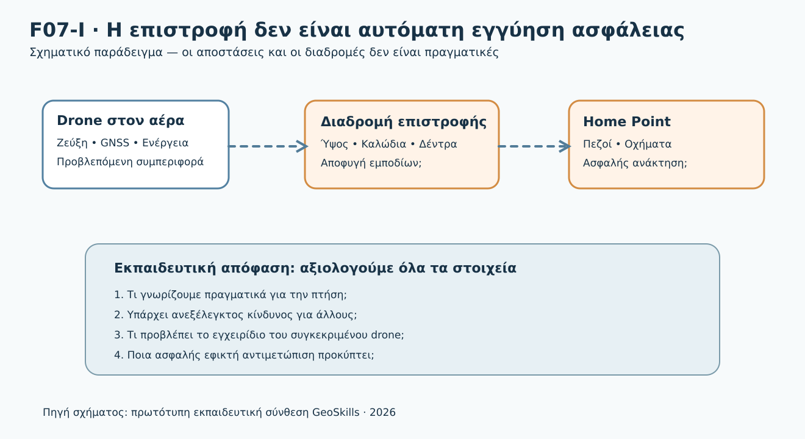

*Σχήμα F07-I. Συνθετικό εκπαιδευτικό διάγραμμα· δεν αποτελεί οδηγία χειρισμού συγκεκριμένου drone.*

### 1. Το πρόβλημα της σημερινής αποστολής

Η ομάδα έχει αναλάβει τη φωτογραμμετρική αποτύπωση ενός **υποθετικού αγρού 25 ha**. Έχει ελέγξει το DAGR, τον καιρό, τον εξοπλισμό και τις εναλλακτικές θέσεις προσγείωσης. Απογειώνεται από ανοικτό χώρο δίπλα σε αγροτικό δρόμο. Όσο η χαρτογράφηση προχωρεί, ένα όχημα σταθμεύει στο σημείο απογείωσης. Λίγο αργότερα η εφαρμογή αναφέρει ότι η σύνδεση εξασθενεί. Το σύστημα διαθέτει λειτουργία Return-to-Home.

**Μπορούμε να θεωρήσουμε ότι το drone θα γυρίσει και θα προσγειωθεί με ασφάλεια;** Όχι. Πρέπει να εξετάσουμε: πού είναι πραγματικά το Home Point, τι ακριβώς ενεργοποιεί το RTH, ποια διαδρομή και ποιο ύψος θα χρησιμοποιηθούν, αν η πλοήγηση παραμένει αξιόπιστη, αν υπάρχουν εμπόδια και αν η προσγείωση παραμένει ασφαλής.

### 2. Μαθησιακά αποτελέσματα

Μετά τη μελέτη θα μπορείς να:

1. Εξηγείς τι σημαίνουν RTH/RTL, Home Point, failsafe, rally point και ασφαλής ανάκτηση.
2. Διακρίνεις χειροκίνητη ενεργοποίηση επιστροφής, επιστροφή λόγω απώλειας σύνδεσης και λειτουργίες λόγω χαμηλής μπαταρίας.
3. Αναγνωρίζεις γιατί μια προκαθορισμένη διαδρομή και ένα ονομαστικό ύψος δεν εγγυώνται αποφυγή εμποδίων.
4. Συγκρίνεις τεκμηριωμένα **συγκεκριμένα** συστήματα DJI Mini 4 Pro και ArduPilot Copter, χωρίς γενικεύσεις.
5. Αξιολογείς τον κίνδυνο όταν το Home Point δεν είναι πλέον κατάλληλο ή όταν αμφισβητείται η αξιόπιστη εκτίμηση θέσης.
6. Συμπληρώνεις καρτέλα εκτίμησης και δικαιολογείς μια απόφαση σε εξελισσόμενο περιστατικό.

### 3. Έννοιες πριν από τα σενάρια

**Home Point:** αναφορά θέσης στην οποία βασίζεται η λειτουργία επιστροφής. Δεν ταυτίζεται αυτομάτως με κάθε θέση του χειριστή ή με οποιαδήποτε διαθέσιμη θέση προσγείωσης. Η διαδικασία καθορισμού και τυχόν ενημέρωσής του είναι ειδική για το μοντέλο και τη διαμόρφωση.

**Return-to-Home (RTH) / Return-to-Launch (RTL):** λειτουργία πλοήγησης προς καθορισμένη θέση επιστροφής. Τα ονόματα χρησιμοποιούνται από διαφορετικά συστήματα και **δεν εγγυώνται ταυτόσημη συμπεριφορά**.

**Failsafe:** προκαθορισμένη αντίδραση του συστήματος σε συγκεκριμένη αστοχία ή συνθήκη. Μπορεί, ανάλογα με την αρχιτεκτονική, να προκαλέσει επιστροφή, προσγείωση, αναμονή ή άλλη συμπεριφορά. Η ενεργοποίηση RTH δεν είναι συνώνυμο κάθε failsafe.

**Rally point:** εναλλακτική καταχωρισμένη θέση ανάκτησης σε συστήματα που την υποστηρίζουν, όπως το ArduPilot. Δεν υποθέτουμε ότι διαθέτει αντίστοιχη λειτουργία κάθε καταναλωτικό drone.

**Σχέδιο ανάκτησης:** τι θα κάνει η ομάδα όταν η αποστολή δεν μπορεί να συνεχιστεί. Περιλαμβάνει τους ανθρώπους, τις θέσεις και τις απειλές του πραγματικού περιβάλλοντος, όχι μόνο μια ρύθμιση της εφαρμογής.

### 4. Από τι εξαρτάται μια αυτόματη επιστροφή;

Μια λειτουργία RTH/RTL μπορεί να χρειάζεται αξιόπιστη εκτίμηση θέσης, σωστό Home Point, διαθέσιμη ενέργεια, κατάλληλες ρυθμίσεις, επαρκείς δυνατότητες πτήσης και ασφαλή τελική περιοχή ανάκτησης. Αν λείπει ένα κρίσιμο στοιχείο, το αποτέλεσμα δεν μπορεί να θεωρείται δεδομένο.

| Στοιχείο | Ερώτηση πρόληψης | Τι μπορεί να πάει στραβά |
|---|---|---|
| Home Point | Πότε, πού και με ποια ένδειξη επιβεβαιώθηκε; | Επιστροφή σε ανεπιθύμητη θέση |
| Ενεργοποίηση | Τι ακριβώς προκαλεί το συγκεκριμένο failsafe; | Διαφορετική ενέργεια από εκείνη που περιμένουμε |
| Ύψος | Σε ποιο σύστημα αναφοράς και με ποιες ρυθμίσεις εκτελείται; | Σύγκρουση ή ανεπιθύμητη άνοδος |
| Διαδρομή | Είναι ευθεία, προσαρμοζόμενη ή εξαρτάται από αισθητήρες; | Εμπόδιο ανάμεσα στο drone και στο σημείο επιστροφής |
| Αισθητήρες | Λειτουργεί η αποφυγή εμποδίων στις τρέχουσες συνθήκες; | Μη ανίχνευση καλωδίων, κλαδιών ή διαφανών επιφανειών |
| Ενέργεια | Επαρκεί για την πραγματική ανάκτηση και τις αποκλίσεις; | Αναγκαστική/απρόβλεπτη προσγείωση |
| Περιοχή | Είναι ακόμη ελεύθερη από τρίτους; | Κίνδυνος για πεζούς, οχήματα ή περιουσία |
| Νομιμότητα | Παραμένει η προβλεπόμενη πορεία εντός των εφαρμοστέων ορίων; | Η αυτοματοποιημένη διαδρομή παραβιάζει περιορισμό |

#### 4.1 Τι σημαίνει «ασφαλές ύψος RTH»;

Δεν είναι ένα καθολικό νούμερο. Η ρύθμιση πρέπει να συνεκτιμά πραγματικά εμπόδια, ανάγλυφο, τρόπο υπολογισμού ύψους, πιθανή αλλαγή θέσης, περιορισμούς της πτήσης και συμπεριφορά του μοντέλου. Ένα ύψος που υπερβαίνει ένα δέντρο δεν είναι αυτομάτως ασφαλές για όλα τα άλλα εμπόδια ή συμβατό με όλους τους περιορισμούς. **Ακόμη και η έννοια του ύψους διαφέρει**: ύψος σε σχέση με το Home Point, το ανάγλυφο ή το τρέχον ύψος του drone δεν είναι κατ’ ανάγκη το ίδιο μέγεθος. Για τον έλεγχο του νόμιμου ύψους χρειάζεται το εφαρμοστέο κανονιστικό σημείο αναφοράς, όχι απλώς η τιμή μιας ρύθμισης.

**Εκπαιδευτική προειδοποίηση:** Το γενικό όριο της κατηγορίας Open δεν είναι παράμετρος που πρέπει απλώς να πληκτρολογήσουμε ως ύψος RTH. Η τήρηση των νομικών ορίων και η αποφυγή εμποδίων είναι διαφορετικοί έλεγχοι.

#### 4.2 Γιατί η αποφυγή εμποδίων δεν εγγυάται ασφαλές RTH;

Ένα drone με αισθητήρες αποφυγής ενδέχεται να έχει περιορισμούς λόγω φωτισμού, μικρών/λεπτών αντικειμένων, ανακλαστικών ή διαφανών επιφανειών, λειτουργίας πτήσης και ρυθμίσεων. Επομένως δεν θεωρούμε ότι «έχει αισθητήρες» σημαίνει «δεν θα χτυπήσει ποτέ καλώδιο». Το επίσημο εγχειρίδιο DJI Mini 4 Pro προειδοποιεί ειδικά για λεπτά αντικείμενα, κλαδιά, καλώδια και ορισμένες επιφάνειες [DJI-M4P-2024].

### 5. Τρεις αιτίες ενεργοποίησης — τρεις διαφορετικές υποθέσεις

**Επιστροφή που ζητά ο χειριστής.** Μπορεί να επιλεγεί σκόπιμα αν οι συνθήκες το επιτρέπουν. Ελέγχουμε πρώτα ότι η προβλεπόμενη επιστροφή είναι ασφαλής. Δεν ενεργοποιούμε μηχανικά μια λειτουργία που δεν γνωρίζουμε.

**Απώλεια ζεύξης ελέγχου.** Η συμπεριφορά εξαρτάται από τις ρυθμίσεις failsafe και τις συνθήκες. Μια απώλεια εικόνας ή τηλεμετρίας **δεν αποδεικνύει** απώλεια C2 και δεν αποδεικνύει ότι το RTH ενεργοποιήθηκε. Βλέπε DM00.4.7.7.

**Εκτίμηση χαμηλής μπαταρίας.** Κάποια συστήματα υπολογίζουν την εκτιμώμενη επάρκεια επιστροφής και εμφανίζουν προειδοποιήσεις ή ενεργοποιούν διαδικασίες. Δεν θεωρούμε ότι η ένδειξη ποσοστού ή ένας αλγόριθμος εγγυάται ασφαλή προσγείωση. Βλέπε DM00.4.7.6.

### 6. Δύο πραγματικά συστήματα — σύγκριση με τεκμηρίωση

#### 6.1 DJI Mini 4 Pro — Advanced RTH

Στο **DJI Mini 4 Pro**, το εγχειρίδιο χρήστη v1.4 (Ιούνιος 2024) περιγράφει **Advanced RTH**, στο οποίο η πορεία εξαρτάται από τις ρυθμίσεις RTH, τη δυνατότητα χρήσης των συστημάτων όρασης, τον φωτισμό, το περιβάλλον, τη θέση και την κατάσταση επικοινωνίας [DJI-M4P-2024]. Η DJI προειδοποιεί ότι όταν ο άνεμος είναι υπερβολικά ισχυρός, η επιστροφή μπορεί να μην είναι εφικτή. Επισημαίνει επίσης περιορισμούς των αισθητήρων ως προς ορισμένα αντικείμενα.

**Διδάσκουμε:** τι ερωτήματα χρειάζεται να απαντήσει ο χειριστής πριν από την απογείωση: επιβεβαιώθηκε το Home Point; τι επιλογή RTH είναι ενεργή; ποια ύψη/διαδρομές εφαρμόζονται; είναι επαρκείς ο φωτισμός και η λειτουργία των αισθητήρων; πού θα προσγειωθεί;

**Δεν διδάσκουμε ως καθολικό κανόνα:** ότι κάθε DJI εκτελεί τον ίδιο ελιγμό, ότι πάντοτε παρακάμπτει εμπόδια, ότι θα επιστρέψει οπωσδήποτε στο σημείο απογείωσης ή ότι ο χειριστής μπορεί πάντοτε να ακυρώσει τη διαδικασία.


#### 6.1.1 Κρίσιμη λεπτομέρεια του DJI Mini 4 Pro: Optimal και Preset δεν είναι ισοδύναμα

Στο **συγκεκριμένο εγχειρίδιο v1.4**, το Advanced RTH διαθέτει επιλογές **Optimal** και **Preset**. Όταν ο φωτισμός και το περιβάλλον είναι κατάλληλα για τα συστήματα όρασης, το Optimal επιχειρεί να σχεδιάσει διαδρομή λαμβάνοντας υπόψη το περιβάλλον. Όταν η χρήση των συστημάτων όρασης δεν είναι κατάλληλη, μπορεί να χρησιμοποιηθεί **Preset RTH** σύμφωνα με το ορισμένο ύψος επιστροφής· ο χειριστής **δεν πρέπει να θεωρεί τότε δεδομένη την παράκαμψη εμποδίων** [DJI-M4P-2024].

Το ίδιο εγχειρίδιο επισημαίνει ότι η αυτόματη επιστροφή **δεν μπορεί να αποφύγει αξιόπιστα λεπτά εμπόδια**, όπως καλώδια και μικρά κλαδιά. Επιπλέον, το RTH μπορεί να μην ολοκληρωθεί αν οι περιβαλλοντικές συνθήκες ή η πολυπλοκότητα της περιοχής το καθιστούν ανέφικτο. Ο χειριστής πρέπει να γνωρίζει **πριν από την πτήση** την ακριβή συμπεριφορά της χρησιμοποιούμενης έκδοσης.

**Παράδειγμα αλλαγής κατάστασης:** Στην απογείωση ο χώρος είναι φωτεινός. Αργότερα, η πτήση διεξάγεται σε περιοχή με ανεπαρκή φωτισμό ή ακατάλληλες συνθήκες για τα συστήματα όρασης. Δεν είναι ορθό να συμπεράνουμε ότι η επιστροφή θα ακολουθήσει οπωσδήποτε την ίδια συμπεριφορά αποφυγής εμποδίων που είχαμε αρχικά σχεδιάσει.

<details>
<summary>Κρυφή επεξήγηση — Γιατί αυτό αποτελεί θέμα προπτητικής εκτίμησης;</summary>

Επειδή ο χειριστής δεν έχει το δικαίωμα να στηρίξει τον σχεδιασμό μιας πιθανής διαδρομής έκτακτης ανάγκης σε χαρακτηριστικά που μπορεί να μην είναι διαθέσιμα όταν χρειαστούν. Εξετάζει τη λειτουργία με τους περιορισμούς του εγχειριδίου, το περιβάλλον, την προσέγγιση/κάθοδο και τους νόμιμους περιορισμούς. Δεν εξομοιώνει τη λειτουργία Optimal με βεβαίωση ότι κάθε εμπόδιο θα αποφευχθεί.

</details>

#### 6.1.2 Τι ακριβώς συμβαίνει σε απώλεια σήματος στο DJI Mini 4 Pro;

Στην ενότητα **Advanced Safety Settings** του εγχειριδίου v1.4, η αντίδραση *Signal Lost* εμφανίζεται ως ρυθμιζόμενη επιλογή **RTH, Descend ή Hover** [DJI-M4P-2024]. Επομένως δεν διδάσκουμε ως δεδομένο ότι η απώλεια τηλεχειρισμού οδηγεί πάντοτε σε επιστροφή. Η πραγματική ρύθμιση, η κατάσταση του συστήματος και οι περιορισμοί του εγχειριδίου πρέπει να έχουν επιβεβαιωθεί.

**Προσοχή:** Η διαθέσιμη ρύθμιση «Descend» δεν ισοδυναμεί με ασφαλή άδεια καθόδου πάνω από τρίτους. Το τι μπορεί να κάνει το drone και το τι είναι αποδεκτό επιχειρησιακά είναι διαφορετικά ζητήματα.

#### 6.2 ArduPilot Copter — RTL

Στην επίσημη τεκμηρίωση του **ArduPilot Copter** το RTL μπορεί να επιστρέψει στο Home ή, εφόσον έχουν οριστεί rally points, στο κατάλληλο rally point σύμφωνα με την τεκμηριωμένη συμπεριφορά του συγκεκριμένου Copter. Οι παράμετροι επηρεάζουν το επιθυμητό ύψος, την άνοδο, την προσέγγιση και το τελικό στάδιο [ARDU-RTL].

Ένα ιδιαίτερα σημαντικό τεχνικό σημείο: **από προεπιλογή η ευθεία διαδρομή RTL μπορεί να διασχίσει οριζόντια όρια γεωφράκτη** (περιλαμβανομένων ορίων ενσωμάτωσης ή αποκλεισμού). Η επίσημη τεκμηρίωση αναφέρει ότι χρειάζεται κατάλληλη διαμόρφωση σχεδιασμού πορείας γύρω από τα όρια για να αντιμετωπιστεί αυτός ο κίνδυνος [ARDU-RTL]. Επίσης, το RTL απαιτεί αξιόπιστη εκτίμηση θέσης· δεν είναι κατάλληλο να υποθέτουμε ορθή λειτουργία όταν αυτή έχει υποβαθμιστεί.

**Δεν αντιγράφουμε ρυθμίσεις παραμέτρων από εκπαιδευτικό παράδειγμα σε πραγματικό αεροσκάφος.** Οι εκδόσεις firmware, η διαμόρφωση, ο τύπος οχήματος και το περιβάλλον έχουν σημασία. Η τεκμηρίωση του ArduPilot Plane και QuadPlane περιγράφει επιπλέον διαφορετικές συμπεριφορές [ARDU-PLANE, ARDU-QRTL].


#### 6.2.1 Ερμηνεία τεχνικών παραμέτρων χωρίς αντιγραφή ρυθμίσεων

Στην τρέχουσα δημόσια τεκμηρίωση RTL του ArduPilot Copter αναφέρονται παράμετροι όπως `RTL_ALT_M`, `RTL_CLIMB_MIN`, `RTL_CONE_SLOPE` και `RTL_ALT_TYPE`. Η ακριβής ονομασία και η ερμηνεία πρέπει να αντιπαραβάλλονται με **την εγκατεστημένη έκδοση firmware**. Οι προηγούμενες/διαφορετικές εκδόσεις εγχειριδίων μπορεί να εμφανίζουν διαφορετική ονοματολογία ή μονάδες. Το παρόν κεφάλαιο **δεν αποτελεί οδηγό ρύθμισης παραμέτρων**.

Επίσης, η δυνατότητα σχεδιασμού πορείας γύρω από οριζόντια όρια γεωφράκτη δεν προκύπτει μόνο από την ύπαρξη γεωφράκτη. Χρειάζεται κατάλληλα διαμορφωμένος σχεδιασμός πορείας, όπως περιγράφεται στην επίσημη τεκμηρίωση για συγκεκριμένους τρόπους obstacle avoidance [ARDU-RTL]. Δεν πρέπει να μεταφέρουμε αυτόν τον μηχανισμό αυτούσιο στο DJI ή σε άλλο αυτόματο πιλότο.

<details>
<summary>Κρυφή επεξήγηση — RTL και γεωφράκτης</summary>

Η ύπαρξη ενεργού γεωφράκτη και η ύπαρξη ελεγκτή που σχεδιάζει διαδρομή **γύρω** από τα όριά του είναι δύο διαφορετικές δυνατότητες. Η ευθεία διαδρομή μπορεί να τέμνει μια ζώνη αποκλεισμού. Η λύση δεν είναι να επινοήσουμε ένα ύψος ή μια παράμετρο από μνήμης: πριν από πραγματική πτήση ελέγχουμε το σχετικό firmware, τις λειτουργίες σχεδιασμού και τις ελεγχόμενες δοκιμές του συστήματος.

</details>

#### 6.3 Τι συγκρίνουμε — και τι όχι

| Ερώτημα | DJI Mini 4 Pro | ArduPilot Copter |
|---|---|---|
| Ονομασία | Advanced RTH | RTL |
| Θέση ανάκτησης | Home Point σύμφωνα με το εγχειρίδιο | Home ή ρυθμισμένο rally point |
| Πορεία | Εξαρτάται από ρυθμίσεις, αισθητήρες και συνθήκες | Επηρεάζεται από ρυθμίσεις RTL, ενδεχομένως σχεδιασμό αποφυγής |
| Ύψος | Ανάλογα με την επιλογή RTH και τις συνθήκες | Παράμετροι RTL και πλαίσιο αναφοράς ύψους |
| Απώλεια σύνδεσης | Συμπεριφορά που καθορίζεται στο εγχειρίδιο/ρυθμίσεις | Εξαρτάται από ρυθμίσεις failsafe |
| Κρίσιμος περιορισμός | Δεν εντοπίζονται όλα τα εμπόδια | Η ευθεία RTL διαδρομή μπορεί να τέμνει γεωφράκτη |

Αυτός είναι **συγκριτικός εκπαιδευτικός πίνακας για συγκεκριμένα συστήματα**, όχι κατάλογος δεσμευτικών λειτουργιών για κάθε drone.

### 7. Πώς μειώνουμε τον κίνδυνο πριν απογειωθούμε

#### 7.1 Έλεγχος πραγματικής περιοχής επιστροφής

Εξετάζουμε αν υπάρχει πρόσβαση τρίτων στο Home Point και πώς μπορεί αυτή να αλλάξει στη διάρκεια της αποστολής. Η προσγείωση δεν γίνεται ασφαλής μόνο επειδή ο χώρος ήταν άδειος κατά την απογείωση.

#### 7.2 Προβλεπόμενη διαδρομή και εμπόδια

Χαρτογραφούμε κτίρια, δέντρα, γραμμές ρεύματος, κεραίες και άλλα εμπόδια, συμπεριλαμβανομένης της προσέγγισης/καθόδου. Ελέγχουμε την πιθανή συμπεριφορά πλοήγησης και τους περιορισμούς της. Ένας χάρτης δεν εντοπίζει αναγκαστικά καλώδια ή προσωρινές κατασκευές.

#### 7.3 Ενεργειακό περιθώριο

Η εκτίμηση επιστροφής εξετάζεται με τον άνεμο, την απόσταση, την κατάσταση μπαταρίας και την πραγματική διαδρομή. Η ενεργοποίηση RTH δεν δημιουργεί πρόσθετη ενέργεια. Προβλέπουμε εφεδρεία για απρόοπτες μεταβολές.

#### 7.4 Αλλαγή Home Point ή εναλλακτικές

Η δυνατότητα ενημέρωσης Home Point, μεταβολής πορείας ή επιλογής εναλλακτικής θέσης **ελέγχεται στο συγκεκριμένο σύστημα**, με βάση το εγχειρίδιο και την προβλεπόμενη διαδικασία. Μια θέση που φαίνεται πιο κοντινή δεν είναι αυτομάτως νόμιμη ή ασφαλής.

#### 7.5 Σχεδιασμός της ομάδας

Πριν την απογείωση ορίζουμε ποιος παρατηρεί την περιοχή ανάκτησης, τι ανακοινώνει στον χειριστή και πώς επιβεβαιώνεται η πληροφορία. Η σαφής επικοινωνία δεν υποκαθιστά την ευθύνη του χειριστή.


#### 7.6 Ειδικός έλεγχος RTH πριν από απογείωση: «πέντε επιβεβαιώσεις»

1. **Στόχος:** επιβεβαιώνουμε πού έχει καταχωριστεί το Home Point και ποιος είναι ο πιθανός στόχος RTL/RTH σε κάθε ενεργή λειτουργία.
2. **Αφορμή:** γνωρίζουμε τι προβλέπεται για απώλεια C2, χαμηλή ενέργεια, χειροκίνητη έναρξη, καθώς και τις προτεραιότητες μεταξύ αυτοματισμών.
3. **Πορεία και ύψος:** ελέγχουμε εμπόδια, ανάγλυφο, ύψη αναφοράς και εφαρμόσιμους περιορισμούς περιοχής.
4. **Μεταβολές:** εξετάζουμε τι μπορεί να αλλάξει στη διάρκεια της αποστολής — φωτισμός, άνεμος, GNSS, διαθεσιμότητα αισθητήρων, πρόσβαση τρίτων στο Home Point.
5. **Εναλλακτικές:** καταγράφουμε εφικτές ασφαλείς επιλογές σε περίπτωση που η προβλεπόμενη επιστροφή δεν είναι κατάλληλη.

Αυτές οι πέντε επιβεβαιώσεις είναι **προτεινόμενο διδακτικό εργαλείο**, όχι πέντε νέες αυτοτελείς κανονιστικές υποχρεώσεις.

### 8. Τι κάνουμε όταν τα δεδομένα αλλάξουν κατά την πτήση;

Ακολουθούμε τη μαθησιακή ακολουθία **Παρατηρώ → Αναγνωρίζω → Προστατεύω → Ενεργώ → Επανεκτιμώ → Καταγράφω**. Δεν αποτελεί εντολή χειρισμού συγκεκριμένου μοντέλου.

**Βήμα Α — Παύση της χαρτογραφικής εργασίας όταν απαιτείται.** Η συλλογή φωτογραφιών έχει μικρότερη προτεραιότητα από την ασφάλεια.

**Βήμα Β — Εκτίμηση της πραγματικής κατάστασης.** Τι γνωρίζουμε για θέση, σύνδεση, ενέργεια, εμπόδια, άλλους χρήστες εναέριου χώρου και τρίτους στο Home Point; Ποιες ενδείξεις είναι παλιές ή αβέβαιες;

**Βήμα Γ — Επιλογή ασφαλούς εφικτής αντιμετώπισης.** Με βάση τις προβλεπόμενες διαδικασίες του συγκεκριμένου συστήματος και τις τρέχουσες συνθήκες. Δεν συνιστούμε καθολικά «πάτησε RTH» ή «ακύρωσε RTH».

**Βήμα Δ — Επανεκτίμηση.** Μια επιτυχημένη επιστροφή δεν δικαιολογεί αυτόματα επανέναρξη της χαρτογράφησης. Εξετάζονται εκ νέου όλες οι απαιτούμενες προϋποθέσεις.

**Σε άμεσο κίνδυνο σύγκρουσης:** η εφαρμογή των διαδικασιών προστασίας δεν πρέπει να καθυστερεί για συμπλήρωση εκπαιδευτικού πίνακα.

### 9. Αναλυτικά λυμένο περιστατικό Α — Το Home Point δεν είναι πια ελεύθερο

**Αρχική κατάσταση.** Ο χειριστής έχει επιβεβαιώσει Home Point σε ανοικτό σημείο. Η προβλεπόμενη επιστροφή έχει ελεγχθεί. Η περιοχή φαίνεται κενή.

**Μεταβολή 1.** Όχημα σταματά ακριβώς στο Home Point, ενώ το drone συνεχίζει την προγραμματισμένη φωτογράφιση.

- **Παρατήρηση:** η περιοχή ανάκτησης έχει αλλάξει.
- **Κίνδυνος:** προσγείωση κοντά σε μη εμπλεκόμενα πρόσωπα ή όχημα.
- **Άγνωστα:** αν υπάρχει ασφαλής εναλλακτική επιλογή, αν μπορεί το συγκεκριμένο μοντέλο να αλλάξει σημείο/διαδικασία ανάκτησης και με ποιους όρους.
- **Αρχική απόφαση:** δεν βασιζόμαστε στη ρουτίνα αυτοματοποιημένης επιστροφής· προτεραιότητα στην ασφαλή αντιμετώπιση σύμφωνα με το σύστημα.

**Μεταβολή 2.** Η εφαρμογή αναφέρει χαμηλότερη διαθέσιμη ενέργεια από την αναμενόμενη.

- **Νέα εκτίμηση:** το ενεργειακό περιθώριο περιορίζει τις επιλογές. Η καθυστέρηση δεν είναι ουδέτερη.
- **Εκπαιδευτικό συμπέρασμα:** δεν επιμένουμε να τελειώσουμε τις φωτογραφίες και δεν υποθέτουμε ότι η αυτόματη πορεία θα καταλήξει με ασφάλεια.

**Μεταβολή 3.** Η εικόνα αποκαθίσταται αλλά η τηλεμετρία θέσης είναι αβέβαιη.

- **Νέα εκτίμηση:** η εικόνα δεν αποδεικνύει αξιόπιστη πλοήγηση. Μπορεί να υπάρχει δυνατότητα χειρισμού, αλλά αυτό πρέπει να επαληθευτεί με τα διαθέσιμα ασφαλή στοιχεία.
- **Συμπέρασμα:** η επιλογή ανάκτησης εξαρτάται από το πραγματικό σύστημα και την τρέχουσα κατάσταση. Δεν μπορεί να δοθεί ένα καθολικό ακριβές πλήκτρο ή ύψος.

### 10. Αναλυτικά λυμένο περιστατικό Β — Υποθετικό εμπόδιο στη διαδρομή

**Υπόθεση εκπαιδευτικού χάρτη:** μεταξύ drone και Home Point βρίσκεται γραμμή ρεύματος. Το drone έχει οριστεί να επιστρέφει σε προκαθορισμένο ύψος, χωρίς να έχει επιβεβαιωθεί αξιόπιστη ανίχνευση των συγκεκριμένων καλωδίων.

**Λανθασμένη απάντηση:** «Ενεργοποιώ RTH επειδή υπάρχει ανίχνευση εμποδίων».

**Ορθή προσέγγιση:** ελέγχουμε πριν την πτήση το πραγματικό προφίλ επιστροφής, το ύψος αναφοράς, τα εμπόδια και τις δυνατότητες της συσκευής. Κατά την πτήση, αν εμφανιστεί απειλή, επιλέγεται η ασφαλέστερη εφικτή αντιμετώπιση σύμφωνα με τις προβλεπόμενες διαδικασίες. Καμία λειτουργία αποφυγής δεν θεωρείται εγγύηση ανίχνευσης λεπτών εμποδίων.

**Τι δεν επιτρέπεται να συμπεράνουμε:** ότι αρκεί οποιοδήποτε συγκεκριμένο ύψος για όλες τις αποστολές ή ότι μια διαδρομή ικανή να αποφύγει καλώδια είναι αυτόματα συμβατή με τους περιορισμούς εναέριου χώρου.


### 10Α. Λυμένο περιστατικό Γ — Η επιστροφή «αλλάζει» επειδή αλλάζει το περιβάλλον

Η ομάδα σχεδιάζει πτήση με **DJI Mini 4 Pro** χρησιμοποιώντας τις δυνατότητες Advanced RTH του εγχειριδίου v1.4. Στον χάρτη υπάρχει δενδροστοιχία και κοντά της λεπτή γραμμή ηλεκτροδότησης.

| Στάδιο | Νέο δεδομένο | Ερμηνεία | Εκπαιδευτική προτεραιότητα |
|---|---|---|---|
| Γ1 | Καλός φωτισμός κατά την εκκίνηση | Οι αισθητήρες ενδέχεται να λειτουργούν στις προβλεπόμενες συνθήκες | Ελέγχουμε και την εναλλακτική συμπεριφορά, όχι μόνο την «κανονική» |
| Γ2 | Ο φωτισμός/περιβάλλον υποβαθμίζονται | Το Optimal ενδέχεται να μην παραμείνει εφαρμόσιμο | Δεν υποθέτουμε συνεχή αποφυγή εμποδίων |
| Γ3 | Η σύνδεση χειρισμού χάνεται | Εξαρτάται από τη ρύθμιση Signal Lost και τις προϋποθέσεις του συστήματος | Δεν συμπεραίνουμε αυτόματο RTH χωρίς επιβεβαίωση ρύθμισης |
| Γ4 | Επανέρχεται η σύνδεση, ενώ υπάρχει καλώδιο στη δυνητική διαδρομή | Η επικοινωνία δεν εξαλείφει τον κίνδυνο εμποδίου | Αξιολογούμε την ασφαλέστερη εφικτή ενέργεια βάσει πραγματικής κατάστασης και εγχειριδίου |

**Αναλυτική λύση:** το λάθος είναι η αλυσιδωτή υπόθεση «έχω αισθητήρες → αποφεύγονται όλα τα εμπόδια → σε απώλεια σύνδεσης ενεργοποιείται πάντα RTH → η επιστροφή είναι ασφαλής». Κάθε βέλος απαιτεί χωριστή τεκμηρίωση. Με πραγματικό drone δεν προκαλούμε σκόπιμα απώλεια σύνδεσης ή υποβάθμιση αισθητήρων ως εκπαιδευτικό πείραμα αρχαρίων.

<details>
<summary>Κρυφή δραστηριότητα — Δύο αβέβαιες ενδείξεις ταυτόχρονα</summary>

**Ερώτηση:** Επανήλθε η τηλεμετρία αλλά εμφανίζεται παλιό Home Point στον χάρτη, ενώ παρατηρητής αναφέρει πεζούς κοντά στην αρχική θέση. Η σωστή απόφαση είναι επανέναρξη της χαρτογράφησης;

**Αιτιολόγηση:** Όχι. Ακόμη κι αν αποκαταστάθηκε η επικοινωνία, η θέση-στόχος επιστροφής και η ασφάλεια της περιοχής ανάκτησης πρέπει να επαληθευτούν. Η παλιά ή αβέβαιη ένδειξη δεν χρησιμοποιείται ως τεκμήριο ασφαλούς στόχου. Εξακολουθεί να προηγείται η ασφαλής διαχείριση της πτήσης, όχι η λήψη φωτογραφιών.

</details>

### 11. Συνοπτικός έλεγχος πριν από πραγματική πτήση

Το ακόλουθο είναι **εκπαιδευτικό φύλλο ελέγχου** και όχι δεσμευτικό έντυπο της EASA:

- [ ] Επιβεβαιώθηκαν μοντέλο, έκδοση λογισμικού και σχετικές λειτουργίες RTH/RTL στο εγχειρίδιο.
- [ ] Επιβεβαιώθηκε και καταγράφηκε η πραγματική θέση Home Point.
- [ ] Ελέγχθηκαν οι ρυθμίσεις ενεργοποίησης/συμπεριφοράς failsafe.
- [ ] Αξιολογήθηκαν ύψος, διαδρομή, ανάγλυφο, καλώδια, δέντρα και εμπόδια.
- [ ] Ελέγχθηκαν τα όρια αισθητήρων αποφυγής και του συστήματος πλοήγησης.
- [ ] Προβλέφθηκε επαρκές ενεργειακό περιθώριο με βάση την πραγματική αποστολή.
- [ ] Ελέγχθηκαν οι γεωγραφικοί και υπόλοιποι περιορισμοί της πτήσης.
- [ ] Εξετάστηκε η πρόσβαση τρίτων στην περιοχή ανάκτησης.
- [ ] Σχεδιάστηκαν εναλλακτικές και επικοινωνία ομάδας, όπου είναι εφικτό.
- [ ] Ο χειριστής γνωρίζει πώς θα αντιμετωπίσει περιστατικό με τις διαδικασίες του συγκεκριμένου drone.

### 12. Δραστηριότητα — Καρτέλα 04Δ-9

**Σενάριο:** Χαρτογράφηση αγρού 25 ha, με Home Point δίπλα σε δρόμο. Στο Τ1 εμφανίζεται πεζός στο σημείο ανάκτησης. Στο Τ2 επιδεινώνεται ο αντίθετος άνεμος. Στο Τ3 η σύνδεση υποβαθμίζεται και υπάρχουν ενδείξεις πιθανής ενεργοποίησης failsafe. Στο Τ4 το drone εμφανίζεται να επιστρέφει, αλλά η διαδρομή του δεν έχει επιβεβαιωθεί ότι αποφεύγει γραμμή ρεύματος.

**Ζητούμενα:** Για καθένα από τα τέσσερα στάδια συμπλήρωσε: (α) επιβεβαιωμένο γεγονός, (β) κρίσιμη αβεβαιότητα, (γ) κίνδυνο για τρίτους, (δ) ενδεδειγμένο είδος απόφασης, (ε) τι θα έπρεπε να έχει ελεγχθεί πριν την πτήση. Παράδωσε την συμπληρωμένη Καρτέλα 04Δ-9 με τελική τεκμηριωμένη απόφαση και μία παράγραφο για το γιατί το RTH δεν αντικαθιστά την κρίση του χειριστή.

**Κριτήρια (10 μονάδες):** εντοπισμός γεγονότων/αβεβαιοτήτων (3), προστασία τρίτων (3), τεκμηριωμένη απόφαση (2), πρόληψη/επανέλεγχος (2). Απάντηση που παρουσιάζει αυτοματισμό ως εγγυημένα ασφαλή ή αγνοεί άμεσο κίνδυνο για τρίτους **δεν γίνεται αποδεκτή** ανεξάρτητα από βαθμολογία.

<details>
<summary>Κρυφή αναλυτική λύση — Καρτέλα 04Δ-9</summary>

**Τ1:** Επιβεβαιώνεται παρουσία πεζού στην περιοχή ανάκτησης. Παραμένουν άγνωστες οι επιλογές αλλαγής θέσης και η προβλεπόμενη πραγματική διαδρομή. Η περιοχή δεν θεωρείται πλέον ασφαλής μόνο επειδή ήταν πριν την απογείωση.

**Τ2:** Ο αντίθετος άνεμος περιορίζει δυνητικά το περιθώριο επιστροφής. Χρειάζεται πραγματική αξιολόγηση ενέργειας, όχι εκτίμηση βάσει ποσοστού ή υπόθεσης για σταθερή ταχύτητα. Η ολοκλήρωση φωτογράφισης παύει να είναι προτεραιότητα.

**Τ3:** Η υποβάθμιση σύνδεσης δεν αποδεικνύει από μόνη της ενεργοποίηση RTH. Ελέγχουμε τι πληροφορία παραμένει αξιόπιστη και τι προβλέπουν οι ρυθμίσεις/το εγχειρίδιο. Δεν προτείνουμε μη τεκμηριωμένο χειρισμό.

**Τ4:** Η οπτική παρατήρηση του drone να επιστρέφει δεν αποδεικνύει ότι η πορεία ή η τελική προσγείωση είναι ασφαλείς. Τα καλώδια και ο πεζός παραμένουν κρίσιμοι κίνδυνοι. Η αντιμετώπιση ακολουθεί την πραγματική κατάσταση και τις προβλεπόμενες ασφαλείς διαδικασίες, με άμεση προτεραιότητα στην αποφυγή τραυματισμών.

**Κοινό συμπέρασμα:** Ανάκτηση και αποστολή χαρτογράφησης είναι δύο διαφορετικοί στόχοι· ο δεύτερος δεν δικαιολογεί έκθεση τρίτων σε κίνδυνο.

</details>

### 13. Αυτοαξιολόγηση

**1. Η λειτουργία RTH εγγυάται αποφυγή καλωδίων;**
<details><summary>Απάντηση 1</summary>
Όχι. Εξαρτάται από τους αισθητήρες, τη διαμόρφωση, τις συνθήκες και το συγκεκριμένο εμπόδιο. Λεπτά καλώδια ενδέχεται να μη γίνουν αντιληπτά.
</details>

**2. Αν παγώσει το βίντεο, έχει χαθεί ο έλεγχος C2;**
<details><summary>Απάντηση 2</summary>
Όχι κατ’ ανάγκη. Τα κανάλια βίντεο, ελέγχου και τηλεμετρίας δεν είναι ταυτόσημα. Χρειάζεται τεκμηριωμένη εκτίμηση της πραγματικής κατάστασης.
</details>

**3. Ένα Home Point που ήταν άδειο κατά την απογείωση παραμένει αυτομάτως κατάλληλο;**
<details><summary>Απάντηση 3</summary>
Όχι. Μπορούν να εμφανιστούν άνθρωποι και οχήματα. Απαιτείται συνεχής εκτίμηση.
</details>

**4. Κάθε ArduPilot Copter RTL ακολουθεί πάντα ευθεία;**
<details><summary>Απάντηση 4</summary>
Όχι. Η επίσημη τεκμηρίωση περιγράφει ευθεία διαδρομή ως βασική συμπεριφορά αλλά και παραμέτρους/επιλογές σχεδιασμού αποφυγής. Η πραγματική συμπεριφορά εξαρτάται από τη διαμόρφωση.
</details>

**5. Το ποσοστό μπαταρίας αρκεί για να κρίνουμε την ασφάλεια RTH;**
<details><summary>Απάντηση 5</summary>
Όχι. Η ενέργεια ανάκτησης επηρεάζεται από απόσταση, άνεμο, κατάσταση μπαταρίας και πραγματική διαδρομή.
</details>

**6. Το RTH του DJI Mini 4 Pro είναι ίδιο με όλα τα DJI;**
<details><summary>Απάντηση 6</summary>
Όχι. Περιγράφουμε χαρακτηριστικά συγκεκριμένης έκδοσης εγχειριδίου, όχι ολόκληρου καταλόγου προϊόντων.
</details>

**7. Εξαφανίστηκε η προειδοποίηση. Επανεκκινούμε αμέσως χαρτογράφηση;**
<details><summary>Απάντηση 7</summary>
Όχι. Επανεξετάζουμε αίτιο, πλοήγηση, ενέργεια, τρίτους, εμπόδια, νομικούς όρους και δυνατότητα ασφαλούς ανάκτησης.
</details>

**8. Έχει ενεργοποιηθεί RTH και εμφανίζεται επανδρωμένο αεροσκάφος. Τι προηγείται;**
<details><summary>Απάντηση 8</summary>
Η άμεση αποφυγή σύγκρουσης και η προστασία ανθρώπων. Επιλέγουμε κατάλληλη ασφαλή εφικτή διαδικασία σύμφωνα με το πραγματικό drone και τις συνθήκες· δεν στηριζόμαστε τυφλά στον αυτοματισμό.
</details>

**9. Γιατί είναι προβληματική η σύσταση «όρισε RTH στα 120 m»;**
<details><summary>Απάντηση 9</summary>
Επειδή συγχέει τα κανονιστικά όρια με τον κατάλληλο σχεδιασμό επιστροφής, χωρίς να εξετάζει ύψος αναφοράς, εμπόδια, ανάγλυφο, πραγματικούς περιορισμούς και μοντέλο.
</details>

**10. Τι πρέπει να ελεγχθεί πριν εκτελεστεί ένα πραγματικό failsafe test;**
<details><summary>Απάντηση 10</summary>
Η τεκμηριωμένη διαδικασία του συγκεκριμένου συστήματος, ο κατάλληλος ελεγχόμενος χώρος και η αρμοδιότητα/επίβλεψη. Για τον παρόντα αρχάριο φοιτητή τα σενάρια πραγματοποιούνται επί χάρτου ή σε ασφαλή προσομοίωση, όχι με σκόπιμη διακοπή σύνδεσης σε πραγματική πτήση.
</details>


**11. Στο DJI Mini 4 Pro, σημαίνει η επιλογή Optimal ότι αποκλείεται μετάβαση σε Preset RTH;**
<details><summary>Απάντηση 11</summary>
Όχι. Το εγχειρίδιο v1.4 περιγράφει συνθήκες στις οποίες η χρήση των συστημάτων όρασης είναι ανεπαρκής και μπορεί να εκτελεστεί Preset RTH. Δεν εγγυόμαστε ότι θα συνεχιστεί η ίδια συμπεριφορά παράκαμψης εμποδίων.
</details>

**12. Σε ArduPilot Copter με ενεργό γεωφράκτη, η διαδρομή RTL αποφεύγει αυτομάτως κάθε ζώνη αποκλεισμού;**
<details><summary>Απάντηση 12</summary>
Όχι. Στη βασική συμπεριφορά η ευθεία επιστροφή μπορεί να τέμνει οριζόντια όρια· απαιτείται κατάλληλη διαμόρφωση σχεδιασμού πορείας για την αντίστοιχη δυνατότητα. Πριν από πραγματική πτήση ελέγχουμε ακριβές firmware και ρυθμίσεις.
</details>

**13. Αν ο χειριστής διαπιστώσει ενεργή επιλογή «Descend» σε απώλεια σήματος, σημαίνει ότι η επιλογή είναι ασφαλής για την περιοχή;**
<details><summary>Απάντηση 13</summary>
Όχι. Η τεχνική διαθεσιμότητα μιας επιλογής δεν ισοδυναμεί με ασφαλή επιχειρησιακή εφαρμογή, ιδίως όταν μπορούν να βρίσκονται άνθρωποι ή οχήματα κάτω από τη διαδρομή.
</details>

### 14. Συχνά λάθη

- «RTH σημαίνει πάντα επιστροφή στο σημείο όπου βρίσκομαι τώρα.» Λάθος: εξετάζουμε τον καταχωρισμένο στόχο επιστροφής.
- «Αφού έχει obstacle avoidance, δεν χρειάζεται έλεγχος εμποδίων.» Λάθος: αισθητήρες και συνθήκες έχουν περιορισμούς.
- «Σύνδεση βίντεο και ζεύξη εντολών είναι το ίδιο.» Λάθος.
- «Ο χειριστής πρέπει πάντα να πατήσει RTH.» Λάθος: η ασφαλής επιλογή εξαρτάται από το περιστατικό και τη συσκευή.
- «Αν επανέλθει η σύνδεση, μπορώ απλώς να συνεχίσω.» Λάθος: απαιτείται επανεκτίμηση.
- «Το RTH επιτρέπει να αγνοώ γεωφράκτες ή περιορισμούς περιοχής.» Λάθος: οι εφαρμοστέοι περιορισμοί παραμένουν.

### 15. Έλεγχος ολοκλήρωσης

Έχεις κατανοήσει την ενότητα αν μπορείς να εξηγήσεις **χωρίς να μαντεύεις την συμπεριφορά μοντέλου**: (α) ποια γεγονότα ενεργοποιούν την επιστροφή, (β) τι μπορεί να κάνει πραγματικά το σύστημα, (γ) γιατί το Home Point και η διαδρομή πρέπει να είναι ασφαλή, (δ) πότε η άγνοια ενός κρίσιμου στοιχείου αποκλείει βεβιασμένη απόφαση, και (ε) γιατί η προστασία τρίτων προηγείται της ολοκλήρωσης της εργασίας.

### Πηγές και όρια εφαρμογής

- **[ARDU-RTL]** ArduPilot Copter, *RTL Mode*: https://ardupilot.ardupilot.org/copter/docs/rtl-mode.html (επίσημη τεχνική τεκμηρίωση, προσπελάστηκε 03/11/2026).
- **[ARDU-RALLY]** ArduPilot Copter, *Rally Points*: https://software.ardupilot.org/copter/docs/common-rally-points.html (προσπελάστηκε 03/11/2026).
- **[ARDU-PLANE]** ArduPilot Plane, *RTL Mode*: https://docs.ardupilot.org/plane/docs/rtl-mode.html (προσπελάστηκε 03/11/2026).
- **[ARDU-QRTL]** ArduPilot, *QuadPlane RTL*: https://www.ardupilot.ardupilot.org/plane/docs/quadplane_rtl.html (προσπελάστηκε 03/11/2026).
- **[DJI-M4P-2024]** DJI, *Mini 4 Pro User Manual*, v1.4, Ιούνιος 2024: https://dl.djicdn.com/downloads/DJI_Mini_4_Pro/20240627/DJI_Mini_4_Pro_User_Manual_EN.pdf . **Σημείωση QA:** επανελέγχθηκε η διαθέσιμη εξαγωγή της επίσημης έκδοσης PDF v1.4 και επιβεβαιώθηκαν οι αναφορές σε Optimal/Preset, λεπτά εμπόδια και Signal Lost. Η απόπειρα λήψης εικόνας της σχετικής σελίδας απέτυχε λόγω μεγέθους του PDF· ο τελικός οπτικός έλεγχος σελίδων παραμένει εκκρεμής πριν από τη δημοσίευση.
- **[EASA-UAS]** EASA, *Easy Access Rules for Unmanned Aircraft Systems*: https://www.easa.europa.eu/en/document-library/easy-access-rules/easy-access-rules-unmanned-aircraft-systems (κανονιστικό πλαίσιο/AMC, όχι τεχνικό εγχειρίδιο κάθε μοντέλου).

Οι πηγές ArduPilot περιγράφουν το αντίστοιχο λογισμικό/όχημα και μπορεί να αλλάξουν με νεότερες εκδόσεις. Για πραγματική χρήση ανατρέχουμε στο **ακριβές εγχειρίδιο και firmware του διαθέσιμου drone**. Η FAA ή άλλες εκπαιδευτικές πηγές δεν μετατρέπονται σε ελληνικές νομικές απαιτήσεις.


---

## DM00.4.7.10 — Βλάβες κινητήρων, ελίκων, αισθητήρων και απώλεια ελέγχου

### Ερμηνευτική επισήμανση — pre-arm και φυσική επιθεώρηση

Οι αυτοδιαγνωστικοί **pre-arm checks** ενός συστήματος είναι σημαντικός φραγμός ασφάλειας, **όχι πιστοποίηση μηχανικής ακεραιότητας**. Ο χειριστής δεν παρακάμπτει προειδοποιήσεις ούτε αγνοεί εμφανείς ρωγμές ή κακή στερέωση επειδή μια εφαρμογή γράφει «Ready». Η εφαρμογή των οδηγιών εξαρτάται από το συγκεκριμένο drone· το UAS.OPEN.060(1)(d) ζητεί να διαπιστώνεται ότι το UAS είναι κατάλληλο να ολοκληρώσει με ασφάλεια την προβλεπόμενη πτήση. [EASA — UAS.OPEN.060](https://www.easa.europa.eu/en/document-library/easy-access-rules/online-publications/easy-access-rules-unmanned-aircraft-systems?erules-id=ERULES-1963177438-19528).


> **GeoSkills · Drone Mapping Core — Αναθεωρημένο εκπαιδευτικό προσχέδιο v0.2 · 03/11/2026.** Η ενότητα διδάσκει αναγνώριση και διαχείριση κινδύνου, **όχι** μια καθολική διαδικασία διάσωσης κάθε drone. Όλες οι ασκήσεις εκτελούνται επί χάρτου ή σε ασφαλή προσομοίωση. Δεν προκαλούμε βλάβες σε πραγματικό αεροσκάφος.

### 1. Σκοπός και μαθησιακά αποτελέσματα

Στην προηγούμενη ενότητα εξετάσαμε γιατί το Return-to-Home (RTH) δεν αποτελεί εγγύηση επιστροφής. Τώρα προχωρούμε σε αστοχίες που μπορούν να καταστήσουν την πτήση ασταθή ή μη ελεγχόμενη. Οι αποστολές χαρτογράφησης περιλαμβάνουν επαναλαμβανόμενες διαδρομές, μεταβολές κατεύθυνσης, συχνά αυξημένη προσοχή στην οθόνη και πτήσεις κοντά σε αντικείμενα ενδιαφέροντος. Η συστηματική πρόληψη είναι σημαντικότερη από οποιαδήποτε υποθετική «τεχνική διάσωσης» μετά από σοβαρή αστοχία.

Μετά την ενότητα, ο φοιτητής θα μπορεί:
1. Να εντοπίζει προπτητικές ενδείξεις φθοράς ή αστοχίας χωρίς να επιχειρεί επικίνδυνη δοκιμή.
2. Να διακρίνει βλάβη πρόωσης, αστοχία αισθητήρα και απώλεια ελέγχου, ακόμη και όταν τα συμπτώματα μοιάζουν.
3. Να συνδέει τις επιπτώσεις με την αρχιτεκτονική του drone, χωρίς να υποθέτει ότι όλα τα πολυκόπτερα έχουν πλεονασμό.
4. Να αξιολογεί ποιος κινδυνεύει σε κάθε πιθανή ζώνη πρόσκρουσης ή προσγείωσης.
5. Να περιγράφει ασφαλή διαχείριση της περιοχής μετά από συμβάν, χωρίς επαφή με κινούμενα μέρη ή ύποπτη μπαταρία.
6. Να διαχωρίζει τη νομική υποχρέωση, την οδηγία συγκεκριμένου κατασκευαστή και την εκπαιδευτική σύσταση.

#### Κεντρική αρχή

**Πρώτα προστατεύουμε ανθρώπους και άλλα αεροσκάφη.** Αν χαθεί πραγματικά η δυνατότητα ελέγχου, δεν υποσχόμαστε ότι η επιλογή RTH, η αλλαγή mode ή ο τερματισμός κινητήρων θα επαναφέρει οπωσδήποτε την ασφάλεια. Οι δυνατότητες και τα επείγοντα βήματα διαφέρουν σημαντικά ανά τύπο αεροσκάφους, λογισμικό, ρυθμίσεις και περιβάλλον.

### 2. Μια πραγματική κατηγορία κινδύνων: όταν το drone δεν αντιδρά όπως αναμένεται

Φανταζόμαστε ένα τετρακόπτερο που φωτογραφίζει αγροτεμάχιο. Ο παρατηρητής ακούει ασυνήθιστο περιοδικό θόρυβο και βλέπει μικρές απότομες ταλαντώσεις. Στην οθόνη εμφανίζεται προειδοποίηση. Ο χειριστής μπορεί να σκεφτεί «ίσως είναι ο άνεμος». Η υπόθεση αυτή δεν αρκεί για ασφαλή συνέχιση. Το σύμπτωμα μπορεί να σχετίζεται με έλικα, κινητήρα, αισθητήρα, ελεγκτή, φορτίο, περιβάλλον ή συνδυασμό τους.

**Αναγνωρίζουμε το σύμπτωμα — δεν προβαίνουμε σε αυθαίρετη διάγνωση στον αέρα.** Η ερώτηση δεν είναι «ποιο εξάρτημα χάλασε σίγουρα;», αλλά «έχει μειωθεί το περιθώριο ασφαλούς πτήσης και τι επιβάλλει τώρα η προστασία τρίτων;».

| Παρατήρηση | Πιθανές ερμηνείες (όχι διάγνωση) | Ορθή προτεραιότητα |
|---|---|---|
| Ασυνήθιστος παλμικός ήχος | Ζημιά/παραμόρφωση έλικα, κινητήρας ή μηχανικός συντονισμός | Διακοπή της εργασίας και αξιολόγηση ασφαλούς ανάκτησης |
| Αυξημένες ταλαντώσεις | Προπέλα, σύνδεση, φορτίο, περιβάλλον, σφάλμα ελέγχου | Αποφυγή συνέχισης φωτογραφικών διαδρομών για «να τελειώσουμε» |
| Προειδοποίηση κινητήρα/ESC | Σύστημα πρόωσης ή ηλεκτρική/ηλεκτρονική δυσλειτουργία | Εφαρμογή επαληθευμένης διαδικασίας συγκεκριμένου συστήματος |
| Ασυμφωνία υψομέτρου/προσανατολισμού | Αισθητήρας, εκτίμηση κατάστασης, περιβάλλον | Διασταύρωση με παρατήρηση και αξιολόγηση επικινδυνότητας |
| Απότομη ανεξέλεγκτη κίνηση | Πιθανή σοβαρή αστοχία, αλλά η αιτία άγνωστη | Άμεση προτεραιότητα στον περιορισμό έκθεσης τρίτων |

### 3. Πρόληψη: ο πραγματικά κρίσιμος χρόνος είναι πριν από την απογείωση

Η πρόληψη χρειάζεται να ακολουθεί τη ροή **εξέταση → απόφαση καταλληλότητας → καθορισμός ασφαλούς περιοχής → απογείωση μόνο εφόσον πληρούνται οι προϋποθέσεις**.

#### 3.1 Έλικες

Εξετάζουμε οπτικά, με το σύστημα ασφαλώς απενεργοποιημένο, τυχόν ρωγμές, θραύσεις, εμφανείς παραμορφώσεις, σημάδια πρόσκρουσης, ασυνήθιστη φθορά ή ανεπαρκή στερέωση. Δεν θεωρούμε ότι μικρή ορατή ζημιά είναι ακίνδυνη. Η αντικατάσταση, ο τύπος και η διαδικασία σύσφιξης ακολουθούν **μόνο** τις οδηγίες του συγκεκριμένου κατασκευαστή. Δεν επιχειρούμε δοκιμαστική απογείωση για να «δούμε αν κρατάει».

Για **DJI Mini 4 Pro**, το συγκεκριμένο επίσημο εγχειρίδιο v1.2 (Δεκέμβριος 2023) απαγορεύει τη χρήση παλιών, σπασμένων ή φθαρμένων ελίκων και ζητά έλεγχο στερέωσης ελίκων και κινητήρων πριν από κάθε πτήση. Η οδηγία ισχύει **για αυτό το μοντέλο**. [M1]

#### 3.2 Κινητήρες, ESC και τροφοδοσία

Εξετάζουμε εξωτερική ζημιά, χαλάρωση, ίχνη υπερθέρμανσης, ρύπανση και ασυνήθιστες ενδείξεις αυτοδιάγνωσης. Δεν αγγίζουμε περιστρεφόμενα μέρη· δεν πραγματοποιούμε εργασίες συντήρησης με τροφοδοτούμενο σύστημα. Δεν δοκιμάζουμε αφαίρεση έλικα, σκόπιμο μπλοκάρισμα κινητήρα ή αποσύνδεση κινητήρα σε λειτουργία. Η κατάσταση κινητήρα **δεν πιστοποιείται** με ένα σύντομο αυτοσχέδιο τεστ στο πεδίο.

#### 3.3 Αισθητήρες και στερεώσεις

Ελέγχουμε καθαρότητα και ορατές φθορές κάμερας/αισθητήρων, ασφάλεια φορτίου, σχετικές ενδείξεις εφαρμογής, κατάσταση GNSS/πυξίδας και αυτοδιάγνωση. Η απουσία προειδοποίησης **δεν αποδεικνύει** ότι όλα είναι σωστά. Ελέγχουμε ότι ο χρήστης κατανοεί τι υποβοήθηση παρέχει η τρέχουσα λειτουργία πτήσης.

#### 3.4 Έλεγχοι λογισμικού και διαμόρφωσης

Στο **ArduPilot Copter**, οι pre-arm checks μπορούν να μπλοκάρουν την ενεργοποίηση πρόωσης όταν αναγνωρίζονται ορισμένα προβλήματα ρύθμισης ή αισθητήρων. Η επίσημη τεκμηρίωση προειδοποιεί **να μη παρακάμπτονται οι έλεγχοι** για κανονική πτήση. [A1] Αυτό δεν σημαίνει ότι το σύστημα ανιχνεύει κάθε πιθανή μηχανική αστοχία ή ότι όλα τα drones έχουν τις ίδιες δοκιμές.

#### 3.5 Προληπτική οργάνωση του χώρου

Πριν την πτήση καταγράφουμε: ανθρώπους και δρόμους, προγραμματισμένες πορείες, πιθανές ζώνες πρόσκρουσης, ασφαλή περιοχή ανάκτησης, περιοχές όπου δεν πρέπει να βρεθεί το αεροσκάφος και σχέδιο επικοινωνίας χειριστή–παρατηρητή. **Δεν δημιουργούμε βεβαιότητα ότι μπορούμε να επιλέξουμε το σημείο πτώσης μετά από πλήρη απώλεια ελέγχου.** Ο κατάλληλος σχεδιασμός και η μείωση έκθεσης πριν από την απογείωση είναι ουσιώδεις.

#### 3.6 Τρεις διαφορετικές πηγές ελέγχου — κανένα «PASS» δεν αρκεί μόνο του

| Μέσο ελέγχου | Τι μπορεί να διαπιστώσει | Τι **δεν** αποδεικνύει |
|---|---|---|
| **Οπτικός και φυσικός έλεγχος με ασφάλεια απενεργοποιημένο UAS** | Εμφανή φθορά έλικα, χαλαρές στερεώσεις, εξωτερική ζημιά ή ρύπανση | Ότι δεν υπάρχουν κρυφές ρωγμές, εσωτερική αστοχία ή βλάβη που εμφανίζεται μόνο υπό φορτίο |
| **Ενδείξεις αυτοδιάγνωσης / pre-arm** | Ορισμένες ασυμφωνίες αισθητήρων, διαμόρφωσης ή άλλες συνθήκες που παρακολουθεί το συγκεκριμένο σύστημα | Ότι έχει ελεγχθεί κάθε έλικας, κάθε κινητήρας ή ολόκληρη η αεροπλοϊμότητα |
| **Ιστορικό συντήρησης και κατασκευαστής** | Αν έγιναν οι προβλεπόμενες επιθεωρήσεις, αλλαγές εξαρτημάτων και ενέργειες μετά από πρόσκρουση | Ότι ένα νέο περιστατικό δεν μπορεί να προκύψει στην τρέχουσα πτήση |

**Ενδεικτική παγίδα:** Η εφαρμογή εμφανίζει «Ready to Fly», αλλά ο χειριστής βλέπει ρωγμή σε έλικα. Ο φοιτητής **δεν** απογειώνει. Η θετική ένδειξη λογισμικού δεν ακυρώνει τη φυσική βλάβη. Αντίστροφα, ένας αψεγάδιαστος οπτικός έλεγχος δεν δικαιολογεί παράβλεψη σοβαρού pre-arm warning.

#### 3.7 Τι σημαίνει «δεν πετάμε» σε προπτητικό πρόβλημα;

Η εκπαίδευση απαιτεί να καταγραφεί **σαφής απόφαση μη απογείωσης**, όχι απλώς «προσοχή». Ο χειριστής απομονώνει το αεροσκάφος από την προγραμματισμένη πτήση, τεκμηριώνει το σύμπτωμα και εφαρμόζει τις οδηγίες επιθεώρησης/επισκευής. Η μεταγενέστερη επιστροφή σε λειτουργία απαιτεί τον προβλεπόμενο έλεγχο, και όπου προβλέπεται αρμόδιο πρόσωπο ή τεχνικό. Δεν διδάσκουμε ότι η προειδοποίηση μπορεί να «διαγραφεί» για να εκτελεστεί το μάθημα.

### 4. Πώς εξελίσσεται μια αστοχία

Μια αρχική μικρή μεταβολή μπορεί να ακολουθεί την αλυσίδα:

**Προειδοποιητικό σύμπτωμα → υποβάθμιση απόδοσης → περιορισμένες επιλογές → πιθανή ανεξέλεγκτη κίνηση → κίνδυνος πρόσκρουσης → δευτερογενείς κίνδυνοι.**

Αυτό είναι **εκπαιδευτικό μοντέλο**, όχι υποχρεωτική χρονική εξέλιξη. Υπάρχουν αστοχίες που συμβαίνουν ακαριαία, χωρίς εμφανές προειδοποιητικό σύμπτωμα. Γι’ αυτό δεν σχεδιάζουμε την ασφάλεια αποκλειστικά γύρω από την ταχεία αντίδραση του χειριστή.

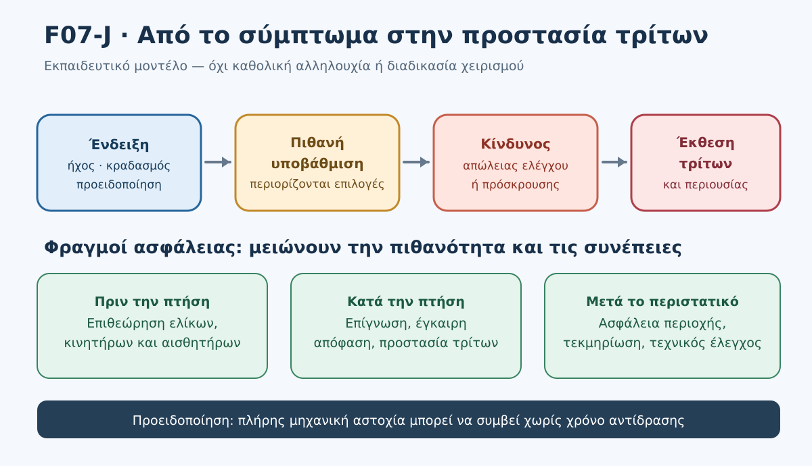

*Σχήμα F07-J. Εκπαιδευτικό διάγραμμα πρόληψης, κλιμάκωσης και προστασίας τρίτων. Συνθετικό οπτικό υλικό.*

#### Η διαφορά ανάμεσα σε τετρακόπτερο και πολυκόπτερο άλλης αρχιτεκτονικής

Δεν ισχυριζόμαστε ότι μια πλήρης αστοχία ενός κινητήρα σε τετρακόπτερο μπορεί να αντιμετωπιστεί πάντα με ασφαλή προσγείωση. Οι δυνατότητες ελέγχου μετά από αστοχία πρόωσης εξαρτώνται από την αρχιτεκτονική, τον αριθμό ενεργοποιητών, το λογισμικό, τις ρυθμίσεις και την πραγματική κατάσταση. Ακόμη και σε σύστημα με περισσότερους κινητήρες, **ο πλεονασμός δεν τεκμαίρεται** από την εξωτερική εμφάνιση. Χρειάζεται ρητή τεκμηρίωση και κατάλληλη δοκιμή/έγκριση του συστήματος.

### 5. Διαβάζω τις ενδείξεις χωρίς να εφευρίσκω βεβαιότητες

| Τι γνωρίζω | Τι δεν γνωρίζω απαραίτητα | Τι χρειάζεται |
|---|---|---|
| Βλέπω ταλάντωση | Αν προέρχεται από άνεμο ή μηχανική αστοχία | Οπτική παρακολούθηση, ακριβής ένδειξη και απόφαση κινδύνου |
| Ακούω νέο θόρυβο | Ποιος κινητήρας ή έλικας ευθύνεται | Αποφυγή παράτασης της εργασίας, έλεγχος μετά από ασφαλή ανάκτηση |
| Η εφαρμογή γράφει “sensor error” | Αν πρόκειται για συγκεκριμένο αισθητήρα ή παροδική συνθήκη | Ανάγνωση ακριβούς μηνύματος και εγχειριδίου μοντέλου |
| Η οθόνη δείχνει κανονικό GNSS | Αν υπάρχει σοβαρή μηχανική αστοχία | Μη συγχέουμε θέση GNSS με υγεία πρόωσης |
| Το drone δεν ανταποκρίνεται στις εντολές | Αν έχει απομείνει ικανότητα ελέγχου | Περιορισμό κινδύνου και προβλεπόμενη διαδικασία κατασκευαστή |

**Παρατήρηση:** Η λειτουργία αποφυγής εμποδίων δεν επιδιορθώνει μηχανική αστοχία και δεν εγγυάται ότι το αεροσκάφος θα παραμείνει ελεγχόμενο.

### 6. Αναλυτικά λυμένο παράδειγμα Α — Ασυνήθιστος θόρυβος πριν από την απογείωση

**Δεδομένα:** Κατά τον οπτικό έλεγχο φαίνεται μικρή ρωγμή κοντά στη βάση ενός έλικα. Η μπαταρία είναι φορτισμένη, το GNSS καλό και η αποστολή έχει προγραμματιστεί. Ο φοιτητής προτείνει «ας σηκωθεί για ένα λεπτό και βλέπουμε».

**Βήμα 1 — Διαθέσιμη πληροφορία.** Η ρωγμή είναι φυσική ένδειξη βλάβης. Οι υπόλοιπες σωστές ενδείξεις δεν ακυρώνουν το εύρημα.

**Βήμα 2 — Κίνδυνος.** Η πρόωση εξαρτάται από δομική ακεραιότητα του έλικα· δεν μπορούμε να εγγυηθούμε ότι η βλάβη δεν θα εξελιχθεί.

**Βήμα 3 — Απόφαση.** Δεν απογειώνουμε το drone. Ο κατάλληλος έλικας και η σωστή αντικατάσταση/έλεγχος πραγματοποιούνται σύμφωνα με το εγχειρίδιο και τον αρμόδιο τεχνικό, όπου απαιτείται.

**Βήμα 4 — Τεκμηρίωση.** Σημειώνουμε σύμπτωμα, φωτογραφία του εξαρτήματος με το drone απενεργοποιημένο, ενέργειες συντήρησης και επανέλεγχο πριν από επόμενη αποστολή.

<details><summary>Γιατί η «δοκιμαστική απογείωση» δεν είναι αποδεκτή λύση;</summary>

Επειδή εκθέτει ανθρώπους και περιουσία σε μη αναγκαίο κίνδυνο ενώ υπάρχει ήδη αναγνωρισμένη ένδειξη αστοχίας. Μια φαινομενικά επιτυχημένη σύντομη πτήση δεν αποδεικνύει ότι ο έλικας θα λειτουργήσει ασφαλώς υπό άλλες φορτίσεις.

</details>

### 7. Αναλυτικά λυμένο παράδειγμα Β — Προειδοποίηση αισθητήρα κατά τη χαρτογράφηση

**Δεδομένα:** Σε πτήση πάνω από άδειο αγροτεμάχιο, η εφαρμογή εμφανίζει προειδοποίηση αισθητήρα. Ο χειριστής εξακολουθεί να βλέπει το drone. Η αυτόματη αποστολή συνεχίζει, αλλά η συμπεριφορά σταθεροποίησης δεν φαίνεται ίδια. Ένας συνεργάτης προτείνει να περιμένουν «μέχρι να τελειώσουν δύο ακόμη γραμμές».

**Βήμα 1 — Τι δεν γνωρίζουμε;** Δεν έχουμε ακόμη βέβαιη διάγνωση ούτε μπορούμε να εγγυηθούμε ότι η απόκλιση δεν θα αυξηθεί.

**Βήμα 2 — Πρακτική προτεραιότητα.** Η ολοκλήρωση φωτογραφικών διαδρομών δεν προηγείται της ασφάλειας. Χρειάζεται κατάλληλη, έγκαιρη αντιμετώπιση της υποβάθμισης, σύμφωνα με το συγκεκριμένο αεροσκάφος.

**Βήμα 3 — Προστασία τρίτων.** Ο παρατηρητής επιβεβαιώνει αν είναι ελεύθερη η διαθέσιμη ασφαλής περιοχή και αν υπάρχουν άλλα αεροσκάφη, οχήματα ή πεζοί.

**Βήμα 4 — Μετά την ανάκτηση.** Δεν επανεκκινούμε επειδή εξαφανίστηκε μία μόνο προειδοποίηση. Διαβάζουμε τις καταγραφές, πραγματοποιούμε τους προβλεπόμενους ελέγχους και επιβεβαιώνουμε την καταλληλότητα για πτήση.

<details><summary>Γιατί δεν δίνουμε συγκεκριμένη αλλαγή mode ως γενική απάντηση;</summary>

Η συμπεριφορά των modes εξαρτάται από το σύστημα και μπορεί να αλλάξει τις απαιτήσεις χειρισμού. Χωρίς δεδομένα για το μοντέλο, την πραγματική κατάστασή του και το εγχειρίδιο, μια καθολική εντολή θα ήταν μη τεκμηριωμένη.

</details>

### 8. Σοβαρό περιστατικό — Όταν δεν παραμένει πραγματική δυνατότητα ελέγχου

Μια σοβαρή βλάβη κινητήρα/πρόωσης μπορεί να εξελιχθεί ταχύτερα από τις δυνατότητες του χειριστή. Δεν υποθέτουμε ότι υπάρχει χρόνος να επιλεχθεί πορεία. Δεν διδάσκουμε καθολική εντολή «κόψε τους κινητήρες», γιατί η διακοπή πρόωσης στον αέρα μπορεί να προκαλέσει άμεση πτώση, ενώ η προβλεπόμενη διαδικασία εξαρτάται από το drone και το περιστατικό.

#### Πλαίσιο απόφασης με προτεραιότητα την ανθρώπινη ασφάλεια

1. **Αναγνωρίζω:** επιβεβαιώνω, όσο επιτρέπει ο χρόνος, τι βλέπω και ποιες εντολές εξακολουθούν να έχουν αποτέλεσμα.
2. **Προστατεύω:** αξιολογώ αμέσως τον κίνδυνο για τρίτους και ειδοποιώ την ομάδα με σαφές μήνυμα· δεν κατευθύνω ανθρώπους προς αβέβαιη ζώνη πτώσης.
3. **Ενεργώ:** εφαρμόζω μόνο την προβλεπόμενη διαδικασία του συγκεκριμένου συστήματος εφόσον παραμένει εφικτή· δεν πειραματίζομαι με άγνωστες εντολές.
4. **Επανεκτιμώ:** λαμβάνω υπόψη αν η συμπεριφορά βελτιώνεται, επιδεινώνεται ή αν έχει χαθεί ο έλεγχος.
5. **Καταγράφω/ασφαλίζω:** μετά το συμβάν μεριμνώ για την ασφάλεια της περιοχής και την τεκμηρίωση.

Η ακολουθία είναι **εκπαιδευτικό πλαίσιο προτεραιοτήτων** και όχι εγγυημένη διαδικασία ανάκτησης. Σε άμεση απειλή ανθρώπινης ζωής, ο διαθέσιμος χρόνος μπορεί να μην επαρκεί για όλα τα παραπάνω βήματα.

#### 8.1 Πρακτική διαλογή: υποβάθμιση, σοβαρή ένδειξη ή μη ελεγχόμενη κίνηση;

Η παρακάτω ταξινόμηση είναι **εκπαιδευτική**, όχι επίσημος πίνακας διαδικασιών κατασκευαστή. Ο ίδιος θόρυβος μπορεί να απαιτεί διαφορετική ενέργεια ανάλογα με τη σοβαρότητα, το μοντέλο και την έκθεση τρίτων.

| Παρατηρούμενη κατάσταση | Τι μπορεί να παραμένει διαθέσιμο | Εκπαιδευτική προτεραιότητα |
|---|---|---|
| Νέα δόνηση, αλλά ελεγχόμενη πτήση | Εντολές και οπτική επαφή | **Δεν συνεχίζουμε λήψεις**· αξιολογούμε άμεσα κατάλληλη ασφαλή ολοκλήρωση |
| Σοβαρή προειδοποίηση πρόωσης, αβέβαιη απόκριση | Μερικός έλεγχος, άγνωστη αντοχή | Προτεραιότητα σε τρίτους και προβλεπόμενη απόκριση συγκεκριμένου συστήματος, χωρίς πειραματισμό |
| Ταχεία, ανεξέλεγκτη κίνηση | Ενδέχεται να μην υπάρχει χρήσιμη δυνατότητα διόρθωσης | Η πρόληψη έκθεσης τρίτων έχει ήδη κεντρική σημασία· δεν υποσχόμαστε «επιλεγμένη» προσγείωση ή ανάκτηση |
| Πρόσκρουση / στάση στο έδαφος | Πιθανώς ενεργή πρόωση ή επικίνδυνη μπαταρία | Περιορισμός πρόσβασης, άνθρωποι, δρόμοι, ειδοποίηση και ασφαλής μετέπειτα διαχείριση |

**Συνδυασμένη κρίση:** Αν συνυπάρχουν αστάθεια και άγνωστη πορεία επανδρωμένου αεροσκάφους, δεν εξετάζουμε την αστοχία απομονωμένα. Η προστασία εναέριας κυκλοφορίας και ανθρώπων προηγείται της προστασίας drone, κάμερας ή φωτογραφιών. Δεν εκδίδουμε αυθαίρετη εντολή προσγείωσης προς σημείο όπου ενδέχεται να βρίσκονται άνθρωποι.

#### 8.2 Όταν η διάγνωση έρχεται αργά

**Τ0:** Η ομάδα παρατηρεί νέο ήχο, αλλά η εφαρμογή δεν έχει εμφανίσει warning. **Τ1:** Το warning εμφανίζεται αργότερα, ενώ το drone έχει ήδη απομακρυνθεί. **Τ2:** Η διαθέσιμη περιοχή ανάκτησης έχει πλέον καταληφθεί από όχημα. Η κρίσιμη αποτυχία δεν είναι ότι η ομάδα δεν διέγνωσε ακριβώς το εξάρτημα στο Τ0· είναι ότι ενδεχομένως αγνόησε την έγκαιρη ένδειξη υποβάθμισης και έχασε χρόνο και επιλογές. Η αξιολόγηση καταγράφει γιατί η έγκαιρη εγκατάλειψη της χαρτογράφησης περιορίζει τον κίνδυνο.

<details>
<summary>Κρυφή λύση — Γιατί δεν περιμένουμε υποχρεωτικά προειδοποίηση εφαρμογής;</summary>

Επειδή οι ενδείξεις λογισμικού δεν καλύπτουν κάθε πιθανή αστοχία. Η οπτική/ακουστική παρατήρηση αποτελεί ανεξάρτητη πληροφορία. Όταν υπάρχει υποψία κινδύνου, προέχει η έγκαιρη εκτίμηση ασφαλούς ολοκλήρωσης της πτήσης με τα τεκμηριωμένα μέσα του μοντέλου, όχι η συνέχιση λήψεων μέχρι να εμφανιστεί σφάλμα.

</details>

### 9. Μετά από πρόσκρουση ή αναγκαστική προσγείωση

Η ασφάλεια δεν τελειώνει όταν το drone ακουμπήσει στο έδαφος. Μπορεί να υπάρχουν περιστρεφόμενοι έλικες, θερμά εξαρτήματα, κατεστραμμένη μπαταρία, διαρροές ή κίνδυνος επανενεργοποίησης.

- **Πρώτα άνθρωποι:** ελέγχουμε αν κάποιος χρειάζεται επείγουσα βοήθεια και επικοινωνούμε με τις αρμόδιες υπηρεσίες όπου απαιτείται.
- **Αποκλείουμε πρόσβαση:** απομακρύνουμε τρίτους από το σημείο, χωρίς να αναλαμβάνουμε επικίνδυνες ενέργειες.
- **Δεν πλησιάζουμε ενεργά κινούμενα μέρη** και δεν προσπαθούμε να συγκρατήσουμε drone στον αέρα.
- **Αν η μπαταρία έχει υποστεί ζημιά, θερμαίνεται, καπνίζει ή μυρίζει περίεργα:** αποφεύγουμε επαφή/φόρτιση/επαναχρησιμοποίηση και ακολουθούμε την ειδική καθοδήγηση κατασκευαστή και αρμόδιων υπηρεσιών. Δεν αυτοσχεδιάζουμε με πυρόσβεση σε επικίνδυνο περιβάλλον.
- **Δευτερογενής κίνδυνος σε δρόμο:** προστασία διερχομένων και ειδοποίηση αρμόδιων αρχών, χωρίς να εισερχόμαστε σε κυκλοφορία οχημάτων.
- **Καταγραφή:** χρόνος, θέση κατά προσέγγιση, συνθήκες, προειδοποιήσεις, μάρτυρες, φωτογραφίες εφόσον ασφαλές, διατήρηση logs και ενέργειες.
- **Αναφορά συμβάντος:** εξετάζεται χωριστά, βάσει των εφαρμοστέων απαιτήσεων αναφοράς. Δεν ισχυριζόμαστε εδώ ότι κάθε μικροβλάβη έχει την ίδια υποχρέωση δήλωσης.

#### 9.1 Ασφάλεια μετά το περιστατικό: διάκριση άμεσης προστασίας από μεταγενέστερο έλεγχο

| Άμεσα, όταν είναι ασφαλές | Μεταγενέστερα, αφού προστατευθεί η περιοχή |
|---|---|
| Αποτροπή προσέγγισης ανθρώπων, αξιολόγηση πιθανών τραυματισμών, κατάλληλη ειδοποίηση | Διατήρηση αρχικών προειδοποιήσεων, καταγραφών πτήσης και πραγματικής ακολουθίας γεγονότων |
| Αποφυγή επαφής με περιστρεφόμενα μέρη και ύποπτη μπαταρία | Αξιολόγηση από κατάλληλο τεχνικό και εφαρμογή εγχειριδίου/διαδικασίας |
| Προστασία από δευτερογενείς κινδύνους οδού ή πιθανής πυρκαγιάς | Εξέταση τυχόν εφαρμοστέας υποχρέωσης αναφοράς συμβάντος, ανάλογα με τα γεγονότα και το νομικό πλαίσιο |

**Δεν εξισώνουμε** κάθε τεχνικό σφάλμα με ατύχημα που επιβάλλει ακριβώς την ίδια αναφορά. Η ακριβής υποχρέωση αναφοράς απαιτεί χωριστό έλεγχο των περιστάσεων και της εφαρμοστέας νομοθεσίας. Όταν υπάρχουν τραυματίες, φωτιά ή άμεσος κίνδυνος, η επικοινωνία με υπηρεσίες έκτακτης ανάγκης δεν αναβάλλεται για να ολοκληρωθεί η τεχνική τεκμηρίωση.

### 10. Αναλυτικά λυμένο παράδειγμα Γ — Δευτερογενής κίνδυνος μετά την πτώση

**Σενάριο:** Drone έχει προσκρούσει στην άκρη αγροτικού δρόμου. Ο παρατηρητής βλέπει πιθανώς φθαρμένη μπαταρία. Ένας περαστικός πλησιάζει να το σηκώσει, ενώ πλησιάζει αυτοκίνητο.

**Ανάλυση:** Το πρώτο μέλημα δεν είναι η διάσωση εξοπλισμού ή δεδομένων. Η ομάδα πρέπει να αποτρέψει την προσέγγιση τρίτων και να αντιμετωπίσει με ασφαλή τρόπο τον κίνδυνο του δρόμου, χωρίς να σταθεί στην τροχιά των οχημάτων. Δεν μετακινούμε ούτε φορτίζουμε ύποπτη μπαταρία για να «σώσουμε τις φωτογραφίες».

<details><summary>Κρυφή αιτιολογημένη λύση — Ποιο λάθος είναι κρίσιμο;</summary>

Κρίσιμο λάθος θα ήταν να βιαστεί ο χειριστής στον δρόμο για να περισυλλέξει το drone ή να επιτρέψει στον περαστικό να αγγίξει κατεστραμμένη μπαταρία. Χρειάζεται ασφάλεια ανθρώπων, κατάλληλη ειδοποίηση και μεταγενέστερη τεχνική αξιολόγηση.

</details>

### 11. Σύνθετη πρακτική δραστηριότητα — Καρτέλα 04Δ-10

**Αποστολή:** Συνθετική χαρτογράφηση αγροτεμαχίου 25 ha, με τετρακόπτερο απροσδιόριστου κατασκευαστή. Ο χειριστής και ο παρατηρητής βρίσκονται σε προκαθορισμένο σημείο· υπάρχει αγροτικός δρόμος στη νότια πλευρά και προεπιλεγμένη περιοχή ανάκτησης στα δυτικά. Τα στοιχεία είναι αποκλειστικά εκπαιδευτικά.

| Στάδιο | Νέα πληροφορία | Εκπαιδευτικό ερώτημα |
|---|---|---|
| Τ0 | Κατά τον έλεγχο, ένας έλικας έχει αμφίβολη επιφανειακή φθορά | Επιτρέπεται να αναβληθεί ο έλεγχος; |
| Τ1 | Σε **διαφορετική υποθετική πτήση με ελεγμένο εξοπλισμό**, ακούγεται μη αναμενόμενος ήχος | Τι συμπεραίνουμε χωρίς να διαγνώσουμε αιτία; |
| Τ2 | Εμφανίζεται προειδοποίηση κινητήρα, αλλά υπάρχει ακόμη κάποια δυνατότητα ελέγχου | Πώς επαναξιολογείται η αποστολή; |
| Τ3 | Το drone αποκλίνει και η περιοχή ανάκτησης δεν είναι πλέον διαθέσιμη | Πώς αλλάζει η προτεραιότητα κινδύνου; |
| Τ4 | Το drone προσκρούει κοντά στον δρόμο, με πιθανώς κατεστραμμένη μπαταρία | Τι πρέπει να αποτραπεί μετά το συμβάν; |

**Προσοχή:** Τ0 και Τ1–Τ4 δεν περιγράφουν την ίδια συνεχόμενη πτήση. Αν παρατηρηθεί αμφίβολη φθορά στο Τ0, **δεν απογειώνουμε**. Τα επόμενα στάδια αποτελούν δεύτερη, ανεξάρτητη προσομοίωση, ώστε η άσκηση να μη νομιμοποιεί σκόπιμα επικίνδυνη απογείωση.

Ζητούμενα: (α) γνωστά/άγνωστα, (β) άμεσα εκτεθειμένοι τρίτοι, (γ) δυνατότητες/περιορισμοί, (δ) ενδεδειγμένη απόφαση, (ε) πληροφορίες που πρέπει να αναζητηθούν στο εγχειρίδιο, (στ) μεταγενέστερες ενέργειες.

<details><summary>Κρυφή πλήρως αναλυμένη ενδεικτική λύση — Καρτέλα 04Δ-10</summary>

- **Τ0:** Δεν απογειώνουμε· ελέγχουμε/αντικαθιστούμε τον έλικα όπως απαιτεί ο κατασκευαστής. Η φθορά δεν «εξουδετερώνεται» από σωστό GNSS.
- **Τ1:** Αναγνωρίζουμε τη νέα ασυνήθιστη συμπεριφορά ως λόγο επανεξέτασης ασφάλειας. Δεν αποφαίνουμε «σίγουρα χάλασε ο κινητήρας».
- **Τ2:** Εγκαταλείπουμε τον στόχο ολοκλήρωσης λήψεων· εξετάζουμε κατάλληλη ανάκτηση με βάση το μοντέλο, την πραγματική ανταπόκριση και τις θέσεις τρίτων.
- **Τ3:** Η απώλεια διαθέσιμης περιοχής μειώνει τις επιλογές. Δεν προτείνουμε «RTH πάντα», ούτε γενικό τερματισμό κινητήρων. Επείγει προστασία τρίτων, σύμφωνα με ό,τι είναι πράγματι εφικτό.
- **Τ4:** Προφυλάσσουμε πεζούς/οδηγούς, αποφεύγουμε άγγιγμα ύποπτης μπαταρίας/ελίκων, ζητούμε βοήθεια όπου απαιτείται, καταγράφουμε και απομονώνουμε το drone από επόμενη πτήση μέχρι κατάλληλο έλεγχο.

Η αξιολόγηση δίνει βάρος στη σαφή απόδοση προτεραιότητας στην ανθρώπινη ασφάλεια. Ακριβείς χειρισμοί άγνωστου μοντέλου δεν γίνονται δεκτοί ως τεκμηριωμένες λύσεις.

</details>

#### Κριτήρια αξιολόγησης (10 μονάδες)

| Κριτήριο | Μονάδες |
|---|---:|
| Αναγνώριση ενδείξεων χωρίς αυθαίρετη διάγνωση | 2 |
| Εντοπισμός έκθεσης ανθρώπων και άλλων αεροσκαφών | 2 |
| Τεκμηριωμένες αποφάσεις πρόληψης / εγκατάλειψης εργασίας | 2 |
| Αναγνώριση ορίων RTH και μη τεκμηριωμένων εντολών | 2 |
| Ασφάλεια μετά το περιστατικό και καταγραφή | 2 |

**Κρίσιμη αστοχία (ανεξαρτήτως βαθμολογίας):** απογείωση με γνωστή ζημιά έλικα· σκόπιμη πρόκληση βλάβης στην πράξη· καθολική σύσταση διακοπής κινητήρων εν πτήσει· απροφύλακτη επαφή με ύποπτη μπαταρία· αδιαφορία για τρίτους. Μια τέτοια απάντηση απαιτεί επανεκπαίδευση και νέα αξιολόγηση.

#### Πρόσθετη άσκηση — Το drone δείχνει «έτοιμο» αλλά δεν είναι

Στην οθόνη εμφανίζεται «Ready to Fly». Ο οπτικός έλεγχος εντοπίζει ίχνος πρόσκρουσης σε έναν έλικα και ο χειριστής δεν γνωρίζει αν επιτρέπεται η συνέχιση χρήσης. Ένας φοιτητής λέει: «Ας απογειωθούμε, αφού πέρασε το pre-arm check».

**Ζητούμενο:** Γράψτε μία πρόταση απόφασης, δύο λόγους και μία πληροφορία από το εγχειρίδιο που πρέπει να επιβεβαιωθεί πριν από νέα απόπειρα πτήσης.

<details>
<summary>Κρυφή ενδεικτική λύση — Ασυμφωνία λογισμικού και φυσικού ελέγχου</summary>

**Απόφαση:** Δεν απογειώνουμε. **Λόγοι:** (1) Υπάρχει ορατό εύρημα που δεν αξιολογήθηκε, (2) η αυτοδιάγνωση δεν τεκμηριώνει την κατάσταση του συγκεκριμένου έλικα. **Έλεγχος:** εντοπίζουμε τα κριτήρια επιθεώρησης, αντικατάστασης και στερέωσης που προβλέπονται για το μοντέλο και εκτελούμε την απαιτούμενη συντήρηση πριν από νέα πτήση.

</details>

### 12. Αυτοαξιολόγηση — Δέκα ερωτήσεις

**1. Μικρή ρωγμή σε έλικα και κανονική ένδειξη GNSS: επιτρέπεται δοκιμαστική πτήση;**
<details><summary>Απάντηση 1</summary>Όχι. Το GNSS δεν πιστοποιεί μηχανική ακεραιότητα. Εφαρμόζουμε την προβλεπόμενη συντήρηση/αντικατάσταση πριν από την πτήση.</details>

**2. Ασυνήθιστες δονήσεις σημαίνουν υποχρεωτικά αστοχία κινητήρα;**
<details><summary>Απάντηση 2</summary>Όχι. Είναι σύμπτωμα με πολλές πιθανές αιτίες. Εξετάζουμε την ασφάλεια, όχι αυθαίρετη διάγνωση.</details>

**3. Απουσία προειδοποίησης στην εφαρμογή σημαίνει ότι οι έλικες είναι ακέραιοι;**
<details><summary>Απάντηση 3</summary>Όχι. Η αυτοδιάγνωση δεν υποκαθιστά τον φυσικό έλεγχο.</details>

**4. Ένας επιπλέον κινητήρας σημαίνει πάντοτε ικανότητα ασφαλούς πτήσης μετά από αστοχία;**
<details><summary>Απάντηση 4</summary>Όχι. Απαιτείται ειδική τεκμηρίωση πλεονασμού και περιορισμών του μοντέλου.</details>

**5. Εμφανίζεται σοβαρό warning αλλά το drone πετά. Συνεχίζουμε τις λήψεις;**
<details><summary>Απάντηση 5</summary>Όχι ως αυτονόητη επιλογή. Προέχει η ασφαλής αντιμετώπιση και αξιολόγηση κατά τις οδηγίες του συγκεκριμένου αεροσκάφους.</details>

**6. Το RTH αποτελεί καθολική διαδικασία για πλήρη μηχανική αστοχία;**
<details><summary>Απάντηση 6</summary>Όχι. Εξαρτάται από το αν παραμένουν διαθέσιμα τα συστήματα πτήσης, οι κατάλληλες ενδείξεις και ασφαλής διαδρομή/θέση.</details>

**7. Μετά από πρόσκρουση, περαστικός θέλει να σηκώσει drone με ύποπτη μπαταρία. Τι προηγείται;**
<details><summary>Απάντηση 7</summary>Αποτροπή έκθεσης ανθρώπων, ασφάλεια περιοχής και κατάλληλη βοήθεια. Δεν αγγίζουμε ή φορτίζουμε ύποπτη μπαταρία.</details>

**8. Γιατί δεν προκαλούμε σκόπιμη αστοχία κινητήρα σε πραγματική εκπαιδευτική πτήση;**
<details><summary>Απάντηση 8</summary>Επειδή μπορεί να χαθεί η δυνατότητα ελέγχου χωρίς ασφαλές περιθώριο επέμβασης και να τεθούν σε κίνδυνο άνθρωποι/περιουσία. Χρησιμοποιούμε σενάρια, εξειδικευμένους προσομοιωτές και πραγματικό έλεγχο κατάστασης εξοπλισμού.</details>

**9. Η οθόνη εμφανίζει «Ready to Fly», όμως υπάρχει ορατή παραμόρφωση έλικα. Ποια πληροφορία υπερισχύει για την απόφαση απογείωσης;**
<details><summary>Απάντηση 9</summary>Η ορατή ένδειξη πιθανής βλάβης δεν αναιρείται από το μήνυμα λογισμικού. Δεν απογειώνουμε και εφαρμόζουμε τις οδηγίες ελέγχου/αντικατάστασης του συγκεκριμένου κατασκευαστή.</details>

**10. Κατά την πτήση εμφανίζονται δονήσεις χωρίς warning, ενώ ένας πεζός προσεγγίζει την πιθανή περιοχή ανάκτησης. Τι πρέπει να αξιολογήσει ο χειριστής;**
<details><summary>Απάντηση 10</summary>Αξιολογεί άμεσα την ένδειξη υποβάθμισης, τη δυνατότητα ασφαλούς ολοκλήρωσης, την πραγματική έκθεση του πεζού και τις διαθέσιμες επιλογές του συγκεκριμένου συστήματος. Δεν συνεχίζει τις λήψεις μόνο επειδή δεν εμφανίστηκε warning, ούτε προτείνει ανεξέλεγκτη προσγείωση κοντά στον πεζό.</details>

### 13. Συνηθισμένα λάθη και διόρθωσή τους

| Λάθος | Γιατί είναι επικίνδυνο | Ορθή αρχή |
|---|---|---|
| «Το drone θα το διορθώσει μόνο του» | Αγνοεί όρια συστήματος | Ελέγχουμε τεκμηριωμένες δυνατότητες |
| «Ο έλικας έχει μόνο μικρή γρατζουνιά» | Δεν γνωρίζουμε δομική καταλληλότητα | Εφαρμόζουμε κριτήρια κατασκευαστή |
| «Οι δονήσεις είναι σίγουρα από αέρα» | Αυθαίρετη αιτία | Διάκριση συμπτώματος και διάγνωσης |
| «Θα πατήσω έκτακτη διακοπή κινητήρων» | Μπορεί να επιφέρει ανεξέλεγκτη πτώση | Μόνο εγκεκριμένη, εξειδικευμένη διαδικασία |
| «Το drone έπεσε — τρέχω να το πιάσω» | Έλικες, κυκλοφορία, μπαταρία | Ασφάλεια ανθρώπων και χώρου |
| «Έσβησε το warning, άρα πετάμε ξανά» | Το αίτιο μπορεί να παραμένει | Επιθεώρηση και τεκμηριωμένη επαναξιολόγηση |

### 14. Σύνθεση και σύνδεση με την επόμενη υποενότητα

Η αλυσίδα της προληπτικής ασφάλειας είναι **επιθεωρώ → αναγνωρίζω → προστατεύω → αποφασίζω → αξιολογώ → καταγράφω**. Ο στόχος δεν είναι η απομνημόνευση ενός «μυστικού κουμπιού» για βλάβες, αλλά ο σχεδιασμός μιας αποστολής όπου ο κίνδυνος για τρίτους έχει μειωθεί πριν ακόμη συμβεί δυσλειτουργία.

Η επόμενη DM00.4.7.11 θα συνδυάσει περισσότερα από ένα προβλήματα στον ίδιο πραγματιστικό χρονικό ορίζοντα και θα εξετάσει την ιεράρχηση ενεργειών υπό πίεση.

### Επίσημη τεκμηρίωση και διαχωρισμός ισχύος

- **[E1] Κανονισμός, δεσμευτικό — EASA, UAS.OPEN.060:** ασφαλής κατάσταση προ πτήσης, επιτήρηση, αποφυγή κινδύνων, οδηγίες κατασκευαστή. https://www.easa.europa.eu/en/document-library/easy-access-rules/online-publications/easy-access-rules-unmanned-aircraft-systems?erules-id=ERULES-1963177438-19528
- **[E2] AMC/GM (καθοδήγηση συμμόρφωσης, όχι αυτοτελής νέος κανονισμός) — EASA:** έλεγχος UAS, περιβάλλοντος και εμποδίων, αναγνώριση κινδύνου. Ίδια επίσημη συλλογή, AMC1 UAS.OPEN.060.
- **[M1] Οδηγία συγκεκριμένου κατασκευαστή — DJI Mini 4 Pro User Manual v1.2 (12/2023), Propellers, σελ. 62–63:** έλεγχος και αντικατάσταση ελίκων, έλεγχος κινητήρων. https://dl.djicdn.com/downloads/DJI_Mini_4_Pro/20231221/DJI_Mini_4_Pro_User_Manual_EN.pdf (το περιεχόμενο επιβεβαιώθηκε από την επίσημη τεχνική τεκμηρίωση DJI· ο ανεξάρτητος οπτικός έλεγχος της συγκεκριμένης σελίδας PDF παραμένει εκκρεμής).
- **[A1] Επίσημη τεχνική τεκμηρίωση συγκεκριμένου λογισμικού — ArduPilot Copter, Pre-Arm Safety Checks:** https://ardupilot.org/copter/docs/common-prearm-safety-checks.html
- **Εκπαιδευτικά σενάρια:** υποθετικά· δεν θεσπίζουν αποστάσεις, χρόνο απόκρισης, ειδικούς χειρισμούς ή ικανότητες ανάκτησης.

> **Όριο εφαρμογής:** Για πραγματική πτήση, προέχουν οι ισχύοντες κανονισμοί, οι γεωγραφικές συνθήκες και οι ακριβείς οδηγίες του κατασκευαστή/φορέα. Για τη Specific μπορεί να ισχύουν πρόσθετες απαιτήσεις επιχειρησιακής άδειας, εγχειριδίου και σχεδίου έκτακτης ανάγκης· δεν τις συγχέουμε με υποχρεώσεις κάθε Open πτήσης.


---

## DM00.4.7.11 — Συνδυασμένα περιστατικά και ιεράρχηση ενεργειών υπό πίεση

### Ερμηνευτική επισήμανση — παιδαγωγικό μοντέλο αποφάσεων

Η ακολουθία «Παρατηρώ → Αναγνωρίζω → Προστατεύω → Αποφασίζω → Επανεκτιμώ → Καταγράφω» και η βαθμολογία των ασκήσεων είναι **διδακτικές επιλογές του GeoSkills**. Δεν αποτελούν αυτούσιους κανονιστικούς όρους. Αντίθετα, η παρακολούθηση του εναέριου χώρου, η αποφυγή σύγκρουσης και η διακοπή πτήσης όταν υπάρχει κίνδυνος στηρίζονται στο **UAS.OPEN.060(2)(b)**. [EASA — UAS.OPEN.060](https://www.easa.europa.eu/en/document-library/easy-access-rules/online-publications/easy-access-rules-unmanned-aircraft-systems?erules-id=ERULES-1963177438-19528).


> **GeoSkills · Drone Mapping Core — Αναθεωρημένο εκπαιδευτικό προσχέδιο v0.2 · 03/11/2026.** Όλα τα περιστατικά είναι **συνθετικά**. Οι ασκήσεις πραγματοποιούνται επί χάρτου, σε συζήτηση ομάδας ή σε προσομοίωση χωρίς πραγματικό αεροσκάφος. Δεν υποκαθιστούν τις διαδικασίες κατασκευαστή ή εκμεταλλευομένου ούτε παρέχουν άδεια πτήσης.

### 1. Σκοπός και μαθησιακά αποτελέσματα

Ένας χειριστής δεν αντιμετωπίζει πάντοτε έναν απομονωμένο κίνδυνο. Μπορεί ταυτόχρονα να αυξηθεί ο άνεμος, να μειωθεί η διαθέσιμη ενέργεια, να καταληφθεί το σημείο ανάκτησης και να εμφανιστεί επανδρωμένο αεροσκάφος. Το κρίσιμο δεν είναι να απαντήσει σε τέσσερις ανεξάρτητες ερωτήσεις, αλλά να **επιλέξει και να επανεξετάσει μια ασφαλή απόφαση στο σύνολο της πραγματικής κατάστασης**.

Μετά την ενότητα ο φοιτητής θα μπορεί:
1. Να διαχωρίζει το παρατηρημένο γεγονός από την εικασία και την ανεπιβεβαίωτη πληροφορία.
2. Να αναγνωρίζει άμεσα κινδύνους για επανδρωμένη κυκλοφορία, ανθρώπους και άλλα εκτεθειμένα πρόσωπα.
3. Να εγκαταλείπει έγκαιρα την ολοκλήρωση της χαρτογράφησης όταν η ασφάλεια δεν το επιτρέπει.
4. Να συγκρίνει διαθέσιμες επιλογές ανάκτησης **χωρίς** να θεωρεί αυτομάτως ασφαλές το RTH, το hover ή μια κοντινή προσγείωση.
5. Να συντονίζει σαφώς χειριστή και παρατηρητή, με αναγνώριση των περιορισμών VLOS και επικοινωνίας.
6. Να αξιολογεί την αλλαγή των συνθηκών, να τεκμηριώνει την απόφαση και να κρίνει αν επιτρέπεται επανέναρξη.

#### Το πλαίσιο των έξι βημάτων

**Παρατηρώ → Αναγνωρίζω → Προστατεύω → Αποφασίζω/ενεργώ → Επανεκτιμώ → Καταγράφω.** Πρόκειται για *διδακτικό σχήμα*, όχι υποχρεωτική κανονιστική αλληλουχία ή συγκεκριμένη ακολουθία κουμπιών. Σε άμεση απειλή σύγκρουσης, η απαιτούμενη προστατευτική αντίδραση δεν καθυστερεί για συμπλήρωση πίνακα.

### 2. Ποια προτεραιότητα προηγείται;

Το απλό «πρώτα η μπαταρία» ή «πρώτα το RTH» είναι επικίνδυνο. Η προτεραιότητα αποδίδεται **στον πραγματικό κίνδυνο και στο επείγον του**, όχι στο όνομα της προειδοποίησης. Η EASA, στο UAS.OPEN.060(2)(b), προβλέπει συνεχή οπτική επιτήρηση του εναέριου χώρου για αποφυγή σύγκρουσης με επανδρωμένα αεροσκάφη και διακοπή της πτήσης όταν αυτή θέτει σε κίνδυνο άλλα αεροσκάφη, ανθρώπους, ζώα, περιβάλλον ή περιουσία [E1].

| Επίπεδο πρακτικής προσοχής | Ενδεικτική κατάσταση | Τι προέχει |
|---|---|---|
| **Άμεση απειλή** | Πιθανή σύγκρουση με επανδρωμένο αεροσκάφος ή επικείμενη έκθεση ανθρώπων | Αποφυγή της σύγκρουσης και προστασία ζωής, με κατάλληλη ασφαλή απόκριση |
| **Ταχέως μειούμενο περιθώριο** | Ασφαλής επιστροφή αβέβαιη λόγω ενέργειας/ανέμου ή ταχεία υποβάθμιση ελέγχου | Εγκατάλειψη εργασίας και κρίση ασφαλούς ανάκτησης όσο υπάρχουν επιλογές |
| **Αβεβαιότητα λειτουργίας** | Παγωμένη τηλεμετρία, προειδοποίηση GNSS, διακοπή εικόνας | Αξιολόγηση της πραγματικής δυνατότητας ελέγχου, χωρίς αυθαίρετη διάγνωση |
| **Στόχος αποστολής** | Απομένουν φωτογραφικές γραμμές | Δεν δικαιολογεί καμία πρόσθετη έκθεση σε κίνδυνο |

**Προσοχή:** Αυτός ο πίνακας δεν είναι κλειστή ακολουθία: μια μηχανική αστοχία μπορεί να προκαλέσει άμεσο κίνδυνο και όχι «δεύτερης προτεραιότητας» περιστατικό. Οι κινήσεις αποφυγής εξαρτώνται από τον χώρο, την απειλή και το συγκεκριμένο UAS.

#### Η σειρά των κινδύνων δεν είναι ίδια με τη σειρά των μηνυμάτων

Σε μια οθόνη μπορεί να εμφανιστούν πρώτα προειδοποιήσεις χαμηλής ενέργειας και αργότερα προειδοποίηση ζεύξης. Αυτό **δεν σημαίνει** ότι η πρώτη ειδοποίηση είναι πάντοτε ο σοβαρότερος κίνδυνος. Η πραγματική προτεραιότητα εξαρτάται από την **άμεση απειλή, την έκθεση τρίτων, τον εναπομένοντα χρόνο αντίδρασης και τις διαθέσιμες εφικτές ενέργειες**.

Η αξιολόγηση χωρίζεται σε δύο ερωτήματα:

1. **Ποια βλάβη ή μεταβολή βλέπω;** Αναγνώριση ένδειξης — δεν απαιτεί από μόνη της διάγνωση αιτίας.
2. **Τι μπορεί να συμβεί αν δεν ενεργήσω εγκαίρως;** Εκτίμηση συνέπειας και επείγοντος — καθορίζει την προστατευτική απόφαση.

Αν ένα επανδρωμένο αεροσκάφος δημιουργεί πιθανό άμεσο κίνδυνο σύγκρουσης, η αποφυγή του δεν αναβάλλεται ώσπου να ελεγχθούν η ένδειξη μπαταρίας ή η τελευταία φωτογραφία. Ταυτόχρονα η ενέργεια αποφυγής **δεν πρέπει να δημιουργήσει νέο προβλέψιμο κίνδυνο** για τρίτους στο έδαφος. Οι συγκεκριμένοι χειρισμοί εξαρτώνται από τη διαμόρφωση του UAS και την πραγματική γεωμετρία της σκηνής.

#### Τρεις διαφορετικές αποφάσεις που δεν συγχέουμε

- **Διακόπτω τη χαρτογράφηση:** παύει ο σκοπός συλλογής δεδομένων, όχι αναγκαστικά η πτήση.
- **Διακόπτω με ασφάλεια την πτήση:** το αεροσκάφος πρέπει να ανακτηθεί ή να ολοκληρωθεί η πτήση με κατάλληλο τρόπο. Ο νόμος και η ασφάλεια δεν εξαντλούνται με το πάτημα «Pause».
- **Αντιμετωπίζω άμεσο περιστατικό:** ενδέχεται να μην υπάρχει δυνατότητα της συνήθους επιστροφής. Οι διαδικασίες πρέπει να έχουν επαληθευτεί εκ των προτέρων ανά μοντέλο.

### 3. Πριν από την πτήση: πώς σχεδιάζονται περιθώρια ασφάλειας

Η αντίδραση υπό πίεση βελτιώνεται όταν το σχέδιο δεν βασίζεται σε μία μόνο υπόθεση. Πριν από τη χαρτογράφηση χρειάζονται: εκτίμηση τρίτων/δρόμων, έλεγχος γεωγραφικών ζωνών, καταλληλότητα drone, πρόγνωση για όλη τη διάρκεια, ενεργειακή εφεδρεία, ασφαλές Home Point, επιβεβαιωμένη συμπεριφορά RTH/lost link, εναλλακτικές ανάκτησης και κανόνας διακοπής της εργασίας [E1].

| Ερώτηση σχεδιασμού | Τι δεν πρέπει να υποθέσουμε |
|---|---|
| Πού μπορεί να καταλήξει το drone; | Ότι το Home Point θα παραμείνει κενό |
| Τι κάνει όταν χαθεί η σύνδεση; | Ότι κάθε μοντέλο ενεργοποιεί RTH |
| Τι σημαίνει το % μπαταρίας; | Ότι εγγυάται χρόνο επιστροφής |
| Τι κάνει το drone όταν χαθεί GNSS; | Ότι πάντοτε κρατά θέση ή πάντοτε μπαίνει σε ATTI |
| Τι γνωρίζει ο παρατηρητής; | Ότι η προειδοποίηση έφτασε οπωσδήποτε στον χειριστή |
| Πού βρίσκεται το άλλο αεροσκάφος; | Ότι ο ήχος προσδιορίζει επακριβώς θέση, ύψος και πορεία |

Η ομάδα συμφωνεί σύντομο τρόπο ανακοίνωσης: *τι παρατηρήθηκε, από πού, αν η πορεία είναι γνωστή, αν ελήφθη η ανακοίνωση*. Αυτό είναι διδακτική σύσταση. Η χρήση παρατηρητή δεν καταργεί τις υποχρεώσεις του χειριστή και πρέπει να πληρούνται οι αντίστοιχες προϋποθέσεις [E1].

#### Πρότυπο σύντομης απόφασης με τέσσερα στοιχεία

Για να μην απαντά ο φοιτητής απλώς «αξιολογώ την κατάσταση», χρησιμοποιούμε στα λυμένα παραδείγματα μια σύντομη, ελέγξιμη δομή:

| Πεδίο | Τι απαιτείται | Παράδειγμα απάντησης |
|---|---|---|
| **Γεγονός** | Μόνο άμεσα παρατηρούμενα δεδομένα | «Η θέση στην εφαρμογή δεν ανανεώνεται» |
| **Αβεβαιότητα** | Τι δεν έχει επιβεβαιωθεί | «Δεν γνωρίζω αν έχει χαθεί και η ζεύξη C2» |
| **Άμεση απειλή** | Ποιος/τι εκτίθεται, πόσο επείγον είναι | «Ελικόπτερο εμφανίζεται σε άγνωστη πορεία» |
| **Ενέργεια/κριτήριο** | Προστατευτική απόφαση και τι πρέπει να ελεγχθεί | «Προτεραιότητα στην αποφυγή σύγκρουσης με τις εγκεκριμένες διαδικασίες του UAS· δεν περιμένω επαναφορά εικόνας» |

Αυτός είναι **εκπαιδευτικός τρόπος τεκμηρίωσης**, όχι υποχρεωτικό λεκτικό πρωτόκολλο ή χρονικά διαδοχικά βήματα που καθυστερούν μια άμεση απόκριση.

### 4. Λυμένο παράδειγμα Α — Άνεμος, μπαταρία και μη διαθέσιμη επιστροφή

**Συνθήκη:** Συνθετική αποστολή αποτύπωσης αγρού, χωρίς ακριβές πραγματικό drone. Αρχικά υπάρχει επαρκές αναμενόμενο περιθώριο για επιστροφή. Ενισχύεται ο αντίθετος άνεμος, αλλά η οθόνη εξακολουθεί να εμφανίζει θετικό ποσοστό μπαταρίας.

**Τ1 — Η πραγματική ταχύτητα επιστροφής μειώνεται.** Δεν συμπεραίνουμε ότι το drone έχει βλάβη. Μπορεί να έχει μεταβληθεί το περιβάλλον. Η ομάδα σταματά την προτεραιότητα των λήψεων και αξιολογεί αμέσως τις ασφαλείς επιλογές, την ορατότητα, την πορεία, την ενέργεια και την καταλληλότητα περιοχής προσγείωσης.

**Τ2 — Εμφανίζεται προειδοποίηση περιορισμένης ενέργειας.** Δεν αποφασίζουμε από ένα γενικό «20%». Η προειδοποίηση, η συμπεριφορά, το φορτίο, η απόσταση και τα διαθέσιμα σημεία ανάκτησης αποτελούν ενιαία εικόνα. Αν η επιστροφή είναι πλέον αβέβαιη, δεν επιλέγουμε νέα φωτογραφική γραμμή.

**Τ3 — Το Home Point καταλαμβάνεται από αγροτικό όχημα.** Η αυτόματη επιστροφή μπορεί να εκθέσει τρίτους στην προσγείωση. Η ομάδα επανεξετάζει τις διαθέσιμες **πραγματικά ασφαλείς** επιλογές με τις διαδικασίες του συγκεκριμένου συστήματος. Δεν εφευρίσκει κουμπιά ή απότομες ενέργειες.

<details><summary>Κρυφή αναλυτική λύση Α — Αιτιολόγηση</summary>

Η ασφαλής αρχική απόφαση προκύπτει ήδη στο Τ1: το μειούμενο περιθώριο ενεργοποιεί νέα αξιολόγηση, ανεξαρτήτως του ότι υπάρχουν λήψεις σε εκκρεμότητα. Στο Τ2 η εκτίμηση ενέργειας γίνεται ακόμη πιο αβέβαιη και η διακοπή εργασίας επιβάλλεται πρακτικά από τη διαχείριση κινδύνου. Στο Τ3 το Home Point δεν αντιμετωπίζεται ως εγγυημένα ασφαλές. Καμία επιλογή RTH/hover/προσγείωσης δεν χαρακτηρίζεται καθολικά σωστή χωρίς πληροφορίες για γεωμετρία, ανθρώπους, αέρα και συμπεριφορά του συγκεκριμένου αεροσκάφους. Μετά την ασφαλή ολοκλήρωση απαιτείται επανέλεγχος πριν από νέα αποστολή.

</details>

### 5. Λυμένο παράδειγμα Β — Αβέβαιη τηλεμετρία και επανδρωμένο αεροσκάφος

**Τ1:** Η απεικόνιση θέσης στον χάρτη δεν ενημερώνεται, αλλά το drone είναι ακόμη ορατό. Δεν θεωρούμε τη θέση της οθόνης τρέχουσα.

**Τ2:** Ο παρατηρητής αναφέρει ελικόπτερο χαμηλής πτήσης στην περιοχή, με άγνωστη ακριβή πορεία. Η προτεραιότητα είναι η αποφυγή κινδύνου σύγκρουσης, όχι η επιβεβαίωση αν φταίει η εφαρμογή.

**Τ3:** Η εικόνα βίντεο παγώνει. Αυτό **δεν αποδεικνύει** από μόνο του απώλεια C2. Ο χειριστής στηρίζεται μόνο σε αξιόπιστες ενδείξεις και στη διαθέσιμη οπτική παρατήρηση. Εφαρμόζει κατάλληλη έγκαιρη ενέργεια αποφυγής του κινδύνου σύγκρουσης· δεν περιμένει να επανέλθει η εικόνα.

<details><summary>Κρυφή αναλυτική λύση Β — Προτεραιότητα</summary>

Ο άμεσος κίνδυνος για το επανδρωμένο αεροσκάφος προηγείται της διάγνωσης τηλεμετρίας και της συλλογής δεδομένων. Η ομάδα αποφεύγει αυθαίρετες εντολές RTH που μπορεί να οδηγήσουν προς τη διαδρομή του ελικοπτέρου. Η κατάλληλη ενέργεια εξαρτάται από τη θέση και πορεία των αεροσκαφών, τη δυνατότητα ελέγχου του UAS και τον ασφαλή χώρο, σύμφωνα με τις επαληθευμένες διαδικασίες. Μετά το περιστατικό καταγράφεται χωριστά η ανεπιβεβαίωτη αιτία της απώλειας δεδομένων.

</details>

### 6. Λυμένο παράδειγμα Γ — GNSS, αλλαγή τρόπου πτήσης και τρίτοι

Ένα drone εμφανίζει υποβάθμιση GNSS, στη συνέχεια αναφέρεται αλλαγή τρόπου πτήσης και παρατηρείται πλάγια μετατόπιση. Ένα άτομο κινείται κοντά σε πιθανή θέση ανάκτησης.

- **Γνωστό:** η απόδοση δεν είναι η αναμενόμενη· υπάρχει άνθρωπος στην περιοχή.
- **Άγνωστο:** αν η αιτία είναι GNSS, άνεμος, αισθητήρας ή συνδυασμός· πόσο ελέγξιμο παραμένει το drone.
- **Προτεραιότητα:** προστασία τρίτων και αξιολόγηση εφικτής ασφαλούς ανάκτησης· όχι δοκιμές modes υπό πίεση.

<details><summary>Κρυφή αναλυτική λύση Γ</summary>

Μία ένδειξη GNSS δεν αρκεί ως διάγνωση. Το drift δεν δικαιολογεί την υπόθεση ότι χάθηκε εξ ολοκλήρου ο έλεγχος, αλλά ούτε και ότι η πτήση παραμένει ασφαλής. Δεν επιλέγουμε καθολική αλλαγή λειτουργίας ή RTH. Προέχει η άμεση εκτίμηση έκθεσης τρίτων και η απόκριση που προβλέπεται από τη διαμόρφωση του συγκεκριμένου UAS. Η φωτογραφική εργασία δεν συνεχίζεται για να ολοκληρωθεί το τελευταίο πέρασμα.

</details>

### 7. Κεντρική μελέτη περίπτωσης — Πέντε διαδοχικές μεταβολές και συνδυασμένες πιέσεις

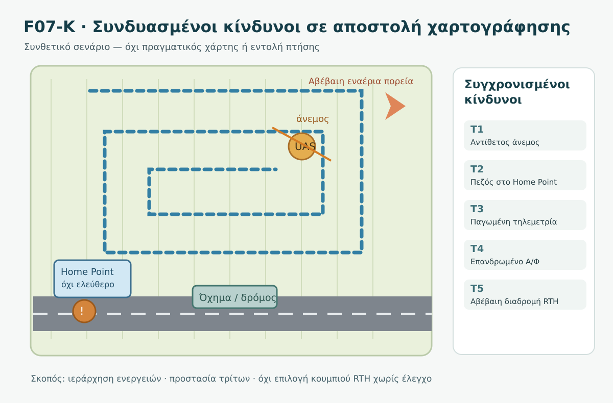

*Σχήμα F07-K. Ενδεικτική σχεδίαση αγροτικής αποστολής με οδικό άξονα, τρίτους, θέσεις ανάκτησης και αβέβαιη εναέρια απειλή. Δεν αποτυπώνει πραγματικές τοποθεσίες, αποστάσεις ή εγκεκριμένη διαδρομή.*

#### Δεδομένα εκκίνησης

Ομάδα δύο ατόμων εκτελεί νόμιμα σχεδιασμένη εκπαιδευτική αποστολή χαρτογράφησης σε συνθετικό αγρό. Προτού ξεκινήσει έχει ελέγξει τις απαιτούμενες ζώνες, τον προβλεπόμενο καιρό, την κατάσταση του drone και τα προβλεπόμενα σημεία ανάκτησης. Η εκτέλεση γίνεται με λειτουργία που επιτρέπει την απαιτούμενη παρέμβαση χειριστή. Η άσκηση **δεν παρέχει** πραγματική άδεια πτήσης ή πιστοποίηση συμμόρφωσης.

| Χρόνος | Νέα πληροφορία | Πιθανός κίνδυνος |
|---|---|---|
| **Τ0** | Κανονική χαρτογράφηση, αρχικά κατάλληλες συνθήκες | Συνήθεις κίνδυνοι αποστολής |
| **Τ1** | Ενισχύεται ο αντίθετος άνεμος, επιβραδύνεται η επιστροφή | Μειώνεται το ενεργειακό περιθώριο |
| **Τ2** | Ο παρατηρητής βλέπει πεζό κοντά στο Home Point | Η περιοχή προσγείωσης μπορεί να μην είναι ασφαλής |
| **Τ3** | Η τηλεμετρία δεν ενημερώνεται, χωρίς σαφή ένδειξη απώλειας C2 | Αβεβαιότητα για θέση και ενέργεια |
| **Τ4** | Ακούγεται και εντοπίζεται χαμηλά επανδρωμένο αεροσκάφος, πορεία αβέβαιη | Πιθανή άμεση απειλή στον αέρα |
| **Τ5** | Στην οθόνη εξακολουθεί να εμφανίζεται επιλογή RTH, αλλά η ζεύξη και η διαδρομή επιστροφής δεν έχουν επανεπιβεβαιωθεί | Λανθασμένη αυτοματοποίηση λόγω πίεσης |

#### Το ουσιαστικό ερώτημα

**Πότε παύει ο σκοπός της φωτογράφησης να έχει οποιαδήποτε βαρύτητα;** Ήδη από το πρώτο ουσιαστικό στοιχείο υποβάθμισης ασφάλειας. Δεν υπάρχει λογική «να απομένουν μόνο δύο γραμμές» ως αντιστάθμισμα κινδύνου.

#### Τι συμπληρώνει ο φοιτητής

Για κάθε χρονικό σημείο, στο φύλλο εργασίας καταγράφει: (α) επιβεβαιωμένα δεδομένα, (β) άγνωστες συνθήκες, (γ) ποιος εκτίθεται, (δ) ποια απόφαση προέχει, (ε) γιατί δεν αρκούν οι δύο προφανείς αλλά πιθανώς επικίνδυνες εναλλακτικές.

<details><summary>Κρυφή αναλυτική λύση της κεντρικής περίπτωσης</summary>

**Τ0:** Το σχέδιο προβλέπει εναλλακτική ανάκτηση και έγκαιρη διακοπή, όχι απόλυτη εγγύηση ασφάλειας. **Τ1:** Η μείωση προόδου επιστροφής απαιτεί νέα ενεργειακή εκτίμηση· η συλλογή εικόνων σταματά όταν η συνέχιση δημιουργεί κίνδυνο. **Τ2:** Το Home Point δεν είναι πια αυτονόητα ασφαλές· δεν αρκεί η εντολή RTH. **Τ3:** Οι τελευταίες εμφανισμένες τιμές μπορεί να είναι παρωχημένες. Αν το drone παραμένει οπτικά αντιληπτό, αυτό βοηθά στην επίγνωση αλλά δεν αποδεικνύει ακέραιη τηλεμετρία ή C2. **Τ4:** Η αποφυγή σύγκρουσης με επανδρωμένο αεροσκάφος αποκτά άμεση προτεραιότητα. Δεν αναμένουμε να επιλυθεί πρώτα η τεχνική διάγνωση. **Τ5:** Η απεικόνιση ενός κουμπιού RTH δεν βεβαιώνει ότι μπορεί να σταλεί ή να ληφθεί τώρα εντολή, ούτε επιβεβαιώνει ασφαλή διαδρομή, ασφαλές σημείο ή επαρκή ενέργεια. Η ομάδα εφαρμόζει την κατάλληλη επαληθευμένη απόκριση του συγκεκριμένου drone στις πραγματικές συνθήκες.

**Επικίνδυνες απαντήσεις:** «Συνεχίζουμε μέχρι να τελειώσουν οι λήψεις», «RTH πάντα», «αφού βλέπω 30% είμαι εντάξει», «η παγωμένη εικόνα σημαίνει χαμένο C2», «κατεβαίνω οπουδήποτε χωρίς να εξετάσω τρίτους». Καμία δεν είναι αποδεκτή.

**Δεν δίνεται καθολική εντολή χειριστηρίων.** Η ίδια περιγραφή με άλλο μοντέλο, άλλη ακριβή θέση αεροσκαφών ή διαφορετική διαθεσιμότητα ασφαλών περιοχών μπορεί να απαιτεί άλλη απόκριση.

</details>

#### 7.1 Δύο διακλαδώσεις — η ίδια ένδειξη, διαφορετικός πραγματικός κίνδυνος

**Διακλάδωση Α: παγωμένη τηλεμετρία με οπτική επαφή.** Ο χειριστής βλέπει το drone και διαπιστώνει ότι ανταποκρίνεται στις συνήθεις, ήδη γνωστές ενδείξεις χειρισμού, αλλά ο χάρτης δεν ανανεώνεται. Η **διαπίστωση της οπτικής ανταπόκρισης** δεν εγγυάται ακριβή τρέχουσα θέση, επαρκή ενέργεια, ορθή λειτουργία κάθε αισθητήρα ή ασφαλή επιστροφή. Η ομάδα δεν στηρίζει τη συνέχιση εργασίας στις παρωχημένες ενδείξεις.

**Διακλάδωση Β: παγωμένη τηλεμετρία χωρίς επιβεβαιωμένη δυνατότητα ελέγχου.** Η ίδια εικόνα της εφαρμογής μπορεί να συνυπάρχει με πραγματική απώλεια ζεύξης C2. Ο χειριστής **δεν υποθέτει** ότι νέα εντολή θα ληφθεί από το drone. Κρίσιμη είναι η εκ των προτέρων γνωστή αντίδραση lost-link και η προστασία του εναέριου και επίγειου περιβάλλοντος. Δεν ζητούμε από τους φοιτητές να δοκιμάσουν απώλεια ζεύξης σε πραγματική πτήση.

**Διακλάδωση Γ: η πορεία του επανδρωμένου αεροσκάφους γίνεται σαφής.** Αν η πραγματική σύγκλιση επιβεβαιώνεται, δεν περιμένουμε «περισσότερη βεβαιότητα» για μια ήδη κρίσιμη απειλή. Η ομάδα εφαρμόζει την κατάλληλη ασφαλή απόκριση αποφυγής, σύμφωνα με τις δυνατότητες του drone και τις πραγματικές συνθήκες. Αν το αεροσκάφος απομακρυνθεί, αυτό **δεν αποκαθιστά** αυτομάτως την καταλληλότητα επιστροφής, την τηλεμετρία ή το ενεργειακό περιθώριο.

<details><summary>Κρυφή συγκριτική λύση — Διακλαδώσεις Α, Β, Γ</summary>

- **Α:** Παρατηρήσιμη ανταπόκριση δεν συνεπάγεται ότι αποκαταστάθηκαν όλα τα υποσυστήματα. Η φωτογράφιση δεν συνεχίζεται με ανεπιβεβαίωτα στοιχεία και ανεπαρκές ενεργειακό περιθώριο.
- **Β:** Δεν συγχέουμε τη διαθεσιμότητα ενός πλήκτρου με επιβεβαιωμένη δυνατότητα επικοινωνίας. Εφαρμόζεται η προελεγμένη στρατηγική του συγκεκριμένου συστήματος, χωρίς αυτοσχέδιους χειρισμούς.
- **Γ:** Η αποφυγή κινδύνου σύγκρουσης προηγείται της διάγνωσης· μετά την απομάκρυνση του αεροσκάφους ακολουθεί **νέα συνολική αξιολόγηση** όλων των εναπομεινάντων κινδύνων.

</details>

#### 7.2 Γιατί μια «σωστή» μεμονωμένη ενέργεια μπορεί να είναι λανθασμένη συνολικά

| Φαινομενικά λογική επιλογή | Τι ενδέχεται να παραβλέπει | Τι έπρεπε να είχε προβλεφθεί |
|---|---|---|
| «Ενεργοποιώ RTH» | Η διαδρομή μπορεί να περνά από περιοχή εναέριας σύγκλισης, το Home Point να μην είναι ελεύθερο, ή η ζεύξη να μη δέχεται εντολή | Έλεγχος διαδρομών και lost-link ρυθμίσεων πριν την πτήση |
| «Μένω σε hover» | Αυξημένη κατανάλωση, αέρας και παρατεταμένη παρουσία σε επικίνδυνο σημείο | Σχεδιασμός ορίων διακοπής/ασφαλούς ανάκτησης ανά UAS |
| «Προσγειώνομαι στο κοντινότερο έδαφος» | Πεζοί, οχήματα, εμπόδια και άγνωστη καταλληλότητα | Επαληθευμένα εναλλακτικά σημεία ανάκτησης |
| «Περιμένω να ενημερωθεί ο χάρτης» | Απώλεια κρίσιμου χρόνου αποφυγής σύγκρουσης | Διατήρηση επίγνωσης και προετοιμασμένη απόκριση |

Καμία από τις παραπάνω επιλογές δεν είναι καθολικά λανθασμένη ή καθολικά σωστή. Η αποδεκτή απόφαση τεκμηριώνεται από **το συγκεκριμένο επίπεδο κινδύνου, τις πραγματικά διαθέσιμες δυνατότητες και την προστασία τρίτων**.

### 8. Πώς συντονίζεται η ομάδα χωρίς να χάνει χρόνο

Μια σύντομη αναφορά παρατηρητή δεν είναι τεχνική διάγνωση: «Ελικόπτερο βόρεια, πορεία αβέβαιη» έχει μεγαλύτερη αξία από «μάλλον έρχεται προς εμάς» όταν αυτό δεν είναι βέβαιο. Ο χειριστής επιβεβαιώνει ότι έλαβε την πληροφορία και διατηρεί την προσοχή στην προστασία του χώρου. Οι ρόλοι έχουν συμφωνηθεί πριν από την πτήση. Το **συγκεκριμένο λεκτικό πρωτόκολλο είναι εκπαιδευτική πρόταση**, όχι κανονιστικά επιβαλλόμενες φράσεις.

| Παράδειγμα ανακοίνωσης | Πώς αξιολογείται |
|---|---|
| «Προσοχή, κάτι συμβαίνει» | Ανεπαρκές: δεν προσδιορίζει γεγονός ή θέση |
| «Πεζός στο Home Point· το σημείο δεν είναι ελεύθερο» | Χρήσιμο: παρατήρηση και λειτουργική συνέπεια |
| «Η τηλεμετρία έχει παγώσει, άρα το drone χάθηκε» | Λανθασμένο συμπέρασμα |
| «Ελικόπτερο στον τομέα μας, πορεία προς εμάς μη επιβεβαιωμένη» | Χρήσιμο: δηλώνει τόσο κίνδυνο όσο και αβεβαιότητα |

#### Προσομοίωση ομαδικής κρίσης με μεταβολή πληροφορίας

Η άσκηση πραγματοποιείται μόνο με έντυπες καρτέλες ή προσομοίωση. Μία ομάδα διαβάζει τα Τ1–Τ5 σε διαδοχή, χωρίς να αποκαλύπτει εξαρχής τις επόμενες πληροφορίες. Ο εκπαιδευτής εισάγει στη συνέχεια **ένα από δύο νέα δεδομένα**: (α) αποκαθίσταται μόνο η εικόνα, όχι η τηλεμετρία, ή (β) εξακριβώνεται ότι η εναλλακτική περιοχή προσγείωσης δεν είναι ελεύθερη.

Οι φοιτητές οφείλουν να **αναθεωρήσουν** την προηγούμενη απόφαση και να εξηγήσουν ποιο νέο στοιχείο την άλλαξε. Ο εκπαιδευτής δεν βαθμολογεί την ταχύτητα απάντησης ή την επιλογή ενός συγκεκριμένου κουμπιού, αλλά την αναγνώριση της νέας έκθεσης, των αβεβαιοτήτων και της ανάγκης για επαληθευμένες διαδικασίες.

<details><summary>Κρυφές οδηγίες αξιολόγησης προσομοίωσης</summary>

Στο (α), η εικόνα δεν επιβεβαιώνει ότι όλες οι πληροφορίες είναι επίκαιρες ή ότι επιλύθηκε το πρόβλημα ενέργειας. Στο (β), η νέα θέση παύει να είναι διαθέσιμη· απαιτείται ασφαλέστερη εφικτή εναλλακτική σύμφωνα με το συγκεκριμένο UAS και τις πραγματικές συνθήκες. Η απόφαση πρέπει να ενημερώνεται καθώς αλλάζουν τα δεδομένα, όχι να ακολουθείται μηχανικά η αρχική επιλογή.

</details>

### 9. Μετά την ασφαλή ολοκλήρωση ή το συμβάν

Η ομάδα προστατεύει την περιοχή και δεν προσεγγίζει άκριτα περιστρεφόμενα μέρη ή κατεστραμμένη/θερμή μπαταρία. Αν απαιτείται βοήθεια, ενεργεί σύμφωνα με τις αρμόδιες υπηρεσίες και τις διαδικασίες του εκμεταλλευομένου. Καταγράφει χρονική αλληλουχία, προειδοποιήσεις, καιρικές παρατηρήσεις, θέση τρίτων, ενέργειες και αποτελέσματα. Διαχωρίζει **επιβεβαιωμένα συμβάντα** από **πιθανές αιτίες**. Οι υποχρεώσεις αναφοράς περιστατικού εξετάζονται χωριστά βάσει του είδους του συμβάντος και του εφαρμοστέου πλαισίου: **δεν ορίζουμε εδώ ανεπιβεβαίωτες προθεσμίες**.

Δεν επανεκκινούμε απλώς επειδή επανήλθε το σήμα, απομακρύνθηκε ένα αεροσκάφος ή σταμάτησε η προειδοποίηση. Χρειάζεται επαναξιολόγηση ολόκληρου του σχεδίου, του εξοπλισμού, του καιρού, της ενέργειας και του χώρου.

### 10. Αξιολόγηση — όχι μόνο σωστές λέξεις, αλλά σωστή κρίση

Η κεντρική δραστηριότητα αξιολογείται με **10 μονάδες**: αναγνώριση πραγματικών κινδύνων (2), διάκριση δεδομένων/αβεβαιοτήτων (2), προστασία τρίτων και επανδρωμένης κυκλοφορίας (3), ορθός έλεγχος διαθέσιμων επιλογών/αυτοματισμών (2), τεκμηρίωση επανεκτίμησης (1).

**Κόκκινες γραμμές:** Ανεξάρτητα από το συνολικό άθροισμα, δεν θεωρείται επαρκής μια απάντηση που αγνοεί εμφανή κίνδυνο σύγκρουσης με επανδρωμένο αεροσκάφος, προτείνει σκόπιμη έκθεση τρίτων, θεωρεί δεδομένη την ασφαλή χρήση RTH ή προτείνει πρόκληση πραγματικής βλάβης για εξάσκηση.

### 11. Αυτοαξιολόγηση

**1. Το drone εμφανίζει 35% μπαταρία αλλά δυσκολεύεται να επιστρέψει. Μπορούμε να συνεχίσουμε τη φωτογράφιση;**
<details><summary>Απάντηση 1</summary>Όχι με βάση μόνο το ποσοστό. Απαιτείται αξιολόγηση πραγματικών συνθηκών, προειδοποιήσεων και ασφαλούς περιθωρίου ανάκτησης. Η συνέχιση λήψεων δεν προηγείται της ασφάλειας.</details>

**2. Παγώνει η εικόνα αλλά το drone παραμένει ορατό. Έχει βεβαίως χαθεί η ζεύξη ελέγχου;**
<details><summary>Απάντηση 2</summary>Όχι. Απώλεια βίντεο και C2 δεν είναι ταυτόσημα φαινόμενα. Εξετάζονται οι πραγματικές αξιόπιστες ενδείξεις και η οπτική παρατήρηση.</details>

**3. Το Home Point είναι κατειλημμένο από πεζό. Είναι οπωσδήποτε σωστό το RTH;**
<details><summary>Απάντηση 3</summary>Όχι. Η καταλληλότητα προσγείωσης και η διαδρομή επιστροφής χρειάζονται επανεκτίμηση. Η συγκεκριμένη απόκριση εξαρτάται από το UAS και τις συνθήκες.</details>

**4. Ακούγεται επανδρωμένο αεροσκάφος αλλά δεν έχουμε σαφή πορεία. Τι αλλάζει;**
<details><summary>Απάντηση 4</summary>Αυξάνεται η επείγουσα ανάγκη επίγνωσης και αποφυγής σύγκρουσης. Δεν αναβάλλουμε την προστασία μέχρι να επιβεβαιώσουμε μια τεχνική αστοχία ή να ολοκληρώσουμε τις φωτογραφίες.</details>

**5. Αν εξαφανιστεί μια προειδοποίηση GNSS, συνεχίζεται αυτομάτως η αποστολή;**
<details><summary>Απάντηση 5</summary>Όχι. Η εξάλειψη μίας ένδειξης δεν αποδεικνύει ότι αποκαταστάθηκε όλη η λειτουργία ή ότι οι υπόλοιπες συνθήκες είναι ασφαλείς.</details>

**6. Το drone παρουσιάζει drift. Έχουμε βέβαιη διάγνωση βλάβης πυξίδας;**
<details><summary>Απάντηση 6</summary>Όχι. Χρειάζεται διάκριση παρατήρησης από αιτία. Το drift μπορεί να έχει περισσότερες από μία ερμηνείες και απαιτεί αξιολόγηση κινδύνου.</details>

**7. Τι είναι πιο χρήσιμο: «κάτι πάει στραβά» ή «όχημα δίπλα στο σημείο ανάκτησης»;**
<details><summary>Απάντηση 7</summary>Το δεύτερο: παρέχει συγκεκριμένη επαληθεύσιμη πληροφορία και συνέπεια για την ασφάλεια.</details>

**8. Μπορούμε να διδάξουμε μια καθολική εντολή τερματισμού κινητήρων για όλα τα μοντέλα;**
<details><summary>Απάντηση 8</summary>Όχι. Οι συνέπειες και οι διαδικασίες διαφέρουν. Σε ορισμένες καταστάσεις μια τέτοια ενέργεια μπορεί να προκαλέσει άμεση πτώση. Ακολουθούνται μόνο οι επαληθευμένες προβλεπόμενες διαδικασίες.</details>

**9. Το ελικόπτερο απομακρύνθηκε, αλλά η μπαταρία και ο άνεμος παραμένουν προβληματικοί. Επανεκκινούμε;**
<details><summary>Απάντηση 9</summary>Όχι αυτόματα. Η επανέναρξη απαιτεί συνολική νέα εκτίμηση όλων των ουσιωδών κινδύνων και του υπολειπόμενου περιθωρίου.</details>

**10. Ένας φοιτητής προτείνει να προκαλέσουμε απώλεια σύνδεσης στην πραγματική πτήση για μάθημα. Είναι κατάλληλη δραστηριότητα;**
<details><summary>Απάντηση 10</summary>Όχι. Χρησιμοποιούμε επιτραπέζια ανάλυση, προσομοίωση ή ασφαλή μη επιχειρησιακή επίδειξη σύμφωνα με τις προβλεπόμενες οδηγίες, όχι σκόπιμη δημιουργία κρίσιμων αστοχιών.</details>

**11.** Η εφαρμογή εμφανίζει το πλήκτρο RTH ενώ η ενημέρωση τηλεμετρίας έχει σταματήσει. Αποδεικνύεται ότι νέα εντολή θα φθάσει στο drone;

<details><summary>Απάντηση 11</summary>Όχι. Η εμφάνιση επιλογής στην εφαρμογή δεν αποδεικνύει κατάσταση πραγματικής ζεύξης C2, παραλαβή εντολής ούτε ασφάλεια πορείας. Χρειάζονται τα κατάλληλα αξιόπιστα στοιχεία και η προελεγμένη διαδικασία του συστήματος.</details>

**12.** Το ελικόπτερο απομακρύνθηκε, αλλά η εναλλακτική προσγείωση καταλήφθηκε από όχημα. Επαναρχίζουμε τη χαρτογράφηση;

<details><summary>Απάντηση 12</summary>Όχι με βάση μόνο την απομάκρυνση του ελικοπτέρου. Η περιοχή ανάκτησης, η ενέργεια, η ζεύξη και οι συνθήκες πρέπει να αξιολογηθούν ξανά. Η ολοκλήρωση της αποστολής δεν έχει προτεραιότητα έναντι της ασφάλειας.</details>

**13.** Ένας φοιτητής γράφει: «Επανεκτιμώ και κάνω το ασφαλές». Τι λείπει για να θεωρηθεί τεκμηριωμένη απάντηση;

<details><summary>Απάντηση 13</summary>Λείπει συγκεκριμένο παρατηρημένο γεγονός, σαφής αβεβαιότητα, προσδιορισμός του εκτεθειμένου προσώπου/κινδύνου και αιτιολόγηση της προστατευτικής απόφασης με βάση τις πραγματικές δυνατότητες και διαδικασίες του UAS.</details>

### 12. Συνήθη λάθη και ανακεφαλαίωση

- Η «αυτόματη πτήση» δεν σημαίνει ότι ο χειριστής απαλλάσσεται από τις απαιτούμενες ευθύνες.
- Η «ακριβής διάγνωση» μπορεί να είναι αδύνατη την ώρα του συμβάντος. Πρώτα περιορίζεται ο κίνδυνος.
- Δεν αρκεί να σταματήσει η λήψη εικόνων: πρέπει να εκτιμηθεί η ασφαλής συνέχεια της ίδιας της πτήσης.
- Δεν υποκαθιστούμε τον έλεγχο διαδρομής RTH με την ύπαρξη του πλήκτρου RTH.
- Η τελευταία τηλεμετρία δεν ταυτίζεται αυτομάτως με την τρέχουσα πραγματική κατάσταση.
- Δεν αξιολογούμε κάθε νέο πρόβλημα ανεξάρτητα από όσα προηγήθηκαν.

**Τελικό συμπέρασμα:** Στο σύνθετο περιστατικό δεν κερδίζει όποιος θυμάται τα περισσότερα κουμπιά. Κερδίζει εκείνος που διατηρεί ασφαλή επίγνωση, προστατεύει ανθρώπους και άλλα αεροσκάφη, αναγνωρίζει έγκαιρα την αβεβαιότητα και εγκαταλείπει την εργασία όταν αυτό απαιτεί η ασφάλεια.

### 13. Πηγές, όρια τεκμηρίωσης και μετάβαση

- **[E1] EASA — Easy Access Rules for Unmanned Aircraft Systems, αναθεώρηση Ιουνίου 2026, UAS.OPEN.060 και σχετικά AMC/GM.** https://www.easa.europa.eu/en/document-library/easy-access-rules/online-publications/easy-access-rules-unmanned-aircraft-systems?erules-id=ERULES-1963177438-19528
- **[E2] EASA — Easy Access Rules, Article 4, ορισμός Open/VLOS.** https://www.easa.europa.eu/en/document-library/easy-access-rules/online-publications/easy-access-rules-unmanned-aircraft-systems?erules-id=ERULES-1963177438-15550

Οι υποθετικές απαντήσεις δεν πιστοποιούν νόμιμη πτήση σε συγκεκριμένο σημείο. Οι ονομασίες RTH/RTL, C2, GNSS χρησιμοποιούνται για εκπαίδευση, όχι ως οδηγίες χειρισμού. Οι αριθμοί ασκήσεων και οι χρονικές στιγμές είναι συνθετικοί. Εφαρμοστέοι κανόνες περιοχής, η άδεια/δήλωση όπου απαιτείται, οι οδηγίες κατασκευαστή και οι διαδικασίες εκμεταλλευομένου πρέπει να ελέγχονται για κάθε πραγματική αποστολή.

**Συνέχεια:** DM00.4.7.12 — Διαχείριση ατυχήματος, προστασία χώρου και τεκμηρίωση μετά το περιστατικό.


---


### Συμπληρωματικός έλεγχος τεκμηρίωσης — Πύλη Β v0.4

> **Σημείωση έκδοσης:** Οι ακόλουθες διευκρινίσεις αφορούν αποκλειστικά την τεκμηρίωση των παρατιθέμενων ισχυρισμών. Δεν αποτελούν νέες γενικές εντολές χειρισμού.

- **B-11-004 — SUPPORTED_SPLIT_AMC_SCOPE:** Ο προπτητικός έλεγχος καιρού, κατάστασης UAS, επάρκειας ενέργειας και λειτουργίας ανάκτησης στηρίζεται σε διακριτά σημεία UAS.OPEN.060 και AMC· δεν αποτελούν όλα ενιαίο αυτοτελή κανονιστικό άρθρο. Πηγή: [επίσημη τεκμηρίωση](https://www.easa.europa.eu/en/document-library/easy-access-rules/online-publications/easy-access-rules-unmanned-aircraft-systems?erules-id=ERULES-1963177438-19528).
- **B-11-006 — CLASSIFIED_INTERNAL_EDUCATIONAL:** Διδακτικό σχήμα έξι βημάτων, όχι υποχρεωτική νομική διαδικασία.
- **B-11-010 — SUPPORTED_CONDITIONAL_TECHNICAL:** Η ύπαρξη πλήκτρου/ένδειξης RTH στην οθόνη δεν πιστοποιεί ενεργό C2· απαιτείται διασταύρωση πραγματικής κατάστασης ζεύξης.
- **B-11-011 — SUPPORTED_CONDITIONAL_TECHNICAL:** Η αποκατάσταση βίντεο δεν επαληθεύει αυτομάτως επικαιρότητα τηλεμετρίας, διαθέσιμη ενέργεια και καταλληλότητα προσγείωσης.
## DM00.4.7.12 — Διαχείριση ατυχήματος, προστασία χώρου και τεκμηρίωση μετά το περιστατικό

### Ερμηνευτική επισήμανση — διαφορετικά κανάλια αναφοράς

Η **υποχρεωτική αναφορά** του Κανονισμού **376/2014** έχει συγκεκριμένο πεδίο εφαρμογής (ιδίως άρθρα 3(2), 4(7)) και η προθεσμία των **72 ωρών** δεν είναι καθολική για κάθε πρόσκρουση drone. Η **χωρίς καθυστέρηση κοινοποίηση** στην αρχή διερεύνησης κατά το άρθρο 9 του **996/2010**, όταν εφαρμόζεται, είναι **διακριτή**. Η δυνατότητα μη διενέργειας διερεύνησης κατά το άρθρο 5(5) δεν συνιστά αυτομάτως απαλλαγή από την κοινοποίηση. Πρώτα αντιμετωπίζονται τραυματισμοί, φωτιά και άμεσοι κίνδυνοι· οι φόρμες ακολουθούν. [376/2014](https://eur-lex.europa.eu/legal-content/EL/TXT/?uri=CELEX:32014R0376) · [996/2010](https://eur-lex.europa.eu/legal-content/EL/TXT/?uri=CELEX:32010R0996). **Εκκρεμεί ανεξάρτητος νομικός έλεγχος ειδικών UAS περιστατικών και η εφαρμογή τους στην Ελλάδα.**


**GeoSkills · Drone Mapping Core · Αναθεωρημένο εκπαιδευτικό προσχέδιο v0.2 · 03/11/2026**

> **Πεδίο εφαρμογής και όρια.** Το κεφάλαιο αναφέρεται κυρίως σε συνήθεις επιχειρήσεις της **Open** στην Ελλάδα. Όπου παρουσιάζεται η **Specific** ή οι κανόνες διερεύνησης, το πεδίο εφαρμογής προσδιορίζεται ιδιαίτερα. Οι εκπαιδευτικές ακολουθίες δεν υποκαθιστούν το εγκεκριμένο σχέδιο αντιμετώπισης εκτάκτων αναγκών, τις οδηγίες του κατασκευαστή, τους διασώστες ή τη νομική αξιολόγηση συγκεκριμένου περιστατικού. Δεν πραγματοποιούμε εκπαιδευτικές προσομοιώσεις με πραγματικά τραυματισμένα πρόσωπα, εσκεμμένη πρόσκρουση ή κατεστραμμένες μπαταρίες.

### 1. Γιατί μελετάμε τη φάση *μετά* την πτήση;

Η πτήση τελείωσε με πρόσκρουση σε αγροτικό δρόμο. Ο χειριστής βλέπει το drone στο έδαφος. Ένα όχημα πλησιάζει, ένας περαστικός πλησιάζει από περιέργεια και η μπαταρία ενδέχεται να έχει υποστεί βλάβη. Το τέλος της κίνησης στον αέρα **δεν** ισοδυναμεί με τέλος του κινδύνου. Ο χειριστής δεν πρέπει να τρέξει αυτομάτως να πάρει τον εξοπλισμό: προέχουν οι άνθρωποι, η κατάσταση του χώρου και οι πιθανές δευτερογενείς συνέπειες.

#### Μαθησιακά αποτελέσματα

Μετά τη μελέτη, ο φοιτητής μπορεί να:

1. αναγνωρίζει κινδύνους που παραμένουν μετά από πρόσκρουση·
2. θέτει προτεραιότητα στην ασφάλεια ανθρώπων χωρίς να εκθέτει επιπλέον πρόσωπα·
3. διακρίνει ασφαλή παρατήρηση από μη επιτρεπτή ή επισφαλή επέμβαση στον εξοπλισμό·
4. αναγνωρίζει ενδείξεις δυνητικά επικίνδυνης μπαταρίας·
5. οργανώνει αντικειμενική αρχική καταγραφή χωρίς εικασίες περί αιτιότητας·
6. διακρίνει αναφορά συμβάντος στην ΑΠΑ από κοινοποίηση στην αρχή διερεύνησης ασφαλείας·
7. ελέγχει πότε πιθανόν υφίσταται υποχρέωση αναφοράς, χωρίς να γενικεύει προθεσμίες·
8. σχεδιάζει πρακτική ανασκόπηση και μέτρα μη επανάληψης.

### 2. Η σειρά προτεραιότητας

**Πρώτα άνθρωποι → κατόπιν αποτροπή πρόσθετου κινδύνου → συνδρομή αρμόδιων υπηρεσιών → τεκμηρίωση και ειδοποιήσεις → τεχνική αξιολόγηση πριν από κάθε επαναχρησιμοποίηση.** Αυτό είναι *εκπαιδευτικό πλαίσιο* και όχι υποχρεωτικό νομικό πρωτόκολλο. Όταν υπάρχει άμεση απειλή, ενεργούμε για την ασφάλεια χωρίς αναμονή να συμπληρώσουμε έγγραφα.

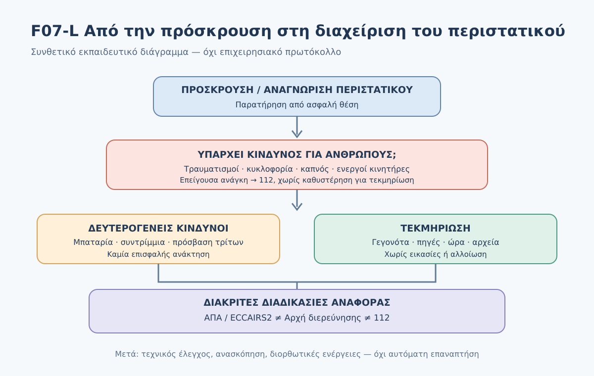

*Σχήμα F07-L. Πρωτότυπο συνθετικό διάγραμμα ροής. Τα βήματα δεν εξουσιοδοτούν άτομα χωρίς εκπαίδευση να εισέλθουν σε επικίνδυνη περιοχή ή να χειριστούν κατεστραμμένες μπαταρίες.*

#### 2.1 Άμεση παρατήρηση από ασφαλή θέση

Δεν πλησιάζουμε βιαστικά. Αναζητούμε από ασφαλή θέση: τραυματίες, κίνηση οχημάτων, μη σταματημένες έλικες, ηλεκτρικά καλώδια, φωτιά ή καπνό, χυμένα υλικά, ασταθές πρανές, κυκλοφορία και τυχόν επικίνδυνα φορτία. **Δεν αγγίζουμε καλώδια, εξαρτήματα υπό τάση ή ύποπτη μπαταρία.** Δεν υποθέτουμε ότι οι κινητήρες έχουν αφοπλιστεί επειδή το drone δεν κινείται. Αν υπάρχει πιθανότητα σοβαρής βλάβης, περιορίζουμε την προσέγγιση και αναζητούμε κατάλληλη βοήθεια.

#### 2.2 Άνθρωποι πριν από τον εξοπλισμό

Εάν υπάρχει τραυματισμός ή άμεση απειλή ζωής/πυρκαγιάς, καλούμε **112** στην Ελλάδα και αναφέρουμε τοποθεσία, τι συνέβη, αριθμό πιθανών τραυματιών και τυχόν καπνό/μπαταρία. Το 112 συνδέει με αρμόδια υπηρεσία έκτακτης ανάγκης. Δεν μετακινούμε τραυματία χωρίς οδηγίες από τις αρμόδιες υπηρεσίες ή κατάλληλη εκπαίδευση, εκτός αν απαιτείται άμεση απομάκρυνση από επικείμενο κίνδυνο με ασφαλή τρόπο. Η παροχή πρώτων βοηθειών απαιτεί κατάλληλη γνώση και δεν διδάσκεται εδώ.

**Επίσημη πηγή:** https://www.gov.gr/el/sdg/healthcare/national-emergency-numbers/general/112

#### 2.3 Περιορισμός πρόσβασης και δευτερογενών κινδύνων

Αποτρέπουμε τρίτους να πλησιάσουν, **χωρίς** να εισέλθουμε στον δρόμο ή να επιχειρήσουμε ανεξουσιοδότητη διαχείριση κυκλοφορίας. Ενημερώνουμε τις αρχές για κίνδυνο σε οδό και ακολουθούμε τις οδηγίες τους. Δεν μετακινούμε τα συντρίμμια απλώς για να τα «τακτοποιήσουμε». Κατ’ εξαίρεση, ενέργειες απαραίτητες για προστασία ζωής και εξάλειψη άμεσου κινδύνου μπορεί να προηγηθούν της διατήρησης στοιχείων· ό,τι άλλαξε καταγράφεται όταν ασφαλές.

### 3. Η μπαταρία μετά από πρόσκρουση

Η χρήση μπαταριών λιθίου απαιτεί επιφυλακή για: **καπνό, φούσκωμα, έντονη/ασυνήθιστη θερμότητα, οσμή, διαρροή, συριγμό ή κρότο**. Καμία από αυτές τις ενδείξεις δεν επιβεβαιώνει από μόνη της συγκεκριμένη εσωτερική βλάβη, αλλά πρέπει να αντιμετωπίζεται ως δυνητικός κίνδυνος. Εάν υπάρχει καπνός/φωτιά, **απομακρυνόμαστε, ειδοποιούμε το 112 και δεν επιχειρούμε κατάσβεση χωρίς ειδική εκπαίδευση/εξοπλισμό**. Δεν ανοίγουμε, τρυπάμε, πιέζουμε, φορτίζουμε ή μεταφέρουμε πρόχειρα ύποπτη μπαταρία, ούτε την τοποθετούμε σε συνηθισμένο κάδο. Η περαιτέρω διαχείριση αποφασίζεται με οδηγίες αρμοδίων και κατασκευαστή.

Αν δεν υπάρχει καπνός, δεν σημαίνει ότι η μπαταρία είναι ασφαλής. Η απουσία ορατής βλάβης επίσης δεν πιστοποιεί καταλληλότητα για νέα πτήση. **Καμία δοκιμαστική φόρτιση ή πτήση** μέχρι ολοκληρωμένη, κατάλληλη τεχνική εκτίμηση.

**Τεχνικές πηγές (γενική ασφάλεια Li-ion, όχι ειδικές οδηγίες UAV):** https://www.london-fire.gov.uk/safety/lithium-batteries/electric-scooter-and-electric-bike-batteries-spotting-the-risks/ και https://www.firescotland.gov.uk/at-home/lithium-ion-batteries/

#### 3.1 Κίνδυνοι με καθυστέρηση — η απουσία καπνού δεν αρκεί

Μια μπαταρία λιθίου μπορεί να παρουσιάσει σοβαρή θερμική αστοχία μετά από μηχανική καταπόνηση. Αυτό **δεν σημαίνει** ότι κάθε πρόσκρουση οδηγεί σε πυρκαγιά· σημαίνει ότι δεν επιτρέπεται να θεωρήσουμε ασφαλές το στοιχείο μόνο επειδή αρχικά δεν παρατηρείται καπνός. Η FAA αναφέρει ότι ζημιά ή υπερθέρμανση μπορεί να οδηγήσει σε *thermal runaway* και ότι ο κίνδυνος δεν είναι πάντα άμεσα ορατός.

| Παρατηρούμενο | Ασφαλής ερμηνεία | Τι δεν δικαιολογείται |
|---|---|---|
| Δεν υπάρχει καπνός | Δεν επιβεβαιώνεται ενεργός καπνισμός τη συγκεκριμένη στιγμή | «Η μπαταρία είναι άθικτη» |
| Παρατηρείται διόγκωση ή ασυνήθιστη θερμότητα | Υπάρχει πιθανός σοβαρός κίνδυνος | «Θα την ανοίξω για να δω» |
| Καπνός, φλόγα ή έντονος συριγμός | Προτεραιότητα σε απομάκρυνση, προστασία άλλων και άμεση αρμόδια βοήθεια | «Θα τη μεταφέρω με τα χέρια» |
| Ο εξοπλισμός φαίνεται εξωτερικά ακέραιος | Δεν υπάρχει ορατή συγκεκριμένη ζημιά | «Μπορώ να τον φορτίσω ή να απογειωθώ ξανά» |

Τα παραπάνω είναι **προληπτικές αρχές**, όχι εξειδικευμένο πρωτόκολλο πυρόσβεσης ή μεταφοράς επικίνδυνων υλικών. Ακολουθούνται οι οδηγίες υπηρεσιών έκτακτης ανάγκης και οι κατάλληλες διαδικασίες του κατασκευαστή.

**Τεχνική πηγή:** https://www.faa.gov/hazmat/packsafe/lithium-batteries

### 4. Τι καταγράφουμε και γιατί;

Ένα εκπαιδευτικό αρχείο συμβάντος δεν είναι απολογία, ούτε προσπάθεια απόδοσης ευθύνης. Είναι **χρονολογημένη καταγραφή διαπιστώσεων και ενεργειών**, ώστε ο οργανισμός και οι αρμόδιοι να μπορούν να κατανοήσουν τι συνέβη. Η ακρίβεια έχει μεγαλύτερη σημασία από την ταχύτητα συγγραφής μιας «ολοκληρωμένης ιστορίας».

| Πεδίο | Παράδειγμα τεκμηρίωσης | Τι αποφεύγουμε |
|---|---|---|
| Χρόνος | «15:42, τοπική ώρα, από αρχείο πτήσης» | «γύρω στο απόγευμα» όταν υπάρχει ακριβές στοιχείο |
| Θέση | «σημείο που διαπιστώθηκε επί του εδάφους, πηγή: επιτόπια αποτύπωση» | δήθεν ακριβείς συντεταγμένες από παγωμένο GNSS |
| Πρόσωπα | «παρευρισκόταν 1 πεζός· τραυματισμός δεν επιβεβαιώθηκε» | πρόωρη βεβαιότητα για κλινική κατάσταση |
| Συμπτώματα | «προειδοποίηση κινητήρα πριν από την πρόσκρουση» | «έσπασε ο κινητήρας» δίχως εξέταση |
| Περιβάλλον | «ριπές κατά την εκτίμηση χειριστή· μετεωρολογικά στοιχεία μη διαθέσιμα» | επινοημένη μέτρηση ανέμου |
| Ενέργειες | «η ομάδα ειδοποίησε το 112 στις 15:44» μόνο εφόσον συνέβη | εκ των υστέρων ανακατασκευή ως βεβαιότητα |
| Τεκμήρια | logs, εικόνες χώρου εφόσον ασφαλές, μαρτυρίες | αλλοίωση, διαγραφή, κοινοποίηση προσωπικών δεδομένων |

Διαχωρίζουμε **παρατήρηση**, **δήλωση τρίτου**, **ένδειξη συστήματος**, **προκαταρκτική υπόθεση**, **επιβεβαιωμένο τεχνικό εύρημα**. Δεν δημοσιεύουμε εικόνες τραυματιών, στοιχεία τρίτων ή άσχετο υλικό. Τα αρχεία τηρούνται με κατάλληλους κανόνες πρόσβασης και προστασίας δεδομένων.

#### 4.1 Τι γίνεται με τα logs και το drone;

Εφόσον δεν υπάρχει κίνδυνος και επιτρέπεται από τους αρμόδιους, διατηρούμε τα πρωτότυπα αρχεία καταγραφής και σημειώνουμε την πηγή, την ώρα λήψης, το όνομα αρχείου και ποιος τα παρέλαβε. Η τεχνική εξαγωγή γίνεται με τρόπο που δεν απαιτεί επικίνδυνη ενεργοποίηση ή φόρτιση του κατεστραμμένου drone. Δεν τροποποιούμε δεδομένα, δεν επαναφέρουμε εργοστασιακές ρυθμίσεις και δεν πετάμε κατεστραμμένα μέρη πριν αποσαφηνιστούν οι ανάγκες ασφάλειας/διερεύνησης.

#### 4.2 Ακεραιότητα αρχείου και πληροφοριακός έλεγχος

Για κάθε τεκμήριο σημειώνουμε: **προέλευση, χρόνο/ζώνη ώρας, τρόπο λήψης και τυχόν επέμβαση στο αρχείο**. Αν ένα log εξάγεται σε υπολογιστή μετά από το περιστατικό, καταγράφεται ξεχωριστά η ώρα **του γεγονότος** και η ώρα **εξαγωγής**. Ένα τεχνικό ίχνος μπορεί να έχει πραγματική αξία χωρίς να πιστοποιεί από μόνο του την αιτία. Ο έλεγχος hash, όπου εφαρμόζεται, χρησιμεύει στην ανίχνευση μεταβολής ενός ψηφιακού αντιγράφου, όχι στην απόδειξη της αλήθειας του περιεχομένου του.

**Λυμένο μικροπαράδειγμα:** «15:42:08 από αρχείο πτήσης» και «16:16:03 ώρα εξαγωγής του αρχείου» είναι δύο διαφορετικοί χρόνοι. Δεν γράφουμε ότι «οι αρχές επιβεβαίωσαν την πρόσκρουση στις 15:42:08» αν το μόνο τεκμήριο είναι ένα log που δεν έχει ανεξάρτητα επαληθευτεί.

<details>
<summary>Κρυφή εξήγηση — Γιατί διαχωρίζουμε πρωτότυπα από αντίγραφα;</summary>

Τα πρωτότυπα πρέπει να διατηρούνται με ασφαλή τρόπο, ενώ η εκπαιδευτική ανάλυση μπορεί να γίνει πάνω σε αντίγραφο. Έτσι μειώνεται ο κίνδυνος ακούσιας μεταβολής. Η διαδικασία δεν αντικαθιστά τις οδηγίες διερεύνησης της αρμόδιας αρχής και δεν απαιτεί επικίνδυνη επανενεργοποίηση του drone.

</details>

### 5. Αναφορά περιστατικών στην Ελλάδα — δύο διαφορετικές λειτουργίες

**Προσοχή:** άλλο η άμεση κλήση για προστασία ζωής, άλλο η αναφορά αεροπορικού περιστατικού στην ΑΠΑ, και άλλο η υποχρέωση κοινοποίησης ατυχήματος/σοβαρού συμβάντος στην αρχή διερεύνησης. Μπορεί ένα γεγονός να ενεργοποιεί περισσότερες από μία διαδικασίες. Η παρούσα ενότητα **δεν** αποφασίζει μόνη της τη νομική ταξινόμηση κάθε πραγματικού συμβάντος.

#### 5.1 Αναφορά περιστατικού ασφαλείας στην ΑΠΑ

Η **Αρχή Πολιτικής Αεροπορίας (ΑΠΑ)** αναφέρει επίσημα ως οδούς αναφοράς τη διαδικτυακή πλατφόρμα **ECCAIRS2** και εναλλακτικά ειδικές διαδικασίες αναφοράς (έντυπα/email/επιστολή), ανάλογα με το πλαίσιο. Η αναφορά μέσω ECCAIRS2 με επιλογή της αρμόδιας ελληνικής αρχής έχει επίσημη τεκμηρίωση. **Δεν** στέλνουμε υποθετική μαθητική αναφορά στο πραγματικό σύστημα.

- Επίσημη ΑΠΑ: https://hcaa.gov.gr/el/faq/pos-na-anaferete-stin-apa
- Επίσημη ΑΠΑ MOR: https://hcaa.gov.gr/el/ypohreotiki-anafora-aeroporikon-peristatikon-asfaleias-mor
- Ευρωπαϊκή πλατφόρμα: https://aviationreporting.eu/

**Κρίσιμος περιορισμός Open:** Στην καθοδήγηση του άρθρου 19(2) του Κανονισμού 2019/947, η EASA εξηγεί ότι για UA χωρίς απαίτηση πιστοποιητικού ή δήλωσης, το υποχρεωτικό πλαίσιο αναφοράς του 376/2014 περιορίζεται σε περιστατικά με **θανατηφόρο ή σοβαρό τραυματισμό** ή με **εμπλοκή άλλου αεροσκάφους**. Δεν συνεπάγεται ότι κάθε απλή πρόσκρουση ή υλική ζημία ενός συνηθισμένου Open drone υπάγεται αυτομάτως στην ίδια υποχρέωση. Μπορεί να υπάρχουν άλλες υποχρεώσεις (ιδίως άλλης κατηγορίας λειτουργίας, ασφαλιστικές, αστικές ή οργανωτικές). **Η προαιρετική αναφορά είναι διακριτή από τη νομικά υποχρεωτική.**

**Επίσημη πηγή:** https://www.easa.europa.eu/en/document-library/easy-access-rules/online-publications/easy-access-rules-unmanned-aircraft-systems?erules-id=ERULES-1963177438-15493

#### 5.2 Προθεσμία 72 ωρών: σε ποιες περιπτώσεις;

Ο Κανονισμός 376/2014 άρθρο 4(7) προβλέπει αναφορά **εντός 72 ωρών από τη γνώση του περιστατικού** για τα πρόσωπα που υπέχουν συγκεκριμένη υποχρέωση αναφοράς, εκτός εξαιρετικών περιστάσεων. Συναφείς υποχρεώσεις οργανισμών αποτυπώνονται στα άρθρα 4(8)–(9). Η προθεσμία **δεν εφαρμόζεται αυτομάτως σε κάθε περιστατικό κάθε ερασιτεχνικής πτήσης Open**· πρώτα διαπιστώνουμε αν το γεγονός και ο υπόχρεος υπάγονται στο υποχρεωτικό σχήμα. Οι εθελοντικές αναφορές δεν εμπίπτουν στη γενική ίδια προθεσμία 72 ωρών.

**Επίσημη πηγή:** https://www.easa.europa.eu/en/document-library/easy-access-rules/online-publications/easy-access-rules-occurrence-reporting?page=13

#### 5.3 Άμεση κοινοποίηση σε αρχή διερεύνησης

Το άρθρο 9 του **Κανονισμού (ΕΕ) 996/2010** ορίζει ότι κάθε εμπλεκόμενο πρόσωπο που γνωρίζει ατύχημα ή σοβαρό συμβάν κοινοποιεί **αμελλητί** το γεγονός στην αρμόδια αρχή διερεύνησης ασφαλείας του κράτους όπου συνέβη. Η εφαρμογή απαιτεί σωστή ταξινόμηση σύμφωνα με τους ορισμούς του κανονισμού. Στην Ελλάδα ο σχετικός θεσμός διερεύνησης αεροπορικών ατυχημάτων είναι ο **ΕΟΔΑΣΑΑΜ (HARSIA)**. Δεν εξισώνουμε αυτόν τον φορέα με την ΑΠΑ και δεν ισχυριζόμαστε ότι κάθε απλή υλική ζημία drone αποτελεί αυτομάτως «αεροπορικό ατύχημα» κατά τη νομική έννοια.

**Επίσημο άρθρο 9:** https://eur-lex.europa.eu/legal-content/EL/TXT/?uri=celex:32010R0996

**Προσοχή στη διερεύνηση:** Το άρθρο 5(5) του ίδιου Κανονισμού επιτρέπει, υπό προϋποθέσεις, στην αρμόδια αρχή να μη διενεργήσει διερεύνηση ορισμένων ατυχημάτων/σοβαρών συμβάντων μη επανδρωμένων αεροσκαφών χωρίς απαίτηση πιστοποιητικού/δήλωσης και χωρίς θανάσιμο ή σοβαρό τραυματισμό. **Η δυνατότητα μη διενέργειας διερεύνησης δεν είναι το ίδιο με γενική απαλλαγή κοινοποίησης.**

#### 5.4 Η επίσημη υπηρεσία αναφοράς του ΕΟΔΑΣΑΑΜ — επαλήθευση 03/11/2026

Ο ΕΟΔΑΣΑΑΜ διαθέτει **δημόσια ηλεκτρονική φόρμα «Αναφέρετε Ατύχημα ή Σοβαρό Συμβάν»**. Επιβεβαιώθηκε από τη δική του επίσημη ιστοσελίδα ότι η φόρμα περιλαμβάνει πεδία στοιχείων αναφέροντος, τόπου/χρόνου, ζημιών, σοβαρού τραυματισμού, περίληψης, επικίνδυνων υλικών, στοιχείων αεροσκάφους και εμπλοκής άλλου αεροσκάφους. Η λειτουργία υποβολής *δεν* δοκιμάστηκε, επειδή δεν υποβάλλουμε εκπαιδευτικές ή εικονικές αναφορές σε πραγματικές αρχές.

- **Επίσημη φόρμα:** https://www.harsia.gr/index.php/anaferete-atychima-i-sovaro-symvan/
- **Επίσημη κεντρική σελίδα:** https://www.harsia.gr/
- **Αριθμός αεροπορικών συμβάντων 24/7, όπως αναγράφεται επισήμως:** **+30 698 100 0578**.

Η ύπαρξη δημόσιας γενικής φόρμας αεροπορικών ατυχημάτων **δεν επιβεβαιώνει** ότι κάθε κατηγορία μικρού UAS εμπίπτει υποχρεωτικά στη διαδικασία, ούτε ότι η φόρμα καλύπτει όλες τις ειδικές περιπτώσεις. Για πραγματικό γεγονός η νομική υπαγωγή και τυχόν ειδικές οδηγίες ελέγχονται με την αρμόδια αρχή. **Δεν επαληθεύτηκε ξεχωριστή φόρμα αποκλειστικά για UAS.**

#### 5.4.1 Τι παραμένει ανοικτό

Δεν επιβεβαιώθηκε ένας ενιαίος ελληνικός πίνακας που να αντιστοιχίζει εξαντλητικά όλα τα πραγματικά περιστατικά UAS σε παράλληλες υποχρεώσεις εποπτείας, ασφάλισης, αστικής ευθύνης, ΕΟΔΑΣΑΑΜ και λοιπών αρχών. Η ταξινόμηση συγκεκριμένου περιστατικού δεν αντικαθίσταται από το εκπαιδευτικό υπόδειγμα.

#### 5.4.2 Τι ισχύει για την προθεσμία

Το **«αμελλητί»** του άρθρου 9 του 996/2010 δεν πρέπει να συγχέεται με την προθεσμία **72 ωρών** του υποχρεωτικού συστήματος 376/2014. Οι δύο υποχρεώσεις, εφόσον συντρέχουν, είναι διακριτές. Η υποβολή στο ECCAIRS2 δεν αποδεικνύει από μόνη της ότι πραγματοποιήθηκε η απαιτούμενη χωριστή κοινοποίηση στον ΕΟΔΑΣΑΑΜ.

**Επιβεβαίωση:** EASA occurrence reporting guidance 2.6: https://www.easa.europa.eu/en/document-library/easy-access-rules/online-publications/easy-access-rules-occurrence-reporting?page=13


#### 5.5 Πίνακας αρχικής διαλογής (όχι νομική απόφαση)

| Συνθετικό περιστατικό | Άμεση προτεραιότητα | Κανονιστικό βήμα προς αξιολόγηση |
|---|---|---|
| Ήπια πρόσκρουση σε ακατοίκητο χωράφι, καμία άλλη ζημιά | Έλεγχος περιοχής και μπαταρίας | Όχι αυτομάτως υποχρεωτικό MOR 376/2014 για συνήθη Open· διατήρηση αρχείου και εξέταση άλλων απαιτήσεων |
| Drone πλήττει πεζό· δεν γνωρίζουμε τη βαρύτητα | Προστασία προσώπου, 112 εάν απαιτείται | Επιβεβαίωση της βαρύτητας και άμεση διερεύνηση υποχρεώσεων αναφοράς· όχι εικασίες περί «ελαφρού» |
| Σοβαρός τραυματισμός τρίτου | Άμεση επείγουσα βοήθεια | Ενεργοποίηση κατάλληλων διαδικασιών ΑΠΑ και αρχής διερεύνησης σύμφωνα με το εφαρμοστέο πλαίσιο |
| Σύγκρουση ή σοβαρή εμπλοκή με επανδρωμένο αεροσκάφος | Προστασία ζωής και εναέριας ασφάλειας | Ισχυρή ένδειξη υποχρέωσης αναφοράς στο εφαρμοστέο πλαίσιο· έλεγχος και των δύο καναλιών |
| Υλική ζημιά σε αυτοκίνητο, χωρίς τραυματία | Ασφάλεια κυκλοφορίας, αρμόδιες υπηρεσίες αν υπάρχει κίνδυνος | ΑΠΑ 376/2014 όχι αυτομάτως για απλή Open· διακριτός έλεγχος αστικών/ασφαλιστικών/άλλων υποχρεώσεων |

#### 5.6 Πέντε ερωτήσεις διαλογής πριν χαρακτηρίσουμε νομικά ένα περιστατικό

1. **Ποια ήταν η κατηγορία λειτουργίας;** Open ή Specific/άλλη; Υπήρχε απαίτηση πιστοποιητικού ή δήλωσης;
2. **Τι συνέβη πραγματικά;** Υπάρχει θάνατος, σοβαρός τραυματισμός, εμπλοκή άλλου αεροσκάφους ή μόνο υλική ζημία; Δεν κάνουμε ιατρική διάγνωση.
3. **Υπάρχει επείγουσα ανάγκη;** Η κλήση 112 δεν αναμένει την κανονιστική ταξινόμηση.
4. **Ποια κανάλια αναφοράς είναι εφαρμοστέα;** ΑΠΑ/ECCAIRS2 και, χωριστά όπου απαιτείται, ΕΟΔΑΣΑΑΜ. Ο φορέας εκμετάλλευσης ελέγχει και τυχόν επιπλέον υποχρεώσεις.
5. **Ποια προθεσμία αφορά το συγκεκριμένο κανάλι;** Δεν αποδίδουμε καθολικά το 72ωρο σε κάθε είδος περιστατικού.

#### Λυμένη αντιπαραβολή — ίδια πρόσκρουση, νέα πληροφορία

**Κατάσταση Α:** Μικρό drone Open καταλήγει σε άδειο χωράφι· δεν έχει επιβεβαιωθεί τραυματισμός ή εμπλοκή άλλου αεροσκάφους. Δεν συνάγουμε αυτομάτως υποχρεωτικό MOR μόνο από την υλική ζημία στο drone. Διατηρούμε στοιχεία και ελέγχουμε τις λοιπές εφαρμοστέες απαιτήσεις.

**Κατάσταση Β:** Προκύπτει πληροφορία ότι πεζός ίσως τραυματίστηκε. **Δεν περιμένουμε** να αποδειχθεί «σοβαρός τραυματισμός» για να αντιμετωπίσουμε πιθανή επείγουσα ανάγκη. Παρέχουμε την κατάλληλη βοήθεια/ειδοποίηση και διερευνούμε με αρμόδιους τη νομική υπαγωγή.

**Κατάσταση Γ:** Επιβεβαιώνεται σοβαρός τραυματισμός με βάση τις εφαρμοστέες ιατρικές/νομικές διαδικασίες. Ελέγχουμε αμέσως τις διαφορετικές υποχρεώσεις αναφοράς· η ενδεχόμενη υποβολή στην ΑΠΑ **δεν αντικαθιστά** την ανεξάρτητη κοινοποίηση στην αρχή διερεύνησης.

<details>
<summary>Κρυφή λύση — Τι μεταβάλλεται και τι όχι;</summary>

Μεταβάλλεται η **διαθεσιμότητα και σοβαρότητα των πραγματικών στοιχείων**, άρα και οι πιθανές υποχρεώσεις. Δεν μεταβάλλεται η αρχή ότι προέχει η ανθρώπινη ζωή, η καταγραφή πρέπει να είναι ακριβής και κάθε κανάλι αναφοράς αξιολογείται χωριστά.

</details>

### 6. Αναλυτικά λυμένα παραδείγματα

#### Παράδειγμα Α — Πρόσκρουση χωρίς γνωστό τραυματισμό

**Δεδομένα:** Ένα drone συντρίβεται σε άδειο τμήμα αγρού. Ο χειριστής βλέπει ότι έχει σταματήσει και η μπαταρία δεν καπνίζει. **Λανθασμένη πρώτη σκέψη:** «Δεν υπάρχει τραυματίας, άρα το παίρνω και πετάω ξανά». **Ανάλυση:** Η ασφάλεια της μπαταρίας και του εξοπλισμού δεν αποδεικνύεται από την απουσία καπνού. Πρώτα παρατηρούμε για δευτερογενείς κινδύνους, διατηρούμε στοιχεία, κάνουμε κατάλληλο τεχνικό έλεγχο και εξετάζουμε το εφαρμοστέο πλαίσιο αναφοράς. Δεν πραγματοποιούμε δοκιμαστική επανεκκίνηση στο πεδίο.

#### Παράδειγμα Β — Πιθανός τραυματισμός και ζημιά σε δρόμο

**Δεδομένα:** Το drone έχει καταλήξει δίπλα σε αγροτικό δρόμο. Ένας οδηγός σταμάτησε απότομα και λέει ότι πονά στον ώμο. **Ανάλυση:** Δεν συμπεραίνουμε αν είναι σοβαρός τραυματισμός ή αν η αιτία του πόνου ήταν πράγματι το drone. Εξασφαλίζουμε ότι δεν προκύπτει νέα έκθεση σε κυκλοφορία, ζητάμε αρμόδια βοήθεια ανάλογα με την κατάσταση, καταγράφουμε τις ακριβείς δηλώσεις με την πηγή τους και ελέγχουμε κατά προτεραιότητα τις υποχρεώσεις κοινοποίησης. Η φωτογράφιση προσώπου δεν προηγείται της προστασίας του.

#### Παράδειγμα Γ — Καπνός από κατεστραμμένη μπαταρία

**Δεδομένα:** Μετά από πρόσκρουση παρατηρείται καπνός από το drone. **Ανάλυση:** Η απομάκρυνση από τον κίνδυνο, η προειδοποίηση των γύρω και η κλήση 112 προηγούνται των φωτογραφιών και της συλλογής logs. Η ομάδα δεν πιάνει ούτε μεταφέρει τη μπαταρία για να «την απομακρύνει». Δεν προτείνουμε γενική μέθοδο κατάσβεσης για όλα τα περιστατικά μπαταριών.

#### Παράδειγμα Δ — Χάθηκαν κρίσιμα δεδομένα μετά το συμβάν

**Δεδομένα:** Κάποιος προτείνει επανεκκίνηση του drone για να κατεβάσει τη μνήμη του. **Ανάλυση:** Μια τέτοια ενέργεια μπορεί να ενέχει κίνδυνο και ενδεχομένως να μεταβάλει αποδεικτικά στοιχεία. Καταγράφουμε το ζήτημα και ζητάμε τις προβλεπόμενες ασφαλείς οδηγίες· δεν θέτουμε κατεστραμμένο εξοπλισμό σε λειτουργία χωρίς αξιολόγηση και αρμόδια απόφαση.

### 7. Κεντρική μελέτη περίπτωσης — «Η πρόσκρουση δεν είναι το τέλος»

**Πλαίσιο:** Μικρή αποστολή χαρτογράφησης σε αγρό. Δίπλα υπάρχει αγροτικός δρόμος. Το παρακάτω χρονικό είναι **αμιγώς συνθετικό**· καμία τιμή ή γεγονός δεν αναφέρεται σε πραγματικό ατύχημα.

| Στάδιο | Νέα πληροφορία | Ερώτημα απόφασης |
|---|---|---|
| Τ1 | Το drone προσκρούει κοντά στον δρόμο | Τι προηγείται της ανάκτησης; |
| Τ2 | Διερχόμενο όχημα φρενάρει, οδηγός κατεβαίνει | Τι κάνουμε για τη νέα έκθεση προσώπων/κυκλοφορίας; |
| Τ3 | Ο οδηγός αναφέρει ενόχληση στο χέρι | Τι θεωρείται γνωστό και τι άγνωστο; |
| Τ4 | Από ασφαλή θέση παρατηρείται ασυνήθιστη οσμή κοντά στο drone | Τι αλλάζει στην προσέγγιση; |
| Τ5 | Η ομάδα συζητά αν θα υποβάλει αναφορά | Ποια διαφορετικά κανονιστικά κανάλια πρέπει να αξιολογήσει; |
| Τ6 | Ο χειριστής διαθέτει μόνο τελευταίο GNSS πριν την πρόσκρουση | Πώς τεκμηριώνεται η θέση; |

<details>
<summary>Κρυφή πλήρης λύση — Κεντρικό περιστατικό</summary>

**Τ1:** Παρατήρηση από ασφαλές σημείο, όχι αυτόματη ανάκτηση του εξοπλισμού. **Τ2:** Προστατεύουμε την ομάδα από κίνηση οχημάτων χωρίς να μπαίνουμε σε ρόλο τροχονόμου· ενημερώνουμε αρμόδιους εφόσον απαιτείται. **Τ3:** Ο πόνος αποτελεί δήλωση του οδηγού, όχι ιατρική ταξινόμηση· εφόσον η κατάσταση επιβάλλει επείγουσα βοήθεια, 112. Δεν καθυστερούμε αναζητώντας νομική κατηγορία τραυματισμού. **Τ4:** Η οσμή μπορεί να σηματοδοτεί κίνδυνο μπαταρίας· αποφεύγουμε προσέγγιση/χειρισμό, διατηρούμε απόσταση, αναζητούμε αρμόδια συνδρομή. **Τ5:** Ξεχωρίζουμε πιθανή υποχρεωτική ή προαιρετική αναφορά στην ΑΠΑ από χωριστή κοινοποίηση ατυχήματος/σοβαρού συμβάντος στην αρχή διερεύνησης και από την άμεση κλήση έκτακτης ανάγκης. Ελέγχουμε τα πραγματικά περιστατικά, κατηγορία λειτουργίας και τους εφαρμοστέους ορισμούς. **Τ6:** Τελευταία γνωστή θέση GNSS ≠ θέση πρόσκρουσης. Σημειώνουμε πηγή, χρονική στιγμή και αβεβαιότητα· δεν κατασκευάζουμε ψευδή ακρίβεια.

Η επίδοση δεν είναι αποδεκτή εάν προτείνει επαναφόρτιση, επικίνδυνη ανάκτηση, απόδοση ιατρικής διάγνωσης από απόσταση ή αγνόηση πιθανής επείγουσας ανάγκης.

</details>

#### 7.1 Δύο διακλαδώσεις μετά την πρόσκρουση

**Διακλάδωση Α — «Δεν βλέπω καπνό».** Ο παρατηρητής λέει ότι η μπαταρία φαίνεται κανονική. Η ομάδα δεν έχει εξετάσει εσωτερική ζημιά. Η βέλτιστη εκπαιδευτική απάντηση δεν είναι «παίρνω το drone», αλλά ότι η οπτική παρατήρηση δεν πιστοποιεί ασφάλεια και απαιτούνται οι κατάλληλες διαδικασίες/αρμόδιοι πριν από οποιονδήποτε χειρισμό.

**Διακλάδωση Β — «Πιθανός σοβαρός τραυματισμός».** Ο οδηγός που αρχικά ανέφερε πόνο μεταφέρεται για εξέταση, αλλά η τελική βαρύτητα δεν έχει τεκμηριωθεί. Η ομάδα δεν αποφαίνεται «ήπιος» ή «σοβαρός» για να επιλέξει φόρμα· διασφαλίζει την κατάλληλη ανταπόκριση, διατηρεί την πραγματική περιγραφή και ελέγχει εγκαίρως τις εφαρμοστέες υποχρεώσεις. Η ανάγκη να εξεταστεί κοινοποίηση χωρίς καθυστέρηση **δεν μετατρέπεται** σε υποχρέωση ανακριβούς δήλωσης διάγνωσης.

<details>
<summary>Κρυφή λύση — Δύο διακλαδώσεις</summary>

**Α:** Η οπτική ηρεμία δεν είναι τεχνική πιστοποίηση. Δεν προτείνουμε μεταφορά/φόρτιση/επανεκκίνηση χωρίς ασφαλή αξιολόγηση. **Β:** Το 112 και η περίθαλψη προηγούνται· για την αναφορά περιγράφονται ακριβώς τα γνωστά δεδομένα και η αβεβαιότητα, ενώ εξετάζονται τα διακριτά κανάλια σύμφωνα με το εφαρμοστέο πλαίσιο.

</details>

### 8. Πρακτική άσκηση: Καρτέλα 04Δ-12

Η Καρτέλα 04Δ-12 αποτελεί ξεχωριστό συμπληρώσιμο αρχείο. Ο φοιτητής καταγράφει ανά στάδιο: γεγονός, πηγή πληροφορίας, αβεβαιότητα, άμεσα εκτιθέμενους, προτεραιότητα, δικαιολογημένη ενέργεια, επιπλέον ανάγκη πληροφορίας και τεκμήριο που πρέπει να διατηρηθεί. Η άσκηση γίνεται μόνο ως επιτραπέζια προσομοίωση.

**Κλίμακα 10 μονάδων:** προστασία ανθρώπων (3), αναγνώριση δευτερογενών κινδύνων (2), διάκριση δεδομένων/υποθέσεων (2), ορθός διαχωρισμός διαδικασιών αναφοράς (2), τεκμηρίωση (1). **Κρίσιμη αστοχία:** απάντηση που παροτρύνει προσέγγιση καπνίζουσας μπαταρίας ή αγνοεί επείγον τραυματισμό δεν μπορεί να θεωρηθεί επιτυχής ανεξαρτήτως βαθμού.

### 9. Αυτοαξιολόγηση

**Ερώτηση 1.** Το drone έπεσε αλλά η μπαταρία δεν καπνίζει. Είναι ασφαλές να το φορτίσουμε;
<details><summary>Απάντηση 1</summary>Όχι. Η απουσία καπνού δεν αποκλείει εσωτερική βλάβη. Χρειάζεται ασφαλής αξιολόγηση και οδηγίες κατασκευαστή/τεχνικού.</details>

**Ερώτηση 2.** Ποιο προηγείται: φωτογράφιση του συμβάντος ή προστασία πιθανού τραυματία;
<details><summary>Απάντηση 2</summary>Προστασία ανθρώπων και η απαιτούμενη επείγουσα βοήθεια. Η τεκμηρίωση ακολουθεί όταν δεν δημιουργεί νέο κίνδυνο.</details>

**Ερώτηση 3.** Η τελευταία ένδειξη GNSS πριν από την πρόσκρουση αποδεικνύει το σημείο πρόσκρουσης;
<details><summary>Απάντηση 3</summary>Όχι. Καταγράφεται ως τελευταία γνωστή θέση με χρονική σήμανση και πιθανή απόκλιση.</details>

**Ερώτηση 4.** Κάθε μικρή υλική ζημιά συνηθισμένης Open πτήσης επιβάλλει αυτομάτως MOR του 376/2014;
<details><summary>Απάντηση 4</summary>Όχι. Η εφαρμογή εξαρτάται από το πεδίο εφαρμογής και τη φύση του γεγονότος. Η καθοδήγηση EASA προβλέπει ειδικό περιορισμό για UA χωρίς απαίτηση πιστοποιητικού/δήλωσης. Άλλες υποχρεώσεις μπορεί να συντρέχουν.</details>

**Ερώτηση 5.** Οι 72 ώρες ισχύουν για κάθε προαιρετική αναφορά;
<details><summary>Απάντηση 5</summary>Όχι. Είναι κανόνας του υποχρεωτικού συστήματος 376/2014 για συγκεκριμένους υπόχρεους. Η εθελοντική αναφορά δεν υπάγεται αυτομάτως στην ίδια προθεσμία.</details>

**Ερώτηση 6.** ΑΠΑ και αρχή διερεύνησης ατυχημάτων είναι το ίδιο;
<details><summary>Απάντηση 6</summary>Όχι. Η ΑΠΑ είναι η αρχή πολιτικής αεροπορίας για το σχετικό πλαίσιο αναφορών, ενώ η αρχή διερεύνησης ασφαλείας έχει διακριτό ρόλο κατά τον 996/2010.</details>

**Ερώτηση 7.** Μπορεί η ομάδα να εισέλθει σε δρόμο για να μεταφέρει τα συντρίμμια;
<details><summary>Απάντηση 7</summary>Όχι απλώς για ανάκτηση εξοπλισμού. Αποφεύγει νέα έκθεση σε κυκλοφορία και ζητά τις κατάλληλες οδηγίες/υπηρεσίες όπου απαιτείται.</details>

**Ερώτηση 8.** Η επιτρεπτή δυνατότητα μη διερεύνησης κατά το άρθρο 5(5) του 996/2010 ισοδυναμεί με καθολική απαλλαγή κοινοποίησης;
<details><summary>Απάντηση 8</summary>Όχι. Πρόκειται για διαφορετικές έννοιες και χρειάζεται αξιολόγηση εφαρμοστέων ορισμών και υποχρεώσεων.</details>

**Ερώτηση 9.** Είναι επιστημονικά ορθό να γράψουμε «έσπασε ο κινητήρας» επειδή προηγήθηκε σχετική προειδοποίηση;
<details><summary>Απάντηση 9</summary>Όχι. Γράφουμε την επιβεβαιωμένη ένδειξη και διακρίνουμε τις υποθέσεις από το τελικό τεχνικό εύρημα.</details>

**Ερώτηση 10.** Μετά από πρόσκρουση δίχως τραυματία, είναι σωστό να γίνει επιτόπου δοκιμαστική πτήση;
<details><summary>Απάντηση 10</summary>Όχι. Προηγείται κατάλληλος τεχνικός έλεγχος και αξιολόγηση ασφάλειας. Μπορεί να απαιτείται παρακράτηση εξοπλισμού/δεδομένων για διερεύνηση.</details>

**Ερώτηση 11.** Επιβεβαιώσαμε την ηλεκτρονική φόρμα του ΕΟΔΑΣΑΑΜ. Μπορεί ο φοιτητής να καταχωρίσει εκπαιδευτικό περιστατικό για δοκιμή;
<details><summary>Απάντηση 11</summary>Όχι. Οι πραγματικές υπηρεσίες αναφοράς δεν χρησιμοποιούνται για εικονικά περιστατικά. Η άσκηση πραγματοποιείται μόνο σε εκπαιδευτικά έντυπα ή τοπικές προσομοιώσεις.</details>

**Ερώτηση 12.** Η ομάδα υπέβαλε αναφορά στο ECCAIRS2. Αποδεικνύεται ότι εκπληρώθηκε και τυχόν χωριστή κοινοποίηση στον ΕΟΔΑΣΑΑΜ;
<details><summary>Απάντηση 12</summary>Όχι. Όταν συντρέχουν δύο υποχρεώσεις, ελέγχονται χωριστά. Η EASA αναφέρει ρητά ότι μπορεί να απαιτείται διπλή αναφορά.</details>

**Ερώτηση 13.** Ο φοιτητής βλέπει φωτογραφία άθικτης μπαταρίας πέντε λεπτά μετά την πρόσκρουση. Τι μπορεί να συμπεράνει;
<details><summary>Απάντηση 13</summary>Μόνο ότι στη συγκεκριμένη εικόνα δεν είναι ορατή ορισμένη βλάβη· δεν αποδεικνύεται απουσία εσωτερικής ή μεταγενέστερης θερμικής αστοχίας.</details>

**Ερώτηση 14.** Το log έχει ώρα 15:42 και το αρχείο δημιουργήθηκε στον υπολογιστή στις 16:16. Πρόκειται για αντίφαση;
<details><summary>Απάντηση 14</summary>Όχι απαραίτητα. Μπορεί να είναι ώρα καταγραφής πτήσης και ώρα εξαγωγής αντιγράφου. Χρειάζεται καταγραφή πηγής, χρονικής ζώνης και της σημασίας κάθε πεδίου.</details>

### 10. Συχνά λάθη

- «Έπεσε, άρα τελείωσε ο κίνδυνος» — παραβλέπει μπαταρία, κυκλοφορία, τραυματισμούς και άλλους κινδύνους.
- «Πρώτα το drone» — αντίστροφη προτεραιότητα.
- «Έχω χάρτη GNSS, ξέρω με ακρίβεια πού έπεσε» — συγχέει χρονικά διαφορετικά δεδομένα.
- «Όλες οι αναφορές έχουν προθεσμία 72 ωρών» — λανθασμένη καθολική γενίκευση.
- «Μια μικρή ζημιά είναι πάντα υποχρεωτικά δηλωτέο αεροπορικό συμβάν» — χρειάζεται νομική ταξινόμηση.
- «Αν η αρχή δεν διερευνήσει, δεν χρειάζεται να κοινοποιήσω» — σύγχυση διαδικασιών.
- «Φωτογραφίζω τον τραυματία για να αποδείξω τι έγινε» — παραβλέπει προτεραιότητα βοήθειας και προσωπικά δεδομένα.
- «Πετάω ξανά για να δω αν όλα λειτουργούν» — επικίνδυνο πριν από τεχνική αξιολόγηση.

### 11. Από το περιστατικό στη βελτίωση

Μετά την άμεση ασφάλεια και την απαιτούμενη επικοινωνία με αρχές, ο φορέας εκμετάλλευσης μπορεί να οργανώσει εσωτερική ανασκόπηση: αλληλουχία γεγονότων, πιθανά αίτια με σαφές επίπεδο βεβαιότητας, ποιες προληπτικές δικλείδες απέτυχαν, τι πρέπει να αλλάξει σε checklist/εκπαίδευση/επιλογή θέσης/συντήρηση, ποιος υλοποιεί κάθε ενέργεια, πώς θα επαληθευτεί η αποτελεσματικότητά της. Η διαδικασία στοχεύει στη μάθηση και στην πρόληψη, όχι στην αυθαίρετη απόδοση ευθύνης.

### 12. Βασική βιβλιογραφία και πηγές

1. EASA — Easy Access Rules for UAS, June 2026, Article 19 / GM1 Article 19(2): https://www.easa.europa.eu/en/document-library/easy-access-rules/online-publications/easy-access-rules-unmanned-aircraft-systems?erules-id=ERULES-1963177438-15493
2. EASA — Operating a drone: https://www.easa.europa.eu/en/domains/drones-air-mobility/operating-drone
3. ΕΕ — Κανονισμός 376/2014, EASA guidance: https://www.easa.europa.eu/en/document-library/easy-access-rules/online-publications/easy-access-rules-occurrence-reporting?page=13
4. ΕΕ — Κανονισμός 996/2010, άρθρα 5 και 9: https://eur-lex.europa.eu/legal-content/EL/TXT/?uri=celex:32010R0996
5. ΑΠΑ — Πώς να αναφέρετε: https://hcaa.gov.gr/el/faq/pos-na-anaferete-stin-apa
6. ΑΠΑ — Υποχρεωτική αναφορά MOR: https://hcaa.gov.gr/el/ypohreotiki-anafora-aeroporikon-peristatikon-asfaleias-mor
7. ΕΟΔΑΣΑΑΜ — επίσημη φόρμα αεροπορικού ατυχήματος/σοβαρού συμβάντος: https://www.harsia.gr/index.php/anaferete-atychima-i-sovaro-symvan/
8. gov.gr — 112: https://www.gov.gr/el/sdg/healthcare/national-emergency-numbers/general/112
9. London Fire Brigade — Lithium-ion battery warning signs: https://www.london-fire.gov.uk/safety/lithium-batteries/electric-scooter-and-electric-bike-batteries-spotting-the-risks/
10. Scottish Fire and Rescue Service — lithium-ion batteries: https://www.firescotland.gov.uk/at-home/lithium-ion-batteries/
11. FAA — ασφάλεια μπαταριών λιθίου: https://www.faa.gov/hazmat/packsafe/lithium-batteries
12. EASA — Emergency response plans in Specific (όχι γενική υποχρέωση Open): https://www.easa.europa.eu/en/document-library/easy-access-rules/online-publications/easy-access-rules-unmanned-aircraft-systems?erules-id=ERULES-1963177438-15556

**Κατάσταση:** αναθεωρημένο προσχέδιο v0.2 · απαιτεί ανεξάρτητο operational/legal review και MyST/browser/mobile QA πριν από δημοσίευση. Η ύπαρξη της επίσημης υπηρεσίας ΕΟΔΑΣΑΑΜ επαληθεύτηκε, αλλά η υπαγωγή συγκεκριμένου UAS γεγονότος απαιτεί κατά περίπτωση έλεγχο.


---

## DM00.4.7.13 — Τελική σύνθεση, πρακτική αξιολόγηση και ετοιμότητα ασφαλούς πτήσης

### Ερμηνευτική επισήμανση — εσωτερική εκπαιδευτική αξιολόγηση

Η βαθμολογία **40 μονάδων**, το όριο **32/40**, οι «κρίσιμες πύλες ασφάλειας» και το φύλλο αξιολογητή είναι **εσωτερική εκπαιδευτική μεθοδολογία GeoSkills**, όχι εξέταση EASA, πιστοποιητικό A1/A3 ή A2 ή επιχειρησιακή έγκριση. Οι πραγματικές υποχρεώσεις χειριστή Open και οι ειδικές προϋποθέσεις κάθε υποκατηγορίας παραμένουν ανεξάρτητες από τη βαθμολογία αυτή. [EASA — UAS.OPEN.060](https://www.easa.europa.eu/en/document-library/easy-access-rules/online-publications/easy-access-rules-unmanned-aircraft-systems?erules-id=ERULES-1963177438-19528).


> **GeoSkills · Drone Mapping Core · Αναθεωρημένο εκπαιδευτικό προσχέδιο v0.2 · 03/11/2026.** Πρόκειται για εσωτερική εκπαιδευτική αξιολόγηση, **όχι** επίσημη εκπαίδευση/εξέταση A1/A3 ή A2, άδεια ή πιστοποίηση χειριστή. Όλα τα συμβάντα, οι χρόνοι, οι αποστάσεις και τα πρόσωπα των ασκήσεων είναι **συνθετικά**. Η αξιολόγηση πραγματοποιείται **επί χάρτου ή σε προσομοιωτή** χωρίς να δημιουργούνται πραγματικές βλάβες, παρεμβολές ή έκτακτες καταστάσεις.

### 1. Γιατί χρειάζεται τελική πρακτική σύνθεση

Στις DM00.4.7.1–DM00.4.7.12 ο φοιτητής εξερεύνησε αλυσίδες περιστατικών, επιτήρηση πτήσης, αναγνώριση εκτάκτου, προστασία τρίτων, καιρικές μεταβολές, ενεργειακή εφεδρεία, απώλεια εικόνας/τηλεμετρίας/C2, GNSS και πυξίδα, RTH, τεχνικές βλάβες, διαδοχικά περιστατικά και μεταγενέστερη αντιμετώπιση. Στην τελική υποενότητα οι επιμέρους γνώσεις μετατρέπονται σε **ικανότητα ορθής απόφασης υπό μεταβαλλόμενες συνθήκες**.

Ένας φοιτητής μπορεί να απαντά σωστά ότι «η μπαταρία χρειάζεται εφεδρεία», αλλά να συνεχίζει μια αποστολή ενώ η επιστροφή δεν είναι πια βέβαιη. Μπορεί να αναγνωρίζει τι σημαίνει VLOS, αλλά να εμπιστεύεται την εικόνα της κάμερας όταν έχει χαθεί η άμεση οπτική επαφή. Η αξιολόγηση εξετάζει ακριβώς αυτά τα κενά ανάμεσα στη γνώση και την εφαρμογή.

#### Μαθησιακά αποτελέσματα

Με την ολοκλήρωση της δοκιμασίας ο φοιτητής πρέπει να μπορεί:

1. Να αναγνωρίζει τι έχει **επιβεβαιωθεί**, τι είναι **ένδειξη** και τι παραμένει **άγνωστο**.
2. Να αξιολογεί νομιμότητα **και** ασφάλεια της σχεδιαζόμενης δραστηριότητας πριν από την απογείωση.
3. Να εντοπίζει την άμεση απειλή για επανδρωμένη κυκλοφορία και τρίτους, χωρίς να περιμένει να ολοκληρωθεί η χαρτογράφηση.
4. Να ερμηνεύει καιρό, ενέργεια, GNSS, C2, εικόνα, τηλεμετρία, μηχανικές ενδείξεις και αυτοματισμούς με επιφύλαξη για τη διαμόρφωση του συγκεκριμένου UAS.
5. Να διακρίνει **παύση εργασίας**, **ασφαλή ολοκλήρωση πτήσης** και **έκτακτη απόκριση**.
6. Να τεκμηριώνει απόφαση με τα στοιχεία **γεγονός → αβεβαιότητα → εκτεθειμένοι → επείγον → διαθέσιμες ασφαλείς επιλογές → απόφαση → επανεκτίμηση**.
7. Να αναγνωρίζει ότι μια υπολογιστικά «καλή» βαθμολογία δεν μπορεί να καλύψει κρίσιμα λάθη ασφάλειας.
8. Να οργανώνει την καταγραφή και τη μεταγενέστερη επανέναρξη μόνο μετά από επαρκή έλεγχο.

### 2. Τι σημαίνει και τι ΔΕΝ σημαίνει «ετοιμότητα»

**Εκπαιδευτική ετοιμότητα** εδώ σημαίνει ότι ο φοιτητής επιδεικνύει ορθή σκέψη στα συνθετικά σενάρια, τεκμηριώνει τις επιλογές του και αναγνωρίζει τα όρια των γνώσεών του. **Δεν** ισοδυναμεί με νόμιμη δυνατότητα πραγματικής πτήσης, άδεια ή διαπιστωμένη πρακτική επάρκεια σε πραγματικό UAS.

Για πραγματική επιχείρηση απαιτούνται επιπλέον η κατάλληλη κατηγορία και υποκατηγορία, οι σχετικές απαιτήσεις ικανότητας, ο έλεγχος γεωγραφικών ζωνών, οι ισχύοντες τοπικοί περιορισμοί, οι πραγματικές διαδικασίες του drone και του εκμεταλλευομένου, και όπου απαιτούνται άλλες εγκρίσεις [E1, E2]. Η ύπαρξη κάμερας ή χαρτογραφικού στόχου δεν απαλλάσσει από άλλες εφαρμοστέες υποχρεώσεις.

Η EASA, στο UAS.OPEN.060, προβλέπει προπτητικό έλεγχο περιοχής και UAS, συνεχή τήρηση των επιχειρησιακών ορίων, VLOS με τις προβλεπόμενες εξαιρέσεις, επιτήρηση της εναέριας κυκλοφορίας και διακοπή πτήσης αν υπάρχει κίνδυνος για αεροσκάφη, ανθρώπους, ζώα, περιβάλλον ή περιουσία [E1]. Οι ειδικές ρυθμίσεις κάθε συστήματος **δεν προκύπτουν** από την παρούσα άσκηση.

#### Πώς χρησιμοποιούμε τη δοκιμασία με ασφάλεια

Η τελική αξιολόγηση έχει **τρεις διαφορετικές λειτουργίες**: (α) εντοπίζει αν ο εκπαιδευόμενος αναγνωρίζει τους κινδύνους, (β) ελέγχει αν τεκμηριώνει τη μεταβολή της απόφασής του και (γ) υποδεικνύει ποια υποενότητα χρειάζεται επανάληψη. Δεν επιτρέπει στον αξιολογητή να συμπεράνει ότι ο εκπαιδευόμενος χειρίζεται με επάρκεια συγκεκριμένο τύπο UAS σε πραγματικές συνθήκες.

**Διδακτική αρχή:** Μία απάντηση μπορεί να είναι αποδεκτή ακόμη κι αν δεν προτείνει την ίδια ακριβώς εναλλακτική με την ενδεικτική λύση. Αρκεί να βασίζεται στα δεδομένα, να μην παραβιάζει τις κρίσιμες πύλες και να αιτιολογεί γιατί η προτεινόμενη ενέργεια είναι εφικτή για το *συγκεκριμένο, τεκμηριωμένο* UAS. Αν λείπουν πληροφορίες για αυτή την εφικτότητα, ο εκπαιδευόμενος οφείλει να το αναγνωρίσει ρητά.

**Όριο απλοποίησης:** Οι υποθετικές διαδοχές Τ1–Τ5 είναι μαθησιακές στιγμές και όχι χρόνοι αναμονής. Όταν εμφανίζεται άμεση εναέρια ή επίγεια απειλή, δεν περιμένουμε τη «σειρά» του επόμενου σταδίου ή την ολοκλήρωση ενός πίνακα για να προστατευθούν άνθρωποι.

### 3. Χάρτης της δοκιμασίας — από τον σχεδιασμό στην επανεκτίμηση

```{figure} assets/DM00-04-F07M_Final_Assessment_Map.svg
:name: dm00-f07m-final-assessment
:width: 100%

**Σχήμα F07-M.** Συνθετικός χάρτης περιοχής αποστολής με αγρό, αγροτικό δρόμο, υποψήφιες θέσεις ανάκτησης και διαδοχικές απειλές. Η κλίμακα και οι αποστάσεις είναι εκπαιδευτικές, όχι πραγματικά επιχειρησιακά ή κανονιστικά δεδομένα.
```

**Συνθετική αποστολή:** χαρτογράφηση αγροτεμαχίου με διαδοχικές φωτογραφικές διαδρομές. Υπάρχει ένα αρχικό σημείο απογείωσης **Η**, ένας δρόμος στη νότια πλευρά, δέντρα στην ανατολική πλευρά και μια περιοχή **Ε** που είχε εκ των προτέρων αναγνωριστεί ως **υποψήφια** εναλλακτική ανάκτηση, όχι επιβεβαιωμένη ελεύθερη επιφάνεια. Δεν ορίζεται τύπος drone, κλάση, εγκεκριμένο ύψος ή νόμιμη υποκατηγορία· αυτά είναι μέρος του προπτητικού ελέγχου, **δεν υπονοούνται από τον χάρτη**.

#### Έξι διαδοχικές φάσεις — όχι έξι ανεξάρτητες απαντήσεις

| Στάδιο | Νέα πληροφορία | Τι αλλάζει στην αξιολόγηση |
|---|---|---|
| Π0 — Πριν την απογείωση | Η εφαρμογή γράφει «Ready», αλλά δεν έχει ελεγχθεί η γεωγραφική ζώνη και η συμπεριφορά lost link | Δεν υπάρχουν αρκετά στοιχεία για απόφαση απογείωσης |
| Τ1 — Κατά την εργασία | Ενισχύεται ο αντίθετος άνεμος, μειώνεται η πρόοδος επιστροφής | Χρειάζεται επανεκτίμηση πραγματικού περιθωρίου ανάκτησης |
| Τ2 — Στο σημείο Η | Πεζός και όχημα πλησιάζουν τον αρχικό χώρο προσγείωσης | Το Home Point δεν είναι πλέον αυτονόητα ασφαλές |
| Τ3 — Στην οθόνη | Η εικόνα συνεχίζεται αλλά η θέση/μπαταρία δεν ενημερώνεται | Πιθανή απώλεια τηλεμετρίας, όχι αποδεδειγμένη απώλεια C2 |
| Τ4 — Στον εναέριο χώρο | Ακούγεται/εντοπίζεται χαμηλά ελικόπτερο με αβέβαιη πορεία | Επείγουσα εκτίμηση και αποφυγή κινδύνου σύγκρουσης |
| Τ5 — Μετά την απόκριση | Σύνδεση και ενδείξεις επανέρχονται, η μπαταρία είναι χαμηλότερη και η θέση Η παραμένει κατειλημμένη | Δεν υπάρχει αυτόματη άδεια επανέναρξης χαρτογράφησης |

**Σημείωση συνθετικής ακολουθίας:** Η Π0 αποτελεί ξεχωριστό υποθετικό σφάλμα προετοιμασίας. Εάν ο φοιτητής σωστά απαντήσει «δεν απογειώνομαι», η επόμενη ακολουθία Τ1–Τ5 αποτελεί *διαφορετικό κλάδο*, όπου υποτίθεται ότι οι προπτητικοί έλεγχοι τελικά ολοκληρώθηκαν. Δεν ζητούμε να συνεχίσει παράνομα μια αποστολή για να αξιολογηθεί.

### 4. Πρώτη πύλη — Ετοιμότητα πριν την απογείωση

Ο χειριστής δεν βασίζεται σε μια πράσινη ένδειξη ή σε μια επιτυχημένη εκκίνηση εφαρμογής. Ελέγχει όλες τις παρακάτω ομάδες:

| Πύλη προετοιμασίας | Τι πρέπει να έχει τεκμηριωθεί | Μη αποδεκτή υπόθεση |
|---|---|---|
| Κανονιστική | Κλάση/υποκατηγορία/ικανότητα, γεωγραφική ζώνη, τυχόν ειδικοί περιορισμοί | «Είναι αγρός, άρα πετάμε οπωσδήποτε» |
| Άνθρωποι και περιβάλλον | Πρόσβαση τρίτων, δρόμοι, ζώα, εμπόδια και δυνητική επανδρωμένη κίνηση | «Δεν βλέπω τώρα κάποιον, άρα δεν θα εμφανιστεί» |
| Καιρός | Συνθήκες συμβατές με όρια κατασκευαστή για όλη την επιχείρηση | «Στο έδαφος έχει άπνοια, άρα δεν θα έχει αέρα στην επιστροφή» |
| Τεχνική κατάσταση | Έλικες, κινητήρες, αισθητήρες, μπαταρία, συνδέσεις σύμφωνα με εγχειρίδιο | «Το λογισμικό λέει Ready, άρα δεν έχει ρωγμή ο έλικας» |
| Ενέργεια | Επάρκεια για αποστολή και απρόβλεπτο περιθώριο | «30% σημαίνει πάντα ασφαλές RTH» |
| Lost link / RTH | Πραγματικά επαληθευμένη συμπεριφορά του UAS στη συγκεκριμένη διαμόρφωση | «Όλα τα μοντέλα επιστρέφουν αυτόματα» |
| Ανάκτηση | Ασφαλές Home Point, ελεγμένες εναλλακτικές και κριτήρια διακοπής | «Ο χώρος Η θα μείνει διαθέσιμος» |
| Ομαδική επικοινωνία | Ρόλοι, σαφής ανακοίνωση κινδύνων, κατανόηση ευθυνών | «Ο παρατηρητής αναλαμβάνει όλη την ευθύνη» |

#### Λυμένο παράδειγμα 1 — Απογείωση χωρίς έλεγχο γεωγραφικής ζώνης

**Δεδομένο:** Η εφαρμογή εμφανίζει «Ready to Fly». Ο φοιτητής δεν έχει ενημερωθεί αν η περιοχή υπάγεται σε περιορισμό, και δεν έχει επιβεβαιώσει την ισχύουσα συμπεριφορά lost link.

**Σωστή απόφαση:** Η απογείωση **δεν πραγματοποιείται**. Η ένδειξη ετοιμότητας του λογισμικού δεν αντικαθιστά τον έλεγχο περιοχής, νομικών προϋποθέσεων ή ανάκτησης. Συμπληρώνονται οι εκκρεμότητες και επανεξετάζεται η δυνατότητα πτήσης.

**Συνηθισμένο λάθος:** «Θα απογειωθώ χαμηλά και θα ελέγξω τη ζώνη μετά». Η προτεινόμενη ενέργεια αντιστρέφει την απαιτούμενη σειρά προετοιμασίας.

### 5. Δεύτερη πύλη — Τι προηγείται όταν οι κίνδυνοι συσσωρεύονται;

Η προτεραιότητα **δεν είναι σταθερή σειρά κουμπιών**. Προκύπτει από το είδος της άμεσης απειλής, την έκθεση τρίτων, την αξιοπιστία των πληροφοριών, τον χρόνο και τις πραγματικά διαθέσιμες επιλογές. Το επανδρωμένο αεροσκάφος δεν «περιμένει» να ολοκληρωθεί η ανάλυση μπαταρίας. Ταυτόχρονα, μια απόκριση αποφυγής δεν πρέπει να δημιουργεί νέο προβλέψιμο κίνδυνο για τρίτους στο έδαφος.

#### Λυμένο παράδειγμα 2 — Ενέργεια, αντίθετος άνεμος, πεζός στο Home Point

**Γεγονός:** Ο χρόνος της επιστροφής αυξάνεται, η ενέργεια μειώνεται, ένας πεζός βρίσκεται στον αρχικό χώρο ανάκτησης.

**Αβεβαιότητες:** Δεν έχουμε επιβεβαιώσει ότι η διαθέσιμη εναλλακτική θέση Ε είναι ελεύθερη και κατάλληλη. Δεν γνωρίζουμε ότι το RTH θα επιλέξει ασφαλή διαδρομή.

**Ορθή κρίση:** Προτεραιότητα έχει η προστασία ανθρώπων και η ασφαλής ολοκλήρωση της πτήσης όσο υπάρχουν εφικτές επιλογές, όχι η συλλογή τελευταίων φωτογραφιών. Δεν επιλέγουμε αυθαίρετα RTH ή προσγείωση στην Ε. Χρησιμοποιούμε μόνο διαδικασίες που είναι γνωστές για το συγκεκριμένο UAS και πραγματικά επιβεβαιωμένες ασφαλείς περιοχές.

#### Λυμένο παράδειγμα 3 — Τηλεμετρία παγώνει, εικόνα συνεχίζει

**Γεγονός:** Η θέση στον χάρτη και το % μπαταρίας δεν αλλάζουν. Η εικόνα εμφανίζεται, αλλά μπορεί να έχει καθυστέρηση.

**Δεν αποδεικνύεται:** Ότι το drone σταμάτησε, ότι η θέση στον χάρτη είναι σημερινή, ότι έχει χαθεί ο έλεγχος C2 ή ότι ενεργοποιήθηκε RTH.

**Απόφαση:** Σταματά η χαρτογραφική εργασία όταν δεν υπάρχει ασφαλής βάση συνέχισης. Η ομάδα αξιολογεί την οπτική παρατήρηση του drone, τις τρέχουσες αξιόπιστες ενδείξεις και την πραγματική δυνατότητα ελέγχου, χωρίς πειραματισμούς στη ζεύξη και χωρίς να θεωρεί ότι η εικόνα της κάμερας υποκαθιστά VLOS.

#### Λυμένο παράδειγμα 4 — Ελικόπτερο και πιθανή σύγκλιση

**Γεγονός:** Παρατηρείται άλλο αεροσκάφος σε ύψος/πορεία που ενδέχεται να αλληλεπιδράσει με το drone. Η εκτίμηση αυτή έχει άμεση σημασία ακόμη και αν υπάρχει προειδοποίηση μπαταρίας.

**Απόφαση:** Η προστασία από σύγκρουση προηγείται του στόχου χαρτογράφησης. Εφαρμόζεται αμέσως ασφαλής αποφυγή σύμφωνα με την πραγματική γεωμετρία, τις δυνατότητες του UAS και τις προβλεπόμενες διαδικασίες, με συνεχή προστασία τρίτων. Δεν αναμένουμε επιβεβαιωμένη σύγκρουση για να διακόψουμε την εργασία. **Δεν δίνεται καθολική εντολή για συγκεκριμένη κάθοδο, ύψος, διακόπτη ή RTH.**

#### Λυμένο παράδειγμα 5 — Εξαφάνιση προειδοποιήσεων

**Γεγονός:** Μετά την αντιμετώπιση, η τηλεμετρία επανέρχεται και η εικόνα είναι ομαλή. Η ενέργεια έχει μειωθεί, ενώ ο πεζός παραμένει στον χώρο Η.

**Σωστή ερμηνεία:** Η επανεμφάνιση ενδείξεων **δεν** πιστοποιεί σταθερή, ασφαλή κατάσταση. Η ομάδα αξιολογεί ολόκληρη τη νέα συνθήκη· αν το περιθώριο ανάκτησης είναι περιορισμένο, προτεραιότητα έχει η ολοκλήρωση της πτήσης και όχι επανέναρξη λήψεων.

### 6. Τρίτη πύλη — Η απάντηση πρέπει να αλλάζει όταν αλλάζει η πληροφορία

#### Διακλάδωση Α: απώλεια εικόνας ή πραγματικά χαμένο C2;

- **Α1 — Παγώνει μόνο η εικόνα, υπάρχουν αξιόπιστα δεδομένα ελέγχου:** δεν ταυτίζουμε το περιστατικό με lost link. Αξιολογούμε αν η πτήση παραμένει ασφαλής και χρησιμοποιούμε τη γνωστή λειτουργική διαδικασία.
- **Α2 — Έχει επιβεβαιωθεί απώλεια C2:** δεν υποθέτουμε ότι η ίδια απόκριση ισχύει για όλα τα μοντέλα. Εφαρμόζεται η προγραμματισμένη/τεκμηριωμένη στρατηγική για το συγκεκριμένο σύστημα και η ομάδα παρακολουθεί τον κίνδυνο στον βαθμό που είναι εφικτό.

<details>
<summary>Αναλυτική λύση διακλάδωσης Α</summary>

Η διαφορά μεταξύ των δύο κλάδων βρίσκεται στην **πραγματική δυνατότητα παρέμβασης** του χειριστή. Το παγωμένο βίντεο είναι απώλεια πηγής πληροφορίας· η απώλεια C2 αφορά τη ζεύξη ελέγχου. Το RTH δεν ενεργοποιείται ως καθολική εντολή από μια αβέβαιη διάγνωση.

</details>

#### Διακλάδωση Β: δύο πιθανές καταστάσεις στο σημείο ανάκτησης

- **Β1:** Η εναλλακτική θέση Ε έχει επιβεβαιωθεί ελεύθερη, κατάλληλη, προσβάσιμη και συμβατή με τους πραγματικούς περιορισμούς της πτήσης.
- **Β2:** Η Ε είχε σημειωθεί μόνο στον χάρτη, χωρίς πρόσφατη επιβεβαίωση επί τόπου.

<details>
<summary>Αναλυτική λύση διακλάδωσης Β</summary>

Η Β1 αποτελεί **δυνητική επιλογή**, όχι αυτόματη εντολή προσγείωσης: χρειάζεται να αξιολογηθούν διαδρομή και δυνατότητες UAS. Η Β2 **δεν** αποτελεί ασφαλή εναλλακτική μόνο επειδή έχει καταχωριστεί ως σημείο σε χάρτη. Σε αμφότερες τις περιπτώσεις προστατεύονται οι τρίτοι και συνεκτιμώνται οι άμεσες απειλές.

</details>

#### Διακλάδωση Γ: προειδοποίηση GNSS ή επιβεβαιωμένη κακή εκτίμηση θέσης;

- **Γ1:** Εμφανίζεται προειδοποίηση ποιότητας GNSS, αλλά το drone δεν παρουσιάζει εμφανή αποκλίνουσα συμπεριφορά.
- **Γ2:** Η προειδοποίηση συνοδεύεται από drift και αλλαγή τρόπου πτήσης.

<details>
<summary>Αναλυτική λύση διακλάδωσης Γ</summary>

Και στους δύο κλάδους ο φοιτητής δεν επιτρέπεται να υποθέσει ακριβή αιτία από μία ένδειξη. Στη Γ2 το μειωμένο περιθώριο ελέγχου αυξάνει την ανάγκη ασφαλούς απόκρισης. Δεν επινοεί αλλαγές τρόπου πτήσης ή «reset πυξίδας στον αέρα». Η αντίδραση εξαρτάται από τις πραγματικές δυνατότητες του UAS.

</details>

### 7. Τελική συνθετική δοκιμασία — Καρτέλα 04Δ-13

Η δοκιμασία περιλαμβάνει **δύο διακριτά μέρη**. Το μέρος Α εξετάζει αν η απογείωση επιτρέπεται, ενώ το μέρος Β προϋποθέτει **νέα υποθετική εκκίνηση με ολοκληρωμένους ελέγχους** και αξιολογεί τη λήψη αποφάσεων κατά την πτήση.

**Μέρος Α — Preflight gate (10 μονάδες):** Δίνονται 8 στοιχεία ελέγχου. Ο φοιτητής πρέπει να αναγνωρίσει τι λείπει και αν η απογείωση επιτρέπεται με τα δεδομένα. Η σωστή απόφαση είναι «αναβάλλω» εφόσον λείπουν υποχρεωτικές κρίσιμες πληροφορίες.

**Μέρος Β — Dynamic incident gate (20 μονάδες):** Ο φοιτητής αντιμετωπίζει τη διαδοχή Τ1–Τ5 και καταγράφει τις αποφάσεις του, αναγνωρίζει την επείγουσα απειλή και τεκμηριώνει την επανεκτίμηση.

**Μέρος Γ — Post-incident reflection (10 μονάδες):** Τεκμηρίωση περιστατικού, μη αποδεκτών εικασιών και ασφαλών όρων επανέναρξης. Δεν ζητείται νομική κρίση χωρίς πραγματικά δεδομένα ούτε συμπλήρωση πραγματικής δήλωσης.

#### Πώς βαθμολογούμε με συνέπεια

Η βαθμολόγηση γίνεται *ανά τεκμηριωμένη απόφαση*, όχι ανά λέξη-κλειδί. Ο εκπαιδευόμενος δεν κερδίζει μονάδες επειδή απλώς έγραψε «επανεκτιμώ» ή «προσγειώνω». Πρέπει να δείξει *ποιο γεγονός* προκάλεσε την απόφαση, *ποια πληροφορία λείπει*, *ποιος κινδυνεύει* και *πώς θα διαπιστωθεί ότι η εναλλακτική είναι εφικτή*. Ο αξιολογητής δεν απαιτεί αυθαίρετες τιμές για άνεμο, μπαταρία, ύψος ή αποστάσεις.

**Αναλυτικοί δείκτες (συνολικά 40):**

| Πεδίο | Δείκτης επίδοσης | Μονάδες |
|---|---|---:|
| Α — Προπτητική πύλη | Αναγνωρίζει τις ανεπιβεβαίωτες κανονιστικές προϋποθέσεις | 3 |
| Α — Προπτητική πύλη | Αναγνωρίζει ελλείψεις σε καιρό, τεχνική κατάσταση, τρίτους και ενέργεια | 4 |
| Α — Προπτητική πύλη | Αποφασίζει μη απογείωση και ορίζει ποιες επαληθεύσεις προηγούνται | 3 |
| Β — Πρωτεύουσες απειλές | Αναγνωρίζει έγκαιρα τον εναέριο κίνδυνο και την έκθεση τρίτων | 8 |
| Β — Πληροφορίες | Διαχωρίζει σωστά γεγονός, ένδειξη και αβεβαιότητα σε Τ1–Τ5 | 5 |
| Β — Επιλογές | Αξιολογεί τον κίνδυνο RTH, τη διαδρομή και τις εναλλακτικές χωρίς επινοημένες διαδικασίες | 5 |
| Β — Συνεργασία | Επικοινωνεί κρίσιμες πληροφορίες και αναθεωρεί την απόφαση σε νέα δεδομένα | 2 |
| Γ — Καταγραφή | Καταγράφει αντικειμενικά χρονολόγιο, γνωστά δεδομένα και όρια αξιοπιστίας | 5 |
| Γ — Συνέχεια | Ορίζει επανελέγχους και τεκμηριώνει την απόφαση μη αυτόματης επανέναρξης | 5 |
| **Σύνολο** | | **40** |

**Πρακτική βαθμολόγησης:** για κάθε δείκτη ο αξιολογητής μπορεί να δώσει από 0 μέχρι τις προβλεπόμενες μονάδες. Πλήρης βαθμολογία όταν υπάρχει σαφής, ολοκληρωμένη αιτιολόγηση· μερική όταν αναγνωρίζεται σωστά ο κίνδυνος αλλά λείπουν ουσιώδεις παράγοντες· μηδέν όταν δεν τεκμηριώνεται ο δείκτης. Τα κρίσιμα σφάλματα εφαρμόζονται *επιπλέον* και ανεξάρτητα από το άθροισμα.

##### Παράδειγμα βαθμολογημένης απάντησης

**Ερώτημα Τ3:** «Η θέση και η ένδειξη μπαταρίας έχουν παγώσει, ενώ η εικόνα συνεχίζεται. Τι σημαίνει και πώς προχωρά η ομάδα;»

- **Ανεπαρκές:** «Έχασα σήμα, πατάω RTH». Δεν τεκμηριώνεται απώλεια C2, ούτε ασφάλεια RTH. Η απάντηση ενεργοποιεί κρίσιμη πύλη εφόσον προτείνει ανεξέλεγκτη ανάκτηση με τρίτους στο Home Point.
- **Μερικώς επαρκές:** «Η θέση ίσως δεν ενημερώνεται, σταματώ τις λήψεις». Αναγνωρίζει την αβεβαιότητα αλλά δεν αξιολογεί την πραγματική δυνατότητα ελέγχου και το σχέδιο ανάκτησης.
- **Πλήρως επαρκές:** «Έχω ένδειξη μη ενημερωμένης τηλεμετρίας, όχι απόδειξη απώλειας C2. Δεν θεωρώ την τελευταία θέση ή μπαταρία τρέχουσες. Δεν συνεχίζω άσκοπες λήψεις. Ελέγχω όσα μπορώ να διαπιστώσω αξιόπιστα με VLOS, τεκμηριωμένη κατάσταση ελέγχου και πληροφορίες παρατηρητή, και εφαρμόζω την ήδη σχεδιασμένη ασφαλή αντιμετώπιση του συγκεκριμένου UAS χωρίς αυθαίρετο RTH».

Το παράδειγμα **δεν απονέμει αυτομάτως συγκεκριμένο αριθμό μονάδων** στο Τ3: οι βαθμοί κατανέμονται στους συναφείς δείκτες του συνόλου της πεντασταδιακής απάντησης. Έτσι αποφεύγεται η διπλή μέτρηση της ίδιας ικανότητας.

#### Ρουμπρίκα 40 μονάδων

| Κριτήριο | Μονάδες |
|---|---:|
| Έλεγχος κανονιστικών και τεχνικών προϋποθέσεων πριν την πτήση | 10 |
| Αναγνώριση άμεσης απειλής και προτεραιότητα προστασίας ανθρώπων/επανδρωμένων | 8 |
| Διάκριση γεγονότος, ένδειξης, αβεβαιότητας | 5 |
| Τεκμηριωμένη σύγκριση διαθέσιμων επιλογών | 5 |
| Επικοινωνία ομάδας και επανεκτίμηση | 2 |
| Σωστή καταγραφή και ορθή κρίση επανέναρξης | 10 |
| **Σύνολο** | **40** |

**Προτεινόμενη εκπαιδευτική επιτυχία:** τουλάχιστον **32/40**, **και** επιτυχής ολοκλήρωση των υποχρεωτικών πυλών ασφάλειας. Το 32/40 είναι **εσωτερικό διδακτικό όριο** του GeoSkills, όχι επίσημη βαθμολογία, εξεταστικό ποσοστό A1/A3/A2 ή κανονιστική προϋπόθεση.

#### Υποχρεωτικές πύλες ασφάλειας

Ανεξάρτητα από το άθροισμα μονάδων, ο εκπαιδευόμενος χρειάζεται επαναξιολόγηση αν:

1. Προτείνει απογείωση χωρίς ολοκλήρωση ουσιώδους ελέγχου γεωγραφικής ζώνης/δικαιώματος λειτουργίας.
2. Αγνοεί εμφανή κίνδυνο σύγκρουσης με επανδρωμένο αεροσκάφος.
3. Προτείνει συνέχιση λήψεων ενώ οι διαθέσιμες πληροφορίες δείχνουν μη αποδεκτό κίνδυνο για τρίτους.
4. Θεωρεί την τελευταία παγωμένη ένδειξη θέσης/μπαταρίας αξιόπιστη πραγματική μέτρηση χωρίς έλεγχο.
5. Θεωρεί το RTH καθολικά ασφαλές ανεξαρτήτως Home Point και διαδρομής.
6. Προτείνει αυθαίρετους χειρισμούς ή δοκιμές πραγματικής βλάβης χωρίς τεκμηρίωση και ασφαλή συνθήκη.

**Προσοχή:** Η αποτυχία μιας πύλης δεν αποτελεί «ποινή» σε πραγματική άσκηση πτήσης. Αποτελεί λόγο να **μην πραγματοποιηθεί επικίνδυνη πρακτική ενέργεια** και να επαναληφθεί η θεωρητική/προσομοιωμένη μάθηση.

#### Τι κάνουμε όταν αποτύχει κρίσιμη πύλη;

Η κρίσιμη πύλη **δεν αφαιρεί απλώς μονάδες**. Το αποτέλεσμα καταγράφεται ως «Χρειάζεται επαναξιολόγηση» ακόμη και για 39/40. Ο αξιολογητής σημειώνει το συγκεκριμένο απόσπασμα της απάντησης, εξηγεί ποιον κίνδυνο δεν αναγνώρισε ο φοιτητής, παραπέμπει στην κατάλληλη υποενότητα και δίνει νέο ισοδύναμο σενάριο. Δεν ζητείται δοκιμή επικίνδυνου χειρισμού σε πραγματικό drone.

| Κρίσιμο λάθος | Υποενότητα επανάληψης | Τι πρέπει να φανεί στην επαναξιολόγηση |
|---|---|---|
| Αγνοεί επανδρωμένη κυκλοφορία ή ανθρώπους στο έδαφος | 4.7.4 και 4.7.11 | Αναγνωρίζει εγκαίρως την άμεση απειλή και αιτιολογεί την προστασία |
| Θεωρεί παγωμένη τηλεμετρία ή βίντεο απόδειξη C2 | 4.7.7 | Διαχωρίζει δεδομένο, απώλεια πληροφορίας και απώλεια ελέγχου |
| Θεωρεί οποιοδήποτε RTH εξ ορισμού ασφαλές | 4.7.9 | Ελέγχει διαδρομή, Home Point και τεκμηριωμένη λειτουργία |
| Θεωρεί το % μπαταρίας επαρκή βεβαίωση αυτονομίας | 4.7.6 | Αναγνωρίζει αβεβαιότητα ενεργειακής εφεδρείας |
| Προτείνει πτήση χωρίς βασικούς προπτητικούς ελέγχους | 4.7.3 και 4.7.10 | Αναγνωρίζει τα ελλείποντα στοιχεία πριν την απογείωση |

**Κανόνας επαναξιολόγησης:** νέα επιτυχία απαιτεί αφενός το εσωτερικό βαθμολογικό όριο και αφετέρου να μην παραμένει κρίσιμο σφάλμα. Δεν χορηγείται άδεια, βεβαίωση πραγματικής χειριστικής επάρκειας ή επίσημο πιστοποιητικό.

### 8. Μικρή άσκηση ομάδας: ο χειριστής δεν γνωρίζει όσα γνωρίζει ο παρατηρητής

**Ρόλοι:** χειριστής, παρατηρητής, αξιολογητής. Οι δύο πρώτοι λαμβάνουν διαφορετικές κάρτες πληροφορίας. Ο παρατηρητής ακούει ελικόπτερο αλλά δεν γνωρίζει την πορεία· ο χειριστής βλέπει τηλεμετρία που έχει παγώσει αλλά δεν έχει αντιληφθεί την καθυστέρηση. Σε κάθε στάδιο ο αξιολογητής ζητεί μια σύντομη δήλωση «γνωστό — άγνωστο — πιθανή απειλή — άμεση απόφαση».

**Ασφάλεια:** η άσκηση γίνεται αποκλειστικά σε αίθουσα ή προσομοιωτή. Δεν απαιτεί απογείωση, πρόκληση απώλειας σήματος ή παρεμβολή σε πραγματικό αεροσκάφος.

<details>
<summary>Κρυφή λύση — Επικοινωνία ομάδας</summary>

Μια επαρκής ανακοίνωση περιέχει συγκεκριμένη παρατήρηση και ρητό βαθμό βεβαιότητας, π.χ. «Ακούγεται ελικόπτερο, η θέση και η πορεία δεν έχουν επιβεβαιωθεί· απαιτείται άμεση αξιολόγηση κινδύνου εναέριας κυκλοφορίας». Η ομάδα επιβεβαιώνει ότι η πληροφορία έφθασε στον χειριστή. Το μήνυμα **δεν** παρουσιάζει μια εικασία ως τεκμηριωμένη πορεία ούτε καθυστερεί την αναγκαία προστατευτική ενέργεια.

</details>

### 9. Τελικό λυμένο παράδειγμα — Μια απόφαση που αλλάζει

**Συνθήκη:** το drone εκτελεί χαρτογράφηση. Το τελευταίο σκέλος απέχει από το Home Point. Ο άνεμος δυναμώνει, η τηλεμετρία παγώνει και ένας άνθρωπος πλησιάζει το σημείο Η. Λίγα δευτερόλεπτα αργότερα ακούγεται επανδρωμένο αεροσκάφος.

**Στάδιο Α — Πρώτη αναγνώριση:** Η αύξηση ανέμου και το αμφίβολο περιθώριο επιστροφής είναι επαρκής λόγος να επανεξεταστεί η συνέχιση της χαρτογράφησης. Η τελευταία ένδειξη μπαταρίας δεν αποδεικνύει την πραγματική τρέχουσα εφεδρεία.

**Στάδιο Β — Επίγειος κίνδυνος:** Η διαθεσιμότητα του Η έχει αλλάξει. Η απλή επιλογή RTH δεν καθιστά ξανά άδειο το σημείο προσγείωσης. Η προεγκεκριμένη εναλλακτική Ε πρέπει να έχει πραγματικά επιβεβαιωθεί.

**Στάδιο Γ — Εναέρια απειλή:** Η προστασία από πιθανή σύγκρουση με επανδρωμένο αεροσκάφος αποκτά επείγουσα προτεραιότητα. Η απόκριση βασίζεται στις πραγματικές δυνατότητες του UAS και στην κατάσταση του χώρου, όχι στο αυτόματο «πάτημα RTH».

**Στάδιο Δ — Μετά την αντιμετώπιση:** Δεν επανεκκινούμε φωτογράφιση μόνο επειδή οι ενδείξεις επανήλθαν. Καταγράφουμε την κατάσταση, εξετάζουμε τεχνική καταλληλότητα, ενέργεια, καιρό, τρίτους και διαθέσιμη ανάκτηση. Αν ο κίνδυνος παραμένει, ολοκληρώνεται η πτήση με ασφαλή τρόπο σύμφωνα με το συγκεκριμένο σύστημα.

**Κρίσιμο διδακτικό συμπέρασμα:** Η σωστή απόφαση δεν είναι απαραίτητα μία εντολή. Είναι η **εγκατάλειψη μη αναγκαίου στόχου, η προστασία ζωής και η έγκαιρη προσαρμογή** όταν τα δεδομένα αλλάζουν.

### 10. Αυτοαξιολόγηση (12 ερωτήσεις)

**Ερώτηση 1.** Ο χειριστής βλέπει «Ready», αλλά δεν έχει ελέγξει τη γεωγραφική ζώνη. Αρκεί η ένδειξη για απογείωση;

<details><summary>Απάντηση 1</summary>**Όχι.** Πρέπει να επιβεβαιωθούν πρώτα οι απαιτούμενοι προπτητικοί έλεγχοι και οι περιορισμοί της περιοχής.</details>

**Ερώτηση 2.** Η κάμερα δείχνει κανονικό βίντεο, αλλά ο χάρτης έχει παγώσει. Έχει αποδειχθεί απώλεια C2;

<details><summary>Απάντηση 2</summary>**Όχι.** Το παγωμένο σημείο αποτελεί ένδειξη μη ενημερωμένης τηλεμετρίας. Η απώλεια ελέγχου C2 είναι διακριτό ζήτημα.</details>

**Ερώτηση 3.** Η μπαταρία δείχνει 35%. Μπορούμε να θεωρήσουμε ότι εξασφαλίζεται ασφαλής επιστροφή;

<details><summary>Απάντηση 3</summary>**Όχι.** Το ποσοστό δεν αρκεί: εξετάζονται πραγματική συμπεριφορά, περιβάλλον, άνεμος, διαδρομή και δυνατότητα ανάκτησης.</details>

**Ερώτηση 4.** Ένας πεζός εισέρχεται στο Home Point. Τι αλλάζει;

<details><summary>Απάντηση 4</summary>Η αρχική θέση ανάκτησης δεν θεωρείται πλέον εξασφαλισμένα ασφαλής. Χρειάζεται άμεση αξιολόγηση τρίτων και των εφικτών ασφαλών επιλογών.</details>

**Ερώτηση 5.** Η τελευταία θέση GNSS είναι σταθερή επί 40 s. Γνωρίζουμε τη σημερινή θέση;

<details><summary>Απάντηση 5</summary>**Όχι.** Η θέση μπορεί να είναι παλαιά. Χρειάζεται διασταύρωση με τρέχουσες αξιόπιστες πηγές.</details>

**Ερώτηση 6.** Το RTH είναι πάντα η πρώτη ενέργεια όταν υπάρχει κίνδυνος;

<details><summary>Απάντηση 6</summary>**Όχι.** Διαδρομή, Home Point, κατάσταση GNSS, αισθητήρες, άνεμος, ενέργεια και ρυθμίσεις διαφοροποιούν την καταλληλότητά του.</details>

**Ερώτηση 7.** Εμφανίζεται πιθανή σύγκλιση επανδρωμένου αεροσκάφους, ενώ απομένουν δύο λήψεις. Τι προέχει;

<details><summary>Απάντηση 7</summary>Η αποφυγή κινδύνου σύγκρουσης και η προστασία ανθρώπων. Οι λήψεις δεν δικαιολογούν συνέχιση επικίνδυνης πτήσης.</details>

**Ερώτηση 8.** Η προειδοποίηση GNSS εξαφανίζεται. Αρκεί για επανέναρξη;

<details><summary>Απάντηση 8</summary>**Όχι.** Εξετάζονται πάλι η κατάσταση συστήματος, η αποστολή και το σύνολο των κινδύνων.</details>

**Ερώτηση 9.** Ο παρατηρητής ακούει ελικόπτερο αλλά δεν ξέρει πορεία. Τι οφείλει να επικοινωνήσει;

<details><summary>Απάντηση 9</summary>Το παρατηρημένο γεγονός και την αβεβαιότητα, όχι επινοημένη πορεία. Η ομάδα χρειάζεται άμεση συντονισμένη αξιολόγηση του κινδύνου.</details>

**Ερώτηση 10.** Η προτεινόμενη θέση Ε φαίνεται κενή στον παλιό χάρτη. Είναι ασφαλής;

<details><summary>Απάντηση 10</summary>**Όχι απαραίτητα.** Πρέπει να επιβεβαιωθεί πραγματικά και να ελεγχθεί αν είναι κατάλληλη για το UAS και τη διαδρομή.</details>

**Ερώτηση 11.** Μπορεί κάποιος να «περάσει» την τελική αξιολόγηση με 36/40 αν αγνόησε πιθανή σύγκρουση με ελικόπτερο;

<details><summary>Απάντηση 11</summary>**Όχι.** Η κρίσιμη πύλη ασφάλειας απαιτεί επαναξιολόγηση ανεξάρτητα από τις μονάδες. Πρόκειται για εσωτερικό εκπαιδευτικό κριτήριο GeoSkills.</details>

**Ερώτηση 12.** Η επιτυχία στο GeoSkills δίνει αυτόματα δικαίωμα πραγματικής πτήσης Open A2;

<details><summary>Απάντηση 12</summary>**Όχι.** Η επιτυχία είναι εσωτερικό μαθησιακό αποτέλεσμα και δεν υποκαθιστά την επίσημη απαιτούμενη επάρκεια, τις επιχειρησιακές προϋποθέσεις ή τυχόν έγκριση.</details>

### 11. Συχνά λάθη και πώς διορθώνονται

| Λανθασμένη σκέψη | Διορθωτική αρχή |
|---|---|
| «Θα ολοκληρώσω μόνο μία φωτογραφική γραμμή» | Η εργασία σταματά όταν δεν είναι ασφαλής· η συλλογή εικόνων δεν υπερισχύει της ασφάλειας |
| «Έχω 30%, άρα προλαβαίνω» | Η ένδειξη είναι μέρος της εικόνας, όχι απόδειξη διαθέσιμης ασφαλούς ανάκτησης |
| «Χάθηκε η εικόνα, άρα χάθηκε ο έλεγχος» | Διαχωρίζουμε βίντεο, τηλεμετρία και C2 |
| «Το RTH λύνει τα προβλήματα» | Ελέγχουμε αν διαδρομή, Home Point και συνθήκες επιτρέπουν πραγματικά την επιστροφή |
| «Ο χάρτης δείχνει θέση, άρα είναι σωστή» | Διαβάζουμε χρόνο τελευταίας ενημέρωσης και αβεβαιότητα |
| «Οι αισθητήρες αποτρέπουν κάθε πρόσκρουση» | Οι δυνατότητες εξαρτώνται από σύστημα και συνθήκες |
| «Η προειδοποίηση έσβησε, συνεχίζω» | Η επανέναρξη απαιτεί συνολική νέα αξιολόγηση |
| «Πέρασα το quiz, άρα έχω δίπλωμα» | Η εσωτερική αξιολόγηση δεν είναι πιστοποίηση χειριστή |

### 11Α. Αντικρουόμενες πληροφορίες — μικρή άσκηση διακλάδωσης

Ο παρατηρητής αναφέρει «πιθανό ελικόπτερο προς τον αγρό», αλλά ο χειριστής δεν το βλέπει ακόμη. Στην οθόνη εμφανίζονται κανονικές φωτογραφικές λήψεις, ενώ η θέση του drone μπορεί να μην ενημερώνεται.

**Ζητούμενο:** Να αναφερθούν δύο γνωστά στοιχεία, δύο αβεβαιότητες, η προτεραιότητα προστασίας, και μια υπόθεση που *δεν* επιτρέπεται να χρησιμοποιηθεί ως βεβαιότητα.

<details>
<summary>Κρυφή αναλυτική λύση — Αντικρουόμενες πληροφορίες</summary>

**Γνωστά:** ο παρατηρητής ανέφερε πιθανή επανδρωμένη κίνηση· στην εφαρμογή εμφανίζονται φωτογραφικές λήψεις. **Αβέβαια:** η πορεία/απόσταση του ελικοπτέρου, η τρέχουσα αξιοπιστία της τηλεμετρίας και του χρόνου ενημέρωσής της. **Προτεραιότητα:** έγκαιρη προστασία έναντι πιθανής σύγκρουσης, όχι ολοκλήρωση φωτογραφικής γραμμής. **Μη αποδεκτή υπόθεση:** «Το drone φωτογραφίζει, άρα είναι ασφαλές» ή «δεν βλέπω το ελικόπτερο, άρα δεν υπάρχει». Απαιτείται η ασφαλής απόκριση της πραγματικής κατάστασης/του συγκεκριμένου UAS χωρίς αυθαίρετη εντολή RTH ή καθολικό ύψος καθόδου.

</details>

### 12. Τι περιλαμβάνει ο τελικός φάκελος εκπαιδευόμενου

1. Συμπληρωμένη Καρτέλα 04Δ-13 με την πύλη απογείωσης.
2. Πίνακας αποφάσεων Τ1–Τ5 με σαφή διάκριση γεγονότων και αβεβαιότητας.
3. Απαντήσεις στις τρεις διακλαδώσεις.
4. Τεκμηρίωση επιλογής ασφαλούς απόκρισης χωρίς επινοημένους χειρισμούς.
5. Καταγραφή μετά το περιστατικό και όροι πιθανής επανέναρξης.
6. Σύντομος προσωπικός αναστοχασμός: «ποια πληροφορία θα έπρεπε να είχα πριν πετάξω;».

#### Checklist αυτοελέγχου πριν την παράδοση

- [ ] Έχω ελέγξει **πριν** την απογείωση τους κανονιστικούς όρους και τη θέση;
- [ ] Έχω εντοπίσει ποια πληροφορία είναι παλαιά ή άγνωστη;
- [ ] Έχω αιτιολογήσει την προστασία ανθρώπων και επανδρωμένων αεροσκαφών;
- [ ] Δεν έχω παρουσιάσει το RTH ως εγγυημένα ασφαλές;
- [ ] Έχω αναθεωρήσει την απόφασή μου όταν άλλαξε η κατάσταση;
- [ ] Έχω ξεχωρίσει την επιτυχία στο μάθημα από το νόμιμο δικαίωμα πραγματικής πτήσης;

### 13. Πηγές, κανονιστικά όρια και σύνδεση με την επόμενη φάση

**[E1] EASA**, *Easy Access Rules for Unmanned Aircraft Systems*, αναθεώρηση Ιουνίου 2026, Κανονισμός (ΕΕ) 2019/947, άρθρα 4 και 8, UAS.OPEN.010, UAS.OPEN.050, UAS.OPEN.060, AMC/GM. https://www.easa.europa.eu/en/document-library/easy-access-rules/online-publications/easy-access-rules-unmanned-aircraft-systems

**[E2] EASA**, *Open category — FAQs*. https://www.easa.europa.eu/en/the-agency/faqs/open-category

**Ειδική διευκρίνιση αξιολόγησης:** Η αξιολόγηση επί χάρτου δεν εξετάζει την πραγματική κινητική δεξιότητα χειρισμού, την επιχειρησιακή ικανότητα αντιμετώπισης πίεσης στο πεδίο ή την τήρηση ειδικών όρων επιχειρησιακής άδειας. Τυχόν πραγματική εκπαίδευση πρέπει να σχεδιαστεί χωριστά και να πληροί το εφαρμοστέο κανονιστικό και οργανωτικό πλαίσιο.

**Κανονιστική προειδοποίηση:** Οι απαιτήσεις διαφέρουν μεταξύ A1/A2/A3, κλάσεων UAS, γεωγραφικών ζωνών και πιθανής υπαγωγής στην Specific. Δεν προστίθενται γενικοί αριθμητικοί «κανόνες» για άνεμο, μπαταρία, προσγείωση, ταχύτητα ή απόσταση από κάθε δρόμο/άνθρωπο. Οι συνθετικοί βαθμοί και χρόνοι είναι *παιδαγωγικές επιλογές* και όχι μέρος κανονισμού. Για πραγματική πτήση ισχύουν οι προδιαγραφές του συγκεκριμένου συστήματος και οι επικαιροποιημένες αρμόδιες οδηγίες.

**Συνολική συνέχεια του DM00.4.7:** Μετά την αναθεώρηση της παρούσας v0.1 σε v0.2 απαιτούνται έλεγχος συμβατότητας με τις άλλες 12 υποενότητες, γλωσσική ενοποίηση, βιβλιογραφικό και οπτικό QA, MyST build, browser/mobile έλεγχος και μόνο κατόπιν δημοσίευση. Η ολοκλήρωση εδώ **δεν** δηλώνει ολοκλήρωση ή δημοσίευση της συνολικής DM00.4.7.
