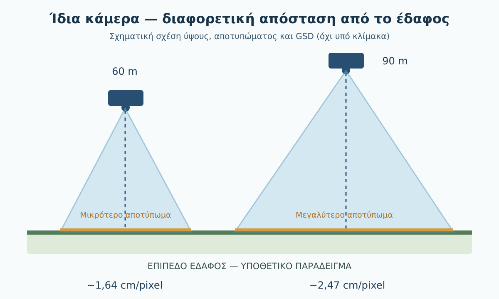
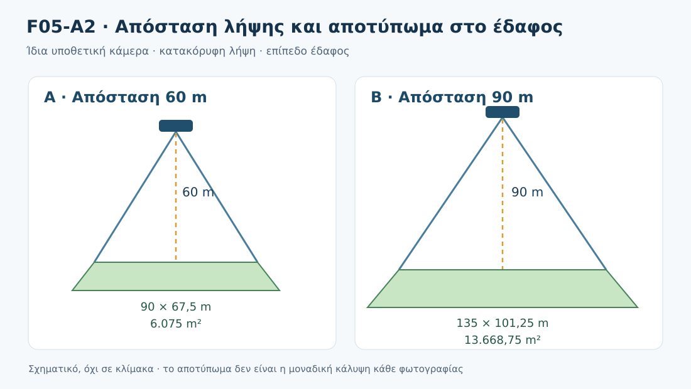
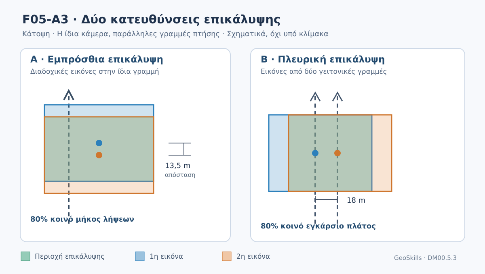
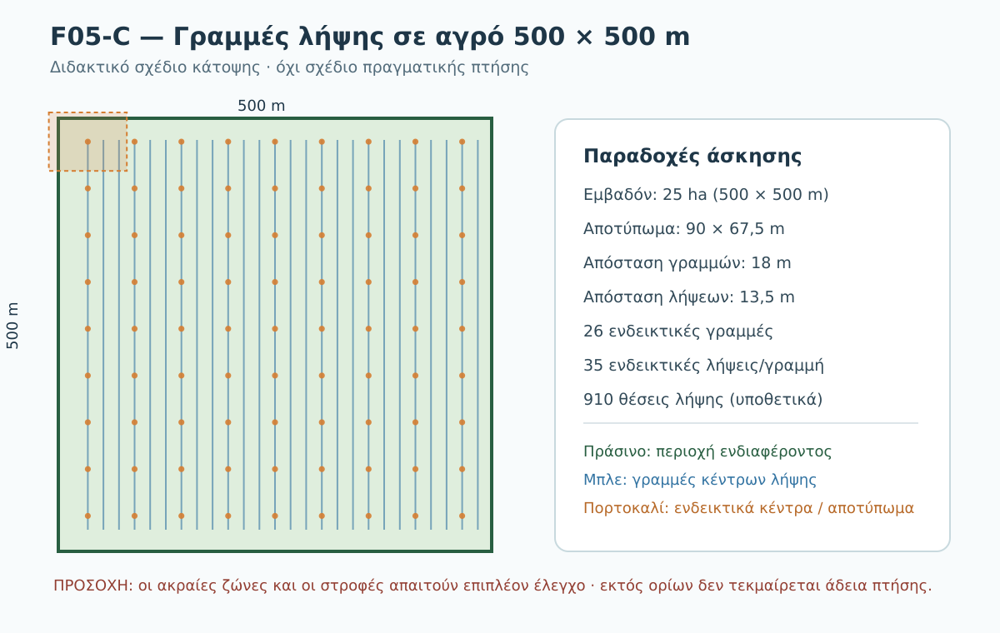
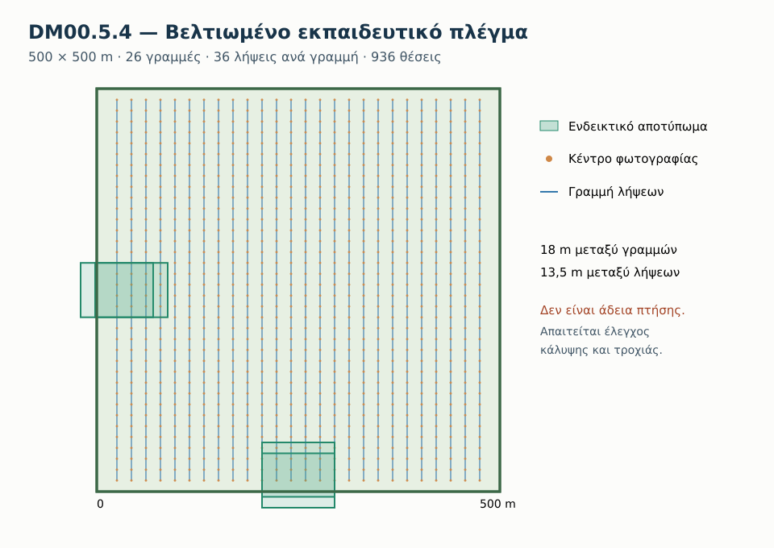
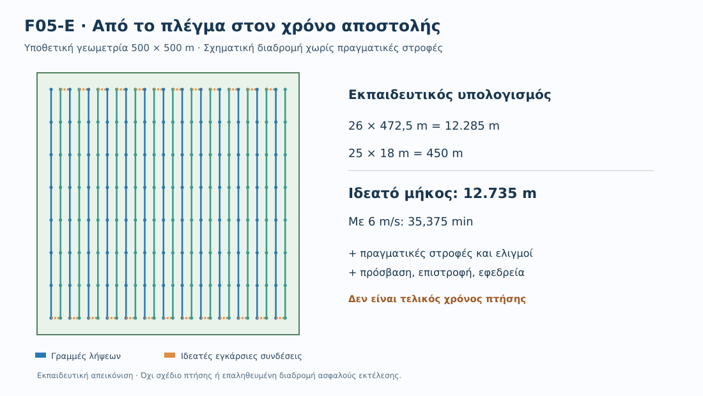
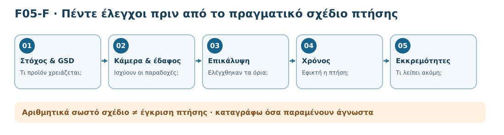

<!-- DM02 Unified Core v0.2: editorial bridges and terminal diagnostic were added; the complete source texts v0.2 are preserved under sources/. -->
# DM02 — Σχεδιασμός φωτογραμμετρικής πτήσης

> **Δοκιμαστική εκπαιδευτική έκδοση — Preview v0.1.** Το DM02 βρίσκεται σε αξιολόγηση και δεν αποτελεί οριστικά εγκεκριμένο μάθημα.

**GeoSkills · Drone Mapping Core · Ενιαία βασική μαθησιακή διαδρομή v0.2 · Τοπικό εκπαιδευτικό προσχέδιο (όχι δημοσιευμένο)**

## Τι θα μάθουμε

Θα σχεδιάσουμε, βήμα προς βήμα, την υποθετική φωτογραμμετρική λήψη ενός αγρού **25 ha**. Στο τέλος θα μπορούμε να αιτιολογούμε την επιθυμητή χωρική ανάλυση, να υπολογίζουμε θεωρητικό αποτύπωμα και επικάλυψη, να σχεδιάζουμε γραμμές και θέσεις λήψης και να διακρίνουμε μια αριθμητικά συνεπή προμελέτη από την πραγματική επιχειρησιακή ετοιμότητα.

### Διαδρομή μάθησης

| Υποενότητα | Εργασία που ολοκληρώνουμε |
|---|---|
| DM02.1 | Από τον σκοπό του έργου στο GSD |
| DM02.2 | Υπολογισμός αποτυπώματος φωτογραφίας |
| DM02.3 | Εμπρόσθια και πλευρική επικάλυψη |
| DM02.4 | Γραμμές πτήσης και έλεγχος ορίων |
| DM02.5 | Φωτογραφίες, μήκος διαδρομής, χρόνος, ενέργεια |
| DM02.6 | Τελική αξιολόγηση και Καρτέλα 02 |

**Εκπαιδευτικές παραδοχές:** Ο αγρός των 25 ha παίρνει το συνθετικό σχήμα τετραγώνου **500 × 500 m** στις ασκήσεις σχεδιασμού. Η κάμερα, το επίπεδο έδαφος, τα 60 m από το τοπικό έδαφος, οι ταχύτητες και τα πρόσθετα χρονικά περιθώρια είναι παραδοχές μάθησης, όχι επιβεβαιωμένα δεδομένα αποστολής. Το σχέδιο **δεν αποτελεί άδεια πτήσης ή τεκμηρίωση αυτονομίας συγκεκριμένου drone**.

**Πώς χρησιμοποιούμε το υλικό:** Μελετάμε με τη σειρά τις έξι υποενότητες, δοκιμάζουμε μόνοι μας κάθε μικρή άσκηση και ανοίγουμε τις κρυφές λύσεις αφού απαντήσουμε. Οι αναλυτικές καρτέλες παραμένουν ξεχωριστά αρχεία και η τελική **Καρτέλα 02** αποτελεί το συγκεντρωτικό παραδοτέο. Οι ίδιες έξι πρωτότυπες υποενότητες v0.2 διατηρούνται αυτούσιες στον φάκελο `sources/`.

---
## DM02.1 — Από τον σκοπό της χαρτογράφησης στο GSD

**Έκδοση v0.2 · Βασική μαθησιακή διαδρομή · Αναθεωρημένο εκπαιδευτικό προσχέδιο (όχι δημοσιευμένο).**

### Τι θα μπορείς να κάνεις
Μετά την ενότητα θα μπορείς να εξηγήσεις τι μετρά το GSD, να το μετατρέπεις σε φυσικό μέγεθος στο έδαφος, να ελέγχεις αν ένα προτεινόμενο GSD εξυπηρετεί τον σκοπό του έργου και να διακρίνεις τη χωρική ανάλυση από την ακρίβεια θέσης.

### 1. Πρώτα καθορίζουμε το παραδοτέο

Η ομάδα αναλαμβάνει να φωτογραφίσει έναν υποθετικό αγρό **25 ha**, για να δημιουργήσει ορθοφωτοχάρτη. Πριν επιλέξουμε ύψος ή αριθμό φωτογραφιών, πρέπει να ξέρουμε για ποια χρήση προορίζεται ο χάρτης. Χρειαζόμαστε γενική οπτική τεκμηρίωση του αγρού ή αναγνώριση μικρών λεπτομερειών; Ο σκοπός επηρεάζει την επιθυμητή χωρική ανάλυση, την κάλυψη και τις απαιτήσεις ελέγχου.

**Κρίσιμη διαφορά:** το «να φαίνεται καθαρά στην οθόνη» δεν αποτελεί τεχνική προδιαγραφή. Μια ελέγξιμη περιγραφή περιλαμβάνει το είδος του παραδοτέου, τη χρήση του και έναν τεκμηριωμένο στόχο χωρικής ανάλυσης. Για παράδειγμα: «ορθοφωτοχάρτης για οπτική αποτύπωση της κατάστασης του αγρού» είναι σαφέστερο από το «θέλουμε πολύ καλές φωτογραφίες», αλλά δεν καθορίζει ακόμη μόνο του το απαιτούμενο GSD.

### 2. Τι είναι το GSD;

Το **Ground Sampling Distance (GSD)** είναι η απόσταση μεταξύ των κέντρων δύο διαδοχικών εικονοστοιχείων, όταν προβάλλονται στο έδαφος. Εκφράζεται συνήθως σε **cm/pixel**. Ένα GSD 3 cm/pixel σημαίνει ότι η απόσταση δύο γειτονικών κέντρων δειγματοληψίας πάνω στο έδαφος είναι περίπου 3 cm.

Ένα τετραγωνικό εικονοστοιχείο αντιστοιχεί προσεγγιστικά σε επιφάνεια 3 × 3 cm, στο απλουστευμένο μοντέλο κατακόρυφης λήψης και επίπεδου εδάφους. Δεν σημαίνει ότι κάθε αντικείμενο μήκους 3 cm θα αναγνωρίζεται με βεβαιότητα. Η αναγνωρισιμότητα εξαρτάται επίσης από θόλωση, εστίαση, αντίθεση, φωτισμό, κίνηση και επεξεργασία. Ούτε σημαίνει ότι η θέση κάθε σημείου στον ορθοφωτοχάρτη είναι ακριβής στα 3 cm.

*Σχήμα F05-A. Συνθετική σχηματική αναπαράσταση. Η κλίμακα δεν είναι πραγματική.*

### 3. Πώς επηρεάζεται το GSD

Το GSD εξαρτάται κυρίως από την απόσταση της κάμερας από το έδαφος και τα οπτικά χαρακτηριστικά της κάμερας. Με **ίδια κάμερα**, μεγαλύτερη απόσταση από το έδαφος σημαίνει γενικά μεγαλύτερο GSD (χαμηλότερη χωρική ανάλυση), ενώ μικρότερη απόσταση σημαίνει μικρότερο GSD (υψηλότερη χωρική ανάλυση).

Σε απλοποιημένη λήψη με κάμερα κατακόρυφη προς επίπεδο έδαφος:

\[GSD = \frac{H \cdot S_w}{f \cdot I_w}\]

όπου \(H\) είναι η **κατακόρυφη απόσταση κάμερας–τοπικού εδάφους** σε μέτρα (όχι αυτομάτως το ύψος που εμφανίζει το χειριστήριο ή το υψόμετρο από τη στάθμη της θάλασσας), \(S_w\) το πλάτος αισθητήρα σε mm, \(f\) η **πραγματική** εστιακή απόσταση σε mm και \(I_w\) το πλάτος εικόνας σε pixels. Το αποτέλεσμα είναι σε m/pixel. Για cm/pixel πολλαπλασιάζουμε επί 100. **Δεν χρησιμοποιούμε ισοδύναμη εστιακή απόσταση 35 mm** στη θέση της πραγματικής.

Στην πράξη η κλίση της κάμερας, η παραμόρφωση του φακού και το ανάγλυφο μπορούν να μεταβάλλουν το τοπικό GSD. Επομένως ο τύπος είναι εργαλείο αρχικού σχεδιασμού και όχι πλήρης προσομοίωση πραγματικής λήψης.

### 4. Πλήρως λυμένο παράδειγμα

Χρησιμοποιούμε **αποκλειστικά υποθετική κάμερα** με πλάτος αισθητήρα 13,2 mm, πραγματική εστιακή απόσταση 8,8 mm και εικόνα πλάτους 5.472 pixels. Έστω ότι η κάμερα βρίσκεται 60 m πάνω από επίπεδο έδαφος.

\[GSD = \frac{60 \cdot 13{,}2}{8{,}8 \cdot 5472}=0{,}016447\;m/pixel \approx 1{,}64\;cm/pixel\]

Στον υπολογισμό: 60 × 13,2 = 792, ενώ 8,8 × 5.472 = 48.153,6. Άρα 792 / 48.153,6 = 0,016447 m/pixel, δηλαδή περίπου 1,64 cm/pixel. Αν κρατήσουμε ίδια την κάμερα και αυξήσουμε την απόσταση κάμερας–εδάφους από 60 σε 90 m, το εκτιμώμενο GSD αυξάνεται αναλογικά σε **2,47 cm/pixel**. Η αύξηση της απόστασης διευκολύνει συνήθως την κάλυψη μεγαλύτερης επιφάνειας ανά εικόνα, αλλά μειώνει τη χωρική λεπτομέρεια. **Η σύγκριση αφορά την ίδια κάμερα, το ίδιο οπτικό πεδίο και ίδιες κατά τα άλλα συνθήκες.**

**Δεν αποφασίζουμε ότι τα 90 m επιτρέπονται ή είναι ασφαλή** με βάση αυτόν τον υπολογισμό· οι γεωγραφικοί περιορισμοί, το έδαφος, τα εμπόδια και οι δυνατότητες του συστήματος αξιολογούνται ανεξάρτητα στη DM00.4.

### 5. Τρία συνηθισμένα λάθη

1. **«GSD = ακρίβεια χάρτη»**: λάθος. Η ακρίβεια θέσης εξαρτάται και από τη γεωαναφορά, το φωτογραμμετρικό μοντέλο και τους ελέγχους.
2. **«Μικρότερο GSD είναι πάντα καλύτερο»**: όχι απαραίτητα. Αυξάνει τις απαιτήσεις λήψεων και επεξεργασίας, χωρίς πάντοτε να προσθέτει χρήσιμη πληροφορία.
3. **«Το ύψος ρυθμίζεται μόνο από τον τύπο»**: λάθος. Ο μαθηματικός σχεδιασμός δεν αντικαθιστά την αξιολόγηση ασφάλειας και τους εφαρμοστέους περιορισμούς.

### 5Α. Από τον αριθμό στη σωστή απόφαση

Ο υπεύθυνος της υποθετικής εργασίας ζητά «να φαίνονται τα όρια και οι γενικές μεταβολές στην εικόνα του αγρού». Δεν έχει τεκμηριώσει ακόμη το μικρότερο στοιχείο που πρέπει να αναγνωρίζεται, ούτε κάποια απαίτηση ακρίβειας θέσης. **Δεν μπορούμε επομένως να επιλέξουμε οριστικά GSD μόνο από αυτή τη φράση.**

Ο φοιτητής μπορεί όμως να κάνει ένα πρώτο χρήσιμο βήμα: να συγκρίνει τα υποθετικά 1,64 και 2,47 cm/pixel, να εξηγήσει ότι το πρώτο προσφέρει υψηλότερη χωρική ανάλυση και να καταγράψει τις πληροφορίες που λείπουν. Το σωστό αποτέλεσμα της άσκησης δεν είναι μια αυθαίρετη «ιδανική» τιμή, αλλά **μια αιτιολογημένη προσωρινή επιλογή προς έλεγχο**.

| Τι γνωρίζουμε | Τι δεν γνωρίζουμε ακόμη | Επόμενη ενέργεια |
|---|---|---|
| Αγρός 25 ha και επιθυμητός ορθοφωτοχάρτης | Ποια μικρότερη λεπτομέρεια πρέπει να είναι διακριτή | Διευκρίνιση απαιτήσεων παραδοτέου |
| Υποθετικά χαρακτηριστικά κάμερας | Πραγματικό drone, κάμερα και ρυθμίσεις | Έλεγχος τεχνικών χαρακτηριστικών |
| Υπολογισμένα GSD για δύο αποστάσεις | Ανάγλυφο, εμπόδια, επικάλυψη, χρόνος πτήσης | Σχεδιασμός και έλεγχος στις επόμενες ενότητες |

Γιατί δεν οριστικοποιούμε το ύψος τώρα;

Επειδή το GSD είναι μία μόνο απαίτηση. Χρειάζονται ο στόχος του παραδοτέου, το πραγματικό σύστημα, το ανάγλυφο, η επικάλυψη φωτογραφιών, τα εμπόδια, οι εφαρμοστέοι περιορισμοί και τα περιθώρια ασφαλείας. Η επίλυση του τύπου δεν αποτελεί άδεια πτήσης.

### 6. Μικρή δραστηριότητα — Η απόφαση για τον αγρό 25 ha

Η ομάδα διαθέτει την ίδια υποθετική κάμερα. Για δύο υποθετικές αποστάσεις λήψης, 60 και 90 m από το έδαφος, καταχώρισε το εκτιμώμενο GSD, ποια επιλογή παρέχει περισσότερη λεπτομέρεια, καθώς και **τρεις πληροφορίες που πρέπει να γνωρίζεις πριν προτείνεις πραγματικό ύψος πτήσης**.

| Απόσταση κάμερας–εδάφους | Εκτιμώμενο GSD | Περισσότερη λεπτομέρεια; |
|---|---|---|
| 60 m | **1,64 cm/pixel (υπόδειγμα)** | Ναι, σε σύγκριση με 90 m |
| 90 m | Συμπλήρωσε | Συμπλήρωσε |

Κρυφή λύση δραστηριότητας

Στα 90 m, με την ίδια κάμερα, το GSD είναι 1,64 × 90/60 ≈ **2,47 cm/pixel**. Η επιλογή των 60 m παρέχει υψηλότερη ενδεικτική χωρική ανάλυση. Η απόφαση πραγματικής πτήσης απαιτεί, τουλάχιστον: (α) στόχο παραδοτέου και απαιτούμενη ανάλυση, (β) πραγματικό ανάγλυφο, εμπόδια και ισχύοντες περιορισμούς ύψους/περιοχής, (γ) μοντέλο κάμερας, συνθήκες φωτισμού και δυνατότητες κάλυψης/ενέργειας. Επίσης θα χρειαστεί σχέδιο επικάλυψης στις επόμενες υποενότητες.

### 7. Αυτοαξιολόγηση

**Ερώτηση 1.** GSD 2 cm/pixel σημαίνει οριζοντιογραφική ακρίβεια ±2 cm;

Απάντηση 1
Όχι. Το GSD περιγράφει τη δειγματοληψία εικόνας και δεν αρκεί για να προσδιορίσει ακρίβεια γεωαναφοράς.

**Ερώτηση 2.** Με την ίδια κάμερα και περίπου κατακόρυφη λήψη, τι συμβαίνει όταν διπλασιάζεται η απόσταση κάμερας–εδάφους;

Απάντηση 2
Στο απλοποιημένο επίπεδο μοντέλο, το GSD περίπου διπλασιάζεται· η λεπτομέρεια ανά pixel μειώνεται.

**Ερώτηση 3.** Μπορεί ο χειριστής να επιλέξει απευθείας 60 m επειδή ο υπολογισμός έδωσε καλό GSD;

Απάντηση 3
Όχι. Πρέπει να ελέγξει το ύψος ως προς το πραγματικό έδαφος, τα εμπόδια, τη νομιμότητα και την ασφάλεια, καθώς και το αν η ανάλυση είναι κατάλληλη για τον σκοπό.

**Ερώτηση 4.** Εάν μια εφαρμογή δείχνει «90 m», γνωρίζουμε υποχρεωτικά ότι η κάμερα απέχει 90 m από κάθε σημείο του εδάφους;

Απάντηση 4
Όχι. Πρέπει να ελέγξουμε το σύστημα αναφοράς της ένδειξης και το πραγματικό ανάγλυφο. Το τοπικό GSD εξαρτάται από την απόσταση της κάμερας από το έδαφος που φωτογραφίζεται.

### 8. Τι κρατάμε

**Πρώτα ορίζουμε το παραδοτέο και το GSD που χρειάζεται — μετά σχεδιάζουμε ύψος και κάλυψη.** Στη DM02.2 θα συνδέσουμε αυτόν τον στόχο με το αποτύπωμα μιας φωτογραφίας και την έκταση που καλύπτει.

### Πηγές

- Pix4D, Ground Sampling Distance: https://support.pix4d.com/hc/en-us/articles/202559809
- Pix4D, Image acquisition: https://support.pix4d.com/hc/en-us/articles/202557469
- Pix4D, Camera focal length and flight altitude: https://support.pix4d.com/hc/en-us/articles/202558849

**Φύλλο εργασίας υποενότητας:** [Άνοιγμα καρτέλας 1](worksheets/DM02_Kartela_05A_GSD.md).

---

### Έλεγχος μετάβασης 05.1 → 05.2

**Έχουμε:** τον σκοπό ενός ορθοφωτοχάρτη και δύο ενδεικτικές τιμές GSD για την ίδια υποθετική κάμερα. **Δεν έχουμε ακόμη:** την έκταση που καλύπτει ολόκληρη η εικόνα. Αυτό θα υπολογίσουμε τώρα, χωρίς να αλλάξουμε κάμερα ή τις παραδοχές του εκπαιδευτικού σεναρίου.

## DM02.2 — Από το ύψος λήψης στο αποτύπωμα μιας φωτογραφίας

**GeoSkills · Drone Mapping Core · Βασική μαθησιακή διαδρομή · Αναθεωρημένο εκπαιδευτικό προσχέδιο v0.2 (03/11/2026)**

### Τι θα μπορείς να κάνεις

Μετά την ενότητα θα μπορείς: (α) να εξηγείς τι είναι το *αποτύπωμα εικόνας στο έδαφος* (image footprint), (β) να υπολογίζεις κατά προσέγγιση το πλάτος και το μήκος του για κατακόρυφη λήψη σε επίπεδο έδαφος, (γ) να συγκρίνεις δύο αποστάσεις λήψης, (δ) να διακρίνεις το θεωρητικό αποτύπωμα από την πραγματικά αξιοποιήσιμη φωτογραμμετρική κάλυψη και (ε) να καταγράφεις τους ελέγχους που απομένουν πριν από πραγματικό σχεδιασμό πτήσης.

### 1. Γιατί δεν αρκεί το GSD;

Στην DM02.1 υπολογίσαμε πόσο έδαφος αντιστοιχεί σε ένα εικονοστοιχείο. Τώρα χρειαζόμαστε μία διαφορετική απάντηση: **πόσο έδαφος βλέπει ολόκληρη η φωτογραφία;** Αυτή η επιφάνεια ονομάζεται **αποτύπωμα φωτογραφίας στο έδαφος**. Στο απλό μοντέλο κατακόρυφης λήψης πάνω από οριζόντιο έδαφος το αποτύπωμα προσεγγίζεται από ένα ορθογώνιο.

Το αποτύπωμα είναι χρήσιμο διότι μας βοηθά να καταλάβουμε το πλάτος μιας λωρίδας που μπορεί να απεικονιστεί, το ενδεικτικό πεδίο θέασης της φωτογραφίας και —στην επόμενη ενότητα— τις αποστάσεις ανάμεσα στις λήψεις και στις γραμμές πτήσης. Για να μιλήσουμε για διαδοχικές λήψεις, πρέπει επιπλέον να γνωρίζουμε πώς είναι προσανατολισμένη η φωτογραφία σε σχέση με την πορεία του drone: η μεγάλη πλευρά του αποτυπώματος δεν είναι υποχρεωτικά παράλληλη στη γραμμή πτήσης. **Δεν είναι από μόνο του πλήρες σχέδιο πτήσης.**

*Σχήμα F05-A2. Πρωτότυπο εκπαιδευτικό διάγραμμα, όχι σε πραγματική κλίμακα. Η εμβέλεια του αποτυπώματος περιγράφει το απλοποιημένο γεωμετρικό μοντέλο.*

### 2. Η ίδια υποθετική κάμερα σε δύο αποστάσεις

Για να συνεχίσουμε χωρίς να αλλάζουμε παραδοχές, χρησιμοποιούμε την **ίδια υποθετική κάμερα** της DM02.1:

| Παράμετρος | Τιμή | Τι σημαίνει |
|---|---:|---|
| Πλάτος αισθητήρα | 13,2 mm | Φυσική διάσταση αισθητήρα |
| Ύψος αισθητήρα | 9,9 mm | Υποθετικός αισθητήρας λόγου 4:3 |
| Πραγματική εστιακή απόσταση | 8,8 mm | **Όχι** ισοδύναμη 35 mm |
| Πλάτος φωτογραφίας | 5.472 px | Πλήθος pixel κατά πλάτος |
| Ύψος φωτογραφίας | 4.104 px | Πλήθος pixel κατά ύψος |

Οι τιμές είναι **εκπαιδευτικές παραδοχές**, όχι προδιαγραφές πραγματικού drone. Υποθέτουμε κατακόρυφη λήψη (κάμερα προς τα κάτω), επίπεδο έδαφος και αμελητέες παραμορφώσεις για το πρώτο αριθμητικό παράδειγμα.

### 3. Πώς υπολογίζεται το αποτύπωμα

Για κατακόρυφη φωτογραφία σε επίπεδο έδαφος, χρησιμοποιούμε τις σχέσεις όμοιων τριγώνων:

\[\text{Πλάτος αποτυπώματος } W=H\cdot\frac{S_w}{f}\]
\[\text{Ύψος αποτυπώματος } L=H\cdot\frac{S_h}{f}\]

όπου: **H** = κατακόρυφη απόσταση της κάμερας από το **τοπικό έδαφος** σε m, **S_w** και **S_h** = φυσικό πλάτος και ύψος αισθητήρα σε mm, **f** = πραγματική εστιακή απόσταση σε mm. Τα mm του λόγου απαλείφονται και τα αποτελέσματα W και L δίνονται σε μέτρα. Το «ύψος αποτυπώματος» L είναι **διάσταση της φωτογραφίας πάνω στο έδαφος**, όχι το υψόμετρο της πτήσης.

Εναλλακτικά, αν ήδη γνωρίζουμε το GSD σε m/pixel, μπορούμε να ελέγξουμε το αποτέλεσμα με: **W ≈ GSD × πλάτος εικόνας (px)** και **L ≈ GSD × ύψος εικόνας (px)**. Η ισοδυναμία ισχύει στις ίδιες γεωμετρικές παραδοχές, όταν τα pixels είναι τετραγωνικά.

### 4. Πλήρως λυμένο παράδειγμα — 60 m

Ο αγρός μας είναι 25 ha. Επιλέγουμε **μόνο για τον υπολογισμό** απόσταση κάμερας–εδάφους H = 60 m και την παραπάνω υποθετική κάμερα.

**Βήμα 1 — Πλάτος:** W = 60 × (13,2 / 8,8) = **90 m**.

**Βήμα 2 — Μήκος:** L = 60 × (9,9 / 8,8) = **67,5 m**.

**Βήμα 3 — Εμβαδόν αποτυπώματος:** A = 90 × 67,5 = **6.075 m²**, δηλαδή **0,6075 ha**. Πρόκειται για την έκταση που *θεωρητικά απεικονίζει* μία λήψη στο απλό μοντέλο, **όχι** για νέα, μη επικαλυπτόμενη χαρτογραφημένη έκταση.

**Βήμα 4 — Έλεγχος με το GSD:** από την DM02.1, GSD ≈ 0,016447 m/pixel. Άρα 5.472 × 0,016447 ≈ 90 m και 4.104 × 0,016447 ≈ 67,5 m. Οι δύο τρόποι υπολογισμού συμφωνούν, με τις διαφορές στρογγυλοποίησης. Χρησιμοποιούμε το **μη στρογγυλοποιημένο** GSD στους υπολογισμούς και στρογγυλοποιούμε μόνο το τελικό αποτέλεσμα.

Γιατί δεν αρκεί να διαιρέσουμε τα 25 ha με τα 0,6075 ha;

Διότι στη φωτογραμμετρία οι λήψεις **επικαλύπτονται σκόπιμα**. Μερικές επιφάνειες θα εμφανιστούν σε πολλές εικόνες, ενώ απαιτείται και κάλυψη στα όρια του αγρού. Η απλή διαίρεση 25 / 0,6075 ≈ 41,2 δίνει μόνο μια *θεωρητική αναλογία εμβαδών χωρίς επικάλυψη* και **δεν** αποτελεί εκτίμηση του πλήθους φωτογραφιών ή πτήσεων. Αυτό θα μελετηθεί στις DM02.3–5.5.

### 5. Τι αλλάζει όταν η απόσταση γίνεται 90 m;

Με **ακριβώς την ίδια κάμερα**, στο υποθετικό H = 90 m:

- Πλάτος: 90 × 13,2 / 8,8 = **135 m**.
- Μήκος: 90 × 9,9 / 8,8 = **101,25 m**.
- Εμβαδόν: 135 × 101,25 = **13.668,75 m²** ή **1,366875 ha**.
- GSD: περίπου **2,47 cm/pixel**, αντί 1,64 cm/pixel στα 60 m.

| Απόσταση κάμερας–εδάφους | Πλάτος × μήκος | Εμβαδόν εικόνας | GSD |
|---|---|---:|---:|
| 60 m | 90 × 67,5 m | 6.075 m² | ≈ 1,64 cm/px |
| 90 m | 135 × 101,25 m | 13.668,75 m² | ≈ 2,47 cm/px |

Τα 60 m και 90 m είναι **δύο παραδείγματα υπολογισμού**, όχι δύο έτοιμα ή κανονιστικά αποδεκτά ύψη πτήσης. Επίσης, το πλάτος W και το μήκος L αναφέρονται στους άξονες της φωτογραφίας· οι διαστάσεις *κατά μήκος της πτήσης* και *εγκάρσια στη γραμμή πτήσης* εξαρτώνται από τον προσανατολισμό της κάμερας/εικόνας.

Η απόσταση αυξάνεται κατά 50%, οι **γραμμικές διαστάσεις** του αποτυπώματος αυξάνονται κατά 50%, ενώ το **εμβαδόν** αυξάνεται κατά 2,25 φορές (1,5²). Η μεγαλύτερη κάλυψη ανά φωτογραφία συνοδεύεται από μικρότερη χωρική λεπτομέρεια. **Δεν επιλέγουμε αυτόματα τα 90 m**: ελέγχουμε στόχο GSD, ανάγλυφο, εμπόδια και πραγματικούς περιορισμούς πτήσης.

Λυμένο παράδειγμα — Γιατί το εμβαδόν δεν αυξήθηκε μόνο κατά 50%;

Επειδή αυξάνονται και οι δύο διαστάσεις της εικόνας: 90 × 1,5 = 135 m και 67,5 × 1,5 = 101,25 m. Άρα 135 × 101,25 = 6.075 × 1,5 × 1,5 = 6.075 × 2,25 = 13.668,75 m².

### 6. Τι συμβαίνει αν το έδαφος ανεβαίνει;

Το «ύψος πτήσης» στην οθόνη μπορεί να αναφέρεται στο σημείο απογείωσης ή σε άλλο επίπεδο αναφοράς. **Ο υπολογισμός αποτυπώματος χρειάζεται την πραγματική κατακόρυφη απόσταση της κάμερας από το έδαφος τη στιγμή κάθε λήψης.** Αν το drone κρατά σταθερό υψόμετρο αναφοράς αλλά το έδαφος ανεβαίνει, η απόσταση από το έδαφος μειώνεται. Στο απλό μοντέλο μικραίνουν το αποτύπωμα και το GSD. Αν το έδαφος κατεβαίνει, συμβαίνει το αντίστροφο.

**Μικρό παράδειγμα μόνο γεωμετρίας:** στο πρώτο τμήμα ενός αγρού η κάμερα απέχει 60 m από το έδαφος. Στο δεύτερο, το έδαφος βρίσκεται 10 m ψηλότερα, ενώ η κάμερα παραμένει στο ίδιο απόλυτο υψόμετρο. Η τοπική απόσταση γίνεται **50 m**. Τότε το πλάτος αποτυπώματος είναι **75 m** (50 × 13,2 / 8,8), το μήκος **56,25 m** (50 × 9,9 / 8,8) και το εμβαδόν **4.218,75 m²**. Το GSD γίνεται περίπου **1,37 cm/pixel**. Αυτό **δεν** είναι πρόταση πτήσης στα 50 m· δείχνει γιατί πρέπει να γνωρίζουμε το ανάγλυφο.

Λυμένη ερώτηση — Πότε είναι απαραίτητος ο έλεγχος αναγλύφου;

Όταν η υψομετρική μεταβολή της περιοχής μπορεί να αλλάξει ουσιαστικά την απόσταση κάμερας–εδάφους, την κάλυψη ή τα περιθώρια ασφαλείας. Η ορθή απόφαση απαιτεί πραγματικά δεδομένα αναγλύφου, δυνατότητες του drone/λογισμικού και ανεξάρτητο έλεγχο εμποδίων και ορίων πτήσης.

### 7. Μικρή απόφαση πριν συνεχίσουμε στον σχεδιασμό πτήσης

Η ομάδα ζητά «να καλυφθεί ο αγρός των 25 ha με όσο γίνεται λιγότερες φωτογραφίες». Ένα μέλος προτείνει τα 90 m επειδή κάθε εικόνα καλύπτει θεωρητικά μεγαλύτερη επιφάνεια. **Είναι αυτό αρκετό για να εγκρίνουμε το σχέδιο;**

Όχι. Πρώτα επιβεβαιώνουμε την απαιτούμενη λεπτομέρεια (GSD), τα χαρακτηριστικά της πραγματικής κάμερας, την επικάλυψη που χρειάζεται η επεξεργασία, το σχήμα του αγρού, το ανάγλυφο και τους περιορισμούς ασφαλούς πτήσης. Μετά συγκρίνουμε εναλλακτικά σχέδια. Το μεγαλύτερο αποτύπωμα δεν ισοδυναμεί κατ’ ανάγκη με καλύτερο φωτογραμμετρικό αποτέλεσμα.

Λυμένη απόφαση — Τι θα καταγράφαμε στο φύλλο σχεδιασμού;

«Το ύψος δεν οριστικοποιήθηκε. Το αποτύπωμα στα 60 m είναι 90 × 67,5 m και στα 90 m 135 × 101,25 m, αλλά εκκρεμούν ο στόχος GSD, η επιθυμητή επικάλυψη, οι πραγματικές προδιαγραφές του συστήματος, το ανάγλυφο και οι περιορισμοί πτήσης». Αυτή είναι τεκμηριωμένη εκκρεμότητα, όχι αδυναμία του σχεδίου.

### 8. Τρία συχνά λάθη που πρέπει να αποφύγεις

1. **«Μεγάλο αποτύπωμα σημαίνει ότι χρειάζομαι ελάχιστες φωτογραφίες».** Όχι: η απαιτούμενη επικάλυψη, το σχήμα αγρού, τα περιθώρια και η ποιότητα των λήψεων καθορίζουν τον πραγματικό αριθμό.
2. **«Το αποτύπωμα είναι πάντοτε ορθογώνιο 90 × 67,5 m».** Όχι: αυτό είναι απλοποίηση για περίπου κατακόρυφη λήψη σε επίπεδο έδαφος. Κλίση κάμερας, ανάγλυφο και παραμόρφωση φακού το αλλάζουν.
3. **«Η απόσταση 60 m από το Home Point ισοδυναμεί παντού με 60 m πάνω από το έδαφος».** Όχι: το έδαφος μπορεί να μεταβάλλεται και η ένδειξη ύψους να έχει διαφορετική αναφορά.

### 9. Δραστηριότητα — Καρτέλα 02Β

Άνοιξε την **Καρτέλα 02Β**. Συμπλήρωσε τα αποτυπώματα στα 60 και 90 m, εξήγησε γιατί *δεν* προκύπτει ακόμη αριθμός φωτογραφιών και εξέτασε μία υψομετρική μεταβολή του εδάφους. Μία εγγραφή δίνεται συμπληρωμένη ως υπόδειγμα.

Σύνοψη ενδεικτικής λύσης

Στα 60 m: 90 × 67,5 m και 6.075 m². Στα 90 m: 135 × 101,25 m και 13.668,75 m². Το αποτύπωμα δίνει κάλυψη ανά εικόνα, αλλά όχι πλήθος λήψεων χωρίς επικάλυψη και σχεδιασμό γραμμών. Αν η τοπική απόσταση μειωθεί στα 50 m, το αποτύπωμα υπολογίζεται σε 75 × 56,25 m. Η επιλογή πραγματικού ύψους παραμένει εκκρεμής μέχρι να ελεγχθούν οι παράμετροι της εργασίας.

### 10. Αυτοαξιολόγηση

**Ερώτηση 1.** Ποια είναι η βασική διαφορά μεταξύ GSD και αποτυπώματος;

Απάντηση 1
Το GSD εκφράζει τη δειγματοληψία του εδάφους ανά pixel, ενώ το αποτύπωμα τις συνολικές διαστάσεις/έκταση που απεικονίζει μια φωτογραφία στο έδαφος.

**Ερώτηση 2.** Στην ίδια κάμερα, αν διπλασιαστεί η απόσταση από επίπεδο έδαφος, τι θα συμβεί στο πλάτος και στο εμβαδόν του αποτυπώματος;

Απάντηση 2
Το πλάτος διπλασιάζεται και το εμβαδόν τετραπλασιάζεται, με τις ίδιες απλοποιητικές γεωμετρικές παραδοχές.

**Ερώτηση 3.** Μπορούμε να γνωρίζουμε τον αριθμό φωτογραφιών του αγρού 25 ha μόνο από το εμβαδόν αποτυπώματος;

Απάντηση 3
Όχι. Χρειαζόμαστε την επιθυμητή επικάλυψη, το σχήμα της περιοχής, τον προσανατολισμό γραμμών, τα περιθώρια κάλυψης και τις πραγματικές συνθήκες.

**Ερώτηση 4.** Αν το έδαφος ανεβαίνει 10 m και η κάμερα διατηρεί το ίδιο απόλυτο υψόμετρο, το αποτύπωμα μεγαλώνει ή μικραίνει;

Απάντηση 4
Μικραίνει, επειδή μειώνεται η κατακόρυφη απόσταση κάμερας–εδάφους.

**Ερώτηση 5.** Η μεγάλη πλευρά W της φωτογραφίας είναι πάντα παράλληλη προς την πορεία του drone;

Απάντηση 5
Όχι. Η σχέση των διαστάσεων W/L με τη γραμμή πτήσης εξαρτάται από τον προσανατολισμό της φωτογραφίας. Αυτό θα έχει σημασία όταν υπολογίσουμε βήμα λήψης και απόσταση γραμμών στη DM02.3.

### 11. Τι κρατάμε και πού συνεχίζουμε

**Η απόσταση κάμερας–εδάφους και τα οπτικά χαρακτηριστικά καθορίζουν κατά προσέγγιση το αποτύπωμα.** Μία φωτογραφία μπορεί να δείχνει μεγαλύτερο τμήμα του αγρού, αλλά η φωτογραμμετρική αποτύπωση απαιτεί ελεγχόμενη επικάλυψη ανάμεσα σε εικόνες. Αυτό είναι το επόμενο πρακτικό βήμα στην **DM02.3 — Εμπρόσθια και πλευρική επικάλυψη**.

#### Πηγές για περαιτέρω ανάγνωση

- Pix4D, [Υπολογισμός ύψους για δεδομένο GSD](https://support.pix4d.com/hc/en-us/articles/202557469) — σχέση ύψους, αισθητήρα, φακού και πλάτους αποτυπώματος.
- Pix4D, [GSD in photogrammetry](https://support.pix4d.com/hc/en-us/articles/202559809) — τεχνικός ορισμός και μεταβολές αναλόγως εδάφους.
- Pix4D, [Image acquisition](https://support.pix4d.com/hc/en-us/articles/115002471546) — σύνδεση αποτυπώματος με επικάλυψη και σχεδιασμό λήψεων.

**Φύλλο εργασίας υποενότητας:** [Άνοιγμα καρτέλας 2](worksheets/DM02_Kartela_05B_Apotypoma.md).

---

### Έλεγχος μετάβασης 05.2 → 05.3

**Έχουμε:** αποτύπωμα φωτογραφίας **90 × 67,5 m** στα υποθετικά 60 m. **Δεν έχουμε ακόμη:** αποστάσεις διαδοχικών λήψεων και γειτονικών γραμμών. Για να τις βρούμε θα δηλώσουμε ποια πλευρά του αποτυπώματος ακολουθεί την πορεία και ποιο ποσοστό επικάλυψης επιδιώκουμε.

## DM02.3 — Εμπρόσθια και πλευρική επικάλυψη φωτογραφιών

**GeoSkills · Drone Mapping Core · Βασική μαθησιακή διαδρομή · Αναθεωρημένο εκπαιδευτικό προσχέδιο v0.2 (03/11/2026)**

### Τι θα μπορείς να κάνεις

Μετά την ενότητα θα μπορείς να (α) διακρίνεις εμπρόσθια από πλευρική επικάλυψη, (β) υπολογίζεις ενδεικτική απόσταση διαδοχικών λήψεων και γειτονικών γραμμών πτήσης, (γ) αναγνωρίζεις γιατί ένα ομοιογενές αγροτεμάχιο χρειάζεται προσεκτικό σχεδιασμό, (δ) ελέγχεις τις παραδοχές του υπολογισμού και (ε) συμπληρώνεις την Καρτέλα 02Γ. Οι τύποι χρησιμοποιούνται για **εκπαιδευτικό προγραμματισμό λήψεων**, όχι για αυτόματη έγκριση πραγματικής πτήσης. Στο τέλος θα μπορείς επίσης να ξεχωρίζεις την **επικάλυψη που σχεδιάσαμε** από εκείνη που τελικά επιτεύχθηκε στις λήψεις.

### 1. Γιατί φωτογραφίζουμε την ίδια περιοχή πολλές φορές;

Μία φωτογραφία δείχνει ένα τμήμα του αγρού. Για να δημιουργηθεί ορθοφωτοχάρτης, οι εικόνες πρέπει να μοιράζονται κοινά σημεία που μπορεί να εντοπίσει το λογισμικό φωτογραμμετρίας. Αν λείπει επαρκής κοινή πληροφορία, η σύνδεση των εικόνων μπορεί να είναι ασταθής ή να αποτύχει. **Η επικάλυψη δεν είναι «χαμένη έκταση»· είναι απαραίτητη πληροφορία για τη σύνθεση του προϊόντος.**

Ορίζουμε δύο διαφορετικές διευθύνσεις:

- **Εμπρόσθια επικάλυψη (front overlap):** κοινό τμήμα δύο διαδοχικών εικόνων **στην ίδια γραμμή πτήσης**.
- **Πλευρική επικάλυψη (side overlap):** κοινό τμήμα εικόνων από **γειτονικές γραμμές πτήσης**.

*Σχήμα F05-A3. Διδακτικό σχεδιάγραμμα κάτοψης, όχι υπό κλίμακα. Οι εικόνες εμφανίζονται ως ημιδιαφανή ορθογώνια ώστε να φαίνεται η κοινή επιφάνειά τους.*

**Προσοχή στον προσανατολισμό:** όπως είδαμε στην DM02.2, δεν είναι δεδομένο ότι η μεγάλη διάσταση μιας φωτογραφίας βρίσκεται κατά μήκος της γραμμής πτήσης. Στα παρακάτω αριθμητικά παραδείγματα **δηλώνουμε** ότι τα **67,5 m βρίσκονται κατά μήκος της πτήσης** και τα **90 m εγκάρσια**. Αν η κάμερα στραφεί κατά 90° σε σχέση με την πορεία, οι δύο διαστάσεις ανταλλάσσουν ρόλους: ο τύπος δεν αλλάζει, αλλάζει το μήκος που βάζουμε μέσα στον τύπο.

### 2. Πόση επικάλυψη θα χρησιμοποιήσουμε στον αγρό 25 ha;

Η τεχνική καθοδήγηση της Pix4D αναφέρει ως γενική αφετηρία τουλάχιστον 75% εμπρόσθια και 60% πλευρική επικάλυψη, και για επίπεδους αγρούς με ομοιογενή εικόνα **τουλάχιστον 80% και στις δύο διευθύνσεις**. Η μεγαλύτερη επικάλυψη βοηθά όταν τα αγροτικά μοτίβα μοιάζουν μεταξύ τους και είναι δύσκολο να βρεθούν διακριτά κοινά σημεία. Δεν πρόκειται για γενικό νόμο ούτε για μία καθολική ρύθμιση όλων των λογισμικών και αισθητήρων.

**Στην άσκησή μας επιλέγουμε 80% εμπρόσθια + 80% πλευρική επικάλυψη** ως τεκμηριωμένη εκπαιδευτική παραδοχή. Για πραγματική αποστολή θα ελέγχαμε τύπο καλλιέργειας, υφή/ομοιογένεια, ανάγλυφο, άνεμο, ταχύτητα και τρόπο λήψης, περιορισμούς εξοπλισμού και απαιτήσεις του λογισμικού επεξεργασίας.

### 3. Ο απλός τύπος

Αν η διάσταση της φωτογραφίας **κατά μήκος της πτήσης** είναι \(L_{\parallel}\), η ενδεικτική απόσταση διαδοχικών λήψεων είναι:

\[d_{\mathrm{λήψεων}}=L_{\parallel}\,(1-p_f)\]

Αν η διάσταση **εγκάρσια στην πτήση** είναι \(W_{\perp}\), η ενδεικτική απόσταση γειτονικών γραμμών είναι:

\[d_{\mathrm{γραμμών}}=W_{\perp}\,(1-p_s)\]

όπου \(p_f\) και \(p_s\) τα ποσοστά εμπρόσθιας και πλευρικής επικάλυψης σε δεκαδική μορφή. Για παράδειγμα **80% = 0,80**, επομένως **1 − 0,80 = 0,20**. Οι αποστάσεις εκφράζονται σε μέτρα.

Οι τύποι υποθέτουν κατακόρυφες λήψεις, περίπου επίπεδο έδαφος, σταθερή κλίμακα εικόνας, σταθερό προσανατολισμό και κανονική παράλληλη διάταξη γραμμών. Στην πραγματικότητα χρειάζονται περιθώρια και επιβεβαίωση της κάλυψης στο λογισμικό σχεδιασμού. **Η απόσταση λήψεων είναι απόσταση μεταξύ διαδοχικών κέντρων λήψης στο έδαφος**· δεν είναι χρονικό διάστημα. Το κάθε πότε θα ενεργοποιείται η κάμερα εξαρτάται επιπλέον από την πραγματική ταχύτητα και τις δυνατότητες του συστήματος, που θα εξετάσουμε στην DM02.5.

### 4. Πλήρως λυμένο παράδειγμα: 60 m από το έδαφος

Από τη DM02.2 γνωρίζουμε το θεωρητικό αποτύπωμα της υποθετικής κάμερας: **90 × 67,5 m** σε απόσταση **60 m** από το έδαφος. Δηλώνουμε ότι **L∥ = 67,5 m** και **W⊥ = 90 m**.

**Βήμα 1 — Εμπρόσθια επικάλυψη 80%:**

\[d_{\mathrm{λήψεων}}=67{,}5\times(1-0{,}80)=67{,}5\times0{,}20=\mathbf{13{,}5\ m}\]

Άρα δύο διαδοχικά κέντρα λήψεων στην ίδια ευθεία απέχουν **θεωρητικά 13,5 m**. Το κοινό μήκος των αποτυπωμάτων είναι 67,5 − 13,5 = **54 m**.

**Βήμα 2 — Πλευρική επικάλυψη 80%:**

\[d_{\mathrm{γραμμών}}=90\times(1-0{,}80)=90\times0{,}20=\mathbf{18\ m}\]

Άρα τα κέντρα γειτονικών γραμμών απέχουν θεωρητικά **18 m**. Το κοινό εγκάρσιο πλάτος είναι 90 − 18 = **72 m**.

**Βήμα 3 — Ερμηνεία:** Οι δύο αποστάσεις **δεν** είναι το ίδιο μέγεθος και **δεν** είναι η απόσταση απογείωσης ή το ύψος πτήσης. Περιγράφουν τη γεωμετρία λήψεων στο απλό μοντέλο.

Αναλυτικά λυμένο: γιατί η εμπρόσθια απόσταση είναι μικρότερη από το μήκος της φωτογραφίας;

Επειδή κάθε νέα φωτογραφία δεν αρχίζει εκεί που τελείωσε η προηγούμενη. Για εμπρόσθια επικάλυψη 80%, **80% από το μήκος 67,5 m** διατηρείται κοινό και μόνο **20% (=13,5 m)** μετατοπίζεται το κέντρο λήψης. Αν τα κέντρα απείχαν 67,5 m, η ονομαστική επικάλυψη κατά μήκος θα ήταν περίπου 0% στο ιδανικό γεωμετρικό μοντέλο.

### 5. Τι θα συνέβαινε με διαφορετική ρύθμιση;

Για το ίδιο αποτύπωμα και τον ίδιο προσανατολισμό:

| Εκπαιδευτικό σενάριο | Εμπρόσθια επικάλυψη | Πλευρική επικάλυψη | Απόσταση λήψεων | Απόσταση γραμμών |
|---|---:|---:|---:|---:|
| Α — Γενική αφετηρία | 75% | 60% | 16,875 m | 36 m |
| **Β — Ομοιογενής αγρός** | **80%** | **80%** | **13,5 m** | **18 m** |
| Γ — Μεγαλύτερη επικάλυψη | 85% | 85% | 10,125 m | 13,5 m |

Στο Β οι λήψεις και οι γραμμές βρίσκονται **πιο κοντά** από το Α, άρα συνήθως απαιτούνται περισσότερες λήψεις και χρόνος. Το Γ δεν είναι αυτόματα «καλύτερο»: αυξάνει την ποσότητα δεδομένων και τις απαιτήσεις αποστολής. Επιλέγουμε επικάλυψη βάσει επιφάνειας, ποιότητας, εξοπλισμού και αποτελέσματος που ζητάμε.

Λυμένο παράδειγμα: τι αλλάζει από 80% σε 85% εμπρόσθια επικάλυψη;

Με L∥ = 67,5 m, στα 80% η απόσταση λήψεων είναι 13,5 m. Στα 85% γίνεται 67,5 × 0,15 = **10,125 m**. Άρα η απόσταση **μικραίνει κατά 3,375 m**. Δεν σημαίνει ότι έχουμε αυτόματα υψηλότερη ακρίβεια ή εξασφαλισμένη επιτυχημένη επεξεργασία.

### 6. Ένα σημείο που συχνά μπερδεύει

Η εμπρόσθια επικάλυψη 80% είναι **ποσοστό κατά τη διεύθυνση πτήσης** και η πλευρική 80% είναι **ποσοστό στην εγκάρσια διεύθυνση**. Δεν σημαίνει ότι η κάθε εικόνα επικαλύπτεται σε **80% του εμβαδού της με κάθε γειτονική εικόνα σε κάθε κατεύθυνση**, ούτε ότι το 20% της φωτογραφίας είναι χρήσιμο και το 80% άχρηστο. Οι εικόνες συνεισφέρουν πολλαπλές παρατηρήσεις του ίδιου εδάφους.

Επίσης **αποτύπωμα φωτογραφίας ≠ πραγματική νέα κάλυψη ≠ εγγυημένη επεξεργάσιμη κάλυψη**. Για ένα πραγματικό σχέδιο πρέπει να προστεθούν περιμετρικά περιθώρια και να ελεγχθεί η ποιότητα εικόνων, ιδιαίτερα στα άκρα και όπου μεταβάλλεται το ανάγλυφο.

### 7. Τι συμβαίνει αν αλλάξει το ύψος ή το έδαφος;

Αν διατηρήσουμε τον ίδιο προσανατολισμό, αλλά χρησιμοποιήσουμε την **υποθετική** απόσταση 90 m από το έδαφος, η DM02.2 έδωσε αποτύπωμα **135 × 101,25 m**. Για 80% + 80% υπολογίζουμε:

- Απόσταση λήψεων: 101,25 × 0,20 = **20,25 m**.
- Απόσταση γραμμών: 135 × 0,20 = **27 m**.

Αυτή είναι **μόνο γεωμετρική σύγκριση**. Αν το έδαφος ανηφορίζει και η κάμερα κρατά σταθερό απόλυτο υψόμετρο, η απόσταση κάμερας–εδάφους μικραίνει και μαζί της μικραίνει το αποτύπωμα. Οι πραγματικές επικαλύψεις μπορεί να είναι διαφορετικές από τις προγραμματισμένες. Ο σχεδιασμός πρέπει να εξετάζει το ανάγλυφο και να εφαρμόζει ασφαλή, υποστηριζόμενη από τον εξοπλισμό διαδικασία.

Λυμένο παράδειγμα: γιατί δεν μεταφέρουμε μηχανικά τη ρύθμιση «18 m μεταξύ γραμμών» σε κάθε τμήμα;

Τα 18 m προέκυψαν από **εγκάρσια διάσταση 90 m**, σε συγκεκριμένη απόσταση κάμερας–εδάφους, προσανατολισμό εικόνας και επίπεδο έδαφος. Αν η γεωμετρία αλλάξει, η ίδια απόσταση γραμμών μπορεί να δώσει διαφορετική πλευρική επικάλυψη. Χρειάζεται νέος υπολογισμός ή κατάλληλος έλεγχος με το λογισμικό σχεδιασμού.

#### Μικρός οπτικός έλεγχος του αποτελέσματος

Ο υπολογισμός **13,5 m / 18 m** μάς δίνει ένα *σχέδιο*. Δεν αποδεικνύει ότι αυτό ακριβώς καταγράφηκε κατά την πτήση. Για παράδειγμα, μία φωτογραφία μπορεί να λείπει, η κάμερα να έχει αποκλίνει από την κατακόρυφη διεύθυνση ή η απόσταση από το έδαφος να έχει αλλάξει. Τότε η **πραγματική επικάλυψη** ενδέχεται να είναι μικρότερη ή άνιση.

Στον έλεγχο φωτογραφιών αναζητούμε τρία πράγματα: **(α)** οι διαδοχικές εικόνες μοιράζονται ορατές λεπτομέρειες, **(β)** εικόνες από γειτονικές γραμμές έχουν επίσης κοινό περιεχόμενο, **(γ)** δεν υπάρχουν εμφανή κενά στα άκρα ή μέσα στο αγροτεμάχιο. Ο οπτικός έλεγχος είναι αρχικός έλεγχος, όχι πιστοποίηση ότι η επικάλυψη επαρκεί για φωτογραμμετρική επεξεργασία. Για ασφαλέστερο συμπέρασμα χρησιμοποιούμε τον έλεγχο διαδρομής/κάλυψης και έπειτα τα εργαλεία ελέγχου ποιότητας της φωτογραμμετρικής επεξεργασίας.

Λυμένο περιστατικό: ο τύπος δίνει 80%, αλλά λείπει μία λήψη

Το προγραμματισμένο διάστημα είναι **13,5 m**. Αν σε μια ευθεία λείψει μία ενδιάμεση φωτογραφία και η προηγούμενη και η επόμενη απέχουν **27 m**, η ονομαστική εμπρόσθια επικάλυψη για αυτό το ζεύγος είναι **1 − 27/67,5 = 0,60**, δηλαδή **60%**, όχι 80%. Αυτό δεν αποδεικνύει από μόνο του αποτυχία του έργου, δείχνει όμως γιατί ελέγχουμε τις πραγματικές λήψεις.

### 8. Πριν από την επόμενη ενότητα

Η παρούσα ενότητα **δεν** υπολογίζει το συνολικό πλήθος φωτογραφιών ή τον χρόνο αποστολής. Αυτά εξαρτώνται από το πραγματικό σχήμα και τις διαστάσεις του αγρού, τις περιστροφές, τα περιθώρια, τη συχνότητα λήψεων, την ταχύτητα και το σχέδιο των γραμμών. Θα τα εξετάσουμε στις DM02.4–5.5.

#### Μικρός έλεγχος πριν συνεχίσεις

1. Έχεις γράψει ποια διάσταση της εικόνας είναι κατά μήκος και ποια εγκάρσια της πτήσης;
2. Έχεις μετατρέψει σωστά το 80% σε 0,80;
3. Έχεις καταγράψει χωριστά απόσταση λήψεων και απόσταση γραμμών;
4. Έχεις επισημάνει ποιες πραγματικές παράμετροι της αποστολής παραμένουν άγνωστες;

### 9. Αυτοαξιολόγηση

**Ερώτηση 1.** Για αποτύπωμα μήκους 67,5 m κατά μήκος πτήσης και εμπρόσθια επικάλυψη 80%, ποια είναι η απόσταση λήψεων;

Δες την απάντηση 1

13,5 m, επειδή 67,5 × 0,20 = 13,5.

**Ερώτηση 2.** Αν διπλασιαστεί το ποσοστό πλευρικής επικάλυψης από 40% σε 80%, η απόσταση των γραμμών αυξάνεται ή μειώνεται;

Δες την απάντηση 2

Μειώνεται: από 90 × 0,60 = 54 m σε 90 × 0,20 = 18 m, με σταθερό εγκάρσιο πλάτος εικόνας 90 m.

**Ερώτηση 3.** Γιατί δεν μπορούμε ακόμη να πούμε πόσες φωτογραφίες απαιτούνται για τα 25 ha;

Δες την απάντηση 3

Επειδή η έκταση δεν αποκαλύπτει το σχήμα του αγρού, το μήκος των γραμμών, τα περιμετρικά περιθώρια, τις αλλαγές πορείας και τις πραγματικές συνθήκες.

**Ερώτηση 4.** Ισχύει ότι 80% εμπρόσθια και 80% πλευρική επικάλυψη εγγυώνται ορθοφωτοχάρτη;

Δες την απάντηση 4

Όχι. Είναι μια τεχνικά αιτιολογημένη αρχική παραδοχή για το εκπαιδευτικό παράδειγμα. Η επιτυχία εξαρτάται και από την ποιότητα, την ομοιογένεια εικόνων, την πραγματική γεωμετρία πτήσης, τα δεδομένα θέσης και τη σωστή επεξεργασία.

**Ερώτηση 5.** Σε προγραμματισμένο διάστημα 13,5 m λείπει μία ενδιάμεση λήψη. Αν το επόμενο διαθέσιμο ζεύγος απέχει 27 m και η κατά μήκος διάσταση παραμένει 67,5 m, ποια είναι η *ονομαστική* εμπρόσθια επικάλυψη αυτού του ζεύγους;

Δες την απάντηση 5

1 − 27/67,5 = 1 − 0,40 = **0,60 ή 60%**. Η τιμή αφορά μόνο το ιδανικό γεωμετρικό μοντέλο και δεν αντικαθιστά τον έλεγχο πραγματικών εικόνων.

#### Επίσημες τεχνικές πηγές

- Pix4D, *Best practices for image acquisition and photogrammetry*: https://support.pix4d.com/hc/best-practices-for-image-acquisition-and-photogrammetry
- Pix4D, *Image acquisition — PIX4Dmapper*: https://support.pix4d.com/hc/en-us/articles/115002471546
- Pix4D, *How to verify that there is enough overlap between the images*: https://support.pix4d.com/hc/en-us/articles/203756125
- OpenDroneMap, *Flying Tips*: https://docs.opendronemap.org/flying/

**Σημείωση τεκμηρίωσης:** Τα 80%/80% αποδίδονται ως οδηγία της Pix4D για επίπεδους αγρούς. Η τεκμηρίωση του OpenDroneMap περιλαμβάνει διαφορετικές συστάσεις ανά επιδιωκόμενο προϊόν και τύπο λήψεων. Τα ποσοστά δεν είναι κανόνες αεροπορικής νομοθεσίας.

**Φύλλο εργασίας υποενότητας:** [Άνοιγμα καρτέλας 3](worksheets/DM02_Kartela_05G_Epikalipsi.md).

---

### Έλεγχος μετάβασης 05.3 → 05.4

**Έχουμε:** βήμα λήψεων **13,5 m** και απόσταση παράλληλων γραμμών **18 m**, υπό τις ρητές παραδοχές προσανατολισμού και 80%/80% επικάλυψης. **Δεν έχουμε ακόμη:** συγκεκριμένο σχήμα αγρού. Για να σχεδιάσουμε αριθμητικά το πλέγμα, θα χρησιμοποιήσουμε μόνο στην άσκηση ένα τετράγωνο **500 × 500 m**. Σε πραγματική εργασία χρειάζεται το πραγματικό πολύγωνο.

## DM02.4 — Γραμμές πτήσης και κάλυψη αγρού

**GeoSkills · Drone Mapping Core · Βασική μαθησιακή διαδρομή · Αναθεωρημένο εκπαιδευτικό προσχέδιο v0.2 (04/11/2026)**

### Τι θα μπορείς να κάνεις

Στο τέλος θα μπορείς να (α) μετατρέπεις την απόσταση μεταξύ γραμμών σε απλό πλέγμα λήψεων, (β) υπολογίζεις έναν ενδεικτικό αριθμό γραμμών και φωτογραφιών για ένα σαφώς καθορισμένο αγροτεμάχιο, (γ) ελέγχεις τις ζώνες στα όρια του αγρού, (δ) αναγνωρίζεις τις στροφές ως ξεχωριστό σχεδιαστικό πρόβλημα και (ε) τεκμηριώνεις τι λείπει πριν από την πραγματική εκτέλεση. Εδώ **σχεδιάζουμε τις λήψεις**, δεν απογειώνουμε drone και δεν εγκρίνουμε πραγματική πτήση.

### 1. Από δύο αριθμούς σε διαδρομή

Στην DM02.3 βρήκαμε δύο ενδεικτικές αποστάσεις για το υποθετικό σύστημα λήψης: **13,5 m μεταξύ διαδοχικών κέντρων φωτογραφιών** και **18 m μεταξύ παράλληλων γραμμών**. Δεν είναι διαστάσεις αγρού ούτε αποστάσεις ασφαλείας. Αφορούν την προβλεπόμενη γεωμετρία των φωτογραφιών: υποθετική κάμερα, κατακόρυφη λήψη, επίπεδο έδαφος, αποτύπωμα **90 m εγκάρσια × 67,5 m κατά μήκος** και επικάλυψη **80% / 80%**.

Πώς μετατρέπουμε αυτά τα μεγέθη σε σχέδιο; Επιλέγουμε παράλληλες ευθείες που διασχίζουν την περιοχή ενδιαφέροντος, τοποθετούμε επάνω τους ενδεικτικά κέντρα λήψης και ελέγχουμε την κάλυψη σε ολόκληρη την έκταση — ειδικά στις άκρες. Το αποτέλεσμα θυμίζει γραμμές που διατρέχουν ένα χωράφι διαδοχικά. Το πραγματικό σχέδιο πτήσης θα ελεγχθεί αργότερα σε κατάλληλο λογισμικό.

### 2. Ένα πλήρως καθορισμένο παράδειγμα 25 ha

Γνωρίζουμε μόνο το εμβαδόν του αγρού (25 ha), όχι το ακριβές σχήμα του. **Το εμβαδόν μόνο του δεν αρκεί για να σχεδιάσουμε διαδρομές.** Για να κάνουμε αναπαραγώγιμη άσκηση υποθέτουμε **τετράγωνο 500 × 500 m**: 500 × 500 = 250.000 m² = 25 ha. Πρόκειται για *συνθετικό αγροτεμάχιο*, όχι για πραγματικό όριο κτηματολογίου.

*Σχήμα F05-C. Κάτοψη τετραγωνικού αγρού. Οι μπλε γραμμές δείχνουν τις ενδεικτικές τροχιές των κέντρων λήψης. Εμφανίζεται μόνο υποσύνολο των πορτοκαλί κουκίδων για να διαβάζεται το σχήμα. Το σχήμα δεν δηλώνει εφικτές στροφές, πραγματική περιοχή εκτέλεσης ή άδεια πτήσης.*

### 3. Τοποθετούμε τις παράλληλες γραμμές

Για το παράδειγμα επιλέγουμε κατακόρυφες γραμμές στην κάτοψη, δηλαδή πορείες περίπου κατά τη διεύθυνση Βορράς–Νότος **μόνο ως σχεδιαστική επιλογή**, χωρίς να γνωρίζουμε ανέμους, εμπόδια ή τοπικούς περιορισμούς. Η πλευρική απόσταση είναι 18 m.

Θέτουμε την πρώτη γραμμή σε εγκάρσια συντεταγμένη **x = 34 m** από το αριστερό όριο του τετραγώνου και προσθέτουμε διαδοχικά 18 m:

- 1η γραμμή: x = 34 m.
- 2η γραμμή: x = 52 m.
- 3η γραμμή: x = 70 m.
- …
- 26η γραμμή: x = 34 + 25 × 18 = **484 m**.

Άρα το διδακτικό πλέγμα περιλαμβάνει **26 γραμμές στο αρχικό, προς έλεγχο πλέγμα**. Η τελευταία βρίσκεται 16 m πριν από το δεξί όριο. Η πρώτη βρίσκεται 34 m μετά το αριστερό. Αυτές οι θέσεις **δεν** προκύπτουν από έναν μοναδικό υποχρεωτικό κανόνα· τις διαλέξαμε για να εξετάσουμε την κάλυψη. Το θεωρητικό πλάτος αποτυπώματος είναι 90 m, δηλαδή 45 m εκατέρωθεν του κέντρου σε επίπεδο έδαφος. Έτσι οι εικόνες από την πρώτη γραμμή φτάνουν γεωμετρικά έως x = −11 m και από την τελευταία έως x = 529 m.

**Προσοχή:** το γεγονός ότι το αποτύπωμα εικόνας περιλαμβάνει έκταση εκτός ορίου **δεν** σημαίνει ότι το drone πρέπει ή επιτρέπεται να κινηθεί εκεί. Επιπλέον, η απλή παρουσία εδάφους σε μία ακραία φωτογραφία δεν αποδεικνύει επαρκή κοινή φωτογραμμετρική κάλυψη στο όριο.

Λυμένο: γιατί δεν αρκεί να υπολογίσουμε «500 / 18 = 27,8 γραμμές»;

Το πηλίκο 500/18 περιγράφει πόσα διαστήματα 18 m χωρούν στο πλάτος, όχι αυτόματα πόσες γραμμές απαιτούνται. Ο πραγματικός αριθμός εξαρτάται από το πού τοποθετούμε την πρώτη και την τελευταία γραμμή και από το απαιτούμενο περιμετρικό περιθώριο. Εδώ επιλέξαμε 26 γραμμές με κέντρα x=34,52,…,484 m. Πρόκειται για ελεγμένο αριθμητικά *σενάριο*, όχι για βέλτιστο ή επιχειρησιακά εγκεκριμένο σχέδιο.

### 4. Τοποθετούμε τις λήψεις επάνω σε μία γραμμή

Κατά μήκος κάθε γραμμής χρησιμοποιούμε την απόσταση **13,5 m**. Για καθαρό αριθμητικό παράδειγμα βάζουμε το πρώτο ενδεικτικό κέντρο στη θέση **y = 27 m** και προσθέτουμε 13,5 m. Έπειτα από 34 διαστήματα, το 35ο κέντρο βρίσκεται στη θέση:

\[y_{35}=27+34\times13{,}5=\mathbf{486\ m}\]

Άρα **35 ενδεικτικές θέσεις λήψης ανά γραμμή στο αρχικό πλέγμα**. Το φωτογραφικό αποτύπωμα εκτείνεται θεωρητικά κατά 33,75 m πριν και μετά από το κέντρο, οπότε η πρώτη εικόνα φτάνει μέχρι y = −6,75 m και η τελευταία μέχρι y = 519,75 m. Η θέση της πρώτης και τελευταίας λήψης χρειάζεται πάντως έλεγχο επάρκειας φωτογραμμετρικής επικάλυψης στα άκρα.

Για το συγκεκριμένο **απλουστευμένο πλέγμα** ο αριθμός θέσεων λήψης είναι:

\[N=26\ \text{γραμμές}\times35\ \text{λήψεις/γραμμή}=\mathbf{910\ θέσεις}\]

Οι **910 θέσεις είναι το αρχικό σενάριο ελέγχου, όχι το τελικό βελτιωμένο πλέγμα** και δεν αποτελούν πρόβλεψη τελικού αριθμού εικόνων: δεν έχουμε προσθέσει τυχόν λήψεις στις εισόδους/εξόδους, ενδεχόμενες επαναλήψεις, διαφορετικό περιμετρικό πλέγμα ή περιορισμούς της πραγματικής κάμερας. Οι απαιτήσεις χρόνου και ενέργειας θα εξεταστούν στην DM02.5.

Λυμένο: γιατί χρησιμοποιήσαμε 34 διαστήματα αλλά 35 λήψεις;

Όταν υπάρχουν 35 διαδοχικά σημεία επάνω σε μία γραμμή, τα διαστήματα *ανάμεσά τους* είναι 34. Γι' αυτό y=27 + 34×13,5=486 m. Η σύγχυση «35 φωτογραφίες σημαίνει 35 αποστάσεις» προκαλεί λάθος υπολογισμό κατά μήκος της γραμμής.

### 5. Ελέγχουμε τις άκρες — όχι μόνο το εμβαδόν

Τα αποτυπώματα στην κάτοψη μπορούν να τέμνουν τα όρια του αγρού, όμως η φωτογραμμετρία χρειάζεται **επαρκείς κοινές παρατηρήσεις**. Για παράδειγμα, στο αριστερό όριο x=0 η εικόνα της πρώτης γραμμής (x=34) το περιλαμβάνει γεωμετρικά, αλλά η εικόνα της δεύτερης γραμμής (x=52) ξεκινά στο x=7 m και **δεν** περιλαμβάνει το ίδιο ακριβώς αριστερό όριο. Άρα η κάλυψη στο άκρο ενδέχεται να υποστηρίζεται από λιγότερες λήψεις από όσες στο κέντρο. Το ίδιο πρόβλημα μπορεί να εμφανιστεί στην αρχή και στο τέλος κάθε γραμμής.

**Τι κάνουμε πρακτικά;** Ελέγχουμε σε λογισμικό σχεδιασμού αν οι απαιτούμενες επικαλύψεις επιτυγχάνονται *μέσα στην πραγματική περιοχή ενδιαφέροντος*, περιλαμβανομένων των άκρων. Εφόσον χρειάζεται, επανασχεδιάζουμε τις θέσεις λήψης ή προσθέτουμε περιμετρικό περιθώριο *μόνο όπου η περιοχή, ο εξοπλισμός και οι κανόνες λειτουργίας το επιτρέπουν*. Η τεχνική καθοδήγηση για χαρτογράφηση UAV συστήνει επιπλέον κάλυψη πέρα από την περιοχή ενδιαφέροντος, όπου είναι εφικτό, ακριβώς για να μην αποδυναμώνονται τα άκρα. Αυτό δεν συνιστά αεροπορική άδεια.

Λυμένο: στο x=0 αρκεί η πρώτη γραμμή για να δηλώσουμε «πλήρως καλυμμένο»;

Όχι. Η πρώτη εικόνα εκτείνεται έως x=−11 m, αλλά η αμέσως επόμενη γραμμή (x=52) έχει θεωρητικό αριστερό όριο x=7 m. Επομένως, στο x=0 δεν υπάρχουν από αυτές τις δύο γραμμές οι δύο αναμενόμενες εγκάρσιες παρατηρήσεις. Δεν συμπεραίνουμε επάρκεια μόνο από την εξωτερική περίμετρο των αποτυπωμάτων. Χρειάζεται ανασχεδιασμός ή έλεγχος της κάλυψης με κατάλληλο εργαλείο.

### 6. Βελτιώνουμε το πλέγμα και συγκρίνουμε τις άκρες

Η πρώτη διάταξη **26 × 35 = 910** είναι χρήσιμη επειδή αποκαλύπτει ένα πραγματικό σχεδιαστικό λάθος: στο αριστερό όριο η δεύτερη γραμμή δεν βλέπει το x=0, ενώ στην αρχή και στο τέλος της διαδρομής ο έλεγχος κοινών εικόνων είναι επίσης ανεπαρκώς τεκμηριωμένος. **Δεν τη διορθώνουμε αυθαίρετα προσθέτοντας έναν γενικό κανόνα «μία ακόμα γραμμή»**. Δοκιμάζουμε συγκεκριμένες νέες συντεταγμένες και επαληθεύουμε το αποτέλεσμα.

#### Δεύτερο, βελτιωμένο *εκπαιδευτικό* πλέγμα

Διατηρούμε τις ίδιες αποστάσεις **18 m** εγκάρσια και **13,5 m** κατά μήκος, αλλά μετατοπίζουμε τα κέντρα λήψης:

- **Εγκάρσια:** πρώτη γραμμή x=25 m, τελευταία x=25+25×18=**475 m**. Συνεπώς **26 γραμμές**.
- **Κατά μήκος:** πρώτη λήψη y=13,75 m και τελευταία y=13,75+35×13,5=**486,25 m**. Συνεπώς **36 θέσεις ανά γραμμή**.
- **Σύνολο:** 26×36=**936 ενδεικτικές θέσεις**, δηλαδή **26 περισσότερες** από τις αρχικές 910.

*Σχήμα F05-D. Το βελτιωμένο πλέγμα με 26 γραμμές και 36 λήψεις ανά γραμμή. Τα πράσινα διαφανή ορθογώνια παρουσιάζουν δύο γειτονικά αποτυπώματα κοντά στην αριστερή και στην κάτω πλευρά. Το διάγραμμα είναι εννοιολογικό, όχι επιχειρησιακό σχέδιο.*

**Ελέγχουμε δύο γειτονικές λήψεις σε κάθε άκρη:**

| Έλεγχος | Ακραίο αποτύπωμα | Γειτονικό αποτύπωμα | Συμπέρασμα γεωμετρίας |
|---|---|---|---|
| Αριστερά x=0 | x=25−45=−20 | x=43−45=−2 | Το x=0 εμφανίζεται και στις δύο |
| Δεξιά x=500 | x=475+45=520 | x=457+45=502 | Το x=500 εμφανίζεται και στις δύο |
| Κάτω y=0 | y=13,75−33,75=−20 | y=27,25−33,75=−6,5 | Το y=0 εμφανίζεται και στις δύο |
| Πάνω y=500 | y=486,25+33,75=520 | y=472,75+33,75=506,5 | Το y=500 εμφανίζεται και στις δύο |

Έτσι βελτιώνουμε **έναν συγκεκριμένο στοιχειώδη γεωμετρικό έλεγχο** στις τέσσερις πλευρές. **Δεν αποδεικνύουμε** ότι όλη η περίμετρος έχει ακριβώς 80% πραγματική επικάλυψη, ότι η φωτογραμμετρική ανακατασκευή θα πετύχει ή ότι επιτρέπεται κάθε λήψη. Η προβλεπόμενη επικάλυψη 80% περιγράφει τις αποστάσεις σε σχέση με το αποτύπωμα σε επίπεδο έδαφος, όχι την επιβεβαιωμένη ποιότητα στο παραγόμενο προϊόν.

Λυμένο: Γιατί το βελτιωμένο πλέγμα έχει 936 και όχι 910 θέσεις;

Ο αριθμός γραμμών παραμένει 26. Κατά μήκος χρησιμοποιούμε **36 αντί για 35** λήψεις ανά γραμμή, δηλαδή 35 αντί για 34 διαστήματα: 13,75+35×13,5=486,25. Άρα 26×36=936 και η διαφορά είναι 936−910=26 θέσεις. Η αλλαγή αφορά τη γεωμετρία της άσκησης και όχι επαληθευμένο πλήθος φωτογραφιών κατά την πτήση.

Λυμένο: Αρκεί τώρα η διπλή παρουσία του ορίου για να πούμε ότι πετύχαμε τη φωτογραμμετρία;

Όχι. Ο στοιχειώδης έλεγχος δείχνει ότι τα ακραία σημεία **περιλαμβάνονται** σε περισσότερα από ένα θεωρητικά αποτυπώματα. Δεν επιβεβαιώνει αριθμό αξιόπιστων κοινών χαρακτηριστικών, ισχύ του επιθυμητού overlap στην πράξη, ποιότητα εικόνων, γεωαναφορά, μεταβολές εδάφους ή την ασφάλεια τροχιάς. Αυτά απαιτούν έλεγχο του τελικού σχεδίου και των πραγματικών φωτογραφιών.

### 7. Οι αλλαγές πορείας είναι ξεχωριστό πρόβλημα

Στην κάτοψη οι παράλληλες γραμμές μοιάζουν απλές. Όμως το drone πρέπει να **μετακινηθεί από το τέλος μίας γραμμής στην αρχή της επόμενης**. Ο τρόπος αλλαγής πορείας εξαρτάται από τα χαρακτηριστικά του drone, τον τύπο αποστολής, τις ρυθμίσεις ταχύτητας, τον άνεμο, τα εμπόδια και τους πραγματικούς περιορισμούς του χώρου. Το διάγραμμα **δεν αποδεικνύει** ότι μια στροφή μπορεί να πραγματοποιηθεί ακριβώς πάνω στο όριο ή ότι επιτρέπεται υπέρπτηση γειτονικής έκτασης.

Στην πράξη, πριν από την πτήση θα ελέγχαμε στον προγραμματιστή αποστολής **ολόκληρη** τη διαδρομή, περιλαμβανομένων των συνδέσεων μεταξύ γραμμών, της απογείωσης, της επιστροφής και των εναλλακτικών σημείων ανάκτησης. Στην DM02.5 θα εκτιμήσουμε το συνολικό μήκος και τον χρόνο χωρίς να αποδώσουμε αυθαίρετες δυνατότητες σε συγκεκριμένο drone.

### 8. Μικρό σενάριο απόφασης

Ο προγραμματιστής αποστολής δείχνει καλή κάλυψη στο κέντρο του αγρού, αλλά οι δύο ακραίες ζώνες παρουσιάζουν λιγότερες κοινές εικόνες. Επιπλέον, προβάλλει στροφή κοντά σε γειτονικό δρόμο. **Η σωστή απάντηση δεν είναι «ξεκινάμε»**. Σημειώνουμε τις δύο εκκρεμότητες, επανεξετάζουμε περιμετρικές λήψεις και ελέγχουμε την πλήρη τροχιά και τους ισχύοντες περιορισμούς. Αν δεν μπορούν να ικανοποιηθούν, το σχέδιο δεν έχει ολοκληρωθεί.

Λυμένη απόφαση: πώς καταγράφουμε τις εκκρεμότητες χωρίς να εφεύρουμε άδεια ή λύση;

«Σχεδιαστική κάλυψη κέντρου: ενδεικτική σύμφωνα με το υποθετικό πλέγμα. Περιμετρικές ζώνες: χρειάζονται έλεγχο κοινών λήψεων. Τροχιά αλλαγής γραμμής κοντά στον δρόμο: μη επαληθευμένη. Απόφαση: **ανασχεδιασμός και έλεγχος**, όχι πραγματική εκτέλεση». Δεν υποθέτουμε ότι ο δρόμος επιτρέπεται να υπερπτηθεί ούτε ότι μια αυτόματη στροφή είναι πάντα εφικτή.

### 9. Συχνά λάθη που θα αποφύγουμε

- Διαιρώ τα 25 ha με το εμβαδόν μίας φωτογραφίας και θεωρώ ότι βρήκα τον αριθμό λήψεων.
- Νομίζω ότι 500/18 δίνει από μόνο του τον αριθμό γραμμών.
- Ελέγχω μόνο το εσωτερικό και ξεχνώ τα όρια της χαρτογράφησης.
- Μπερδεύω την κάλυψη εδάφους από *μία* φωτογραφία με την επάρκεια *πολλών* επικαλυπτόμενων φωτογραφιών.
- Θεωρώ ότι οι στροφές γίνονται αυτόματα χωρίς πρόσθετο χώρο ή έλεγχο.

### 10. Σύντομη αυτοαξιολόγηση

**Ερώτηση 1.** Ένας αγρός 25 ha είναι οπωσδήποτε τετράγωνος 500 × 500 m;

Δες τη λύση 1
Όχι. Τα 25 ha δίνουν μόνο εμβαδόν. Στην άσκηση *επιλέξαμε* το τετράγωνο για να έχουμε σαφή γεωμετρία.

**Ερώτηση 2.** Γιατί 35 θέσεις λήψης αντιστοιχούν σε 34 διαστήματα;

Δες τη λύση 2
Οι αποστάσεις μετρώνται μεταξύ διαδοχικών σημείων. Με 35 σημεία υπάρχουν 34 τέτοια διαστήματα.

**Ερώτηση 3.** Αρκεί η φωτογραφία της πρώτης γραμμής να περιλαμβάνει την αριστερή άκρη του αγρού;

Δες τη λύση 3
Όχι, χρειάζεται έλεγχος επαρκών κοινών λήψεων στην περιμετρική ζώνη. Μία φωτογραφία που δείχνει το άκρο δεν αρκεί για τεκμηριωμένη φωτογραμμετρική επάρκεια.

**Ερώτηση 4.** Αν οι στροφές προβάλλονται εκτός αγρού, τι συμπεραίνουμε;

Δες τη λύση 4
Ότι το σχέδιο απαιτεί πρόσθετο επιχειρησιακό και κανονιστικό έλεγχο ή ανασχεδιασμό· όχι ότι επιτρέπονται οι εκτός ορίων ελιγμοί.

**Ερώτηση 5.** Τι κερδίσαμε μετακινώντας το πλέγμα και προσθέτοντας μία λήψη σε κάθε γραμμή;

Δες τη λύση 5
Στο βελτιωμένο υποθετικό πλέγμα ελέγχουμε ότι δύο γειτονικά θεωρητικά αποτυπώματα περιλαμβάνουν τα τέσσερα ακραία όρια. Αυξήσαμε τις ενδεικτικές θέσεις από 910 σε 936. Δεν πιστοποιήσαμε πραγματική φωτογραμμετρική επάρκεια ή επιτρεπτή εκτέλεση.

### 11. Εργασία φοιτητή — Καρτέλα 02Δ

Συμπλήρωσε την [Καρτέλα 02Δ — Γραμμές και κάλυψη](worksheets/DM02_Kartela_05D_Grammes_Kalypsi.md). Ξεκίνα από το συμπληρωμένο παράδειγμα και συνέχισε με τις δικές σου απαντήσεις. **Δεν απαιτείται εγκατάσταση λογισμικού πτήσης**: δουλεύουμε με τις παραδοχές και το σχήμα της ενότητας.

### Πηγές και όρια χρήσης

- Pix4D, *Image acquisition*: https://support.pix4d.com/hc/en-us/articles/115002471546 — τακτικό πλέγμα και φωτογραμμετρική επικάλυψη σε αγρούς.
- Pix4D, *How to verify that there is enough overlap*: https://support.pix4d.com/hc/en-us/articles/203756125 — έλεγχος κοινής κάλυψης.
- UAV Mapping Guidelines (OpenAerialMap / HOT): https://uav-guidelines.openaerialmap.org/pdfs/UAV_Mapping_Guidelines.pdf — γενική καθοδήγηση για πρόσθετες λήψεις στην περιφέρεια. **Πηγές τεχνικής καθοδήγησης, όχι νομικές άδειες.**

*Το παράδειγμα δεν περιλαμβάνει πραγματικό AOI, μοντέλο drone, terrain model ή πραγματική έγκριση πτήσης. Οποιαδήποτε πραγματική αποστολή χρειάζεται ανεξάρτητο έλεγχο.*

**Φύλλο εργασίας υποενότητας:** [Άνοιγμα καρτέλας 4](worksheets/DM02_Kartela_05D_Grammes_Kalypsi.md).

---

### Έλεγχος μετάβασης 05.4 → 05.5

**Έχουμε:** το διορθωμένο *θεωρητικό* πλέγμα **26 γραμμών × 36 θέσεων = 936 προγραμματισμένες θέσεις λήψης**. **Δεν έχουμε:** 936 ήδη τραβηγμένες φωτογραφίες ούτε επαληθευμένη διαδρομή στροφών. Τώρα θα εξετάσουμε τι σημαίνει αυτή η γεωμετρία για μήκος, χρόνο και ενεργειακό σχεδιασμό, χωρίς να υποθέτουμε πραγματική αυτονομία.

## DM02.5 — Εκτίμηση χρόνου, φωτογραφιών και ενεργειακών απαιτήσεων

**GeoSkills · Drone Mapping Core · Βασική μαθησιακή διαδρομή · Αναθεωρημένο εκπαιδευτικό προσχέδιο v0.2 (04/11/2026)**

### Τι θα μπορώ να κάνω

Μετά το μάθημα θα μπορώ να: (α) υπολογίζω το *ιδεατό γεωμετρικό μήκος* της συγκεκριμένης εκπαιδευτικής διάταξης από τις θέσεις λήψης, (β) εκτιμώ χρόνο για διαφορετικές υποθετικές ταχύτητες, (γ) ελέγχω αν το χρονικό διάστημα ανά φωτογραφία είναι συμβατό με την πραγματική κάμερα, (δ) αναγνωρίζω τι λείπει για να αποφασίσω αν επαρκεί μία πτήση ή απαιτούνται περισσότερες.

### 1. Από πού ξεκινά ο υπολογισμός;

Στη DM02.4 σχεδιάσαμε, μόνο για εκπαιδευτικούς σκοπούς, τετράγωνο αγρό **500 × 500 m (25 ha)**. Η ίδια υποθετική κάμερα, στο επιλεγμένο παράδειγμα, δίνει απόσταση λήψεων **13,5 m** και απόσταση γραμμών **18 m**. Το βελτιωμένο πλέγμα περιλαμβάνει **26 γραμμές × 36 κέντρα λήψης = 936 προγραμματισμένες θέσεις**. Η πρώτη λήψη κάθε γραμμής είναι στο y=13,75 m και η τελευταία στο y=486,25 m.

**Προσοχή:** Πρόκειται για θέσεις λήψης, όχι για 936 στάσεις ούτε για 936 ήδη τραβηγμένες φωτογραφίες. Πολλά συστήματα μπορούν να ενεργοποιούν την κάμερα ανά σταθερή απόσταση ενώ το drone κινείται. Το αν αυτό λειτουργεί με τη δική μας κάμερα και με τη συγκεκριμένη ταχύτητα πρέπει να ελεγχθεί.

*Σχήμα F05-E. Οι εναλλάξ γραμμές και οι μικρές εγκάρσιες συνδέσεις απεικονίζουν **μόνο** ένα μαθηματικό, ιδεατό μήκος. Οι πραγματικές στροφές και η προσέγγιση/αποχώρηση δεν έχουν μοντελοποιηθεί.*

### 2. Πόσο μήκος έχουν οι γραμμές λήψεων;

Μεταξύ της πρώτης και της τελευταίας προγραμματισμένης φωτογραφίας κάθε γραμμής υπάρχουν **35 διαστήματα**, όχι 36.

\[L_{\mathrm{γραμμής}}=35\times13{,}5=472{,}5\ \mathrm{m}\]

Για 26 γραμμές:

\[L_{\mathrm{λήψεων}}=26\times472{,}5=\mathbf{12.285\ \mathrm{m}}\]

Αν συνδέαμε τις **τελικές θέσεις** κάθε γραμμής με τις **αρχικές θέσεις** της επόμενης, σε εναλλάξ κατεύθυνση, με **ιδεατό ευθύ τμήμα 18 m**, θα είχαμε 25 συνδέσεις:

\[L_{\mathrm{συνδέσεων}}=25\times18=450\ \mathrm{m}\]

Άρα, για αυτήν ακριβώς την ιδεατή διαδρομή:

\[L_{\mathrm{ιδεατό}}=12.285+450=\mathbf{12.735\ \mathrm{m}}\]

Αυτός είναι **υπολογισμός γεωμετρίας για τη συγκεκριμένη διάταξη, όχι καθολικό ελάχιστο διαδρομής ή βεβαίωση εκτελέσιμης τροχιάς**. Ένα drone δεν είναι υποχρεωμένο ούτε πάντοτε ικανό να πραγματοποιεί τις εναλλαγές πορείας με τέτοιες απότομες συνδέσεις. Η πραγματική διαδρομή μπορεί να απαιτεί διαφορετική γεωμετρία στροφών, διαφορετικές τροχιές, εκτός-ορίων ελιγμούς που δεν επιτρέπεται να υποθέσουμε ή ξεχωριστές διαδρομές για περισσότερες πτήσεις. Ακόμη και η διατήρηση κάλυψης στη διάρκεια των στροφών χρειάζεται έλεγχο.

Λυμένο: Γιατί οι συνδέσεις είναι 25 και όχι 26;

Μεταξύ **26** διαδοχικών γραμμών μετράμε **25** αλλαγές από τη μία στην επόμενη. Η αρχική πρόσβαση στην πρώτη γραμμή και η τελική αποχώρηση δεν περιλαμβάνονται στα 450 m.

### 3. Τι χρόνο χρειάζεται το ιδεατό μήκος;

Ο βασικός υπολογισμός είναι, για **σταθερή ταχύτητα ως προς το έδαφος** και χωρίς επιβραδύνσεις:

\[t=\frac{L}{v}\]

Όπου **L** το μήκος διαδρομής (m), **v** η υποθετική ταχύτητα ως προς το έδαφος (m/s) και **t** ο χρόνος (s).

Για **6 m/s**, μόνο για σύγκριση στο μάθημα:

\[t=\frac{12.735}{6}=2.122{,}5\ \mathrm{s}=\mathbf{35{,}375\ min}\]

Για **8 m/s**:

\[t=\frac{12.735}{8}=1.591{,}875\ \mathrm{s}\approx\mathbf{26{,}53\ min}\]

| Εκπαιδευτική ταχύτητα | Χρόνος ιδεατής διαδρομής | Μεσοδιάστημα λήψης για 13,5 m |
|---|---:|---:|
| 4 m/s | 53,06 min | 3,375 s |
| 6 m/s | 35,38 min | 2,25 s |
| 8 m/s | 26,53 min | 1,6875 s |

Ο πίνακας δεν συνεπάγεται ότι μια μεγαλύτερη ταχύτητα είναι συμβατή με την κάμερα, το θόλωμα κίνησης ή τις πραγματικές συνθήκες. Το μεσοδιάστημα αναφέρεται στις λήψεις της ίδιας ευθείας, όχι στα χρονικά διαστήματα μεταξύ των γραμμών.

**Οι ταχύτητες είναι αριθμητικές παραδοχές, όχι προτεινόμενες ρυθμίσεις.** Με δυνατό άνεμο, περιορισμούς του ελεγκτή ή αλλαγές ταχύτητας ως προς το έδαφος, το πραγματικό μεσοδιάστημα και το αποτέλεσμα μπορούν να αλλάξουν. Αν η κάμερα δεν προλαβαίνει να καταγράφει και να αποθηκεύει κάθε φωτογραφία, χάνουμε λήψεις και ενδεχομένως την προβλεπόμενη επικάλυψη.

Λυμένο: Τι μας λένε τα 2,25 s;

Σε υποθετική σταθερή ταχύτητα 6 m/s, για να απέχουν διαδοχικά κέντρα φωτογραφιών 13,5 m, απαιτείται λήψη κάθε 13,5/6 = **2,25 s**. Δεν αρκεί να δώσουμε αυτήν την τιμή στις ρυθμίσεις: πρέπει να υποστηρίζεται από τον πραγματικό μηχανισμό λήψης, το διάστημα ενεργοποίησης και την ταχύτητα εγγραφής της κάμερας.

### 4. Ποιος χρόνος λείπει από την εκτίμηση;

Εκτός από το μήκος του πλέγματος πρέπει να εκτιμηθούν, **με στοιχεία του πραγματικού σχεδίου**: η πρόσβαση από το σημείο απογείωσης στην πρώτη γραμμή, οι στροφές και επιβραδύνσεις, η επιστροφή και προσγείωση, ενδεχόμενες στάσεις ή επαναλήψεις λήψεων, καθώς και το περιθώριο για απρόβλεπτες συνθήκες.

Για να δούμε τη λογική, κάνουμε μια *δεύτερη, αποκλειστικά εκπαιδευτική* αριθμητική άσκηση: προσθέτουμε **25 × 8 s = 200 s** ως επιπλέον υποθετική καθυστέρηση στροφών και **5 min** ως υποθετικό συνολικό χρόνο πρόσβασης/επιστροφής. Τα 200 s είναι *πρόσθετα* του ιδεατού χρόνου σύνδεσης, άρα δεν τον αντικαθιστούν.

\[35{,}375 + \frac{200}{60} + 5 = \mathbf{43{,}71\ min}\]

**Το 43,71 min δεν είναι πρόβλεψη πραγματικής πτήσης ούτε διάρκεια μπαταρίας.** Ούτε τα 8 s ούτε τα 5 min προέρχονται από πραγματικό drone. Είναι μαθησιακές τιμές για να διακρίνουμε τον ιδεατό από τον πληρέστερο χρονικό προϋπολογισμό. Δεν είναι υποχρεωτικό να υπάρχει μία καθολικά σωστή τιμή για όλες τις αποστολές.

#### Μικρός έλεγχος: θεωρητικός και πλήρης χρόνος

| Τι περιλαμβάνω | Τι μπορώ να πω |
|---|---|
| Μόνο τις ευθείες λήψεων (12.285 m) | Υπολογίζω έναν **μερικό** χρόνο, όχι ολόκληρη τη διαδρομή |
| Ευθείες και ιδεατές συνδέσεις (12.735 m) | Υπολογίζω **ιδεατό χρόνο** για τη συγκεκριμένη διάταξη |
| Ενδεικτικές καθυστερήσεις και πρόσβαση/επιστροφή | Παράγω **εκπαιδευτικό σενάριο**, όχι επαληθευμένη διάρκεια |
| Πραγματικό σχέδιο με δυνατότητες drone, κάμερας και στοιχεία δοκιμών | Μόνο τότε μπορώ να κάνω επιχειρησιακή εκτίμηση, η οποία επανελέγχεται πριν από την πτήση |

**Συνηθισμένο λάθος:** το 43,71 min δεν προκύπτει προσθέτοντας μόνο τις στροφές. Περιλαμβάνει και 5 min *υποθετικής* πρόσβασης/επιστροφής, αλλά **όχι** πιστοποιημένο περιθώριο ασφαλείας ή πραγματική απόδοση μπαταρίας.

### 5. Αρκεί μία μπαταρία;

**Δεν μπορούμε ακόμη να αποφασίσουμε.** Δεν γνωρίζουμε μοντέλο drone, πραγματική αυτονομία με το φορτίο χαρτογράφησης, κατανάλωση σε συγκεκριμένο άνεμο, διαθέσιμη χωρητικότητα, ρυθμίσεις επιστροφής, δυνατότητα εκτέλεσης της διαδρομής ή το απαιτούμενο περιθώριο ασφαλείας σύμφωνα με το συγκεκριμένο σύστημα και τις συνθήκες.

Αν η εκτίμηση υπερβαίνει τα επιβεβαιωμένα επιχειρησιακά όρια, το σχέδιο πρέπει να τροποποιηθεί: αλλαγή τεκμηριωμένων παραμέτρων, επανέλεγχος εξοπλισμού, ή **διάσπαση σε περισσότερες ανεξάρτητα ασφαλείς πτήσεις**. Η διάσπαση δεν είναι απλώς «μοιράζω τις φωτογραφίες στη μέση». Ελέγχουμε επικάλυψη μεταξύ τμημάτων, μεταβάσεις, επιπλέον προσβάσεις και τη δυνατότητα ασφαλούς επιστροφής σε κάθε έξοδο.

**Δεν αφαιρούμε αυθαίρετα κάποιο ποσοστό μπαταρίας από γενικό κανόνα** και δεν θεωρούμε ότι η ονομαστική διάρκεια που αναγράφεται σε διαφήμιση είναι διαθέσιμος ασφαλής χρόνος για τη συγκεκριμένη αποστολή.

Λυμένο περιστατικό: «Το φυλλάδιο γράφει 45 λεπτά — άρα πετάμε 43,7 λεπτά»

**Όχι.** Η ονομαστική διάρκεια δεν αποδεικνύει ότι ο πραγματικός ασφαλής διαθέσιμος χρόνος είναι 45 min. Τα 43,7 min στηρίζονται σε υποθετικές στροφές και πρόσβαση. Χρειάζονται οι οδηγίες και τα πραγματικά δεδομένα του drone, του φορτίου, της μπαταρίας, της επιστροφής και των συνθηκών. Μέχρι τότε η απόφαση είναι **ΑΝΑΜΟΝΗ ΕΛΕΓΧΩΝ / ΑΝΑΘΕΩΡΗΣΗ ΣΧΕΔΙΟΥ**.

#### Πώς μετατρέπουμε τον χρόνο σε απόφαση;

Ακολουθούμε μια σύντομη ακολουθία ελέγχου. Δεν χρειάζεται να μάθουμε ηλεκτροτεχνικούς τύπους ή να υπολογίσουμε κατανάλωση από άγνωστες τιμές.

1. **Συλλέγω** το πραγματικό μοντέλο drone, την κάμερα, την κατάσταση της μπαταρίας και τις οδηγίες λειτουργίας.
2. **Ελέγχω** αν η κάμερα επιτυγχάνει τις λήψεις με την απαιτούμενη επικάλυψη στη σχεδιαζόμενη ταχύτητα και στις συνθήκες φωτισμού.
3. **Εκτιμώ** από πραγματική τροχιά/δοκιμές χρόνο μεταβάσεων, στροφών, επιστροφής και διαθέσιμα επιχειρησιακά περιθώρια σύμφωνα με το συγκεκριμένο σύστημα.
4. **Αποφασίζω**: τεκμηριωμένα εφικτή μία έξοδος, ανασχεδιασμός/περισσότερες έξοδοι ή **αναμονή ελέγχων**.

| Στοιχείο για τον αγρό των 25 ha | Κατάσταση στο παράδειγμά μας |
|---|---|
| Γεωμετρία θέσεων λήψης | Γνωστή, μόνο ως εκπαιδευτική διάταξη |
| Υποθετικός χρόνος στα 6 m/s | Υπολογισμένος: 35,38 min ιδεατά |
| Πραγματικές στροφές και χρόνοι πρόσβασης | **Άγνωστοι** |
| Πραγματική απόδοση drone/μπαταρίας και συνθήκες | **Άγνωστες** |
| Δυνατότητα λήψεων χωρίς απώλειες/θόλωμα | **Μη επαληθευμένη** |
| Απόφαση για μία πτήση | **Δεν τεκμηριώνεται ακόμη** |

Λυμένο παράδειγμα: Τι κάνουμε αν το σχέδιο χωριστεί στα δύο;

Η φράση «χωρίζω τις 26 γραμμές σε 13 και 13» δεν αρκεί. Κάθε νέα έξοδος χρειάζεται δικό της σχέδιο πρόσβασης, στροφών, επιστροφής και ενεργειακό έλεγχο. Πρέπει επίσης να τεκμηριωθεί ότι **τα δύο σύνολα εικόνων έχουν επαρκή κοινή φωτογραμμετρική κάλυψη** και ότι δεν μένει κενό μεταξύ τους. Η επιλογή γραμμών, η επικάλυψη και οι πραγματικοί χρόνοι επαναϋπολογίζονται, δεν κληρονομούνται αυτόματα από τον αρχικό προϋπολογισμό.

### 6. Τι καταγράφουμε στο σχέδιο;

Στην **Καρτέλα 02Ε** καταχωρίζουμε: γεωμετρία 26×36, ιδεατό μήκος, επιλεγμένη υποθετική ταχύτητα, απαιτούμενο μεσοδιάστημα λήψης, μη υπολογισμένους χρόνους, γνωστά χαρακτηριστικά εξοπλισμού και τελική τεκμηριωμένη κατάσταση σχεδιασμού. Η κατάσταση αυτή δεν ισοδυναμεί με άδεια πτήσης.

#### Μικρός αυτοέλεγχος

1. Αν έχουμε 36 θέσεις σε μια ευθεία και 13,5 m απόσταση, πόσο απέχουν πρώτη και τελευταία;
2. Η ταχύτητα 8 m/s σημαίνει απαραίτητα μικρότερη συνολική ενεργειακή κατανάλωση;
3. Μπορεί να θεωρηθεί ασφαλής μια πτήση όταν ο θεωρητικός χρόνος είναι κάτω από την ονομαστική διάρκεια μπαταρίας;
4. Αν μια κάμερα υποστηρίζει μόνο λήψεις ανά 3 s, είναι συμβατή με 13,5 m στα 6 m/s χωρίς αλλαγές;

Απαντήσεις αυτοελέγχου

1. **35×13,5=472,5 m.** 2. **Όχι**. Η κατανάλωση δεν συνάγεται μόνο από τον χρόνο και την ταχύτητα· χρειάζονται στοιχεία του εξοπλισμού και των συνθηκών. 3. **Όχι**. Χρειάζονται πραγματικά δεδομένα και όρια ασφαλείας, όχι σύγκριση με ονομαστική διαφημιστική διάρκεια. 4. **Όχι** για τον συγκεκριμένο συνδυασμό, επειδή σε 3 s με 6 m/s η απόσταση είναι 18 m· θα πρέπει να ελεγχθούν διαφορετικές παράμετροι, συμβατές με την κάμερα και την επικάλυψη. 5. **Όχι.** Χρειάζεται σχέδιο και έλεγχος κοινής φωτογραμμετρικής κάλυψης ανάμεσα στα τμήματα, μαζί με χωριστό έλεγχο ασφάλειας/χρόνου κάθε πτήσης.

### Θυμάμαι

**Πλέγμα λήψεων → ιδεατή απόσταση → εκτίμηση χρόνου → έλεγχος κάμερας → πραγματικός ενεργειακός έλεγχος → τεκμηριωμένη απόφαση.** Το πλέγμα δεν είναι από μόνο του επιχειρησιακά έτοιμο σχέδιο.

#### Τεχνικές πηγές

- [ArduPilot Mission Planner — Camera Control in Auto Missions](https://ardupilot.org/planner/docs/common-camera-control-and-auto-missions-in-mission-planner.html): λήψεις ανά απόσταση, διαμόρφωση survey grid και κάμερας.
- [ArduPilot Mission Planner — Flight Plan](https://ardupilot.ardupilot.org/planner/docs/mission-planner-flight-plan.html): πολύγωνα, grid και διαδρομές σε λογισμικό σχεδίασης.

Οι υπολογισμοί των 6 και 8 m/s και των πρόσθετων καθυστερήσεων αποτελούν **πρωτότυπα εκπαιδευτικά σενάρια**, όχι παραμέτρους που δίνουν οι πηγές.

**Φύλλο εργασίας υποενότητας:** [Άνοιγμα καρτέλας 5](worksheets/DM02_Kartela_05E_Xronos_Energeia.md).

---

### Έλεγχος μετάβασης 05.5 → 05.6

**Έχουμε:** ενδεικτικό ιδεατό μήκος **12.735 m**, ιδεατό χρόνο **35,38 min** στα υποθετικά 6 m/s και εναλλακτικό υποθετικό σενάριο **43,71 min**. **Δεν έχουμε:** επιβεβαιωμένο drone, ασφαλή διάρκεια μπαταρίας ή πραγματική τροχιά. Στον τελικό έλεγχο θα παραδώσουμε αριθμητικά συνεπή προμελέτη **και** κατάλογο εκκρεμοτήτων, όχι έγκριση πτήσης.

## DM02.6 — Τελικός έλεγχος σχεδίου φωτογραμμετρικής πτήσης

**GeoSkills · Drone Mapping Core · Βασική μαθησιακή διαδρομή · Εκπαιδευτικό προσχέδιο v0.2 (04/11/2026)**

> **Στόχος:** Δεν κατασκευάζουμε απλώς ένα ωραίο πλέγμα. Ελέγχουμε αν ο σχεδιασμός των λήψεων είναι κατανοητός, συνεπής και επαρκώς τεκμηριωμένος — και αναγνωρίζουμε τι δεν γνωρίζουμε ακόμη. Η Καρτέλα 02 είναι **παραδοτέο σχεδιασμού**, όχι άδεια απογείωσης.

### Τι θα μπορώ να κάνω;

Στο τέλος θα μπορώ να (1) ελέγχω τη συνέπεια μεταξύ στόχου, GSD, αποτυπώματος και επικάλυψης, (2) εξετάζω όρια, γραμμές, εικόνες και εκτιμώμενο χρόνο, (3) αναγνωρίζω άγνωστα στοιχεία εξοπλισμού και περιορισμούς ασφαλείας, (4) καταγράφω **δύο διαφορετικές αποφάσεις**: αν το προκαταρκτικό σχέδιο είναι αρκετά συνεπές για περαιτέρω τεχνικό έλεγχο και αν διαθέτω τα πραγματικά στοιχεία που απαιτούνται για να εξετάσω την εκτέλεση. Καμία θετική απάντηση για το πρώτο δεν αποτελεί άδεια πτήσης.

### 1. Τι έχουμε ήδη υπολογίσει;

Στις DM02.1–5.5 εργαστήκαμε με **υποθετικό τετράγωνο αγρό 500 × 500 m = 250.000 m² = 25 ha**, επίπεδο για τους γεωμετρικούς υπολογισμούς, και **υποθετική κάμερα**: αισθητήρας **13,2 × 9,9 mm**, εστιακή απόσταση **8,8 mm**, εικόνα **5.472 × 4.104 pixel**. Καμία από αυτές τις τιμές δεν περιγράφει επιβεβαιωμένο πραγματικό εξοπλισμό.

| Παράμετρος | Εκπαιδευτικό αποτέλεσμα | Τι πρέπει να προσέξω |
|---|---:|---|
| Απόσταση κάμερας–εδάφους | 60 m | Όχι αυτομάτως ένδειξη ύψους ως προς Home Point, ούτε εγκεκριμένο ύψος πτήσης |
| GSD | περίπου 1,64 cm/pixel | Δεν ισοδυναμεί με ακρίβεια ορθοφωτοχάρτη |
| Αποτύπωμα κατακόρυφης φωτογραφίας | 90 × 67,5 m | Ισχύει για την υποθετική γεωμετρία και επίπεδο έδαφος |
| Εμπρόσθια / πλευρική επικάλυψη | 80% / 80% | Τεχνική αφετηρία για ομοιογενή αγρό, όχι νομική υποχρέωση |
| Απόσταση λήψεων / γραμμών | 13,5 m / 18 m | Εξαρτάται από προσανατολισμό εικόνας κατά τη διεύθυνση πτήσης |
| Βελτιωμένο πλέγμα | 26 × 36 = **936 θέσεις** | Προγραμματισμένες θέσεις, όχι καταγεγραμμένα αρχεία |
| Μήκος ευθειών με λήψεις | 12.285 m | Από πρώτη έως τελευταία λήψη ανά γραμμή |
| Ιδεατό μήκος με ευθείες συνδέσεις | 12.735 m | Οι στροφές των 18 m δεν είναι επαληθευμένες τροχιές |
| Ιδεατός χρόνος στα υποθετικά 6 m/s | 35,375 min ≈ **35,38 min** | Χωρίς πραγματικές στροφές, επιβραδύνσεις, μεταβάσεις |
| Πληρέστερο *εκπαιδευτικό* σενάριο | περίπου **43,71 min** | 35,375 min + 25 × 8 s / 60 + 5 min· όλες οι πρόσθετες τιμές είναι υποθετικές |

**Γιατί 936 και όχι 910;** Η αναθεωρημένη DM02.4 πρόσθεσε μια θέση ανά γραμμή, στο βελτιωμένο παράδειγμα ελέγχου περιμετρικής κάλυψης. Το 936 παραμένει γεωμετρικό υπόδειγμα. Δεν εγγυάται ότι όλα τα περιμετρικά σημεία θα έχουν τις απαιτούμενες κατάλληλες φωτογραμμετρικές παρατηρήσεις.

Λυμένο παράδειγμα: Ελέγχω δύο αριθμούς χωρίς να αντιγράφω μηχανικά

Με **36 κέντρα λήψης** ανά γραμμή έχουμε **35 διαστήματα**: 35 × 13,5 = **472,5 m** μεταξύ πρώτης και τελευταίας. Για **26 γραμμές**, 26 × 472,5 = **12.285 m**. Με 25 υποθετικές ευθείες συνδέσεις 18 m, προκύπτουν 12.285 + 450 = **12.735 m**. Δεν έχουμε υπολογίσει πραγματική πτητική τροχιά.

### 2. Έλεγχος φωτογραμμετρικού σχεδίου — πέντε ερωτήματα

#### Ερώτημα Α — Τι προϊόν θέλω;

Η εντολή «χαρτογράφησε τον αγρό» δεν αρκεί. Πρέπει να ξέρω αν ζητείται ορθοφωτοχάρτης για γενική επισκόπηση, λεπτομερή αποτύπωση ή άλλο προϊόν, ποια είναι η ζητούμενη λεπτομέρεια και πώς θα ελεγχθεί η ποιότητα. Ορίζουμε **απαίτηση**, όχι μόνο διαθέσιμη τεχνολογία. Το GSD των 1,64 cm/pixel είναι υπολογισμός από την κάμερα, όχι αποδεικτικό χωρικής ακρίβειας.

#### Ερώτημα Β — Ταιριάζει η γεωμετρία κάμερας και εδάφους;

Ελέγχουμε τις **πραγματικές** διαστάσεις αισθητήρα, εστιακή απόσταση, ανάλυση, προσανατολισμό λήψης και μεταβολές αναγλύφου. Αν ο αγρός δεν είναι επίπεδος, η απόσταση κάμερας–εδάφους μεταβάλλεται και μαζί της μπορεί να μεταβάλλονται GSD, αποτύπωμα και επικάλυψη. Ελέγχουμε τη δυνατότητα κατάλληλης τροχιάς, χωρίς να υποθέτουμε ότι το λογισμικό κάνει αυτόματα παρακολούθηση αναγλύφου.

#### Ερώτημα Γ — Έχω πραγματικά κατάλληλη κάλυψη;

Το πλέγμα **26 × 36** είναι καλό σημείο εκκίνησης για να συζητήσουμε πλήθος θέσεων, αλλά δεν αρκεί να πούμε «όλο το τετράγωνο χωράει μέσα στα αποτυπώματα». Χρειάζεται έλεγχος κοινών περιοχών φωτογραφιών, ιδίως στα όρια, στους τυχόν διαχωρισμούς πολλαπλών εξόδων και σε περιοχές με ομοιόμορφη βλάστηση. Η τεχνική καθοδήγηση της Pix4D προτείνει **τουλάχιστον 80% εμπρόσθια και πλευρική επικάλυψη για επίπεδα αγροτεμάχια με ομοιογενές περιεχόμενο**. Είναι σύσταση σχεδιασμού, όχι υπόσχεση ότι κάθε θέση θα ανακατασκευαστεί επιτυχώς.

#### Ερώτημα Δ — Είναι ρεαλιστικός ο χρόνος και ο ρυθμός λήψεων;

Στο υποθετικό **6 m/s** απαιτείται μία φωτογραφία ανά **2,25 s** για βήμα 13,5 m. Αυτό πρέπει να επιβεβαιωθεί στην πραγματική κάμερα, μαζί με ταχύτητα καταγραφής, έκθεση, κίνδυνο θολώματος και δυνατότητα του λογισμικού πτήσης. Τα **43,71 min** προκύπτουν από **35,375 min + 25 × 8 s / 60 + 5 min** (υποθετικές πρόσθετες καθυστερήσεις στροφών και υποθετική πρόσβαση/επιστροφή). Είναι **παράδειγμα αριθμητικού προϋπολογισμού**, όχι πρόβλεψη ούτε χρόνος που συγκρίνεται απευθείας με διαφημιζόμενη αυτονομία για απόφαση GO.

#### Ερώτημα Ε — Τι στοιχεία λείπουν για ασφαλή υλοποίηση;

Δεν έχουν οριστεί συγκεκριμένα: μοντέλο drone/κάμερας, πραγματικά όρια/συντεταγμένες, ανάγλυφο και εμπόδια, χώρος απογείωσης/ανάκτησης, πραγματικές τροχιές στροφών, επιτρεπόμενη περιοχή και τυχόν εγκρίσεις, στοιχεία χειριστή, καιρός, απόδοση/κατάσταση μπαταρίας και ασφαλής επιστροφή. Οι έλεγχοι **DAGR, κανονισμών και ασφάλειας** γίνονται στην DM00.4 και **επανελέγχονται πριν από την απογείωση**· δεν υποκαθίστανται από αυτήν την καρτέλα σχεδιασμού.

Λυμένο: Αν όλα τα μαθηματικά είναι σωστά, μπορώ να πατήσω Start;

**Όχι.** Τα μαθηματικά τεκμηριώνουν μόνο συγκεκριμένες παραμέτρους του εκπαιδευτικού μοντέλου. Ούτε πραγματικό drone ούτε νόμιμη περιοχή πτήσης ούτε ασφαλής τροχιά και ενεργειακή επάρκεια έχουν επαληθευθεί. Η απόφαση είναι **ΑΝΕΠΑΡΚΗ ΣΤΟΙΧΕΙΑ**, με κατάλογο εκκρεμοτήτων. Το αρχείο πτήσης, αν δημιουργηθεί σε εφαρμογή, χρειάζεται ξεχωριστό έλεγχο συμβατότητας και ασφάλειας.

### 3. Πρακτικός έλεγχος τριών συνηθισμένων λαθών

**Λάθος 1 — «Έχω 936 φωτογραφίες».** Έχουμε **936 προγραμματισμένες θέσεις**, όχι αρχεία που παραδόθηκαν. Η επιβεβαίωση πραγματικών λήψεων ανήκει στην εκτέλεση/έλεγχο δεδομένων της DM00.6.

**Λάθος 2 — «Το drone θα κάνει τις στροφές με 18 m».** Η απόσταση 18 m είναι εγκάρσια απόσταση γειτονικών γραμμών, όχι γεωμετρία στροφής. Χρειάζεται πραγματική τροχιά συμβατή με το σύστημα και την επιτρεπόμενη περιοχή.

**Λάθος 3 — «Η πτήση χωράει σε 45 min αυτονομίας».** Δεν έχουμε διαθέσιμο ασφαλή χρόνο πραγματικής μπαταρίας, δεδομένα ανέμου, φορτίου και επιστροφής. Το σχέδιο μπορεί να απαιτεί περισσότερες εξόδους, με επικάλυψη μεταξύ τμημάτων. Δεν αποφασίζουμε από την ονομαστική αυτονομία.

Λυμένο περιστατικό — Ο αγρός έχει κλίση και η κάμερα έχει άλλο αισθητήρα

Τότε οι τιμές **60 m, 1,64 cm/pixel, 90 × 67,5 m, 13,5 m και 18 m** δεν μεταφέρονται αυτομάτως. Επανυπολογίζουμε με **πραγματικά** χαρακτηριστικά κάμερας και αποστάσεις από το έδαφος. Ελέγχουμε επίσης αν η εφαρμογή πτήσης υποστηρίζει την απαιτούμενη λειτουργία. Δεν αλλάζουμε απλώς τον τίτλο της άσκησης και κρατάμε ίδιους αριθμούς.

### 4. Η τελική Καρτέλα 02 — ένα σχέδιο που μπορεί να ελεγχθεί

Ο φοιτητής συμπληρώνει την **Καρτέλα 02**. Δεν απαιτείται να δημιουργήσει πραγματικό αρχείο αποστολής, ούτε να πετάξει drone. Η άσκηση ολοκληρώνεται όταν έχει: (α) πίνακα βασικών παραμέτρων, (β) αριθμητικό έλεγχο, (γ) περιμετρικό/λειτουργικό έλεγχο, (δ) κατάλογο ελλειπόντων στοιχείων και (ε) **δύο τεκμηριωμένες αποφάσεις** — για το προκαταρκτικό σχέδιο και για την πραγματική εκτέλεση.

#### Δύο ξεχωριστές αποφάσεις — για να μη συγχέουμε σχέδιο και πτήση

**Απόφαση 1 — Ποιότητα του προκαταρκτικού σχεδίου:**

- **Προωθείται για τεχνική/επιχειρησιακή επαλήθευση:** οι εκπαιδευτικοί υπολογισμοί είναι συνεπείς, χωρίς να έχει αποδειχθεί ακόμη πραγματική κάλυψη ή υλοποιησιμότητα.
- **Χρειάζεται αναθεώρηση:** βρέθηκε σφάλμα σε αριθμούς, κάλυψη, προσανατολισμό ή άλλη παραδοχή.

**Απόφαση 2 — Ετοιμότητα για πραγματική εκτέλεση:**

- **Ανεπαρκή στοιχεία / αναμονή ελέγχων:** δεν έχουν τεκμηριωθεί ο πραγματικός εξοπλισμός, τα γεωγραφικά και κανονιστικά δεδομένα, οι συνθήκες και η ενεργειακή επάρκεια.
- **Προς πλήρη προπτητικό έλεγχο:** έχουν συγκεντρωθεί τα αναγκαία πραγματικά στοιχεία, αλλά απαιτείται ακόμη η προβλεπόμενη ανεξάρτητη αξιολόγηση ασφάλειας και νομιμότητας της DM00.4. Ούτε αυτή η ένδειξη ισοδυναμεί με GO.

**Για τη δική μας άσκηση:**

| Απόφαση | Αποτέλεσμα | Γιατί |
|---|---|---|
| Προκαταρκτικό σχέδιο | **Προωθείται για επαλήθευση** | Η αριθμητική γεωμετρία του υποθετικού πλέγματος είναι συνεπής· η φωτογραμμετρική επάρκεια δεν έχει αποδειχθεί. |
| Πραγματική εκτέλεση | **Ανεπαρκή στοιχεία / αναμονή ελέγχων** | Δεν γνωρίζουμε πραγματικό drone, κάμερα, όρια, καιρό, μπαταρία, επιτρεπτή περιοχή ή ασφαλείς στροφές. |

Οι δύο χαρακτηρισμοί **δεν αντιφάσκουν**, επειδή απαντούν σε διαφορετικές ερωτήσεις. Δεν επιλέγουμε ποτέ «GO» μόνο βάσει της Καρτέλας 02.

Λυμένο υπόδειγμα τελικής απόφασης

«Ολοκλήρωσα προκαταρκτικό γεωμετρικό σχεδιασμό για υποθετικό τετράγωνο αγρό 25 ha. Οι σχέσεις GSD, αποτυπώματος, βήματος λήψεων και πλήθους θέσεων είναι αριθμητικά συνεπείς για την υποθετική κάμερα και το επίπεδο έδαφος. Δεν γνωρίζω τα πραγματικά όρια και εμπόδια, το drone, τις πραγματικές στροφές και τους ελέγχους περιοχής/χειριστή/καιρού/μπαταρίας. **Απόφαση σχεδίου: προωθείται για επαλήθευση. Απόφαση εκτέλεσης: ανεπαρκή στοιχεία / αναμονή ελέγχων.** Επόμενη ενέργεια: επιβεβαίωση πραγματικών δεδομένων και επανέλεγχος όλου του σχεδίου πριν από οποιαδήποτε πτήση».

#### Μικρή δοκιμή αποφάσεων — ίδιο σχέδιο, δύο διαφορετικές απαντήσεις

Ένας συμφοιτητής λέει: «Αφού το πλέγμα έχει 936 θέσεις και οι υπολογισμοί βγαίνουν, σημειώνω έτοιμο για πτήση». Πώς απαντώ;

Λυμένο: Οι δύο σωστές απαντήσεις

**Για το σχέδιο:** «Οι μαθηματικές παραδοχές ελέγχθηκαν, επομένως προωθείται για επαλήθευση με πραγματικά στοιχεία». **Για την πτήση:** «Ανεπαρκή στοιχεία / αναμονή ελέγχων», γιατί δεν τεκμηριώνονται πραγματικό drone, ασφαλής τροχιά, διαθέσιμη ενέργεια, θέση/περιορισμοί και συνθήκες. Δεν συγχέω μια ορθή σχολική άσκηση με εκτελέσιμη αποστολή.

### 5. Αυτοαξιολόγηση

1. Γιατί δεν ισοδυναμεί ένα GSD 1,64 cm/pixel με ορθοφωτοχάρτη ακρίβειας 1,64 cm;
2. Ένα πρόγραμμα δείχνει πλέγμα 26 × 36. Ποια δύο πράγματα πρέπει να ελεγχθούν πέρα από τον αριθμό θέσεων;
3. Τι σημαίνει «τουλάχιστον 80%/80%» για τον επίπεδο αγρό; Είναι νομικός κανόνας;
4. Αν η πραγματική κάμερα δεν μπορεί να λαμβάνει ανά 2,25 s στην υποθετική ταχύτητα, τι κάνουμε;
5. Μπορώ να χαρακτηρίσω το σχέδιο «έτοιμο για πτήση» μόνο επειδή συμπλήρωσα την Καρτέλα 02;
6. Πώς μπορεί ένα προκαταρκτικό σχέδιο να προωθείται για επαλήθευση, ενώ η εκτέλεση παραμένει σε αναμονή ελέγχων;

Απαντήσεις αυτοαξιολόγησης

1. Το GSD αφορά την απόσταση που αντιστοιχεί σε ένα pixel στο έδαφος, όχι τη συνολική ακρίβεια γεωαναφοράς/παραδοτέου. 2. Τουλάχιστον την πραγματική κοινή κάλυψη στα όρια και την υλοποιησιμότητα της διαδρομής/στροφών. 3. Είναι τεχνική σύσταση επικάλυψης για ομοιογενή καλλιεργούμενη επιφάνεια, όχι νομική απαίτηση· η καταλληλότητα κρίνεται ανά έργο. 4. Αναθεωρούμε τη συμβατότητα ταχύτητας–διαστήματος–κάμερας και ξαναελέγχουμε την επικάλυψη· δεν θεωρούμε ότι η λήψη θα επιτευχθεί. 5. Όχι. Χρειάζονται ανεξάρτητοι πραγματικοί επιχειρησιακοί και κανονιστικοί έλεγχοι. 6. Η πρώτη απόφαση αφορά την εσωτερική συνοχή ενός υποθετικού μοντέλου, ενώ η δεύτερη απαιτεί πραγματικά, επιβεβαιωμένα στοιχεία ασφάλειας και νομιμότητας.

### 6. Σύνοψη — τι παραδίδω και πού συνεχίζω;

Η **DM02** ολοκληρώνεται με ένα τεκμηριωμένο *προκαταρκτικό σχέδιο λήψεων* και έναν κατάλογο ελέγχων πριν από την πραγματική υλοποίηση. Η **DM00.4** καλύπτει το πλαίσιο ασφάλειας/νομιμότητας. Η επόμενη ενότητα **DM00.6** θα ασχοληθεί με την πραγματική συλλογή και τον ποιοτικό έλεγχο εικόνων. Δεν καταγράφουμε εικονικά παραδοτέα ως πραγματικά δεδομένα.

#### Πηγές για περαιτέρω μελέτη

- Pix4D — [Selecting image acquisition plan type](https://support.pix4d.com/hc/en-us/articles/202557459)
- Pix4D — [Image acquisition](https://support.pix4d.com/hc/en-us/articles/115002471546)
- Pix4D — [How to verify overlap](https://support.pix4d.com/hc/en-us/articles/203756125)
- Pix4D — [Terrain height variations](https://support.pix4d.com/hc/en-us/articles/204656209)

*Σημείωση: Αυτή είναι εκπαιδευτική και όχι επιχειρησιακή μελέτη. Οι αριθμοί του παραδείγματος δεν συνιστούν προτεινόμενες ρυθμίσεις πραγματικού drone.*

**Φύλλο εργασίας υποενότητας:** [Άνοιγμα καρτέλας 6](worksheets/DM02_Kartela_05_Telikos_Elegxos.md).

---

## Ενοποιημένη ανακεφαλαίωση και τελική εργασία

Η πορεία του σχεδιασμού είναι: **σκοπός → GSD → αποτύπωμα → επικάλυψη → πλέγμα λήψεων → εκτίμηση χρόνου → τελικός έλεγχος**. Τα αριθμητικά αποτελέσματα των παραδειγμάτων διαβάζονται ως ενιαίο *υποθετικό σενάριο*, όχι ως εντολές προς πραγματικό drone.

### Συγκεντρωτικός πίνακας του εκπαιδευτικού σεναρίου

| Παράμετρος | Τιμή | Σημαντικό όριο |
|---|---:|---|
| Συνθετικός αγρός | 500 × 500 m = 25 ha | Δεν είναι πραγματικό τοπογραφικό όριο |
| Υποθετική κάμερα | 13,2 × 9,9 mm, f = 8,8 mm, 5.472 × 4.104 px | Πρέπει να αντικατασταθεί με πραγματικά χαρακτηριστικά |
| Απόσταση κάμερας–εδάφους | 60 m | Δεν εγκρίνει ύψος πραγματικής πτήσης |
| GSD | ≈ 1,64 cm/pixel | Δεν ταυτίζεται με την ακρίβεια θέσης |
| Αποτύπωμα | 90 × 67,5 m | Απλή κατακόρυφη λήψη σε επίπεδο έδαφος |
| Επικάλυψη | 80% εμπρόσθια / 80% πλευρική | Τεχνική εκπαιδευτική επιλογή |
| Διάστημα λήψεων / γραμμών | 13,5 m / 18 m | Εξαρτάται από τον προσανατολισμό εικόνας |
| Βελτιωμένο πλέγμα | 26 × 36 = 936 θέσεις | Θεωρητικές θέσεις, όχι πραγματικές φωτογραφίες |
| Ιδεατό μήκος | 12.735 m | Δεν μοντελοποιεί πραγματικές στροφές |
| Ιδεατός χρόνος στα 6 m/s | 35,375 min ≈ 35,38 min | Δεν αποτελεί επιχειρησιακή διάρκεια |
| Εκπαιδευτικό σενάριο με προσθήκες | ≈ 43,71 min | Όλες οι πρόσθετες χρονικές τιμές είναι υποθετικές |

### Τελικό παραδοτέο φοιτητή

Συμπλήρωσε την **[Καρτέλα 02 — Τελικός έλεγχος σχεδίου](worksheets/DM02_Kartela_05_Telikos_Elegxos.md)**. Η καρτέλα περιλαμβάνει υπόδειγμα, κρυφή λύση και κριτήρια αξιολόγησης. Παράδωσε τις **δύο ξεχωριστές κρίσεις** που προβλέπει: (α) ωριμότητα προκαταρκτικού φωτογραμμετρικού σχεδίου και (β) επάρκεια πραγματικών δεδομένων για εξέταση εκτέλεσης.

### Σύντομος τελικός έλεγχος κατανόησης (πριν συμπληρώσεις την Καρτέλα 02)

Για καθεμία από τις προτάσεις σημείωσε **«τεκμηριώνεται»**, **«δεν τεκμηριώνεται»** ή **«ισχύει μόνο ως εκπαιδευτική παραδοχή»**. Σκοπός δεν είναι να ξανακάνεις όλους τους υπολογισμούς, αλλά να ξεχωρίσεις το αποτέλεσμα του μαθηματικού μοντέλου από την πραγματική επαλήθευση.

| Ισχυρισμός | Κρίση του φοιτητή |
|---|---|
| Το εκπαιδευτικό πλέγμα διαθέτει 936 προγραμματισμένες θέσεις. | … |
| Έχουμε ήδη 936 φωτογραφίες καλής ποιότητας. | … |
| Το πραγματικό drone θα ολοκληρώσει την αποστολή σε 43,71 λεπτά. | … |
| Το GSD του υποθετικού μοντέλου είναι περίπου 1,64 cm/pixel. | … |
| Ο ορθοφωτοχάρτης θα έχει αποδεδειγμένη ακρίβεια θέσης ±1,64 cm. | … |

Κρυφή λύση τελικού ελέγχου

1. **Ισχύει μόνο ως εκπαιδευτική παραδοχή:** 26 × 36 = 936 θέσεις στο συγκεκριμένο υποθετικό πλέγμα.
2. **Δεν τεκμηριώνεται:** δεν πραγματοποιήθηκε λήψη ούτε έλεγχος πραγματικών φωτογραφιών.
3. **Δεν τεκμηριώνεται:** το 43,71 min προκύπτει από υποθετικούς χρόνους και ιδεατή γεωμετρία.
4. **Ισχύει μόνο ως εκπαιδευτική παραδοχή:** σωστό για τη δηλωμένη κάμερα, απόσταση και απλουστευμένο επίπεδο έδαφος.
5. **Δεν τεκμηριώνεται:** το GSD δεν είναι μέτρηση οριζοντιογραφικής ακρίβειας.

**Έλεγχος συνέχειας:** Αν δυσκολεύτηκες με μια πρόταση, ξαναδιάβασε την αντίστοιχη υποενότητα. Η τελική Καρτέλα 02 ζητά τεκμηριωμένη κρίση και όχι μηχανική μεταφορά αριθμών.

### Πριν από το επόμενο μάθημα

Μην αντικαθιστάς ελλείποντα στοιχεία με αυθαίρετες τιμές. Ειδικά η ταχύτητα λήψεων, η διαθέσιμη ενέργεια, η τροχιά στροφών, η γεωγραφική περιοχή και οι πραγματικοί περιορισμοί πρέπει να ελεγχθούν όταν θα υπάρχει συγκεκριμένος εξοπλισμός και αποστολή.
