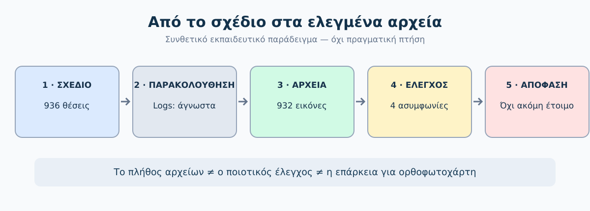
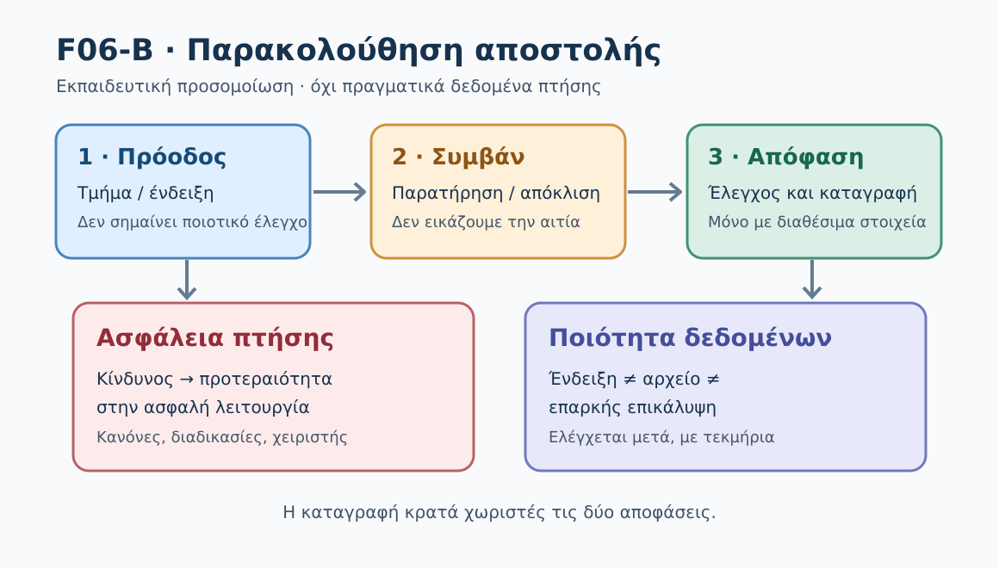
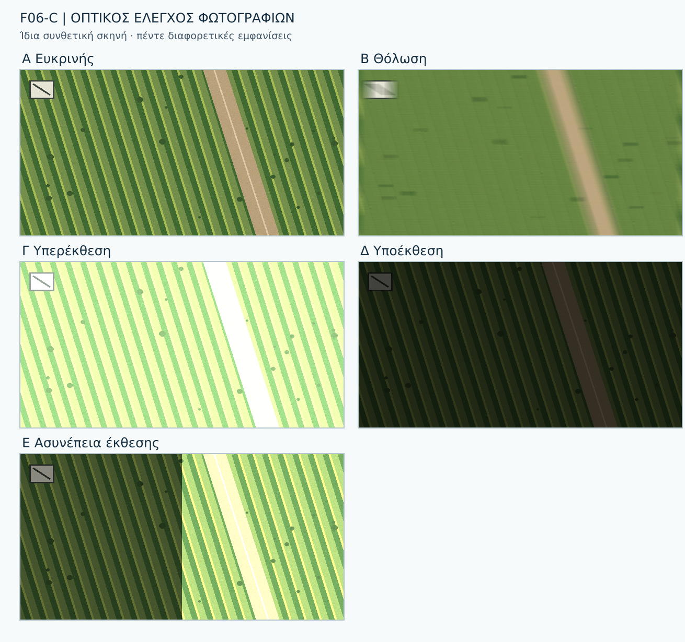
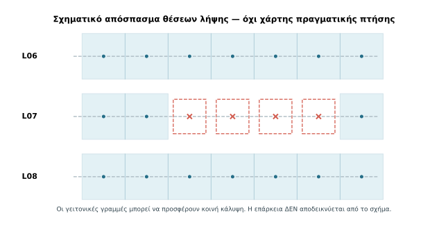
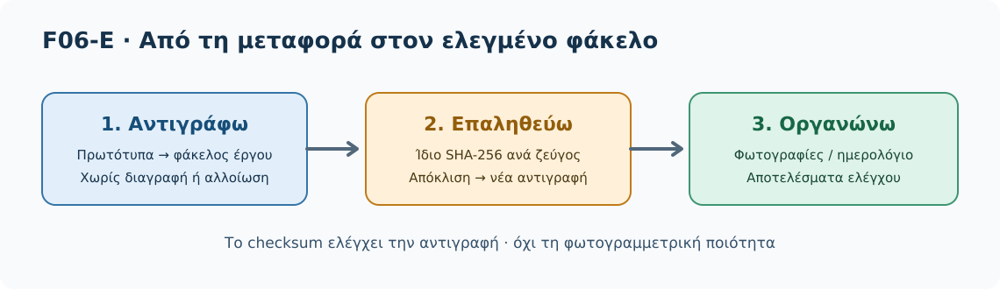
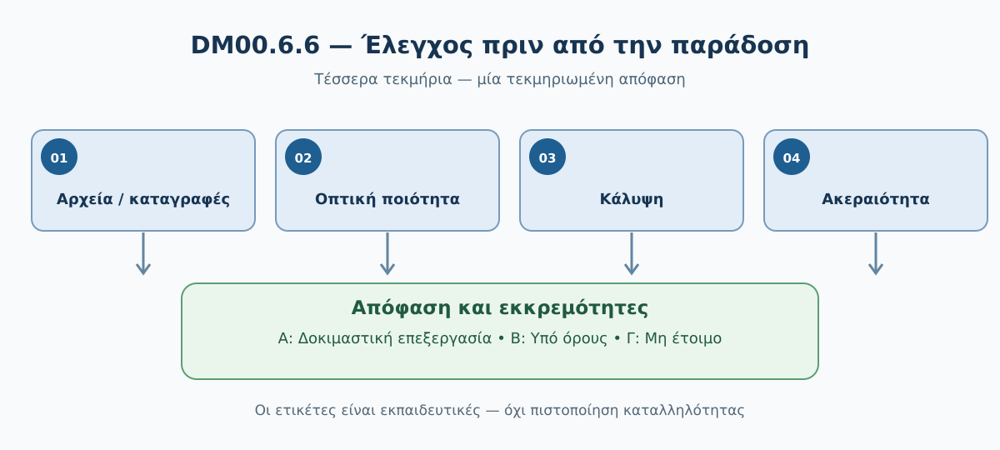

# DM03 — Εκτέλεση αποστολής και αρχικός ποιοτικός έλεγχος φωτογραφιών

> **Δοκιμαστική εκπαιδευτική έκδοση — Preview v0.1.** Το DM03 βρίσκεται σε αξιολόγηση και δεν αποτελεί οριστικά εγκεκριμένο μάθημα.

> **GeoSkills · Drone Mapping Core · Ενιαίο παιδαγωγικά αναθεωρημένο προσχέδιο v0.2 · 04/11/2026**
> **Όλα τα δεδομένα πτήσης/φωτογραφιών του παραδείγματος είναι συνθετικά.** Δεν έχει εκτελεστεί πραγματική πτήση ούτε υπάρχει πραγματικό dataset 932 αεροφωτογραφιών.

## Σκοπός και μαθησιακή διαδρομή

Μετά το σχέδιο πτήσης της DM02, ο φοιτητής μαθαίνει να **καταγράφει την εκτέλεση, να ελέγχει τα αρχεία, να εντοπίζει προβλήματα και να τεκμηριώνει την παράδοση**. Οι έξι υποενότητες ακολουθούν την ίδια υποθετική εργασία χαρτογράφησης αγρού 25 ha.

| Στάδιο | Νέα δεξιότητα | Παραδοτέο |
|---|---|---|
| 6.1 | Αντιστοιχίζω σχέδιο και αρχεία | Καρτέλα 06Α |
| 6.2 | Παρακολουθώ αποκλίσεις και διακοπές | Καρτέλα 06Β |
| 6.3 | Ελέγχω οπτικά την ποιότητα | Καρτέλα 06Γ |
| 6.4 | Επισημαίνω πιθανό κενό κάλυψης | Καρτέλα 06Δ |
| 6.5 | Αντιγράφω και επαληθεύω αρχεία | Καρτέλα 06Ε |
| 6.6 | Τεκμηριώνω τη δυνατότητα παράδοσης | Τελική Καρτέλα 06 |

**Κοινή αρχή:** 936 προγραμματισμένες θέσεις και 932 υποθετικά αρχεία είναι μόνο δεδομένα άσκησης. Ούτε η πλήρης καταμέτρηση ούτε η οπτική προεπισκόπηση πιστοποιούν τη φωτογραμμετρική καταλληλότητα.

**Συνεκτικό σενάριο για τις δραστηριότητες 06Α, 06Β και 06Δ:** Στον συνθετικό *πίνακα αρχείων* της 06Α, η L07 έχει 32 αντί 36 αντιστοιχισμένων αρχείων, ενώ οι άλλες 25 γραμμές έχουν 36 η καθεμία (25×36+32=932). Στο χωριστό *ημερολόγιο ενδείξεων εφαρμογής* της 06Β, η ίδια L07 εμφανίζει 35 λήψεις. Οι δύο αριθμοί αφορούν **διαφορετικές πηγές τεκμηρίων** και δεν είναι από μόνοι τους ισοδύναμοι. Το συνθετικό CSV της 06Δ τοποθετεί τις τέσσερις μη αντιστοιχισμένες θέσεις στις L07-P17 έως P20. Δεν πρόκειται για πραγματικά logs και δεν είναι απόδειξη αιτίας της απόκλισης.

**Πώς διαβάζεις το μάθημα:** κάθε υποενότητα εισάγει μόνο μία νέα ενέργεια. Στην επόμενη αρκεί να χρησιμοποιήσεις το αποτέλεσμα της προηγούμενης· δεν χρειάζεται να επαναλάβεις τη μέθοδό της.

---

## DM03.1 — Από το σχέδιο στο ημερολόγιο συλλογής

> **GeoSkills · Drone Mapping Core · v0.2**
> **Σημαντικό:** Όλα τα αποτελέσματα λήψεων αυτής της υποενότητας είναι **συνθετικά εκπαιδευτικά δεδομένα**, όχι φωτογραφίες που έχουν συλλεχθεί από πραγματική πτήση.

### Τι θα μπορείς να κάνεις
Μετά την υποενότητα θα μπορείς: (α) να ξεχωρίζεις το πλήθος *προγραμματισμένων θέσεων* από το πλήθος *αποθηκευμένων αρχείων*, (β) να οργανώνεις βασικό ημερολόγιο συλλογής, (γ) να εντοπίζεις ασυμφωνίες ανάμεσα στο σχέδιο και στον φάκελο εικόνων, και (δ) να τεκμηριώνεις μια πρώτη απόφαση χωρίς να συγχέεις την αριθμητική πληρότητα με την ποιότητα των εικόνων.

### 1. Τι αλλάζει μετά τη DM02;
Στη DM02 σχεδιάσαμε ένα πλέγμα για αγρό 25 ha: **26 γραμμές**, **36 προγραμματισμένες θέσεις λήψης ανά γραμμή**, δηλαδή **936 θέσεις**. Δεν πραγματοποιήσαμε πραγματική πτήση και δεν αποκτήσαμε 936 πραγματικές φωτογραφίες. Το σχέδιο μάς λέει *τι θέλουμε να καταγράψουμε*. Η DM03 εξετάζει *τι αποτυπώνουν τα στοιχεία εκτέλεσης και τι υπάρχει στον φάκελο εικόνων*. Στην παρούσα άσκηση χρησιμοποιούμε **μόνο συνθετικά στοιχεία**: δεν έχουν πραγματοποιηθεί οι λήψεις.



*Σχήμα F06-A. Πέντε διαφορετικές καταστάσεις: σχεδιασμός, παρακολούθηση, καταγραφή, έλεγχος αρχείων και απόφαση. Οι αριθμοί είναι συνθετικοί.*

### 2. Τρεις αριθμοί που δεν πρέπει να συγχέουμε

| Τι μετράμε | Τι σημαίνει | Στην εκπαιδευτική άσκηση |
|---|---|---:|
| Προγραμματισμένες θέσεις | Σημεία όπου το σχέδιο προβλέπει λήψη | 936 |
| Καταγεγραμμένα γεγονότα λήψης | Εγγραφές από το σύστημα ή ημερολόγιο ότι επιχειρήθηκε/αναφέρθηκε λήψη | Δεν παρέχονται — **άγνωστο** |
| Αποθηκευμένα αρχεία εικόνων | Πλήθος αρχείων που δηλώνει το συνθετικό σενάριο (δεν παραδίδεται πραγματικός φάκελος 932 φωτογραφιών) | 932 (συνθετικά) |

**Προσοχή:** Δεν επιτρέπεται να συμπεράνουμε ότι υπήρξαν ακριβώς 932 επιτυχημένα γεγονότα λήψης ή ότι τα τέσσερα υπόλοιπα είναι οπωσδήποτε αποτυχίες του κλείστρου. Μπορεί να οφείλονται σε διαφορετικό σημείο της αλυσίδας καταγραφής, αντιγραφής ή αντιστοίχισης. Για να αποδώσουμε αιτία χρειάζονται αρχεία καταγραφής και αντιστοίχιση ανά θέση.

#### Πλήρως λυμένο παράδειγμα
Από ένα υποθετικό πακέτο παραλάβαμε **932 εικόνες**, ενώ το προκαταρκτικό σχέδιο είχε **936 θέσεις**.

- Διαφορά πλήθους: 936 − 932 = **4**. Πρόκειται για απόκλιση μεταξύ δύο αριθμών, όχι για αποδεδειγμένες τέσσερις συγκεκριμένες αποτυχημένες λήψεις.
- Ποσοστό αριθμητικής παρουσίας: 932 / 936 × 100 = **99,57%** (με στρογγυλοποίηση).
- Αριθμητική απουσία ως προς τις θέσεις: 4 / 936 × 100 = **0,43%**.

**Τι ξέρουμε από το σενάριο:** δηλώνονται τέσσερα λιγότερα αρχεία από τις σχεδιασμένες θέσεις. **Τι δεν ξέρουμε:** ποιες θέσεις επηρεάστηκαν, αν οι φωτογραφίες έχουν σωστή ποιότητα, αν τα αρχεία έχουν σωστές γεωγραφικές πληροφορίες και αν είναι δυνατή η φωτογραμμετρική σύνθεση.

<details>
<summary>Δες τη λυμένη απόφαση</summary>

«Η αριθμητική πληρότητα είναι 99,57% για το συγκεκριμένο συνθετικό σύνολο. Δεν χαρακτηρίζω το dataset έτοιμο για επεξεργασία χωρίς έλεγχο των θέσεων, της ευκρίνειας, της έκθεσης, των μεταδεδομένων και της επικάλυψης. Καταγράφω τις τέσσερις μη αντιστοιχισμένες θέσεις ως εκκρεμότητα και συνεχίζω σε έλεγχο ποιότητας».
</details>

### 3. Τι καταγράφουμε στο ημερολόγιο συλλογής;

Δεν χρειάζεται πολύπλοκο σύστημα. Για μια αρχική εργαστηριακή εργασία αρκούν οι στήλες: **αναγνωριστικό γραμμής**, **αναμενόμενες λήψεις**, **αρχεία που βρέθηκαν**, **παρατηρήσεις** και **κατάσταση ελέγχου**. Σε πραγματική εργασία χρειάζονται επιπλέον τα στοιχεία της αποστολής, ο εξοπλισμός, οι χρόνοι, τα συμβάντα και όσα απαιτεί η τεκμηρίωση του έργου· δεν επινοούμε συγκεκριμένο μοντέλο, αυτοματισμό ή καταγραφή που δεν έχουμε.

| Γραμμή | Σχέδιο | Αρχεία | Εκκρεμότητα | Κατάσταση |
|---|---:|---:|---|---|
| L01–L06 (μαζί) | 216 | 216 | Καμία αριθμητική | Χρειάζεται ποιοτικός έλεγχος |
| **L07** | **36** | **32** | **4 μη αντιστοιχισμένες θέσεις** | **Διερεύνηση** |
| L08–L26 (μαζί) | 684 | 684 | Καμία αριθμητική | Χρειάζεται ποιοτικός έλεγχος |
| **Σύνολο** | **936** | **932** | **4** | **Δεν έχει ολοκληρωθεί ο έλεγχος** |

Οι παραπάνω εγγραφές **δίνονται ως πρόσθετα, συνθετικά δεδομένα της άσκησης**, σε συμφωνία με την Καρτέλα 06Α και το CSV της DM03.4. **Δεν αποτελούν πραγματικά flight logs.** Από το γενικό πλήθος «932» και μόνο δεν μπορούμε να αποδώσουμε αρχεία στις L01–L26. Για μια πραγματική αντιστοίχιση απαιτούνται κατάλληλα, ελεγμένα στοιχεία (π.χ. ονομασίες, χρονικές σφραγίδες, μεταδεδομένα ή αρχεία καταγραφής). Ακόμη και η συμφωνία των αριθμών σε μία γραμμή δεν αποδεικνύει ότι όλες οι εικόνες αντιστοιχούν στα σωστά σημεία.

### 4. Πώς περνάμε από το «μέτρησα αρχεία» στο «ελέγχω τη συλλογή»;

Ακολουθούμε μια απλή ακολουθία:

1. **Καταγράφω το σχέδιο:** πόσες λήψεις αναμένονταν και με ποια οργάνωση ανά γραμμή.
2. **Επιθεωρώ το σύνολο:** ποια αρχεία υπάρχουν, αν ανοίγουν και αν αντιστοιχούν στο έργο.
3. **Συγκρίνω με τα διαθέσιμα logs/μεταδεδομένα:** μόνο αν υπάρχουν, μπορώ να αναζητήσω τις θέσεις και τις χρονικές στιγμές που αντιστοιχούν στα αρχεία.
4. **Καταγράφω ελλείψεις και αβεβαιότητες:** δεν τις κρύβω κάτω από ένα υψηλό ποσοστό.
5. **Δεν αποφαίνομαι ακόμη για καταλληλότητα:** θα ελεγχθούν ευκρίνεια, έκθεση, επικάλυψη και γεωγραφική κάλυψη στις επόμενες υποενότητες.

Η καθοδήγηση της Pix4D επισημαίνει ότι για αξιόπιστη φωτογραμμετρική επεξεργασία χρειάζονται κατάλληλη επικάλυψη, καλό οπτικό περιεχόμενο και ποιοτικές εικόνες. Επομένως, ο αριθμός αρχείων είναι χρήσιμος πρώτος έλεγχος, όχι τελικό κριτήριο. [Π1–Π3]

#### Μικρό παράδειγμα ελέγχου φακέλου — τι κάνω πραγματικά;

Ας υποθέσουμε ότι σε μια άλλη εργαστηριακή άσκηση μάς παραδίδεται **πραγματικός φάκελος τριών δοκιμαστικών αρχείων**: `IMG_001.JPG`, `IMG_002.JPG` και `notes.txt`. Αυτό είναι **παράδειγμα διαδικασίας**, όχι αρχείο που περιέχεται στο πακέτο της DM03.1.

1. Ανοίγω τον φάκελο και **διαχωρίζω τα αρχεία εικόνας από τα υπόλοιπα αρχεία**. Το `notes.txt` δεν μετρά ως φωτογραφία.
2. Ελέγχω ότι οι δύο εικόνες **ανοίγουν** και αν έχουν τις αναμενόμενες βασικές πληροφορίες (όπου είναι διαθέσιμες).
3. Συγκρίνω το πλήθος και τα αναγνωριστικά με το σχέδιο ή το ημερολόγιο. **Δεν θεωρώ** ότι το `IMG_002.JPG` προέρχεται από συγκεκριμένη προγραμματισμένη θέση χωρίς επιπλέον στοιχεία.
4. Σημειώνω το αποτέλεσμα, την ημερομηνία ελέγχου και τις εκκρεμότητες, αντί να γράψω απλώς «όλα καλά».

**Παράδειγμα καταγραφής:** «Βρέθηκαν 2 αρχεία JPG και 1 αρχείο κειμένου. Οι εικόνες ανοίγουν. Η χωρική αντιστοίχιση και η φωτογραμμετρική καταλληλότητα δεν έχουν ελεγχθεί». Έτσι τεκμηριώνουμε **ακριβώς τι κάναμε**, χωρίς να ισχυριζόμαστε περισσότερα.

<details>
<summary>Γιατί τα δύο JPG δεν αρκούν για να χαρακτηρίσουμε τη συλλογή πλήρη;</summary>

Η ύπαρξη και το άνοιγμα δύο εικόνων δεν αποδεικνύουν σε ποιες προγραμματισμένες θέσεις αντιστοιχούν, ούτε αν έχουν την απαιτούμενη επικάλυψη, ευκρίνεια και γεωγραφική κάλυψη. Χρειάζονται ξεχωριστοί έλεγχοι.
</details>

### 5. Μικρή άσκηση: Τι μπορείς να ισχυριστείς;

Ένας συμφοιτητής λέει: «Έχουμε 932 από τις 936 φωτογραφίες, δηλαδή σχεδόν όλες. Μπορούμε να αρχίσουμε τον ορθοφωτοχάρτη χωρίς άλλους ελέγχους».

Συμπλήρωσε: **(α)** ποιο συμπέρασμα είναι σωστό, **(β)** ποιο συμπέρασμα είναι αυθαίρετο και **(γ)** ποιον έλεγχο κάνεις πρώτο.

<details>
<summary>Δες τη λύση της δραστηριότητας</summary>

(α) Υπάρχουν 932 αρχεία έναντι 936 σχεδιασμένων θέσεων. (β) Δεν τεκμηριώνεται ότι όλες οι κρίσιμες περιοχές καλύπτονται ούτε ότι οι εικόνες είναι κατάλληλες. (γ) Ξεκινώ με αντιστοίχιση των αρχείων στις σχεδιασμένες θέσεις, εφόσον υπάρχουν έγκυρα μεταδεδομένα/γεγονότα, και συνεχίζω με οπτικό/τεχνικό ποιοτικό έλεγχο. Η προτεραιότητα των ελέγχων μπορεί να προσαρμοστεί στα διαθέσιμα δεδομένα.
</details>

### 6. Αυτοαξιολόγηση

**Ερώτηση 1.** Το «936» σημαίνει ότι έχουν αποθηκευτεί 936 φωτογραφίες;

<details><summary>Απάντηση 1</summary>Όχι. Είναι ο αριθμός προγραμματισμένων θέσεων λήψης.</details>

**Ερώτηση 2.** Με 932 αρχεία και 936 θέσεις, μπορούμε να πούμε ότι το φωτογραμμετρικό αποτέλεσμα θα είναι καλό;

<details><summary>Απάντηση 2</summary>Όχι. Το πλήθος δεν αρκεί για να αξιολογήσουμε την ποιότητα ή τη χωρική πληρότητα.</details>

**Ερώτηση 3.** Τι άλλο χρειάζεται για να εντοπίσουμε σε ποιες θέσεις αντιστοιχούν τα αρχεία;

<details><summary>Απάντηση 3</summary>Κατάλληλες και αξιόπιστες πληροφορίες χρόνου/θέσης ή logs/μεταδεδομένα και δυνατότητα αντιστοίχισης.</details>

**Ερώτηση 4.** Γιατί δεν αποφασίζουμε αυτόματα ότι «λείπουν τέσσερις λήψεις»;

<details><summary>Απάντηση 4</summary>Γνωρίζουμε ότι λείπουν τέσσερα αρχεία ως προς το σχέδιο, όχι αν η διαφορά προέκυψε στη λήψη, καταγραφή, μεταφορά, ταξινόμηση ή αλλού.</details>

#### Γρήγορος έλεγχος πριν παραδώσεις την Καρτέλα 06Α

- Έχω χωρίσει τα **δεδομένα του σεναρίου** από όσα αποδείχθηκαν με πραγματικό έλεγχο;
- Έχω υπολογίσει σωστά το πλήθος, χωρίς να μαντέψω πού χάθηκαν φωτογραφίες;
- Έχω γράψει συγκεκριμένα τι απομένει να ελεγχθεί (θέση, ποιότητα, κάλυψη);

### Τι κρατάμε
**Το σχέδιο προβλέπει λήψεις. Το ημερολόγιο και τα αρχεία τεκμηριώνουν όσα έχουμε. Ο ποιοτικός έλεγχος δείχνει αν τα δεδομένα μπορούν να χρησιμοποιηθούν.** Στην DM03.2 θα εξετάσουμε πώς παρακολουθείται η πρόοδος της συλλογής και πώς καταγράφονται αποκλίσεις ή διακοπές, πάντα χωρίς αυθαίρετες οδηγίες για συγκεκριμένο drone.

#### Πηγές
- **[Π1] Pix4D — Best practices for image acquisition:** https://support.pix4d.com/hc/best-practices-for-image-acquisition-and-photogrammetry
- **[Π2] Pix4D — How to verify overlap:** https://support.pix4d.com/hc/en-us/articles/203756125
- **[Π3] Pix4D — Quality Report Help:** https://support.pix4d.com/hc/en-us/articles/202558689

**Στη DM03.2:** από την καταμέτρηση περνάμε στην παρακολούθηση αποκλίσεων.

---

## DM03.2 — Οργάνωση εκτέλεσης και παρακολούθηση αποστολής

> **GeoSkills · Drone Mapping Core · Εκπαιδευτικό προσχέδιο v0.2 · 04/11/2026**
> **Όλα τα γεγονότα και οι αριθμοί εκτέλεσης είναι συνθετικά.** Δεν πραγματοποιήθηκε πτήση. Δεν παρέχονται πραγματικά flight logs ή φωτογραφίες. Οι ενέργειες χειρισμού εξαρτώνται από το UAS και τις διαδικασίες του εκμεταλλευόμενου.

### Τι θα μπορείς να κάνεις
Μετά την ενότητα θα μπορείς (α) να παρακολουθείς την πρόοδο μιας αποστολής ανά γραμμή, (β) να διαχωρίζεις την **παρατήρηση** από την **ερμηνεία**, (γ) να καταγράφεις ένα συμβάν και τις εκκρεμότητες που δημιουργεί, (δ) να ξεχωρίζεις τον **έλεγχο ασφάλειας** από τον **έλεγχο πληρότητας λήψεων** και (ε) να παραδίδεις σαφές ημερολόγιο για την επόμενη φάση ελέγχου εικόνων.

### 1. Τι αλλάζει σε σχέση με την DM03.1;

Στην DM03.1 συγκρίναμε **936 προγραμματισμένες θέσεις** με ένα **συνθετικό σύνολο 932 αρχείων**. Το συνολικό πλήθος μάς έδειξε αριθμητική διαφορά **4**, χωρίς να αποκαλύπτει τι ακριβώς συνέβη. Τώρα θα μάθουμε να κρατούμε καταγραφή **κατά την εξέλιξη της αποστολής**: σε ποιο τμήμα βρίσκεται το σχέδιο, ποιες ενδείξεις εμφανίζονται και ποιες αποφάσεις χρειάζεται να επανεξεταστούν.



*Σχήμα F06-B. Η καταγραφή προόδου και συμβάντων δεν καταργεί την προτεραιότητα της ασφάλειας ούτε αποδεικνύει φωτογραμμετρική πληρότητα.*

#### Πώς διαβάζουμε μια εγγραφή χωρίς να μαντεύουμε την αιτία;

Κάθε χρήσιμη εγγραφή απαντά σε τέσσερα μικρά ερωτήματα: **τι έδειξε το σύστημα ή τι παρατηρήσαμε**, **από πού προέρχεται η πληροφορία**, **τι παραμένει άγνωστο** και **ποιος έλεγχος ακολουθεί**. Το «L07: 35 λήψεις» είναι ένδειξη εφαρμογής· το «χάθηκε μια φωτογραφία λόγω ανέμου» είναι υπόθεση για την οποία δεν έχουμε στοιχεία. Η σωστή εγγραφή διατηρεί αυτή τη διαφορά.

| Ανεπαρκής διατύπωση | Τεκμηριωμένη διατύπωση |
|---|---|
| «Χάσαμε φωτογραφία στη L07». | «Η εφαρμογή αναφέρει 35 λήψεις αντί 36 προγραμματισμένων στη L07. Δεν έχει ελεγχθεί ο φάκελος εικόνων». |
| «Η L08 είναι καλή». | «Η εφαρμογή δήλωσε ολοκλήρωση L08. Ποιότητα και χωρική κάλυψη δεν έχουν ακόμη αξιολογηθεί». |
| «Το drone μπορεί να συνεχίσει». | «Η επανέναρξη δεν τεκμηριώνεται από τα στοιχεία του ημερολογίου· χρειάζεται ανεξάρτητη επιχειρησιακή αξιολόγηση». |

### 2. Τι παρακολουθούμε και γιατί;

Δεν χρειάζεται ο αρχάριος να απομνημονεύει δεκάδες τεχνικές ενδείξεις. Χρειάζεται να ξέρει **ποιες πληροφορίες θα ζητήσει και πώς θα τις ερμηνεύσει**, εφόσον παρέχονται από το συγκεκριμένο σύστημα.

| Πεδίο ημερολογίου | Τι σημειώνουμε | Τι **δεν** αποδεικνύει μόνο του |
|---|---|---|
| Γραμμή/τμήμα σχεδίου | Π.χ. L08, L09 | Ότι η γραμμή καλύφθηκε φωτογραμμετρικά |
| Κατάσταση αποστολής | Σχεδιάστηκε / σε εξέλιξη / διακόπηκε / έκλεισε | Ότι το UAS είναι ασφαλές για συνέχιση |
| Ένδειξη λήψεων | Πλήθος που αναφέρει η εφαρμογή, αν υπάρχει | Ότι έχουν αποθηκευτεί ισάριθμα έγκυρα JPG |
| Παρατήρηση | Άνεμος, πεζός, προειδοποίηση, διακοπή | Τη συγκεκριμένη τεχνική αιτία του συμβάντος |
| Ενέργεια/απόφαση | Τι έκανε ο αρμόδιος χειριστής σύμφωνα με τις διαδικασίες | Ότι μπορεί να γίνει αυτόματη επανέναρξη |
| Εκκρεμότητα | Τι πρέπει να ελεγχθεί μετά | Ότι απαιτείται οπωσδήποτε νέα πτήση |

**Σημαντικό:** η ένδειξη «ολοκληρώθηκε η γραμμή» αφορά την πρόοδο του σχεδίου ή την ένδειξη εφαρμογής, όχι υποχρεωτικά επιβεβαιωμένη ποιότητα εικόνων. Η DM03.3 εξετάζει ορατή ποιότητα και η DM03.4 χωρική πληρότητα.

### 3. Τρεις καταστάσεις κατά την παρακολούθηση

**Κανονική πρόοδος.** Το διαθέσιμο σύστημα δηλώνει ότι ολοκληρώθηκε ένα τμήμα, χωρίς καταγεγραμμένο συμβάν. Καταχωρίζουμε την πρόοδο και συνεχίζουμε την επιτήρηση. **Δεν** θεωρούμε αυτομάτως ότι η συλλογή είναι φωτογραμμετρικά αποδεκτή.

**Απόκλιση προς διερεύνηση.** Π.χ. ο μετρητής της εφαρμογής διαφέρει από το σχέδιο ή φαίνεται κενό στη χρονική ακολουθία. Η απόκλιση καταγράφεται και **χρειάζεται επιβεβαίωση**. Δεν συμπεραίνουμε ότι το drone έχασε πράγματι φωτογραφία, ούτε ότι η ασφαλής απόφαση είναι οπωσδήποτε επανάληψη της γραμμής.

**Διακοπή/κίνδυνος που απαιτεί επαναξιολόγηση.** Π.χ. εισέρχεται τρίτος στον επιχειρησιακό χώρο, μεταβάλλεται σημαντικά ο άνεμος ή εμφανίζεται επανδρωμένο αεροσκάφος. Η ασφάλεια υπερισχύει της συμπλήρωσης φωτογραφιών. Ο αρμόδιος χειριστής ακολουθεί τους κανόνες, το εγχειρίδιο και τις προβλεπόμενες διαδικασίες. **Η συμπλήρωση των λήψεων μπορεί να περιμένει.**

Το ενωσιακό UAS.OPEN.060 απαιτεί, στην κατηγορία Open, μεταξύ άλλων διατήρηση VLOS, προσοχή σε κινδύνους σύγκρουσης και διακοπή της πτήσης εάν υπάρχει κίνδυνος για αεροσκάφη, πρόσωπα, ζώα, περιβάλλον ή περιουσία. Η παρούσα εκπαιδευτική άσκηση **δεν** δίνει εντολές χειριστηρίου, ύψη ή διαδικασίες έκτακτης ανάγκης για άγνωστο μοντέλο. [Π1]

### 4. Λυμένο συνθετικό παράδειγμα: γεγονότα σε μία αποστολή

Η ομάδα έχει σχέδιο **26 γραμμών × 36 θέσεις = 936**. Το παρακάτω ημερολόγιο αφορά **προσομοιωμένα στιγμιότυπα**, όχι πραγματικά telemetry logs. **Τα τμήματα και οι ώρες δίνονται για εξάσκηση**. Η ένδειξη «35» στη L07 είναι αριθμός που εμφανίζει η **υποθετική εφαρμογή**, ενώ τα «32» είναι ο αριθμός αντιστοιχισμένων αρχείων στον **χωριστό συνθετικό πίνακα της Καρτέλας 06Α**. Η διαφορά μεταξύ τους δεν τεκμηριώνει συγκεκριμένη τεχνική αιτία.

| Χρόνος άσκησης | Τμήμα | Παρατήρηση/ένδειξη | Κατάσταση και ενέργεια |
|---|---|---|---|
| 09:00 | L01–L06 | Η εφαρμογή εμφανίζει «τμήμα ολοκληρωμένο» | Καταγράφεται πρόοδος· εικόνες μη ελεγμένες |
| 09:12 | L07 | Ένδειξη 35 αντί 36 προγραμματισμένων λήψεων | Καταγράφεται **απόκλιση**· αιτία άγνωστη |
| 09:18 | L08 | Εμφάνιση πεζού κοντά στον χώρο ανάκτησης | **Ζήτημα ασφάλειας**· ο χειριστής επανεκτιμά σύμφωνα με τις διαδικασίες |
| 09:24 | — | Καταγράφεται διακοπή του εκπαιδευτικού σεναρίου | Δεν εξάγεται συμπέρασμα ότι επιτρέπεται άμεση επανέναρξη |
| 09:40 | — | Η ομάδα εξετάζει το ημερολόγιο και τις εκκρεμότητες | Η ολοκλήρωση συλλογής παραμένει **ανεπιβεβαίωτη** |

#### Ερώτημα 1: Έχουμε αποδείξει ότι λείπει ακριβώς μία φωτογραφία στη L07;

Όχι. Η εφαρμογή μπορεί να εμφανίζει διαφορετικό αριθμό εγγραφών από τα πραγματικά αποθηκευμένα αρχεία, και δεν έχουμε ανεξάρτητο αρχείο εικόνων ή τεκμηριωμένη αντιστοίχιση. Έχουμε **ένδειξη απόκλισης** που χρειάζεται έλεγχο.

<details>
<summary>Αναλυτικά λυμένο ερώτημα 1</summary>

Το σχέδιο προβλέπει 36 θέσεις στη L07. Η συνθετική εφαρμογή δείχνει 35. Η αριθμητική διαφορά είναι 1 **στην ένδειξη**, όχι αποδεδειγμένη απώλεια εικόνας. Θα ζητούσαμε τα διαθέσιμα logs, το πραγματικό πλήθος αρχείων και τις θέσεις/χρόνους λήψης. Μόνο τότε θα εντοπίζαμε συγκεκριμένη έλλειψη.
</details>

#### Ερώτημα 2: Μπορούμε να συνεχίσουμε επειδή ο μετρητής δείχνει σχεδόν όλες τις φωτογραφίες;

Όχι. Η παρουσία προσώπου στον χώρο ανάκτησης είναι ξεχωριστό ζήτημα ασφάλειας. Η απόφαση του χειριστή υπάγεται στις κανονιστικές και επιχειρησιακές προϋποθέσεις, όχι στην ανάγκη να ολοκληρωθεί το φωτογραμμετρικό πλέγμα.

<details>
<summary>Αναλυτικά λυμένο ερώτημα 2</summary>

Η απόκλιση φωτογραφιών δεν αιτιολογεί συνέχιση όταν υπάρχει ζήτημα ασφαλούς λειτουργίας. Προτεραιότητα είναι η αποφυγή κινδύνου σύμφωνα με το UAS.OPEN.060 και τις διαδικασίες του συγκεκριμένου UAS. Η ομάδα καταγράφει το περιστατικό και επαναξιολογεί πριν από οποιονδήποτε περαιτέρω σχεδιασμό.
</details>

#### Δύο αποφάσεις που δεν συγχέουμε

Σε ένα ημερολόγιο μπορεί να υπάρχουν **δύο ταυτόχρονες αλλά διαφορετικές εκκρεμότητες**. Η πρώτη αφορά την ασφαλή λειτουργία: η ομάδα δεν γνωρίζει αν και υπό ποιες συνθήκες επιτρέπεται η συνέχιση. Η δεύτερη αφορά το φωτογραμμετρικό αποτέλεσμα: η ομάδα δεν γνωρίζει ποια τμήματα καλύφθηκαν με κατάλληλες εικόνες. Ακόμη και αν η δεύτερη εκκρεμότητα λυθεί με έλεγχο αρχείων, **η πρώτη δεν λύνεται αυτομάτως**.

<details>
<summary>Λυμένο παράδειγμα: Έχουμε πλήρη αρχεία, μπορούμε να ξαναπετάξουμε;</summary>

**Όχι ως συμπέρασμα.** Η επιβεβαίωση φωτογραφιών και επικάλυψης απαντά σε ερώτημα ποιότητας δεδομένων. Η πραγματική επανέναρξη εξαρτάται από ξεχωριστούς ελέγχους ασφαλείας και επιχειρησιακών προϋποθέσεων. Η καρτέλα πρέπει να καταγράφει «εκκρεμεί αξιολόγηση συνέχισης», όχι «επιτρέπεται απογείωση».
</details>

### 5. Τι κάνουμε μετά από διακοπή;

Μετά τη διακοπή **δεν διατάζουμε αυτόματα «συνέχισε από την επόμενη γραμμή»**. Διαχωρίζουμε:

1. **Ασφάλεια και δυνατότητα νέας πτήσης:** επανελέγχονται οι πραγματικές συνθήκες, οι περιορισμοί της περιοχής και όσα προβλέπει ο εκμεταλλευόμενος και ο κατασκευαστής. Αυτή η ενότητα δεν αποφασίζει ότι πληρούνται.
2. **Δεδομένα που έχουν ήδη συλλεχθεί:** ελέγχουμε ποια αρχεία υπάρχουν πράγματι και αν συνδέονται με τα τμήματα του σχεδίου.
3. **Πιθανό συμπληρωματικό σχέδιο:** μόνο αφού βρεθεί συγκεκριμένο κενό και ελεγχθούν οι προϋποθέσεις, σχεδιάζεται χωριστά πιθανή επανάληψη. Οι λήψεις διαφορετικών πτήσεων χρειάζονται επαρκή αμοιβαία επικάλυψη· δεν αρκεί να συνεχίσουν «από εκεί που σταμάτησαν». [Π2]

#### Μικρό λυμένο παράδειγμα δύο αποστολών

Η πρώτη συνθετική αποστολή τελειώνει στη L08. Μια δεύτερη υποθετική αποστολή σχεδιάζεται αργότερα. Η ομάδα διαπιστώνει ότι **δεν γνωρίζει** αν υπάρχουν αρκετές κοινές εικόνες μεταξύ των δύο συνόλων. Η σωστή απόφαση είναι **«χρειάζεται έλεγχος αλληλοεπικάλυψης πριν θεωρήσουμε τη συλλογή ενιαία»**, όχι «οι δύο φάκελοι μπαίνουν μαζί και άρα ολοκληρώθηκε ο χάρτης». Η Pix4D επισημαίνει την ανάγκη επαρκούς επικάλυψης μεταξύ σχεδίων λήψης. [Π2]

<details>
<summary>Γιατί δεν αρκεί να ονομάσουμε τον δεύτερο φάκελο «συνέχεια»;</summary>

Η ονομασία δεν τεκμηριώνει κοινή περιοχή εικόνων, συνεπείς συνθήκες λήψης ή γεωμετρική συμβατότητα. Χρειάζεται σύγκριση διαθέσιμων εικόνων και κατάλληλος έλεγχος πριν από την επεξεργασία.
</details>

#### Μικρή δραστηριότητα ελέγχου τεκμηρίων

Μια ομάδα παραδίδει δύο σημειώσεις: **Α:** «Ολοκληρώθηκαν όλες οι φωτογραφίες της L07» και **Β:** «Στις 09:12 η εφαρμογή εμφάνισε 35 εγγραφές για τη L07· αναμένεται έλεγχος αρχείων». Ποια μπορείς να εντάξεις χωρίς αλλαγές στο ημερολόγιο και γιατί;

<details>
<summary>Δες την αιτιολογημένη απάντηση</summary>

Η **Β** είναι κατάλληλη: περιγράφει συγκεκριμένο παρατηρήσιμο στοιχείο, χρονική στιγμή και εκκρεμότητα. Η **Α** παρουσιάζει ως επιβεβαιωμένο κάτι που δεν έχει αποδειχθεί από το διαθέσιμο σύνολο αρχείων.
</details>

### 6. Άσκηση: Τι γράφουμε στο ημερολόγιο;

Στο υποθετικό σενάριο η εφαρμογή δείχνει ολοκλήρωση της L12, αλλά αργότερα ο φάκελος περιέχει άγνωστο πλήθος αντιστοιχισμένων εικόνων. Διατύπωσε **μία ακριβή καταγραφή** και **μία εκκρεμότητα**.

<details>
<summary>Δες τη λυμένη δραστηριότητα</summary>

**Καταγραφή:** «Η εφαρμογή δήλωσε ολοκλήρωση της L12 κατά τη συνθετική αποστολή. Δεν έχει επιβεβαιωθεί ποια αρχεία της αντιστοιχούν». **Εκκρεμότητα:** «Έλεγχος καταγραφών και αντιστοίχιση πραγματικών αρχείων με L12· έπειτα έλεγχος ποιότητας και κάλυψης».
</details>

### 7. Αυτοαξιολόγηση

**Ερώτηση 1.** Η ένδειξη «100% ολοκλήρωση σχεδίου» σημαίνει έτοιμο σύνολο εικόνων;

<details><summary>Απάντηση 1</summary>Όχι. Απαιτείται ξεχωριστός έλεγχος υπαρκτών αρχείων, ποιότητας, θέσης και κάλυψης.</details>

**Ερώτηση 2.** Ποιο έχει προτεραιότητα: να συμπληρώσουμε την L08 ή να αντιμετωπίσουμε κίνδυνο για τρίτους;

<details><summary>Απάντηση 2</summary>Η ασφάλεια τρίτων· ο χειριστής ακολουθεί τους κανόνες και τις κατάλληλες διαδικασίες.</details>

**Ερώτηση 3.** Ποια είναι η διαφορά ανάμεσα στο «35 αντί 36» και στο «αποδεδειγμένα λείπει μία εικόνα»;

<details><summary>Απάντηση 3</summary>Το πρώτο είναι αριθμητική ένδειξη ή ασυμφωνία. Το δεύτερο απαιτεί επιβεβαίωση με στοιχεία πραγματικών λήψεων/αρχείων και αντιστοίχιση.</details>

**Ερώτηση 4.** Δύο πτήσεις κάλυψαν γειτονικά τμήματα. Αρκεί να βάλουμε όλες τις φωτογραφίες σε έναν φάκελο;

<details><summary>Απάντηση 4</summary>Όχι. Πρέπει να ελεγχθούν η αλληλοεπικάλυψη, η ποιότητα και η συμβατότητα των συνόλων εικόνων.</details>

**Ερώτηση 5.** Αφού βεβαιωθούμε ότι οι φωτογραφίες της L07 υπάρχουν, σημαίνει αυτό ότι επιτρέπεται να επανεκκινήσει η αποστολή;

<details><summary>Απάντηση 5</summary>Όχι. Η ύπαρξη αρχείων αποτελεί στοιχείο ελέγχου δεδομένων, όχι αξιολόγηση της ασφάλειας, των συνθηκών ή της νομιμότητας ενδεχόμενης νέας πτήσης.</details>

#### Πριν παραδώσεις την Καρτέλα 06Β

- Έχω γράψει **τι παρατηρήθηκε**, χωρίς να αποδώσω ανεπιβεβαίωτη αιτία;
- Έχω σημειώσει την κατάσταση ασφάλειας **ανεξάρτητα** από τον αριθμό εικόνων;
- Έχω αφήσει ανοιχτές τις εκκρεμότητες που θα εξεταστούν στις DM03.3–6.4;

### Τι κρατάμε

**Παρακολουθώ την πρόοδο — καταγράφω αποκλίσεις — δίνω προτεραιότητα στην ασφάλεια — διατηρώ ανοιχτές τις εκκρεμότητες δεδομένων.** Δεν ταυτίζω «η διαδρομή ολοκληρώθηκε» με «οι φωτογραφίες είναι κατάλληλες».

#### Επίσημες και τεχνικές πηγές

- **[Π1] EASA, Easy Access Rules for UAS, UAS.OPEN.060 (έκδοση Ιουνίου 2026):** https://www.easa.europa.eu/en/document-library/easy-access-rules/online-publications/easy-access-rules-unmanned-aircraft-systems
- **[Π2] Pix4D, Selecting the Image Acquisition Plan Type — πολλαπλές πτήσεις και επικάλυψη:** https://support.pix4d.com/hc/en-us/articles/202557459
- **[Π3] Pix4D, How to verify that there is enough overlap:** https://support.pix4d.com/hc/en-us/articles/203756125

**Σύνδεση με τη DM03.3:** Το ημερολόγιο δείχνει την πορεία της αποστολής, όχι την οπτική καταλληλότητα των εικόνων. Τώρα ελέγχουμε τα χαρακτηριστικά των φωτογραφιών.

---

## DM03.3 — Ποιότητα φωτογραφιών: ευκρίνεια, έκθεση και καταλληλότητα

> **GeoSkills · Drone Mapping Core · Εκπαιδευτικό προσχέδιο v0.2 · 04/11/2026**
> **Οι εικόνες και όλα τα δεδομένα είναι συνθετικά.** Δεν έχουν ληφθεί από πραγματική πτήση. Οι ρυθμίσεις κάμερας εξαρτώνται από το συγκεκριμένο σύστημα.

### Τι θα μπορείς να κάνεις

Στο τέλος θα μπορείς να (α) αναγνωρίζεις με απλή οπτική εξέταση συνηθισμένα προβλήματα φωτογραφιών, (β) περιγράφεις τι βλέπεις χωρίς να επινοείς την αιτία, (γ) διακρίνεις **ύποπτη εικόνα** από **αποδεδειγμένα ακατάλληλο σύνολο**, (δ) καταγράφεις ποιον επόμενο έλεγχο χρειάζεται κάθε περίπτωση και (ε) συμπληρώνεις την Καρτέλα 06Γ.

### 1. Γιατί δεν αρκεί να μετρήσουμε τις φωτογραφίες;

Στην DM03.1 χρησιμοποιήσαμε **936 προγραμματισμένες θέσεις** και **932 συνθετικά αρχεία**. Στην DM03.2 μάθαμε ότι η ένδειξη της εφαρμογής δεν είναι από μόνη της απόδειξη για το περιεχόμενο των αρχείων. Εδώ εξετάζουμε άλλο ερώτημα: *αν ανοίξουμε πράγματι μια φωτογραφία, τι μπορούμε να καταλάβουμε από την εμφάνισή της;*

Μια εικόνα μπορεί να υπάρχει ως αρχείο, αλλά η λεπτομέρεια των καλλιεργειών να είναι θολή ή να έχουν χαθεί πληροφορίες σε υπερβολικά φωτεινές ή σκοτεινές περιοχές. Τότε η αντιστοίχιση κοινών χαρακτηριστικών μεταξύ επικαλυπτόμενων εικόνων μπορεί να δυσκολέψει. Ο έλεγχος **δεν** τελειώνει με το οπτικό κοίταγμα: η επάρκεια για φωτογραμμετρική επεξεργασία θα εξεταστεί και από τα αποτελέσματα του λογισμικού. [Π1], [Π2]



*Σχήμα F06-C. Ίδια σχεδιασμένη αγροτική σκηνή σε πέντε **τεχνητά δημιουργημένες** εκδοχές. Οι διαφορές είναι σκόπιμα έντονες ώστε να αναγνωρίζονται εύκολα από αρχάριους. Δεν αποτελούν πραγματικές φωτογραφίες από drone ούτε μέτρηση ποσοτικής ποιότητας.*

### 2. Πέντε πράγματα που ελέγχουμε με το μάτι

| Εικόνα | Τι παρατηρούμε | Γιατί μας ενδιαφέρει | Τι σημειώνουμε |
|---|---|---|---|
| **Α — Σχετικά ευκρινής** | Διακρίνονται γραμμές καλλιέργειας και μικρά αντικείμενα | Υπάρχουν ορατές λεπτομέρειες για περαιτέρω έλεγχο | «Οπτικά αποδεκτή ως προς την ευκρίνεια στο δείγμα» |
| **Β — Θόλωση** | Τα όρια εμφανίζονται απλωμένα στην κατεύθυνση του θολώματος | Ίσως χάνονται χαρακτηριστικά που βοηθούν στην αντιστοίχιση | «Θόλωση — έλεγχος πρωτοτύπου και γειτονικών λήψεων» |
| **Γ — Υπερέκθεση** | Πολύ φωτεινές περιοχές έχουν χάσει λεπτομέρεια | Ενδέχεται να μην διακρίνονται χαρακτηριστικά εδάφους | «Απώλεια λεπτομέρειας στα φωτεινά» |
| **Δ — Υποέκθεση** | Σκοτεινές περιοχές δυσκολεύουν την αναγνώριση | Μπορεί να υπάρχει λίγη χρήσιμη οπτική πληροφορία | «Ανεπαρκής ορατή λεπτομέρεια στα σκοτεινά» |
| **Ε — Ανομοιομορφία φωτεινότητας (σχηματική)** | Η συνθετική σκηνή εμφανίζει απότομη διαφορά φωτεινότητας μεταξύ δύο τμημάτων | Αποτελεί αφορμή για έλεγχο ομοιομορφίας φωτισμού και για σύγκριση διαδοχικών λήψεων, όχι απόδειξη διαφορετικής έκθεσης μεταξύ εικόνων | «Απότομη εσωτερική διαφορά φωτεινότητας στο σχήμα — απαιτείται έλεγχος πραγματικών λήψεων» |

Η **Ε** είναι σχηματική προσομοίωση απότομης διαφοράς φωτεινότητας **μέσα στην ίδια εικόνα**. Δεν τεκμηριώνει αλλαγή έκθεσης από τη μία πραγματική λήψη στην άλλη και δεν αναπαριστά συγκεκριμένη βλάβη κάμερας. Η συνέπεια μεταξύ λήψεων εξετάζεται **συγκρίνοντας διαδοχικές φωτογραφίες που απεικονίζουν κοινή περιοχή**. Δεν συμπεραίνουμε τη ρύθμιση ή την αιτία από μία εικόνα.

#### Μια φωτογραφία, τρεις διαφορετικές κρίσεις

| Ερώτηση | Τι μπορεί να απαντηθεί στο πρώτο στάδιο; |
|---|---|
| **Υπάρχει αρχείο;** | Με έλεγχο του φακέλου διαπιστώνουμε την παρουσία του· αυτό δεν πιστοποιεί την ποιότητά του. |
| **Φαίνεται κατάλληλο το δείγμα;** | Με οπτική εξέταση καταγράφουμε ενδείξεις θόλωσης ή απώλειας λεπτομέρειας, όχι οριστική φωτογραμμετρική αποδοχή. |
| **Είναι επαρκές το σύνολο για ορθοφωτοχάρτη;** | Χρειάζονται έλεγχοι κάλυψης, επικαλύψεων, φωτογραμμετρικής αντιστοίχισης και αποτελεσμάτων επεξεργασίας. |

Με άλλα λόγια, **αρχείο που ανοίγει ≠ εικόνα χωρίς ορατό πρόβλημα ≠ επαρκές φωτογραμμετρικό σύνολο**.

#### Τι δεν μπορούμε να συμπεράνουμε αμέσως

- Δεν μπορούμε να πούμε ότι η θόλωση προκλήθηκε από άνεμο και όχι από εστίαση, κίνηση, χρόνο έκθεσης ή άλλο παράγοντα χωρίς επιπλέον στοιχεία.
- Δεν γνωρίζουμε αν ένα μόνο προβληματικό καρέ δημιουργεί φωτογραμμετρικό κενό: πρέπει να ελέγξουμε τις γειτονικές επικαλυπτόμενες λήψεις.
- Δεν υπολογίζουμε την πραγματική φωτογραμμετρική ακρίβεια από την οπτική εμφάνιση.
- Δεν αποφασίζουμε χειρισμούς του drone ή συγκεκριμένες τιμές shutter/ISO χωρίς το εγχειρίδιο και τις δυνατότητες της κάμερας.

<details>
<summary>Λυμένο παράδειγμα: Η εικόνα Β είναι θολή — ποιος είναι ο σωστός ισχυρισμός;</summary>

**Παρατήρηση:** τα περιγράμματα της καλλιέργειας είναι θολά. **Άγνωστα:** αιτία, αριθμός ανάλογων εικόνων και ύπαρξη επαρκούς επικάλυψης από γειτονικά καρέ. **Επόμενος έλεγχος:** εξετάζουμε το πρωτότυπο αρχείο σε κατάλληλη μεγέθυνση (όχι μόνο τη μικρογραφία) και τα κοντινά καρέ. **Δεν** γράφουμε «το drone έτρεχε υπερβολικά γρήγορα» χωρίς δεδομένα.
</details>

### 3. Πρακτική διαδικασία πρώτου ελέγχου

1. **Κρατώ τα πρωτότυπα αρχεία αμετάβλητα.** Η διόρθωση φωτεινότητας σε αντίγραφο δεν αντικαθιστά τη διατήρηση του αρχείου λήψης.
2. **Ανοίγω δείγμα εικόνων** από διαφορετικές γραμμές και τμήματα, όχι μόνο την πρώτη ή την τελευταία.
3. **Μεγεθύνω λογικά** για να εξετάσω αν παραμένουν ευδιάκριτα σταθερά χαρακτηριστικά· δεν κρίνω μόνο από μικρογραφίες.
4. **Συγκρίνω γειτονικές λήψεις** για ασυνέπεια φωτεινότητας ή εστίασης.
5. **Καταγράφω ανά εικόνα**: όνομα αρχείου, παρατήρηση, αν η διαπίστωση έγινε στο πρωτότυπο ή σε προεπισκόπηση, τι παραμένει άγνωστο και επόμενο έλεγχο.
6. **Παραπέμπω ύποπτες περιοχές στον έλεγχο χωρικής πληρότητας** της DM03.4. Δεν απορρίπτω ολόκληρο σύνολο με βάση ένα παράδειγμα.

Η διαδικασία αυτή είναι εκπαιδευτικό **πρώτο φίλτρο**. Η Pix4D προτείνει έλεγχο θόλωσης, περιεχομένου και ανάλυσης και επισημαίνει ότι η κακή έκθεση ή ο θόρυβος μπορούν να δυσκολέψουν την εύρεση κοινών χαρακτηριστικών. [Π1], [Π2]

### 4. Λυμένο συνθετικό περιστατικό στον αγρό 25 ha

Η ομάδα μελετά ένα **φανταστικό δείγμα 5 εικόνων** από τα 932 συνθετικά αρχεία. Τα γράμματα Α–Ε του σχήματος είναι ετικέτες άσκησης και **δεν** αντιστοιχούν σε πραγματικά αρχεία της αποστολής.

| Δείγμα | Παρατήρηση | Κατάσταση πρώτου ελέγχου | Επόμενη ενέργεια |
|---|---|---|---|
| Α | Ευδιάκριτες γραμμές, χωρίς προφανές πρόβλημα έκθεσης | Δεν εντοπίστηκε εμφανές ζήτημα | Έλεγχος μαζί με γειτονικές εικόνες |
| Β | Θόλωση στις γραμμές | **Προς διερεύνηση** | Έλεγχος πρωτοτύπου, γειτονικών λήψεων και πιθανών συστημικών προβλημάτων |
| Γ | Απώλεια υφής σε φωτεινά σημεία | **Προς διερεύνηση** | Έλεγχος πόσο εκτεταμένο είναι το πρόβλημα |
| Δ | Λίγη ορατή πληροφορία στα σκοτεινά | **Προς διερεύνηση** | Έλεγχος πρωτοτύπου και άλλων εικόνων της ίδιας ζώνης |
| Ε | Απότομη διαφορά φωτεινότητας εντός της συνθετικής εικόνας | **Προς διερεύνηση** | Έλεγχος πραγματικών γειτονικών λήψεων για τυχόν αντίστοιχο φαινόμενο, χωρίς προκαθορισμένη αιτία |

**Απόφαση:** «Πρώτος οπτικός έλεγχος ολοκληρώθηκε για τις πέντε συνθετικές εκδοχές της εκπαιδευτικής σκηνής. Η καταλληλότητα του συνολικού συνόλου 932 αρχείων **δεν έχει επιβεβαιωθεί**». Δεν σημαίνει «απορρίπτονται όλες οι φωτογραφίες» ούτε «έτοιμες για ορθοφωτοχάρτη».

<details>
<summary>Γιατί δεν διαγράφουμε αυτομάτως το Β;</summary>

Επειδή πρέπει πρώτα να βεβαιωθούμε ότι εξετάζουμε το πρωτότυπο και αν άλλες επικαλυπτόμενες εικόνες καλύπτουν επαρκώς την ίδια περιοχή. Η εικόνα είναι **ύποπτη** κατά τον πρώτο έλεγχο, όχι αποδεδειγμένα η μόνη αιτία μελλοντικής αποτυχίας. Τα πρωτότυπα διατηρούνται ώστε οι αποφάσεις επεξεργασίας να παραμένουν ελέγξιμες.
</details>

<details>
<summary>Τι θα γράφαμε αν 20 διαδοχικές εικόνες είχαν αντίστοιχη θόλωση;</summary>

Θα καταγράφαμε **συστηματικό πιθανό πρόβλημα ποιότητας** σε συγκεκριμένο τμήμα, θα απομονώναμε τη σειρά για προσεκτικό έλεγχο και θα εξετάζαμε την κάλυψη με γειτονικές γραμμές. Δεν θα επινοούσαμε την αιτία ούτε θα εγκρίναμε επανάληψη πτήσης μόνο από αυτό το εύρημα. Οποιαδήποτε νέα πτήση απαιτεί χωριστό έλεγχο ασφάλειας.
</details>

### 5. Δραστηριότητα — Πέντε εικόνες, πέντε τεκμηριωμένες εγγραφές

Χρησιμοποίησε το F06-C και συμπλήρωσε στην [Καρτέλα 06Γ](cards/DM00_Kartela_06G_Elegxos_Poiotitas.md) πέντε εγγραφές. Για κάθε εικόνα γράψε **μία παρατήρηση**, **ένα συμπέρασμα που δεν μπορείς ακόμη να υποστηρίξεις** και **τον επόμενο έλεγχο**. Η εικόνα Α συμπληρώνεται ως υπόδειγμα στην καρτέλα.

Μην προσπαθήσεις να αναγνωρίσεις «ποιο κουμπί πατήθηκε». Το κριτήριο είναι να μάθεις να **παρατηρείς και να τεκμηριώνεις**.

<details>
<summary>Κρυφή ενδεικτική λύση της δραστηριότητας</summary>

- Β: θόλωση· άγνωστη αιτία· έλεγχος πρωτοτύπου/γειτονικών λήψεων.
- Γ: απώλεια φωτεινής λεπτομέρειας· άγνωστη έκταση σε όλο το σύνολο· έλεγχος συνεχόμενων εικόνων.
- Δ: ελλιπής σκοτεινή λεπτομέρεια· άγνωστη πραγματική χρησιμότητα· άνοιγμα πρωτοτύπου και σύγκριση.
- Ε: απότομη διαφορά φωτεινότητας μέσα σε μία συνθετική εικόνα· δεν γνωρίζουμε εάν υπάρχει σε πραγματικά πρωτότυπα ή μεταξύ διαδοχικών λήψεων· ελέγχουμε μόνο εφόσον διατίθενται πραγματικά αρχεία.

Δεν θεωρείται πλήρης απάντηση το «κακή φωτογραφία» χωρίς περιγραφή συγκεκριμένου ευρήματος.
</details>

#### Μικρό λυμένο παράδειγμα: προεπισκόπηση και πρωτότυπο

Ο φοιτητής βλέπει μια μικρογραφία της εικόνας Α. Οι γραμμές της καλλιέργειας φαίνονται καθαρές. Σημειώνει «επιτυχής λήψη». Είναι επαρκές;

<details>
<summary>Λύση — τι μπορώ να επιβεβαιώσω;</summary>

**Όχι ακόμη.** Η προεπισκόπηση επιτρέπει μόνο αρχική οπτική παρατήρηση. Χρειάζεται άνοιγμα του πρωτοτύπου στο πλήρες μέγεθος, έλεγχος γειτονικών επικαλυπτόμενων φωτογραφιών και αργότερα εξέταση της συμπεριφοράς στην επεξεργασία. Ορθή εγγραφή: «Η προεπισκόπηση δεν δείχνει εμφανές πρόβλημα· εκκρεμεί έλεγχος πρωτοτύπου».
</details>

### 6. Αυτοαξιολόγηση

**Ε1.** Μία φωτογραφία είναι αποθηκευμένη και ανοίγει. Είναι οπωσδήποτε φωτογραμμετρικά κατάλληλη;
<details><summary>Απάντηση Ε1</summary>Όχι. Χρειάζεται έλεγχος ευκρίνειας, έκθεσης, περιεχομένου, γεωμετρικής σχέσης με άλλες λήψεις και, αργότερα, αποτελεσμάτων επεξεργασίας.</details>

**Ε2.** Βλέπω θόλωση. Μπορώ να συμπεράνω με βεβαιότητα ότι έφταιγε ο άνεμος;
<details><summary>Απάντηση Ε2</summary>Όχι. Η θόλωση είναι παρατήρηση· η συγκεκριμένη αιτία χρειάζεται επιπλέον στοιχεία.</details>

**Ε3.** Μία εικόνα είναι υπερφωτισμένη. Χρειάζεται να πετάξω πάλι αμέσως;
<details><summary>Απάντηση Ε3</summary>Όχι. Πρώτα ελέγχονται οι γειτονικές εικόνες και η έκταση του προβλήματος. Νέα πτήση, εφόσον απαιτηθεί, προϋποθέτει ανεξάρτητη επιχειρησιακή αξιολόγηση.</details>

**Ε4.** Γιατί ελέγχουμε και διαδοχικές λήψεις και όχι κάθε εικόνα απομονωμένα;
<details><summary>Απάντηση Ε4</summary>Για να εντοπίσουμε ασυνέπεια φωτεινότητας/εστίασης και να εξετάσουμε αν οι γειτονικές φωτογραφίες προσφέρουν εναλλακτική κοινή πληροφορία.</details>

**Ε5.** Η εικόνα Α φαίνεται καθαρή. Μπορώ να θεωρήσω ότι ο ορθοφωτοχάρτης θα είναι ακριβής;
<details><summary>Απάντηση Ε5</summary>Όχι. Η ορατή ευκρίνεια μιας εικόνας δεν αποδεικνύει γεωαναφορά, επικάλυψη, επιτυχία συνδυασμού εικόνων ή ακρίβεια τελικού προϊόντος.</details>

**Ε6.** Η εικόνα Ε έχει φωτεινό και σκοτεινό μισό. Αποδεικνύεται ότι η κάμερα άλλαξε έκθεση μεταξύ δύο λήψεων;
<details><summary>Απάντηση Ε6</summary>Όχι. Το Ε είναι μία σκόπιμη, συνθετική απεικόνιση ανομοιομορφίας μέσα στο ίδιο καρέ. Για συμπέρασμα σχετικά με ασυνέπεια ανάμεσα σε πραγματικές λήψεις θα χρειαστεί να συγκρίνουμε αντίστοιχες περιοχές σε διαφορετικά πρωτότυπα αρχεία.</details>

### 7. Τι παραδίδω και τι ακολουθεί;

Παραδίδω την **Καρτέλα 06Γ** με πέντε καταχωρίσεις και μία σύντομη απόφαση: **«ο πρώτος οπτικός έλεγχος έγινε· τα προβληματικά δείγματα χρειάζονται διερεύνηση»**. Δεν χρειάζομαι ακόμη αλγόριθμους, κάμερα συγκεκριμένου κατασκευαστή ή πραγματική πτήση.

Στην **DM03.4** θα μάθουμε πώς συνδέουμε τα αρχεία με **θέσεις λήψης, γραμμές και πιθανές χωρικές ασυνέχειες**. Μια άριστη φωτογραφία δεν διορθώνει από μόνη της ένα κενό στην κάλυψη.

### Πηγές και όρια

- **[Π1] Pix4D**, [How to verify that the Image Quality is sufficient](https://support.pix4d.com/hc/en-us/articles/203756115), επίσημη τεχνική καθοδήγηση για οπτικό έλεγχο εικόνων.
- **[Π2] Pix4D**, [Quality Report Help](https://support.pix4d.com/hc/en-us/articles/202558689), αναλυτική σχέση ποιότητας εικόνων, χαρακτηριστικών και αντιστοίχισης.
- **[Π3] Pix4D**, [Best practices for image acquisition and photogrammetry](https://support.pix4d.com/hc/best-practices-for-image-acquisition-and-photogrammetry), οδηγίες συλλογής. **Οι τεχνικές συστάσεις δεν είναι κανονιστικές υποχρεώσεις** και δεν εξασφαλίζουν επιτυχία για κάθε σύστημα.

**Στη DM03.4:** εντοπίζουμε πιθανές χωρικές ασυνέχειες.

---

## DM03.4 — Ελέγχω αν υπάρχουν πιθανές ελλείψεις κάλυψης

> **GeoSkills · Drone Mapping Core · Βασικό εκπαιδευτικό κείμενο v0.2**
> **Συνθετικά δεδομένα:** κανένα αποτέλεσμα δεν προέρχεται από πραγματική πτήση ή επεξεργασία αεροφωτογραφιών.

### Τι θα μάθεις

Να **εντοπίζεις μια ύποπτη περιοχή** στον σχεδιασμό των λήψεων και να περιγράφεις **ποιος έλεγχος λείπει** πριν τη χαρακτηρίσεις πραγματικό κενό κάλυψης.

Χρησιμοποιούμε τη γνωστή επικάλυψη από την DM02.3 και το ημερολόγιο της DM03.1. **Εδώ εξετάζουμε μόνο πού εμφανίζεται πιθανή ασυνέχεια.**

### 1. Βρίσκω την περιοχή που χρειάζεται έλεγχο

Το συνθετικό σενάριο δίνει τέσσερις αριθμητικές ελλείψεις στη L07, όπως καταγράφηκαν στην Καρτέλα 06Α. Για να εξετάσουμε **πού** βρίσκονται, παρέχεται [συνθετικό ημερολόγιο 21 θέσεων](data/DM00_6_4_SYNTHETIC_SLOTS.csv). Σε αυτό οι **L07-P17 έως L07-P20** χαρακτηρίζονται ως ελλείπουσες καταγραφές. Πρόκειται για *δεδομένο του ημερολογίου*, όχι συμπέρασμα από την αφαίρεση 936 − 932.



*Σχήμα F06-D. Σχηματικό, όχι υπό κλίμακα. Δεν απεικονίζει πραγματικό φωτογραμμετρικό κενό.*

### 2. Ένα λυμένο παράδειγμα

Η τελευταία διαθέσιμη προγραμματισμένη θέση πριν από την ομάδα ελλείψεων είναι η **P16** και η επόμενη η **P21**. Με βήμα λήψης **13,5 m**:

\[
(P21-P16)\times 13{,}5 = 5\times13{,}5 = 67{,}5\,\mathrm{m}
\]

Το θεωρητικό μήκος αποτυπώματος της φωτογραφίας **κατά την πορεία** είναι επίσης **67,5 m**. Επομένως, τα δύο ιδεατά αποτυπώματα **εφάπτονται**: η αμοιβαία εμπρόσθια επικάλυψη αυτού του ζεύγους είναι **0%**.

**Τι συμπεραίνουμε:** χάθηκε η προγραμματισμένη επικάλυψη *μεταξύ αυτών των δύο θέσεων*. **Δεν συμπεραίνουμε** ότι υπάρχει αναγκαστικά κενό στον τελικό ορθοφωτοχάρτη. Φωτογραφίες από γειτονικές γραμμές μπορεί να απεικονίζουν την περιοχή· δεν γνωρίζουμε ακόμη αν εξασφαλίζουν επαρκή κοινά χαρακτηριστικά για φωτογραμμετρία.

<details>
<summary>Πώς θα το έγραφα σε μια σύντομη αναφορά;</summary>

«Στο συνθετικό ημερολόγιο λείπουν οι θέσεις L07-P17–P20. Η μεταξύ P16 και P21 απόσταση είναι 67,5 m και το αντίστοιχο θεωρητικό ζεύγος δεν επικαλύπτεται. **Επισημαίνεται πιθανό πρόβλημα τοπικής επικάλυψης**, όχι επιβεβαιωμένο κενό κάλυψης. Χρειάζεται έλεγχος γειτονικών εικόνων και αποτελεσμάτων φωτογραμμετρικής επεξεργασίας».
</details>

### 3. Τι κάνω στην πράξη;

1. **Εντοπίζω:** αντιστοιχίζω τις λήψεις σε θέσεις μόνο όταν υπάρχουν αξιόπιστα στοιχεία θέσης ή ημερολόγιο. Αν δεν υπάρχουν, καταγράφω «μη επαληθευμένη αντιστοίχιση».
2. **Σημειώνω:** επισημαίνω τις συγκεντρωμένες ελλείψεις πάνω στο σχέδιο, χωρίς να τις ονομάζω αυτόματα «τρύπες».
3. **Επαληθεύω:** εξετάζω τις διαθέσιμες εικόνες από την ίδια και τις γειτονικές γραμμές. Κατά τη φωτογραμμετρική επεξεργασία ελέγχω τα αποτελέσματα αντιστοίχισης/κάλυψης.

**Η ανάγκη συμπληρωματικών λήψεων είναι τεχνικό συμπέρασμα προς έλεγχο, όχι αυτόματη απόφαση για νέα πτήση.**

### 4. Μικρή πρακτική άσκηση

Άνοιξε την [Καρτέλα 06Δ](cards/DM00_Kartela_06D_Plirotita_Kalypsis.md) και το συνθετικό CSV. Βρες τις ελλείπουσες θέσεις, υπολόγισε το διάστημα μεταξύ των εξωτερικών διαθέσιμων θέσεων και γράψε μία τεκμηριωμένη πρόταση για τον επόμενο έλεγχο.

### 5. Αυτοαξιολόγηση

**1.** Από τα 932 αρχεία γνωρίζουμε ποιες συγκεκριμένες θέσεις λείπουν;

<details><summary>Απάντηση</summary>Όχι. Τις L07-P17–P20 τις γνωρίζουμε επειδή δίνονται στο *ξεχωριστό συνθετικό ημερολόγιο*.</details>

**2.** Η μηδενική αμοιβαία επικάλυψη P16–P21 αποδεικνύει τρύπα στον ορθοφωτοχάρτη;

<details><summary>Απάντηση</summary>Όχι. Αφορά μόνο το συγκεκριμένο ιδεατό ζεύγος. Ελέγχουμε γειτονικές εικόνες και την επεξεργασία.</details>

**3.** Ποιο είναι το σωστό επόμενο βήμα;

<details><summary>Απάντηση</summary>Επισήμανση της ύποπτης ζώνης και επαλήθευση της πραγματικής κάλυψης/αντιστοίχισης με τα διαθέσιμα αρχεία.</details>

**Συμπέρασμα:** *Εντοπίζω πιθανή ασυνέχεια — δεν βεβαιώνω κενό χωρίς επαλήθευση.* Στην DM03.5 θα οργανώσουμε τα πρωτότυπα αρχεία για να μπορούν να γίνουν αυτοί οι έλεγχοι.

#### Τεχνικές πηγές για περαιτέρω μελέτη

- [Pix4D — Quality Report Help](https://support.pix4d.com/hc/en-us/articles/202558689)
- [Pix4D — How to verify that there is enough overlap between the images](https://support.pix4d.com/hc/en-us/articles/203756125)

**Στη DM03.5:** ελέγχουμε την ακεραιότητα των αντιγράφων.

---

## DM03.5 — Μεταφέρω και οργανώνω με ασφάλεια τις φωτογραφίες

> **GeoSkills · Drone Mapping Core · Βασικό εκπαιδευτικό προσχέδιο v0.2**
> **Εκπαιδευτική προσομοίωση:** δεν περιλαμβάνονται πραγματικές φωτογραφίες ή αρχεία πτήσης drone.

### Τι θα μπορείς να κάνεις

Να **αντιγράφεις** τις πρωτότυπες εικόνες χωρίς να τις αλλοιώνεις, να **επαληθεύεις** ότι η μεταφορά ήταν σωστή και να **οργανώνεις** έναν αναγνωρίσιμο φάκελο για το επόμενο στάδιο της φωτογραμμετρικής επεξεργασίας.

Στις DM03.1–6.4 ελέγξαμε καταγραφή, πρόοδο, ποιότητα και κάλυψη. **Δεν επαναλαμβάνουμε τους ελέγχους εδώ**· οργανώνουμε τα πρωτότυπα αρχεία ώστε να μπορούν να πραγματοποιηθούν αξιόπιστα.

### 1. Πρώτα αντιγράφω, μετά επαληθεύω

Μετά την αποστολή, η κάρτα μνήμης περιέχει τα πρωτότυπα αρχεία. Ένα ασφαλές βασικό βήμα είναι να **αντιγράψω** τα αρχεία σε νέο φάκελο έργου, χωρίς να τα μετονομάσω, να τα επεξεργαστώ ή να τα διαγράψω από την κάρτα κατά τη μεταφορά. Περιμένω να ολοκληρωθεί η διαδικασία και ελέγχω αν αναφέρθηκαν σφάλματα. **Δεν κάνω αποκοπή και επικόλληση** από την κάρτα.

Η ύπαρξη ίδιου αριθμού αρχείων είναι χρήσιμος πρώτος έλεγχος, **όχι απόδειξη ακεραιότητας**. Ακόμη και ίσα μεγέθη αρχείων δεν εγγυώνται ότι τα περιεχόμενα είναι ταυτόσημα. Για ουσιαστικό έλεγχο, συγκρίνω αποτυπώματα **SHA-256** του αρχικού αρχείου και του αντιγράφου. Όταν συμφωνούν, έχουμε ισχυρή ένδειξη ότι τα δύο αρχεία έχουν ακριβώς το ίδιο περιεχόμενο· όταν διαφέρουν, δεν αποδέχομαι το αντίγραφο ως πιστό. Ο έλεγχος έχει νόημα μόνο αν τα αποτυπώματα υπολογίζονται από **τα πραγματικά αρχεία και στις δύο θέσεις**.



**Προσοχή:** ο έλεγχος SHA-256 αποδεικνύει ταύτιση περιεχομένου μεταξύ δύο εκδόσεων αρχείου, όχι ότι η φωτογραφία είναι ευκρινής ή φωτογραμμετρικά κατάλληλη.

### 2. Ένα λυμένο παράδειγμα

Ο φοιτητής αντιγράφει τρία **αρχεία δοκιμής** (όχι πραγματικά JPEG) από τον φάκελο `practice/source` στον φάκελο `practice/copy`. Το πρώτο και το τρίτο έχουν ακριβώς τα ίδια bytes στα δύο αντίστοιχα αρχεία. Το δεύτερο αντίγραφο έχει σκόπιμα αλλοιωθεί, **χωρίς να αλλάξει το μέγεθός του**.

| Αρχείο | Ίδιο όνομα; | Ίδιο μέγεθος; | Ίδιο SHA-256; | Απόφαση |
|---|---|---|---|---|
| `IMG_A.txt` | Ναι | Ναι | Ναι | Αντίγραφο επαληθευμένο |
| `IMG_B.txt` | Ναι | Ναι | **Όχι** | Απορρίπτω το αντίγραφο και επαναλαμβάνω την αντιγραφή |
| `IMG_C.txt` | Ναι | Ναι | Ναι | Αντίγραφο επαληθευμένο |

<details>
<summary>Λυμένη εξήγηση — Γιατί το IMG_B δεν είναι αποδεκτό;</summary>

Επειδή το περιεχόμενο του αντιγράφου δεν ταυτίζεται με το αρχικό, παρότι το όνομα και το μέγεθος είναι ίδια. Το πρόβλημα τεκμηριώνεται από διαφορετικά SHA-256. Δεν σβήνω το αρχικό αρχείο και δεν συνεχίζω την επεξεργασία με το μη επαληθευμένο αντίγραφο. Επαναλαμβάνω την αντιγραφή και τον έλεγχο.
</details>

Για **λίγα αρχεία**, ο έλεγχος μπορεί να γίνει χειροκίνητα. Για **πολλά αρχεία**, χρησιμοποιείται αξιόπιστο εργαλείο παραγωγής και σύγκρισης αποτυπωμάτων· η χειροκίνητη σύγκριση εκατοντάδων αρχείων δεν είναι ρεαλιστική. Δεν ζητάμε προγραμματισμό σε αυτό το μάθημα.

<details>
<summary>Προαιρετική δοκιμή σε Windows — ελέγχω ο ίδιος το IMG_B</summary>

Άνοιξε το PowerShell **στον φάκελο όπου αποσυμπίεσες το πακέτο** και εκτέλεσε:

```powershell
Get-FileHash .\practice\source\IMG_B.txt -Algorithm SHA256
Get-FileHash .\practice\copy\IMG_B.txt -Algorithm SHA256
```

Τα δύο αποτυπώματα πρέπει να **διαφέρουν**. Για τα `IMG_A.txt` και `IMG_C.txt` πρέπει να **συμφωνούν**. Αν το PowerShell δεν βρίσκεται στον φάκελο του πακέτου, οι σχετικές διαδρομές δεν θα βρεθούν. Πρόκειται για προαιρετικό έλεγχο: η βασική άσκηση λύνεται και μόνο με το CSV.
</details>

### 3. Οργανώνω έναν καθαρό φάκελο έργου

Ένας απλός εκπαιδευτικός τρόπος οργάνωσης είναι:

```text
DM00_Field25ha/
├── original_photos/       ← επαληθευμένα αντίγραφα, χωρίς αλλαγές
├── flight_records/        ← διαθέσιμο ημερολόγιο/στοιχεία αποστολής
├── checks/                ← καταγραφή ελέγχου αντιγραφής
└── processing_workspace/  ← χώρος εργασίας για την επεξεργασία
```

Οι ονομασίες είναι **δική μας εκπαιδευτική πρόταση**, όχι υποχρεωτική δομή όλων των εφαρμογών. Αν χρησιμοποιήσουμε OpenDroneMap, η τεκμηρίωσή του περιγράφει ειδική δομή έργου με φάκελο `images/`. Την προσαρμόζουμε όταν επιλέξουμε το λογισμικό επεξεργασίας· **δεν μετακινούμε άκριτα τα πρωτότυπα αρχεία**.

**Πριν αδειάσω ή επαναχρησιμοποιήσω την κάρτα**, ακολουθώ τη διαδικασία του φορέα και βεβαιώνομαι ότι υπάρχουν τα απαιτούμενα ασφαλή, ελεγμένα αντίγραφα. Μία επιτυχημένη αντιγραφή σε έναν μόνο δίσκο δεν αποτελεί από μόνη της ολοκληρωμένη στρατηγική διατήρησης.

Για το υποθετικό σενάριο των **932 φωτογραφιών**, η σωστή καταγραφή είναι: «αναμένονται 932 αρχεία βάσει συνθετικού σεναρίου· η πραγματική μεταφορά και τα SHA-256 δεν έχουν εκτελεστεί». Δεν ανακοινώνουμε επιτυχή αντιγραφή χωρίς πραγματικά αρχεία.

### 4. Η πρακτική σου εργασία

Άνοιξε την [Καρτέλα 06Ε](cards/DM00_Kartela_06E_Metafora_Arxeion.md) και το συνοδευτικό [αρχείο αποτελεσμάτων δοκιμής](practice/DEMO_CHECKSUM_RESULTS.csv). Εντόπισε ποιο αντίγραφο είναι αλλοιωμένο, γράψε την απόφασή σου και σχεδίασε τη δομή φακέλων του έργου. Μπορείς προαιρετικά να ελέγξεις τα τρία ζεύγη αρχείων που υπάρχουν στο πακέτο με οποιοδήποτε τοπικό εργαλείο SHA-256.

### 5. Σύντομη αυτοαξιολόγηση

**1.** Αρκεί να έχουν ίδιο όνομα και μέγεθος το πρωτότυπο και το αντίγραφο;

<details><summary>Απάντηση</summary>Όχι. Χρειάζεται αξιόπιστη επαλήθευση περιεχομένου, π.χ. σύγκριση SHA-256.</details>

**2.** Το ίδιο SHA-256 σημαίνει ότι η φωτογραφία είναι κατάλληλη για ορθοφωτοχάρτη;

<details><summary>Απάντηση</summary>Όχι. Επιβεβαιώνει ότι το αντίγραφο έχει ίδιο περιεχόμενο με το αρχικό, όχι την οπτική ή φωτογραμμετρική ποιότητά του.</details>

**3.** Πότε διαγράφουμε τα πρωτότυπα από την κάρτα;

<details><summary>Απάντηση</summary>Όχι κατά τη μεταφορά. Τυχόν επαναχρησιμοποίηση/διαγραφή της κάρτας αποφασίζεται μόνο σύμφωνα με τη διαδικασία διαχείρισης και αντιγράφων ασφαλείας του φορέα, αφού έχει επιβεβαιωθεί η ασφαλής διατήρηση των δεδομένων.</details>

**Συμπέρασμα:** *Αντιγράφω → επαληθεύω → οργανώνω. Μόνο τα επαληθευμένα αντίγραφα προωθώ για τον επόμενο έλεγχο· η δυνατότητα επεξεργασίας κρίνεται χωριστά στην DM03.6.*

#### Πηγές για περαιτέρω μελέτη

- [USGS EROS — Checksum Help](https://www.usgs.gov/media/files/checksum-help-machine-2-machine): γιατί χρειάζεται checksum στη μεταφορά και γιατί το μέγεθος δεν επαρκεί.
- [OpenDroneMap — Tutorials / Directory structure](https://docs.opendronemap.org/tutorials/): παράδειγμα δομής φακέλων για φωτογραμμετρικό έργο.

**Σύνδεση με τη DM03.6:** Με συγκεντρωμένα τα τεκμήρια και τις εκκρεμότητες, απομένει η απόφαση για τη μορφή και τον σκοπό της παράδοσης.

---

## DM03.6 — Τελικός έλεγχος και παράδοση φωτογραφιών για επεξεργασία

> **GeoSkills · Drone Mapping Core · Βασικό εκπαιδευτικό προσχέδιο v0.2**
> **Εκπαιδευτική προσομοίωση:** δεν πραγματοποιήθηκε πραγματική πτήση και δεν διαθέτουμε σύνολο 932 φωτογραφιών.

### Τι θα μπορείς να κάνεις

Να συντάσσεις μια **σύντομη και τεκμηριωμένη αναφορά παράδοσης εικόνων**, δηλώνοντας τι ελέγχθηκε, τι εκκρεμεί και **για ποιον σκοπό** μπορεί να παραδοθεί ο φάκελος. Εδώ **συνδυάζουμε** όσα ελέγχθηκαν στις DM03.1–6.5· δεν επαναλαμβάνουμε τις μεθόδους τους.

### 1. Τέσσερα στοιχεία που πρέπει να συνοδεύουν τον φάκελο

| Έλεγχος | Τι χρειάζεται να γράφει η αναφορά παράδοσης | Παραπομπή |
|---|---|---|
| **Αρχεία και καταγραφές** | Ποια αρχεία παραλήφθηκαν και ποια στοιχεία στηρίζουν το πλήθος τους | DM03.1–6.2 |
| **Οπτική ποιότητα** | Τι ελέγχθηκε και ποια εικόνα ή περιοχή χρειάζεται εξέταση | DM03.3 |
| **Κάλυψη** | Ποιες ζώνες έχουν πιθανή ασυνέχεια και τι δεν έχει επαληθευτεί | DM03.4 |
| **Ακεραιότητα και οργάνωση** | Πού βρίσκονται τα αντίγραφα και αν έχει επιβεβαιωθεί η ταύτισή τους | DM03.5 |



Δεν γράφουμε «PASS» σε έλεγχο που **δεν πραγματοποιήσαμε**. Αν διαθέτουμε μόνο συνθετικό ημερολόγιο, η σωστή καταχώριση είναι «δεν επαληθεύτηκε σε πραγματικά αρχεία».

### 2. Τρεις πιθανές καταστάσεις παράδοσης

- **Α — Έτοιμο για δοκιμαστική επεξεργασία:** υπάρχει προσβάσιμο σύνολο εικόνων, έχει ελεγχθεί η ακεραιότητα των αντιγράφων, έχουν ολοκληρωθεί οι προβλεπόμενοι αρχικοί έλεγχοι και οι τυχόν περιορισμοί έχουν καταγραφεί. Αυτό **δεν εγγυάται** επιτυχημένη φωτογραμμετρική επεξεργασία.
- **Β — Παράδοση μόνο για συγκεκριμένο διαγνωστικό έλεγχο:** τα διαθέσιμα αρχεία μπορούν να δοθούν σε αρμόδιο παραλήπτη **με ρητές επισημάνσεις και συγκεκριμένο σκοπό ελέγχου**. Δεν επιτρέπεται να παρουσιαστούν ως ολοκληρωμένο ή επαληθευμένο dataset.
- **Γ — Δεν παραδίδεται ως dataset για επεξεργασία:** δεν υπάρχουν διαθέσιμες πραγματικές εικόνες ή υπάρχει σοβαρή ανεπίλυτη εκκρεμότητα (π.χ. αμφίβολη ακεραιότητα). Μπορεί να παραδοθεί μόνο **αναφορά του προβλήματος**, όχι να δηλωθεί ο φάκελος έτοιμος.

Οι καταστάσεις είναι **εκπαιδευτικές ετικέτες**, όχι επίσημη πιστοποίηση. Η απόφαση εξαρτάται και από **τον σκοπό της παράδοσης**: διαφορετικό είναι να ζητάμε τεχνική διάγνωση και διαφορετικό να ισχυριζόμαστε ότι τα δεδομένα είναι κατάλληλα για παραγωγή τελικού προϊόντος.

### 3. Ένα πλήρως λυμένο παράδειγμα

Συγκεντρώνοντας τα **προηγούμενα συνθετικά τεκμήρια**, έχουμε σχέδιο **936 θέσεων**, αναφορά **932 αρχείων** και σημειωμένες τις θέσεις **L07-P17–P20**. Είδαμε επίσης πώς μπορεί να γίνει έλεγχος SHA-256 σε **τρία διαφορετικά αρχεία δοκιμής** της DM03.5. Αυτά τα αρχεία δοκιμής **δεν είναι** οι 932 φωτογραφίες.

| Πεδίο | Τι γνωρίζουμε πραγματικά στο μάθημα | Κατάσταση |
|---|---|---|
| Πλήθος | 932, **μόνο ως τιμή συνθετικού σεναρίου** | Δεν επαληθεύτηκε σε φάκελο JPEG |
| Οπτική ποιότητα | Εξετάσαμε πέντε χωριστές συνθετικές εικόνες | Άγνωστη για τις 932 |
| Κάλυψη | Υποθετική ασυνέχεια στη L07 | Χρειάζεται έλεγχος πραγματικών εικόνων |
| Ακεραιότητα | Ελέγχθηκαν τρία ζεύγη **αρχείων κειμένου δοκιμής** | Άγνωστη για τις 932 εικόνες |

**Απόφαση:** **Γ — Μη έτοιμο για πραγματική φωτογραμμετρική επεξεργασία.** Δεν έχουμε διαθέσιμο και επαληθευμένο φωτογραμμετρικό dataset. Μπορούμε όμως να παραδώσουμε **την εκπαιδευτική αναφορά εκκρεμοτήτων** ως μέρος της άσκησης.

<details>
<summary>Λυμένη αιτιολόγηση: γιατί δεν επιλέγουμε «Α»;</summary>

Επειδή τα 932 JPEG υπάρχουν μόνο ως υποθετικός αριθμός και όχι ως προσβάσιμα, ελεγμένα αρχεία. Οι πέντε συνθετικές εικόνες ποιότητας και τα τρία ζεύγη TXT εξυπηρετούν ξεχωριστές ασκήσεις· δεν τεκμηριώνουν ποιότητα, κάλυψη ή ακεραιότητα 932 φωτογραφιών. Η απόφαση αφορά **την ετοιμότητα του πραγματικού φακέλου**, όχι την αριθμητική συνέπεια της άσκησης.
</details>

#### Τι περιέχει η σύντομη αναφορά παράδοσης

Η αναφορά συνοδεύει τον φάκελο και αναφέρει: **θέση/όνομα φακέλου**, **ποια αρχεία υπάρχουν**, **ποιοι έλεγχοι ολοκληρώθηκαν**, **γνωστές εκκρεμότητες**, **επιτρεπόμενο σκοπό παράδοσης** και **επόμενο έλεγχο**. Δεν χρειάζεται αναλυτική επανάληψη των προηγούμενων μαθημάτων.

### 4. Η τελική πρακτική σου εργασία

Συμπλήρωσε την [**Καρτέλα 06 — Αναφορά παράδοσης φωτογραφιών**](cards/DM00_Kartela_06_Teliki_Paradosi.md). Θα βρεις ένα συμπληρωμένο υπόδειγμα και δύο μικρά σενάρια. Η εργασία ζητά **μία τεκμηριωμένη απόφαση** και σύντομη λίστα εκκρεμοτήτων· δεν απαιτεί εγκατάσταση φωτογραμμετρικού λογισμικού.

#### Αυτοαξιολόγηση

**1.** Μπορούμε να χαρακτηρίσουμε τις 932 συνθετικές λήψεις «επαληθευμένες» επειδή ελέγξαμε τρία αρχεία TXT;

<details><summary>Απάντηση</summary>Όχι. Τα TXT είναι ξεχωριστά αρχεία δοκιμής για την τεχνική αντιγραφής.</details>

**2.** Ένα σύνολο εικόνων που δόθηκε για **δοκιμαστική** επεξεργασία είναι αυτομάτως κατάλληλο για παραγωγή ορθοφωτοχάρτη;

<details><summary>Απάντηση</summary>Όχι. Η φωτογραμμετρική επεξεργασία και οι έλεγχοι των αποτελεσμάτων θα δείξουν αν το σύνολο επαρκεί.</details>

**3.** Ποια πληροφορία πρέπει να ακολουθεί τον φάκελο αν υπάρχει ύποπτη ζώνη κάλυψης;

<details><summary>Απάντηση</summary>Η θέση ή περιγραφή της ύποπτης ζώνης, το τεκμήριο που την ανέδειξε, η αβεβαιότητα και ο απαιτούμενος επόμενος έλεγχος.</details>

**Συμπέρασμα:** *Παραδίδω αρχεία και τεκμηρίωση μαζί. Δεν δηλώνω ως ολοκληρωμένο έναν έλεγχο που δεν έχει γίνει.* Το επόμενο στάδιο αφορά τη **φωτογραμμετρική επεξεργασία**, όχι νέα έγκριση πτήσης.

---

## Τελική σύνθεση: τι παραδίδει ο φοιτητής

Η **τελική Καρτέλα 06** συγκεντρώνει τα ήδη παραχθέντα τεκμήρια των καρτελών 06Α–06Ε και καταγράφει μία αιτιολογημένη απόφαση για τον σκοπό παράδοσης. Δεν επαναλαμβάνει τις τεχνικές μεθόδους κάθε προηγούμενης ενότητας.

[Άνοιγμα της τελικής Καρτέλας 06](cards/DM00_Kartela_06_Teliki_Paradosi.md)

**Προσοχή:** Η παράδοση για περιορισμένο διαγνωστικό έλεγχο δεν ισοδυναμεί με αποδοχή/πιστοποίηση ενός πραγματικού dataset, ενώ η εκπαιδευτική άσκηση δεν αντιστοιχεί σε πτήση που πραγματοποιήθηκε.
