# FS00 — Πριν βγω στο πεδίο: εξοπλισμός, μετρήσεις και έλεγχοι

**Field Surveying Core · Ενοποιημένο εκπαιδευτικό προσχέδιο v0.4 · 31/10/2026**  
**Κατάσταση:** προς επιστημονική αξιολόγηση· όχι εγκεκριμένη διαδικασία πραγματικών μετρήσεων.  
**Μαθησιακή αποστολή:** Προετοιμάζω μια μικρή τοπογραφική αποτύπωση υπαίθριου χώρου πανεπιστημιούπολης.  
**Προαπαιτούμενα:** κανένα. Η πρακτική επαφή με όργανα γίνεται με επίβλεψη διδάσκοντα.

> **Σημείωση για την οπτική τεκμηρίωση:** Οι διαθέσιμες φωτογραφίες προέρχονται από Wikimedia Commons με καταγεγραμμένη άδεια και εμφανίζονται με εξωτερική σύνδεση. Όπου εκκρεμεί πραγματική λήψη, χρησιμοποιείται εκπαιδευτικό SVG και εμφανής επισήμανση. Τα εξωτερικά εγχειρίδια παραπέμπονται στοχευμένα· δεν αντιγράφονται οι προστατευμένες εικόνες τους.

## Πώς θα εργαστείς

Το ίδιο συνθετικό σενάριο επανέρχεται σε όλες τις ενότητες: μικρό κτίριο, πεζοδρόμιο, πράσινο, δύο φωτιστικά και φρεάτιο. Θα μάθεις να αναγνωρίζεις αντικείμενα και όργανα, να διακρίνεις μεθόδους, να οργανώνεις την ομάδα, να εντοπίζεις προβλήματα και να κρατάς καταγραφές. **Δεν θα πραγματοποιήσεις ακόμη ανεξάρτητες μετρήσεις.** Στο τέλος θα παραδώσεις φύλλο προετοιμασίας και σκαρίφημα, όχι συντεταγμένες.

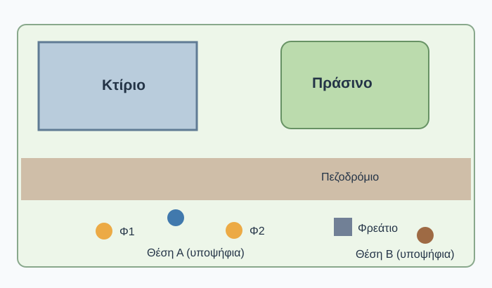
*Σχήμα FS00-S01. Κοινό συνθετικό σκαρίφημα· όχι υπό κλίμακα. Οι υποψήφιες στάσεις δεν είναι γνωστά γεωδαιτικά σημεία.*

---

# FS00.1 — Τι είναι μια εργασία τοπογραφικής αποτύπωσης;

**Χρόνος:** 8–10΄ μελέτη + 5–7΄ άσκηση. **Στόχος:** αναγνωρίζω τι χρειάζεται αποτύπωση και γιατί οι μετρήσεις πρέπει να αποτελούν οργανωμένη εργασία.

### 1.1 Ο χώρος πριν και μετά την αποτύπωση

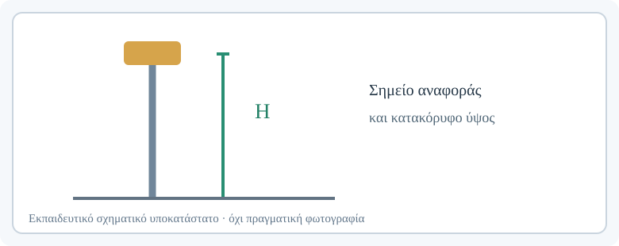

**Εκκρεμεί πραγματική φωτογραφία — FS00.1-P01.** *Ζητούμενη λήψη:* Πραγματικός υπαίθριος χώρος, ευρυγώνιο κάδρο στο ύψος των ματιών: όψη κτιρίου, πεζοδρόμιο, πράσινο και χαρακτηριστικά αντικείμενα. Επικάλυψη λεπτών αριθμημένων ενδείξεων 1=γωνία κτιρίου, 2=όριο πεζοδρομίου, 3=φωτιστικό, 4=φρεάτιο. Δεν σημειώνουμε ανύπαρκτες μετρημένες συντεταγμένες.

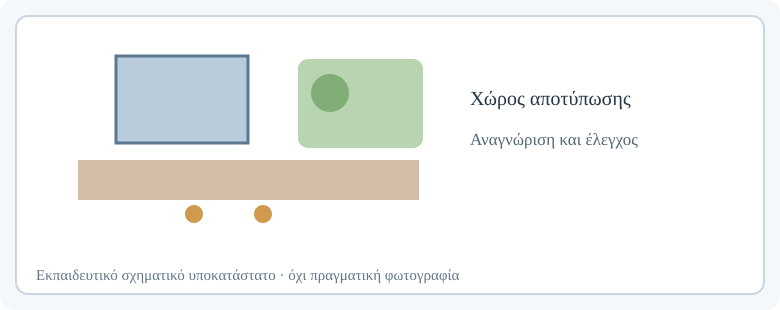

**Εκκρεμεί πραγματική φωτογραφία — FS00.1-P02.** *Ζητούμενη λήψη:* Πραγματικό τοπογραφικό σχέδιο ή ελεγχόμενο εκπαιδευτικό σχέδιο παρόμοιου χώρου, με σαφώς διακεκριμένα σημεία/γραμμές/περιγράμματα. Να αναγράφεται αν πρόκειται για παράδειγμα, όχι σχέδιο του εικονιζόμενου χώρου.

**Τοπογραφική αποτύπωση** είναι η οργανωμένη διαδικασία προσδιορισμού της θέσης και, όπου χρειάζεται, του υψομέτρου χαρακτηριστικών σημείων, ώστε να προκύψει ένα αξιόπιστο γεωμετρικό αποτέλεσμα, όπως ένα σχέδιο. Δεν μετράμε κάθε αντικείμενο ανεξαιρέτως. Επιλέγουμε όσα απαιτούν ο σκοπός, η κλίμακα/λεπτομέρεια και οι προδιαγραφές της εργασίας.

Στο κοινό σκαρίφημα, τις γωνίες του κτιρίου μπορούμε να τις αποδώσουμε με χαρακτηριστικά σημεία που ορίζουν το περίγραμμα. Για το πεζοδρόμιο χρειάζονται σημεία στα όρια και στις αλλαγές διεύθυνσης. Ένα φωτιστικό μπορεί να αναπαρασταθεί με τη θέση της βάσης του. Για το φρεάτιο μπορεί να ζητείται το κέντρο ή οι γωνίες του, ανάλογα με το παραδοτέο. Η πράσινη περιοχή χρειάζεται χαρακτηριστικά σημεία ορίου αν περιλαμβάνεται στην αποτύπωση.

### 1.2 «Παίρνω σημεία» ή «κάνω αποτύπωση»;

Η συλλογή σημείων δεν αρκεί. Σκέψου μια ομάδα που μετρά 20 σημεία χωρίς περιγραφές: ύστερα από μία εβδομάδα ίσως δεν ξέρει ποια ανήκουν στο κτίριο και ποια στο πεζοδρόμιο. Μια άλλη ομάδα μετρά χαρακτηριστικά σημεία, καταγράφει τους κωδικούς, διατηρεί σκαρίφημα και εκτελεί ελέγχους. Η δεύτερη μπορεί να δημιουργήσει και να υπερασπιστεί το αποτέλεσμα.

**Η διαδρομή μας:** Καταλαβαίνω την αποστολή → Προετοιμάζω → Στήνω → Προσανατολίζω → Μετρώ → Ελέγχω → Καταγράφω → Μεταφέρω → Επαληθεύω. Στο FS00 εστιάζουμε στις αρχές προετοιμασίας και ελέγχου· οι επιμέρους χειρισμοί έρχονται στα επόμενα μαθήματα.

### 1.3 Δοκίμασέ το

Στο κοινό σκαρίφημα σημείωσε (α) τρία αντικείμενα που θα αποτύπωνες, (β) ποια σημεία τα περιγράφουν, (γ) μία πληροφορία που δεν μπορείς να αποφασίσεις μόνο από την εικόνα.

Ενδεικτική απάντηση

Γωνίες κτιρίου, χαρακτηριστικά σημεία του ορίου πεζοδρομίου, βάσεις των δύο φωτιστικών. Δεν μπορούμε να αποφασίσουμε αν οι υποψήφιες στάσεις έχουν ασφαλή εγκατάσταση, ακριβή συντεταγμένα ή ελεύθερη ορατότητα μόνο από το σκαρίφημα.

**Κράτησε:** Η αποτύπωση ξεκινά με σαφή σκοπό, όχι με τυχαίες μετρήσεις.

---

# FS00.2 — Γνωρίζω τον εξοπλισμό πεδίου

**Χρόνος:** 15–20΄ + 10΄ αναγνώριση. **Στόχος:** αναγνωρίζω τα πραγματικά αντικείμενα και εξηγώ τι κάνει καθένα.

### 2.1 Ο γεωδαιτικός σταθμός

> **Δες τα εξαρτήματα σε πραγματικό όργανο — Αγγλικά.** [Trimble S Series: Instrument Description](https://help.fieldsystems.trimble.com/s-series-total-station/instrument-description-s-series.htm). Αναζήτησε τις αριθμημένες απεικονίσεις και εντόπισε τηλεσκόπιο, οθόνη, συνδέσεις και σημεία αναφοράς. Εναλλακτικά: [Leica TS16 User Manual, ενότητα 2.4, έντυπη σελίδα 32](https://laserplane.co.uk/wp-content/uploads/2022/02/Leica-TS16-Total-Station-User-Manual.pdf#page=32) (Αγγλικά). *Προσοχή: ο αριθμός έντυπης σελίδας μπορεί να διαφέρει από τον μετρητή του PDF viewer.*

*Φωτογραφία FS00.2-P01. Γεωδαιτικός σταθμός σε τρίποδα, σε πραγματική αποτύπωση. Πηγή: [Cvstr, Wikimedia Commons](https://commons.wikimedia.org/wiki/File:Total_station_coastal_survey.jpg) · [CC BY 4.0](https://creativecommons.org/licenses/by/4.0/). Η φωτογραφία δείχνει ενδεικτικό εξοπλισμό, όχι κατ’ ανάγκη το μοντέλο του εργαστηρίου. Φορτώνεται από την εξωτερική πηγή.*

*Φωτογραφία FS00.2-P02. Βάση tribrach με οπτική κέντρωση. Πηγή: [Johan Gustafsson, Wikimedia Commons](https://commons.wikimedia.org/wiki/File:Tribrach_for_surveying_instruments.JPG) · [Public domain](https://commons.wikimedia.org/wiki/File:Tribrach_for_surveying_instruments.JPG). Η φωτογραφία δείχνει ενδεικτικό εξοπλισμό, όχι κατ’ ανάγκη το μοντέλο του εργαστηρίου. Φορτώνεται από την εξωτερική πηγή.*

Ο γεωδαιτικός σταθμός μετρά γωνιακές διευθύνσεις και αποστάσεις προς στόχους, ώστε με σωστή στάση, προσανατολισμό και παραμέτρους να υπολογίζονται συντεταγμένες. Το τηλεσκόπιο χρησιμοποιείται για σκόπευση· το EDM για ηλεκτρονική μέτρηση απόστασης· τα χειριστήρια για ενδείξεις, ρυθμίσεις και καταγραφή. Η βάση, οι κοχλίες, οι φυσαλίδες και η διάταξη κέντρωσης υποστηρίζουν την εγκατάσταση. Η ακριβής κατασκευή διαφέρει ανά όργανο.

### 2.2 Τρίποδας και βάση

> **Δες τη διαδικασία εγκατάστασης — Αγγλικά.** [Leica TS16 User Manual, ενότητα 4.1, έντυπη σελίδα 38](https://laserplane.co.uk/wp-content/uploads/2022/02/Leica-TS16-Total-Station-User-Manual.pdf#page=38). Παρατήρησε με τη σειρά τρίποδα, στερέωση, κέντρωση, κοχλίες και επανέλεγχο φυσαλίδας. Μην επιχειρείς τη διαδικασία χωρίς επίβλεψη.

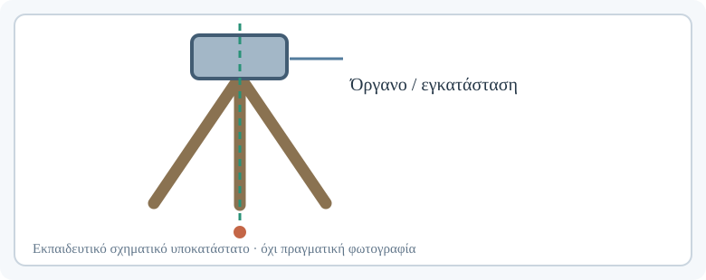

**Εκκρεμεί πραγματική φωτογραφία — FS00.2-P03.** *Ζητούμενη λήψη:* Τρίποδας κλειστός/ανοιχτός σε δύο διαδοχικά καρέ, εμφανείς ασφάλειες, κεφαλή και πέλματα.

**Εκκρεμεί πραγματική φωτογραφία — FS00.2-P04.** *Ζητούμενη λήψη:* Σωστή/προβληματική εγκατάσταση ως εκπαιδευτική σύγκριση, χωρίς έκθεση πραγματικού οργάνου σε κίνδυνο· η προβληματική κατάσταση να αναπαρασταθεί με σχέδιο ή άδειο τρίποδα.

Ο τρίποδας στηρίζει το όργανο. Προτού τον χρησιμοποιήσουμε ελέγχουμε οπτικά πόδια, ασφάλειες, συνδέσεις και καταλληλότητα εδάφους. Η βάση (tribrach) επιτρέπει στερέωση και οριζοντίωση, ενώ η διάταξη κέντρωσης βοηθά να τοποθετηθεί ο άξονας πάνω από το σημείο. Η ακριβής διαδικασία διδάσκεται στην FS02.

### 2.3 Πρίσμα, κοντάρι, χειριστήριο

*Φωτογραφία FS00.2-P05. Ανακλαστικό πρίσμα με στόχο. Πηγή: [Jfoster7991, Wikimedia Commons](https://commons.wikimedia.org/wiki/File:Prism_Target_used_with_survey_equipment.jpg) · [CC BY-SA 4.0](https://creativecommons.org/licenses/by-sa/4.0/). Η φωτογραφία δείχνει ενδεικτικό εξοπλισμό, όχι κατ’ ανάγκη το μοντέλο του εργαστηρίου. Φορτώνεται από την εξωτερική πηγή.*

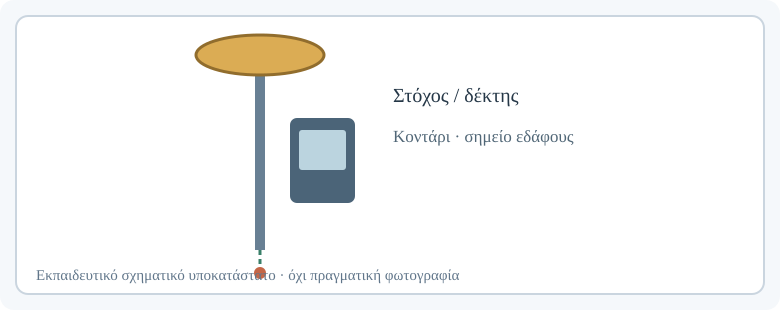

**Εκκρεμεί πραγματική φωτογραφία — FS00.2-P06.** *Ζητούμενη λήψη:* Κοντάρι πρίσματος ολόκληρο και ξεχωριστό κοντινό στη φυσαλίδα και στην κλίμακα ύψους.

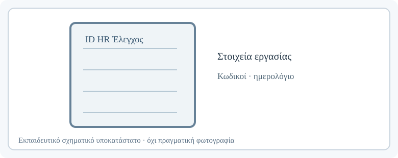

**Εκκρεμεί πραγματική φωτογραφία — FS00.2-P07.** *Ζητούμενη λήψη:* Χειριστήριο πεδίου με ενδεικτική οθόνη επιλογής εργασίας ή σημείου, χωρίς προσωπικά δεδομένα/κωδικούς.

Το πρίσμα λειτουργεί ως ανακλαστικός στόχος για την ηλεκτρονική μέτρηση απόστασης. Το κοντάρι το τοποθετεί πάνω από το σημείο εδάφους. Χρειάζεται να γνωρίζουμε το ύψος του κέντρου στόχου και να διατηρούμε την κατάλληλη κατακόρυφη θέση. Ορισμένα όργανα επιτρέπουν μετρήσεις χωρίς πρίσμα, αλλά αυτό εξαρτάται από τις συνθήκες και το όργανο. Το χειριστήριο βοηθά σε ρυθμίσεις, κωδικούς σημείων και αποθήκευση.

### 2.4 GNSS rover και βοηθητικός εξοπλισμός

*Φωτογραφία FS00.2-P08. Δέκτης GNSS και χειριστήριο. Πηγή: [Best Tech Nick 25, Wikimedia Commons](https://commons.wikimedia.org/wiki/File:Trimble_GNSS_Messausr%C3%BCstung_R980_Empf%C3%A4nger.jpg) · [CC0 1.0](https://creativecommons.org/publicdomain/zero/1.0/). Η φωτογραφία δείχνει ενδεικτικό εξοπλισμό, όχι κατ’ ανάγκη το μοντέλο του εργαστηρίου. Φορτώνεται από την εξωτερική πηγή.*

**Εκκρεμεί πραγματική φωτογραφία — FS00.2-P09.** *Ζητούμενη λήψη:* Μπαταρίες/φορτιστές/μετροταινία/σήμανση σε τακτοποιημένο πάγκο, με ξεχωριστή ετικέτα για κάθε αντικείμενο.

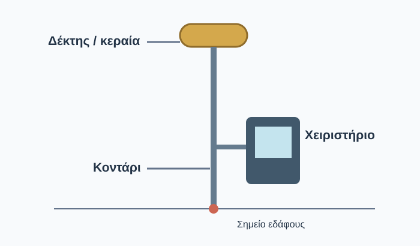
*Σχήμα FS00-S02. Διάταξη rover· το σημείο αναφοράς του ύψους κεραίας εξαρτάται από μοντέλο και μέθοδο.*

Ο δέκτης GNSS αξιοποιεί δορυφορικές παρατηρήσεις για να προσδιορίσει τη θέση της κεραίας. Το χειριστήριο οργανώνει τη μέτρηση. Για RTK απαιτούνται κατάλληλες διορθώσεις και ρυθμίσεις. Για μια έξοδο πρέπει ακόμη να έχουμε επαρκείς μπαταρίες, τρόπους αποθήκευσης, μέσο μέτρησης υψών και κατάλληλο εξοπλισμό ασφαλείας.

### 2.5 Άσκηση «Τι λείπει από τον πάγκο;»

**Σκηνή Α:** γεωδαιτικός σταθμός, τρίποδας, πρίσμα, *χωρίς κοντάρι*, μετροταινία και φορτισμένες μπαταρίες. **Σκηνή Β:** rover, κοντάρι, χειριστήριο, μπαταρίες, αλλά *χωρίς επιβεβαιωμένη πρόσβαση στην υπηρεσία διορθώσεων* για τη σχεδιαζόμενη RTK εργασία.

Σημείωσε τι λείπει και γιατί έχει σημασία. Στη συνέχεια ομαδοποίησε τα αντικείμενα ανά εργασία.

Ενδεικτική λύση

Στη σκηνή Α λείπει ο προβλεπόμενος τρόπος σωστής τοποθέτησης του πρίσματος πάνω από τα σημεία. Στη Β πρέπει να επιβεβαιωθεί η πηγή διορθώσεων ή να αναθεωρηθεί η μέθοδος. Η ύπαρξη του οργάνου δεν αρκεί για ετοιμότητα.

**Κράτησε:** Εξοπλισμός σημαίνει σύνολο λειτουργικών εξαρτημάτων, όχι μόνο το κύριο όργανο.

---

# FS00.3 — Τι μετρά ο γεωδαιτικός σταθμός και τι το GNSS;

**Χρόνος:** 12–15΄ + 5–8΄ δραστηριότητα. **Στόχος:** ξεχωρίζω την αρχή μέτρησης και επιλέγω αρχικά την κατάλληλη προσέγγιση.

### 3.1 Γεωδαιτικός σταθμός: από μια στάση προς έναν στόχο

**Εκκρεμεί πραγματική φωτογραφία — FS00.3-P01.** *Ζητούμενη λήψη:* Πραγματική σκόπευση γεωδαιτικού σταθμού προς πρίσμα: στο ίδιο κάδρο, εφόσον είναι δυνατόν, φαίνονται όργανο και στόχος. Προσθήκη λεπτής γραμμής σκόπευσης μόνο αν αντιστοιχεί σωστά στη σκηνή.

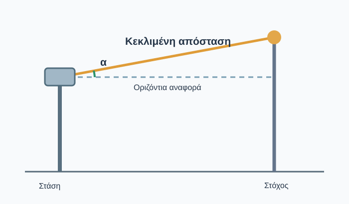
*Σχήμα FS00-S03. Κατακόρυφη τομή: κεκλιμένη απόσταση και γωνία κλίσης σε σχέση με οριζόντια αναφορά. Η οριζόντια γωνία ορίζεται διαφορετικά, σε κάτοψη.*

Ο γεωδαιτικός σταθμός δίνει οριζόντιες γωνιακές **διευθύνσεις**, κατακόρυφη γωνιακή ένδειξη και κεκλιμένη απόσταση προς τον στόχο. Η **οριζόντια γωνία** μεταξύ δύο στόχων προκύπτει από τη διαφορά των δύο αντίστοιχων διευθύνσεων. Η κεκλιμένη απόσταση δεν ταυτίζεται συνήθως με την οριζόντια. Για υπολογισμό συντεταγμένων απαιτούνται σωστή στάση, προσανατολισμός και οι κατάλληλες παράμετροι, συμπεριλαμβανομένων των απαιτούμενων υψών.

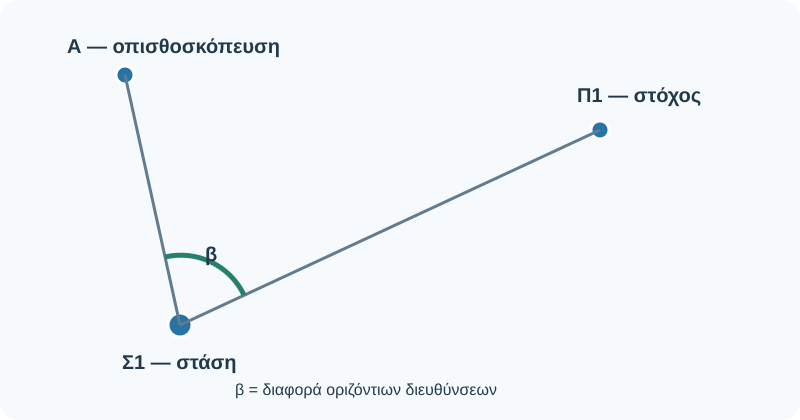
*Επεξηγηματικό σχήμα — συνθετική αναπαράσταση, όχι υπό κλίμακα. Απαιτείται τεχνική επιβεβαίωση πριν από τη δημοσίευση.*

### 3.2 GNSS: από δορυφορικές παρατηρήσεις στη θέση κεραίας

> **Προαιρετική εμβάθυνση — Ελληνικά.** [Ελληνικό Κτηματολόγιο: Οδηγίες χρήσης υπηρεσιών πραγματικού χρόνου HEPOS (PDF)](https://ia43rg05sa01.blob.core.windows.net/ktima-public/assets/KT_DOCLIB_1175005_v1_HEPOS_RT_INSTR_V3_0_GR_2f7d90a490_73e5ee7c6d.pdf). Δες τι είναι μια υπηρεσία διορθώσεων RTK και πώς περιγράφεται η σύνδεση χρήστη· δεν απαιτείται να εκτελέσεις ρυθμίσεις.

*Φωτογραφία FS00.3-P02. Χειριστής GNSS RTK σε εργασία πεδίου. Πηγή: [Cvstr, Wikimedia Commons](https://commons.wikimedia.org/wiki/File:Surveyor_Using_GNSS_Receiver_with_RTK_Solution.jpg) · [CC BY 4.0](https://creativecommons.org/licenses/by/4.0/). Η φωτογραφία δείχνει ενδεικτικό εξοπλισμό, όχι κατ’ ανάγκη το μοντέλο του εργαστηρίου. Φορτώνεται από την εξωτερική πηγή.*

Ο δέκτης GNSS λαμβάνει σήματα από δορυφορικά συστήματα πλοήγησης. Από παρατηρήσεις όπως ψευδοαποστάσεις και φάσεις φέροντος, κατάλληλη επεξεργασία και, για RTK, δεδομένα/διορθώσεις αναφοράς, υπολογίζει τη θέση της **κεραίας**. Για να περιγράψει το σημείο στο έδαφος, πρέπει να ληφθούν υπόψη σωστά η εγκατάσταση και το ύψος κεραίας.

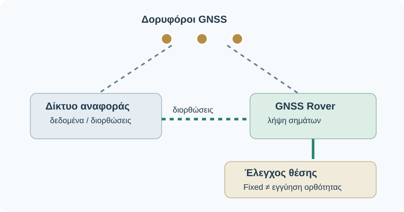
*Επεξηγηματικό σχήμα — συνθετική αναπαράσταση, όχι υπό κλίμακα. Απαιτείται τεχνική επιβεβαίωση πριν από τη δημοσίευση.*

### 3.3 Πώς επιλέγω μέθοδο;

**Εκκρεμεί πραγματική φωτογραφία — FS00.3-P03.** *Ζητούμενη λήψη:* Στενός αστικός χώρος δίπλα σε ψηλά κτίρια· εμφανείς φραγμοί ορατότητας ουρανού.

**Εκκρεμεί πραγματική φωτογραφία — FS00.3-P04.** *Ζητούμενη λήψη:* Ανοιχτός υπαίθριος χώρος με επαρκή ορατότητα ουρανού.

Ο γεωδαιτικός σταθμός απαιτεί ορατότητα προς τον στόχο, αλλά όχι ορατότητα δορυφόρων. Το GNSS δεν απαιτεί επίγεια γραμμή σκόπευσης προς τον στόχο, όμως εξαρτάται από τη δορυφορική λήψη, τις συνθήκες, τις διορθώσεις και την κατάλληλη ρύθμιση. Σε στενό χώρο με ψηλά κτίρια συχνά προτιμάμε γεωδαιτικό σταθμό. Σε ανοιχτό χώρο το GNSS RTK μπορεί να είναι ιδιαίτερα αποδοτικό. Συχνά οι δύο μέθοδοι συμπληρώνονται.

### 3.4 Έλεγξε την κατανόησή σου

**Ερώτηση 1.** Γιατί ένας γεωδαιτικός σταθμός μπορεί να δείχνει συντεταγμένες και παρ' όλα αυτά να χρειάζεται έλεγχο;  
**Ερώτηση 2.** Μπορεί ένα rover να δείχνει Fixed και παρ' όλα αυτά να έχει σφάλμα;  
**Ερώτηση 3.** Ποια μέθοδος θα εξετάσεις πρώτη για λεπτομέρειες σε στενό διάδρομο, με ορατότητα προς πρίσμα αλλά περιορισμένο ουρανό;

Ενδεικτικές απαντήσεις

1. Οι συντεταγμένες εξαρτώνται από στάση, προσανατολισμό, παραμέτρους και ποιότητα παρατηρήσεων. 2. Ναι· ενδεικτικά λανθασμένο ύψος κεραίας ή σύστημα αναφοράς δεν αποκλείεται από το Fixed. 3. Τον γεωδαιτικό σταθμό, με έλεγχο κατάλληλης στάσης και σκόπευσης.

**Κράτησε:** Διαφορετικές παρατηρήσεις, ίδιος στόχος — ελεγμένες θέσεις σημείων.

---

# FS00.4 — Σημείο στάσης, αναφοράς και ύψη οργάνων

**Χρόνος:** 12–15΄ + 5–8΄ δραστηριότητα. **Στόχος:** χρησιμοποιώ σωστά έξι βασικούς όρους.

### 4.1 Σημείο στάσης και σημείο αναφοράς

**Εκκρεμεί πραγματική φωτογραφία — FS00.4-P01.** *Ζητούμενη λήψη:* Υλοποιημένο σημείο στο έδαφος, κοντινό σε καρφί/σήμα με κωδικό. Να διακρίνεται το σημάδι από τυχαία επιφανειακή φθορά.

**Εκκρεμεί πραγματική φωτογραφία — FS00.4-P02.** *Ζητούμενη λήψη:* Όργανο εγκατεστημένο πάνω από σημείο, με δεύτερο κοντινό στη διάταξη κέντρωσης.

Το **σημείο στάσης** είναι το σημείο από το οποίο ο γεωδαιτικός σταθμός παρατηρεί τους στόχους. Ο άξονάς του πρέπει να τοποθετηθεί σωστά πάνω από το σημείο, σύμφωνα με τη διαδικασία εγκατάστασης. Ένα σημείο στάσης μπορεί να έχει ήδη γνωστές συντεταγμένες ή να απαιτεί προσδιορισμό· δεν θεωρούμε κάθε σημείο γνωστό. Το **σημείο αναφοράς/ελέγχου** έχει γνωστές ή κατάλληλα τεκμηριωμένες πληροφορίες που χρησιμοποιούνται σύμφωνα με τη μέθοδο. Το **σημείο προσανατολισμού (backsight)** είναι ο στόχος προς τον οποίο σκοπεύουμε για τον καθορισμό/έλεγχο προσανατολισμού.

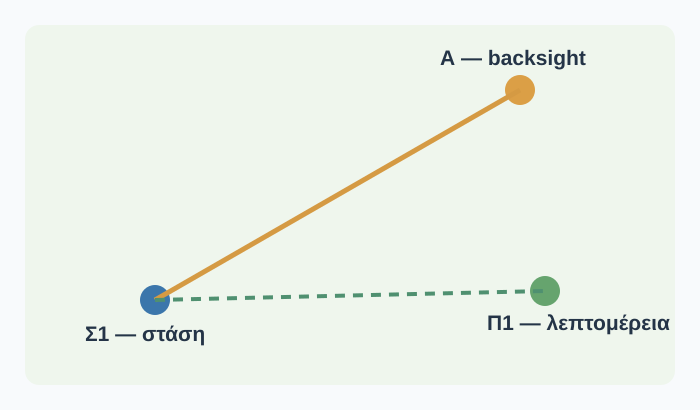
*Σχήμα FS00-S04. Κάτοψη με στάση Σ1, γνωστό σημείο Α και λεπτομέρεια Π1. Το Α είναι γνωστό μόνο μέσα στο εκπαιδευτικό σενάριο.*

### 4.2 Σημεία λεπτομέρειας και κωδικοί

**Εκκρεμεί πραγματική φωτογραφία — FS00.4-P03.** *Ζητούμενη λήψη:* Κοντάρι σε χαρακτηριστική γωνία πεζοδρομίου, ορατή η βάση που αντιστοιχεί στο σημείο.

Μια γωνία κτιρίου μπορεί να ονομαστεί `Κ01`, μια αλλαγή διεύθυνσης ορίου `Π02` και η βάση ενός φωτιστικού `Φ01`. Οι κωδικοί είναι εκπαιδευτικά παραδείγματα· το ζητούμενο είναι η συνέπεια. Οι συντεταγμένες χωρίς αντιστοίχιση με το αντικείμενο συχνά δεν επαρκούν για τη σύνταξη του σχεδίου.

### 4.3 Ύψος οργάνου και στόχου

> **Δες πού μετράμε — Αγγλικά.** [Trimble S Series: Measuring the Instrument Height](https://help.fieldsystems.trimble.com/s-series-total-station/measuring-the-instrument-height.htm). Εστίασε στα σχήματα των σημείων αναφοράς και στη διαφορά κεκλιμένης/κατακόρυφης απόστασης. Οι αποστάσεις/σταθερές αφορούν το συγκεκριμένο μοντέλο.

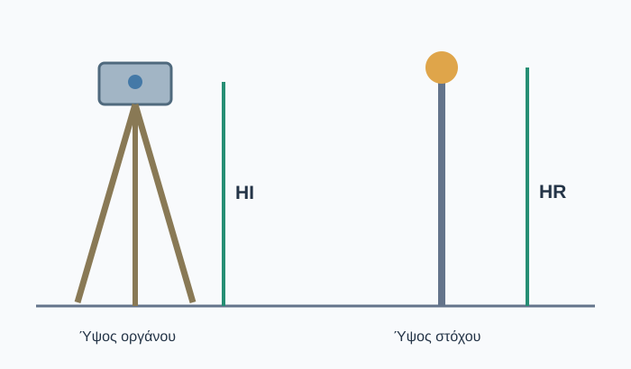
*Σχήμα FS00-S05. Ύψος οργάνου HI και ύψος στόχου HR σε διαφορετικές θέσεις. Τα ακριβή σημεία αναφοράς πρέπει να καθορίζονται σύμφωνα με το μοντέλο.*

Το **HI** είναι το ύψος οργάνου ως προς το σημείο στάσης, με βάση τον καθορισμένο τρόπο μέτρησης του συγκεκριμένου οργάνου. Το **HR** είναι το κατακόρυφο ύψος του κατάλληλου σημείου αναφοράς του στόχου από το σημείο εδάφους. Όταν αλλάζει το ύψος κονταριού, αλλάζει και η πληροφορία που πρέπει να καταχωριστεί ή να ελεγχθεί.

**Εκκρεμεί πραγματική φωτογραφία — FS00.4-P04.** *Ζητούμενη λήψη:* Μετροταινία στο σημείο μέτρησης HI για το πραγματικό όργανο, με σαφή ένδειξη από πού έως πού.

**Εκκρεμεί πραγματική φωτογραφία — FS00.4-P05.** *Ζητούμενη λήψη:* Κοντάρι πρίσματος με κλίμακα/κέντρο στόχου, χωρίς αυθαίρετη ταύτιση ονομαστικού μήκους και πραγματικού HR.

### 4.4 Ύψος κεραίας GNSS

> **Δες την αναφορά ύψους κεραίας — Αγγλικά.** [Trimble Access: GNSS Antenna Heights](https://help.fieldsystems.trimble.com/trimble-access/latest/en/gnss-antenna-heights.htm). Στην ενότητα για δέκτη επάνω σε κοντάρι, παρατήρησε τη μέτρηση ύψους και τη διαφορά από το κέντρο φάσης της κεραίας.

Η θέση που υπολογίζεται αφορά την κεραία και το εφαρμοζόμενο μοντέλο αναφοράς της. Ο χειριστής πρέπει να χρησιμοποιεί σωστό τύπο μέτρησης ύψους και σωστό αναγνωριστικό κεραίας. **Δεν ταυτίζουμε αυτομάτως** τη μετρούμενη απόσταση μέχρι κάποιο σημείο του περιβλήματος με το ύψος που χρησιμοποιεί η επεξεργασία.

**Εκκρεμεί πραγματική φωτογραφία — FS00.4-P06.** *Ζητούμενη λήψη:* GNSS κοντάρι και ένδειξη ύψους, δεύτερο καρέ με τη ρύθμιση antenna height στο χειριστήριο. Η αντιστοίχιση να ελεγχθεί από συνάδελφο και εγχειρίδιο συσκευής.

### 4.5 Μικρή εφαρμογή

Στάση Σ1, σημείο προσανατολισμού Α, HI=1,52 m, HR=1,80 m. Πριν από το Π03 μειώνεται το HR σε 1,60 m. Τι αλλάζει στην καταγραφή;

Ενδεικτική απάντηση

Ενημερώνουμε την παράμετρο ύψους στόχου για τις νέες μετρήσεις και καταγράφουμε πότε/σε ποια σημεία ισχύει. Δεν θεωρούμε ότι η αλλαγή είναι αμελητέα.

**Κράτησε:** Σημείο και ύψος χωρίς σωστή αναφορά μπορούν να δώσουν λανθασμένο αποτέλεσμα.

---

# FS00.5 — Προετοιμάζω την εργασία πεδίου

**Χρόνος:** 15΄ + 10–15΄ δραστηριότητα. **Στόχος:** δημιουργώ λειτουργικό σχέδιο εξόδου και ελέγχου.

### 5.1 Πρώτα η αποστολή, έπειτα το όργανο

Πρέπει να αποτυπώσουμε το κτίριο, το πεζοδρόμιο, δύο φωτιστικά και το φρεάτιο. Πριν επιλέξουμε εξοπλισμό, σημειώνουμε τι ζητείται, ποια λεπτομέρεια απαιτείται, ποιο είναι το προβλεπόμενο σύστημα αναφοράς, ποια είναι τα σημεία ελέγχου και ποιος έχει ορίσει τα κριτήρια αποδοχής. Ό,τι δεν έχει δοθεί καταγράφεται ως **«προς επιβεβαίωση»**, όχι ως εικασία.

**Εκκρεμεί πραγματική φωτογραφία — FS00.5-P01.** *Ζητούμενη λήψη:* Φωτογραφική ακολουθία αναγνώρισης: 1 γενική όψη χώρου, 2 πιθανό εμπόδιο ορατότητας, 3 ασφαλής περιοχή τοποθέτησης, 4 σημείο αναφοράς αν υπάρχει. Λεζάντα με συγκεκριμένη απόφαση σε κάθε κάδρο.

### 5.2 Αναγνώριση χώρου και ασφάλεια

Ελέγχουμε πρόσβαση, κυκλοφορία πεζών, μεταβαλλόμενο καιρό, εμπόδια στη σκόπευση, ορατότητα ουρανού για GNSS, σταθερότητα εδάφους και ενδεχόμενους κινδύνους. Οι υποψήφιες θέσεις στάσης στο σκαρίφημα **δεν είναι εγκεκριμένες θέσεις**. Για την πρώτη εκπαιδευτική δραστηριότητα επιλέγεται χώρος χωρίς οδική κυκλοφορία ή άλλους μη ελεγχόμενους κινδύνους. Τηρούμε τις οδηγίες του εργαστηρίου και του συγκεκριμένου εξοπλισμού, συμπεριλαμβανομένης της ασφάλειας laser.

**Εκκρεμεί πραγματική φωτογραφία — FS00.5-P02.** *Ζητούμενη λήψη:* Ελεγχόμενος υπαίθριος χώρος εργασίας· επισημάνσεις της ασφαλούς ζώνης, της διέλευσης πεζών και των εμποδίων.

### 5.3 Έλεγχος εξοπλισμού

> **Δες μια ολοκληρωμένη προετοιμασία — Αγγλικά.** [Trimble S Series: Setting Up and Starting](https://help.fieldsystems.trimble.com/s-series-total-station/setup-and-start.htm). Αναζήτησε τα βήματα εγκατάστασης, ασφάλισης, οριζοντίωσης και ελέγχου πριν από τις μετρήσεις.

**Εκκρεμεί πραγματική φωτογραφία — FS00.5-P03.** *Ζητούμενη λήψη:* Flat lay γεωδαιτικού σταθμού στον πάγκο: όργανο, βάση, τρίποδας, πρίσμα, κοντάρι, χειριστήριο εφόσον χρησιμοποιείται, μπαταρίες, φορτιστής, μετροταινία και φύλλο πεδίου. Αριθμημένες ετικέτες.

**Εκκρεμεί πραγματική φωτογραφία — FS00.5-P04.** *Ζητούμενη λήψη:* Flat lay GNSS RTK: δέκτης, κοντάρι, χειριστήριο, τροφοδοσία, σύστημα επικοινωνίας όπως απαιτείται, στοιχεία πρόσβασης χωρίς δημόσια αποκάλυψη κωδικών, φύλλο πεδίου.

**Κοινός ελάχιστος έλεγχος:** εξοπλισμός πλήρης; μπαταρίες φορτισμένες; βάσεις/κοντάρια/ασφάλειες σε καλή κατάσταση; σωστή εργασία και κωδικοποίηση; διαθέσιμα στοιχεία αναφοράς/ελέγχου; έχει οριστεί ποιος αναλαμβάνει τι; έχει γίνει εκτίμηση ασφάλειας;

### 5.4 Ρόλοι και επικοινωνία

Σε τριμελή ομάδα ένας χειρίζεται το όργανο, ένας βοηθά στους στόχους και ένας ελέγχει καταγραφές/κωδικούς. Οι ρόλοι εναλλάσσονται στη διδασκαλία. Όλοι πρέπει να γνωρίζουν ποιο αντικείμενο είναι, για παράδειγμα, το `Π03`. Διαφορετικά μπορεί να αποθηκευτεί σωστή γεωμετρία με λάθος περιγραφή.

### 5.5 Φύλλο προετοιμασίας

Συμπλήρωσε: εργασία, ημερομηνία, ομάδα, περιοχή, σκοπός, στοιχεία προς αποτύπωση, μέθοδος και εξοπλισμός, στοιχεία αναφοράς, σύστημα συντεταγμένων, απαιτήσεις ακρίβειας, κίνδυνοι/μέτρα, έλεγχοι και εκκρεμότητες. Το κοινό εκτυπώσιμο υπόδειγμα βρίσκεται στο τέλος αυτού του πακέτου.

Ενδεικτικό συμπληρωμένο παράδειγμα

Εργασία FS-DEMO-01· σκοπός: προετοιμασία αποτύπωσης μικρού υπαίθριου χώρου· αντικείμενα: κτίριο, πεζοδρόμιο, φωτιστικά, φρεάτιο· προτεινόμενη αρχική μέθοδος: γεωδαιτικός σταθμός, ενδεχόμενη συμπλήρωση GNSS· σύστημα συντεταγμένων και γνωστά σημεία: **προς καθορισμό από διδάσκοντα**· κίνδυνοι: διέλευση πεζών, ασταθές έδαφος, εμπόδια· προγραμματισμένοι έλεγχοι: εγκατάσταση, προσανατολισμός, ύψη, κωδικοί και ανεξάρτητος έλεγχος κατά την πραγματική εργασία.

**Κράτησε:** Ετοιμότητα δεν σημαίνει απλώς «έχω φορτισμένο όργανο».

---

# FS00.6 — Τι μπορεί να πάει στραβά;

**Χρόνος:** 15–20΄ + 10΄ δραστηριότητα. **Στόχος:** αναγνωρίζω έξι τύπους προβλημάτων, τη συνέπειά τους και τον πρώτο ασφαλή έλεγχο.

### 6.1 Πρόβλημα στήριξης

> **Σύγκρινε με την επίσημη διαδικασία — Αγγλικά.** [Trimble S Series: Setting Up and Starting](https://help.fieldsystems.trimble.com/s-series-total-station/setup-and-start.htm). Παρατήρησε τους ελέγχους σταθερότητας και οριζοντίωσης.

**Εκκρεμεί πραγματική φωτογραφία — FS00.6-P01.** *Ζητούμενη λήψη:* Σταθερός τρίποδας σε ασφαλές επίπεδο, χωρίς να υπονοείται ότι το επίπεδο έδαφος αρκεί για την ορθή εγκατάσταση.

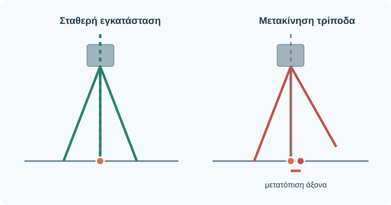
*Επεξηγηματικό σχήμα — συνθετική αναπαράσταση, όχι υπό κλίμακα. Απαιτείται τεχνική επιβεβαίωση πριν από τη δημοσίευση.*

**Συνέπεια:** αν μετακινηθεί το όργανο μετά την εγκατάσταση, η στάση ή η οριζοντίωση μπορεί να μην ισχύουν. **Ενέργεια:** σταματούμε, επανελέγχουμε εγκατάσταση και αναφορά και εξετάζουμε ποιες παρατηρήσεις απαιτούν επανάληψη.

### 6.2 Κεκλιμένο κοντάρι

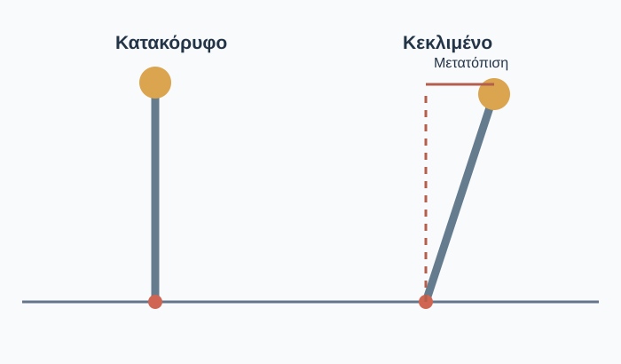
*Σχήμα FS00-S06. Το κέντρο στόχου μετατοπίζεται οριζόντια όταν το κοντάρι δεν είναι κατακόρυφο. Το σχήμα είναι ενδεικτικό.*

**Συνέπεια:** το κέντρο στόχου/κεραίας δεν βρίσκεται κατακόρυφα πάνω από το σημείο. **Ενέργεια:** ελέγχουμε φυσαλίδα/ρύθμιση και χρησιμοποιούμε τυχόν αντιστάθμιση κλίσης μόνο αν υποστηρίζεται και εφαρμόζεται σωστά.

### 6.3 Λάθος ύψος

**Εκκρεμεί πραγματική φωτογραφία — FS00.6-P02.** *Ζητούμενη λήψη:* Οθόνη με καταχωρισμένο ύψος στόχου και πραγματική κλίμακα κονταριού, δύο εικόνες δίπλα-δίπλα· για το εκπαιδευτικό σενάριο πραγματικό HR 1,80 m, δηλωμένο 1,60 m.

**Συνέπεια:** η διαφορά 0,20 m μπορεί να επηρεάσει ανάλογα την υψομετρική θέση. **Ενέργεια:** ελέγχουμε πραγματικό και δηλωμένο ύψος, καταγράφουμε την αλλαγή και επανεξετάζουμε τις μετρήσεις που επηρεάζονται. Ποτέ αυτόματη αντιγραφή παλιάς τιμής.

### 6.4 Λανθασμένος προσανατολισμός

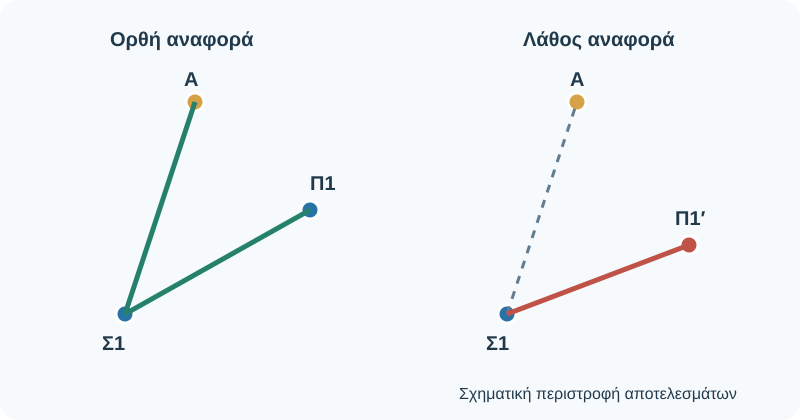
*Επεξηγηματικό σχήμα — συνθετική αναπαράσταση, όχι υπό κλίμακα. Απαιτείται τεχνική επιβεβαίωση πριν από τη δημοσίευση.*

**Συνέπεια:** μπορεί να επηρεαστεί ο προσανατολισμός του συνόλου σημείων. **Ενέργεια:** επιβεβαιώνουμε ταυτότητα/συντεταγμένες backsight και εφαρμόζουμε τους προβλεπόμενους ελέγχους, κατά προτίμηση ανεξάρτητους όπου απαιτούνται. Δεν χαρακτηρίζουμε τη στάση αποδεκτή επειδή απλώς εμφανίστηκαν συντεταγμένες.

### 6.5 Δυσμενές GNSS

**Εκκρεμεί πραγματική φωτογραφία — FS00.6-P03.** *Ζητούμενη λήψη:* Rover σε ανοιχτό χώρο, ορατός ο ουρανός και το περιβάλλον.

*Φωτογραφία FS00.6-P04. Δέκτης GNSS σε περιβάλλον με δέντρα· παράδειγμα πιθανών εμποδίων. Πηγή: [Cvstr, Wikimedia Commons](https://commons.wikimedia.org/wiki/File:GNSS_receiver_at_dusk_among_eucalyptus_trees.jpg) · [CC BY 4.0](https://creativecommons.org/licenses/by/4.0/). Η φωτογραφία δείχνει ενδεικτικό εξοπλισμό, όχι κατ’ ανάγκη το μοντέλο του εργαστηρίου. Φορτώνεται από την εξωτερική πηγή.*

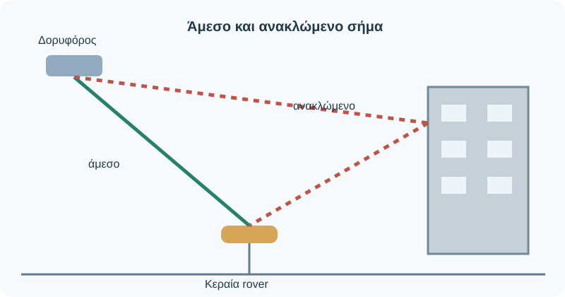
*Επεξηγηματικό σχήμα — συνθετική αναπαράσταση, όχι υπό κλίμακα. Απαιτείται τεχνική επιβεβαίωση πριν από τη δημοσίευση.*

**Συνέπεια:** παρεμπόδιση και ανακλάσεις σημάτων (multipath) μπορούν να υποβαθμίσουν το αποτέλεσμα. **Ενέργεια:** αξιολογούμε περιβάλλον, κατάσταση διορθώσεων, ποιότητα λύσης, επαναλήψεις και αποτελέσματα ελέγχου. Το `Fixed` δεν αποτελεί εγγύηση ορθότητας.

### 6.6 Λάθος κωδικός σημείου

**Εκκρεμεί πραγματική φωτογραφία — FS00.6-P05.** *Ζητούμενη λήψη:* Ανώνυμο/συνθετικό απόσπασμα εγγραφών χειριστηρίου 101 φωτιστικό/Φ01, 102 φρεάτιο/ΦΡ01, 103 φωτιστικό/ΦΡ01 — το τελευταίο λανθασμένο· έντονη επισήμανση της ασυμφωνίας.

**Συνέπεια:** σωστή θέση με λάθος περιγραφή μπορεί να οδηγήσει σε εσφαλμένο σχέδιο. **Ενέργεια:** ελέγχουμε ταυτότητα αντικειμένου, κωδικό και σκαρίφημα και τεκμηριώνουμε τη διόρθωση.

### 6.7 Άσκηση «Βρες το λάθος»

Για κάθε μία από τις έξι σκηνές συμπλήρωσε τρεις σύντομες φράσεις: **Τι βλέπω; Τι μπορεί να επηρεαστεί; Τι ελέγχω πρώτα;** Μην αποδίδεις «PASS» αν δεν υπάρχουν μετρήσεις και καθορισμένα κριτήρια.

Ενδεικτικές απαντήσεις

1. Τρίποδας μετακινήθηκε → πιθανή αλλαγή στάσης → διακοπή/επανέλεγχος. 2. Κοντάρι κεκλιμένο → λάθος θέση στόχου → κατακορύφωση ή ορθά ρυθμισμένη αντιστάθμιση. 3. Λάθος HR → επηρεασμένο υψόμετρο → διόρθωση παραμέτρου/αξιολόγηση καταγραφών. 4. Λάθος backsight → πιθανή περιστροφή θέσεων → αναγνώριση/ανεξάρτητος έλεγχος. 5. Κτίρια/δέντρα → πιθανή υποβάθμιση GNSS → έλεγχοι ποιότητας και επανάληψη. 6. Λάθος κωδικός → λανθασμένη σημασιολογία → έλεγχος με σκαρίφημα.

**Κράτησε:** Η επιτυχής αποθήκευση μιας μέτρησης δεν είναι έλεγχος ορθότητας.

---

# FS00.7 — Τι καταγράφω στο ημερολόγιο πεδίου;

**Χρόνος:** 12–15΄ + 10–15΄ δραστηριότητα. **Στόχος:** καταγράφω την εργασία έτσι ώστε να μπορεί να ελεγχθεί.

### 7.1 Γιατί δεν αρκεί το αρχείο σημείων;

**Εκκρεμεί πραγματική φωτογραφία — FS00.7-P01.** *Ζητούμενη λήψη:* Ανοιχτό πραγματικό ημερολόγιο πεδίου με μη ευαίσθητες εκπαιδευτικές εγγραφές· φαίνονται ημερομηνία, στάση, σύντομο σκαρίφημα.

**Εκκρεμεί πραγματική φωτογραφία — FS00.7-P02.** *Ζητούμενη λήψη:* Χειριστήριο και καταχώριση σημείου, χωρίς στοιχεία λογαριασμών ή προσωπικά δεδομένα.

Το ηλεκτρονικό αρχείο συνήθως κρατά μετρήσεις και κωδικούς, αλλά όχι πάντα γιατί αλλάξαμε στάση, τι δυσκόλεψε τη μέτρηση, ποια τιμή ύψους διορθώθηκε ή αν κάποιος έλεγχος απέτυχε. Το ημερολόγιο ενώνει τις παρατηρήσεις με τις συνθήκες και τις αποφάσεις της ομάδας. Μπορεί να είναι έντυπο ή ηλεκτρονικό, εφόσον είναι σαφές, διαθέσιμο και συνδεδεμένο με τα αρχεία της εργασίας.

### 7.2 Τέσσερα μέρη μιας χρήσιμης καταγραφής

**Α. Εργασία:** ημερομηνία, περιοχή, σκοπός, ομάδα, συνθήκες. **Β. Εξοπλισμός και αναφορά:** αναγνωριστικό οργάνου, μέθοδος, αρχείο, σύστημα αναφοράς. **Γ. Στάση/στόχος:** σημείο στάσης, backsight, HI/HR ή ύψος κεραίας, μεταβολές. **Δ. Μετρήσεις και έλεγχοι:** κωδικοί, παρατηρήσεις, επαναλήψεις, αποτελέσματα και εκκρεμότητες.

### 7.3 Πλήρως δουλεμένο παράδειγμα

**Συνθετική εργασία:** FS-DEMO-01 · ημερομηνία 31/10/2026 · ομάδα 1 · γεωδαιτικός σταθμός TS-LAB-01 (εκπαιδευτικό ID) · αρχείο `FS_DEMO_01` · τοπικό εκπαιδευτικό σύστημα. Στάση Σ1, προσανατολισμός προς σημείο Α1 (θεωρείται γνωστό μόνο στο σενάριο). HI=1,52 m, αρχικό HR=1,80 m.

| Ώρα | Σημείο/ενέργεια | Καταγραφή |
|---|---|---|
| 10:15 | Κ01 | Γωνία κτιρίου, HR=1,80 m |
| 10:18 | Π01 | Αρχή πεζοδρομίου, HR=1,80 m |
| 10:22 | Αλλαγή HR | Νέο HR=1,60 m, ενημερώθηκε το χειριστήριο πριν το Π02 |
| 10:23 | Π02 | Αλλαγή διεύθυνσης ορίου πεζοδρομίου, HR=1,60 m |
| 10:26 | Φ01 | Βάση φωτιστικού, HR=1,60 m |
| 10:33 | Ε1 | Έγινε επαναληπτική παρατήρηση ελέγχου· **αξιολόγηση αποτελέσματος εκκρεμεί** |

**Γιατί γράφουμε «εκκρεμεί»;** Δεν έχουν δοθεί αριθμητικά αποτελέσματα ή κριτήρια ανοχών. Δεν είναι επιστημονικά έντιμο να γράψουμε «έλεγχος PASS». Το ημερολόγιο πρέπει να παραπέμπει στο αρχείο μετρήσεων και, όταν αξιολογηθεί, στο αποτέλεσμα ελέγχου.

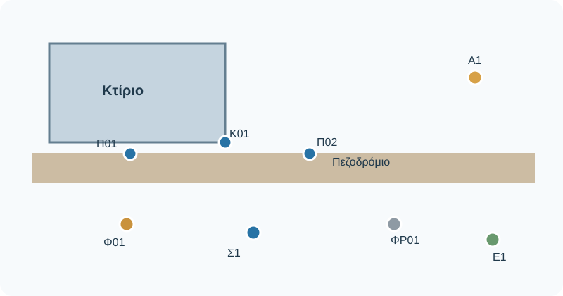
*Επεξηγηματικό σχήμα — συνθετική αναπαράσταση, όχι υπό κλίμακα. Απαιτείται τεχνική επιβεβαίωση πριν από τη δημοσίευση.*

### 7.4 Καλή έναντι ελλιπούς σημείωσης

**Ελλιπής:** «Μετρήθηκαν 101, 102, 103. Όλα ΟΚ». Δεν είναι σαφές ποια ήταν τα αντικείμενα, ποια η στάση και πώς ελέγχθηκαν. **Χρήσιμη:** «Σ1, Α1, HI 1,52 m, HR 1,80 m έως Π01· HR 1,60 m από Π02· αρχείο FS_DEMO_01· έλεγχος Ε1 σε εκκρεμότητα». Η δεύτερη συνδέει τα δεδομένα με τη διαδικασία.

### 7.5 Αντίστοιχες εγγραφές GNSS

Καταγράφουμε αναγνωριστικό δέκτη, τύπο κεραίας, ύψος και τρόπο μέτρησής του, πηγή διορθώσεων/ροή, σύστημα αναφοράς, κατάσταση λύσης, ενδείξεις ποιότητας και ανεξάρτητους ελέγχους, κατά τις απαιτήσεις της εργασίας. Το `Fixed` είναι κατάσταση λύσης, όχι τελικός χαρακτηρισμός ακρίβειας.

**Εκκρεμεί πραγματική φωτογραφία — FS00.7-P03.** *Ζητούμενη λήψη:* Εκπαιδευτικό στιγμιότυπο οθόνης GNSS, με σημειωμένα: point ID, antenna height/type, corrections, solution status, quality indicators. Πραγματικό μοντέλο υπό έλεγχο συναδέλφου.

### 7.6 Συμπλήρωσε εσύ

Δίνονται: στάση Σ2, backsight Α2, HI 1,48 m, αρχικό HR 1,80 m, HR 1,50 m πριν το Π03 και τελική μέτρηση ελέγχου Ε2 χωρίς αξιολογημένο αποτέλεσμα. Συμπλήρωσε τις εγγραφές, ιδίως την αλλαγή HR και την κατάσταση ελέγχου.

Ενδεικτική συμπλήρωση

Στάση Σ2· backsight Α2· HI=1,48 m· HR=1,80 m έως την αλλαγή· νέο HR=1,50 m πριν το Π03 και αντίστοιχη ενημέρωση χειριστηρίου· προς Ε2 έγινε μέτρηση, **αξιολόγηση εκκρεμεί**.

**Κράτησε:** Καταγράφω αυτό που πραγματικά έγινε και ό,τι δεν έχει ακόμη επιβεβαιωθεί.

---

# FS00.8 — Η πρώτη μου αποστολή πεδίου

**Χρόνος:** 25–35΄ πρακτική προπαρασκευή. **Στόχος:** παραδίδω ολοκληρωμένο φύλλο αποστολής για πραγματική μελλοντική εργασία υπό επίβλεψη.

### 8.1 Η αποστολή

**Εκκρεμεί πραγματική φωτογραφία — FS00.8-P01.** *Ζητούμενη λήψη:* Ο ίδιος εκπαιδευτικός υπαίθριος χώρος της FS00.1 από δεύτερη γωνία. Αν δεν υπάρχει συγκεκριμένος χώρος ακόμη, δηλώνεται «ενδεικτική φωτογραφία — δεν αντιστοιχεί στο συνθετικό σχέδιο».

Χρειάζεται να προετοιμάσεις αποτύπωση κτιρίου, πεζοδρομίου, δύο φωτιστικών και φρεατίου. Έχεις το κοινό σκαρίφημα, αλλά **δεν** έχεις εγκεκριμένες συντεταγμένες, πιστοποιημένες στάσεις, πληροφορίες πρόσβασης, όρια αποδοχής ή ολοκληρωμένη αυτοψία. Αυτό είναι σκόπιμο: η σωστή προετοιμασία περιλαμβάνει να επισημάνεις τα άγνωστα.

*Σχήμα FS00-S01. Οι θέσεις Α/Β είναι υποψήφιες και δεν θεωρούνται ασφαλείς ή γνωστές χωρίς έλεγχο.*

### 8.2 Η αποστολή σε έξι ενέργειες

**1. Καταλαβαίνω τι ζητείται.** Γράφω τα αντικείμενα και το τελικό σχέδιο που προβλέπεται. **2. Αναγνωρίζω τον χώρο.** Σημειώνω εμπόδια, πρόσβαση, ασφάλεια, πιθανές θέσεις εγκατάστασης. **3. Επιλέγω αρχικά εξοπλισμό.** Προτείνω μέθοδο και αιτιολογώ. **4. Οργανώνω ομάδα.** Χειριστής, βοηθός, καταγραφέας, με εναλλαγή. **5. Προβλέπω ελέγχους.** Σημειώνω τι πρέπει να καθοριστεί από τον διδάσκοντα. **6. Συμπληρώνω το φύλλο αποστολής.** Δεν κρύβω τις εκκρεμότητες.

**Εκκρεμεί πραγματική φωτογραφία — FS00.8-P02.** *Ζητούμενη λήψη:* Τρία διαδοχικά καρέ πραγματικής ομάδας: συζήτηση πάνω από σκαρίφημα, έλεγχος εξοπλισμού στον πάγκο, επιτόπια αναγνώριση με επίβλεψη. Κάθε καρέ αντιστοιχεί σε ενέργεια, όχι γενική πόζα.

### 8.3 Διάλεξε μέθοδο χωρίς αυθαίρετες παραδοχές

Έχεις κτίριο και δέντρα αλλά και ανοιχτό χώρο. Δεν είναι επιστημονικά σωστό να αποφασίσεις «μόνο GNSS» επειδή είναι γρήγορο, ούτε «μόνο γεωδαιτικό σταθμό» χωρίς αυτοψία. Αρχικά εξετάζεις συνθήκες, στόχους, προδιαγραφές και πιθανό συνδυασμό, με επιλογή του διδάσκοντα.

### 8.4 Φύλλο αποστολής — προς συμπλήρωση

| Πεδίο | Συμπλήρωση φοιτητή |
|---|---|
| Εργασία / ημερομηνία / ομάδα | __________________ |
| Περιοχή / πρόσβαση | __________________ |
| Σκοπός και παραδοτέο | __________________ |
| Αντικείμενα και χαρακτηριστικά σημεία | __________________ |
| Προτεινόμενα όργανα και παρελκόμενα | __________________ |
| Υποψήφιες θέσεις και εμπόδια | __________________ |
| Σύστημα συντεταγμένων / γνωστά σημεία | __________________ |
| Απαιτήσεις ακρίβειας / έλεγχοι | __________________ |
| Ρόλοι ομάδας / επικοινωνία | __________________ |
| Κίνδυνοι / μέτρα προστασίας | __________________ |
| Εκκρεμότητες προς υπεύθυνο | __________________ |

Πλήρως λυμένο εκπαιδευτικό παράδειγμα

Εργασία FS-DEMO-01· σκοπός: προετοιμασία μικρής αποτύπωσης για σχέδιο χαρακτηριστικών στοιχείων· αντικείμενα: γωνίες κτιρίου, όρια πεζοδρομίου, βάσεις δύο φωτιστικών, φρεάτιο· μέθοδος: προτεινόμενος γεωδαιτικός σταθμός για λεπτομέρειες και πιθανή συμπλήρωση GNSS μετά την αναγνώριση· παρελκόμενα: τρίποδας, βάση, πρίσμα, κοντάρι, μετροταινία, μπαταρίες, χειριστήριο, φύλλο πεδίου· ρόλοι: χειριστής, βοηθός, καταγραφέας· ασφάλεια: παρουσία πεζών, σταθερότητα εδάφους, εμπόδια, καιρός· **εκκρεμούν** επιβεβαίωση σημείων αναφοράς, συστήματος συντεταγμένων, κριτηρίων ακρίβειας, ορατότητας και ασφαλών θέσεων.

### 8.5 Τελικός έλεγχος

- [ ] Γνωρίζω τι πρέπει να αποτυπώσω.
- [ ] Αναγνώρισα τα βασικά αντικείμενα στο κοινό σκαρίφημα.
- [ ] Κατέγραψα τον εξοπλισμό και τις ελλείψεις του.
- [ ] Κατέγραψα τους περιορισμούς πρόσβασης και ασφάλειας.
- [ ] Δεν παρουσίασα υποψήφια στάση ως γνωστό σημείο.
- [ ] Κατέγραψα άγνωστα στοιχεία ως εκκρεμότητες.
- [ ] Οργάνωσα ρόλους και φύλλο αποστολής.

**Παραδοτέο FS00:** Συμπληρωμένο φύλλο αποστολής, σημειωμένο κοινό σκαρίφημα και κατάλογος εξοπλισμού. **Όχι** πραγματικές συντεταγμένες, «αποδεκτές» μετρήσεις ή άδεια ανεξάρτητου χειρισμού.

---

# Παράρτημα Α — Ενιαία φύλλα και παραδοτέα

## Α1. Φύλλο προετοιμασίας εξοπλισμού

| Έλεγχος | Ναι | Όχι | Παρατήρηση |
|---|---|---|---|
| Κύριο όργανο λειτουργεί και είναι κατάλληλο | ☐ | ☐ | |
| Τρίποδας/βάση/κοντάρι σε καλή κατάσταση | ☐ | ☐ | |
| Πρίσμα ή/και κεραία/δέκτης κατά την αποστολή | ☐ | ☐ | |
| Χειριστήριο και κατάλληλη επικοινωνία | ☐ | ☐ | |
| Μπαταρίες/εφεδρεία | ☐ | ☐ | |
| Μετροταινία, εξαρτήματα, φύλλο πεδίου | ☐ | ☐ | |
| Στοιχεία αναφοράς και απαιτούμενων ελέγχων | ☐ | ☐ | |
| Πρόσβαση, ασφάλεια, επίβλεψη | ☐ | ☐ | |

## Α2. Πρότυπο ημερολογίου

**Εργασία:** ______ **Ημερομηνία:** ______ **Περιοχή:** ______ **Ομάδα:** ______  
**Όργανο/αναγνωριστικό:** ______ **Αρχείο:** ______ **Μέθοδος:** ______  
**Σύστημα αναφοράς:** ______ **Στάση:** ______ **Backsight:** ______  
**HI:** ______ **HR / Ύψος κεραίας και τρόπος μέτρησης:** ______  
**Διορθώσεις GNSS (αν ισχύει):** ______ **Κριτήρια/έλεγχοι:** ______

| Ώρα | Κωδικός σημείου/ενέργειας | Τι μετρήθηκε ή άλλαξε | Παράμετρος/ύψος | Έλεγχος/εκκρεμότητα |
|---|---|---|---|---|
| | | | | |
| | | | | |
| | | | | |

**Σκαρίφημα:** ____________________ **Σύνδεση αρχείου μετρήσεων:** ____________________

---

# Παράρτημα Β — Προδιαγραφές υλοποίησης και επιστημονικού ελέγχου

1. Κάθε φωτογραφία εντάσσεται ακριβώς δίπλα στο βήμα που υποστηρίζει, με **τι βλέπω → τι προσέχω → τι κάνω**. Πραγματικές φωτογραφίες του εργαστηρίου είναι η πρώτη επιλογή. Αν λείπουν, διατηρείται εμφανές placeholder και καταχωρίζεται εκκρεμότητα. Δεν παρουσιάζεται εξωτερική φωτογραφία ως ιδιόκτητη.
2. Όλα τα διαγράμματα δηλώνουν αν είναι **κάτοψη, κατακόρυφη τομή ή εννοιολογικό σχήμα**, καθώς και αν είναι υπό κλίμακα. Κοινός χρωματικός κώδικας: μπλε για στάση/μετρώμενα σημεία, κεχριμπαρί για στόχο, πράσινο για σωστή γεωμετρία, κόκκινο για προειδοποίηση.
3. Όλες οι ενδεικτικές απαντήσεις αποκρύπτονται αρχικά. Κάθε παράδειγμα δηλώνεται «συνθετικό» όπου δεν προέρχεται από πραγματική αποτύπωση.
4. Πριν από δημοσίευση συναδέλφοι ελέγχουν: ορισμό ύψους συγκεκριμένου οργάνου, μοντέλο GNSS/κεραίας, κωδικοποίηση, περιορισμούς μετρητικών μεθόδων, κριτήρια QA, ασφάλεια.
5. Το μάθημα είναι προσχέδιο **προς αξιολόγηση**. Δεν μετατρέπεται σε συνοπτικό κείμενο κατά την τελική ενοποίηση. Η παρούσα έκδοση ενσωματώνει το διδακτικό σώμα, τους ελέγχους, τα σενάρια και τα παραδοτέα και διατηρεί ορατές τις εκκρεμότητες φωτογραφιών και επιμέρους σχημάτων.

---

# Παράρτημα Γ — Φωτογραφικό υλικό και στοχευμένες εξωτερικές πηγές

Το πλήρες μητρώο των φωτογραφιών, των αδειών, των ελλείψεων και των στοχευμένων οδηγών περιλαμβάνεται στα χωριστά αρχεία `FS00_Photo_Replacement_Register.csv` και `FS00_Targeted_Manual_References.md`. Οι φωτογραφίες τρίτων δεν αποτελούν εικόνες του εξοπλισμού του εργαστηρίου. Οι τεχνικές οδηγίες κατασκευαστών αποτελούν συμπληρωματική ανάγνωση, όχι μέρος της υποχρεωτικής ύλης.
