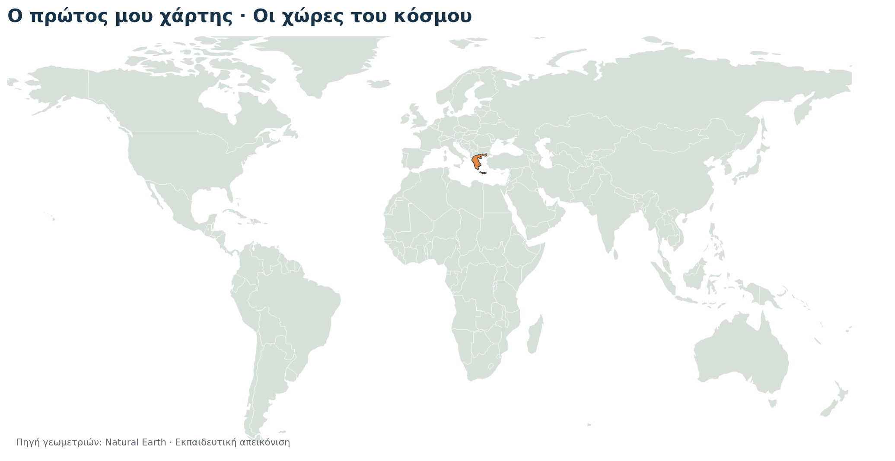
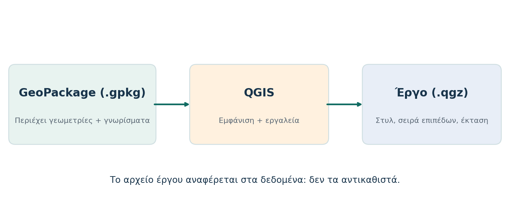

# GQ00 — Ο πρώτος μου χάρτης στο QGIS

## Συνοδευτικό υλικό

Κατέβασε το πλήρες {download}`πακέτο φοιτητή GQ00 v2.0 (ZIP) <../../../downloads/qgis/GQ00_student_v2.0.zip>` και, αν θέλεις αναλυτικό έντυπο, τον {download}`οδηγό φοιτητή GQ00 v2.0 (Word) <../../../downloads/qgis/GQ00_Odigos_Foititi_v2.0.docx>`.

Μπορείς επίσης να κατεβάσεις απευθείας το {download}`GeoPackage δεδομένων GQ00 <../../../downloads/qgis/GQ00_world_countries_v2.0.gpkg>` και το {download}`επεξεργάσιμο φύλλο εργασίας Word <../../../downloads/qgis/GQ00_Fyllo_Ergasias_v2.0.docx>`. Αν κατεβάσεις μόνο το GeoPackage, αποθήκευσέ το στον φάκελο `data/` μιας αποσυμπιεσμένης άσκησης. Τα `projects/` και `exercises/` παραμένουν χώροι εργασίας του φοιτητή.

Σε αυτή την πρακτική άσκηση θα δημιουργήσεις το πρώτο σου έργο QGIS με πραγματικά γεωχωρικά δεδομένα. Θα φορτώσεις έναν παγκόσμιο χάρτη, θα εντοπίσεις την Ελλάδα, θα ξεχωρίσεις την προσωρινή επιλογή από τον μόνιμο συμβολισμό και θα αποθηκεύσεις ένα έργο που μπορεί να ξανανοίξει.

**Προαπαιτούμενα:** ολοκλήρωση [GQ-START](../intro/index.md) · **Ενδεικτικός χρόνος:** 80–100 λεπτά · **Έκδοση αναφοράς:** QGIS 3.44 LTR.

## 1. Στόχος, προαπαιτούμενα και παραδοτέο

Στο τέλος πρέπει να έχεις δημιουργήσει:

```text
projects/GQ00_my_first_map.qgz
```

Το έργο πρέπει να περιλαμβάνει τα επίπεδα `countries` και `greece`, με μόνιμη οπτική έμφαση στην Ελλάδα. Θα συμπληρώσεις επίσης το `exercises/GQ00_fyllo_ergasias.md` με σύντομες απαντήσεις. Η εξαγωγή εικόνας PNG είναι προαιρετική.

## 2. Προετοιμασία υπολογιστή και αρχείων

1. Εγκατάστησε ή άνοιξε το QGIS 3.44 LTR από το [qgis.org](https://qgis.org/download/). Οι ονομασίες των μενού μπορεί να εμφανίζονται στα ελληνικά ή στα αγγλικά.
2. Αποσυμπίεσε ολόκληρο το `GQ00_student_v2.0.zip` σε έναν μόνιμο φάκελο. Μην εργάζεσαι μέσα από το ZIP.
3. Έλεγξε ότι ο φάκελος περιέχει τα `data/`, `projects/` και `exercises/`.
4. Έλεγξε ότι υπάρχει το `data/world_countries.gpkg` και ότι το `projects/` περιέχει μόνο το υπόδειγμα οδηγιών πριν δημιουργήσεις το δικό σου έργο.

**Αναμενόμενο αποτέλεσμα:** μπορείς να εντοπίσεις το GeoPackage και έχεις έναν ξεχωριστό φάκελο όπου θα αποθηκεύσεις το `.qgz`.

## 3. Γνωριμία με το περιβάλλον QGIS

Δημιούργησε νέο, κενό έργο. Συνήθως θα χρησιμοποιήσεις:

- το πάνελ **Περιηγητής / Browser** για αρχεία και πηγές δεδομένων,
- το πάνελ **Επίπεδα / Layers** για τη σειρά και την ορατότητα των επιπέδων,
- τον κεντρικό **καμβά χάρτη** για την προβολή,
- τη γραμμή κατάστασης για πληροφορίες όπως το CRS.

Αν δεν βλέπεις τον Περιηγητή, αναζήτησε τη ρύθμιση μέσα από **Προβολή / View → Πάνελ / Panels**. Οι ακριβείς μεταφράσεις εξαρτώνται από τη γλώσσα του QGIS.

**Έλεγχος:** βλέπεις κενό καμβά, πάνελ Επιπέδων και Περιηγητή.

## 4. Φόρτωση του επιπέδου countries

1. Στον Περιηγητή εντόπισε το `data/world_countries.gpkg`.
2. Άνοιξε το GeoPackage και φόρτωσε το επίπεδο `countries` στον χάρτη. Μπορείς συνήθως να κάνεις διπλό κλικ στο επίπεδο ή να το προσθέσεις με την εντολή προσθήκης επιπέδου.
3. Στο πάνελ Επιπέδων βεβαιώσου ότι εμφανίζεται το `countries`.
4. Χρησιμοποίησε την εντολή **Εστίαση στο επίπεδο / Zoom to Layer**.

**Αναμενόμενο αποτέλεσμα:** εμφανίζεται παγκόσμιος χάρτης με 177 γεωχωρικά αντικείμενα.



## 5. Πίνακας γνωρισμάτων και πεδία

Άνοιξε τον **Πίνακα γνωρισμάτων / Attribute Table** από το μενού του επιπέδου `countries` ή από το μενού που εμφανίζεται με δεξί κλικ.

Εντόπισε τα πεδία:

- `name`: όνομα χώρας,
- `continent`: ήπειρος,
- `iso_a3`: κωδικός χώρας,
- `pop_est`: παλαιότερη εκτίμηση πληθυσμού του εκπαιδευτικού συνόλου.

**Έλεγχος:** βλέπεις τις εγγραφές του πίνακα και μπορείς να εντοπίσεις την τιμή `Greece` στο πεδίο `name`.

## 6. Επιλογή της Ελλάδας

Χρησιμοποίησε την εντολή **Επιλογή με έκφραση / Select by Expression** για το ενεργό επίπεδο και πληκτρολόγησε ακριβώς:

```qgis
"name" = 'Greece'
```

Η έκφραση χρησιμοποιεί το όνομα του πεδίου σε διπλά εισαγωγικά και την τιμή σε μονά εισαγωγικά. Πρέπει να επιλεγεί μία εγγραφή. Αν δεν εμφανιστεί αποτέλεσμα, έλεγξε ότι χρησιμοποιείς το πεδίο `name` και τη λατινική τιμή `Greece`.

**Έλεγχος:** η Ελλάδα επισημαίνεται προσωρινά και ο πίνακας γνωρισμάτων αναφέρει μία επιλεγμένη εγγραφή.

## 7. Προσωρινή επιλογή και μόνιμος συμβολισμός

Η επιλογή είναι προσωρινή κατάσταση του ενεργού επιπέδου. Δεν είναι μόνιμο χρώμα του χάρτη. Κάνε **Αποεπιλογή όλων / Deselect all** με `Ctrl+Shift+A` ή με την αντίστοιχη εντολή επιλογής.

Άνοιξε τις ιδιότητες του `countries`, επίλεξε **Συμβολισμός / Symbology** και άλλαξε το γενικό σύμβολο, για παράδειγμα σε ανοιχτό χρώμα. Η αλλαγή αυτή αφορά την εμφάνιση του έργου και όχι τη γεωμετρία ή τα γνωρίσματα του GeoPackage.

**Έλεγχος:** μετά την αποεπιλογή δεν υπάρχει προσωρινή επισήμανση, αλλά το γενικό σύμβολο του επιπέδου παραμένει.

## 8. Προσθήκη του επιπέδου greece

Φόρτωσε από το ίδιο GeoPackage το επίπεδο `greece` και τοποθέτησέ το πάνω από το `countries` στο πάνελ Επιπέδων. Στις ιδιότητες συμβολισμού του `greece` όρισε ένα διακριτό, μόνιμο χρώμα και περίγραμμα.

**Αναμενόμενο αποτέλεσμα:** η Ελλάδα ξεχωρίζει ακόμη και όταν δεν υπάρχει ενεργή επιλογή. Αν κάνεις μεγέθυνση, το επίπεδο `greece` πρέπει να καλύπτει τη θέση της Ελλάδας και να παραμένει στην κορυφή της σειράς.

## 9. Αποθήκευση έργου και σχετικές διαδρομές

Αποθήκευσε το έργο ως:

```text
projects/GQ00_my_first_map.qgz
```

Στις ιδιότητες του έργου αναζήτησε τη ρύθμιση **Paths / Διαδρομές** και επίλεξε σχετικές διαδρομές, όπου αυτή η επιλογή είναι διαθέσιμη. Αποθήκευσε ξανά το έργο μετά την αλλαγή.

Το `.gpkg` είναι το αρχείο που περιέχει τα γεωχωρικά δεδομένα. Το `.qgz` είναι αρχείο έργου που αποθηκεύει επίπεδα, συμβολισμούς, προβολή και ρυθμίσεις. Το `.qgz` δεν αντιγράφει ούτε αντικαθιστά το GeoPackage.



## 10. Επαναφόρτωση και επαλήθευση

Κλείσε το έργο και άνοιξε ξανά το `projects/GQ00_my_first_map.qgz`.

Έλεγξε ότι:

1. φορτώνουν τα `countries` και `greece`,
2. το `greece` βρίσκεται πάνω από το `countries`,
3. η μόνιμη έμφαση στην Ελλάδα παραμένει,
4. δεν εμφανίζεται προειδοποίηση για χαμένη πηγή δεδομένων.

Αν εμφανιστεί σφάλμα διαδρομής, επανέφερε το `data/world_countries.gpkg` δίπλα στο `projects/` ή όρισε ξανά τη σωστή πηγή δεδομένων από τις ιδιότητες του επιπέδου και αποθήκευσε το έργο.

## 11. Αυτοέλεγχος

Συμπλήρωσε το `exercises/GQ00_fyllo_ergasias.md` και επιβεβαίωσε:

- [ ] Φόρτωσα το `countries` και είδα τον παγκόσμιο χάρτη.
- [ ] Εντόπισα την Ελλάδα με την έκφραση επιλογής.
- [ ] Κατάλαβα τη διαφορά προσωρινής επιλογής και μόνιμου συμβολισμού.
- [ ] Πρόσθεσα το `greece` πάνω από το `countries`.
- [ ] Αποθήκευσα το `projects/GQ00_my_first_map.qgz`.
- [ ] Έκλεισα και ξανάνοιξα το έργο χωρίς χαμένες πηγές.
- [ ] Μπορώ να εξηγήσω τη διαφορά `.gpkg` και `.qgz`.

## 12. Προαιρετική εξαγωγή εικόνας PNG

Αφού ολοκληρώσεις και αποθηκεύσεις το έργο, μπορείς προαιρετικά να εξαγάγεις μια εικόνα του χάρτη σε PNG από την αντίστοιχη λειτουργία εξαγωγής του QGIS. Η εικόνα δεν αντικαθιστά το `.qgz` και δεν είναι απαραίτητο παραδοτέο.

## 13. Συνηθισμένα προβλήματα και λύσεις

| Πρόβλημα | Τι να ελέγξεις |
|---|---|
| Δεν βλέπω τον Περιηγητή | **View / Προβολή → Panels / Πάνελ → Browser / Περιηγητής**. |
| Ο καμβάς είναι κενός | Έλεγξε την ορατότητα του επιπέδου και χρησιμοποίησε **Zoom to Layer**. |
| Δεν φορτώνει το GeoPackage | Βεβαιώσου ότι εργάζεσαι σε αποσυμπιεσμένο φάκελο και ότι η διαδρομή δείχνει στο `data/world_countries.gpkg`. |
| Δεν βρίσκω την Ελλάδα | Χρησιμοποίησε το πεδίο `name` και την τιμή `Greece`, όχι `Ελλάδα`. |
| Άλλαξε χρώμα μόνο η επιλογή | Κάνε αποεπιλογή και ρύθμισε το **Symbology** του επιπέδου. |
| Το έργο έχει χαμένες πηγές | Διατήρησε το `data/` δίπλα στο `projects/` και έλεγξε τις σχετικές διαδρομές. |

## Τι παραδίδεις

Παρέδωσε το `projects/GQ00_my_first_map.qgz` και το συμπληρωμένο `exercises/GQ00_fyllo_ergasias.md`. Αν χρειαστεί να μεταφέρεις το έργο σε άλλον υπολογιστή, κράτησε μαζί του το `data/world_countries.gpkg` και την ίδια σχετική δομή φακέλων. Η PNG εικόνα είναι προαιρετική.
