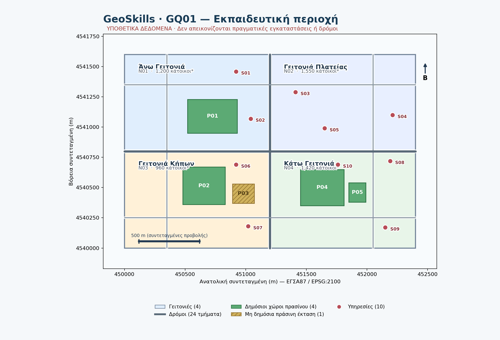

# GQ01 — Γεωχωρικά δεδομένα και θεματικά επίπεδα στο QGIS

## Συνοδευτικό υλικό

Κατέβασε το {download}`πλήρες πακέτο φοιτητή GQ01 v1.1 (ZIP) <../../../downloads/qgis/GQ01_student_v1.1.zip>`, τον {download}`οδηγό φοιτητή GQ01 v1.1 (Word) <../../../downloads/qgis/GQ01_Odigos_Foititi_v1.1.docx>`, το {download}`GeoPackage δεδομένων GQ01 <../../../downloads/qgis/GQ01_geoskills_learning_area_v0.1.gpkg>` ή το {download}`επεξεργάσιμο φύλλο εργασίας Word <../../../downloads/qgis/GQ01_Fyllo_Ergasias_v1.1.docx>`. Το Word είναι η προτεινόμενη μορφή συμπλήρωσης· το Markdown φύλλο μέσα στο ZIP παραμένει αποδεκτό.

Αν κατεβάσεις μόνο το GeoPackage, αποθήκευσέ το στον φάκελο `data/` μιας αποσυμπιεσμένης άσκησης. Για να λειτουργήσουν οι σχετικές διαδρομές του έργου, κράτησε τη δομή `data/`, `projects/` και `exercises/`.

Σε αυτό το μάθημα θα οργανώσεις τέσσερα θεματικά επίπεδα σε ένα έργο QGIS. Θα δουλέψεις με μια **συνθετική εκπαιδευτική περιοχή**: οι ονομασίες, οι γεωμετρίες, οι πληθυσμοί, οι δρόμοι και οι υπηρεσίες δεν αντιπροσωπεύουν πραγματικό δήμο ή πραγματικές εγκαταστάσεις.

**Προαπαιτούμενο:** [GQ00 — Ο πρώτος μου χάρτης στο QGIS](../gq00/index.md) · **Ενδεικτικός χρόνος:** 105–130 λεπτά για αρχάριο που έχει ολοκληρώσει το GQ00 και έχει εγκατεστημένο QGIS · **Έκδοση αναφοράς:** QGIS 3.44 LTR.

Το πακέτο του μαθήματος είναι έκδοση **v1.0**, ενώ το GeoPackage που περιέχει τα δεδομένα παραμένει έκδοση **v0.1**. Οι δύο εκδόσεις δεν είναι το ίδιο πράγμα.

### Η γέφυρα από το GQ00

Στο GQ00 έμαθες να ανοίγεις ένα GeoPackage, να χρησιμοποιείς τον Περιηγητή και το πάνελ Επιπέδων, να ελέγχεις έναν πίνακα γνωρισμάτων, να ξεχωρίζεις επιλογή από συμβολισμό και να αποθηκεύεις ένα έργο `.qgz`. Στο GQ01 επαναχρησιμοποιείς αυτές τις δεξιότητες σε τέσσερα επίπεδα ταυτόχρονα. Νέα βήματα είναι η αναγνώριση τριών τύπων γεωμετρίας, η οργάνωση της σειράς πολλών επιπέδων, η μετονομασία του εμφανιζόμενου layer χωρίς αλλαγή της πηγής και η προσεκτική ερμηνεία των περιορισμών των δεδομένων.

Αν χρειάζεσαι επανάληψη πριν συνεχίσεις, ολοκλήρωσε πρώτα το [GQ00](../gq00/index.md). Η επόμενη ενότητα της διαδρομής θα εξετάσει αναλυτικότερα τα CRS και την επαναπροβολή· το GQ01 περιορίζεται στην αναγνώριση του EPSG:2100.

*Σχήμα 1. Συνθετική περιοχή εργασίας με τέσσερα θεματικά επίπεδα.*

## 1. Η εκπαιδευτική αποστολή

Μια υποθετική δημοτική υπηρεσία παρέλαβε τέσσερα επίπεδα δεδομένων. Η αποστολή σου είναι να τα ανοίξεις, να καταλάβεις τι αναπαριστούν, να οργανώσεις έναν ευανάγνωστο χάρτη και να ελέγξεις ότι το έργο αποθηκεύεται και ξανανοίγει.

Δεν θα κάνεις μετασχηματισμούς CRS, σύνθετες εκφράσεις, χωρικά ερωτήματα ή δικτυακή ανάλυση. Σε αυτό το μάθημα μαθαίνεις πρώτα να **διαβάζεις και να οργανώνεις** τα δεδομένα.

## 2. Τι θα μάθω και τι θα παραδώσω

Στο τέλος θα μπορείς να:

1. εισάγεις τέσσερα επίπεδα από ένα GeoPackage,
2. διακρίνεις σημειακή, γραμμική και πολυγωνική γεωμετρία,
3. εξηγείς τη διαφορά πηγής δεδομένων, επιπέδου και έργου QGIS,
4. ελέγχεις πλήθος αντικειμένων και βασικά γνωρίσματα,
5. ρυθμίζεις σειρά, ορατότητα, ονόματα και βασικό συμβολισμό,
6. αποφεύγεις συμπεράσματα που δεν υποστηρίζονται από τα γνωρίσματα,
7. αποθηκεύεις και επαναφορτώνεις ένα έργο χωρίς χαμένες πηγές.

Το τελικό παραδοτέο είναι το `projects/GQ01_my_area.qgz` με τα τέσσερα επίπεδα φορτωμένα, διακριτό συμβολισμό και σωστή σειρά. Θα συμπληρώσεις επίσης το φύλλο εργασίας σε Word ή, εναλλακτικά, στο `exercises/GQ01_fyllo_ergasias.md`.

## 3. Γνωριμία με το πακέτο δεδομένων

Αποσυμπίεσε το `GQ01_student_v1.1.zip` σε μόνιμο φάκελο. Μην εργάζεσαι μέσα από το ZIP. Ο φάκελος `data/` περιέχει το `geoskills_learning_area_v0.1.gpkg`, ενώ ο φάκελος `projects/` είναι ο χώρος όπου θα αποθηκεύσεις το δικό σου έργο.

Το GeoPackage περιέχει τέσσερα επίπεδα και συνολικά 43 αντικείμενα:

| Επίπεδο | Γεωμετρία | Πλήθος | Τι παρατηρώ |
|---|---|---:|---|
| `neighborhoods` | Πολύγωνα | 4 | υποθετικές γειτονιές και βασικά γνωρίσματα |
| `roads` | Γραμμές | 24 | σχηματικούς άξονες δρόμων |
| `parks` | Πολύγωνα | 5 | δημόσιο ή περιορισμένης πρόσβασης πράσινο |
| `services` | Σημεία | 10 | υποθετικές υπηρεσίες |

Όλα τα επίπεδα χρησιμοποιούν EPSG:2100. Το CRS περιγράφει το σύστημα συντεταγμένων· δεν κάνει τα συνθετικά δεδομένα πραγματικά.

### Δύο παρατηρήσεις που θα χρειαστείς

Η `N02` δεν έχει καταγεγραμμένο πάρκο στο παρόν σύνολο. Αυτό είναι παρατήρηση για τα διαθέσιμα δεδομένα και όχι απόδειξη ότι στην πραγματικότητα δεν υπάρχει πάρκο.

Το `P03` έχει `access=restricted` και `green_type=institutional_green`. Είναι πράσινη έκταση περιορισμένης πρόσβασης, όχι δημόσιο πάρκο. Η παρουσία μιας πράσινης γεωμετρίας δεν συνεπάγεται δημόσια πρόσβαση.

## 4. Δημιουργία έργου και φόρτωση τεσσάρων επιπέδων

Άνοιξε το QGIS 3.44 LTR και δημιούργησε ένα νέο κενό έργο. Αν δεν βλέπεις τον **Περιηγητή / Browser** ή το πάνελ **Επίπεδα / Layers**, αναζήτησέ τα από **Προβολή / View → Πάνελ / Panels**. Ο καμβάς θα είναι αρχικά κενός.

Στον Περιηγητή βρες το αποσυμπιεσμένο αρχείο `data/geoskills_learning_area_v0.1.gpkg`. Άνοιξέ το για να δεις τα επίπεδα και πρόσθεσε στον καμβά τα `neighborhoods`, `roads`, `parks` και `services`. Μπορείς να κάνεις διπλό κλικ σε κάθε επίπεδο ή να το σύρεις στο πάνελ Επιπέδων.

Εναλλακτικά, χρησιμοποίησε **Επίπεδο / Layer → Προσθήκη επιπέδου / Add Layer → Προσθήκη διανυσματικού επιπέδου / Add Vector Layer**. Στον διάλογο επίλεξε ως πηγή το αρχείο `geoskills_learning_area_v0.1.gpkg`, πάτησε **Add** και διάλεξε τα τέσσερα επίπεδα. Αυτή είναι ισοδύναμη μέθοδος· στην κύρια ροή προτίμησε τον Περιηγητή για να δεις πρώτα τη δομή της πηγής.

Μετά από κάθε προσθήκη κοίτα το πάνελ Επιπέδων. Θέλεις να βλέπεις και τα τέσσερα ονόματα. Αν ο καμβάς φαίνεται κενός ή πολύ μεγεθυμένος, κάνε δεξί κλικ στο `neighborhoods` και επίλεξε **Εστίαση στο επίπεδο / Zoom to Layer**.

**Έλεγχος επιτυχίας:** υπάρχουν τέσσερα επίπεδα στο πάνελ και ο καμβάς δείχνει την ίδια συνθετική περιοχή. Δεν δημιούργησες νέο αρχείο δεδομένων.

## 5. Σημεία, γραμμές και πολύγωνα στην πράξη

Κοίτα τα σύμβολα στον καμβά και σύνδεσέ τα με τον τύπο γεωμετρίας: τα `services` είναι σημεία, τα `roads` είναι γραμμές και τα `neighborhoods` και `parks` είναι πολύγωνα.

Η γεωμετρία περιγράφει τη μορφή και τη θέση ενός αντικειμένου. Τα γνωρίσματα περιγράφουν πληροφορίες που συνδέονται με αυτό, όπως το `name`, το `access` ή το `service_type`. Κάνε δεξί κλικ σε κάθε επίπεδο και άνοιξε τις **Ιδιότητες / Properties** ή τον πίνακα γνωρισμάτων. Μην αλλάξεις ακόμη δεδομένα.

## 6. Πηγή δεδομένων, επίπεδο και έργο QGIS

Το GeoPackage είναι η **πηγή δεδομένων**. Μέσα του υπάρχουν τα τέσσερα θεματικά **επίπεδα**. Το έργο QGIS (`.qgz`) αποθηκεύει ποια επίπεδα φόρτωσες, τη σειρά τους, τον συμβολισμό, την προβολή και άλλες ρυθμίσεις.

Άρα το `.qgz` δεν αντικαθιστά το `.gpkg` και δεν αντιγράφει αυτόματα τα δεδομένα μέσα του. Αν μετακινήσεις το GeoPackage χωρίς να ενημερώσεις τη διαδρομή, το έργο μπορεί να εμφανίσει χαμένη πηγή.

Σκέψου τα τρία επίπεδα ως εξής: η **πηγή δεδομένων** είναι το αρχείο και ο πίνακας μέσα στο GeoPackage, το **layer στον χάρτη** είναι η συγκεκριμένη φόρτωση αυτής της πηγής με όνομα, ορατότητα και συμβολισμό, ενώ το **αποθηκευμένο έργο** είναι η συλλογή αυτών των ρυθμίσεων. Μπορείς να έχεις δύο διαφορετικά layers που δείχνουν στην ίδια πηγή, αλλά κάθε layer μπορεί να έχει διαφορετικό όνομα ή συμβολισμό.

## 7. Έλεγχος πινάκων γνωρισμάτων

Άνοιξε τον πίνακα γνωρισμάτων κάθε επιπέδου. Έλεγξε πρώτα το πλήθος εγγραφών και μετά μερικά πεδία:

- `neighborhoods`: `zone_id`, `name`, `pop_est`, `households`, `land_use`.
- `roads`: `road_id`, `road_type`, `surface`, `walkable`, `length_m`.
- `parks`: `park_id`, `zone_id`, `access`, `green_type`, `area_m2`.
- `services`: `service_id`, `zone_id`, `service_type`, `active`.

Οι αριθμοί 4, 24, 5 και 10 είναι έλεγχοι πληρότητας του πακέτου. Οι τιμές `pop_est` και `households` είναι υποθετικές. Μην τις παρουσιάσεις ως στοιχεία απογραφής. Ομοίως, το `walkable=1` είναι απλή εκπαιδευτική ένδειξη του υποδείγματος και δεν αποδεικνύει ασφάλεια ή πραγματική προσβασιμότητα.

### Τύποι πεδίων και πραγματικές τιμές

Στον πίνακα γνωρισμάτων θα συναντήσεις τρεις βασικούς τύπους:

- **Κείμενο / Text:** `name`, `zone_id`, `road_type`, `surface`, `access`, `green_type`, `service_type`. Παραδείγματα είναι `N02`, `Σχολικός Κήπος`, `restricted`, `institutional_green` και `school`.
- **Ακέραιος / Integer:** `pop_est`, `households`, `walkable`, `area_m2` και `active`. Παραδείγματα είναι `1550`, `540`, `1` και `28800`.
- **Δεκαδικός / Real:** `length_m` στο επίπεδο `roads`, με τιμές όπως `250.0`.

Οι τύποι αυτοί είναι οι πραγματικοί τύποι αποθήκευσης του GeoPackage. Οι κωδικοποιημένες τιμές δεν είναι αυθαίρετες: `access=public` σημαίνει δημόσια πρόσβαση στο εκπαιδευτικό υπόδειγμα, `access=restricted` περιορισμένη πρόσβαση, `green_type=park` δημόσιο πάρκο και `green_type=institutional_green` θεσμικό πράσινο. Τα `road_type=collector/local` και `surface=paved/gravel` περιγράφουν το συνθετικό υπόδειγμα, ενώ το `service_type` δηλώνει κατηγορία υπηρεσίας.

## 8. Σειρά επιπέδων, ορατότητα και βασικός συμβολισμός

Στο πάνελ Επιπέδων βάλε τα `services` επάνω, ώστε τα σημεία να μη σκεπάζονται από τα πολύγωνα. Τοποθέτησε τα `roads` πάνω από τα `neighborhoods` και τα `parks`, και κράτησε τις `neighborhoods` χαμηλότερα ως υπόβαθρο.

Χρησιμοποίησε διαφορετικά, ευανάγνωστα σύμβολα: απαλό χρώμα για τις γειτονιές, γραμμικό σύμβολο για τους δρόμους, πράσινο για τα πάρκα και διακριτά σημεία για τις υπηρεσίες. Για κάθε layer κάνε δεξί κλικ → **Ιδιότητες / Properties → Συμβολογία / Symbology**, επίλεξε ένα απλό σύμβολο και πάτησε **Apply**. Έλεγξε στον καμβά ότι οι γειτονιές παραμένουν διακριτές, οι δρόμοι φαίνονται πάνω από το υπόβαθρο, τα πάρκα ξεχωρίζουν και τα σημεία υπηρεσιών δεν κρύβονται.

Η απόκρυψη ενός επιπέδου αλλάζει την προβολή του έργου, όχι το GeoPackage. Αν ο συμβολισμός γίνει δυσανάγνωστος, προτίμησε πιο ανοιχτό γέμισμα και καθαρό περίγραμμα αντί για πολλά εφέ.

Κάνε τώρα έναν σύντομο έλεγχο ορατότητας: πάτησε το εικονίδιο ματιού δίπλα στο `parks` για να το κρύψεις και παρατήρησε ότι τα υπόλοιπα επίπεδα παραμένουν. Πάτησέ το ξανά για να επανεμφανίσεις τα πάρκα πριν συνεχίσεις. Ο έλεγχος αυτός δεν διαγράφει ούτε αλλάζει δεδομένα.

## 9. Μετονομασία επιπέδων χωρίς αλλαγή της πηγής

Άλλαξε υποχρεωτικά το εμφανιζόμενο όνομα τουλάχιστον ενός layer, για παράδειγμα `neighborhoods` σε «Γειτονιές» ή `services` σε «Υπηρεσίες». Κάνε διπλό κλικ στο όνομα στο πάνελ Επιπέδων ή χρησιμοποίησε **Rename**. Η μετονομασία αφορά μόνο το layer μέσα στο έργο και βοηθά την ανάγνωση. Δεν αλλάζει το αρχικό όνομα του πίνακα μέσα στο GeoPackage, ούτε το `zone_id` ή τα άλλα πεδία.

## 10. Παρατηρώ τι δείχνουν και τι δεν δείχνουν τα δεδομένα

Κοίτα ειδικά το `parks`. Εντόπισε το `P03` και έλεγξε τα πεδία `access` και `green_type`. Κατέγραψε ότι πρόκειται για περιορισμένης πρόσβασης θεσμικό πράσινο.

Έπειτα έλεγξε τα πάρκα ανά `zone_id`. Δεν θα βρεις καταγεγραμμένο πάρκο για τη `N02`. Η σωστή διατύπωση είναι: «Στο παρόν συνθετικό σύνολο δεν υπάρχει καταγραφή πάρκου για τη N02». Η λανθασμένη διατύπωση θα ήταν: «Η N02 δεν έχει πάρκο» σαν να πρόκειται για πραγματική απογραφή.

Για να κάνεις τον έλεγχο χωρίς σύνθετες εκφράσεις, άνοιξε τον πίνακα γνωρισμάτων του `parks`, βεβαιώσου ότι βλέπεις και τις πέντε εγγραφές και διάβασε τη στήλη `zone_id` σε κάθε γραμμή. Σημείωσε τις ζώνες που εμφανίζονται και εντόπισε τη γραμμή `P03`. Η απουσία του `N02` από τις πέντε διαθέσιμες εγγραφές είναι απουσία καταγραφής στο εκπαιδευτικό σύνολο, όχι απόδειξη πραγματικής έλλειψης εγκατάστασης.

## 11. Αποθήκευση έργου και σχετικές διαδρομές

Αποθήκευσε το έργο ως `projects/GQ01_my_area.qgz`. Για σχετικές διαδρομές άνοιξε **Project → Properties → General → Save paths → Relative** και πάτησε **Apply/OK**. Η ρύθμιση λέει στο QGIS να αποθηκεύει τη διαδρομή του GeoPackage σε σχέση με τον φάκελο του έργου, ώστε το έργο να μπορεί να μετακινηθεί μαζί με τον φάκελο `data/`.

Μετά τη ρύθμιση **Relative**, αποθήκευσε ξανά το έργο με **Project → Save** ή `Ctrl+S` και μόνο τότε κλείσε το έργο. Μην αποθηκεύσεις πάνω από το αρχικό GeoPackage και μην ενεργοποιήσεις επεξεργασία των δεδομένων.

## 12. Επαναφόρτωση και τεχνική επαλήθευση

Κλείσε το QGIS ή το έργο και άνοιξε ξανά το `projects/GQ01_my_area.qgz` από τον φάκελο `projects/`, ενώ το `data/geoskills_learning_area_v0.1.gpkg` παραμένει στον διπλανό φάκελο `data/`. Έλεγξε ότι φορτώνουν και τα τέσσερα επίπεδα, ότι η μετονομασία, η σειρά και ο συμβολισμός παραμένουν, ότι ο καμβάς δείχνει τη συνθετική περιοχή και ότι δεν εμφανίζεται προειδοποίηση για χαμένη πηγή. Άνοιξε ξανά έναν πίνακα γνωρισμάτων και επιβεβαίωσε ότι τα δεδομένα παραμένουν αμετάβλητα.

Αν εμφανιστεί σφάλμα, έλεγξε πρώτα ότι το `data/geoskills_learning_area_v0.1.gpkg` βρίσκεται στη θέση που αναμένει το έργο. Μην διορθώσεις το πρόβλημα δημιουργώντας νέο GeoPackage.

## 13. Φύλλο εργασίας και αυτοέλεγχος

Συμπλήρωσε το Word ή, εναλλακτικά, το `exercises/GQ01_fyllo_ergasias.md` με έναν απλό επεξεργαστή κειμένου ή μέσα από το QGIS, αν χρησιμοποιείς σχετικό πρόσθετο. Το φύλλο ζητά να αιτιολογήσεις τις παρατηρήσεις σου για τους τύπους γεωμετρίας, τα πλήθη, τα βασικά πεδία, τα `access` και `green_type`, τις `N02` και `P03`, καθώς και τη διαφορά `.gpkg` και `.qgz`.

Πριν θεωρήσεις την άσκηση ολοκληρωμένη:

- [ ] Φόρτωσα και τα τέσσερα επίπεδα.
- [ ] Έλεγξα 4/24/5/10 αντικείμενα.
- [ ] Ξεχώρισα σημεία, γραμμές και πολύγωνα.
- [ ] Εξήγησα γιατί το P03 δεν είναι δημόσιο πάρκο.
- [ ] Διατύπωσα προσεκτικά την παρατήρηση για τη N02.
- [ ] Ρύθμισα σειρά, ορατότητα και βασικό συμβολισμό.
- [ ] Αποθήκευσα και ξανάνοιξα το έργο χωρίς χαμένη πηγή.

## 14. Συνηθισμένα προβλήματα

| Πρόβλημα | Τι να ελέγξεις |
|---|---|
| Δεν βλέπω τον Περιηγητή | **Προβολή / View → Πάνελ / Panels → Browser / Περιηγητής**. |
| Ο καμβάς είναι κενός | Έλεγξε την ορατότητα και χρησιμοποίησε **Zoom to Layer**. |
| Δεν φορτώνει το GeoPackage | Εργάσου στον αποσυμπιεσμένο φάκελο και έλεγξε τη διαδρομή του `.gpkg`. |
| Βλέπω μόνο μερικά επίπεδα | Άνοιξε το GeoPackage και πρόσθεσε και τα τέσσερα επίπεδα. |
| Τα σημεία κρύβονται | Μετακίνησε το `services` πάνω από τα πολύγωνα. |
| Το έργο έχει χαμένη πηγή | Κράτησε τον φάκελο `data/` δίπλα στο `projects/` και έλεγξε τις σχετικές διαδρομές. |
| Μπερδεύω το P03 με δημόσιο πάρκο | Διάβασε μαζί τα `access` και `green_type`. |
| Ενεργό είναι λάθος layer | Κάνε πρώτα κλικ στο σωστό layer στο πάνελ πριν ανοίξεις πίνακα ή ιδιότητες. |
| Ένα layer είναι κρυφό | Έλεγξε το εικονίδιο ορατότητας και τη σειρά των layers. |
| Ο χάρτης φαίνεται σε λάθος θέση | Έλεγξε το CRS του layer και του έργου· μην αλλάξεις CRS αυθαίρετα σε αυτή την άσκηση. |
| Φορτώθηκε λάθος πηγή | Έλεγξε ότι η διαδρομή δείχνει στο `geoskills_learning_area_v0.1.gpkg` και ότι επέλεξες το σωστό layer. |

## 15. Τελικό παραδοτέο και σύνδεση με GQ02

Παρέδωσε το `projects/GQ01_my_area.qgz` και το συμπληρωμένο φύλλο εργασίας ως Word ή Markdown. Στο ZIP το Markdown είναι `exercises/GQ01_fyllo_ergasias.md`. Κράτησε μαζί τους τον φάκελο `data/`, ώστε οι πηγές να παραμένουν διαθέσιμες.

Στην επόμενη ενότητα της διαδρομής θα εξετάσεις συστηματικά τα συστήματα αναφοράς, το EPSG και την επαναπροβολή. Στο GQ01 αρκεί να αναγνωρίζεις ότι τα τέσσερα επίπεδα χρησιμοποιούν EPSG:2100 και ότι το CRS δεν μετατρέπει συνθετικά δεδομένα σε πραγματικά δεδομένα.

Αν χρειάζεσαι δύο μικρότερες συναντήσεις, ολοκλήρωσε στην πρώτη περίπου 55–65 λεπτά: προετοιμασία, φόρτωση, γεωμετρίες, πηγή και πίνακες. Στη δεύτερη ολοκλήρωσε άλλα 55–65 λεπτά: συμβολισμό, μετονομασία, N02/P03, αποθήκευση, επαναφόρτωση και φύλλο εργασίας.

## Προαιρετική πρόκληση

Χωρίς σύνθετες εκφράσεις, γράψε σε δύο προτάσεις τι θα μπορούσες και τι δεν θα μπορούσες να συμπεράνεις από τα επίπεδα `parks` και `services`. Η απάντηση πρέπει να αναφέρει την περιορισμένη πρόσβαση του `P03`, την απουσία καταγραφής πάρκου στη `N02` και τον υποθετικό χαρακτήρα του συνόλου.
