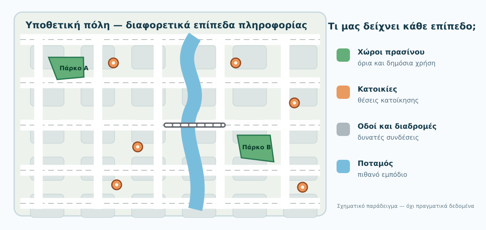
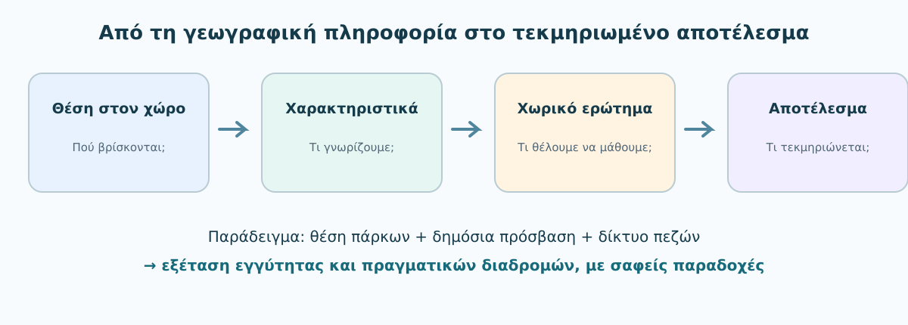
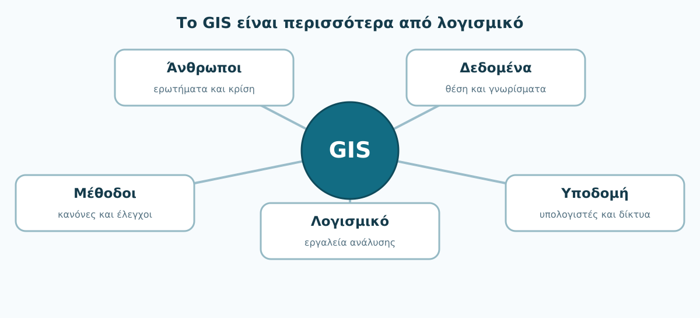

# 1. Τι είναι ένα Γεωγραφικό Σύστημα Πληροφοριών;

**Από το «πού βρίσκεται;» στο «τι σημαίνει η θέση του;»**

**Χρόνος:** περίπου 30–40 λεπτά μαζί με τις δραστηριότητες · **Προαπαιτούμενα:** κανένα · **Λογισμικό:** δεν απαιτείται.

:::{note} Η αποστολή σου
Ένας δήμος θέλει να καταλάβει ποιες περιοχές των κατοίκων του εξυπηρετούνται λιγότερο από δημόσιους χώρους πρασίνου. Θα δούμε πώς ένα Γεωγραφικό Σύστημα Πληροφοριών μπορεί να βοηθήσει να οργανώσουμε αυτό το ερώτημα — *χωρίς* να χρειάζεται ακόμη να ανοίξεις πρόγραμμα ή να εκτελέσεις υπολογισμούς.
:::

## Τι θα μπορείς να κάνεις στο τέλος

- Να εξηγείς με δικά σου λόγια τι είναι ένα GIS και γιατί δεν είναι απλώς «ένας χάρτης στον υπολογιστή».
- Να αναγνωρίζεις ένα πρόβλημα που χρειάζεται γεωχωρικές πληροφορίες.
- Να διακρίνεις τη **θέση** ενός αντικειμένου από τα **χαρακτηριστικά** του.
- Να περιγράφεις τα βασικά συστατικά ενός GIS και τον ρόλο του χρήστη.
- Να ξεχωρίζεις το **GIS**, το **QGIS**, τον **ψηφιακό χάρτη** και το **GNSS/GPS**.
- Να διατυπώνεις ένα αρχικό γεωγραφικό ερώτημα και να εξηγείς ποια στοιχεία λείπουν για να απαντηθεί αξιόπιστα.

## 1.1 Ένα ερώτημα από την καθημερινή ζωή

Φαντάσου ότι εργάζεσαι σε μια μικρή ομάδα που βοηθά έναν δήμο να οργανώσει καλύτερα τους δημόσιους χώρους του. Κάποιος στη συνάντηση λέει: «Σε ορισμένες γειτονιές δεν υπάρχουν αρκετά πάρκα. Θέλουμε να το δούμε σε έναν χάρτη».

Ένας χάρτης με τα πάρκα είναι ένα χρήσιμο πρώτο βήμα. Θα δείξει πού βρίσκονται. Όμως δεν απαντά από μόνος του στο βασικό ερώτημα: **ποιες γειτονιές εξυπηρετούνται λιγότερο;**

Για να το εξετάσουμε, πρέπει να σκεφτούμε περισσότερα: Πού κατοικούν οι άνθρωποι; Πού είναι οι είσοδοι των πάρκων; Υπάρχουν δρόμοι και πεζόδρομοι που οδηγούν σε αυτά; Είναι όλοι οι χώροι πράσινοι και δημόσια προσβάσιμοι; Μετράμε την απόσταση σε ευθεία γραμμή ή τη διαδρομή που μπορεί κάποιος να περπατήσει;

Το γεωγραφικό ερώτημα λοιπόν δεν αφορά μόνο την εμφάνιση αντικειμένων σε χάρτη. Αφορά τις **σχέσεις ανάμεσα σε αντικείμενα που βρίσκονται στον χώρο**.

*Εικόνα 1. Υποθετική πόλη: τα σπίτια, οι χώροι πρασίνου και οι δρόμοι δίνουν διαφορετικά είδη πληροφορίας. Ο χάρτης είναι επεξηγηματικός — δεν τεκμηριώνει από μόνος του την προσβασιμότητα.*

:::{tip} Σκέψου για 30 δευτερόλεπτα
Δύο κατοικίες απέχουν το ίδιο σε ευθεία από ένα πάρκο. Μπορούμε να συμπεράνουμε ότι οι κάτοικοί τους έχουν εξίσου εύκολη πρόσβαση; Τι μπορεί να διαφοροποιεί τη μετακίνηση;
:::

Δεν μπορούμε να το συμπεράνουμε. Ένας δρόμος χωρίς ασφαλή διάβαση, ένας ποταμός, μια περιφραγμένη περιοχή ή η θέση της εισόδου του πάρκου μπορεί να αλλάζει σημαντικά την πραγματική διαδρομή.

## 1.2 Τι είναι λοιπόν το GIS;

Τα αρχικά **GIS** προέρχονται από το *Geographic Information System*. Στα ελληνικά χρησιμοποιούμε τον όρο **Γεωγραφικό Σύστημα Πληροφοριών (ΓΣΠ)**.

Ένα GIS είναι ένα οργανωμένο σύστημα με το οποίο **συλλέγουμε, αποθηκεύουμε, οργανώνουμε, ελέγχουμε, συνδυάζουμε, αναλύουμε και παρουσιάζουμε πληροφορίες που σχετίζονται με συγκεκριμένες θέσεις ή περιοχές**. Η γεωγραφική θέση μάς επιτρέπει να εξετάζουμε σχέσεις που ένας απλός πίνακας ή μια εικόνα δεν αποκαλύπτει εύκολα. Για παράδειγμα, μπορούμε να εντοπίσουμε περιοχές που βρίσκονται μέσα σε μια ζώνη ή να συγκρίνουμε κατανομές φαινομένων στον χώρο.

Ας πάρουμε έναν απλό πίνακα:

| Όνομα χώρου | Έκταση (στρέμματα) | Δημόσια πρόσβαση |
|---|---:|---|
| Πάρκο Α | 12 | Ναι |
| Πάρκο Β | 8 | Ναι |
| Κήπος Γ | 5 | Όχι |

Οι τιμές αυτές είναι **υποθετικά εκπαιδευτικά δεδομένα**. Ο πίνακας περιγράφει τους χώρους, αλλά δεν δείχνει πού βρίσκονται. Αν τους συνδέσουμε με γεωγραφική θέση και όρια, μπορούμε να τους απεικονίσουμε στον χάρτη, να τους συσχετίσουμε με κατοικημένες περιοχές και να κάνουμε νέες ερωτήσεις.

Η θέση μόνη της επίσης δεν αρκεί. Ένας χώρος πρασίνου που είναι ιδιωτικός ή κλειστός δεν πρέπει να αντιμετωπίζεται ως διαθέσιμο δημόσιο πάρκο. **Γεωμετρία και περιγραφική πληροφορία έχουν νόημα όταν εξετάζονται μαζί.**

*Εικόνα 2. Ένα GIS συνδυάζει δεδομένα θέσης και περιγραφές για να υποστηρίξει ερωτήματα και ελέγχους. Το αποτέλεσμα μπορεί να είναι χάρτης, πίνακας ή αναφορά.*

### Γιατί δεν αρκεί ο χάρτης;

Ένας χάρτης μάς βοηθά να **δούμε**. Ένα GIS μάς βοηθά επιπλέον να **εξετάσουμε, να υπολογίσουμε και να τεκμηριώσουμε**. Όταν μια εφαρμογή χαρτών μάς προτείνει διαδρομές, πραγματοποιεί και υπολογιστικές λειτουργίες πάνω σε χωρικά δεδομένα· επομένως τα όρια μεταξύ ψηφιακού χάρτη και εφαρμογών GIS δεν είναι πάντα απόλυτα. Το κρίσιμο δεν είναι η εμφάνιση του λογισμικού αλλά το **τι είδους δεδομένα, ερωτήματα, αναλύσεις και ελέγχους υποστηρίζει**.

Ούτε όμως ένα GIS μπορεί να απαντήσει αυτόματα σε οποιαδήποτε ερώτηση. Το αποτέλεσμα εξαρτάται από τα διαθέσιμα δεδομένα, τον τρόπο με τον οποίο ορίσαμε το πρόβλημα και την ορθότητα της μεθόδου.

## 1.3 Πέντε βασικά συστατικά ενός GIS

Συχνά σκεφτόμαστε ένα GIS μόνο ως λογισμικό. Στην πραγματικότητα, μια ολοκληρωμένη εργασία απαιτεί περισσότερα:

*Εικόνα 3. Το λογισμικό είναι ένα από τα συστατικά του GIS, όχι ολόκληρο το σύστημα.*

**Άνθρωποι.** Είναι εκείνοι που θέτουν το ερώτημα, γνωρίζουν τις ανάγκες της εργασίας και αξιολογούν αν το αποτέλεσμα έχει νόημα. Για το παράδειγμά μας μπορεί να συνεργάζονται μηχανικοί, υπηρεσίες του δήμου και κάτοικοι.

**Δεδομένα.** Χρειαζόμαστε αξιόπιστες πληροφορίες για πάρκα, κατοικίες, δρόμους και όσα άλλα στοιχεία κρίνουμε αναγκαία. Αν λείπουν δεδομένα ή είναι παρωχημένα, ακόμη και ένας άψογος υπολογισμός μπορεί να οδηγήσει σε λανθασμένο συμπέρασμα.

**Μέθοδοι.** Καθορίζουμε τι ακριβώς μετράμε και με ποιους κανόνες: ευθεία απόσταση ή πραγματική διαδρομή; Ποιος θεωρείται δημόσια προσβάσιμος χώρος; Πώς θα ελέγξουμε το αποτέλεσμα;

**Λογισμικό.** Μας επιτρέπει να ανοίγουμε δεδομένα, να τα εμφανίζουμε, να εκτελούμε αναλύσεις και να δημιουργούμε παραδοτέα. Στη δική μας εκπαιδευτική διαδρομή θα χρησιμοποιήσουμε το QGIS.

**Τεχνολογική υποδομή.** Περιλαμβάνει τον υπολογιστή, τον αποθηκευτικό χώρο, πιθανές βάσεις δεδομένων, το δίκτυο και τις υποδομές με τις οποίες μοιραζόμαστε αποτελέσματα. Για ένα πρώτο μάθημα αρκεί ένας προσωπικός υπολογιστής, αλλά μεγαλύτερες εφαρμογές μπορεί να χρειάζονται διακομιστές.

:::{important} Το σημαντικότερο μήνυμα
Η ποιότητα μιας εργασίας GIS **δεν εξαρτάται μόνο από το πόσο καλά γνωρίζουμε τα κουμπιά του προγράμματος**. Εξαρτάται από το αν θέτουμε το σωστό ερώτημα, επιλέγουμε τα κατάλληλα δεδομένα, εφαρμόζουμε σωστή μέθοδο και ελέγχουμε την ερμηνεία του αποτελέσματος.
:::

## 1.4 Οι γεωγραφικές ερωτήσεις που μπορεί να μας βοηθήσει να εξετάσουμε

Πολλά προβλήματα GIS ξεκινούν από απλές καθημερινές ερωτήσεις:

| Γεωγραφική ερώτηση | Παράδειγμα |
|---|---|
| **Πού;** | Πού βρίσκονται οι δημόσιοι χώροι πρασίνου; |
| **Τι υπάρχει εκεί;** | Ποια πάρκα έχουν παιδική χαρά ή αθλητικό χώρο; |
| **Πόσο κοντά;** | Ποιες κατοικίες βρίσκονται σε συγκεκριμένη απόσταση από ένα πάρκο; |
| **Τι σχετίζεται με τι;** | Ποιες κατοικημένες περιοχές συνδέονται με ασφαλείς διαδρομές πεζών; |
| **Πώς μεταβάλλεται;** | Σε ποιες γειτονιές προστέθηκαν νέοι χώροι πρασίνου τα τελευταία χρόνια; |

Στις απαντήσεις εμπλέκονται **γεωχωρικά δεδομένα**. Κάποια περιγράφουν τη θέση και τη μορφή ενός αντικειμένου, άλλα τα χαρακτηριστικά του. Για παράδειγμα, ένα πάρκο μπορεί να αναπαρίσταται με ένα πολύγωνο που δείχνει τα όριά του, ενώ ένας δρόμος με μια γραμμή. Η λεπτομερής εξήγηση αυτών των αναπαραστάσεων θα γίνει στο Κεφάλαιο 3.

Συχνά τα δεδομένα οργανώνονται σε **επίπεδα (layers)**: ένα επίπεδο με πάρκα, ένα με δρόμους, ένα με κατοικίες. Σκέψου τα σαν διαφανή φύλλα που μπορούμε να τοποθετούμε το ένα πάνω στο άλλο. Η υπέρθεση μάς βοηθά να δούμε σχέσεις, αλλά η απλή οπτική επικάλυψη δεν αντικαθιστά έναν τεκμηριωμένο υπολογισμό.

## 1.5 GIS, QGIS, GPS/GNSS: ποια είναι η διαφορά;

Αυτοί οι όροι μοιάζουν, αλλά περιγράφουν διαφορετικά πράγματα.

- **GIS / ΓΣΠ:** το ευρύτερο σύστημα, οι άνθρωποι, τα δεδομένα, οι μέθοδοι και οι τεχνολογίες για εργασία με γεωχωρική πληροφορία.
- **QGIS:** ένα συγκεκριμένο, ελεύθερο λογισμικό ανοιχτού κώδικα που χρησιμοποιείται για εργασίες GIS. Θα το αξιοποιήσουμε στα πρακτικά μαθήματα.
- **GNSS:** δορυφορικά συστήματα προσδιορισμού θέσης, με τα οποία μπορούμε να υπολογίσουμε συντεταγμένες. Το **GPS** είναι ένα από αυτά τα συστήματα. Οι θέσεις που μετράμε μπορούν στη συνέχεια να χρησιμοποιηθούν σε ένα GIS.
- **Ψηφιακός χάρτης:** μια οπτική παρουσίαση της γεωγραφικής πληροφορίας. Μπορεί να είναι στατικός ή διαδραστικός, αλλά δεν αποτελεί από μόνος του πλήρη περιγραφή ενός GIS.

**Παράδειγμα από την τοπογραφία:** Ένας μηχανικός μετρά τις συντεταγμένες σημείων με δέκτη GNSS. Στη συνέχεια εισάγει τις μετρήσεις στο QGIS, τις συνδυάζει με άλλα γεωχωρικά δεδομένα και κατασκευάζει χάρτη. Η μέτρηση, η επεξεργασία και η παρουσίαση είναι διακριτά στάδια μιας εργασίας.

## 1.6 Τι μπορεί — και τι δεν μπορεί — να μας πει το αποτέλεσμα

Ας επιστρέψουμε στον δήμο. Υποθέτουμε ότι κάποιος προτείνει: «Θα σχεδιάσουμε μια ζώνη 500 μέτρων γύρω από κάθε πάρκο και θα πούμε ότι όλες οι κατοικίες μέσα σε αυτή έχουν καλή πρόσβαση».

Αυτός ο υπολογισμός μπορεί να μας δώσει μια **πρώτη ένδειξη γεωμετρικής εγγύτητας**. Δεν αποδεικνύει, όμως, καλή πρόσβαση. Μπορεί να υπάρχουν περιφράξεις, μεγάλη υψομετρική διαφορά, δρόμοι χωρίς διαβάσεις ή είσοδοι στην αντίθετη πλευρά. Επίσης, η ποιότητα ενός χώρου πρασίνου δεν εξαρτάται μόνο από την απόσταση.

Το GIS προσφέρει εργαλεία για να οργανώσουμε την ανάλυση, αλλά **η ερμηνεία χρειάζεται κρίση, τεκμηρίωση και έλεγχο**. Σε αυτή τη διαδρομή θα μάθεις σταδιακά και πώς γίνονται οι σχετικοί υπολογισμοί — όχι μόνο πώς εμφανίζονται τα αποτελέσματα.

:::{warning} Προσοχή σε έναν συνηθισμένο συλλογισμό
«Το βλέπω κοντά στον χάρτη» δεν σημαίνει «είναι εύκολα προσβάσιμο». Πάντα να αναρωτιέσαι τι ακριβώς δείχνουν τα δεδομένα και τι **δεν** μπορούν να υποστηρίξουν.
:::

## 1.7 Δραστηριότητες χωρίς υπολογιστή

### Δραστηριότητα Α — Από μια γενική επιθυμία σε γεωγραφικό ερώτημα (3 λεπτά)

Ένας δήμαρχος λέει: «Θέλουμε καλύτερη ποιότητα ζωής». Διατύπωσε ένα ερώτημα που θα μπορούσε να εξεταστεί με GIS και να σχετίζεται με δημόσιους χώρους πρασίνου. Πρόσθεσε **δύο είδη δεδομένων** που θεωρείς αναγκαία.

:::{dropdown} Ενδεικτική απάντηση
«Ποιες κατοικημένες περιοχές απέχουν πάνω από δέκα λεπτά πεζή από την πλησιέστερη δημόσια είσοδο πάρκου;». Ενδεικτικά χρειαζόμαστε στοιχεία κατοίκησης, το δίκτυο πεζών και τις εισόδους δημόσιων πάρκων. Το ερώτημα θα απαιτήσει επίσης παραδοχές για τις ταχύτητες πεζής μετακίνησης και πιθανά εμπόδια.
:::

### Δραστηριότητα Β — Τι λείπει από τα δεδομένα; (3 λεπτά)

Έχεις έναν πίνακα με ονόματα πάρκων και εκτάσεις, αλλά χωρίς θέση. Μπορείς να υπολογίσεις ποια κατοικία είναι πιο κοντά σε κάθε πάρκο; Τι επιπλέον χρειάζεσαι;

:::{dropdown} Ενδεικτική απάντηση
Όχι. Χρειαζόμαστε έγκυρη χωρική θέση για τα πάρκα και τις κατοικίες, καθώς και σαφή ορισμό της απόστασης. Αν το ζητούμενο είναι η πεζή πρόσβαση, χρειαζόμαστε επίσης διαδρομές πεζών και θέσεις εισόδων.
:::

### Δραστηριότητα Γ — Είναι GIS ή όχι; (2 λεπτά)

Σκέψου τις περιπτώσεις: **(α)** ένας εκτυπωμένος χάρτης με πάρκα, **(β)** η καταγραφή θέσεων πάρκων με συντεταγμένες και γνωρίσματα σε ένα GIS, **(γ)** μια εφαρμογή που υπολογίζει διαδρομές μέσα σε ένα ψηφιακό δίκτυο δρόμων. Ποια από αυτά περιλαμβάνει λειτουργίες γεωχωρικού συστήματος και γιατί;

:::{dropdown} Ενδεικτική απάντηση
Ο εκτυπωμένος χάρτης είναι χαρτογραφικό προϊόν, όχι ολόκληρο GIS. Στις περιπτώσεις (β) και (γ) χρησιμοποιούνται γεωχωρικά δεδομένα και δυνατότητες καταγραφής, διαχείρισης ή ανάλυσης. Μια εφαρμογή πλοήγησης μπορεί να ενσωματώνει τεχνολογίες GIS χωρίς να προσφέρει όλες τις δυνατότητες ενός γενικού λογισμικού GIS.
:::

## 1.8 Έλεγξε την κατανόησή σου

Απάντησε πρώτα χωρίς να ανοίξεις τις λύσεις.

1. Τι επιπλέον μπορεί να κάνει ένα GIS σε σχέση με την απλή εμφάνιση ενός χάρτη;
2. Γιατί δεν αρκεί να έχουμε μόνο τις θέσεις των πάρκων;
3. Ποιος είναι ο ρόλος των **μεθόδων** σε μια εργασία GIS;
4. Είναι το QGIS το ίδιο πράγμα με το GIS; Εξήγησε τη σχέση τους.
5. Οι συντεταγμένες που προέρχονται από GNSS αρκούν από μόνες τους για να απαντήσουμε ερωτήματα προσβασιμότητας;
6. Αν δύο αντικείμενα φαίνονται κοντά, τι άλλο πρέπει να ελέγξουμε πριν συμπεράνουμε ότι η μεταξύ τους πρόσβαση είναι εύκολη;

:::{dropdown} Ενδεικτικές απαντήσεις
1. Μπορεί να συνδυάζει δεδομένα, να εφαρμόζει χωρικά ερωτήματα και υπολογισμούς, να ελέγχει σχέσεις και να τεκμηριώνει συμπεράσματα. 2. Χρειαζόμαστε π.χ. θέση κατοικιών, εισόδους και κατάσταση δημόσιας πρόσβασης, δίκτυο διαδρομών. 3. Οι μέθοδοι ορίζουν τι μετράμε, με ποιον τρόπο και με ποιους ελέγχους. 4. Το GIS είναι ευρύτερο σύστημα· το QGIS συγκεκριμένο λογισμικό. 5. Όχι, χρειάζονται πρόσθετα δεδομένα και συγκεκριμένο ερώτημα. 6. Την πραγματική διαδρομή, εμπόδια, διαθέσιμες εισόδους και την ποιότητα/καταλληλότητα των δεδομένων.
:::

### Μπορώ να συνεχίσω όταν…

- [ ] Εξηγώ το GIS χωρίς να το ταυτίζω με έναν χάρτη.
- [ ] Αναγνωρίζω πότε η γεωγραφική θέση κάνει διαφορά σε μια απόφαση.
- [ ] Διακρίνω τη θέση ενός αντικειμένου από τις πληροφορίες που το περιγράφουν.
- [ ] Ξεχωρίζω GIS, QGIS και GNSS/GPS.
- [ ] Μπορώ να αναφέρω έναν λόγο για τον οποίο ένα αποτέλεσμα GIS χρειάζεται έλεγχο.

## Τι κρατάμε από αυτό το κεφάλαιο

Ένα GIS δεν είναι μια συλλογή κουμπιών ούτε απλώς ένας ψηφιακός χάρτης. Είναι τρόπος να **συνδέουμε τη θέση με πληροφορίες**, να εξετάζουμε χωρικές σχέσεις και να παράγουμε τεκμηριωμένα αποτελέσματα. Η αξία του εξαρτάται τόσο από τα εργαλεία όσο και από τις επιλογές των ανθρώπων που το χρησιμοποιούν.

**Στο επόμενο κεφάλαιο:** [Πού και γιατί χρησιμοποιούμε GIS;](02-efarmoges.md). Θα δούμε διαφορετικά πραγματικά πεδία εφαρμογής — από την τοπογραφία έως το περιβάλλον — και θα ξεχωρίσουμε τι μπορεί να υποστηρίξει ένα GIS σε καθεμία.

## Πηγές για περαιτέρω μελέτη

- [QGIS — A Gentle Introduction to GIS, Introducing GIS](https://docs.qgis.org/3.44/en/docs/gentle_gis_introduction/introducing_gis.html)
- [U.S. Geological Survey — What is a geographic information system?](https://www.usgs.gov/faqs/what-a-geographic-information-system-gis)
- [NOAA — What is a geographic information system?](https://oceanservice.noaa.gov/facts/gis.html)

*Οι σχηματικές εικόνες αυτού του κεφαλαίου έχουν δημιουργηθεί ειδικά για το GeoSkills και δεν αναπαριστούν πραγματικές μετρήσεις.*
