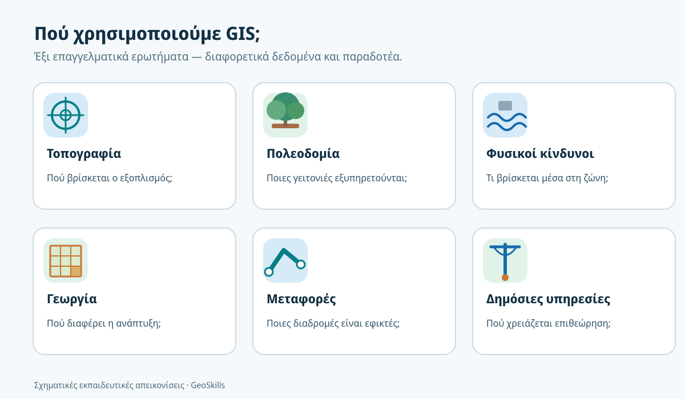
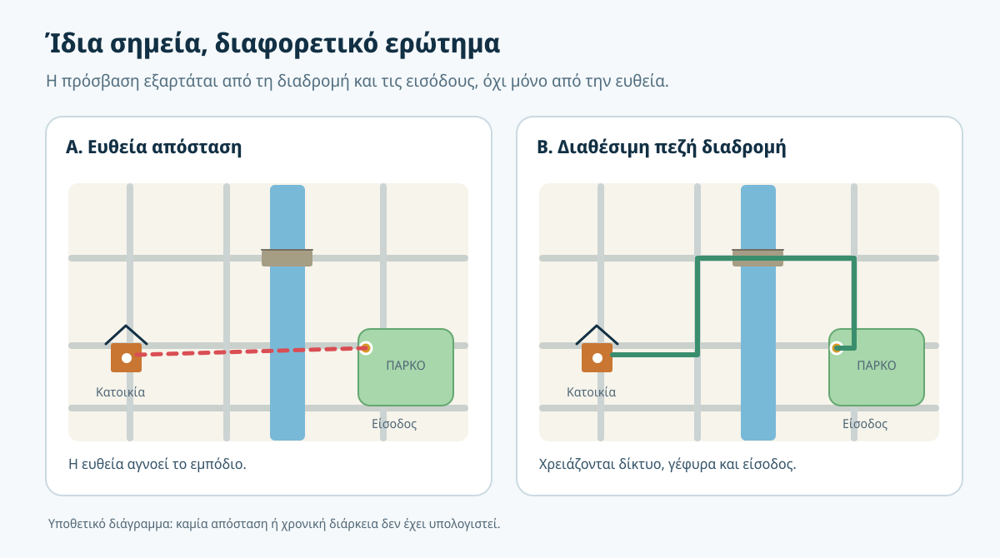
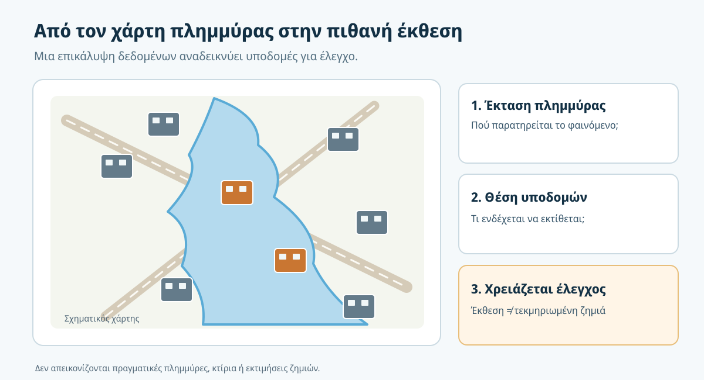
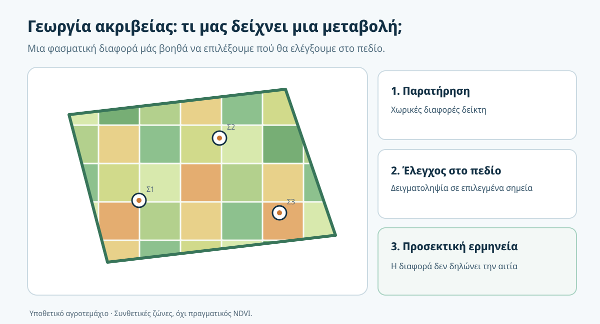

# 2. Πού και γιατί χρησιμοποιούμε Γεωγραφικά Συστήματα Πληροφοριών;

**Έξι επαγγελματικές εφαρμογές — από τη μέτρηση ενός σημείου μέχρι μια τεκμηριωμένη απόφαση για ολόκληρη περιοχή.**

**Χρόνος:** περίπου 40–50 λεπτά, μαζί με τις δραστηριότητες · **Προαπαιτούμενα:** [Κεφάλαιο 1](01-ti-einai-gis.md) · **Λογισμικό:** δεν απαιτείται.

:::{note} Η αποστολή σου
Μια τεχνική ομάδα αναλαμβάνει έξι διαφορετικές εργασίες: αποτύπωση δικτύου, αξιολόγηση δημόσιων χώρων, μελέτη πλημμύρας, παρακολούθηση καλλιεργειών, οργάνωση μεταφορών και κατανομή δημοτικών υπηρεσιών. Μπορείς να αναγνωρίσεις **τι ερώτημα απαντά κάθε εργασία, ποια δεδομένα χρειάζεται, τι αποτέλεσμα παραδίδει και τι πρέπει να ελεγχθεί**;
:::

## Τι θα μπορείς να κάνεις στο τέλος

- Να περιγράφεις τουλάχιστον τέσσερις ουσιαστικές εφαρμογές των GIS και την αξία τους για διαφορετικά επαγγέλματα.
- Να μετατρέπεις ένα γενικό αίτημα («χρειαζόμαστε χάρτη») σε συγκεκριμένο γεωγραφικό ερώτημα.
- Να αναγνωρίζεις βασικές κατηγορίες δεδομένων για τοπογραφία, πολεοδομία, φυσικούς κινδύνους, γεωργία, μεταφορές και δημόσιες υπηρεσίες.
- Να διακρίνεις **δεδομένα**, **διαδικασία**, **παραδοτέο** και **περιορισμό ερμηνείας** σε μια πραγματική εργασία.
- Να εξηγείς γιατί ο πιο κοντινός στόχος σε ευθεία απόσταση δεν είναι πάντα ο πιο εύκολα προσβάσιμος.
- Να αποφεύγεις υπερβολικά συμπεράσματα από μια δορυφορική εικόνα ή έναν χάρτη πλημμύρας.

## 2.1 Μια κοινή ιδέα, πολλές διαφορετικές ανάγκες

Στο [προηγούμενο κεφάλαιο](01-ti-einai-gis.md) είδαμε ότι ένας χάρτης με πάρκα δεν αρκεί για να καταλάβουμε ποιες γειτονιές εξυπηρετούνται πραγματικά. Τώρα θα δούμε ότι η ίδια λογική —η θέση σε συνδυασμό με χρήσιμες πληροφορίες— εμφανίζεται σε πολύ διαφορετικές επαγγελματικές εργασίες.

Ο τοπογράφος θέλει να οργανώσει μετρήσεις. Ο πολεοδόμος να συγκρίνει εναλλακτικές χωροθετήσεις. Μια υπηρεσία πολιτικής προστασίας να εντοπίσει υποδομές που βρίσκονται μέσα σε πλημμυρισμένη περιοχή. Ο γεωπόνος να διαπιστώσει πού αλλάζει η ανάπτυξη μιας καλλιέργειας. Ο συγκοινωνιολόγος να αξιολογήσει διαδρομές. Ο δήμος να κατανοήσει ποιους κατοίκους εξυπηρετούν οι εγκαταστάσεις του.

**Δεν χρησιμοποιούν όλοι τα ίδια δεδομένα, τις ίδιες μεθόδους ή τα ίδια αποτελέσματα.** Αυτό που μοιράζονται είναι η ανάγκη να ερμηνεύσουν πληροφορίες που έχουν χωρική διάσταση.

*Εικόνα 1. Ενδεικτικές εφαρμογές. Τα εικονίδια και τα παραδείγματα είναι πρωτότυπα εκπαιδευτικά σχέδια, όχι αποτελέσματα πραγματικής ανάλυσης.*

## 2.2 Τοπογραφία και τεχνικά δίκτυα — από τη μέτρηση στην πληροφορία

Φαντάσου ότι συνεργείο αποτυπώνει φρεάτια και τμήματα δικτύου ύδρευσης σε μια συνοικία. Με γεωδαιτικό σταθμό ή δέκτη GNSS καταγράφει θέσεις. Αλλά οι συντεταγμένες μόνες τους δεν απαντούν σε ερωτήματα όπως «ποια φρεάτια χρειάζονται συντήρηση;» ή «ποια τμήματα του δικτύου έχουν ελλιπή τεκμηρίωση;».

Αν οι μετρήσεις συνδεθούν με κωδικούς, ημερομηνίες, κατάσταση εγκατάστασης και άλλα γνωρίσματα, η εργασία αποκτά οργανωμένη γεωχωρική μορφή. Ένα GIS μπορεί να βοηθήσει στη χαρτογράφηση, στον εντοπισμό διπλών εγγραφών, στην επιλογή στοιχείων για επιθεώρηση και στην παραγωγή ενημερωμένου χάρτη για τη διαχείριση του δικτύου.

**Τι χρειάζεται:** θέσεις και κωδικοί σημείων, περιγραφές εγκαταστάσεων, ενδεχομένως γραμμές δικτύου, τεκμηριωμένο σύστημα αναφοράς και πληροφορίες προέλευσης μετρήσεων.

**Τι παραδίδεται:** οργανωμένο γεωχωρικό σύνολο και θεματικός χάρτης επιθεωρήσεων, όχι απλώς ένας κατάλογος συντεταγμένων.

**Τι ελέγχουμε:** την καταλληλότητα των μετρήσεων, το σύστημα αναφοράς, τα κενά και την ταυτοποίηση κάθε εγκατάστασης. Το GIS δεν «διορθώνει» από μόνο του μια λανθασμένη μέτρηση ούτε αποδεικνύει ότι μια σχεδιασμένη γραμμή αντιστοιχεί σε πραγματική υπόγεια σύνδεση.

:::{tip} Σύνδεση με άλλη διαδρομή του GeoSkills
Στο **Field Surveying Core** θα μάθεις πώς εκτελούνται και ελέγχονται οι μετρήσεις πεδίου. Εδώ μας ενδιαφέρει τι κάνουμε *αφού αποκτήσουμε* αξιόπιστα γεωχωρικά δεδομένα.
:::

## 2.3 Πολεοδομία και δημόσιοι χώροι — σχεδιάζοντας για τις πραγματικές ανάγκες

Επιστρέφουμε για λίγο στον δήμο των χώρων πρασίνου. Αυτή τη φορά η υπηρεσία δεν θέλει απλώς να εντοπίσει υπάρχοντα πάρκα. Θέλει να αξιολογήσει **πού θα ήταν χρήσιμη μια νέα είσοδος πάρκου ή ένας νέος κοινόχρηστος χώρος**.

Μια πρώτη προσέγγιση συγκρίνει την ευθεία απόσταση κατοικιών–πάρκου. Μια καλύτερα τεκμηριωμένη προσέγγιση λαμβάνει υπόψη το δίκτυο πεζών, τις θέσεις εισόδων, τις διαβάσεις και τα εμπόδια. Δύο κατοικίες μπορεί να φαίνονται εξίσου κοντά στο ίδιο πάρκο, αλλά η μία να απαιτεί σημαντική παράκαμψη.

*Εικόνα 2. Υποθετικό παράδειγμα. Οι γραμμές δεν αποτυπώνουν πραγματικές αποστάσεις ούτε υπολογισμένο χρόνο: δείχνουν γιατί πρέπει να ορίσουμε τη μέθοδο πριν μιλήσουμε για εξυπηρέτηση.*

**Τι χρειάζεται:** κατοικημένες περιοχές, πληθυσμό, προσβάσιμες εισόδους, δίκτυο πεζών, χρήσεις γης και τυχόν χωροταξικούς περιορισμούς.

**Τι παραδίδεται:** χάρτης περιοχών με περιορισμένη εξυπηρέτηση, συγκριτικός πίνακας εναλλακτικών θέσεων και τεκμηρίωση κριτηρίων.

**Τι ελέγχουμε:** αν το δίκτυο είναι πλήρες, αν οι είσοδοι είναι πραγματικά ανοιχτές, αν λήφθηκαν υπόψη άτομα με διαφορετικές δυνατότητες μετακίνησης και αν η χωροθέτηση είναι θεσμικά και τεχνικά εφικτή. Ένα αποτέλεσμα GIS υποστηρίζει τον σχεδιασμό· **δεν αντικαθιστά την τελική πολεοδομική απόφαση**.

## 2.4 Περιβάλλον και φυσικοί κίνδυνοι — από το φαινόμενο στην πιθανή έκθεση

Έπειτα από έντονη βροχόπτωση, μια υπηρεσία θέλει να εντοπίσει ποιοι δρόμοι και ποιες εγκαταστάσεις βρίσκονται μέσα στην περιοχή που εμφανίζεται πλημμυρισμένη. Χρειάζεται να συνδυάσει δύο διαφορετικά είδη πληροφορίας: την **εκτιμώμενη ή παρατηρημένη έκταση του φαινομένου** και τη **θέση των υποδομών**.

Η επικάλυψη των δύο μπορεί να δείξει ποιες εγκαταστάσεις τέμνουν τη χαρτογραφημένη περιοχή και επομένως χρειάζονται έλεγχο. Σε μια πραγματική επιχειρησιακή κατάσταση μπορεί να αξιοποιηθεί, μεταξύ άλλων, υλικό δορυφορικής χαρτογράφησης όπως αυτό που παράγει η υπηρεσία [Copernicus Emergency Management Service](https://mapping.emergency.copernicus.eu/about/).

*Εικόνα 3. Αμιγώς εκπαιδευτικό σχήμα: η επικάλυψη δείχνει **πιθανή έκθεση**, όχι βεβαιωμένη ζημιά ή πλήρη εκτίμηση κινδύνου.*

**Τι χρειάζεται:** χάρτης έκτασης πλημμύρας και χρονική σήμανσή του, δρόμοι, κτίρια, κρίσιμες εγκαταστάσεις, στοιχεία ποιότητας και πιθανές επιτόπιες παρατηρήσεις.

**Τι παραδίδεται:** προκαταρκτικός κατάλογος υποδομών που τέμνουν την πλημμυρισμένη περιοχή, χάρτης προτεραιοτήτων επιθεώρησης και σαφής αναφορά περιορισμών.

**Τι ελέγχουμε:** πότε έγινε η παρατήρηση, αν υπάρχουν σφάλματα ταξινόμησης, αν η γεωμετρία είναι επαρκώς ακριβής και αν οι υποδομές έχουν ενημερωθεί. **Έκθεση** δεν σημαίνει αυτόματα **ζημιά**· ούτε ένας χάρτης πλημμύρας αρκεί για πλήρη υπολογισμό **κινδύνου**, που απαιτεί επιπλέον πληροφορίες.

## 2.5 Γεωργία ακριβείας — παρακολουθώντας χωρικές διαφορές

Ένας παραγωγός παρατηρεί ότι η καλλιέργειά του δεν αναπτύσσεται ομοιόμορφα. Αντί να αντιμετωπίσει ολόκληρο το αγροτεμάχιο ως μία ενιαία περιοχή, μπορεί να εξετάσει χωρικά διαφοροποιημένα δεδομένα: δορυφορικές παρατηρήσεις, επιτόπιες μετρήσεις, ιστορικό άρδευσης και εδαφικές πληροφορίες.

Ένας **δείκτης βλάστησης**, όπως ο NDVI, συνοψίζει τη διαφορά ανακλαστικότητας σε συγκεκριμένες φασματικές περιοχές και μπορεί να αναδείξει χωρική μεταβλητότητα της βλάστησης. Δεν μας λέει όμως μόνος του **γιατί** εμφανίζεται η διαφορά: μπορεί να σχετίζεται με στάδιο ανάπτυξης, υδατικές συνθήκες, έδαφος, καλλιεργητικές πρακτικές ή άλλους παράγοντες. Η ερμηνεία πρέπει να συνεκτιμά τον χρόνο λήψης, τα νέφη και τις συνθήκες παρατήρησης.

*Εικόνα 4. Συμβολικό παράδειγμα μεταβλητότητας μέσα σε αγροτεμάχιο. Οι ζώνες δεν προέρχονται από πραγματικά δορυφορικά δεδομένα και δεν δηλώνουν διάγνωση ασθένειας.*

**Τι χρειάζεται:** όρια αγροτεμαχίων, συγκρίσιμες δορυφορικές εικόνες ή χάρτες δείκτη, ημερομηνίες λήψης, στοιχεία εδάφους και επιτόπιες παρατηρήσεις.

**Τι παραδίδεται:** χάρτης περιοχών που αξίζει να ελεγχθούν στο πεδίο, συγκριτική παρακολούθηση και τεκμηριωμένη λίστα επόμενων μετρήσεων.

**Τι ελέγχουμε:** νεφοκάλυψη, στάδιο ανάπτυξης, χωρική ανάλυση, ακρίβεια ορίων και αν οι μεταβολές υποστηρίζονται από επίγειες παρατηρήσεις. **Διαφορετική τιμή δείκτη ≠ διάγνωση συγκεκριμένης ασθένειας.**

## 2.6 Μεταφορές — η σημασία του δικτύου

Μια περιφερειακή υπηρεσία θέλει να εξετάσει ποιοι οικισμοί μπορούν να φτάσουν σε μια μονάδα υγείας μέσα σε συγκεκριμένο χρόνο οδήγησης. Εδώ η απλή ευθεία απόσταση έχει μικρή πρακτική αξία: δύο οικισμοί μπορεί να απέχουν το ίδιο από το νοσοκομείο στον χάρτη αλλά να έχουν εντελώς διαφορετική οδική σύνδεση.

Η ανάλυση μπορεί να στηριχθεί σε **δίκτυο δρόμων**, με κόμβους και τμήματα που επιτρέπουν συγκεκριμένες μετακινήσεις. Η διαδρομή δεν εξαρτάται μόνο από τη γεωμετρία: σημαντικό ρόλο παίζουν κατευθύνσεις, όρια ταχύτητας, περιορισμοί, ποιότητα οδοστρώματος και πιθανές διακοπές κυκλοφορίας.

**Τι χρειάζεται:** ενημερωμένο και συνδεδεμένο δίκτυο δρόμων, θέσεις οικισμών ή πληθυσμιακής ζήτησης, θέσεις μονάδων υγείας και εύλογες παραδοχές χρόνου μετακίνησης.

**Τι παραδίδεται:** χάρτης περιοχών εξυπηρέτησης, πιθανές διαδρομές και κατάλογος οικισμών που υπερβαίνουν το επιλεγμένο χρονικό όριο.

**Τι ελέγχουμε:** μονόδρομους, απαγορεύσεις στροφών, εποχικές διακοπές και αν οι χρόνοι αποτελούν ενδεικτικές εκτιμήσεις ή πραγματικές μετρήσεις. Η συντομότερη γεωμετρικά διαδρομή δεν είναι πάντα η ταχύτερη ούτε η ασφαλέστερη.

## 2.7 Δημόσιες υπηρεσίες — αποφάσεις με στοιχεία

Ένας δήμος θέλει να οργανώσει καλύτερα τη συντήρηση δημοτικού φωτισμού. Διαθέτει καταγραφές βλαβών, θέσεις φωτιστικών, κατηγορίες οδών και ημερομηνίες τελευταίας επιθεώρησης. Αν ενώσει αυτά τα στοιχεία χωρικά, μπορεί να δει σε ποιες περιοχές συσσωρεύονται εκκρεμότητες και να σχεδιάσει οργανωμένες επισκέψεις συνεργείων.

Αν όμως μια γειτονιά έχει περισσότερες αναφορές βλαβών, αυτό δεν σημαίνει αυτομάτως ότι παρουσιάζει περισσότερες πραγματικές αστοχίες: μπορεί απλώς να αναφέρει συχνότερα τα προβλήματα. Χρειάζεται να εξεταστεί η **πληρότητα της καταγραφής** και να μη μετατραπεί μια μεροληπτική πηγή δεδομένων σε άδικη απόφαση κατανομής πόρων.

**Τι χρειάζεται:** θέσεις εξοπλισμού, κωδικοί, κατάσταση/ημερομηνίες, αναφορές κατοίκων και στοιχεία για τον τρόπο καταγραφής.

**Τι παραδίδεται:** χάρτης προγραμματισμού επιθεωρήσεων, κατάλογος εργασιών και συνοπτικοί δείκτες κατά περιοχή.

**Τι ελέγχουμε:** διπλές αναφορές, παλιές εγγραφές, ελλείψεις και θέματα προστασίας προσωπικών δεδομένων όταν υπάρχουν πληροφορίες ταυτοποιήσιμων κατοίκων. Δεν χρειάζεται να δημοσιοποιούνται ονόματα πολιτών για να παρουσιαστεί ένας χάρτης συντήρησης.

## 2.8 Έξι εφαρμογές — μία πρακτική σύγκριση

| Πεδίο | Κεντρικό ερώτημα | Χαρακτηριστικά δεδομένα | Χρήσιμο παραδοτέο |
|---|---|---|---|
| Τοπογραφία | Πού βρίσκονται και ποια κατάσταση έχουν τα στοιχεία δικτύου; | Μετρήσεις, κωδικοί, περιγραφές | Οργανωμένο αρχείο και χάρτης εγκαταστάσεων |
| Πολεοδομία | Ποιες περιοχές έχουν περιορισμένη εξυπηρέτηση από πάρκα; | Κατοικίες, είσοδοι, δίκτυο πεζών | Χάρτης εναλλακτικών σχεδιασμού |
| Φυσικοί κίνδυνοι | Ποιες υποδομές τέμνουν μια πλημμυρισμένη ζώνη; | Έκταση φαινομένου, υποδομές | Προκαταρκτικός χάρτης πιθανής έκθεσης |
| Γεωργία | Πού παρατηρούμε διαφορετική ανάπτυξη; | Αγροτεμάχια, δείκτες, παρατηρήσεις | Χάρτης θέσεων για επιτόπιο έλεγχο |
| Μεταφορές | Ποιες περιοχές ξεπερνούν τον χρόνο εξυπηρέτησης; | Οδικό δίκτυο, υπηρεσίες, πληθυσμός | Χάρτης χρόνων διαδρομής |
| Δημόσιες υπηρεσίες | Πού πρέπει να οργανωθούν επιθεωρήσεις; | Θέσεις εξοπλισμού, αναφορές | Σχέδιο εργασιών και χάρτης προτεραιοτήτων |

Κοίτα τις στήλες **ερώτημα**, **δεδομένα** και **παραδοτέο**: η ίδια πληροφορία μπορεί να αποκτήσει διαφορετική αξία ανάλογα με αυτό που θέλουμε να αποφασίσουμε. Ένας καλός χάρτης δεν είναι πάντα ο τελικός σκοπός. Μερικές φορές το σημαντικότερο παραδοτέο είναι μια λίστα επιθεώρησης, ένας πίνακας ή μια τεκμηριωμένη εναλλακτική επιλογή.

## 2.9 Τρεις δραστηριότητες εφαρμογής

### Δραστηριότητα Α — Από το επάγγελμα στο γεωγραφικό ερώτημα (4 λεπτά)

Επίλεξε **ένα** από τα εξής αιτήματα:

- «Θέλουμε να βελτιώσουμε την ασφάλεια των μαθητών στη διαδρομή προς το σχολείο».
- «Θέλουμε να εντοπίσουμε πιθανές βλάβες σε τμήματα αρδευτικού δικτύου».
- «Θέλουμε να αποφασίσουμε ποιες καλλιεργητικές ζώνες θα επισκεφθούμε πρώτες».

Γράψε: **(α)** ένα μετρήσιμο ερώτημα, **(β)** δύο απαραίτητα σύνολα δεδομένων και **(γ)** ένα παραδοτέο.

:::{dropdown} Ενδεικτική απάντηση
Για το σχολείο: «Ποιες βασικές πεζές διαδρομές προς τα σχολεία διασταυρώνονται με οδικά τμήματα χωρίς καταγεγραμμένες ασφαλείς διαβάσεις;». Απαιτούνται θέσεις σχολείων, δίκτυο πεζών και θέσεις διαβάσεων (άρα στην πράξη τρία σύνολα). Παραδοτέο: χάρτης πιθανών σημείων επιτόπιου ελέγχου. Η απουσία μιας διάβασης από δεδομένα δεν αποδεικνύει ότι δεν υπάρχει στον πραγματικό κόσμο.
:::

### Δραστηριότητα Β — Βρες το υπερβολικό συμπέρασμα (3 λεπτά)

Διάβασε δύο δηλώσεις:

**Α.** «Το κτίριο βρίσκεται μέσα στη χαρτογραφημένη πλημμυρισμένη περιοχή, επομένως έχει υποστεί σοβαρή ζημιά».

**Β.** «Στο αγροτεμάχιο παρατηρήθηκε χαμηλότερος δείκτης βλάστησης, επομένως έχει προσβληθεί από συγκεκριμένη ασθένεια».

Εξήγησε γιατί καθεμία χρειάζεται περισσότερα στοιχεία.

:::{dropdown} Ενδεικτική απάντηση
Η χαρτογραφική επικάλυψη υποδηλώνει πιθανή έκθεση, όχι τεκμηριωμένη ζημιά. Χρειάζονται πληροφορίες για την πραγματική επαφή με το νερό, τα χαρακτηριστικά του κτιρίου και επιτόπιος έλεγχος. Ο δείκτης βλάστησης δείχνει φασματική/χωρική διαφορά, όχι συγκεκριμένη αιτία· απαιτούνται επιπλέον παρατηρήσεις, μετρήσεις και αγρονομική αξιολόγηση.
:::

### Δραστηριότητα Γ — Επιλογή κατάλληλου αποτελέσματος (3 λεπτά)

Μια δημοτική υπηρεσία θέλει να προγραμματίσει τις εργασίες του συνεργείου της για την επόμενη εβδομάδα. Τι θα τη βοηθήσει περισσότερο: **(α)** μια καλαίσθητη εικόνα της πόλης χωρίς πληροφορίες βλαβών ή **(β)** ένας χάρτης με θέσεις και κατάσταση φωτιστικών, συνοδευόμενος από λίστα εργασιών; Αιτιολόγησε.

:::{dropdown} Ενδεικτική απάντηση
Το (β), επειδή συνδέει τον χώρο με την πληροφορία που χρειάζεται για τη συγκεκριμένη απόφαση. Η εμφάνιση παραμένει σημαντική για την ανάγνωση, αλλά δεν υποκαθιστά τα χρήσιμα και ελεγμένα δεδομένα.
:::

## 2.10 Έλεγξε την κατανόησή σου

Απάντησε χωρίς να κοιτάξεις πρώτα τις λύσεις.

1. Γιατί ένα σύνολο συντεταγμένων χρειάζεται συχνά να συνδεθεί και με περιγραφικά γνωρίσματα;
2. Ποια βασική διαφορά έχει μια ανάλυση πεζής πρόσβασης από έναν υπολογισμό ευθείας απόστασης;
3. Τι μπορούμε να συμπεράνουμε με ασφάλεια όταν ένα κτίριο τέμνει μια χαρτογραφημένη πλημμυρισμένη περιοχή;
4. Γιατί δεν μπορούμε να θεωρήσουμε τον NDVI αυτόματη διάγνωση ασθένειας;
5. Ποια στοιχεία μπορεί να αλλάξουν τον εκτιμώμενο χρόνο μιας οδικής διαδρομής;
6. Γιατί ένας χάρτης με πολλές αναφορές βλαβών δεν αποδεικνύει ότι η αντίστοιχη περιοχή έχει απαραίτητα περισσότερες πραγματικές βλάβες;
7. Δώσε ένα παράδειγμα εργασίας όπου ένα **γεωχωρικό αρχείο** ή ένας **πίνακας εργασιών** είναι σημαντικότερο τελικό παραδοτέο από έναν εντυπωσιακό χάρτη.
8. Διάλεξε ένα από τα έξι πεδία και συμπλήρωσε: «Θέλω να μάθω ___, χρειάζομαι ___, θα παραδώσω ___, πρέπει να ελέγξω ___».

:::{dropdown} Ενδεικτικές απαντήσεις
1. Για να γνωρίζουμε *ποιο* αντικείμενο μετρήθηκε και με ποια χαρακτηριστικά/κατάσταση. 2. Η πραγματική πεζή πρόσβαση εξαρτάται από συνδεδεμένες διαδρομές, εισόδους και εμπόδια. 3. Πιθανή έκθεση που αξίζει διερεύνηση, όχι βεβαιωμένη ζημιά. 4. Ο δείκτης επηρεάζεται από πολλούς παράγοντες και δεν προσδιορίζει μονοσήμαντα την αιτία. 5. Η συνδεσιμότητα, οι κατευθύνσεις, οι περιορισμοί και οι συνθήκες μετακίνησης. 6. Ενδέχεται να υπάρχουν διαφορές στον τρόπο αναφοράς ή στην πληρότητα δεδομένων. 7. Π.χ. κατάλογος φρεατίων προς επιθεώρηση με θέσεις και κωδικούς. 8. Αποδεκτή κάθε συνεπής τετράδα ερωτήματος–δεδομένων–παραδοτέου–ελέγχου.
:::

### Μπορώ να συνεχίσω όταν…

- [ ] Αναγνωρίζω τουλάχιστον τέσσερις διαφορετικές επαγγελματικές εφαρμογές GIS.
- [ ] Μπορώ να διατυπώσω για μία εφαρμογή σαφές ερώτημα, απαιτούμενα δεδομένα και παραδοτέο.
- [ ] Δεν συγχέω την ευθεία απόσταση με τον χρόνο ή την ευκολία πραγματικής μετακίνησης.
- [ ] Διακρίνω την πιθανή έκθεση σε φυσικό φαινόμενο από τη διαπιστωμένη ζημιά.
- [ ] Κατανοώ ότι οι δείκτες τηλεπισκόπησης χρειάζονται ερμηνεία και επιτόπιο έλεγχο.

## Τι κρατάμε — και τι ακολουθεί

Οι εφαρμογές GIS δεν περιορίζονται στη δημιουργία χαρτών. Μπορούν να οργανώσουν μετρήσεις, να υποστηρίξουν έλεγχο υποδομών, να συγκρίνουν επιλογές σχεδιασμού, να κατευθύνουν επιτόπιες αυτοψίες και να βοηθήσουν στη διαχείριση υπηρεσιών. **Η σωστή εφαρμογή ξεκινά από ένα συγκεκριμένο ερώτημα, τεκμηριωμένα δεδομένα και μια ειλικρινή περιγραφή των περιορισμών.**

Τώρα προκύπτει το επόμενο ερώτημα: *πώς αποθηκεύουμε στον υπολογιστή έναν δρόμο, ένα αγροτεμάχιο, έναν δορυφορικό δείκτη ή έναν πίνακα συντεταγμένων;* Αυτό θα μάθουμε στο [Κεφάλαιο 3 — Με ποια δεδομένα δουλεύει ένα GIS;](03-dedomena.md), όπου θα γνωρίσουμε συστηματικά τις γεωμετρίες, τα διανυσματικά δεδομένα και τα ψηφιδωτά επίπεδα.

## Πηγές για περαιτέρω μελέτη

- [QGIS — Introducing GIS](https://docs.qgis.org/3.44/en/docs/gentle_gis_introduction/introducing_gis.html) — πρακτική εισαγωγή στα γεωχωρικά επίπεδα και στις χρήσεις GIS.
- [Copernicus Emergency Management Service — Mapping](https://mapping.emergency.copernicus.eu/about/) — πραγματικές εφαρμογές γεωχωρικής πληροφορίας σε φυσικές καταστροφές.
- [NASA Earth Observatory — Measuring Vegetation](https://earthobservatory.nasa.gov/Features/MeasuringVegetation/measuring_vegetation_2.php) — τι μετρά ένας δείκτης βλάστησης και πώς ερμηνεύεται.
- [OpenStreetMap — Copyright and License](https://www.openstreetmap.org/copyright) — παράδειγμα σημαντικής ανοικτής πηγής χωρικών δεδομένων και των όρων επαναχρησιμοποίησης.

*Όλα τα εκπαιδευτικά διαγράμματα του κεφαλαίου απεικονίζουν υποθετικά σενάρια. Δεν χρησιμοποιήθηκαν πραγματικές θέσεις, μετρήσεις, αποτελέσματα δορυφορικής ανάλυσης ή δεδομένα πολιτών.*
