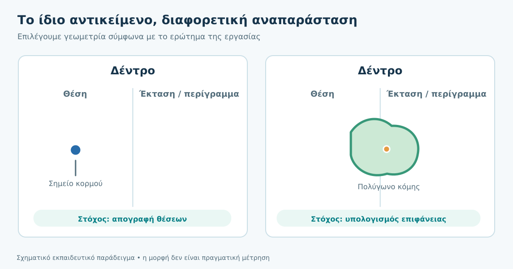
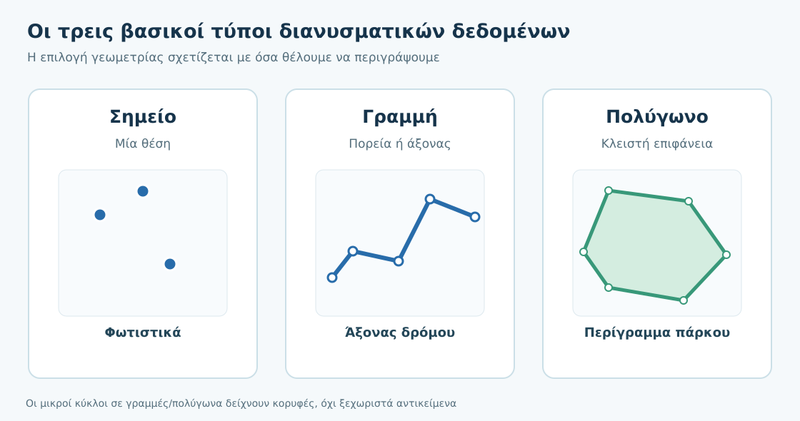
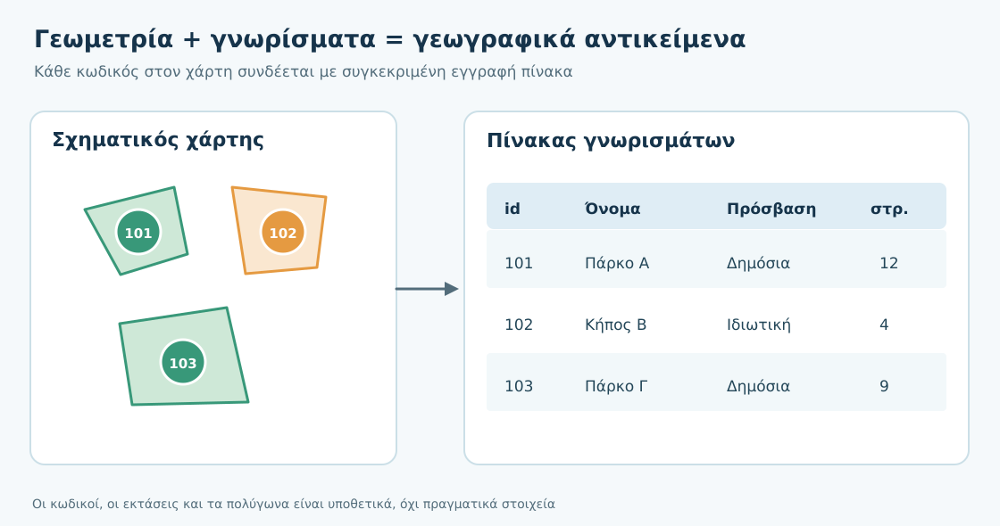
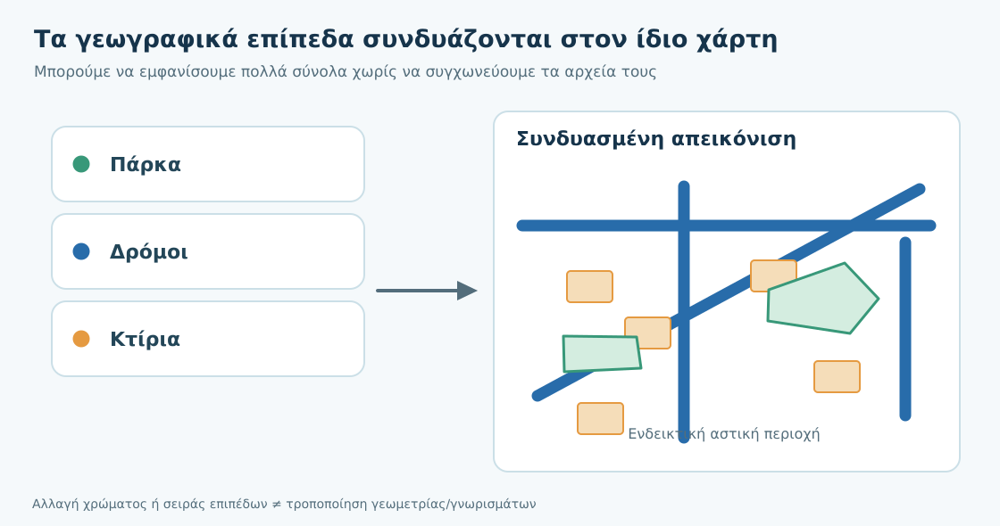
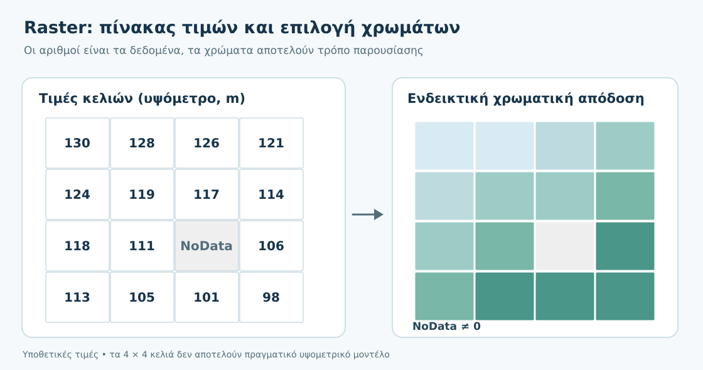
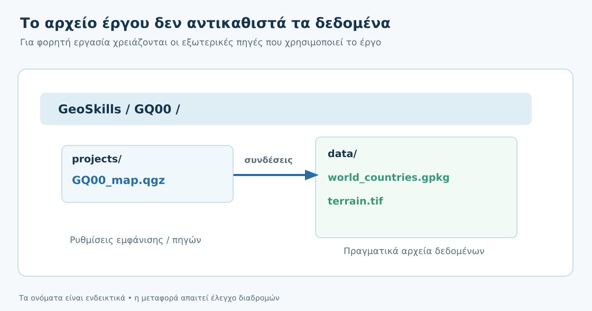

# 3. Με ποια δεδομένα δουλεύει ένα GIS;

**Από τον πραγματικό κόσμο στα ψηφιακά γεωχωρικά δεδομένα**

**Χρόνος:** περίπου 50–65 λεπτά μαζί με τις δραστηριότητες · **Προαπαιτούμενα:** Κεφάλαια 1–2 του GQ-START · **Λογισμικό:** δεν απαιτείται.

:::{note} Η αποστολή σου
Ένας δήμος χρειάζεται έναν αξιόπιστο κατάλογο από πάρκα, δρόμους, κτίρια και δέντρα για να μελετήσει τους χώρους πρασίνου. Πώς θα αναπαραστήσουμε αυτά τα διαφορετικά αντικείμενα στον υπολογιστή; Πότε χρειαζόμαστε σημεία, πότε πολύγωνα και πότε μια εικόνα αποτελούμενη από κελιά; Στο τέλος θα μπορείς να επιλέγεις *αιτιολογημένα* τον κατάλληλο τύπο δεδομένων.
:::

## Τι θα μπορείς να κάνεις στο τέλος

- Να εξηγείς γιατί ένα πραγματικό αντικείμενο μπορεί να αναπαριστάνεται με διαφορετικούς τρόπους, ανάλογα με τον σκοπό της εργασίας.
- Να ξεχωρίζεις **σημεία, γραμμές και πολύγωνα** και να προτείνεις σωστές εφαρμογές τους.
- Να αναγνωρίζεις **γεωμετρία, αντικείμενο, γνώρισμα, πεδίο και εγγραφή**.
- Να περιγράφεις τι είναι τα **επίπεδα (layers)** και τι αλλάζει όταν τροποποιούμε μόνο τον συμβολισμό τους.
- Να εξηγείς τα **ψηφιδωτά δεδομένα (raster)**, τις τιμές κελιών, τη χωρική ανάλυση και την ένδειξη NoData.
- Να επιλέγεις ανάμεσα σε vector και raster χωρίς να θεωρείς ότι το ένα είναι πάντα καλύτερο.
- Να αναγνωρίζεις συνηθισμένους μορφότυπους και να διακρίνεις ένα αρχείο **δεδομένων** από ένα **έργο QGIS**.

## 3.1 Ο πραγματικός κόσμος δεν χωρά αυτούσιος στον υπολογιστή

Στο [προηγούμενο κεφάλαιο](02-efarmoges.md) είδαμε ότι τα GIS χρησιμοποιούνται σε διαφορετικά επαγγελματικά πεδία. Για να εργαστούμε όμως με ένα πραγματικό φαινόμενο, πρέπει πρώτα να το περιγράψουμε με τρόπο που ο υπολογιστής να μπορεί να αποθηκεύσει και να επεξεργαστεί.

Σκέψου ένα δέντρο στην πλατεία. Στην πραγματικότητα έχει κορμό, κόμη, ύψος, ηλικία και θέση. Αν θέλουμε απλώς **να καταγράψουμε πόσα δέντρα υπάρχουν και πού βρίσκονται**, μια θέση-σημείο και ένας πίνακας χαρακτηριστικών μπορεί να αρκούν. Αν θέλουμε **να υπολογίσουμε την έκταση της σκιάς ή την επιφάνεια της κόμης**, ένα σημείο δεν αρκεί: χρειαζόμαστε πληροφορία για το σχήμα και το μέγεθός της.

Το ίδιο ισχύει για ένα κτίριο: ως σημείο μπορεί να δηλώνει τη θέση μιας δημόσιας υπηρεσίας, ενώ ως πολύγωνο μπορεί να περιγράφει το αποτύπωμά του. Δεν άλλαξε το πραγματικό κτίριο· **άλλαξε ο τρόπος με τον οποίο το περιγράφουμε, επειδή άλλαξε το ερώτημα**.

*Εικόνα 1. Η επιλογή γεωμετρίας εξαρτάται από τον στόχο και την απαιτούμενη λεπτομέρεια. Σχηματικό εκπαιδευτικό παράδειγμα.*

:::{tip} Σκέψου πριν συνεχίσεις
Αν θέλεις να γνωρίζεις **πόσες** στάσεις λεωφορείου υπάρχουν σε μια περιοχή, ποια αναπαράσταση θα ήταν πρακτική; Αν θέλεις να υπολογίσεις **πόση επιφάνεια καταλαμβάνει** μια πλατεία, θα ήταν το ίδιο κατάλληλη;
:::

Αυτό που δημιουργούμε είναι ένα **μοντέλο του γεωγραφικού κόσμου**. Το μοντέλο κρατά τις ιδιότητες που χρειαζόμαστε για ένα συγκεκριμένο πρόβλημα, όχι κάθε λεπτομέρεια της πραγματικότητας. Γι' αυτό ακόμη και πολύ ακριβή δεδομένα πρέπει να κρίνονται σε σχέση με την ερώτηση που θέλουμε να απαντήσουμε.

## 3.2 Διανυσματικά δεδομένα: σημεία, γραμμές, πολύγωνα

Τα **διανυσματικά δεδομένα (vector data)** περιγράφουν διακριτά γεωγραφικά αντικείμενα με γεωμετρίες. Στην εισαγωγή μας αρκούν τρεις βασικοί τύποι:

### Σημείο

Ένα **σημείο** δηλώνει θέση. Για παράδειγμα, μια γεώτρηση, ένα φωτιστικό, μια στάση, ένα σημείο μέτρησης GNSS ή η καταγεγραμμένη θέση ενός δέντρου. Έχει συντεταγμένες, αλλά δεν περιγράφει από μόνο του μήκος ή επιφάνεια.

### Γραμμή

Μια **γραμμή** περιγράφει τη διαδρομή ή τη γραμμική μορφή ενός αντικειμένου: άξονα δρόμου, αγωγό, ρέμα ή μονοπάτι. Αποτελείται από συνδεδεμένες κορυφές και μπορεί να έχει μήκος. Η γραμμή ενός δρόμου δεν αναπαριστά υποχρεωτικά το πραγματικό πλάτος του δρόμου.

### Πολύγωνο

Ένα **πολύγωνο** περιγράφει μια κλειστή έκταση: πάρκο, αγροτεμάχιο, λίμνη, διοικητική περιοχή ή αποτύπωμα κτιρίου. Η γεωμετρία του επιτρέπει να εξετάζουμε την έκταση και τη χωρική επικάλυψη. Για αξιόπιστους υπολογισμούς χρειάζονται κατάλληλα συστήματα αναφοράς και έγκυρες γεωμετρίες — αυτά θα τα μάθουμε αργότερα.

*Εικόνα 2. Οι τρεις βασικές γεωμετρίες. Οι γραμμές και τα πολύγωνα αποτελούνται από κορυφές (vertices).*

| Αν θέλω να περιγράψω… | Πιθανή επιλογή | Γιατί; |
|---|---|---|
| Θέση βρύσης | Σημείο | Ενδιαφέρει η τοποθεσία, όχι η επιφάνειά της |
| Άξονα δρόμου | Γραμμή | Ενδιαφέρει η διαδρομή και το μήκος |
| Περίγραμμα πάρκου | Πολύγωνο | Ενδιαφέρουν τα όρια και η έκταση |
| Ένα μεγάλο κτίριο | Σημείο **ή** πολύγωνο | Εξαρτάται αν μελετώ θέση υπηρεσίας ή αποτύπωμα |

:::{important} Η γεωμετρία δεν είναι το ίδιο με το σύμβολο
Ένα σημείο μπορεί να εμφανίζεται στον χάρτη με έναν μεγάλο κύκλο. Ο κύκλος αυτός είναι **σύμβολο εμφάνισης**· δεν σημαίνει ότι το γεωγραφικό αντικείμενο απέκτησε αντίστοιχη έκταση. Επίσης, δεν μετατρέπουμε μια γραμμή σε πολύγωνο απλώς αυξάνοντας το πάχος της στην οθόνη.
:::

## 3.3 Γεωμετρία και γνωρίσματα: η θέση συναντά την περιγραφή

Ας επιστρέψουμε στα πάρκα του δήμου. Χρειάζεται να γνωρίζουμε πού βρίσκεται κάθε πάρκο, αλλά και ποιο είναι, αν έχει δημόσια πρόσβαση και τι χαρακτηριστικά διαθέτει.

Ένα **γεωγραφικό αντικείμενο (feature)** μπορεί να έχει δύο πλευρές: τη **γεωμετρία** του, που περιγράφει τη θέση και το σχήμα, και τα **γνωρίσματά** του (*attributes*), που περιγράφουν ιδιότητές του. Τα γνωρίσματα παρουσιάζονται συνήθως σε **πίνακα γνωρισμάτων**.

| id | Όνομα | Πρόσβαση | Έκταση (στρ.) |
|---:|---|---|---:|
| 101 | Πάρκο Α | Δημόσια | 12 |
| 102 | Κήπος Β | Ιδιωτική | 4 |
| 103 | Πάρκο Γ | Δημόσια | 9 |

*Υποθετικά εκπαιδευτικά δεδομένα. Οι εκτάσεις είναι τιμές του πίνακα και όχι αποτέλεσμα μέτρησης από το παρακάτω σχήμα.*

Οι **στήλες** του πίνακα είναι πεδία (*fields*). Κάθε **γραμμή** είναι μια εγγραφή (*record*) που αντιστοιχεί σε αντικείμενο. Το πεδίο `id` λειτουργεί εδώ ως μοναδικός αναγνωριστικός κωδικός. Μπορεί να αποθηκεύουμε κείμενα, αριθμούς, ημερομηνίες ή λογικές τιμές, ανάλογα με το μοντέλο δεδομένων.

*Εικόνα 3. Η αναφορά σε ένα αντικείμενο του χάρτη συνδέεται με συγκεκριμένη εγγραφή και πεδία στον πίνακα.*

Η σύνδεση αυτή είναι πολύ σημαντική. Αν ρωτήσουμε «ποια πάρκα έχουν δημόσια πρόσβαση;», το GIS μπορεί να χρησιμοποιήσει την τιμή του πεδίου `Πρόσβαση` αντί να αποφασίσει από το χρώμα που βλέπουμε στην οθόνη. Η απουσία τιμής (**NULL**) δεν σημαίνει απαραίτητα μηδέν ή «Όχι»· σημαίνει ότι δεν υπάρχει καταχωρισμένη τιμή για το πεδίο.

## 3.4 Επίπεδα: οργανώνουμε διαφορετικές πληροφορίες στον ίδιο χάρτη

Συχνά χρειαζόμαστε περισσότερα από ένα σύνολα δεδομένων. Στο παράδειγμα του δήμου μπορεί να υπάρχουν επίπεδα για **πάρκα, δρόμους, κτίρια και σημεία εισόδων**. Τα GIS οργανώνουν αυτά τα σύνολα σε **επίπεδα (layers)**.

Φαντάσου μια σειρά από διαφανή φύλλα πάνω στην ίδια περιοχή. Σε κάθε φύλλο σχεδιάζουμε διαφορετική πληροφορία. Όταν τα προβάλλουμε μαζί, καταλαβαίνουμε καλύτερα πώς σχετίζονται οι θέσεις τους.

*Εικόνα 4. Τα επίπεδα συνδυάζονται οπτικά χωρίς να γίνονται υποχρεωτικά ένα ενιαίο αρχείο δεδομένων.*

Στο QGIS θα μάθουμε να ενεργοποιούμε ή να αποκρύπτουμε ένα επίπεδο, να αλλάζουμε τη σειρά του και να επιλέγουμε διαφορετικά σύμβολα. **Αλλαγή εμφάνισης δεν σημαίνει αυτόματα αλλαγή δεδομένων.** Αν εμφανίσουμε τα πάρκα μπλε αντί πράσινα, τα όρια και τα γνωρίσματά τους δεν αλλάζουν.

Επίσης, το *επίπεδο στην εφαρμογή* δεν ταυτίζεται πάντοτε με *ένα ξεχωριστό αρχείο*. Ένα GeoPackage μπορεί να περιέχει περισσότερα από ένα σύνολα δεδομένων και ένα αρχείο μπορεί να τροφοδοτεί περισσότερα από ένα επίπεδα εμφάνισης. Για την ώρα μας ενδιαφέρει η διάκριση: **δεδομένα → επίπεδο στον χάρτη → συμβολισμός**.

## 3.5 Ψηφιδωτά δεδομένα: ο χώρος ως πλέγμα τιμών

Δεν περιγράφονται όλα τα γεωγραφικά φαινόμενα με διακριτά σημεία, γραμμές ή πολύγωνα. Το υψόμετρο, η θερμοκρασία ή η καταγραφή της ακτινοβολίας από δορυφόρο μπορεί να είναι χρήσιμο να περιγράφονται ως χωρικά μεταβαλλόμενες τιμές.

Τα **ψηφιδωτά δεδομένα (raster)** οργανώνονται σε ένα πλέγμα από **γραμμές και στήλες κελιών** (*pixels*). Κάθε κελί έχει μια θέση στο πλέγμα και περιέχει μία ή περισσότερες τιμές — ανάλογα με το σύνολο δεδομένων.

Σε ένα **ψηφιακό μοντέλο εδάφους (DEM)** η τιμή μπορεί να είναι υψόμετρο σε μέτρα. Σε μια **δορυφορική εικόνα** κάθε φασματική ζώνη περιέχει τιμές σχετικές με τη συγκεκριμένη μέτρηση. Σε έναν χάρτη κάλυψης γης, οι αριθμοί μπορεί να σημαίνουν κατηγορίες, όπως δάσος ή καλλιέργεια.

*Εικόνα 5. Η τιμή του κελιού και το χρώμα με το οποίο εμφανίζεται στον χάρτη είναι **διαφορετικά πράγματα**. Όλες οι τιμές και το πλέγμα είναι υποθετικά.*

### Τι σημαίνει χωρική ανάλυση;

Αν ένα raster έχει μέγεθος κελιού **10 × 10 μέτρα** στο έδαφος, κάθε κελί καλύπτει ονομαστική περιοχή 100 m² (όταν οι μονάδες και η προβολή είναι κατάλληλες). Αυτό **δεν** εγγυάται ότι μπορούμε να αναγνωρίσουμε με ακρίβεια οποιοδήποτε αντικείμενο πλάτους 10 μέτρων. Η πραγματική δυνατότητα διάκρισης εξαρτάται και από το όργανο, την επεξεργασία, την ποιότητα των δεδομένων και το φαινόμενο.

Αν μεγεθύνουμε πολύ την εικόνα, βλέπουμε όλο και καθαρότερα τα τετράγωνα κελιά· δεν δημιουργούμε έτσι καινούργια πληροφορία.

### Τι είναι το NoData;

Η ένδειξη **NoData** δηλώνει ότι σε συγκεκριμένη θέση δεν έχουμε έγκυρη τιμή σύμφωνα με τη σύμβαση του συνόλου δεδομένων. Δεν ισοδυναμεί αναγκαστικά με μηδέν. Η τιμή 0 θα μπορούσε, για παράδειγμα, να είναι πραγματικό υψόμετρο, ενώ το NoData δηλώνει απουσία έγκυρης μέτρησης.

:::{warning} Μην εξάγεις συμπεράσματα μόνο από το χρώμα
Ένα πράσινο κελί δεν περιέχει υποχρεωτικά τη λέξη «πράσινο», ούτε σημαίνει πάντα βλάστηση. Χρειάζεται να γνωρίζεις τι μετρά το raster, τις μονάδες, την κλίμακα απεικόνισης και το υπόμνημα. Ούτε μια αλλαγή σε δείκτη βλάστησης είναι από μόνη της διάγνωση κάποιας ασθένειας.
:::

## 3.6 Πότε χρησιμοποιώ διανυσματικά και πότε ψηφιδωτά δεδομένα;

Η επιλογή εξαρτάται από το **ερώτημα, τη μορφή του φαινομένου και τα διαθέσιμα δεδομένα**.

| Ερώτημα | Χρήσιμος τύπος | Αιτιολόγηση |
|---|---|---|
| Πού βρίσκονται οι δημοτικές βρύσες; | Σημεία vector | Μελετούμε διακριτές θέσεις |
| Πόσο μήκος έχει μια διαδρομή; | Γραμμή vector | Μας ενδιαφέρει η πορεία και το μήκος της |
| Ποια είναι τα όρια ενός αγροτεμαχίου; | Πολύγωνο vector | Μας ενδιαφέρει μια κλειστή επιφάνεια |
| Πώς μεταβάλλεται το υψόμετρο; | Raster DEM | Μας ενδιαφέρει τιμή που μεταβάλλεται στον χώρο |
| Πώς απεικονίζεται μια δορυφορική παρατήρηση; | Raster | Έχουμε τιμές με οργανωμένη χωρική δειγματοληψία |
| Ποια πάρκα βρίσκονται σε περιοχές μεγάλης κλίσης; | **Vector και raster μαζί** | Συνδυάζουμε όρια πάρκων και πεδίο κλίσεων |

Ας δούμε μια χρήσιμη διάκριση. Αν η θέση ενός δέντρου αποθηκεύεται ως σημείο, μπορούμε να μετρήσουμε πόσα δέντρα καταγράφηκαν. Αν διαθέτουμε μια δορυφορική εικόνα, μπορεί να εντοπίσουμε περιοχές με βλάστηση. Όμως η εικόνα δεν αποτελεί απαραίτητα απογραφή μεμονωμένων δέντρων, ούτε οι θέσεις των κορμών περιγράφουν την έκταση της κόμης.

**Δεν υπάρχει μόνιμος «νικητής» ανάμεσα σε vector και raster.** Συχνά τα χρησιμοποιούμε μαζί στην ίδια εργασία.

## 3.7 Ποιο αρχείο περιέχει τι;

Στο GeoSkills θα συναντήσουμε αρκετούς μορφότυπους. Δεν χρειάζεται να ξέρεις όλες τις τεχνικές λεπτομέρειες από τώρα, αλλά είναι χρήσιμο να αναγνωρίζεις τι περιμένεις να περιέχει κάθε αρχείο.

| Μορφότυπος | Συνήθης χρήση | Τι να θυμάσαι |
|---|---|---|
| `.gpkg` — GeoPackage | Διανυσματικά επίπεδα και ορισμένους τύπους raster/tiles | Ένα αρχείο μπορεί να περιέχει πολλά σύνολα δεδομένων |
| `.geojson` — GeoJSON | Ανταλλαγή διανυσματικών γεωμετριών και γνωρισμάτων | Εύχρηστο, αλλά όχι ιδανικό για κάθε μεγάλη συλλογή |
| `.shp` — Shapefile | Παλαιότερα διανυσματικά δεδομένα | Το `.shp` **δεν αρκεί μόνο του**· απαιτούνται συνοδευτικά αρχεία |
| `.csv` — CSV | Πίνακες, μερικές φορές με συντεταγμένες | Δεν αποκτά αυτόματα σωστή γεωμετρία αν δεν ορίσουμε πώς ερμηνεύονται τα πεδία |
| `.tif` — GeoTIFF | Raster, π.χ. εικόνες ή υψομετρικά δεδομένα | Ελέγχουμε γεωαναφορά, τιμές, μονάδες, NoData |
| `.qgz` — έργο QGIS | Ρυθμίσεις, εμφάνιση, σύνδεσμοι προς δεδομένα | **Δεν υποκαθιστά** τη διανομή όλων των εξωτερικών πηγών |

Το **GeoPackage** είναι μορφότυπος αποθήκευσης βασισμένος σε SQLite και ορίζεται από ανοιχτό πρότυπο του OGC. Για τα πρακτικά μαθήματα QGIS θα το προτιμήσουμε συχνά, επειδή οργανώνει πολύ καλά τα δεδομένα. Η ύπαρξη αρχείου με κατάληξη `.gpkg` δεν σημαίνει ότι περιέχει μόνο ένα επίπεδο ή μόνο διανυσματικά δεδομένα.

## 3.8 Δεδομένα και έργο QGIS: δύο διαφορετικά πράγματα

Θα συναντήσεις συχνά αυτή τη διαφορά στα εργαστήρια. Το αρχείο **`.gpkg`** μπορεί να περιέχει γεωμετρίες και γνωρίσματα. Το αρχείο **`.qgz`** αποθηκεύει, μεταξύ άλλων, την κατάσταση του έργου QGIS: ποια επίπεδα χρησιμοποιήσαμε, πώς τα εμφανίζουμε και πού αναζητούνται οι πηγές τους. Ένα `.qgz` μπορεί να περιέχει ορισμένα ενσωματωμένα βοηθητικά δεδομένα, **όχι όμως αυτόματα αντίγραφο όλων των εξωτερικών αρχείων που έχουμε ανοίξει**.

*Εικόνα 6. Το έργο QGIS «θυμάται» πώς συνδέσαμε και εμφανίσαμε τα δεδομένα. Για να λειτουργήσει σε άλλον υπολογιστή, οι αναφερόμενες πηγές πρέπει να παραμένουν διαθέσιμες.*

Για αυτό θα αποθηκεύουμε οργανωμένα τα εκπαιδευτικά αρχεία και θα αποφεύγουμε την τυχαία μετακίνηση πηγών. Οι **σχετικές διαδρομές** βοηθούν στη φορητότητα ενός οργανωμένου φακέλου, αλλά δεν υποκαθιστούν τον έλεγχο ανοίγματος του έργου μετά τη μεταφορά.

:::{important} Θυμήσου τη διαφορά
**Αλλάζω την εμφάνιση** ενός επιπέδου στον χάρτη ≠ **αλλάζω τις τιμές ή τις γεωμετρίες** του αρχείου δεδομένων. Και **αποθηκεύω το έργο** ≠ **συσκευάζω αυτομάτως όλες τις πηγές δεδομένων**.
:::

## 3.9 Η θέση θέλει και σύστημα αναφοράς

Το γεγονός ότι έχουμε αριθμούς όπως `x = 420000` και `y = 4510000` δεν μας λέει από μόνο του πού βρίσκεται ένα σημείο. Για να ερμηνεύσουμε συντεταγμένες χρειαζόμαστε και το **σύστημα αναφοράς συντεταγμένων (CRS)**. Δύο σύνολα μπορεί να έχουν διαφορετικά CRS και να χρειάζονται σωστή διαχείριση για να συνδυαστούν.

Εδώ δεν θα υπολογίσουμε μετασχηματισμούς ούτε αποστάσεις. Το ζητούμενο είναι να θυμάσαι να ρωτάς: **«Οι θέσεις που αποθηκεύω πώς ορίζονται γεωγραφικά;»**. Το GQ02 θα εξηγήσει αναλυτικά τα CRS και τον ρόλο τους στις πραγματικές μετρήσεις.

Παράλληλα, όπως θα δούμε στο Κεφάλαιο 5, πρέπει να γνωρίζουμε την πηγή, την ημερομηνία και την ποιότητα κάθε συνόλου. Ένα αρχείο που ανοίγει χωρίς σφάλμα δεν είναι απαραίτητα κατάλληλο για κάθε χρήση.

## 3.10 Μια μικρή μελέτη περίπτωσης: τα πάρκα του δήμου

Έχουμε τώρα αρκετές έννοιες για να οργανώσουμε μια πρώτη επιλογή δεδομένων χωρίς να ανοίξουμε το QGIS.

**Ερώτημα:** «Θέλουμε να γνωρίζουμε ποιες κατοικημένες περιοχές απέχουν αρκετά από δημόσιους χώρους πρασίνου και πώς επηρεάζεται αυτή η εικόνα από το ανάγλυφο».

Πιθανό σύνολο δεδομένων:

- **Πολύγωνα πάρκων:** για να γνωρίζουμε τα όρια και ποιοι χώροι έχουν δημόσια πρόσβαση.
- **Σημεία εισόδων:** επειδή η πρόσβαση ξεκινά συχνά από συγκεκριμένα σημεία και όχι από ολόκληρο το όριο ενός πάρκου.
- **Γραμμές διαδρομών πεζών:** για να περιγράψουμε το δίκτυο κίνησης, αν υπάρχει και είναι κατάλληλο.
- **Πολύγωνα κατοικημένων περιοχών ή κατάλληλες θέσεις πληθυσμού:** ανάλογα με το πώς διατίθεται η σχετική πληροφορία.
- **Raster υψομέτρων:** αν πρόκειται να εξετάσουμε τη μορφολογία του εδάφους.

Δεν έχουμε κάνει ακόμη ανάλυση. Έχουμε όμως πάρει μια ουσιαστική απόφαση: **ποια δεδομένα είναι απαραίτητα για ένα ερώτημα και τι μπορεί να προσφέρει ο καθένας από τους τύπους τους**. Το πώς θα οργανώσουμε ολόκληρη τη διαδικασία θα το μελετήσουμε στο Κεφάλαιο 4.

## 3.11 Δραστηριότητες χωρίς υπολογιστή

### Δραστηριότητα Α — Διάλεξε αναπαράσταση (4 λεπτά)

Έχεις να καταγράψεις: (α) θέσεις φωτιστικών, (β) άξονες ποδηλατοδρόμων, (γ) έκταση ενός πάρκου, (δ) τοπικές τιμές υψομέτρου. Πρότεινε τον πιο κατάλληλο τύπο δεδομένων για καθένα και εξήγησε με μία πρόταση το γιατί.

:::{dropdown} Ενδεικτική απάντηση
(α) Σημεία για μεμονωμένες θέσεις. (β) Γραμμές για πορείες. (γ) Πολύγωνο για κλειστή έκταση. (δ) Raster DEM για χωρικά μεταβαλλόμενες τιμές υψομέτρου. Είναι πιθανές και άλλες αναπαραστάσεις αν αλλάζει το ερώτημα ή η κλίμακα.
:::

### Δραστηριότητα Β — Διάβασε τον πίνακα (4 λεπτά)

Με βάση τον πίνακα της ενότητας 3.3: πόσα πάρκα αναγράφονται ως δημόσια; Ποιο πεδίο το επιτρέπει να το γνωρίζουμε; Είναι σωστό να θεωρήσουμε ότι ο ιδιωτικός κήπος Β είναι δημόσια διαθέσιμος επειδή φαίνεται πράσινος στον χάρτη;

:::{dropdown} Ενδεικτική απάντηση
Δύο καταγραφές έχουν δημόσια πρόσβαση (Α και Γ), σύμφωνα με το πεδίο «Πρόσβαση». Όχι, η εμφάνιση με πράσινο σύμβολο δεν αλλάζει την καταχωρισμένη πρόσβαση.
:::

### Δραστηριότητα Γ — Τι δείχνει ένα pixel; (4 λεπτά)

Σε ένα υποθετικό υψομετρικό raster διαβάζεις `125` σε ένα κελί, `0` σε άλλο και `NoData` σε ένα τρίτο. Τι θα χρειαστεί να γνωρίζεις για να ερμηνεύσεις σωστά αυτές τις τιμές; Είναι ο αριθμός 0 πάντα ισοδύναμος με NoData;

:::{dropdown} Ενδεικτική απάντηση
Χρειαζόμαστε περιγραφή του συνόλου, μονάδες, σύστημα κατακόρυφης αναφοράς όπου σχετίζεται και ορισμό του NoData. Το 0 μπορεί να είναι πραγματική καταγεγραμμένη τιμή, δεν είναι αυτόματα απουσία δεδομένων.
:::

### Δραστηριότητα Δ — Τι πρέπει να παραδώσω; (3 λεπτά)

Έφτιαξες χάρτη στο QGIS από ένα GeoPackage και ένα GeoTIFF. Έσωσες μόνο το αρχείο `my_map.qgz` και το έστειλες σε συμφοιτητή σου. Εκείνος βλέπει χαμένα επίπεδα. Πώς εξηγείται και πώς θα οργάνωνες σωστά τη μεταφορά;

:::{dropdown} Ενδεικτική απάντηση
Το έργο διατηρεί συνδέσμους προς τις εξωτερικές πηγές και μπορεί να μην βρίσκει τα αρχεία στον άλλον υπολογιστή. Θα παρέδιδα οργανωμένο φάκελο με έργο και δεδομένα, θα διατηρούσα λειτουργικές σχετικές διαδρομές και θα έλεγχα το άνοιγμα σε διαφορετική θέση πριν από την παράδοση.
:::

## 3.12 Έλεγξε την κατανόησή σου

Προσπάθησε πρώτα να απαντήσεις χωρίς να ανοίξεις τις λύσεις.

1. Γιατί το ίδιο κτίριο μπορεί να αναπαρασταθεί και ως σημείο και ως πολύγωνο;
2. Ποια είναι η διαφορά γραμμής και πολυγώνου;
3. Τι είναι γνώρισμα και ποια η σχέση του με ένα αντικείμενο του χάρτη;
4. Πώς διαφέρει ένα πεδίο από μια εγγραφή πίνακα;
5. Αν αλλάξω το χρώμα ενός επιπέδου, αλλάζουν οι πραγματικές συντεταγμένες;
6. Τι πληροφορία αποθηκεύει ένα raster κελί και γιατί δεν ταυτίζεται η τιμή με το χρώμα;
7. Τι σημαίνει NoData; Είναι πάντα ίσο με το μηδέν;
8. Γιατί raster με μέγεθος κελιού 10 μέτρα δεν εγγυάται αξιόπιστη αναγνώριση αντικειμένου 10 μέτρων;
9. Ποιον μορφότυπο θα επέλεγες ως συνήθη βάση για ομαδοποίηση διανυσματικών επιπέδων στο QGIS;
10. Γιατί το να στείλεις μόνο το `.qgz` δεν αρκεί πάντα;

:::{dropdown} Ενδεικτικές απαντήσεις
1. Εξαρτάται από το ερώτημα: θέση ή περίγραμμα/έκταση. 2. Η γραμμή έχει πορεία, ενώ το πολύγωνο οριοθετεί κλειστή επιφάνεια. 3. Περιγραφική πληροφορία συσχετισμένη με feature. 4. Πεδίο = στήλη, εγγραφή = γραμμή. 5. Όχι, αλλάζει ο συμβολισμός, όχι οι γεωμετρίες. 6. Κάθε κελί έχει τιμή μέτρησης/κατηγορίας, ενώ το χρώμα είναι επιλογή απεικόνισης. 7. Απουσία έγκυρης τιμής, όχι κατ' ανάγκην 0. 8. Η δυνατότητα διάκρισης εξαρτάται και από την πραγματική ποιότητα δειγματοληψίας/αισθητήρα. 9. Συχνά GeoPackage. 10. Επειδή το έργο μπορεί να παραπέμπει σε ξεχωριστά δεδομένα που λείπουν στον παραλήπτη.
:::

### Μπορώ να συνεχίσω όταν…

- [ ] Επιλέγω αιτιολογημένα σημείο, γραμμή, πολύγωνο ή raster για ένα πρόβλημα.
- [ ] Μπορώ να εξηγήσω με ένα παράδειγμα τη διαφορά γεωμετρίας και γνωρισμάτων.
- [ ] Ξέρω τι είναι επίπεδο και γιατί ο συμβολισμός δεν ταυτίζεται με τα δεδομένα.
- [ ] Δεν συγχέω την τιμή pixel με το χρώμα της οθόνης ούτε το NoData με το μηδέν.
- [ ] Αναγνωρίζω τα αρχεία `.gpkg`, `.tif`, `.csv` και `.qgz`.
- [ ] Γνωρίζω τι πρέπει να συνοδεύει ένα έργο QGIS όταν το παραδίδω.

## Τι κρατάμε — και τι ακολουθεί

Τα GIS δεν αποθηκεύουν αυτούσιο τον κόσμο. Χρησιμοποιούν **επιλεγμένες γεωμετρίες, γνωρίσματα και πλέγματα τιμών** για να αναπαραστήσουν συγκεκριμένες πλευρές του. Η ορθή επιλογή δεδομένων είναι ήδη μέρος της επίλυσης του προβλήματος, ακόμη και πριν ανοίξουμε οποιοδήποτε λογισμικό.

Στο επόμενο κεφάλαιο, [«Πώς λύνουμε ένα πρόβλημα με GIS;»](04-roi-ergasias.md), θα ενώσουμε όλα αυτά σε μια σαφή ροή εργασίας — από το ερώτημα και τα δεδομένα ως τον έλεγχο και την τεκμηρίωση.

## Πηγές για περαιτέρω μελέτη

- [QGIS 3.44 — A Gentle Introduction: Vector Data](https://docs.qgis.org/3.44/en/docs/gentle_gis_introduction/vector_data.html)
- [QGIS 3.44 — A Gentle Introduction: Raster Data](https://docs.qgis.org/3.44/en/docs/gentle_gis_introduction/raster_data.html)
- [QGIS 3.44 — Working with Project Files](https://docs.qgis.org/3.44/en/docs/user_manual/introduction/project_files.html)
- [OGC — GeoPackage Encoding Standard](https://www.ogc.org/standards/geopackage/)

*Τα παραδείγματα, οι αριθμοί και τα διαγράμματα αυτού του κεφαλαίου είναι υποθετικά και δημιουργήθηκαν αποκλειστικά για εκπαιδευτική χρήση. Δεν αποτελούν μετρήσεις πραγματικού δήμου ή αποτελέσματα ανάλυσης.*
