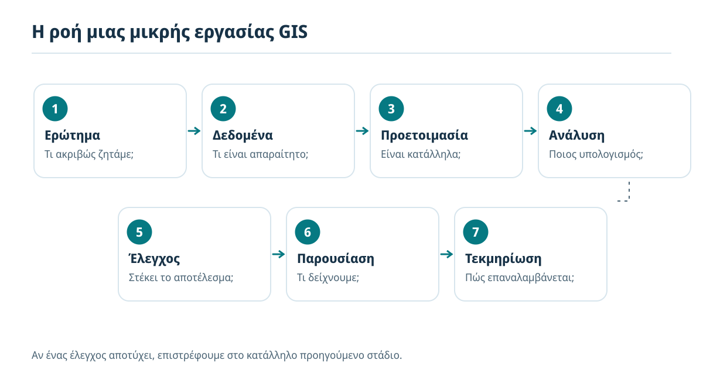
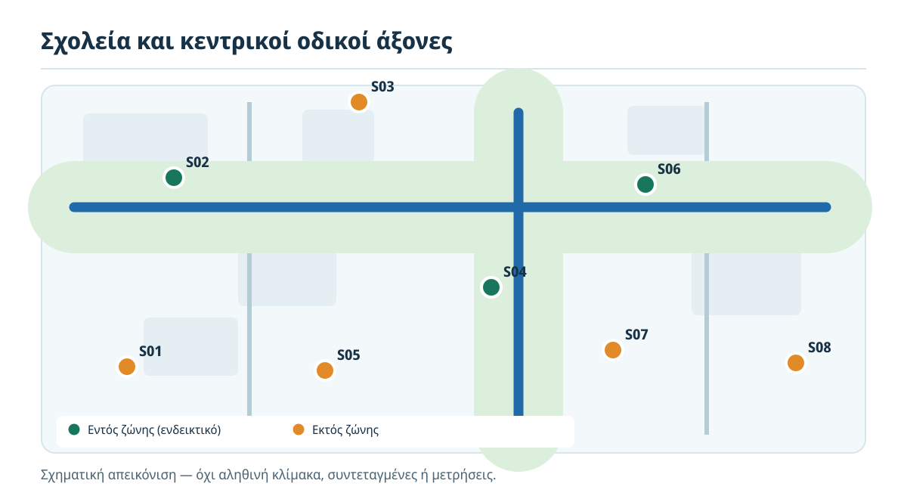
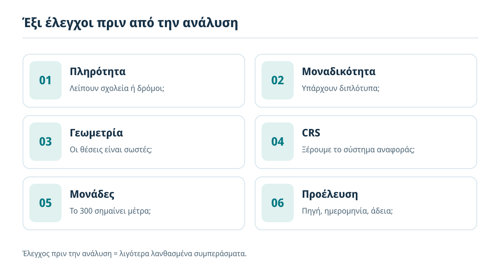
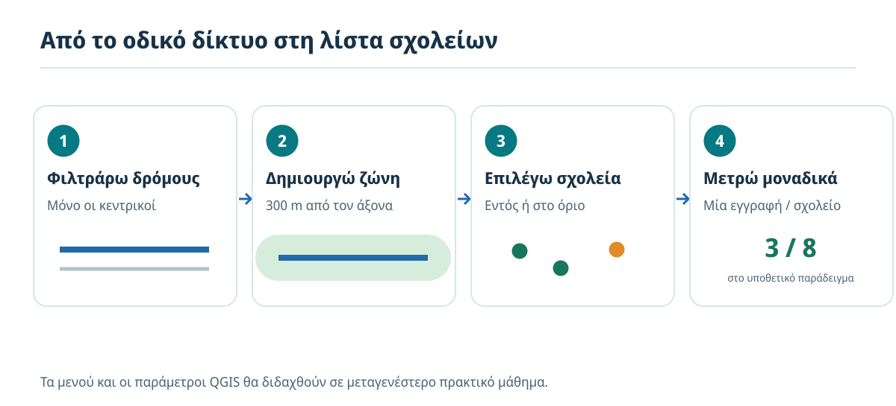
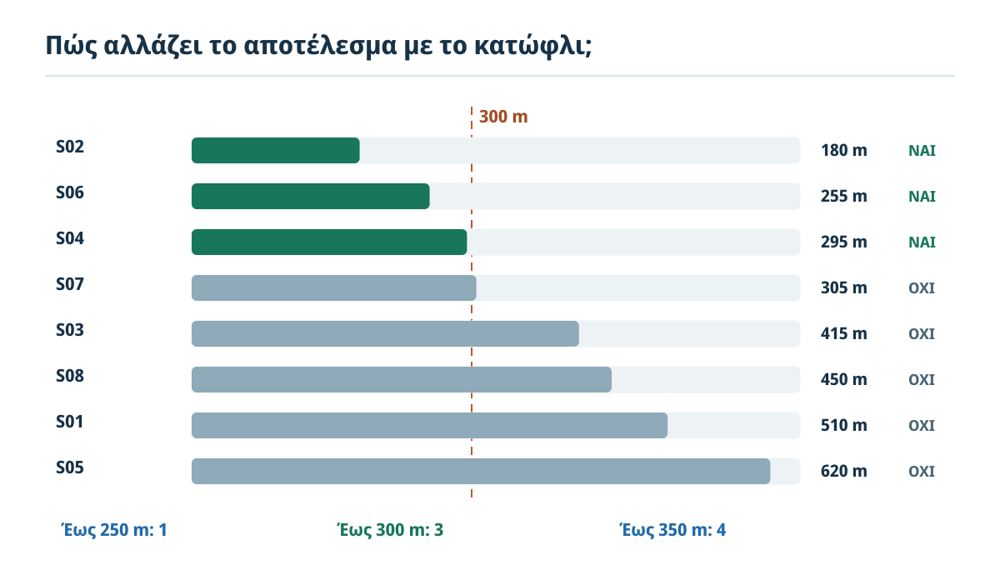
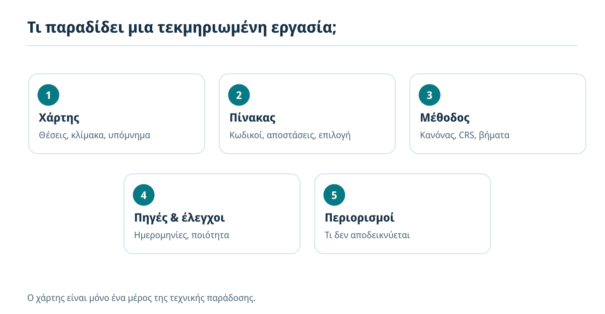

# 4. Πώς λύνουμε ένα πρόβλημα με GIS;

**Από ένα ερώτημα σε ένα ελεγχόμενο και τεκμηριωμένο αποτέλεσμα**

**Εκτιμώμενος χρόνος:** 50–65 λεπτά, μαζί με τις δραστηριότητες · **Προαπαιτούμενα:** [Κεφάλαια 1–3](index.md) · **Λογισμικό:** δεν απαιτείται.

:::{note} Η αποστολή σου
Μια δημοτική υπηρεσία θέλει να εντοπίσει ποιες σχολικές μονάδες βρίσκονται σε ευθεία απόσταση **έως 300 μέτρων από τον άξονα επιλεγμένων κεντρικών δρόμων**. Θα σχεδιάσεις μια σωστή εργασία GIS, θα εξετάσεις ένα μικρό *υποθετικό* αποτέλεσμα και θα αποφασίσεις τι μπορεί —και τι δεν μπορεί— να υποστηρίξει.
:::

## Τι θα μπορείς να κάνεις στο τέλος

- Να μετατρέπεις μια γενική επιθυμία σε μετρήσιμο γεωγραφικό ερώτημα.
- Να προσδιορίζεις τις ελάχιστες γεωχωρικές και περιγραφικές πληροφορίες που απαιτούνται.
- Να σχεδιάζεις διαδοχικά τα στάδια **ερώτημα → δεδομένα → προετοιμασία → ανάλυση → έλεγχος → παρουσίαση → τεκμηρίωση**.
- Να εξηγείς τη λογική της **ζώνης εγγύτητας** (*buffer*), χωρίς να χρειάζεται ακόμη να την κατασκευάσεις στο QGIS.
- Να διακρίνεις αποτέλεσμα υπολογισμού, ερμηνεία και τεκμηριωμένη απόφαση.
- Να περιγράφεις τι θα παρέδιδες ώστε κάποιος άλλος να μπορέσει να επαληθεύσει την εργασία σου.

## 4.1 Από το «ποια δεδομένα έχω;» στο «ποια διαδικασία χρειάζομαι;»

Στο προηγούμενο κεφάλαιο γνωρίσαμε τα σημεία, τις γραμμές, τα πολύγωνα, τους πίνακες γνωρισμάτων και τα ψηφιδωτά δεδομένα. Είδαμε ότι ο πραγματικός κόσμος μπορεί να αναπαρασταθεί με διαφορετικούς τρόπους, ανάλογα με το τι θέλουμε να μελετήσουμε.

Τώρα θα χρησιμοποιήσουμε αυτές τις γνώσεις. Δεν αρκεί να ανοίξουμε δύο επίπεδα και να δημιουργήσουμε έναν ωραίο χάρτη. Χρειαζόμαστε μια **διαδικασία με αποφάσεις και ελέγχους**. Για παράδειγμα, αν αλλάξει η έννοια του «κοντά», μπορεί να αλλάξει ο κατάλογος σχολείων που θα προκύψει.



*Εικόνα 1. Η ροή εργασίας του GeoSkills. Τα στάδια συνδέονται, αλλά δεν είναι άκαμπτα: ένας έλεγχος μπορεί να μας αναγκάσει να επιστρέψουμε στα δεδομένα ή στον ορισμό του ερωτήματος.*

Θα δουλέψουμε με ένα **ενιαίο υποθετικό σενάριο** σε όλες τις επόμενες ενότητες. Έτσι θα δεις γιατί κάθε στάδιο υπάρχει και τι μπορεί να πάει στραβά αν το παραλείψουμε.

## 4.2 Το πρόβλημα: σχολεία κοντά σε κεντρικούς δρόμους

Η αρχική οδηγία που λαμβάνεις είναι: «Βρες τα σχολεία που είναι κοντά σε κεντρικούς δρόμους».

Η λέξη *κοντά* δεν είναι ακριβής. Δύο διαφορετικοί χρήστες μπορεί να επιλέξουν διαφορετικά σχολεία, ακόμη και αν δουλεύουν με τον ίδιο χάρτη. Χρειαζόμαστε λοιπόν έναν **λειτουργικό ορισμό**, δηλαδή σαφή κανόνα που να μπορεί να εφαρμοστεί και να ελεγχθεί:

> «Ποιες από τις καταγεγραμμένες σχολικές μονάδες της περιοχής μελέτης έχουν το σημείο αναφοράς τους σε ευθεία απόσταση έως και 300 μέτρων από τον γεωμετρικό άξονα των δρόμων που έχουν καταχωριστεί ως “κεντρικοί”;»

Η διατύπωση αυτή δεν είναι τέλεια, αλλά είναι πλέον **υπολογίσιμη**. Έχουμε ορίσει:

- **Ποια αντικείμενα** εξετάζουμε: σχολικές μονάδες.
- **Ποιους δρόμους** χρησιμοποιούμε: μόνο όσους έχουν έγκυρη κατηγορία «κεντρικός».
- **Ποια θέση σχολείου** μετράμε: ένα συγκεκριμένο σημείο αναφοράς, που πρέπει να δηλωθεί στα μεταδεδομένα.
- **Πώς μετράμε**: ευθύγραμμη γεωμετρική απόσταση από τον άξονα του δρόμου, όχι χρόνο μετακίνησης.
- **Ποιο είναι το όριο**: 300 μέτρα, συμπεριλαμβανομένων των ακριβώς 300 μέτρων.



*Εικόνα 2. Υποθετική περιοχή με οκτώ σχολεία. Οι πράσινες και πορτοκαλί ενδείξεις είναι εκπαιδευτικές, όχι πραγματικές μετρήσεις ή γεωμετρικά υπολογισμένα αποτελέσματα. Ο πίνακας της Ενότητας 4.7 περιέχει τις συμβατικές αποστάσεις του σεναρίου.*

:::{important} Τι **δεν** ρωτήσαμε
Δεν εξετάζουμε αν ένας δρόμος είναι επικίνδυνος, πόσο θόρυβο προκαλεί, πόσους ρύπους εκπέμπει ή αν η μετακίνηση μαθητών είναι ασφαλής. Για τέτοια συμπεράσματα θα απαιτούνταν επιπλέον δεδομένα, ορισμοί και μέθοδοι.
:::

## 4.3 Πρώτο στάδιο — Ορίζουμε το ερώτημα και το πεδίο του

Πριν αναζητήσουμε αρχεία, γράφουμε μια μικρή **κάρτα εργασίας**:

| Απόφαση | Συμφωνία εργασίας για το παράδειγμά μας |
|---|---|
| Περιοχή | Υποθετικός δήμος «Δείγμα» |
| Μονάδα ανάλυσης | Μία σχολική μονάδα ανά εγγραφή |
| Σημείο μέτρησης | Καταγεγραμμένο σημείο αναφοράς σχολείου, όχι ολόκληρο το οικόπεδο |
| Δρόμοι αναφοράς | Γραμμικά τμήματα με τιμή `road_class = main` |
| Κριτήριο | Ελάχιστη επίπεδη απόσταση ≤ 300 m από τους άξονες των επιλεγμένων δρόμων |
| Ζητούμενο | Λίστα σχολείων, πλήθος, χάρτης και σύντομη τεκμηρίωση |
| Περιορισμός | Γεωμετρική εγγύτητα, όχι εκτίμηση κινδύνου ή πραγματική έκθεση |

**Γιατί έχει σημασία το σημείο αναφοράς;** Μια μεγάλη σχολική εγκατάσταση μπορεί να έχει είσοδο στη μια πλευρά και κτίρια στην άλλη. Αν άλλος αναλυτής χρησιμοποιήσει το κέντρο του κτιρίου και άλλος την πύλη, μπορεί να προκύψει διαφορετικό αποτέλεσμα. Κανείς δεν πρέπει να αλλάζει αυθαίρετα τον κανόνα στη μέση της εργασίας.

:::{tip} Μικρός έλεγχος
Αν η υπηρεσία ζητούσε «σχολεία σε απόσταση 300 μέτρων *με τα πόδια*», θα αρκούσε ο ίδιος υπολογισμός; Όχι. Θα έπρεπε να εξετάσουμε το πεζό δίκτυο, προσβάσιμες διαδρομές και πραγματικές συνδέσεις.
:::

## 4.4 Δεύτερο στάδιο — Επιλέγουμε τα κατάλληλα δεδομένα

Χρειαζόμαστε τουλάχιστον δύο **διανυσματικά** επίπεδα, όπως μάθαμε στο Κεφάλαιο 3:

| Δεδομένα | Αναπαράσταση | Ενδεικτικά πεδία | Για ποιο λόγο |
|---|---|---|---|
| Σχολικές μονάδες | Σημεία | `school_id`, `name`, `reference_type` | Για να εντοπίσουμε και να αναγνωρίσουμε σχολεία |
| Οδικό δίκτυο | Γραμμές | `road_id`, `road_class`, `source_date` | Για να κρατήσουμε τους κεντρικούς δρόμους |
| Όριο περιοχής | Πολύγωνο | `area_id`, `name` | Για να ορίσουμε σαφώς την περιοχή μελέτης |
| Μεταδεδομένα | Πίνακας/κείμενο | πηγή, ημερομηνία, CRS, άδεια, πληρότητα | Για να ελέγξουμε καταλληλότητα και επαναχρησιμοποίηση |

Δεν χρειαζόμαστε απαραίτητα δορυφορική εικόνα ή μοντέλο εδάφους. Η ύπαρξη περισσότερων δεδομένων δεν βελτιώνει πάντα μια εργασία. **Συγκεντρώνουμε όσα χρειάζονται για το ερώτημα και μπορούν να τεκμηριωθούν.**

Επίσης, δεν πρέπει να συγχέουμε την *πηγή δεδομένων* με την *αλήθεια*. Ένας ενημερωμένος κατάλογος σχολείων μπορεί να περιέχει ελλείψεις, λάθος θέσεις ή σχολικές μονάδες που έχουν συγχωνευθεί. Κρατάμε την πηγή, την ημερομηνία και τα γνωστά όρια ποιότητας.

### Οργάνωση φακέλων

Για μια μικρή εργασία προτείνουμε την ακόλουθη λογική:

```text
school_road_proximity/
├── input/           # αρχικά δεδομένα, χωρίς τροποποίηση
├── working/         # καθαρισμένα / προσωρινά δεδομένα
├── outputs/         # τελικά αποτελέσματα
├── project/         # έργο QGIS, όταν ξεκινήσει η πρακτική
└── README.md        # ερώτημα, πηγές, μέθοδος, περιορισμοί
```

Το `README.md` δεν είναι διακοσμητικό. Είναι μέρος της δυνατότητας **αναπαραγωγής**: αν ξανακάνουμε την εργασία, πρέπει να γνωρίζουμε με ποια έκδοση δεδομένων και με ποιους κανόνες δουλέψαμε.

## 4.5 Τρίτο στάδιο — Προετοιμάζουμε και ελέγχουμε

Πριν από οποιαδήποτε απόσταση, ελέγχουμε τα δεδομένα. Δεν θα μάθουμε ακόμη τα μενού του QGIS — αυτά θα ακολουθήσουν στα πρακτικά μαθήματα — αλλά πρέπει να ξέρουμε τι ελέγχουμε και *γιατί*.



*Εικόνα 3. Ελάχιστοι έλεγχοι καταλληλότητας. Μια αποτυχία δεν διορθώνεται με αλλαγή χρώματος στον χάρτη.*

**1. Πληρότητα.** Υπάρχουν όλες οι σχολικές μονάδες της συγκεκριμένης ημερομηνίας αναφοράς; Λείπουν τμήματα του οδικού δικτύου;

**2. Μοναδικότητα.** Το ίδιο σχολείο εμφανίζεται δύο φορές; Ο μετρητής μπορεί τότε να δώσει φουσκωμένο πλήθος.

**3. Γεωμετρία.** Το σημείο βρίσκεται πράγματι στο σχολείο; Οι δρόμοι έχουν κατάλληλη γεωμετρία και έχουν τη σωστή ταξινόμηση;

**4. Σύστημα αναφοράς συντεταγμένων (CRS).** Είναι γνωστό και σωστό για κάθε αρχείο; Για επίπεδη μέτρηση σε μέτρα επιλέγουμε κατάλληλο προβολικό CRS, για παράδειγμα το **ΕΓΣΑ87 / EPSG:2100** για κατάλληλες εφαρμογές στην Ελλάδα. Το ότι δύο επίπεδα *εμφανίζονται μαζί* στον χάρτη δεν σημαίνει ότι έχουν αποθηκευτεί στο ίδιο CRS ή ότι μπορούμε να μετρήσουμε αδιακρίτως με οποιονδήποτε αλγόριθμο.

**5. Μονάδες.** Το «300» σημαίνει **300 μέτρα** και όχι 300 μοίρες ή άλλη μονάδα. Ο αλγόριθμος πρέπει να εφαρμόζεται σε κατάλληλες συντεταγμένες και να επιβεβαιώνουμε τις μονάδες του.

**6. Προέλευση και χρόνο.** Πότε ενημερώθηκαν οι θέσεις και οι κατηγορίες δρόμων; Επιτρέπεται η χρήση ή αναδιανομή των δεδομένων;

:::{warning} Κλασικό σφάλμα με τις συντεταγμένες
Το γεωγραφικό CRS EPSG:4326 εκφράζει γεωγραφικό πλάτος και μήκος σε μοίρες. Δεν εφαρμόζουμε απλώς «buffer 300» πάνω στις μοίρες σαν να ήταν μέτρα. Η ενδεδειγμένη μέθοδος εξαρτάται από το είδος του αλγορίθμου, το CRS των δεδομένων και το γεωγραφικό εύρος της εργασίας.
:::

## 4.6 Τέταρτο στάδιο — Σχεδιάζουμε τη χωρική ανάλυση

Η λογική του υπολογισμού είναι απλή, ακόμη και χωρίς να έχουμε ανοίξει το QGIS.

**Βήμα Α — Επιλογή δρόμων.** Από όλο το οδικό δίκτυο κρατάμε μόνο τις γραμμές που ικανοποιούν τον συμφωνημένο κανόνα `road_class = main`. Αν οι κατηγορίες έχουν λάθη, το αποτέλεσμα επίσης θα έχει λάθη.

**Βήμα Β — Ζώνη εγγύτητας.** Γύρω από τους επιλεγμένους άξονες δημιουργούμε μια **ζώνη (buffer)** που περιλαμβάνει θέσεις σε απόσταση έως 300 m από αυτούς. Αν δύο ζώνες επικαλύπτονται, αποφασίζουμε πώς θα χειριστούμε την επικάλυψη. Για το ερώτημά μας αρκεί να ξέρουμε αν ένα σχολείο βρίσκεται **μέσα σε τουλάχιστον μία** ζώνη, όχι να το μετρήσουμε δύο φορές.

**Βήμα Γ — Χωρική επιλογή.** Εξετάζουμε ποια σημεία σχολείων βρίσκονται εντός ή επάνω στο όριο της ενιαίας ζώνης, με τον κατάλληλο χωρικό κανόνα.

**Βήμα Δ — Καταμέτρηση και κατάλογος.** Κρατάμε μοναδικούς κωδικούς σχολείων, τις σχετικές αποστάσεις και την ένδειξη «εντός/εκτός». Το αποτέλεσμα μπορεί να αποθηκευτεί ως νέο επίπεδο και ως πίνακας.



*Εικόνα 4. Σχηματική ακολουθία, όχι πραγματική οθόνη QGIS. Η δημιουργία buffer είναι μια γεωμετρική διαδικασία· η εκτέλεσή της θα διδαχθεί στο GQ08.*

:::{note} Πού ανήκουν οι τεχνικές λεπτομέρειες;
Στο εισαγωγικό αυτό κεφάλαιο μαθαίνεις να *σχεδιάζεις και να ελέγχεις* τη διαδικασία. Τα πραγματικά κουμπιά, οι παράμετροι και η δημιουργία buffer στο QGIS είναι μέρος των πρακτικών μαθημάτων. Δεν χρειάζεται να απομνημονεύσεις εντολές τώρα.
:::

## 4.7 Πέμπτο στάδιο — Ελέγχουμε ένα υποθετικό αποτέλεσμα

Ας υποθέσουμε ότι έχουμε οκτώ σχολεία, με **εκπαιδευτικές** αποστάσεις που θα χρησιμοποιήσουμε ως παράδειγμα. Αυτές οι τιμές **δεν προκύπτουν από πραγματικό GIS υπολογισμό** ούτε από το σχηματικό διάγραμμα.

| Κωδικός | Ελάχιστη απόσταση από επιλεγμένο άξονα δρόμου | Έως 300 m; |
|---|---:|---|
| S01 | 510 m | Όχι |
| S02 | 180 m | **Ναι** |
| S03 | 415 m | Όχι |
| S04 | 295 m | **Ναι** |
| S05 | 620 m | Όχι |
| S06 | 255 m | **Ναι** |
| S07 | 305 m | Όχι |
| S08 | 450 m | Όχι |

Με το συμφωνημένο κριτήριο επιλέγονται **3 από τα 8 σχολεία (37,5%)**. Η αναλογία αφορά μόνο το υποθετικό σύνολο και δεν αντιπροσωπεύει κανέναν πραγματικό δήμο.



*Εικόνα 5. Οριακές περιπτώσεις: το S04 στα 295 m επιλέγεται, ενώ το S07 στα 305 m όχι. Η αλλαγή του κατωφλίου μεταβάλλει τον κατάλογο.*

### Πέντε απαραίτητοι έλεγχοι

1. **Πλήθος:** είχαμε οκτώ μοναδικά σχολεία· παραμένουν οκτώ πριν την επιλογή; Πόσα επιλέχθηκαν; Μήπως ένα εμφανίζεται δύο φορές λόγω επικαλυπτόμενων ζωνών;
2. **Όριο:** το κριτήριο περιλαμβάνει την ακριβή τιμή 300 m. Δεν χρησιμοποιούμε άλλοτε `< 300` και άλλοτε `≤ 300`.
3. **Οριακές περιπτώσεις:** το S04 είναι στα 295 m και το S07 στα 305 m. Αξίζει να εξετάσουμε ιδιαίτερα τις θέσεις τους, ειδικά αν η ακρίβεια των δεδομένων δεν επαρκεί για διάκριση λίγων μέτρων.
4. **Ευαισθησία:** με το ίδιο υποθετικό σύνολο, στα 250 m επιλέγεται **1** σχολείο, στα 300 m **3**, ενώ στα 350 m **4**. Άρα το συμπέρασμα εξαρτάται από την επιλογή του κατωφλίου.
5. **Επαλήθευση:** επιλέγουμε ενδεικτικές εγγραφές και ελέγχουμε πηγή, θέση, ταξινόμηση δρόμου, μονάδες και μεθοδολογία.

Η **ευαισθησία** του αποτελέσματος δεν σημαίνει απαραίτητα ότι ο υπολογισμός είναι λάθος. Σημαίνει ότι πρέπει να είμαστε σαφείς για τις παραδοχές μας και για το πόσο αξιόπιστη είναι η διάκριση «μέσα/έξω» κοντά στο όριο.

## 4.8 Έκτο στάδιο — Παρουσιάζουμε το αποτέλεσμα

Το τελικό προϊόν δεν είναι απαραίτητα μόνο ένας χάρτης. Για το ερώτημά μας η παράδοση θα είχε:

- **Χάρτη** με τα σχολεία, τους κεντρικούς δρόμους, τη ζώνη 300 m, υπόμνημα, κλίμακα και πηγές.
- **Πίνακα** με μοναδικό κωδικό σχολείου, την υπολογισμένη απόσταση και τη στήλη επιλογής.
- **Σύνοψη αποτελέσματος**, π.χ. «3 από 8 σχολεία του υποθετικού συνόλου ικανοποιούν το συμφωνημένο κριτήριο».
- **Περιγραφή μεθόδου**, ώστε να μπορεί άλλος αναλυτής να επαναλάβει τον υπολογισμό.
- **Δήλωση περιορισμών**, χωρίς ατεκμηρίωτους ισχυρισμούς για κίνδυνο, έκθεση ή ποιότητα περιβάλλοντος.



*Εικόνα 6. Η αξιόπιστη παρουσίαση συνδυάζει εικόνα, αριθμούς, μέθοδο, πηγές και περιορισμούς.*

### Τι δεν θα γράφαμε

Δεν θα γράφαμε «το 37,5% των σχολείων είναι επικίνδυνα» ούτε «βρίσκονται σε υψηλή ατμοσφαιρική ρύπανση». Μετρήσαμε μόνο τη γεωμετρική απόσταση ενός δηλωμένου σημείου από έναν οδικό άξονα. Για να μελετήσουμε θόρυβο, ρύπους ή ασφάλεια χρειάζονται πραγματικές μετρήσεις ή ειδικά μοντέλα, καθώς και άλλα κριτήρια.

### Τι θα γράφαμε

«Στο υποθετικό σύνολο οκτώ σχολικών μονάδων, τρεις έχουν σημείο αναφοράς σε επίπεδη απόσταση έως 300 m από άξονα επιλεγμένων κεντρικών δρόμων. Το αποτέλεσμα αφορά αποκλειστικά το συγκεκριμένο κριτήριο και εξαρτάται από τη θέση των σημείων, την ταξινόμηση δρόμων, το CRS και την ποιότητα των πηγών.»

## 4.9 Έβδομο στάδιο — Τεκμηριώνουμε για να μπορούμε να επαναλάβουμε

Συχνά ένας χάρτης φαίνεται τελειωμένος, αλλά ο επόμενος χρήστης δεν γνωρίζει από πού προήλθαν τα δεδομένα ή πώς έγιναν οι υπολογισμοί. Η τεκμηρίωση είναι γι' αυτό απαραίτητη.

Στο συνοδευτικό `README.md` ή στην τεχνική αναφορά κρατάμε τουλάχιστον:

| Στοιχείο τεκμηρίωσης | Τι γράφουμε |
|---|---|
| Σκοπός | Το ακριβές ερώτημα και το όριο των 300 m |
| Περιοχή και ημερομηνία | Πού και πότε αφορά η εργασία |
| Πηγές | Δημιουργός, έκδοση, ημερομηνία και άδεια κάθε συνόλου |
| Αναπαράσταση | Τι σημαίνει το σημείο σχολείου και ο άξονας δρόμου |
| Συντεταγμένες | CRS δεδομένων, κατάλληλο CRS ανάλυσης και μονάδες |
| Μέθοδος | Επιλογή δρόμων, ζώνη 300 m, κανόνας επιλογής, μοναδική καταμέτρηση |
| Έλεγχοι | Διπλότυπα, πληρότητα, οριακές περιπτώσεις και ευαισθησία |
| Περιορισμοί | Τι *δεν* μετρήθηκε ή δεν μπορεί να συναχθεί |

**Διαφορά μεταξύ αρχείου δεδομένων και έργου QGIS:** Το `.gpkg` περιέχει τα πραγματικά γεωχωρικά δεδομένα, ενώ το `.qgz` περιγράφει, μεταξύ άλλων, την εμφάνιση και τις συνδέσεις του έργου. Αν αργότερα μοιράσουμε το έργο QGIS, θα πρέπει να υπάρχουν και οι πηγές δεδομένων στις αναμενόμενες διαδρομές. Αυτό το είδαμε στο Κεφάλαιο 3 και θα το εφαρμόσουμε στο GQ00.

## 4.10 Εφάρμοσε όσα έμαθες — Δραστηριότητες

### Δραστηριότητα Α — Κάνε την ερώτηση μετρήσιμη (4 λεπτά)

Η υπηρεσία λέει: «Βρες τα σχολεία που βρίσκονται δίπλα σε πολυσύχναστους δρόμους». Ποια **τέσσερα πράγματα** θα ζητούσες να διευκρινιστούν πριν ξεκινήσεις;

:::{dropdown} Ενδεικτική απάντηση
(1) Τι σημαίνει «πολυσύχναστος» — π.χ. διοικητική κατηγορία ή συγκεκριμένη κυκλοφοριακή μέτρηση; (2) Τι σημαίνει «δίπλα» — π.χ. έως 300 m; (3) Από ποιο σημείο του σχολείου μετράμε; (4) Ποια ημερομηνία και γεωγραφική περιοχή αφορά το ερώτημα; Θα μπορούσαμε επίσης να ρωτήσουμε αν η απόσταση είναι σε ευθεία ή κατά διαδρομή.
:::

### Δραστηριότητα Β — Εντόπισε τρία πιθανά σφάλματα (4 λεπτά)

Ένας συνεργάτης φορτώνει τα σχολεία σε EPSG:4326, βάζει «300» στο εργαλείο buffer χωρίς να ελέγξει τη μονάδα, χρησιμοποιεί δρόμους άγνωστης ημερομηνίας και καταμετρά το ίδιο σχολείο δύο φορές επειδή βρίσκεται στην επικάλυψη δύο ζωνών. Ποια είναι τα τρία διαφορετικά προβλήματα;

:::{dropdown} Ενδεικτική απάντηση
Ακατάλληλη ή ανεπιβεβαίωτη μονάδα απόστασης σε συνδυασμό με γεωγραφικές μοίρες, άγνωστη καταλληλότητα/επικαιρότητα των δρόμων και διπλή καταμέτρηση σχολείου. Πριν προχωρήσουμε απαιτούνται έλεγχος CRS και μονάδων, τεκμηρίωση δεδομένων και καταμέτρηση μοναδικών κωδικών.
:::

### Δραστηριότητα Γ — Αλλαγή του κριτηρίου (3 λεπτά)

Χρησιμοποιώντας τον πίνακα της Ενότητας 4.7, πόσα σχολεία θα επέλεγες με όριο **250 m**, **300 m** και **350 m**; Γιατί αξίζει να αναφέρουμε αυτή τη διαφορά;

:::{dropdown} Ενδεικτική απάντηση
Με ≤250 m: 1 σχολείο (S02). Με ≤300 m: 3 σχολεία (S02, S04, S06). Με ≤350 m: 4 σχολεία (S02, S04, S06, S07). Η αλλαγή του κριτηρίου αλλάζει το αποτέλεσμα, άρα ο ορισμός του ορίου και η ακρίβεια των δεδομένων πρέπει να αναφέρονται.
:::

### Δραστηριότητα Δ — Σχεδίασε τη δική σου μικρή εργασία (5 λεπτά)

Ένας δήμος θέλει να εντοπίσει **στάσεις λεωφορείων** που απέχουν έως 200 m σε ευθεία από ένα δημόσιο νοσοκομείο. Χωρίς λογισμικό, συμπλήρωσε: (α) ερώτημα, (β) γεωχωρικά δεδομένα, (γ) μέθοδος, (δ) δύο έλεγχοι, (ε) παραδοτέο και ένας περιορισμός.

:::{dropdown} Ενδεικτική προσέγγιση
Σημεία στάσεων, σημείο αναφοράς ή γεωμετρία νοσοκομείου με ρητή επιλογή, κατάλληλο προβολικό CRS σε μέτρα, ζώνη 200 m ή αντίστοιχος γεωμετρικός έλεγχος απόστασης, επιλογή στάσεων και πίνακας. Έλεγχοι: διπλότυπα/σωστές θέσεις στάσεων, CRS/μονάδες. Παραδοτέο: χάρτης, λίστα στάσεων, πηγές και μέθοδος. Περιορισμός: ευθεία απόσταση δεν σημαίνει πραγματική ή προσβάσιμη πεζή διαδρομή.
:::

## 4.11 Έλεγξε την κατανόησή σου

Απάντησε πριν εμφανίσεις τις ενδεικτικές λύσεις.

1. Γιατί η φράση «σχολεία κοντά σε δρόμους» δεν είναι από μόνη της υπολογίσιμη οδηγία;
2. Τι αλλάζει αν το σημείο αναφοράς είναι η είσοδος του σχολείου αντί για το κέντρο του κτιρίου;
3. Ποια δύο βασικά επίπεδα δεδομένων χρειαζόμαστε για τη μελέτη;
4. Γιατί ελέγχουμε το CRS και τις μονάδες **πριν** από τη δημιουργία buffer;
5. Τι αποτυπώνει μια ζώνη εγγύτητας 300 m γύρω από άξονα δρόμου;
6. Τι πρόβλημα προκαλεί μια διπλή καταμέτρηση στην επικάλυψη δύο ζωνών;
7. Με κριτήριο ≤300 m, ένα σχολείο σε απόσταση 305 m επιλέγεται;
8. Γιατί εξετάζουμε οριακές περιπτώσεις και εναλλακτικά κατώφλια;
9. Αποδεικνύει η μικρή απόσταση υψηλό θόρυβο ή έκθεση σε ρύπους;
10. Ποιες πληροφορίες πρέπει να περιλαμβάνει μια τεκμηριωμένη τεχνική παράδοση;

:::{dropdown} Ενδεικτικές απαντήσεις
1. Δεν ορίζει δρόμους, σημείο μέτρησης, απόσταση και μονάδες. 2. Μπορεί να αλλάξει η θέση και άρα το αποτέλεσμα. 3. Σημεία σχολείων και γραμμές δρόμων (συχνά χρήσιμο και όριο μελέτης). 4. Για να έχει γεωμετρικό νόημα η απόσταση και να μην αντιμετωπίσουμε μοίρες ως μέτρα. 5. Τις θέσεις έως την ορισμένη γεωμετρική απόσταση από τον άξονα, με τις παραδοχές του υπολογισμού. 6. Λανθασμένα αυξημένο πλήθος. 7. Όχι. 8. Για να ελέγξουμε την ευαισθησία του αποτελέσματος στις παραδοχές και στην ποιότητα θέσεων. 9. Όχι — απαιτούνται άλλα δεδομένα και μέθοδοι. 10. Ερώτημα, πηγές και ημερομηνίες, γεωμετρίες, CRS, μονάδες, μέθοδο, αποτέλεσμα, ελέγχους και περιορισμούς.
:::

### Μπορώ να συνεχίσω όταν…

- [ ] Περιγράφω και τα επτά στάδια μιας αξιόπιστης μικρής εργασίας GIS.
- [ ] Διατυπώνω ένα σαφές, μετρήσιμο χωρικό ερώτημα.
- [ ] Ξέρω γιατί ελέγχουμε τα δεδομένα και τις μονάδες *πριν* από την ανάλυση.
- [ ] Μπορώ να εξηγήσω τι περιγράφει μία ζώνη εγγύτητας.
- [ ] Δεν συγχέω την εγγύτητα με τον κίνδυνο ή την αιτία.
- [ ] Μπορώ να προτείνω χάρτη, πίνακα και τεκμηρίωση ως ενιαίο παραδοτέο.

## Τι κρατάμε — και τι ακολουθεί

Η αξία ενός GIS δεν κρίνεται μόνο από το πόσο γρήγορα πατάμε μια εντολή. Κρίνεται από το αν μπορούμε να περιγράψουμε **γιατί επιλέξαμε τα συγκεκριμένα δεδομένα, κανόνες και ελέγχους**, να παρουσιάσουμε σωστά το αποτέλεσμα και να αναγνωρίσουμε τους περιορισμούς του.

Στο επόμενο κεφάλαιο θα εστιάσουμε στις **[πηγές, την ποιότητα και την αξιοπιστία των γεωχωρικών δεδομένων](05-piges-poiotita.md)**. Εκεί θα μάθουμε να αξιολογούμε πιο συστηματικά αν ένα σύνολο δεδομένων είναι πράγματι κατάλληλο για την εργασία μας.

## Πηγές για περαιτέρω μελέτη

- [QGIS — Vector Spatial Analysis: Buffers](https://docs.qgis.org/3.44/en/docs/gentle_gis_introduction/vector_spatial_analysis_buffers.html) — τι είναι και τι σημαίνει μια ζώνη εγγύτητας.
- [QGIS — Buffer processing algorithm](https://docs.qgis.org/3.44/en/docs/user_manual/processing_algs/qgis/vectorgeometry.html#buffer) — επίσημη τεχνική τεκμηρίωση.
- [QGIS — Working with Projections](https://docs.qgis.org/3.44/en/docs/user_manual/working_with_projections/working_with_projections.html) — μετασχηματισμοί, CRS και απεικόνιση.

*Όλα τα πρόσωπα, οι αποστάσεις, οι θέσεις σχολείων, οι οδικοί άξονες και τα αριθμητικά αποτελέσματα αυτού του κεφαλαίου είναι υποθετικά εκπαιδευτικά παραδείγματα. Δεν αποτελούν στοιχεία πραγματικού δήμου.*
