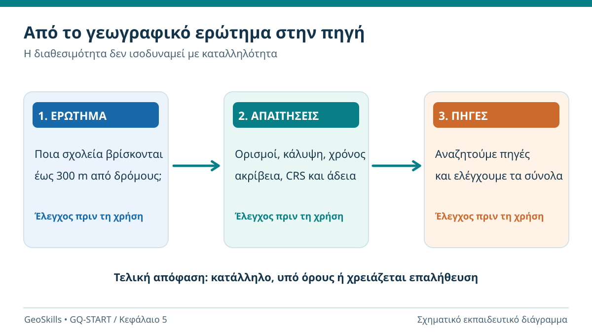
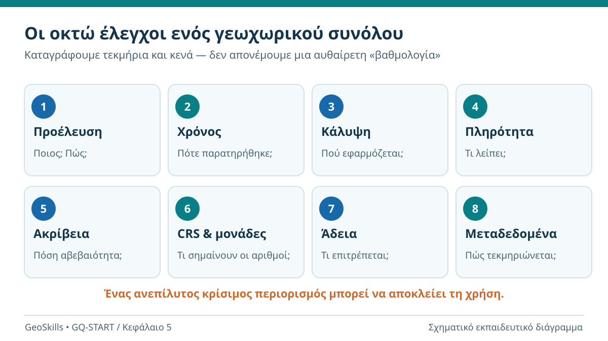
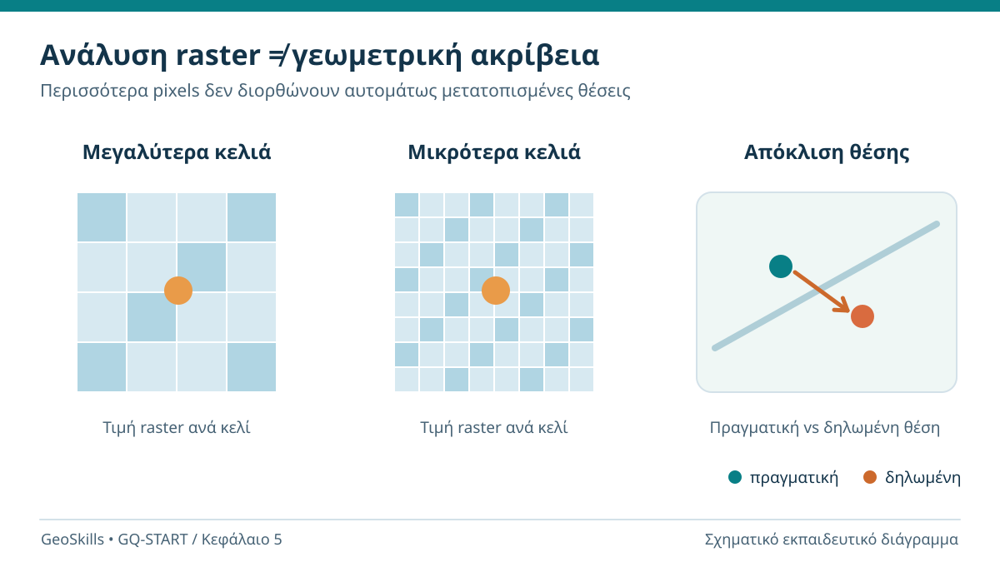
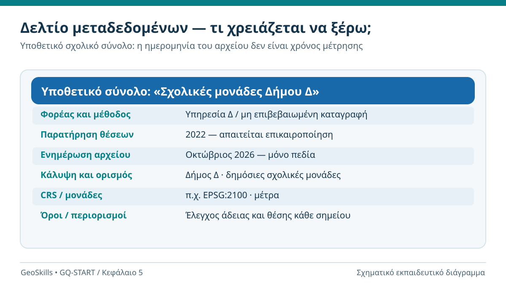
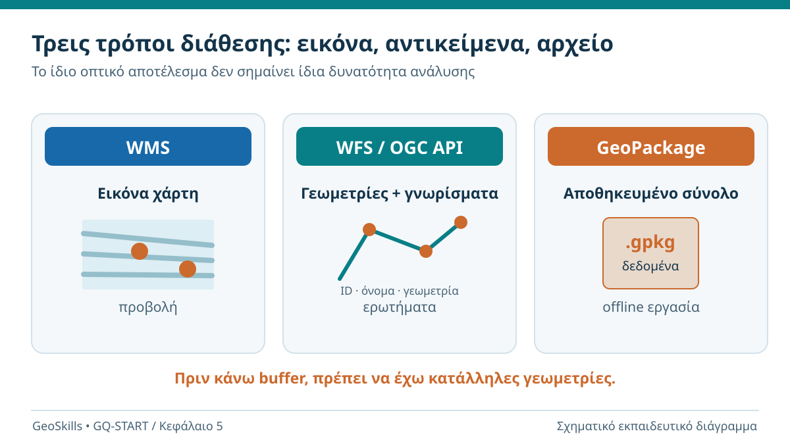
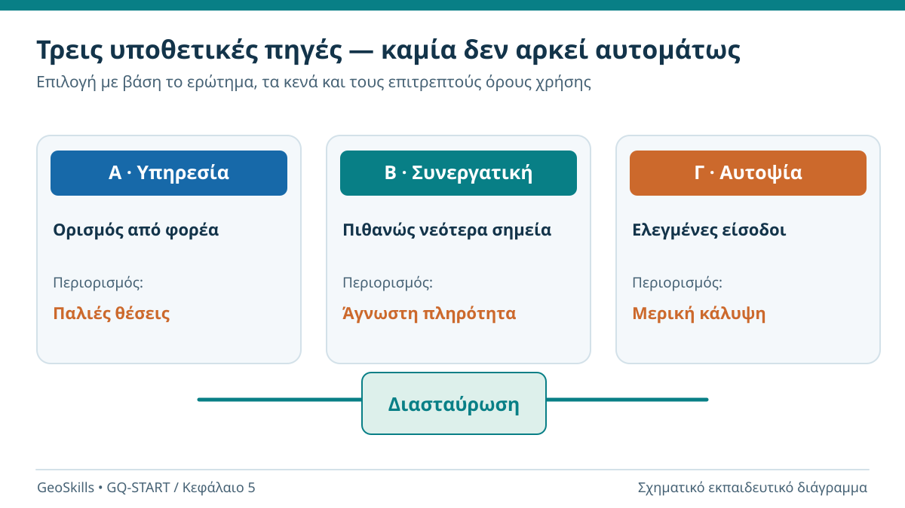

# 5. Από πού βρίσκουμε γεωχωρικά δεδομένα και πότε τα εμπιστευόμαστε;

**Από την εύρεση ενός αρχείου στην τεκμηριωμένη επιλογή μιας πηγής**

**Εκτιμώμενος χρόνος:** 55–70 λεπτά μαζί με τις δραστηριότητες · **Προαπαιτούμενα:** [Κεφάλαια 1–4](index.md) · **Λογισμικό:** δεν απαιτείται.

:::{note} Η αποστολή σου
Στο Κεφάλαιο 4 σχεδιάσαμε μια εργασία για τον εντοπισμό σχολείων που βρίσκονται σε ευθεία απόσταση έως **300 μέτρων από τον άξονα επιλεγμένων κεντρικών δρόμων**. Τώρα ο δήμος σου δίνει τρεις πιθανούς καταλόγους σχολείων. Ποιον θα χρησιμοποιήσεις; Πώς θα ελέγξεις αν τα σχολεία λείπουν, αν οι θέσεις είναι αξιόπιστες και αν επιτρέπεται να διανείμεις τα αποτελέσματά σου;
:::

## Τι θα μπορείς να κάνεις στο τέλος

- Να ξεκινάς την αναζήτηση από ένα **συγκεκριμένο ερώτημα** και όχι από έναν τυχαίο διαθέσιμο χάρτη.
- Να εντοπίζεις ενδεικτικές πηγές δημόσιων, συνεργατικών, δορυφορικών και επιτόπιων δεδομένων.
- Να ξεχωρίζεις την **προέλευση**, την **ημερομηνία παρατήρησης**, την **ημερομηνία ενημέρωσης** και την **άδεια διάθεσης**.
- Να αξιολογείς πληρότητα, κάλυψη, ακρίβεια, ανάλυση, καταλληλότητα και τεκμηρίωση.
- Να διακρίνεις απλό αρχείο δεδομένων από διαδικτυακή υπηρεσία WMS, WFS ή OGC API – Features.
- Να συμπληρώνεις ένα **δελτίο ελέγχου γεωχωρικού συνόλου** και να προτείνεις «χρήση», «χρήση με περιορισμούς» ή «απόρριψη για τον σκοπό αυτό».

## 5.1 Το πρώτο λάθος: βρήκα έναν χάρτη, άρα έχω τα δεδομένα

Φαντάσου ότι αναζητάς στο διαδίκτυο «σχολεία και δρόμοι». Βρίσκεις έναν όμορφο χάρτη με σημεία σχολικών μονάδων. Είναι αυτό αρκετό για να απαντήσεις στο ερώτημα του Κεφαλαίου 4;

Όχι. Μπορεί ο χάρτης να είναι παλιός, να εμφανίζει μόνο δημόσια σχολεία, να μην περιέχει όλες τις βαθμίδες, να χρησιμοποιεί γενικευμένες θέσεις ή να μην επιτρέπει την εξαγωγή των γεωμετριών. Μπορεί ακόμη να έχει οπτικά σωστά σύμβολα αλλά λανθασμένες συντεταγμένες.

Πριν αναζητήσεις δεδομένα, χρειάζεται να περιγράψεις τις **ελάχιστες απαιτήσεις**:

| Τι ζητά η εργασία | Τι πρέπει να γνωρίζουμε για τα δεδομένα |
|---|---|
| Σχολικές μονάδες | Ποιες κατηγορίες σχολείων περιλαμβάνονται, αν υπάρχουν διπλές ή ελλείπουσες εγγραφές |
| Θέσεις σχολείων | Αν το σημείο είναι είσοδος, κέντρο κτιρίου, διεύθυνση ή κατά προσέγγιση θέση |
| Κεντρικοί δρόμοι | Ποιος ορίζει την κατηγορία «κεντρικός», αν οι γεωμετρίες είναι άξονες οδών |
| Απόσταση 300 μέτρων | Κατάλληλο CRS, σωστές μονάδες και επαρκής χωρική ακρίβεια |
| Χρόνος | Σε ποια χρονική στιγμή αναφέρεται η εργασία και πότε ισχύουν τα δεδομένα |
| Παραδοτέο | Αν επιτρέπεται να εμφανιστούν, να αναλυθούν και να επαναδιανεμηθούν τα δεδομένα |

*Εικόνα 1. Δεν επιλέγουμε την πηγή επειδή απλώς είναι διαθέσιμη. Πρώτα ορίζουμε τι πρέπει να υποστηρίζει.*

:::{tip} Σύνδεση με το προηγούμενο κεφάλαιο
Στο Κεφάλαιο 4 αλλάξαμε το κατώφλι απόστασης από 250 σε 350 μέτρα και είδαμε ότι αλλάζει ο αριθμός επιλεγμένων σχολείων. Εδώ διερευνούμε μια δεύτερη πηγή μεταβολής: **αν τα αρχικά δεδομένα είναι διαφορετικά ή ανεπαρκή, μπορεί να αλλάζει και το τελικό αποτέλεσμα ακόμη και όταν η μέθοδος μένει ίδια.**
:::

## 5.2 Πού αναζητούμε γεωχωρικά δεδομένα;

Δεν υπάρχει μία μοναδική «καλύτερη πηγή». Υπάρχουν πηγές καταλληλότερες για **διαφορετικούς σκοπούς**.

### Επίσημα δεδομένα δημόσιων φορέων

Για διοικητικά όρια, υποδομές, κτηματολογικές πληροφορίες ή άλλες θεσμικές καταγραφές, ξεκινούμε από τον φορέα που είναι αρμόδιος για το αντίστοιχο αντικείμενο. Στην Ελλάδα, μπορούμε να αναζητήσουμε σύνολα και υπηρεσίες μέσω της [εθνικής πύλης ανοικτών δεδομένων](https://data.gov.gr/) και, όπου είναι κατάλληλο, της [Γεωπύλης INSPIRE του Ελληνικού Κτηματολογίου](https://www.ktimatologio.gr/e-services/23).

**Προσοχή:** το γεγονός ότι ένας φορέας είναι δημόσιος δεν σημαίνει ότι κάθε διαθέσιμο επίπεδό του είναι αυτομάτως πλήρες, κατάλληλο για κάθε μέτρηση ή ελεύθερο για οποιαδήποτε επαναδιανομή. Ελέγχουμε την περιγραφή και τους όρους του *συγκεκριμένου συνόλου*.

### Συνεργατικά δεδομένα — OpenStreetMap

Το [OpenStreetMap (OSM)](https://www.openstreetmap.org/) περιλαμβάνει αντικείμενα, όπως δρόμους, κτίρια, σημεία ενδιαφέροντος και ενδεχομένως σχολεία. Είναι εξαιρετικά χρήσιμο σε πολλές εφαρμογές, αλλά η πληρότητα και η ενημέρωση διαφέρουν ανά περιοχή και τύπο αντικειμένου.

Τα δεδομένα του OSM διατίθενται με άδεια **ODbL**: απαιτείται αναφορά προέλευσης και υπάρχουν κανόνες για την επαναχρησιμοποίηση και τη διανομή βάσεων δεδομένων που προκύπτουν από αυτά. Η ανοιχτή άδεια δεν εγγυάται γεωμετρική ακρίβεια ή πληρότητα.

### Γενικοί χαρτογραφικοί χάρτες — Natural Earth

Το [Natural Earth](https://www.naturalearthdata.com/downloads/) παρέχει γενικευμένα παγκόσμια διανυσματικά και ψηφιδωτά δεδομένα, σε διαφορετικά επίπεδα λεπτομέρειας. Είναι χρήσιμο, για παράδειγμα, για να παρουσιάσουμε χώρες και ηπείρους στον πρώτο μας χάρτη QGIS.

Τα δεδομένα Natural Earth είναι **κοινό κτήμα (public domain)**, αλλά η γενίκευσή τους δεν τα καθιστά κατάλληλα για τοπογραφική χάραξη ορίων ή ακριβή σχεδιασμό σε επίπεδο οικοπέδου.

### Δεδομένα παρατήρησης της Γης — Copernicus

Το [Copernicus Data Space Ecosystem](https://dataspace.copernicus.eu/) παρέχει αναζήτηση και πρόσβαση σε δορυφορικά προϊόντα, όπως Sentinel. Είναι χρήσιμο για μελέτες κάλυψης γης, μεταβολών και περιβαλλοντικής παρακολούθησης. Όμως ένα δορυφορικό προϊόν δεν αποτελεί αυτόματα κατάλογο σχολείων ή ακριβή αποτύπωση μικρών γεωμετρικών ορίων.

Η πρόσβαση και χρήση των δεδομένων Sentinel ρυθμίζεται από τους αντίστοιχους όρους Copernicus. Ελέγχουμε χωριστά τυχόν περιεχόμενο τρίτων, παράγωγα προϊόντα και όρους εξυπηρέτησης της πύλης.

### Δικές μας μετρήσεις και επιτόπιος έλεγχος

Στοιχεία GNSS, γεωδαιτικού σταθμού ή αυτοψίας μπορεί να είναι κατάλληλα για συγκεκριμένους ελέγχους. Αλλά και εδώ απαιτείται να γνωρίζουμε μέθοδο μέτρησης, ημερομηνία, CRS, αβεβαιότητα και δικαιώματα χρήσης. Δεν μοιραζόμαστε αυθαίρετα δεδομένα που περιέχουν προσωπικές ή προστατευόμενες πληροφορίες.

:::{important} Δεν είναι «επίσημο» εναντίον «ανοιχτού»
Μια θεσμική πηγή μπορεί να έχει καλύτερα καθορισμένη αρμοδιότητα αλλά να μην έχει την επιθυμητή επικαιρότητα. Μια συνεργατική πηγή μπορεί να είναι νεότερη αλλά να χρειάζεται έλεγχο πληρότητας. Η επιλογή τεκμηριώνεται **σε σχέση με το ερώτημα και την προβλεπόμενη χρήση**.
:::

## 5.3 Οκτώ έλεγχοι πριν χρησιμοποιήσουμε ένα σύνολο

Κάθε σύνολο το αντιμετωπίζουμε σαν υποψήφιο στοιχείο ενός τεχνικού έργου: ζητάμε τεκμηρίωση, σημειώνουμε αβεβαιότητες και ελέγχουμε αν η χρήση του είναι κατάλληλη.

*Εικόνα 2. Οι έλεγχοι είναι συμπληρωματικοί. Μια πολύ καλή επίδοση σε έναν δεν εξουδετερώνει αυτόματα σοβαρή έλλειψη σε άλλον.*

| Κριτήριο | Ερώτηση που πρέπει να κάνω | Παράδειγμα προβλήματος |
|---|---|---|
| **Προέλευση** | Ποιος δημιούργησε το σύνολο; Ποια μέθοδο χρησιμοποίησε; | Ο κατάλογος αναπαράγεται χωρίς γνωστή αρχική πηγή |
| **Χρόνος** | Πότε έγινε η παρατήρηση και πότε ενημερώθηκε το αρχείο; | Νέο αρχείο που περιέχει παλιές θέσεις σχολείων |
| **Κάλυψη** | Περιλαμβάνει ολόκληρη την περιοχή και τον πληθυσμό-στόχο; | Λείπουν οικισμοί στα όρια του δήμου |
| **Πληρότητα** | Υπάρχουν ελλείπουσες τιμές, διπλότυπα ή αντικείμενα; | Το ίδιο σχολείο υπάρχει δύο φορές |
| **Ακρίβεια / ποιότητα** | Με πόση αβεβαιότητα έχει προσδιοριστεί μια θέση ή ιδιότητα; | Το σημείο σχολείου είναι σε άλλο οικοδομικό τετράγωνο |
| **CRS / μονάδες** | Πώς ερμηνεύονται και μετασχηματίζονται οι συντεταγμένες; | Μοίρες αντιμετωπίζονται σαν μέτρα |
| **Άδεια / δικαιώματα** | Επιτρέπεται η χρήση και η διανομή που σχεδιάζω; | Αναδιανομή δεδομένων χωρίς άδεια |
| **Μεταδεδομένα / τεκμηρίωση** | Υπάρχει περιγραφή πεδίων, κλίμακας, πηγής και περιορισμών; | Δεν γνωρίζουμε τι σημαίνει το πεδίο `type` |

Δεν υπάρχει **καθολική βαθμολογία ποιότητας**: ένα σύνολο μπορεί να είναι επαρκές για μια εισαγωγική απεικόνιση και ανεπαρκές για μια εφαρμογή στην οποία μια απόφαση θα επηρεάσει την ασφάλεια ή τα δικαιώματα ανθρώπων.

## 5.4 Ακρίβεια, ανάλυση και οπτική λεπτομέρεια δεν είναι το ίδιο

Ένα συνηθισμένο λάθος είναι να θεωρούμε ότι περισσότερα pixels ή πιο λεπτομερής γραμμή σημαίνουν αυτομάτως ακριβέστερη θέση.

**Χωρική ανάλυση** ενός raster είναι, μεταξύ άλλων, το μέγεθος του εδαφικού κελιού που αναπαριστά. Αν ένα raster έχει κελιά 10 × 10 m, αυτό δεν μας επιτρέπει να ισχυριστούμε ότι τα όρια όλων των αντικειμένων αποτυπώνονται με ακρίβεια 10 cm ή ότι κάθε μικρό αντικείμενο διακρίνεται.

**Γεωμετρική ακρίβεια** αφορά το πόσο κοντά βρίσκεται η αναπαριστώμενη θέση στην πραγματική θέση αναφοράς, στο πλαίσιο μιας γνωστής μεθόδου αξιολόγησης. Η ονομαστική ανάλυση, η χωρική ακρίβεια και η πληρότητα είναι διαφορετικές ιδιότητες.

*Εικόνα 3. Η πιο λεπτή ψηφιδωτή αναπαράσταση δεν διορθώνει αυτομάτως την απόκλιση στη θέση ενός αντικειμένου. Πρόκειται για σχηματικό παράδειγμα, όχι για πραγματικές μετρήσεις.*

### Μια μικρή δοκιμή σκέψης

Έχουμε δύο αρχεία με σημεία σχολείων: στο πρώτο οι θέσεις είναι σε επίπεδο οικοδομικού τετραγώνου, στο δεύτερο είναι ελεγμένες είσοδοι κτιρίων. Για μια γενική αποτύπωση ανά δήμο ίσως αρκεί το πρώτο. Για να εξετάσουμε με ακρίβεια την απόσταση από τον άξονα ενός δρόμου, η διαφορά αυτή μπορεί να έχει σημασία, ειδικά κοντά στο όριο των 300 μέτρων.

:::{warning} Μην υπερερμηνεύεις τα δεκαδικά
Το ότι μια συντεταγμένη γράφεται με πολλά δεκαδικά ψηφία δεν αποδεικνύει ότι η θέση μετρήθηκε με αντίστοιχη ακρίβεια. Χρειαζόμαστε πληροφορία για μέθοδο και αβεβαιότητα.
:::

## 5.5 Τι είναι τα μεταδεδομένα και γιατί μας χρειάζονται;

Τα **μεταδεδομένα** είναι πληροφορίες που περιγράφουν ένα σύνολο δεδομένων: ποιος το παρήγαγε, τι περιέχει, ποια περιοχή και χρονική περίοδο καλύπτει, ποιο CRS χρησιμοποιεί, ποιοι είναι οι όροι χρήσης και ποια προβλήματα είναι γνωστά.

Χωρίς αυτές τις πληροφορίες, ένα αρχείο μπορεί να ανοίγει άψογα στο QGIS, αλλά να μην μπορούμε να αποφασίσουμε αν είναι επιστημονικά κατάλληλο.

*Εικόνα 4. Σχηματική κάρτα μεταδεδομένων. Όλα τα ονόματα, οι χρόνοι και τα πεδία είναι εκπαιδευτικά και υποθετικά.*

**Δύο διαφορετικές ημερομηνίες:** η «ενημέρωση αρχείου: Οκτώβριος 2026» δεν σημαίνει κατ' ανάγκην «όλα τα σχολεία αποτυπώθηκαν τον Οκτώβριο 2026». Μπορεί να έχει αλλάξει μόνο το όνομα ενός πεδίου. Αναζητούμε ξεχωριστά την **ημερομηνία πραγματικής παρατήρησης**.

Ένα χρήσιμο δελτίο καταγραφής πρέπει να περιλαμβάνει και **γνωστούς περιορισμούς**, όπως «δεν περιλαμβάνονται ιδιωτικά σχολεία» ή «οι θέσεις αντιστοιχούν σε διευθύνσεις, όχι σε εισόδους».

## 5.6 Αρχείο, διαδικτυακός χάρτης και υπηρεσία αντικειμένων

Όταν ανοίγουμε έναν χάρτη στο διαδίκτυο, δεν λαμβάνουμε πάντα τα ίδια δεδομένα που θα παίρναμε κατεβάζοντας ένα GeoPackage.

- **Αρχείο** (`.gpkg`, `.geojson`, `.tif`): κατεβάζουμε και αποθηκεύουμε συγκεκριμένα δεδομένα, με τη δική τους δομή, έκδοση και όρους.
- **WMS (Web Map Service):** συνήθως ζητάμε από απομακρυσμένο εξυπηρετητή μια γεωαναφερμένη *εικόνα* χάρτη, κατάλληλη για εμφάνιση. Δεν σημαίνει ότι αποκτούμε τις αρχικές διανυσματικές γεωμετρίες.
- **WFS (Web Feature Service):** μπορεί να παρέχει γεωχωρικά αντικείμενα και γνωρίσματα για αναζήτηση και περαιτέρω αξιοποίηση, ανάλογα με τις δυνατότητες του εξυπηρετητή.
- **OGC API – Features:** νεότερος τυποποιημένος τρόπος πρόσβασης σε γεωχωρικά αντικείμενα μέσω διαδικτυακών API. Συναντάται συμπληρωματικά με παλαιότερες υπηρεσίες WFS.

*Εικόνα 5. Το ίδιο οπτικό αποτέλεσμα μπορεί να προέρχεται από διαφορετικούς τρόπους διάθεσης. Οι δυνατότητες εξαγωγής, ερωτημάτων και επεξεργασίας δεν είναι ίδιες.*

Στο εισαγωγικό μάθημα δεν χρειάζεται να ρυθμίσουμε ακόμη αυτές τις υπηρεσίες. Το σημαντικό είναι να αναγνωρίζουμε **τι ακριβώς αποκτούμε**: μια χαρτογραφική απεικόνιση ή τα πρωτογενή αντικείμενα που χρειαζόμαστε για ανάλυση.

## 5.7 Ποιες πηγές επιλέγουμε για το παράδειγμα του δήμου;

Ας υποθέσουμε ότι αναζητούμε σχολεία για την ανάλυση των 300 μέτρων και βρίσκουμε τρία υποψήφια σύνολα. Τα παρακάτω **Α, Β και Γ είναι φανταστικά εκπαιδευτικά δεδομένα** — δεν αξιολογούν πραγματικό δήμο, δημόσιο φορέα ή το OpenStreetMap.

| Πηγή | Τι γνωρίζουμε | Τι πρέπει να ελέγξουμε |
|---|---|---|
| **Α — Κατάλογος υπηρεσίας** | Προέρχεται από υπεύθυνη υπηρεσία· έχει γνωστό ορισμό σχολικής μονάδας· τελευταία απογραφή πριν από αρκετά χρόνια | Έχουν ανοίξει ή κλείσει σχολεία; Τι αναπαριστά η θέση; |
| **Β — Συνεργατική καταγραφή** | Πρόσφατες διορθώσεις και αρκετές θέσεις στον χάρτη | Έχουν καταγραφεί όλες οι μονάδες; Τι σημαίνει κάθε ετικέτα; |
| **Γ — Επιτόπιες μετρήσεις** | Ελεγμένες θέσεις εισόδων για ένα υποσύνολο σχολείων | Καλύπτει όλα τα σχολεία; Επιτρέπεται η διάθεση; |

*Εικόνα 6. Δεν υπάρχει αυτόματος νικητής. Μπορεί να χρειαστεί διασταύρωση πηγών, διόρθωση ελλείψεων και νέα μέτρηση.*

### Απόφαση για δύο διαφορετικές χρήσεις

**Χρήση 1 — Εκπαιδευτική δοκιμή:** Μπορούμε να χρησιμοποιήσουμε ένα σαφώς χαρακτηρισμένο δοκιμαστικό σύνολο ή μια κατάλληλη ανοιχτή πηγή, να σημειώσουμε τους περιορισμούς και να εξασκηθούμε στη μέθοδο. Δεν παρουσιάζουμε το αποτέλεσμα ως επίσημη απογραφή σχολείων.

**Χρήση 2 — Τεκμηριωμένη απόφαση δημόσιας υπηρεσίας:** Απαιτούνται πληρότητα, σαφής ορισμός, επαλήθευση θέσεων, έλεγχος τρέχουσας κατάστασης και τεκμηρίωση όρων χρήσης. Ενδεχομένως χρειάζεται συνδυασμός Α, Β και Γ. Αν η ποιότητα δεν επαρκεί, **δεν προχωρούμε σε κατηγορηματικό συμπέρασμα**.

Η επιλογή μας πρέπει να καταγράφει τα στοιχεία που είναι γνωστά, τα στοιχεία που αγνοούμε και τον τρόπο με τον οποίο θα καλύψουμε τα κενά.

## 5.8 Άδεια χρήσης, αναφορά πηγής και διανομή: τρεις διαφορετικές αποφάσεις

Αν μπορείς να δεις ένα αρχείο στον browser, **δεν συνεπάγεται** ότι επιτρέπεται να το αντιγράψεις και να το δημοσιεύσεις σε δικό σου ZIP.

| Περίπτωση | Γενικός κανόνας |
|---|---|
| **Natural Earth** | Δεδομένα public domain· η αναφορά πηγής δεν απαιτείται από τους όρους, αλλά είναι καλή εκπαιδευτική πρακτική |
| **OpenStreetMap** | ODbL: απαιτείται κατάλληλη αναφορά πηγής και συμμόρφωση με τους όρους επαναχρησιμοποίησης/διάθεσης παραγώγων βάσεων δεδομένων |
| **Copernicus Sentinel** | Ελεύθερη, πλήρης και ανοιχτή χρήση Sentinel με βάση την ειδική νομική γνωστοποίηση· δεν ταυτίζουμε αυτόματα με άλλα στοιχεία της πύλης |
| **Άλλος φορέας** | Διαβάζουμε τους συγκεκριμένους όρους, την άδεια και τις εξαιρέσεις του συνόλου |

Για το GeoSkills ακολουθούμε έναν απλό κανόνα: καταγράφουμε **πηγή, URL, ημερομηνία πρόσβασης, χρόνο δεδομένων, όρους άδειας και αλλαγές που πραγματοποιήθηκαν**. Όπου οι άδειες δεν επιτρέπουν αναδιανομή, δεν βάζουμε το πρωτογενές αρχείο στο δημόσιο πακέτο· παραπέμπουμε μόνο σε νόμιμη πηγή πρόσβασης, εφόσον είναι επιτρεπτό.

:::{warning} Δεν προσθέτουμε δεδομένα «επειδή είναι στο διαδίκτυο»
Τα δικαιώματα διάθεσης, οι ειδικοί όροι υπηρεσιών και η προστασία προσωπικών δεδομένων είναι ξεχωριστά ζητήματα από την τεχνική δυνατότητα λήψης. Σε αμφίβολες περιπτώσεις συμβουλευόμαστε τον αρμόδιο φορέα ή τον υπεύθυνο του έργου.
:::

## 5.9 Το προσωπικό σου δελτίο αξιολόγησης

Σε κάθε νέα εργασία GIS θα μπορείς να χρησιμοποιείς το ίδιο σύντομο φύλλο ελέγχου. Δεν είναι ένας «μαγικός βαθμός αξιοπιστίας»· είναι ένας τρόπος να **μην ξεχάσεις κρίσιμες ερωτήσεις**. Για συμπλήρωση προτείνεται το επεξεργάσιμο αρχείο Word· το Markdown παραμένει διαθέσιμο για συμβατότητα και απλή καταγραφή.

- [Λήψη δελτίου ελέγχου (.docx)](/GQ_START_05_fyllo_axiologisis.docx) — προτεινόμενη μορφή για συμπλήρωση.
- {download}`Λήψη δελτίου ελέγχου (.md) <../../../downloads/qgis/GQ_START_05_fyllo_axiologisis.md>` — εναλλακτική μορφή Markdown.
- {download}`Λήψη πίνακα ελέγχου (.csv) <../../../downloads/qgis/GQ_START_05_fyllo_axiologisis.csv>` — άνοιγμα σε εφαρμογή υπολογιστικών φύλλων (UTF-8 με BOM για συμβατότητα ελληνικών).

Τα παραπάνω είναι **κενά εκπαιδευτικά υποδείγματα**: δεν περιέχουν αληθινές πληροφορίες για σχολεία ή κατοίκους.

### Τέσσερις δραστηριότητες

**Δραστηριότητα Α — Διάλεξε πηγή (4 λεπτά).** Θέλεις χάρτη Ευρώπης για παρουσίαση και αποτύπωση εισόδων σχολείων για μέτρηση εγγύτητας. Θα αρκούσε η ίδια πηγή και για τις δύο ανάγκες; Δικαιολόγησε την απάντηση.

:::{dropdown} Ενδεικτική απάντηση
Όχι. Ένα γενικευμένο χαρτογραφικό σύνολο όπως το Natural Earth είναι κατάλληλο για απεικόνιση χωρών σε μικρή κλίμακα. Για εισόδους σχολείων χρειάζονται ειδικές και ελεγμένες θέσεις, με κατάλληλη ποιότητα και χρονική αναφορά.
:::

**Δραστηριότητα Β — Βρες το κρίσιμο κενό (4 λεπτά).** Ένα αρχείο σχολείων έχει πεδία `name`, `lat`, `lon` και ημερομηνία λήψης χθες. Ποια τρία στοιχεία λείπουν για να το θεωρήσεις κατάλληλο για υπολογισμό 300 μέτρων;

:::{dropdown} Ενδεικτική απάντηση
Ενδεικτικά: ημερομηνία πραγματικής καταγραφής των θέσεων, πηγή/ακρίβεια σημείων και τι ακριβώς αναπαριστά κάθε σημείο (κέντρο, είσοδος, διεύθυνση). Επίσης είναι αναγκαία η αξιολόγηση πληρότητας, CRS/μονάδων και άδειας. Η πρόσφατη λήψη δεν εγγυάται πρόσφατη παρατήρηση.
:::

**Δραστηριότητα Γ — Διάλεξε τρόπο πρόσβασης (3 λεπτά).** Βρήκες WMS δρόμων και χρειάζεσαι τις γεωμετρίες τους για ανάλυση buffer. Μπορείς να θεωρήσεις δεδομένο ότι ο WMS θα σου τις δώσει;

:::{dropdown} Ενδεικτική απάντηση
Όχι. Ο WMS παρέχει κατά κανόνα εικόνες χάρτη. Πρέπει να αναζητήσουμε κατάλληλο αρχείο ή υπηρεσία αντικειμένων (π.χ. WFS / OGC API – Features) που επιτρέπει τη χρήση των γεωμετριών, εφόσον ο πάροχος διαθέτει τέτοια πρόσβαση.
:::

**Δραστηριότητα Δ — Συμπλήρωσε το δελτίο (8 λεπτά).** Επίλεξε μία από τις υποθετικές πηγές Α, Β, Γ της ενότητας 5.7. Συμπλήρωσε το δελτίο αξιολόγησης και πρότεινε μια τελική απόφαση: «χρήση», «χρήση με περιορισμούς», «αναβολή μέχρι επαλήθευση» ή «απόρριψη για αυτόν τον σκοπό».

:::{dropdown} Τι αναζητούμε σε μια καλή απάντηση
Μια τεκμηριωμένη απόφαση που συνδέεται με τη χρήση: όχι απλώς «η Α είναι επίσημη» ή «η Β είναι νεότερη». Αναφέρονται κενά, σχέδιο ελέγχου, όροι χρήσης και σαφής περιορισμός των συμπερασμάτων. Περισσότερες από μία επιλογές μπορεί να είναι αποδεκτές εφόσον αιτιολογούνται.
:::

## 5.10 Αυτοαξιολόγηση

Απάντησε πρώτα χωρίς να ανοίξεις τις ενδεικτικές λύσεις.

1. Γιατί η ημερομηνία λήψης ενός αρχείου δεν αποδεικνύει την επικαιρότητα των θέσεων;
2. Ποια είναι η διαφορά ανάμεσα στη χωρική ανάλυση και στη γεωμετρική ακρίβεια;
3. Τι θα έλεγες σε κάποιον που θεωρεί κάθε επίσημο σύνολο κατάλληλο για οποιαδήποτε εργασία;
4. Τι πρέπει να γνωρίζεις για τον ορισμό ενός σημείου σχολείου πριν υπολογίσεις απόσταση;
5. Τι πληροφορίες δίνουν τα μεταδεδομένα;
6. Είναι το WMS ισοδύναμο με λήψη επεξεργάσιμου GeoPackage;
7. Γιατί οι όροι του OpenStreetMap δεν είναι ίδιοι με εκείνους του Natural Earth;
8. Πότε θα προτιμούσες να κάνεις επιτόπια επαλήθευση;
9. Τι καταγράφεις για να είναι μια άσκηση GeoSkills αναπαραγώγιμη;
10. Μπορείς να επιλέξεις «μη χρήση ακόμη» ως σωστή τεχνική απόφαση; Γιατί;

:::{dropdown} Ενδεικτικές απαντήσεις
1. Το αρχείο μπορεί να αναρτήθηκε πρόσφατα αλλά να περιέχει παλιές παρατηρήσεις. 2. Η ανάλυση περιγράφει μέγεθος κελιού/λεπτομέρεια, η ακρίβεια απόκλιση έναντι θέσης αναφοράς. 3. Ελέγχουμε πάντα καταλληλότητα για τον σκοπό, χρόνο, κάλυψη, ακρίβεια, όρους. 4. Αν είναι είσοδος, κέντρο κτιρίου, διεύθυνση ή κατά προσέγγιση σημείο. 5. Πηγή, μεθοδολογία, χρονική/χωρική κάλυψη, CRS, άδεια, περιορισμούς. 6. Όχι. 7. Το OSM χρησιμοποιεί ODbL με υποχρεώσεις, το Natural Earth είναι public domain. 8. Όταν οι υπάρχουσες θέσεις δεν επαρκούν για τον απαιτούμενο έλεγχο. 9. Προέλευση, έκδοση, χρόνος, λήψη, αρχείο/έκδοση, άδεια, μέθοδο και ελέγχους. 10. Ναι, όταν η πληροφορία είναι ανεπαρκής για υπεύθυνο συμπέρασμα.
:::

### Μπορώ να συνεχίσω όταν…

- [ ] Ξέρω από πού να αρχίσω την αναζήτηση για ένα συγκεκριμένο ερώτημα.
- [ ] Διαχωρίζω «ανοιχτή άδεια» από «καλή ποιότητα».
- [ ] Μπορώ να εξηγήσω την αναγκαιότητα των μεταδεδομένων.
- [ ] Ξεχωρίζω αρχείο, WMS και υπηρεσία γεωχωρικών αντικειμένων.
- [ ] Έχω συμπληρώσει ένα πρώτο δελτίο αξιολόγησης, με ρητούς περιορισμούς.

## Τι κρατάμε — και τι ακολουθεί

Δεν αρκεί τα δεδομένα να είναι διαθέσιμα, όμορφα ή «επίσημα». Πρέπει να ταιριάζουν **στο ερώτημα, στη χρονική αναφορά, στη χωρική λεπτομέρεια, στον απαιτούμενο έλεγχο και στον τρόπο χρήσης τους**. Η τεκμηρίωση αυτής της επιλογής αποτελεί μέρος της ίδιας της εργασίας GIS.

Στο [Κεφάλαιο 6 — Λεξιλόγιο και τεχνικές έννοιες](06-orologia.md) θα οργανώσουμε όσα γνωρίσαμε μέχρι τώρα σε ένα κοινό λεξιλόγιο, ώστε να μπορείς να ανατρέχεις σε αυτό όποτε χρειάζεται.

## Πηγές και περαιτέρω ανάγνωση

- [Natural Earth — Terms of Use](https://www.naturalearthdata.com/about/terms-of-use/)
- [OpenStreetMap — Copyright and License](https://www.openstreetmap.org/copyright)
- [Ελληνικό Κτηματολόγιο — Γεωπύλη INSPIRE](https://www.ktimatologio.gr/e-services/23)
- [Copernicus Data Space Ecosystem — Όροι](https://dataspace.copernicus.eu/terms-and-conditions)
- [Copernicus — Νομική γνωστοποίηση για δεδομένα Sentinel](https://cds.climate.copernicus.eu/licences/ec-sentinel)
- [OGC — Web Map Service](https://www.ogc.org/standards/wms/)
- [OGC — Web Feature Service](https://www.ogc.org/standards/wfs/)
- [OGC — OGC API Features](https://www.ogc.org/standards/ogcapi-features/)

*Όλα τα διαγράμματα, οι τρεις υποθετικές πηγές και τα παραδείγματα θέσεων σχολείων σε αυτό το κεφάλαιο έχουν δημιουργηθεί για εκπαιδευτική χρήση. Δεν περιέχουν πραγματικές μετρήσεις ή συμπεράσματα για δήμο ή σχολείο.*
