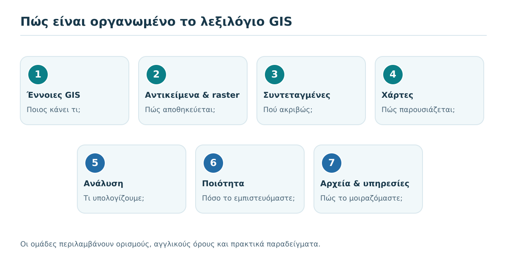
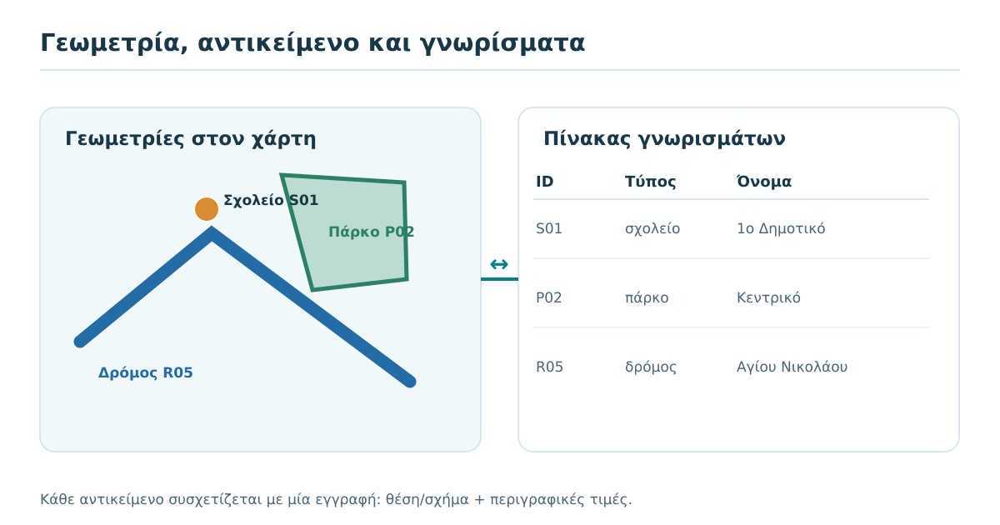
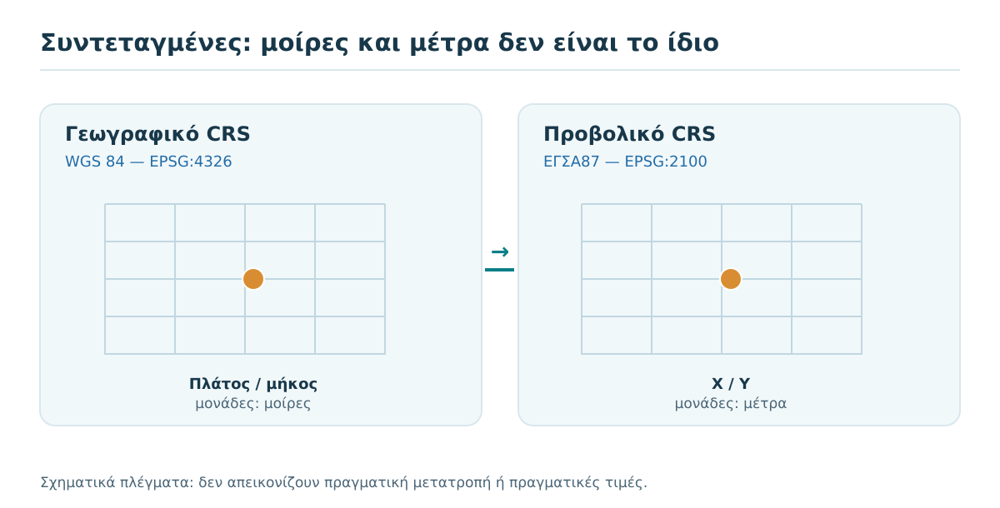
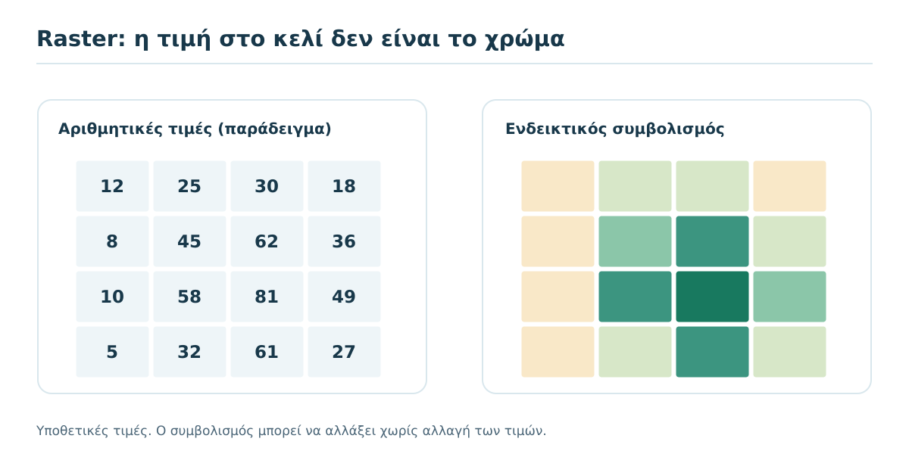
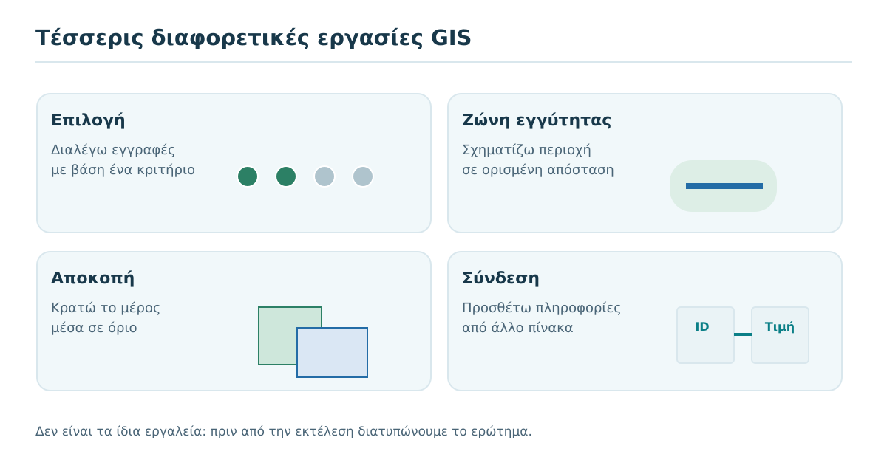
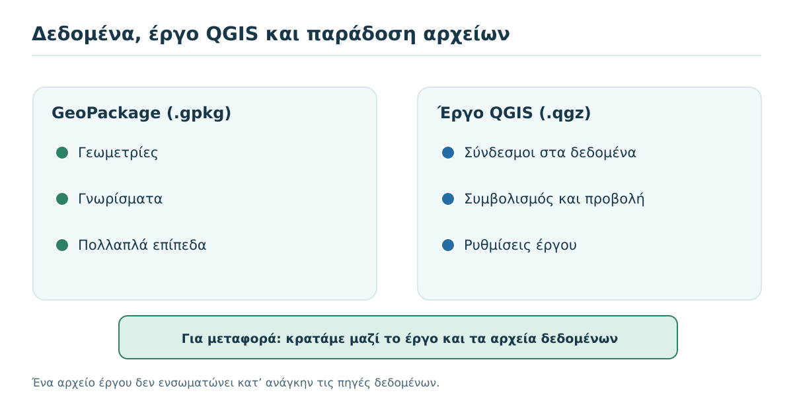

# 6. Το λεξιλόγιο της Γεωπληροφορικής

**Λεξικό αναφοράς: όταν συναντάς έναν όρο, βρίσκεις τι σημαίνει και πώς χρησιμοποιείται.**

**Προτεινόμενος χρόνος πρώτης γνωριμίας:** 35–45 λεπτά με τις δραστηριότητες · **Χρήση αργότερα:** όποτε χρειάζεται · **Προαπαιτούμενα:** [Κεφάλαια 1–5](index.md) · **Λογισμικό:** δεν απαιτείται.

:::{note} Πώς χρησιμοποιείς αυτό το κεφάλαιο
Δεν είναι κατάλογος για αποστήθιση. Ξεκίνα με τις **πέντε κρίσιμες διακρίσεις** στην αρχή, περιηγήσου στις θεματικές ομάδες και χρησιμοποίησε την αναζήτηση της ιστοσελίδας ή τη λειτουργία **Ctrl+F** για έναν συγκεκριμένο όρο. Οι αγγλικοί όροι περιλαμβάνονται για να αναγνωρίζεις ετικέτες στο QGIS και σε τεχνικές πηγές.
:::

## Τι θα μπορείς να κάνεις στο τέλος

- Να εξηγείς με δικά σου λόγια τις θεμελιώδεις έννοιες GIS χωρίς να συγχέεις εργαλεία, δεδομένα και αποτελέσματα.
- Να επιλέγεις τον σωστό όρο όταν περιγράφεις ένα γεωχωρικό πρόβλημα.
- Να διακρίνεις **δεδομένα από έργο**, **τιμή raster από χρώμα**, **γεωγραφικό από προβολικό CRS**.
- Να αναγνωρίζεις συχνές αγγλικές ονομασίες εργαλείων και αρχείων.
- Να εντοπίζεις έναν όρο στο λεξικό και να τον εφαρμόζεις σε ένα παράδειγμα.

## 6.1 Πέντε διακρίσεις που αξίζει να θυμάσαι

| Μην τα συγχέεις | Τι αλλάζει στην πράξη |
|---|---|
| GIS και QGIS | Το πρώτο είναι ευρύτερο σύστημα και μεθοδολογία· το δεύτερο συγκεκριμένο λογισμικό. |
| Γεωμετρία και γνώρισμα | Η γεωμετρία περιγράφει **πού και με τι σχήμα**· το γνώρισμα περιγράφει **τι ιδιότητες έχει**. |
| Τιμή raster και χρώμα | Το κελί αποθηκεύει τιμή· το χρώμα είναι επιλογή προβολής. |
| CRS έργου και CRS αρχικού αρχείου | Η κοινή εμφάνιση επιπέδων στο QGIS δεν σημαίνει ότι άλλαξαν τα αποθηκευμένα δεδομένα. |
| `.gpkg` και `.qgz` | Το πρώτο είναι πηγή δεδομένων· το δεύτερο αποθηκεύει τις ρυθμίσεις του έργου και αναφορές στις πηγές. |

*Εικόνα 1. Οι όροι οργανώνονται ανά θέμα και μπορούν να χρησιμοποιούνται ως γρήγορο σημείο αναφοράς.*

## 6.2 Γρήγορη αναζήτηση ανά θέμα

Για το πρώτο διάβασμα, επικεντρώσου σε δύο έως τέσσερις άγνωστους όρους από κάθε ομάδα. Εάν ήδη γνωρίζεις έναν όρο, μη χάνεις χρόνο στην απομνημόνευσή του· προσπάθησε να τον χρησιμοποιήσεις σε μία πρόταση.

(gq6-group-1)=

### 6.2.1 Θεμελιώδεις έννοιες

| Ελληνικός όρος | Αγγλικός όρος | Τι σημαίνει / ένα παράδειγμα |
|---|---|---|
| **Γεωγραφικό Σύστημα Πληροφοριών** | *GIS* | Οργανωμένο σύστημα ανθρώπων, δεδομένων, μεθόδων και τεχνολογίας για γεωγραφική πληροφορία. **Παράδειγμα:** Ανάλυση εξυπηρέτησης κατοικιών από πάρκα. |
| **QGIS** | *QGIS* | Ελεύθερο λογισμικό ανοικτού κώδικα με εργαλεία GIS. **Παράδειγμα:** Άνοιγμα και οπτικοποίηση ενός GeoPackage. |
| **Γεωχωρική πληροφορία** | *Geospatial information* | Πληροφορία που σχετίζεται με συγκεκριμένη θέση ή περιοχή. **Παράδειγμα:** Κατάλογος σχολείων με συντεταγμένες. |
| **Γεωγραφικό αντικείμενο** | *Feature* | Μονάδα δεδομένων με γεωμετρία και ενδεχομένως γνωρίσματα. **Παράδειγμα:** Ένα σχολείο ως σημείο με όνομα και κωδικό. |
| **Γεωμετρία** | *Geometry* | Περιγραφή θέσης και σχήματος ενός αντικειμένου. **Παράδειγμα:** Όριο πάρκου ως πολύγωνο. |
| **Σύνολο δεδομένων** | *Dataset* | Οργανωμένη συλλογή εγγραφών ή κελιών που περιγράφει φαινόμενο. **Παράδειγμα:** Αρχείο με τις σχολικές μονάδες ενός δήμου. |
| **Επίπεδο** | *Layer* | Τρόπος φόρτωσης και εμφάνισης μιας πηγής δεδομένων μέσα στο GIS. **Παράδειγμα:** Ξεχωριστά επίπεδα για δρόμους και πάρκα. |
| **Γνώρισμα** | *Attribute* | Περιγραφική ιδιότητα ενός αντικειμένου. **Παράδειγμα:** Το όνομα του σχολείου ή ο αριθμός μαθητών. |
| **Πεδίο** | *Field* | Στήλη πίνακα που περιγράφει μία ιδιότητα. **Παράδειγμα:** Το πεδίο `school_type`. |
| **Εγγραφή** | *Record* | Γραμμή πίνακα για ένα αντικείμενο. **Παράδειγμα:** Η γραμμή για το σχολείο S01. |

(gq6-group-2)=

### 6.2.2 Αναπαράσταση και αποθήκευση

| Ελληνικός όρος | Αγγλικός όρος | Τι σημαίνει / ένα παράδειγμα |
|---|---|---|
| **Διανυσματικά δεδομένα** | *Vector data* | Αντικείμενα με γεωμετρίες σημείων, γραμμών και πολυγώνων. **Παράδειγμα:** Δρόμοι ως γραμμές και αγροτεμάχια ως πολύγωνα. |
| **Σημείο** | *Point* | Θέση χωρίς αποτύπωμα επιφάνειας στη συγκεκριμένη αναπαράσταση. **Παράδειγμα:** Θέση γεώτρησης. |
| **Γραμμή** | *Line* | Ακολουθία συνδεδεμένων σημείων για γραμμικά αντικείμενα. **Παράδειγμα:** Άξονας δρόμου. |
| **Πολύγωνο** | *Polygon* | Κλειστή γεωμετρία που αναπαριστά επιφάνεια. **Παράδειγμα:** Όρια αγροτεμαχίου. |
| **Πολυμερής γεωμετρία** | *Multipart geometry* | Ένα αντικείμενο που αποτελείται από περισσότερα χωριστά γεωμετρικά μέρη. **Παράδειγμα:** Νησιωτική διοικητική ενότητα. |
| **Ψηφιδωτά δεδομένα** | *Raster* | Πλέγμα κελιών που αποθηκεύουν αριθμητικές ή κατηγορικές τιμές. **Παράδειγμα:** Δορυφορική εικόνα ή μοντέλο υψομέτρων. |
| **Κελί / εικονοστοιχείο** | *Cell / Pixel* | Η βασική μονάδα ενός ψηφιδωτού επιπέδου. **Παράδειγμα:** Κελί με τιμή υψομέτρου 120 m. |
| **Ζώνη εικόνας** | *Raster band* | Στρώμα τιμών ενός πολυζωνικού raster. **Παράδειγμα:** Κόκκινη ή υπέρυθρη ζώνη Sentinel-2. |
| **Χωρίς έγκυρη τιμή** | *NoData* | Κελί που δηλώνεται ως μη διαθέσιμο ή μη έγκυρο για ανάλυση. **Παράδειγμα:** Κενό έξω από τα όρια κάλυψης raster. |
| **Πίνακας γνωρισμάτων** | *Attribute table* | Προβολή των εγγραφών και πεδίων ενός διανυσματικού επιπέδου. **Παράδειγμα:** Κατάλογος σχολείων με κατηγορία και ονομασία. |
| **Μη χωρικός πίνακας** | *Non-spatial table* | Πίνακας χωρίς ενσωματωμένη γεωμετρία, που μπορεί να συνδεθεί με γεωχωρικά δεδομένα. **Παράδειγμα:** CSV πληθυσμού ανά κωδικό δήμου. |

(gq6-group-3)=

### 6.2.3 Θέση, συντεταγμένες και μέτρηση

| Ελληνικός όρος | Αγγλικός όρος | Τι σημαίνει / ένα παράδειγμα |
|---|---|---|
| **Συντεταγμένες** | *Coordinates* | Αριθμητικές τιμές θέσης που έχουν νόημα μόνο με γνωστό σύστημα αναφοράς. **Παράδειγμα:** Ζεύγος γεωγραφικού πλάτους και μήκους. |
| **Σύστημα αναφοράς συντεταγμένων** | *CRS* | Ορισμός που επιτρέπει τη σωστή ερμηνεία συντεταγμένων στον χώρο. **Παράδειγμα:** Έλεγχος EPSG πριν τη μέτρηση 300 m. |
| **Γεωγραφικό CRS** | *Geographic CRS* | Θέσεις με γωνιακές συντεταγμένες, συνήθως σε μοίρες. **Παράδειγμα:** WGS 84 / EPSG:4326. |
| **Προβολικό CRS** | *Projected CRS* | Επίπεδες συντεταγμένες με καθορισμένες μονάδες, συχνά σε μέτρα. **Παράδειγμα:** ΕΓΣΑ87 / EPSG:2100. |
| **Κωδικός EPSG** | *EPSG code* | Αναγνωριστικό καταχωρισμένου ορισμού CRS, όχι μονάδα μέτρησης. **Παράδειγμα:** EPSG:4326 και EPSG:2100. |
| **WGS 84** | *WGS 84* | Γεωδαιτικό σύστημα αναφοράς· η χρήση του ως EPSG:4326 δίνει γεωγραφικές συντεταγμένες. **Παράδειγμα:** Δεδομένα γεωγραφικού πλάτους/μήκους. |
| **ΕΓΣΑ87** | *Greek Grid / EPSG:2100* | Προβολικό σύστημα αναφοράς που χρησιμοποιείται στην Ελλάδα. **Παράδειγμα:** Επίπεδες συντεταγμένες σε μέτρα. |
| **Χαρτογραφική προβολή** | *Map projection* | Μαθηματική απεικόνιση της καμπύλης Γης σε επίπεδο, με παραμορφώσεις. **Παράδειγμα:** Επιλογή προβολής για χάρτη περιοχής. |
| **Επαναπροβολή** | *Reprojection* | Μετατροπή των συντεταγμένων δεδομένων σε άλλο CRS όταν απαιτείται. **Παράδειγμα:** Εξαγωγή επιπέδου σε EPSG:2100. |
| **Εμφάνιση με μετασχηματισμό κατά την προβολή** | *On-the-fly reprojection* | Το GIS προβάλλει μαζί επίπεδα διαφορετικού CRS, χωρίς να αλλάζει κατ’ ανάγκην τα αρχικά αρχεία. **Παράδειγμα:** Εμφάνιση WGS 84 και ΕΓΣΑ87 στο ίδιο έργο. |
| **Γεωαναφορά** | *Georeferencing* | Συσχέτιση εικόνας ή χάρτη με γνωστές θέσεις στον χώρο. **Παράδειγμα:** Τοποθέτηση σαρωμένου χάρτη με σημεία ελέγχου. |
| **Κλίμακα χάρτη** | *Map scale* | Αναλογία απόστασης στον χάρτη προς απόσταση στο έδαφος, υπό συγκεκριμένες συνθήκες. **Παράδειγμα:** 1:25.000 στον έντυπο χάρτη. |

(gq6-group-4)=

### 6.2.4 Χαρτογραφία και παρουσίαση

| Ελληνικός όρος | Αγγλικός όρος | Τι σημαίνει / ένα παράδειγμα |
|---|---|---|
| **Συμβολισμός** | *Symbology* | Ορισμός χρώματος, μεγέθους, γραμμής και συμβόλου εμφάνισης. **Παράδειγμα:** Πράσινα πάρκα και μπλε ρέματα. |
| **Υπόμνημα** | *Legend* | Επεξήγηση των συμβόλων και χρωμάτων ενός χάρτη. **Παράδειγμα:** Ποιο χρώμα δηλώνει τον τύπο δρόμου. |
| **Θεματικός χάρτης** | *Thematic map* | Χάρτης που οπτικοποιεί μια συγκεκριμένη ιδιότητα ή κατανομή. **Παράδειγμα:** Πυκνότητα πληθυσμού ανά περιοχή. |
| **Ετικέτα** | *Label* | Κείμενο που προβάλλεται για αντικείμενο στον χάρτη. **Παράδειγμα:** Το όνομα ενός οικισμού. |
| **Χωρική έκταση προβολής** | *Map extent* | Η περιοχή που φαίνεται αυτή τη στιγμή στον καμβά. **Παράδειγμα:** Εστίαση σε έναν δήμο. |
| **Χωρική ανάλυση** | *Spatial resolution* | Στα raster, μέγεθος κελιού στο έδαφος· σε άλλα συμφραζόμενα, επίπεδο χωρικής λεπτομέρειας. **Παράδειγμα:** Raster 10 m ανά κελί. |
| **Κατηγοριοποίηση** | *Classification* | Ανάθεση αντικειμένων ή τιμών σε κατηγορίες βάσει κριτηρίων. **Παράδειγμα:** Κλάσεις χρήσεων γης. |
| **Σύνθεση εκτύπωσης** | *Print layout* | Σελίδα όπου συνθέτουμε χάρτη, τίτλο, κλίμακα και υπόμνημα. **Παράδειγμα:** Χάρτης για τεχνική έκθεση. |

(gq6-group-5)=

### 6.2.5 Επιλογή και χωρική ανάλυση

| Ελληνικός όρος | Αγγλικός όρος | Τι σημαίνει / ένα παράδειγμα |
|---|---|---|
| **Ερώτημα / φίλτρο** | *Query / Filter* | Κριτήριο που επιλέγει ή εμφανίζει μέρος των δεδομένων. **Παράδειγμα:** Σχολεία συγκεκριμένης βαθμίδας. |
| **Επιλογή αντικειμένων** | *Feature selection* | Προσωρινός ορισμός συγκεκριμένων αντικειμένων για εργασία. **Παράδειγμα:** Επιλογή τριών σχολείων. |
| **Ζώνη εγγύτητας** | *Buffer* | Περιοχή που ορίζεται σε συγκεκριμένη απόσταση από γεωμετρία. **Παράδειγμα:** Ζώνη 300 m γύρω από άξονες δρόμων. |
| **Τομή** | *Intersection* | Κοινό γεωμετρικό τμήμα που προκύπτει από επικαλυπτόμενες περιοχές. **Παράδειγμα:** Κοινή έκταση δύο πολυγώνων. |
| **Αποκοπή** | *Clip* | Περιορισμός χωρικών δεδομένων μέσα σε καθορισμένο όριο. **Παράδειγμα:** Αποκοπή δρόμων στα όρια δήμου. |
| **Σύνδεση πινάκων** | *Join* | Συσχέτιση εγγραφών από δύο πίνακες βάσει κοινού πεδίου. **Παράδειγμα:** Προσθήκη πληθυσμού σε πολύγωνα δήμων με κωδικό. |
| **Χωρική σύνδεση** | *Spatial join* | Μεταφορά ή συνάθροιση γνωρισμάτων βάσει χωρικής σχέσης. **Παράδειγμα:** Αριθμός σχολείων ανά δήμο. |
| **Τοπολογία** | *Topology* | Σχέσεις και κανόνες χωρικής συνέπειας μεταξύ γεωμετριών. **Παράδειγμα:** Έλεγχος για κενά μεταξύ γειτονικών πολυγώνων. |
| **Χωρική επικάλυψη** | *Overlay* | Συνδυασμός επιπέδων για ανάλυση των μεταξύ τους χωρικών σχέσεων. **Παράδειγμα:** Δρόμοι σε πλημμυρική ζώνη. |
| **Ανάλυση δικτύου** | *Network analysis* | Υπολογισμοί σε συνδεδεμένο δίκτυο μετακίνησης ή υποδομών. **Παράδειγμα:** Πεζή διαδρομή προς πάρκο. |

(gq6-group-6)=

### 6.2.6 Ποιότητα, χρόνος και τεκμηρίωση

| Ελληνικός όρος | Αγγλικός όρος | Τι σημαίνει / ένα παράδειγμα |
|---|---|---|
| **Χωρική ακρίβεια θέσης** | *Positional accuracy* | Βαθμός εγγύτητας μιας καταγεγραμμένης θέσης προς την πραγματική ή αναφοράς. **Παράδειγμα:** Απόκλιση θέσης εισόδου σχολείου. |
| **Επαναληψιμότητα / ακρίβεια επανάληψης** | *Precision / Repeatability* | Πόσο κοντά βρίσκονται μεταξύ τους επαναλαμβανόμενες μετρήσεις· δεν εγγυάται ορθότητα. **Παράδειγμα:** Σταθερό αλλά συστηματικά μετατοπισμένο GNSS. |
| **Πληρότητα** | *Completeness* | Κατά πόσο υπάρχουν όλα τα απαιτούμενα αντικείμενα ή τιμές. **Παράδειγμα:** Λείπουν σχολεία από τον κατάλογο; |
| **Μεταδεδομένα** | *Metadata* | Πληροφορίες για πηγή, ημερομηνίες, μέθοδο, CRS, άδεια και περιορισμούς. **Παράδειγμα:** Τεκμηρίωση ενός GeoPackage. |
| **Χρόνος παρατήρησης** | *Observation date* | Πότε συλλέχθηκε πραγματικά η πληροφορία, όχι πότε κατέβηκε το αρχείο. **Παράδειγμα:** Ημερομηνία καταγραφής σχολείων. |
| **Άδεια χρήσης** | *License* | Νομικοί όροι χρήσης και αναδιανομής των δεδομένων. **Παράδειγμα:** Έλεγχος ODbL πριν δημοσιευθεί ZIP. |
| **Προέλευση** | *Data provenance* | Πώς προέκυψαν τα δεδομένα και τι επεξεργασίες έχουν υποστεί. **Παράδειγμα:** Αποτύπωση GNSS και μεταγενέστερος καθαρισμός. |
| **Αβεβαιότητα** | *Uncertainty* | Τι δεν γνωρίζουμε με βεβαιότητα για δεδομένα ή συμπεράσματα. **Παράδειγμα:** Θέση σχολείου ως εκτίμηση από διεύθυνση. |
| **Επαλήθευση** | *Validation* | Έλεγχος ότι δεδομένα και αποτελέσματα ταιριάζουν στις πραγματικές απαιτήσεις. **Παράδειγμα:** Δειγματοληπτικός έλεγχος σχολείων στο πεδίο. |

(gq6-group-7)=

### 6.2.7 Αρχεία, έργα και υπηρεσίες

| Ελληνικός όρος | Αγγλικός όρος | Τι σημαίνει / ένα παράδειγμα |
|---|---|---|
| **GeoPackage** | *GeoPackage (.gpkg)* | Αρχείο γεωχωρικής βάσης που μπορεί να περιέχει περισσότερα επίπεδα και πίνακες. **Παράδειγμα:** world_countries.gpkg στην άσκηση GQ00. |
| **GeoJSON** | *GeoJSON* | Κειμενικός μορφότυπος για διανυσματικά γεωχωρικά αντικείμενα. **Παράδειγμα:** Σημεία σχολείων σε αρχείο .geojson. |
| **Shapefile** | *Shapefile (.shp)* | Παλαιός μορφότυπος που αποτελείται συνήθως από περισσότερα συνοδευτικά αρχεία. **Παράδειγμα:** Χρειάζεται και .dbf, .shx, κ.ά. |
| **GeoTIFF** | *GeoTIFF (.tif)* | Raster TIFF με γεωαναφορικές πληροφορίες. **Παράδειγμα:** Ψηφιακό μοντέλο εδάφους. |
| **CSV** | *Comma-Separated Values* | Αρχείο πίνακα· αποκτά χωρική χρήση αν συνδεθεί με κατάλληλη γεωμετρία. **Παράδειγμα:** Πίνακας σχολείων με συντεταγμένες. |
| **Έργο QGIS** | *QGIS project (.qgz)* | Αποθηκεύει διαμόρφωση έργου και αναφορές σε πηγές· όχι απαραίτητα αντίγραφα δεδομένων. **Παράδειγμα:** GQ00_my_first_map.qgz. |
| **Υπηρεσία χαρτογραφικής εικόνας** | *WMS* | Διαδικτυακή υπηρεσία που συνήθως επιστρέφει απεικόνιση χάρτη. **Παράδειγμα:** Υπόβαθρο που προβάλλεται σε GIS. |
| **Υπηρεσία γεωχωρικών αντικειμένων** | *WFS* | Διαδικτυακή υπηρεσία πρόσβασης σε διανυσματικά αντικείμενα και γνωρίσματα. **Παράδειγμα:** Λήψη χαρακτηριστικών δικτύου δρόμων όταν διατίθεται. |
| **Σύγχρονο API γεωχωρικών αντικειμένων** | *OGC API – Features* | Τυποποιημένη διαδικτυακή πρόσβαση σε γεωχωρικά αντικείμενα. **Παράδειγμα:** Ερωτήματα σε συλλογή αντικειμένων μέσω API. |

## 6.3 Οπτικές καρτέλες: πέντε σημεία όπου γίνονται συχνά λάθη

(gq6-geometry-attributes)=

### 6.3.1 Γεωμετρία, αντικείμενο και πίνακας γνωρισμάτων

Όταν προσθέτουμε ένα σχολείο ως σημείο, το σημείο είναι η **γεωμετρία**. Ο κωδικός, η ονομασία και ο τύπος του σχολείου είναι **γνωρίσματα**. Το σύνολο συνιστά ένα **γεωγραφικό αντικείμενο**. Στον πίνακα γνωρισμάτων, το σχολείο αντιστοιχεί σε μία εγγραφή. Η ίδια διάκριση ισχύει για γραμμές δρόμων και πολύγωνα πάρκων.

*Εικόνα 2. Υποθετικά αντικείμενα και τιμές. Ο χάρτης και ο πίνακας περιγράφουν τα ίδια γεωχωρικά αντικείμενα από διαφορετική πλευρά.*

(gq6-crs)=

### 6.3.2 Σύστημα αναφοράς, μοίρες και μέτρα

Ένας αριθμός όπως `450000` δεν έχει γεωγραφική σημασία αν δεν γνωρίζουμε το **CRS**. Στο **EPSG:4326** χρησιμοποιούνται γεωγραφικές γωνιακές συντεταγμένες (μοίρες). Το **EPSG:2100 / ΕΓΣΑ87** χρησιμοποιεί επίπεδες συντεταγμένες σε μέτρα. Δεν μπορούμε λοιπόν να δώσουμε αυθαίρετα απόσταση `300` χωρίς να διευκρινίζουμε τι μετράμε, με ποιες μονάδες και με ποια μέθοδο. Η ανάλυση απόστασης σε γεωγραφικό CRS χρειάζεται ιδιαίτερη προσοχή.

*Εικόνα 3. Εκπαιδευτικό σχήμα, όχι πραγματικός μετασχηματισμός. Η διαφορά αφορά το νόημα των συντεταγμένων και τις μονάδες τους.*

**Προσοχή:** η αλλαγή του CRS **του έργου** μπορεί να αλλάξει τον τρόπο εμφάνισης των επιπέδων. Δεν ισοδυναμεί με σωστή επαναπροβολή των αποθηκευμένων δεδομένων. Η αναλυτική διαδικασία θα εξεταστεί στο GQ02.

(gq6-raster)=

### 6.3.3 Raster: τιμή κελιού και χρωματική εμφάνιση

Σε ένα raster κάθε κελί έχει τιμή ή ένδειξη ότι η τιμή απουσιάζει. Για να εμφανιστεί ο χάρτης, το GIS αντιστοιχίζει συχνά τις τιμές σε χρώματα. **Αλλάζοντας την παλέτα δεν αλλάζουν αυτομάτως οι τιμές των κελιών.** Αν η τιμή δηλώνει υψόμετρο, ένα πράσινο κελί δεν σημαίνει αναγκαστικά βλάστηση.

*Εικόνα 4. Υποθετικές αριθμητικές τιμές. Τα χρώματα είναι επιλογή συμβολισμού, όχι νέα μέτρηση.*

(gq6-operations)=

### 6.3.4 Επιλογή, ζώνη εγγύτητας, αποκοπή και σύνδεση

Οι εντολές μπορεί να μοιάζουν στο περιβάλλον του λογισμικού, αλλά λύνουν διαφορετικά προβλήματα: μια **επιλογή** εντοπίζει εγγραφές, μια **ζώνη εγγύτητας** κατασκευάζει περιοχή σε συγκεκριμένη απόσταση, η **αποκοπή** περιορίζει γεωμετρίες μέσα σε ένα όριο, ενώ η **σύνδεση πινάκων** προσθέτει γνωρίσματα με κατάλληλο κοινό πεδίο. Η χωρική σύνδεση χρησιμοποιεί αντί για κοινό πεδίο μια χωρική σχέση.

*Εικόνα 5. Τέσσερις διαφορετικές εργασίες — επιλέγουμε τη διαδικασία ανάλογα με το ερώτημα, όχι επειδή υπάρχει διαθέσιμο κουμπί.*

(gq6-data-vs-project)=

### 6.3.5 Αρχείο γεωχωρικών δεδομένων και αρχείο έργου

Σε ένα GeoPackage (`.gpkg`) μπορεί να βρίσκονται γεωμετρίες και γνωρίσματα από πολλά επίπεδα. Το έργο QGIS (`.qgz`) αποθηκεύει συνήθως τη δομή εργασίας, τον συμβολισμό και τις **διαδρομές** προς τις πηγές. Έτσι, αν στείλουμε μόνο το `.qgz`, ο παραλήπτης ενδέχεται να μην έχει πρόσβαση στα δεδομένα.

*Εικόνα 6. Όταν παραδίδουμε εργασία, διατηρούμε οργανωμένα το έργο, τις πηγές και τα απαραίτητα συνοδευτικά αρχεία.*

## 6.4 Εφάρμοσε τους όρους σε μικρά προβλήματα

**Δραστηριότητα Α — Γεωμετρία ή γνώρισμα; (3 λεπτά).** Έχεις σχολείο S01 με συντεταγμένες, ονομασία, τύπο και αριθμό μαθητών. Ποια στοιχεία περιγράφουν τη γεωμετρία του; Ποια είναι γνωρίσματα; Τι αντιστοιχεί σε μία γραμμή πίνακα;

:::{dropdown} Ενδεικτική απάντηση
Η θέση αναπαρίσταται με τη γεωμετρία σημείου, ενώ η ονομασία, ο τύπος και ο αριθμός μαθητών είναι γνωρίσματα. Μία εγγραφή πίνακα αντιστοιχεί στο S01. Οι συντεταγμένες μπορεί επίσης να υπάρχουν σε ξεχωριστά πεδία, αλλά δεν πρέπει να συγχέονται με τη γεωμετρία που διαχειρίζεται το GIS.
:::

**Δραστηριότητα Β — Μονάδες και CRS (3 λεπτά).** Ένας συμφοιτητής δημιουργεί ζώνη «300» γύρω από δρόμο χωρίς να ελέγξει CRS, μονάδες ή μέθοδο. Πώς θα του εξηγούσες το πρόβλημα;

:::{dropdown} Ενδεικτική απάντηση
Το «300» από μόνο του δεν ορίζει απόσταση. Χρειάζεται να ξέρουμε το CRS, τις μονάδες και τη μέθοδο της λειτουργίας. Δεν πρέπει να θεωρούμε ότι γεωγραφικές μοίρες ισοδυναμούν με μέτρα. Για το παράδειγμα επιλέγουμε κατάλληλη διαδικασία υπολογισμού αποστάσεων.
:::

**Δραστηριότητα Γ — Ποιο εργαλείο; (4 λεπτά).** Θέλεις: (α) μόνο τους δρόμους εντός δήμου, (β) τις κατοικίες μέσα σε 300 m από άξονα δρόμου, (γ) πληθυσμό ανά δήμο από πίνακα κοινών κωδικών. Ποια εργασία ή συνδυασμό εργασιών θα σχεδίαζες;

:::{dropdown} Ενδεικτική απάντηση
(α) Αποκοπή (clip). (β) Δημιουργία ζώνης εγγύτητας και χωρική επιλογή/έλεγχος της σχέσης με τις κατοικίες. (γ) Σύνδεση πινάκων (join) με κοινό κωδικό. Σε πραγματική εργασία απαιτούνται και έλεγχοι δεδομένων, CRS και αποτελέσματος.
:::

**Δραστηριότητα Δ — Τι παραδίδεις; (3 λεπτά).** Έχεις έτοιμο χάρτη GQ00 και θέλεις να τον μεταφέρεις σε άλλον υπολογιστή. Ποια αρχεία και ποιες πληροφορίες χρειάζεται να συμπεριλάβεις;

:::{dropdown} Ενδεικτική απάντηση
Το `.qgz`, τις πραγματικές πηγές δεδομένων όπως `.gpkg` και τυχόν απαραίτητα συνοδευτικά αρχεία. Διατηρούμε συνεπή δομή φακέλων/σχετικές διαδρομές, καταγράφουμε έκδοση δεδομένων, προέλευση και όρους χρήσης και δοκιμάζουμε το έργο στον νέο υπολογιστή.
:::

## 6.5 Αυτοαξιολόγηση

1. Ποια είναι η διαφορά μεταξύ γεωγραφικού αντικειμένου και γνωρίσματος;
2. Τι αναπαριστά ένα διανυσματικό πολύγωνο;
3. Ένα πράσινο raster σημαίνει πάντα ότι η τιμή είναι «βλάστηση»;
4. Γιατί πρέπει να γνωρίζουμε το CRS πριν μετρήσουμε αποστάσεις;
5. Πώς διαφέρει η αλλαγή CRS έργου από την επαναπροβολή αρχείου;
6. Τι είναι το `NoData`;
7. Πότε χρησιμοποιούμε αποκοπή και πότε ζώνη εγγύτητας;
8. Τι μας προσφέρουν τα μεταδεδομένα;
9. Γιατί το `.qgz` μπορεί να μη λειτουργεί όταν στείλουμε μόνο αυτό;
10. Σε τι διαφέρουν γενικά WMS και WFS ως προς όσα μπορούμε να λάβουμε;

:::{dropdown} Ενδεικτικές απαντήσεις
1. Το αντικείμενο έχει χωρική αναπαράσταση και ενδεχομένως γνωρίσματα· το γνώρισμα είναι ιδιότητα του αντικειμένου. 2. Την έκταση ενός αντικειμένου ως κλειστή επιφάνεια. 3. Όχι, το χρώμα είναι τρόπος εμφάνισης. 4. Το CRS ορίζει πώς ερμηνεύονται οι συντεταγμένες και σχετίζεται με τις μονάδες/μέθοδο. 5. Η εμφάνιση στο CRS του έργου δεν τροποποιεί κατ’ ανάγκην το αρχείο. 6. Ένδειξη μη διαθέσιμης/μη έγκυρης τιμής κελιού. 7. Αποκοπή για περιορισμό σε όρια· ζώνη εγγύτητας για περιοχή σε απόσταση. 8. Πηγή, χρόνο, μέθοδο, CRS, ποιότητα, άδεια, περιορισμούς. 9. Οι πηγές συνήθως παραμένουν εξωτερικά αρχεία. 10. Ο WMS δίνει κυρίως χαρτογραφικές εικόνες, ενώ ο WFS αντικείμενα/γνωρίσματα εφόσον η υπηρεσία τα παρέχει.
:::

### Μπορώ να συνεχίσω όταν…

- [ ] Βρίσκω γρήγορα έναν άγνωστο όρο χωρίς να χρειάζεται να τον απομνημονεύσω.
- [ ] Χρησιμοποιώ σωστά τουλάχιστον πέντε βασικούς όρους σε μια περιγραφή εργασίας GIS.
- [ ] Ξεχωρίζω GeoPackage από αρχείο έργου QGIS.
- [ ] Μπορώ να εξηγήσω γιατί το CRS έχει σημασία στην ανάλυση.
- [ ] Επιλέγω τον κατάλληλο όρο για μια απλή χωρική εργασία.

## 6.6 Αρχεία αναφοράς για επόμενα μαθήματα

- {download}`Λήψη λεξιλογίου σε CSV (UTF-8) <../../../downloads/qgis/GQ_START_06_glossary.csv>` — αναζήτηση, ταξινόμηση και επαναχρησιμοποίηση όρων.
- {download}`Λήψη σύντομου δελτίου βασικών διακρίσεων (.md) <../../../downloads/qgis/GQ_START_06_quick_reference.md>` — οι σημαντικότερες διακρίσεις σε μία σελίδα.

Οι θεματικοί τίτλοι και οι επισημασμένες υποενότητες έχουν προετοιμαστεί για μελλοντικές παραπομπές από άλλες εκπαιδευτικές διαδρομές. Μπορούμε έτσι να παραπέμπουμε στο λεξιλόγιο αντί να επαναλαμβάνουμε σε κάθε μάθημα τους ίδιους ορισμούς.

## Τι κρατάμε — και τι ακολουθεί

Η σωστή ορολογία δεν είναι αυτοσκοπός. Είναι εργαλείο για να περιγράφεις χωρίς ασάφεια **τι δεδομένα έχεις, τι επεξεργασία εκτελείς, τι έλεγξες και τι παραδίδεις**. Όταν συναντήσεις άγνωστο όρο στα πρακτικά μαθήματα, επέστρεψε σε αυτό το λεξικό.

**Επόμενο βήμα:** [Κεφάλαιο 7 — Μικρό ολοκληρωμένο σενάριο και αυτοαξιολόγηση](07-senario-quiz.md), πριν περάσουμε στο [GQ00 — Ο πρώτος μου χάρτης στο QGIS](../gq00/index.md).

## Πηγές για περαιτέρω μελέτη

- [QGIS 3.44 — A Gentle Introduction to GIS](https://docs.qgis.org/3.44/en/docs/gentle_gis_introduction/)
- [QGIS 3.44 — Coordinate Reference Systems](https://docs.qgis.org/3.44/en/docs/gentle_gis_introduction/coordinate_reference_systems.html)
- [QGIS 3.44 — Exploring Data Formats and Fields](https://docs.qgis.org/3.44/en/docs/user_manual/managing_data_source/supported_data.html)
- [OGC — Web Map Service](https://www.ogc.org/standards/wms/)
- [OGC — Web Feature Service](https://www.ogc.org/standards/wfs/)

*Τα ονόματα S01, P02 και R05, οι πίνακες και τα διαγράμματα είναι υποθετικά εκπαιδευτικά παραδείγματα.*
