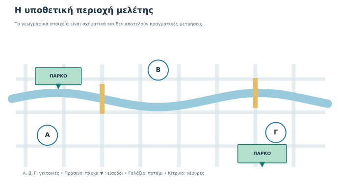
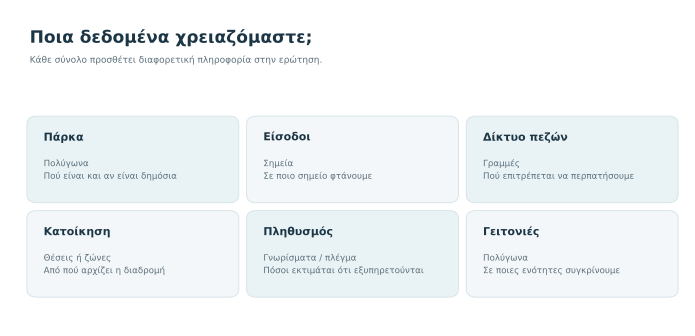
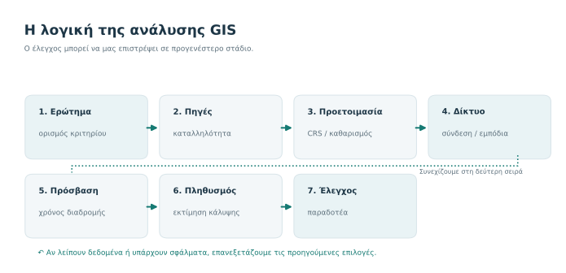
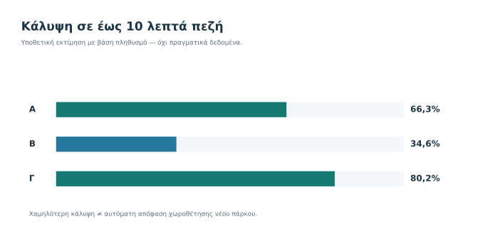
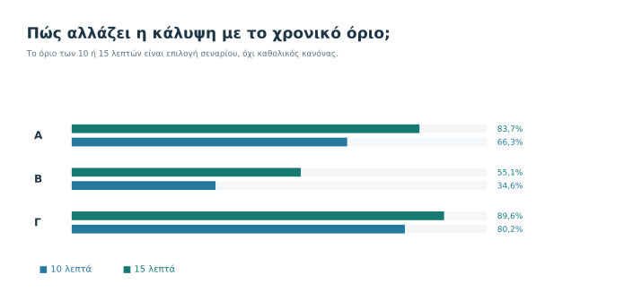
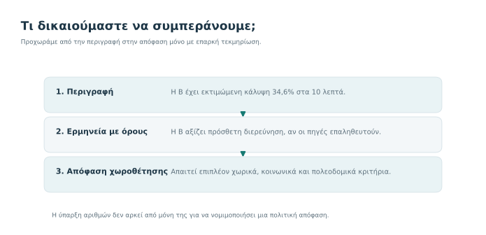

# 7. Σκέψου σαν αναλυτής GIS — τελική αποστολή

**Ένα γεωγραφικό ερώτημα, πολλές αποφάσεις και ένα τεκμηριωμένο αποτέλεσμα.**

**Εκτιμώμενος χρόνος:** 60–75 λεπτά (συμπεριλαμβανομένης της τελικής εργασίας) · **Προαπαιτούμενα:** [Κεφάλαια 1–6](index.md) · **Λογισμικό:** δεν απαιτείται.

:::{note} Η αποστολή σου
Ένας υποθετικός δήμος ζητά τη βοήθειά σου: «Θέλουμε να γνωρίζουμε σε ποιες γειτονιές υπάρχει περιορισμένη δυνατότητα πεζής πρόσβασης σε δημόσιους χώρους πρασίνου». Δεν σου ζητά να αποφασίσεις πού θα κατασκευαστεί νέο πάρκο, ούτε να εκτελέσεις ακόμη ανάλυση στο QGIS. Θέλει **ένα ελέγξιμο σχέδιο εργασίας** και μια προσεκτική ερμηνεία ήδη δοσμένων, υποθετικών αποτελεσμάτων.
:::

## Τι θα μπορείς να κάνεις στο τέλος

- Να μετατρέπεις μια γενική ανάγκη σε **συγκεκριμένο, μετρήσιμο γεωγραφικό ερώτημα**.
- Να επιλέγεις κατάλληλες χωρικές αναπαραστάσεις, δεδομένα και πηγές.
- Να διαχωρίζεις τη **γεωμετρική εγγύτητα** από την **πραγματική δυνατότητα πεζής πρόσβασης**.
- Να προτείνεις λογική ακολουθία ανάλυσης και ελέγχων, χωρίς να ταυτίζεις τον σχεδιασμό με την εκτέλεση στο λογισμικό.
- Να ερμηνεύεις σωστά απλά ποσοστά και να ελέγχεις πώς τα επηρεάζουν οι παραδοχές.
- Να παρουσιάζεις το τι προκύπτει από τα δεδομένα **και όσα ακόμη δεν δικαιούμαστε να συμπεράνουμε**.

## 7.1 Επιστρέφουμε στο ερώτημα του πρώτου κεφαλαίου

Στο [Κεφάλαιο 1](01-ti-einai-gis.md) είδαμε ότι ένας χάρτης με πάρκα δεν αρκεί για να αξιολογήσουμε την εξυπηρέτηση μιας γειτονιάς. Στο [Κεφάλαιο 2](02-efarmoges.md) γνωρίσαμε επαγγελματικές εφαρμογές. Στο [Κεφάλαιο 3](03-dedomena.md) μάθαμε να διακρίνουμε γεωμετρίες, γνωρίσματα και ψηφιδωτά δεδομένα. Στο [Κεφάλαιο 4](04-roi-ergasias.md) οργανώσαμε μια ροή εργασίας. Στο [Κεφάλαιο 5](05-piges-poiotita.md) μάθαμε να ελέγχουμε τις πηγές. Το [Κεφάλαιο 6](06-orologia.md) λειτουργεί πλέον ως κοινό λεξικό.

Τώρα θα τα συνδυάσεις. Το ερώτημα δεν είναι «ποιο εργαλείο να πατήσω;» αλλά **«πώς θα σχεδιάσω μια εργασία που μπορεί να ελεγχθεί και να επαναληφθεί;»**

*Εικόνα 1. Η περιοχή της αποστολής είναι εντελώς υποθετική. Οι συμβολικές θέσεις των πάρκων και των κατοικιών δεν αποδεικνύουν την ευκολία πρόσβασης. Το ποτάμι και οι γέφυρες υπενθυμίζουν την ανάγκη εξέτασης πραγματικών διαδρομών.*

### Πρώτη επιλογή: τι σημαίνει «πρόσβαση»;

Μπορούμε να μετρήσουμε την απόσταση σε ευθεία, την απόσταση πάνω σε δίκτυο πεζών ή τον εκτιμώμενο χρόνο πεζής διαδρομής. Αυτές είναι **διαφορετικές μετρήσεις**. Για την αποστολή επιλέγουμε, ως υποθετικό κριτήριο, **το αν ένας κάτοικος μπορεί να φτάσει σε είσοδο δημόσιου πάρκου μέσα σε 10 λεπτά πεζή**, ακολουθώντας επιτρεπόμενες διαδρομές.

Αυτό δεν σημαίνει ότι όλα τα άτομα περπατούν με την ίδια ταχύτητα ή ότι όλες οι διαδρομές είναι ασφαλείς και προσβάσιμες. Ορίζουμε το κριτήριο ώστε να μπορούμε να υπολογίσουμε κάτι συγκεκριμένο και καταγράφουμε τις αδυναμίες του.

:::{tip} Σκέψου πριν συνεχίσεις
Ένα σπίτι βρίσκεται 250 m σε ευθεία από το περίγραμμα ενός πάρκου. Η κοντινότερη είσοδος βρίσκεται στην άλλη πλευρά του ποταμού και η γέφυρα αρκετά μακρύτερα. Μπορούμε να αποφασίσουμε ότι το σπίτι εξυπηρετείται σε 10 λεπτά; Γιατί;
:::

Δεν μπορούμε να το κρίνουμε μόνο από την ευθεία απόσταση. Χρειαζόμαστε τη διαδρομή που επιτρέπεται να ακολουθήσει ο πεζός, τη θέση της εισόδου και παραδοχές για την ταχύτητα μετακίνησης.

## 7.2 Ποια δεδομένα θα ζητήσουμε;

*Εικόνα 2. Τα δεδομένα δεν έχουν όλα τον ίδιο ρόλο. Τα σημεία εισόδου, το δίκτυο πεζών, η εκτιμώμενη κατανομή πληθυσμού και τα όρια αναφοράς είναι απαραίτητα στο συγκεκριμένο σενάριο. Άλλα δεδομένα βοηθούν στον έλεγχο των περιορισμών.*

| Σύνολο | Ενδεικτική αναπαράσταση | Γιατί το χρειαζόμαστε |
|---|---|---|
| Δημόσια πάρκα | Πολύγωνα | Για να γνωρίζουμε έκταση, όρια και ποια είναι δημόσια προσβάσιμα |
| Είσοδοι πάρκων | Σημεία | Για να ορίζουμε τον πραγματικό προορισμό της διαδρομής |
| Δίκτυο πεζών, γέφυρες και διαβάσεις | Γραμμές με γνωρίσματα | Για να γνωρίζουμε ποιες διαδρομές επιτρέπονται και συνδέονται μεταξύ τους |
| Θέσεις ή ζώνες κατοίκησης | Σημεία ή μικρές χωρικές ενότητες | Για να γνωρίζουμε από πού αρχίζει η μετακίνηση |
| Εκτιμώμενος πληθυσμός | Γνωρίσματα περιοχών ή κατάλληλο πληθυσμιακό πλέγμα | Για να σταθμίζουμε την κάλυψη ως προς τους κατοίκους, με τις αντίστοιχες παραδοχές |
| Όρια γειτονιών | Πολύγωνα | Για να συγκρίνουμε αποτελέσματα στην ίδια χωρική ενότητα |

Το αν τα δεδομένα είναι σημειακά, γραμμικά, πολυγωνικά ή ψηφιδωτά εξαρτάται από το ερώτημα, όπως είδαμε στο τρίτο κεφάλαιο. Για παράδειγμα, ένα πάρκο μπορεί να έχει και πολύγωνο (την έκταση) και ξεχωριστά σημεία (τις εισόδους). **Το πολύγωνο δεν υποκαθιστά τα σημεία εισόδου.**

Δεν θεωρούμε ότι ένα σύνολο είναι κατάλληλο μόνο και μόνο επειδή βρίσκεται στο διαδίκτυο. Για κάθε πηγή συμπληρώνουμε το [δελτίο αξιολόγησης δεδομένων](../../../downloads/qgis/GQ_START_05_fyllo_axiologisis.docx), όπου καταγράφουμε προέλευση, παρατήρηση, ενημέρωση, πληρότητα, ακρίβεια, άδεια και γνωστούς περιορισμούς. Η έκδοση Markdown παραμένει διαθέσιμη στη σελίδα λήψεων.

### Τι θα ήταν ανεπαρκές;

Ένα αρχείο που εμφανίζει «πράσινες περιοχές» από μια δορυφορική ταξινόμηση δεν είναι αυτομάτως κατάλογος **δημόσιων, προσβάσιμων πάρκων**. Μπορεί να περιλαμβάνει ιδιωτικούς κήπους, χωράφια ή περιοχές χωρίς είσοδο. Απαιτούνται κατάλληλοι ορισμοί και επαλήθευση.

## 7.3 Σχεδιάζουμε τη μέθοδο πριν ανοίξουμε το QGIS

*Εικόνα 3. Το σχέδιο είναι επαναληπτικό. Αν διαπιστώσουμε ατελές δίκτυο πεζών, δεν προχωράμε απλώς στην επόμενη εντολή: επιστρέφουμε στην προετοιμασία.*

**Βήμα 1 — Ορισμός.** Επιλέγουμε «έως 10 λεπτά πεζή προς είσοδο δημόσιου πάρκου». Καταγράφουμε την υπόθεση για τη μέση ταχύτητα πεζού και τις συνθήκες μετακίνησης. Το όριο είναι *εκπαιδευτική παραδοχή* και όχι αναγνωρισμένο καθολικό πρότυπο.

**Βήμα 2 — Αναζήτηση και έλεγχος πηγών.** Επιβεβαιώνουμε ότι τα πάρκα είναι δημόσια, οι είσοδοι είναι υπαρκτές και το δίκτυο πεζών περιλαμβάνει γέφυρες, διαβάσεις και απαγορεύσεις. Ελέγχουμε μεταδεδομένα, ημερομηνίες και δικαιώματα χρήσης.

**Βήμα 3 — Κοινή γεωχωρική αναφορά.** Ελέγχουμε τα συστήματα συντεταγμένων (CRS). Όταν χρειάζονται μήκη σε μέτρα, επιλέγουμε κατάλληλη μέθοδο μέτρησης και αναφοράς. Η κοινή εμφάνιση διαφορετικών επιπέδων στο QGIS **δεν σημαίνει ότι έχουν μεταβληθεί τα αρχικά δεδομένα**.

**Βήμα 4 — Προετοιμασία δικτύου.** Ελέγχουμε συνδέσεις γραμμών, ασυνέχειες, απαγορεύσεις διέλευσης, θέσεις εισόδων και περιοχές χωρίς καταγεγραμμένα μονοπάτια.

**Βήμα 5 — Υπολογισμός περιοχών εξυπηρέτησης.** Για κάθε είσοδο υπολογίζουμε ποια σημεία στο δίκτυο μπορούν να προσεγγιστούν σε έως 10 λεπτά, με βάση τις υποθέσεις μας. Σε μια πραγματική ανάλυση αυτό απαιτεί κατάλληλη δικτυακή μέθοδο· **δεν ισοδυναμεί** με κύκλο ακτίνας 10 λεπτών ή με απλό γεωμετρικό buffer.

**Βήμα 6 — Σύνδεση με πληθυσμό.** Εκτιμούμε τον πληθυσμό που εξυπηρετείται και αυτόν που δεν εξυπηρετείται, χρησιμοποιώντας κατάλληλη χωρική πληροφορία. Αν έχουμε μόνο συνολικό πληθυσμό γειτονιάς, δεν μπορούμε να συμπεράνουμε πού ακριβώς κατοικεί κάθε άτομο. Κάθε επιμερισμός του πληθυσμού χρειάζεται παραδοχές.

**Βήμα 7 — Έλεγχος και παρουσίαση.** Ελέγχουμε επιλεγμένες διαδρομές, κενά δικτύου, πιθανές λανθασμένες εισόδους και την επίδραση των επιλογών μας. Τεκμηριώνουμε πηγές, παραδοχές, αβεβαιότητες και όσα δεν εξετάσαμε.

:::{important} Σημαντική διάκριση
Το **σχέδιο εργασίας** που εκπονείς εδώ δεν αποδεικνύει ότι εκτελέστηκε ανάλυση GIS. Θα πραγματοποιήσεις πραγματική υλοποίηση με λογισμικό στα επόμενα πρακτικά μαθήματα. Στο GQ-START αξιολογούμε τις αποφάσεις και τη λογική τους.
:::

## 7.4 Ένα υποθετικό σύνολο αποτελεσμάτων

Ο δήμος μάς δίνει έναν **εκπαιδευτικό πίνακα με ήδη υπολογισμένες εκτιμήσεις**. Δεν προέρχεται από πραγματική χωρική ανάλυση ούτε από καταγραφή κατοίκων. Όλοι οι αριθμοί είναι επινοημένοι ειδικά για το μάθημα.

| Γειτονιά | Εκτιμώμενος συνολικός πληθυσμός | Εκτιμώμενος πληθυσμός σε έως 10 λεπτά | Ποσοστό κάλυψης |
|---|---:|---:|---:|
| Α | 920 | 610 | 66,3% |
| Β | 780 | 270 | 34,6% |
| Γ | 1.060 | 850 | 80,2% |

Το **ποσοστό εκτιμώμενης κάλυψης** μιας γειτονιάς είναι ο εκτιμώμενος πληθυσμός που βρίσκεται εντός του ορισμένου χρόνου διαδρομής, διαιρεμένος με τον συνολικό εκτιμώμενο πληθυσμό της γειτονιάς και πολλαπλασιασμένος επί 100.

Για τη γειτονιά Β: **270 / 780 × 100 ≈ 34,6%**. Επομένως το εκτιμώμενο ποσοστό *εκτός* του κριτηρίου των 10 λεπτών είναι περίπου **65,4%**. Οι αριθμοί έχουν στρογγυλοποιηθεί στο ένα δεκαδικό ψηφίο.

*Εικόνα 4. Το χαμηλότερο εκτιμώμενο ποσοστό εμφανίζεται στη γειτονιά Β. Αυτό υποδεικνύει ανάγκη περαιτέρω εξέτασης, όχι αυτομάτως κατάλληλη θέση νέου πάρκου.*

### Τι μπορούμε να πούμε;

Στο πλαίσιο αυτών των υποθετικών δεδομένων, η γειτονιά Β έχει το μικρότερο ποσοστό εκτιμώμενου πληθυσμού εντός του ορίου των 10 λεπτών. Είναι συνεπώς **εύλογη υποψήφια για πιο λεπτομερή διερεύνηση της πεζής πρόσβασης**.

### Τι δεν μπορούμε να πούμε;

Δεν έχουμε ακόμη αποδείξει ότι πρέπει να κατασκευαστεί νέο πάρκο στη γειτονιά Β. Δεν γνωρίζουμε τη διαθεσιμότητα γης, τις χρήσεις γης, τα πολεοδομικά όρια, τις κοινωνικές προτεραιότητες, την ποιότητα υφιστάμενων πάρκων, ούτε αν το δίκτυο πεζών έχει αποτυπωθεί σωστά. Μπορεί, για παράδειγμα, μια μικρή παρέμβαση σε πεζή διάβαση ή είσοδο να αλλάξει σημαντικά την εξυπηρέτηση.

## 7.5 Αν αλλάξει η υπόθεση, αλλάζει και το αποτέλεσμα;

Ας δοκιμάσουμε δεύτερη εκδοχή. Τι θα συνέβαινε αν ο δήμος χρησιμοποιούσε **15 λεπτά πεζή** αντί για 10, με τα ίδια κατά τα άλλα υποθετικά δεδομένα;

| Γειτονιά | Κάλυψη σε 10 λεπτά | Κάλυψη σε 15 λεπτά |
|---|---:|---:|
| Α | 610 / 920 = 66,3% | 770 / 920 = 83,7% |
| Β | 270 / 780 = 34,6% | 430 / 780 = 55,1% |
| Γ | 850 / 1.060 = 80,2% | 950 / 1.060 = 89,6% |

*Εικόνα 5. Αυξάνοντας το χρονικό όριο, αυξάνεται ή διατηρείται η εκτιμώμενη κάλυψη. Η γειτονιά Β παραμένει χαμηλότερα στο παράδειγμα, αλλά τα ποσοστά αλλάζουν σημαντικά.*

Δεν επιλέγουμε το όριο που μας δίνει «ωραιότερο» αποτέλεσμα. **Πρέπει να εξηγούμε γιατί χρησιμοποιούμε συγκεκριμένο κριτήριο** και να εξετάζουμε, όπου χρειάζεται, εναλλακτικά σενάρια. Εδώ η αλλαγή είναι δοκιμή ευαισθησίας, όχι σύσταση ότι τα 15 λεπτά είναι ο σωστός στόχος για κάθε δήμο.

:::{warning} Το αποτέλεσμα δεν είναι ανεξάρτητο από τις παραδοχές
Αν αλλάξουμε ταχύτητα πεζού, θέσεις εισόδων, ποιότητα δικτύου ή χωρική κατανομή πληθυσμού, μπορεί να αλλάξουν οι εκτιμήσεις. Δεν αποκρύπτουμε αυτές τις εξαρτήσεις από τον αναγνώστη του χάρτη.
:::

## 7.6 Διαχωρίζουμε δεδομένο, ερμηνεία και απόφαση

*Εικόνα 6. Μπορούμε να περιγράψουμε το αποτέλεσμα του πίνακα. Η ερμηνεία του είναι υπό όρους. Μια απόφαση χωροθέτησης απαιτεί πρόσθετα κριτήρια και συμμετοχή των αρμόδιων φορέων.*

**Επίπεδο 1 — Περιγραφή:** «Με τα υποθετικά δεδομένα μας, η γειτονιά Β έχει εκτιμώμενη κάλυψη 34,6% για όριο 10 λεπτών».

**Επίπεδο 2 — Ερμηνεία:** «Η Β θα μπορούσε να εξεταστεί κατά προτεραιότητα για τη βελτίωση της πεζής πρόσβασης, εφόσον τα δεδομένα και οι παραδοχές επαληθευτούν».

**Επίπεδο 3 — Απόφαση:** «Πρέπει να αγοραστεί συγκεκριμένο οικόπεδο και να κατασκευαστεί πάρκο». Αυτό **δεν τεκμηριώνεται** από τον πίνακα και απαιτεί διαφορετική, πολυκριτηριακή διερεύνηση.

## 7.7 Η τελική σου εργασία

Κατέβασε και συμπλήρωσε το **φύλλο εργασίας**. Προτείνεται το επεξεργάσιμο αρχείο Word· το Markdown παραμένει διαθέσιμο ως εναλλακτική μορφή. Δεν χρειάζεται να ξέρεις ακόμη QGIS, αλλά πρέπει να αιτιολογήσεις με σαφήνεια τις επιλογές σου.

- {download}`Φύλλο εργασίας τελικής αποστολής (.docx) <../../../downloads/qgis/GQ_START_07_fyllo_ergasias.docx>` — προτεινόμενη μορφή για συμπλήρωση.
- {download}`Φύλλο εργασίας τελικής αποστολής (.md) <../../../downloads/qgis/GQ_START_07_fyllo_ergasias.md>` — εναλλακτική μορφή Markdown.
- {download}`Υποθετικός πίνακας δεδομένων (.csv) <../../../downloads/qgis/GQ_START_07_senario_dedomena.csv>`

### Τι θα παραδώσεις;

Ένα σύντομο κείμενο (περίπου 1–2 σελίδες) που θα περιλαμβάνει:

1. Ένα σαφές γεωγραφικό ερώτημα και τον ορισμό της «πρόσβασης».
2. Τα απαραίτητα δεδομένα, τον τύπο κάθε συνόλου και δύο ελέγχους καταλληλότητας πηγής.
3. Μια σωστή σειρά ενεργειών από την προετοιμασία έως την τεκμηρίωση.
4. Μια σύγκριση γειτονιών Α, Β, Γ για τα 10 λεπτά με σωστά ποσοστά.
5. Μια σύντομη εξήγηση του τι αλλάζει στα 15 λεπτά.
6. Ένα **επιτρεπτό** συμπέρασμα και ένα **μη επιτρεπτό** συμπέρασμα με αιτιολόγηση.
7. Δύο πρόσθετους ελέγχους που θα ζητούσες πριν από οποιαδήποτε πραγματική δημοτική απόφαση.

:::{dropdown} Ενδεικτική προσέγγιση — άνοιξε μετά την προσπάθειά σου
Ένα αποδεκτό ερώτημα είναι: «Ποιο εκτιμώμενο ποσοστό κατοίκων κάθε γειτονιάς μπορεί να φτάσει σε είσοδο δημόσιου πάρκου μέσω δικτύου πεζών σε έως 10 λεπτά;». Τα απαραίτητα δεδομένα περιλαμβάνουν εισόδους, επιτρεπόμενο δίκτυο πεζών, χωρική κατανομή πληθυσμού και όρια γειτονιών· τα πολύγωνα πάρκων χρειάζονται για να επαληθεύσουμε δημόσιο χαρακτήρα και γεωμετρική έκταση. Η Β έχει το χαμηλότερο ποσοστό: 270/780 ≈ 34,6%. Στα 15 λεπτά ανεβαίνει σε 430/780 ≈ 55,1%. Επιτρέπεται να προτείνουμε έλεγχο και διερεύνηση για τη Β, όχι να διατάξουμε συγκεκριμένη χωροθέτηση. Έλεγχοι: πληρότητα πεζού δικτύου, επικαιρότητα εισόδων, συνθήκες ασφάλειας και κατανομή κατοίκων. Διαφορετικές σωστά αιτιολογημένες επιλογές γίνονται δεκτές.
:::

## 7.8 Αυτοαξιολόγηση — δώδεκα ερωτήσεις

Απάντησε πρώτα χωρίς βοήθεια. Για τις αριθμητικές ερωτήσεις, χρησιμοποίησε τους υποθετικούς πίνακες του κεφαλαίου.

1. Τι ακριβώς μετρά το κριτήριο «10 λεπτά πεζή»;
2. Γιατί δεν αρκεί να έχουμε μόνο πολύγωνα πάρκων;
3. Ποια χωρική αναπαράσταση προτιμάς για τις εισόδους πάρκων; Γιατί;
4. Ποια πληροφορία πρέπει να έχει το δίκτυο πεζών εκτός από τη γεωμετρία του;
5. Ποιος είναι ο ρόλος του CRS στη μέτρηση αποστάσεων;
6. Γιατί δεν μπορείς να υποθέσεις ότι όλοι οι κάτοικοι μιας γειτονιάς βρίσκονται στο γεωμετρικό της κέντρο;
7. Ποιο είναι το ποσοστό κάλυψης της Β στα 10 λεπτά;
8. Πόσοι κάτοικοι της Β εκτιμάται ότι βρίσκονται εκτός του κριτηρίου των 10 λεπτών;
9. Τι αλλάζει για τη Β όταν το κριτήριο γίνει 15 λεπτά;
10. Γιατί μια πράσινη περιοχή σε δορυφορικό χάρτη δεν είναι υποχρεωτικά δημόσιο πάρκο;
11. Γράψε ένα συμπέρασμα που **δεν** επιτρέπουν οι αριθμοί.
12. Ποια τέσσερα στοιχεία θα έγραφες στην τεκμηρίωση για να μπορεί άλλος να αξιολογήσει την εργασία σου;

:::{dropdown} Ενδεικτικές απαντήσεις αυτοαξιολόγησης
1. Εκτιμώμενο χρόνο πορείας μέσω διαθέσιμου δικτύου προς δημόσια είσοδο, με παραδοχές για μετακίνηση. 2. Χρειάζονται είσοδοι, διαδρομές και σημεία προέλευσης. 3. Σημεία, επειδή αναζητούμε συγκεκριμένες θέσεις εισόδου. 4. Συνδεσιμότητα και πληροφορίες για επιτρεπόμενη/ασφαλή μετακίνηση, περιορισμούς, ενδεχομένως μήκος και χρόνο. 5. Οι συντεταγμένες και οι μονάδες πρέπει να ερμηνεύονται σωστά για να μην παράγονται λανθασμένα μήκη. 6. Έτσι χάνουμε την εσωτερική κατανομή πληθυσμού. 7. 270/780×100 ≈ 34,6%. 8. 780−270=510 άτομα κατά εκτίμηση. 9. Από 270 σε 430 καλυπτόμενους και από 34,6% σε περίπου 55,1%. 10. Μπορεί να είναι ιδιωτική ή μη προσβάσιμη περιοχή. 11. Π.χ. «Έχει αποδειχθεί ότι η Β χρειάζεται πάρκο σε συγκεκριμένο οικόπεδο». 12. Ενδεικτικά: πηγές/έκδοση, χρόνος δεδομένων, μέθοδος/παραδοχές, έλεγχοι/αβεβαιότητες, άδειες.
:::

### Μπορώ να συνεχίσω στο QGIS όταν…

- [ ] Διατυπώνω σαφές γεωγραφικό ερώτημα πριν διαλέξω εργαλείο.
- [ ] Επιλέγω κατάλληλες γεωμετρίες και αναγνωρίζω κρίσιμα γνωρίσματα.
- [ ] Ελέγχω την καταλληλότητα της πηγής και δεν θεωρώ όλα τα ανοιχτά δεδομένα ισοδύναμα.
- [ ] Περιγράφω μια λογική ροή GIS με έλεγχο και τεκμηρίωση.
- [ ] Ερμηνεύω σωστά τον πίνακα χωρίς υπερβολικές αξιώσεις.
- [ ] Μπορώ να εξηγήσω μια αλλαγή αποτελέσματος όταν αλλάζει το κριτήριο.

## 7.9 Ολοκλήρωσες το GQ-START — τι ακολουθεί;

Πριν ανοίξεις ένα εργαλείο, έχεις ήδη μάθει να σκέφτεσαι σαν αναλυτής: να θέτεις ερωτήματα, να αναζητάς κατάλληλα δεδομένα, να επιλέγεις αναπαραστάσεις και να απαιτείς ελέγχους.

Το επόμενο βήμα είναι το πρακτικό [**GQ00 — Ο πρώτος μου χάρτης στο QGIS**](../gq00/index.md). Εκεί θα ανοίξεις πραγματικό GeoPackage, θα εξετάσεις γνωρίσματα, θα αλλάξεις συμβολισμό και θα δημιουργήσεις το πρώτο σου αρχείο έργου.

Αν χρειαστείς όρους κατά τη διάρκεια της άσκησης, μπορείς να επιστρέφεις στο [**Κεφάλαιο 6 — Λεξιλόγιο Γεωπληροφορικής**](06-orologia.md). Έτσι η εισαγωγή παραμένει χρήσιμη και μετά την ολοκλήρωσή της.

## Πηγές για περαιτέρω μελέτη

- [QGIS — A Gentle Introduction to GIS](https://docs.qgis.org/3.44/en/docs/gentle_gis_introduction/)
- [QGIS — Network analysis library](https://docs.qgis.org/3.44/en/docs/pyqgis_developer_cookbook/network_analysis.html) — προχωρημένη τεχνική αναφορά για ανάλυση δικτύων, όχι προαπαιτούμενο της αποστολής.
- [OpenStreetMap — Copyright and License](https://www.openstreetmap.org/copyright) — παράδειγμα ανοιχτών δεδομένων με συγκεκριμένους όρους χρήσης.

*Όλες οι γειτονιές, τα διαγράμματα, οι αριθμοί πληθυσμού και τα αποτελέσματα είναι απολύτως υποθετικά. Δεν περιγράφουν πραγματικό δήμο και δεν υποστηρίζουν πραγματική χωροθετική ή πολιτική απόφαση.*
